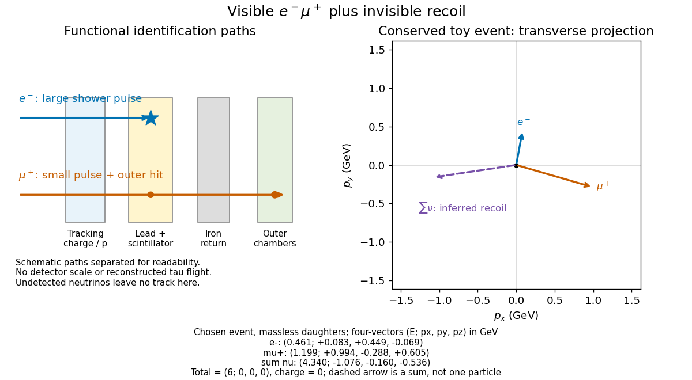

# SPEAR Mark I tau discovery experiment

↑ **Parent:** [Tau (particle)](tau-particle.md)

Counterrotating [electron](electron.md) and [Positron](positron.md) beams at SPEAR collided inside the Mark I magnetic [particle detector](particle-detector.md). Lead–scintillator [scintillation counters](scintillation-counter.md) identified [electrons](electron.md) through large shower pulses; small pulses plus hits beyond the iron return identified [muons](muon.md).[SLAC-PUB-1626, pp. 2–3](evidence-for-anomalous-lepton-production-in-e-plus-e-annihilation-by-martin-lewis-perl-and-others.md)

The selection required opposite-charge [electron](electron.md)–[muon](muon.md) tracks, no detected [photons](photon.md), [momenta](momentum-split.md) above $0.65\,\mathrm{GeV}/c$, and transverse noncoplanarity above $20^\circ$. Multitrack [hadron](hadron.md) samples calibrated momentum-dependent misidentification; collinear [lepton](lepton.md) pairs checked identification losses. Photon and charge control samples tested backgrounds. Acceptance corrections depended on the proposed signal.[SLAC-PUB-1626, pp. 3–5, Table I](evidence-for-anomalous-lepton-production-in-e-plus-e-annihilation-by-martin-lewis-perl-and-others.md)

The 1975 claim was anomalous events without a conventional explanation; new-particle pair production was a possible interpretation.[Abstract; SLAC-PUB-1626, pp. 5–6](evidence-for-anomalous-lepton-production-in-e-plus-e-annihilation-by-martin-lewis-perl-and-others.md) [Martin Lewis Perl](martin-lewis-perl.md)'s lecture describes subsequent evidence for a [charged lepton](charged-lepton.md).[pp. 184–187](reflections-on-the-discovery-of-the-tau-lepton-by-martin-lewis-perl.md)

**[Figure 9](#image-an-electron-muon-signature-and-its-invisible-recoil). An electron–muon signature and its invisible recoil**. Functional identification paths beside an original, conserved event in a massless-daughter teaching model. Solid arrows show visible transverse momenta; the dashed arrow is the sum of four neutrino momenta in this chosen interpretation. It is neither a measured track nor a historical event.

The [particle identification](particle-identification.md) problem matters as much as the apparent [missing four-momentum in electron-positron collisions](missing-four-momentum-in-electron-positron-collisions.md). A penetrating [hadron](hadron.md) can imitate a [muon](muon.md); a [particle shower](particle-shower.md) can imitate an [electron](electron.md); an undetected [photon](photon.md) or a detector gap can imitate invisible recoil. An absence of additional recorded signals is conditional on [detection efficiency](detection-efficiency.md). In a proposed signal model, the selected count has the schematic form

$$
N_{\rm selected}=\mathcal L\,\sigma\,\varepsilon+N_{\rm background},
$$

where $\mathcal L$ is integrated [collider luminosity](collider-luminosity.md), $\sigma$ a [cross section](cross-section-physics.md), and $\varepsilon$ the combined acceptance and [detection efficiency](detection-efficiency.md). A single count cannot determine all three factors. A control sample must probe the relevant [momentum](momentum-split.md) and angular range; its abundant events do not automatically calibrate a differently distributed signal.

**Table of contents**

- [Collider luminosity](collider-luminosity.md)
  - [Integrated collider luminosity](integrated-collider-luminosity.md)
- [Tau-pair electron-muon missing-energy signature](tau-pair-electron-muon-missing-energy-signature.md)
  - [Three-body leptonic tau-decay kinematic bounds](three-body-leptonic-tau-decay-kinematic-bounds.md)
    - [Tau-pair missing-mass teaching model](tau-pair-missing-mass-teaching-model.md)
- [Missing four-momentum in electron-positron collisions](missing-four-momentum-in-electron-positron-collisions.md)
  - [Missing invariant mass](missing-invariant-mass.md)

## ↑ Ancestors (8)

1. [Tau (particle)](tau-particle.md)
2. [Lepton](lepton.md)
3. [Standard Model fermion](standard-model-fermion.md)
4. [Standard Model](standard-model-split.md)
5. [Quantum field theory](quantum-field-theory-split.md)
6. [Branches of physics](branches-of-physics.md)
7. [Physics](physics-split.md)
8. [Codex Wiki](split.md)
