# Special relativity

↑ **Parent:** [Branches of physics](physics.md#branches-of-physics)  
ⓦ [Wiki](https://en.wikipedia.org/wiki/Special_relativity)

[Special relativity](special-relativity.md) describes [physics](physics.md) in [Minkowski spacetime](#minkowski-spacetime), where [inertial frames](mathematical-physics.md#inertial-frame) assign different space and time coordinates to the same [spacetime events](#event-relativity). Its two postulates are [Einstein's principle of relativity](#einstein-s-principle-of-relativity) and the same vacuum [speed of light](#speed-of-light) $c$ in every [inertial frame](mathematical-physics.md#inertial-frame), independent of the source's motion. Together they replace the [Galilean transformation](#galilean-transformation) with the [Lorentz transformation](#lorentz-transformation), coupling space and time rather than providing a universal clock. Einstein's 1905 paper developed this account through measuring rods, clocks, and light signals. [Einstein (1905), On the Electrodynamics of Moving Bodies, introduction and sections 1–3; English translation](https://fourmilab.ch/etexts/einstein/specrel/www/).

A [spacetime event](#event-relativity) is an occurrence at a definite place and time: a pulse reaching a detector, for example. An [inertial frame](mathematical-physics.md#inertial-frame) supplies a [Cartesian coordinate system](linear-algebra.md#cartesian-coordinate-system) and clocks at rest throughout it. [Einstein synchronisation](#einstein-synchronisation) sets a distant clock's reflection reading to the midpoint between a light signal's departure and return readings at the sending clock. The resulting coordinate time records the local synchronized clock at each [spacetime event](#event-relativity); it differs from the time when a distant observer receives its image. This distinction makes [time dilation](#time-dilation), [length contraction](#length-contraction), and the [relativity of simultaneity](#relativity-of-simultaneity) precise measurements. [Einstein (1905), section 1: definition of simultaneity](https://fourmilab.ch/etexts/einstein/specrel/www/).

The beauty of [special relativity](special-relativity.md) is that these different measurements fit one geometry: all [inertial frames](mathematical-physics.md#inertial-frame) agree on the [Minkowski interval](#minkowski-interval). It lets us translate an experiment between a laboratory and a moving apparatus while preserving the light-signal relations between [spacetime events](#event-relativity).

**Table of contents**

- [Four-gradient](#four-gradient)
- [Relativistic beaming](#relativistic-beaming)
  - [Doppler boosting of a moving blob](#doppler-boosting-of-a-moving-blob)
  - [Lorentz-invariant specific intensity](#lorentz-invariant-specific-intensity)
  - [Jet brightness asymmetry](#jet-brightness-asymmetry)
  - [Doppler factor](#doppler-factor)
- [Mass-energy equivalence](#mass-energy-equivalence)
- [Postulates of special relativity](#postulates-of-special-relativity)
- [Tests of special relativity](#tests-of-special-relativity)
  - [Bertozzi's electron speed-energy experiment](#bertozzi-s-electron-speed-energy-experiment)
  - [Michelson-Morley experiment](#michelson-morley-experiment)
- [Thomas precession](#thomas-precession)
- [Relativistic force transformation](#relativistic-force-transformation)
- [Einstein's principle of relativity](#einstein-s-principle-of-relativity)
  - [Einstein synchronisation](#einstein-synchronisation)
- [Relativistic particle](#relativistic-particle)
- [Nonrelativistic particle](#nonrelativistic-particle)
- [Hyperbolic motion](#hyperbolic-motion)
  - [Hyperbolic motion from an initial event and rapidity](#hyperbolic-motion-from-an-initial-event-and-rapidity)
  - [Finite-acceleration correction to a relativistic cruise](#finite-acceleration-correction-to-a-relativistic-cruise)
- [Proper length](#proper-length)
- [Spacetime](#spacetime)
  - [Event (relativity)](#event-relativity)
  - [Spacetime extension](#spacetime-extension)
    - [Maximal analytic extension](#maximal-analytic-extension)
    - [Extendible spacetime](#extendible-spacetime)
  - [Proper time](#proper-time)
    - [Proper lifetime inferred from a delayed decay flash](#proper-lifetime-inferred-from-a-delayed-decay-flash)
- [Null vector](#null-vector)
  - [Sum of future-pointing null vectors](#sum-of-future-pointing-null-vectors)
  - [Null condition](#null-condition)
- [Lorentz factor](#lorentz-factor)
  - [Length contraction](#length-contraction)
    - [Small-speed length contraction estimate](#small-speed-length-contraction-estimate)
  - [Time dilation](#time-dilation)
    - [Muon storage-ring time-dilation experiment](#muon-storage-ring-time-dilation-experiment)
    - [Cosmic-ray muon time-dilation experiment](#cosmic-ray-muon-time-dilation-experiment)
      - [Mean-lifetime survival energy estimate](#mean-lifetime-survival-energy-estimate)
    - [Light clock](#light-clock)
    - [Twin paradox](#twin-paradox)
      - [Twin paradox with fixed reunion events](#twin-paradox-with-fixed-reunion-events)
      - [Twin paradox simultaneity change](#twin-paradox-simultaneity-change)
      - [Twin paradox with finite acceleration](#twin-paradox-with-finite-acceleration)
        - [Clock hypothesis](#clock-hypothesis)
      - [Twin paradox clock experiments](#twin-paradox-clock-experiments)
        - [Atomic clock](#atomic-clock)
          - [Cesium-beam clock procedure](#cesium-beam-clock-procedure)
          - [Atomic clock frequency lock](#atomic-clock-frequency-lock)
          - [Atomic clock frequency shifts](#atomic-clock-frequency-shifts)
- [Ultrarelativistic particle](#ultrarelativistic-particle)
- [Galilean transformation](#galilean-transformation)
  - [Principle of Galilean relativity](#principle-of-galilean-relativity)
- [Lorentz transformation](#lorentz-transformation)
  - [Transverse relativistic interception](#transverse-relativistic-interception)
  - [Universality of an invariant speed under boost composition](#universality-of-an-invariant-speed-under-boost-composition)
  - [Local Lorentz transformation](#local-lorentz-transformation)
  - [Relativity of simultaneity](#relativity-of-simultaneity)
    - [Rod containment and simultaneity](#rod-containment-and-simultaneity)
    - [Photon separation under a collinear Lorentz boost](#photon-separation-under-a-collinear-lorentz-boost)
  - [Lorentz covariance](#lorentz-covariance)
    - [Lorentz invariance](#lorentz-invariance)
  - [Lorentz boost](#lorentz-boost)
    - [Wigner rotation](#wigner-rotation)
      - [Noncollinear boost obstruction from Pauli products](#noncollinear-boost-obstruction-from-pauli-products)
    - [Rapidity](#rapidity)
      - [Iterated collinear boosts with equal rapidity](#iterated-collinear-boosts-with-equal-rapidity)
  - [Active Lorentz transformation of a vector field](#active-lorentz-transformation-of-a-vector-field)
  - [Lorentz scalar](#lorentz-scalar)
  - [Lorentz tensor](#lorentz-tensor)
  - [Lorentz group](#lorentz-group)
    - [Component quotient of the real Lorentz group in two dimensions](#component-quotient-of-the-real-lorentz-group-in-two-dimensions)
    - [Time-orientation-preserving Lorentz group in one spatial dimension](#time-orientation-preserving-lorentz-group-in-one-spatial-dimension)
    - [Lie algebra of the Lorentz group](#lie-algebra-of-the-lorentz-group)
    - [Orthochronous Lorentz group](#orthochronous-lorentz-group)
    - [Proper orthochronous Lorentz group](#proper-orthochronous-lorentz-group)
      - [Every proper orthochronous Lorentz transformation is an exponential](#every-proper-orthochronous-lorentz-transformation-is-an-exponential)
      - [Lorentz spinor double cover](#lorentz-spinor-double-cover)
        - [Hermitian matrix representation of Minkowski four-vectors](#hermitian-matrix-representation-of-minkowski-four-vectors)
          - [Future-null spinor factorization](#future-null-spinor-factorization)
            - [Spinor azimuth convention](#spinor-azimuth-convention)
          - [Trace form on scalar-plus-skew-Hermitian two-by-two matrices](#trace-form-on-scalar-plus-skew-hermitian-two-by-two-matrices)
    - [Poincaré group](#poincare-group)
      - [Poincaré symmetry](#poincare-symmetry)
      - [Poincare algebra](#poincare-algebra)
        - [Pauli-Lubanski pseudovector](#pauli-lubanski-pseudovector)
          - [Pauli-Lubanski orthogonality](#pauli-lubanski-orthogonality)
          - [Massive Pauli-Lubanski Casimir](#massive-pauli-lubanski-casimir)
          - [Massless longitudinal Pauli-Lubanski eigenvalues](#massless-longitudinal-pauli-lubanski-eigenvalues)
          - [Massive rest-frame Pauli-Lubanski eigenvalues](#massive-rest-frame-pauli-lubanski-eigenvalues)
      - [Little group](#little-group)
        - [Particle polarization](#particle-polarization)
          - [Longitudinal polarization vector](#longitudinal-polarization-vector)
        - [Massless particle little group](#massless-particle-little-group)
          - [Massless induced representation of the Poincare double cover](#massless-induced-representation-of-the-poincare-double-cover)
          - [Finite-dimensional unitary representations of the massless little group have trivial translations](#finite-dimensional-unitary-representations-of-the-massless-little-group-have-trivial-translations)
          - [Massless little-group generators](#massless-little-group-generators)
          - [Massless vector particle](#massless-vector-particle)
        - [Massive particle little group](#massive-particle-little-group)
          - [Massive vector particle](#massive-vector-particle)
        - [Little group with mixed string boundary conditions](#little-group-with-mixed-string-boundary-conditions)
        - [Vector-particle polarization](#vector-particle-polarization)
        - [Helicity](#helicity)
          - [Helicity decomposition of a transverse Fourier mode](#helicity-decomposition-of-a-transverse-fourier-mode)
        - [Continuous-spin representation](#continuous-spin-representation)
        - [Wigner's classification](#wigner-s-classification)
          - [Massive induced representation of the Poincare double cover](#massive-induced-representation-of-the-poincare-double-cover)
    - [One-dimensional Lorentz group](#one-dimensional-lorentz-group)
      - [Null coordinates in two-dimensional Minkowski spacetime](#null-coordinates-in-two-dimensional-minkowski-spacetime)
        - [Retarded and advanced null coordinates](#retarded-and-advanced-null-coordinates)
          - [Minkowski wave operator in null coordinates](#minkowski-wave-operator-in-null-coordinates)
  - [Nonrelativistic limit](#nonrelativistic-limit)
  - [Velocity-addition formula](#velocity-addition-formula)
    - [Relative speed from four-velocity contraction](#relative-speed-from-four-velocity-contraction)
      - [Orthogonal local velocities in Schwarzschild spacetime](#orthogonal-local-velocities-in-schwarzschild-spacetime)
    - [Retarded radio reply to an approaching inertial observer](#retarded-radio-reply-to-an-approaching-inertial-observer)
    - [Fizeau experiment](#fizeau-experiment)
      - [Fresnel drag coefficient](#fresnel-drag-coefficient)
      - [Fizeau experiment path-length convention](#fizeau-experiment-path-length-convention)
      - [Fizeau experiment worked example](#fizeau-experiment-worked-example)
- [Sagnac effect](#sagnac-effect)
  - [Sagnac interferometer](#sagnac-interferometer)
    - [Sagnac rotating-ring experiment](#sagnac-rotating-ring-experiment)
  - [Sagnac area law](#sagnac-area-law)
    - [Sagnac fringe shift worked example](#sagnac-fringe-shift-worked-example)
  - [Relativistic Sagnac delay on a circular ring](#relativistic-sagnac-delay-on-a-circular-ring)
- [Four-vector](#four-vector)
  - [Four-wavevector](#four-wavevector)
    - [Lorentz invariance of plane-wave phase](#lorentz-invariance-of-plane-wave-phase)
  - [Position four-vector](#position-four-vector)
  - [Future-pointing timelike four-vector](#future-pointing-timelike-four-vector)
  - [Four-divergence](#four-divergence)
- [Causality](#causality)
- [Minkowski spacetime](#minkowski-spacetime)
  - [Time-dependent lapse can disguise flat spacetime](#time-dependent-lapse-can-disguise-flat-spacetime)
  - [Complexified Minkowski spacetime](#complexified-minkowski-spacetime)
  - [Rindler wedge](#rindler-wedge)
  - [Rindler coordinates](#rindler-coordinates)
    - [Rindler null geodesics](#rindler-null-geodesics)
  - [Minkowski metric](#minkowski-metric)
    - [Minkowski interval](#minkowski-interval)
      - [Timelike separation](#timelike-separation)
      - [Null separation](#null-separation)
    - [Light-cone coordinates](#light-cone-coordinates)
    - [Minkowski norm](#minkowski-norm)
    - [Light cone](#light-cone)
      - [Past light cone](#past-light-cone)
      - [Future light cone](#future-light-cone)
      - [Speed of light](#speed-of-light)
        - [One-way speed of light](#one-way-speed-of-light)
        - [Light-second](#light-second)
      - [Null directions](#null-directions)
    - [Null curve](#null-curve)
      - [Null geodesic](#null-geodesic)
        - [Radial null geodesic](#radial-null-geodesic)
- [World line](#world-line)
  - [Null worldline](#null-worldline)
  - [Timelike curve](#timelike-curve)
- [Subluminal speed](#subluminal-speed)
- [Impossibility of photon decay into two massive particles](#impossibility-of-photon-decay-into-two-massive-particles)
- [Four-momentum](#four-momentum)
  - [Impossibility of isolated massive-particle decay into one photon](#impossibility-of-isolated-massive-particle-decay-into-one-photon)
  - [Three-momentum](#three-momentum)
  - [Physical momentum](#physical-momentum)
  - [Center-of-mass energy](#center-of-mass-energy)
  - [Mass shell](#mass-shell)
  - [Four-momentum conservation](#four-momentum-conservation)
    - [Collinear inelastic capture followed by two photons](#collinear-inelastic-capture-followed-by-two-photons)
    - [Soft-photon resonant capture threshold](#soft-photon-resonant-capture-threshold)
      - [Maximum deflection in soft-photon capture](#maximum-deflection-in-soft-photon-capture)
    - [Right-angle Compton scattering in the centre-of-momentum frame](#right-angle-compton-scattering-in-the-centre-of-momentum-frame)
    - [Relativistic collision mass threshold](#relativistic-collision-mass-threshold)
      - [Fixed-target production threshold](#fixed-target-production-threshold)
        - [Photon fixed-target production threshold](#photon-fixed-target-production-threshold)
          - [Photon-induced triplet pair-production threshold](#photon-induced-triplet-pair-production-threshold)
          - [Photon excitation threshold with a soft final photon](#photon-excitation-threshold-with-a-soft-final-photon)
    - [Fixed-target threshold for production of equal-mass particles](#fixed-target-threshold-for-production-of-equal-mass-particles)
    - [Angular relation for two-photon electron-positron annihilation](#angular-relation-for-two-photon-electron-positron-annihilation)
    - [Rest mass of a coalescing relativistic collision](#rest-mass-of-a-coalescing-relativistic-collision)
  - [Rest energy](#rest-energy)
  - [Center-of-momentum frame](#center-of-momentum-frame)
    - [Centre-of-momentum energy](#centre-of-momentum-energy)
  - [Energy–momentum relation](#energy-momentum-relation)
    - [Relativistic energy](#relativistic-energy)
      - [Kinetic energy released by relativistic decay](#kinetic-energy-released-by-relativistic-decay)
    - [Invariant mass](#invariant-mass)
      - [Diphoton invariant mass](#diphoton-invariant-mass)
        - [Correlated diphoton mass resolution](#correlated-diphoton-mass-resolution)
      - [Cascade-decay invariant-mass endpoint](#cascade-decay-invariant-mass-endpoint)
        - [Complementary invariant masses in a sequential decay](#complementary-invariant-masses-in-a-sequential-decay)
    - [Conservation of relativistic energy](#conservation-of-relativistic-energy)
    - [Relativistic motion in a constant electric field with transverse momentum](#relativistic-motion-in-a-constant-electric-field-with-transverse-momentum)
  - [Four-force](#four-force)
  - [Relativistic force](#relativistic-force)
    - [Relativistic motion under a constant force from rest](#relativistic-motion-under-a-constant-force-from-rest)
  - [Relativistic two-body decay](#relativistic-two-body-decay)
    - [Parent momentum in a daughter's rest frame](#parent-momentum-in-a-daughter-s-rest-frame)
    - [Mass threshold after photon absorption](#mass-threshold-after-photon-absorption)
    - [Källén function](#kallen-function)
  - [Mandelstam variables](#mandelstam-variables)
    - [Scattering t-channel](#scattering-t-channel)
    - [Scattering s-channel](#scattering-s-channel)
- [Four-velocity](#four-velocity)
  - [Proper-time normalization](#proper-time-normalization)
- [Four-acceleration](#four-acceleration)
  - [Four-acceleration in uniform circular motion](#four-acceleration-in-uniform-circular-motion)
  - [Proper acceleration](#proper-acceleration)
    - [Proper acceleration from coordinate velocity and acceleration](#proper-acceleration-from-coordinate-velocity-and-acceleration)
    - [Proper acceleration of a static Rindler observer](#proper-acceleration-of-a-static-rindler-observer)
    - [Proper acceleration for one-dimensional motion](#proper-acceleration-for-one-dimensional-motion)
      - [Rapidity form of one-dimensional proper acceleration](#rapidity-form-of-one-dimensional-proper-acceleration)
    - [Rindler horizon](#rindler-horizon)
      - [Photon reception by a uniformly accelerated observer](#photon-reception-by-a-uniformly-accelerated-observer)
      - [Light reception by a uniformly accelerated observer](#light-reception-by-a-uniformly-accelerated-observer)
      - [Doppler shift for a uniformly accelerated receiver](#doppler-shift-for-a-uniformly-accelerated-receiver)
- [Relativistic causality](#relativistic-causality)
  - [Spacelike separation](#spacelike-separation)
  - [Faster-than-light communication](#faster-than-light-communication)

## Four-gradient

↑ **Parent:** [Special relativity](special-relativity.md)

For coordinates $x^\mu=(ct,x,y,z)$, the [four-gradient](#four-gradient) of a scalar field is its [covector](dual-space.md#covector) of coordinate derivatives. Under a constant [Lorentz transformation](#lorentz-transformation), $\partial'_\mu=(\Lambda^{-1})^\nu{}_{\mu}\partial_\nu$. In [metric signature](topological-manifold.md#metric-signature) $(+,-,-,-)$, raising its index gives $\partial^\mu=(c^{-1}\partial_t,-\nabla)$. Contracting it with a [four-vector](#four-vector) field produces the [Lorentz scalar](#lorentz-scalar) [four-divergence](#four-divergence). In particular $\partial_\mu J^\mu=0$ is charge continuity in every [inertial frame](mathematical-physics.md#inertial-frame).

## Relativistic beaming

↑ **Parent:** [Special relativity](special-relativity.md)

Angular concentration and Doppler enhancement of [radiation](physics.md#radiation) from a relativistically moving emitter. Frequency, [photon](quantum-mechanics.md#photon) arrival rate and apparent solid angle transform together; inferred brightness depends on viewing angle and the emission geometry.

### Doppler boosting of a moving blob

↑ **Parent:** [Relativistic beaming](#relativistic-beaming)

For an unresolved, isotropically emitting rest-frame blob with [power-law spectrum](electromagnetic-radiation.md#power-law-spectrum) $F'_\nu\propto\nu^{-\alpha}$, the observed [spectral flux density](astrophysics.md#spectral-flux-density) at a fixed [frequency](wave.md#frequency) is enhanced by $D^{3+\alpha}$. The factors follow from [Lorentz-invariant specific intensity](#lorentz-invariant-specific-intensity) and the [frequency](wave.md#frequency) shift. The bolometric or corresponding-logarithmic-bin [luminosity](astrophysics.md#luminosity) transforms with $D^4$. A spatially steady continuous jet has a different equal-arrival-time sampling and can have exponent $2+\alpha$ instead.

### Lorentz-invariant specific intensity

↑ **Parent:** [Relativistic beaming](#relativistic-beaming)

The [photon](quantum-mechanics.md#photon) phase-space occupation is a [Lorentz scalar](#lorentz-scalar). For [radiation](physics.md#radiation) propagating through vacuum, this makes [specific intensity](radiometry.md#spectral-radiance) divided by cubed [frequency](wave.md#frequency) invariant under a change of inertial observer. With [Doppler factor](#doppler-factor) $D$, $I_\nu(\nu)=D^3I'_{\nu'}(\nu/D)$. This describes corresponding ray directions; it does not assert that an angularly integrated [radiation](physics.md#radiation) field is isotropic in both frames.

### Jet brightness asymmetry

↑ **Parent:** [Relativistic beaming](#relativistic-beaming)

An approaching [jet](standard-model.md#jet-particle-physics) can be enhanced and its receding counterpart suppressed by different [Doppler factors](#doppler-factor). A discrete moving emitter with rest-frame power-law spectrum $F_\nu\propto\nu^{-s}$ has the usual boost $\delta_D^{3+s}$, whereas a steady continuous-jet convention changes the exponent. Absorption and environmental asymmetry can also affect the contrast.

### Doppler factor

↑ **Parent:** [Relativistic beaming](#relativistic-beaming)

For velocity $\beta c$ at angle $\theta$ toward the observer, $\delta_D=[\Gamma(1-\beta\cos\theta)]^{-1}$. Frequencies transform as $\nu=\delta_D\nu^\prime$ before cosmological [redshift](optics.md#redshift). Specific-intensity transformation follows invariance of $I_\nu/\nu^3$.

## Mass-energy equivalence

↑ **Parent:** [Special relativity](special-relativity.md)

The rest energy of a body is $E_0=mc^2$. A body emitting energy $dE$ and no net momentum in its rest frame loses mass $dE/c^2$. For a radiating source of luminosity $L$, the corresponding radiative mass-loss rate is $L/c^2$.

## Postulates of special relativity

↑ **Parent:** [Special relativity](special-relativity.md)  
ⓦ [Wiki](https://en.wikipedia.org/wiki/Postulates_of_special_relativity)

The first postulate is [Einstein's principle of relativity](#einstein-s-principle-of-relativity): nongravitational laws have the same form in every [inertial frame](mathematical-physics.md#inertial-frame). The second states that light in vacuum propagates at the same finite [speed of light](#speed-of-light) $c$ in every [inertial frame](mathematical-physics.md#inertial-frame), independently of the source's motion. Together with the usual spacetime symmetries and calibrated coordinates, these postulates yield the [Lorentz transformation](#lorentz-transformation). The relativity principle alone also admits the [Galilean transformation](#galilean-transformation) with its infinite invariant-speed limit.

## Tests of special relativity

↑ **Parent:** [Special relativity](special-relativity.md)  
ⓦ [Wiki](https://en.wikipedia.org/wiki/Tests_of_special_relativity)

[Special relativity](special-relativity.md) connects measurable clock rates, [length contraction](#length-contraction), light propagation, and [four-momentum](#four-momentum) through the [Lorentz transformation](#lorentz-transformation). Tests probe particular predictions rather than measuring a coordinate transformation in isolation. Examples include [cosmic-ray muon time-dilation experiments](#cosmic-ray-muon-time-dilation-experiment), [muon storage-ring time-dilation experiments](#muon-storage-ring-time-dilation-experiment), the [Michelson-Morley experiment](#michelson-morley-experiment), the [Fizeau experiment](#fizeau-experiment), and particle-collision energy and momentum balances.

<h3 id="bertozzi-s-electron-speed-energy-experiment">Bertozzi's electron speed-energy experiment</h3>

↑ **Parent:** [Tests of special relativity](#tests-of-special-relativity)

[William Bertozzi](physicist.md#william-bertozzi) compared [electron](physics.md#electron) time-of-flight speeds with independently measured kinetic energies using electrostatic and linear acceleration. The 1964 report covers 0.5–15 MeV and uses calorimetry to check deposited [energy](energy.md). Speed approaches the light-speed limit while [energy](energy.md) continues rising, testing relativistic [energy](energy.md) against an unrestricted Newtonian extrapolation.[1964 abstract and experimental procedure](physics-bibliography.md#speed-and-kinetic-energy-of-relativistic-electrons-by-william-bertozzi)

### Michelson-Morley experiment

↑ **Parent:** [Tests of special relativity](#tests-of-special-relativity)  
ⓦ [Wiki](https://en.wikipedia.org/wiki/Michelson–Morley_experiment)

An [interferometer](physical-optics.md#interferometer) compares round-trip [light](optics.md#light) travel times along perpendicular arms as its orientation changes. The absence of the classical stationary-aether fringe shift at the expected scale constrains orientation dependence of the round-trip [speed of light](#speed-of-light). The result is consistent with [special relativity](special-relativity.md), but alone does not select it uniquely from every alternative theory.[1887 report, interferometer arrangement and comparison of predicted and observed orientation-dependent shifts](physics-bibliography.md#on-the-relative-motion-of-the-earth-and-the-luminiferous-ether-by-albert-abraham-michelson-and-edward-w-morley)

## Thomas precession

↑ **Parent:** [Special relativity](special-relativity.md)  
ⓦ [Wiki](https://en.wikipedia.org/wiki/Thomas_precession)

[Thomas precession](#thomas-precession) is the kinematic rotation arising when the successive instantaneous rest frames of an accelerated particle are connected by noncollinear [Lorentz boosts](#lorentz-boost). Its contribution is needed in deriving the leading atomic [spin-orbit coupling](atomic-physics.md#spin-orbit-interaction): for an electron in central potential energy $U(r)$, the corrected term is $H_{\rm so}=[2m_e^2c^2r]^{-1}(dU/dr)\mathbf L\cdot\mathbf S$. A rest-field argument alone gives twice this coefficient.[§3.1.3, printed pp. 71–75, especially the correction from the accelerated electron frame](physics-bibliography.md#topics-in-quantum-mechanics-by-david-tong)

## Relativistic force transformation

↑ **Parent:** [Special relativity](special-relativity.md)

For a particle instantaneously at rest in a primed frame moving at $v\widehat{\mathbf x}$ relative to the laboratory, the ordinary three-force transforms as $F_\parallel=F'_\parallel$ and $F_\perp=F'_\perp/\gamma$. The spatial components of the [four-force](#four-force) are $\gamma_u\mathbf F$, whereas its time component is $\gamma_u\mathbf F\cdot\mathbf u/c$. For a co-moving material segment, [length contraction](#length-contraction) also changes its laboratory length, so transforming total force is not the same as transforming [force per unit length](force.md#force-per-unit-length).

<h2 id="einstein-s-principle-of-relativity">Einstein's principle of relativity</h2>

↑ **Parent:** [Special relativity](special-relativity.md)

The laws of physics have the same form in all [inertial frames](mathematical-physics.md#inertial-frame); uniform absolute motion cannot be identified by experiments confined to an inertial laboratory. The invariant vacuum speed of light is a separate postulate. Together they motivate the [Lorentz transformations](#lorentz-transformation) of [special relativity](special-relativity.md).

### Einstein synchronisation

↑ **Parent:** [Einstein's principle of relativity](#einstein-s-principle-of-relativity)  
ⓦ [Wiki](https://en.wikipedia.org/wiki/Einstein_synchronisation)

Einstein synchronisation sets clocks at rest in one [inertial frame](mathematical-physics.md#inertial-frame) using exchanged [light](optics.md#light) signals. If the sending clock records departure at $t_A$ and return at $t_A'$, the distant clock's reflection reading is set to $t_B=(t_A+t_A')/2$. This convention assigns equal outgoing and incoming travel times and defines the frame's distant simultaneity. It does not set the arrival time of an image equal to the time of the remote [spacetime event](#event-relativity).

## Relativistic particle

↑ **Parent:** [Special relativity](special-relativity.md)

A relativistic massive particle is described by a timelike worldline with proper-time four-velocity $u^\mu$. In signature $(+---)$ its normalization is $u^\mu u_\mu=c^2$ and its momentum is $p^\mu=mu^\mu$. The [relativistic charged-particle action](relativistic-electromagnetism.md#relativistic-charged-particle-action) adds electromagnetic coupling, whose variation gives the [Lorentz force](relativistic-electromagnetism.md#lorentz-force).

## Nonrelativistic particle

↑ **Parent:** [Special relativity](special-relativity.md)

A massive particle is nonrelativistic when its speed is small compared with the speed of light. Its energy expansion is $E=mc^2+p^2/(2m)+O(p^4/(m^3c^2))$. The leading momentum-dependent term is the classical [kinetic energy](energy.md#kinetic-energy).

## Hyperbolic motion

↑ **Parent:** [Special relativity](special-relativity.md)

Hyperbolic motion in [special relativity](special-relativity.md) is rectilinear motion with constant [proper acceleration](#proper-acceleration). A representative positive-$x$ [world line](#world-line) is $x=ct_0\cosh(\tau/t_0)$, $t=t_0\sinh(\tau/t_0)$, with proper acceleration $c/t_0$. This describes a hyperbola in spacetime, not a [hyperbolic Kepler orbit](celestial-mechanics.md#hyperbolic-kepler-orbit).

### Hyperbolic motion from an initial event and rapidity

↑ **Parent:** [Hyperbolic motion](#hyperbolic-motion)

In units $c=1$, constant signed [proper acceleration](#proper-acceleration) $a$ gives

$$
t-t_0=\frac{\sinh(\eta_0+a\tau)-\sinh\eta_0}{a},\qquad
x-x_0=\frac{\cosh(\eta_0+a\tau)-\cosh\eta_0}{a}.
$$

Position data determine $t_0,x_0$ but leave the initial [rapidity](#rapidity) $\eta_0$ free. Proper-acceleration magnitude alone also leaves its orientation unspecified. The familiar centred [hyperbola](euclidean-geometry.md#hyperbola) $x^2-t^2=a^{-2}$ follows for the additional initial data $t_0=0$, $x_0=1/a$, $\eta_0=0$ and [acceleration](classical-mechanics.md#acceleration) toward increasing $x$.

### Finite-acceleration correction to a relativistic cruise

↑ **Parent:** [Hyperbolic motion](#hyperbolic-motion)

Replace instantaneous acceleration and braking by legs of constant proper-acceleration magnitude $a$, retaining the same cruise [rapidity](#rapidity) $\eta$ and fixed endpoint separation. Each leg takes [proper time](#proper-time) $c\eta/a$ and displaces $(c^2/a)(\cosh\eta-1)$ in the endpoint [rest frame](mathematical-physics.md#rest-frame). Subtracting the proper cruise time displaced by both legs gives the displayed correction. A cruise segment exists only if the total endpoint separation exceeds twice this acceleration distance.

## Proper length

↑ **Parent:** [Special relativity](special-relativity.md)

Proper length is spatial length measured using the [induced metric](riemannian-geometry.md#induced-metric) on a specified spacelike slice. For a moving extended object, specify the simultaneity convention; local rest lengths need not coincide with a coordinate length.

## Spacetime

↑ **Parent:** [Special relativity](special-relativity.md)  
ⓦ [Wiki](https://en.wikipedia.org/wiki/Spacetime)

Spacetime combines spatial position and time into one geometric setting for physical events. In [special relativity](special-relativity.md) it is modeled by [Minkowski spacetime](#minkowski-spacetime); in [general relativity](general-relativity.md) its geometry is dynamical.

### Event (relativity)

↑ **Parent:** [Spacetime](#spacetime)  
ⓦ [Wiki](https://en.wikipedia.org/wiki/Event_(relativity))

A spacetime event is an idealized occurrence at one point of [spacetime](#spacetime), such as a [light](optics.md#light) pulse reaching a detector. An [inertial frame](mathematical-physics.md#inertial-frame) assigns spatial coordinates and a time coordinate to it. Different frames can assign different coordinates to the same [spacetime event](#event-relativity); the event itself is not changed by a coordinate transformation.

### Spacetime extension

↑ **Parent:** [Spacetime](#spacetime)

A [spacetime extension](#spacetime-extension) is an isometric embedding of a spacetime as a proper open subset of a larger connected spacetime with a nondegenerate Lorentzian metric. The allowed differentiability class must be specified: analytic, smooth and low-regularity extensions are different questions. Divergent curvature can obstruct a regular extension even when an incomplete geodesic has finite affine length.

#### Maximal analytic extension

↑ **Parent:** [Spacetime extension](#spacetime-extension)

A [maximal analytic extension](#maximal-analytic-extension) of an analytic [spacetime](#spacetime) is an analytic [spacetime extension](#spacetime-extension) admitting no further proper analytic extension as a regular spacetime of the same dimension. It is different from a [maximal Cauchy development](general-relativity.md#maximal-cauchy-development), which can end at a smooth [Cauchy horizon](general-relativity.md#cauchy-horizon). Additional global choices or quotients can affect uniqueness. The simply connected extension of positive-mass [Schwarzschild spacetime](schwarzschild-spacetime.md) through both horizons is the [Kruskal spacetime](schwarzschild-spacetime.md#kruskal-spacetime); its [curvature singularities](general-relativity.md#curvature-singularity) remain boundaries.

#### Extendible spacetime

↑ **Parent:** [Spacetime extension](#spacetime-extension)

An [extendible spacetime](#extendible-spacetime) admits a [spacetime extension](#spacetime-extension) in the specified regularity class. A coordinate horizon need not obstruct an extension: the exterior Schwarzschild chart extends through its horizon in regular null coordinates. Maximality refers to extensions of the given spacetime, not to the mere absence of a singularity in one coordinate chart.

### Proper time

↑ **Parent:** [Spacetime](#spacetime)  
ⓦ [Wiki](https://en.wikipedia.org/wiki/Proper_time)

Proper time is the time measured by a clock following a timelike worldline. With metric signature $(-,+,+,+)$ and units $c=1$,

$$
d\tau^2=-ds^2
$$

along that worldline.

Restoring the [speed of light](#speed-of-light), the same [metric signature](topological-manifold.md#metric-signature) gives $d\tau=\sqrt{-ds^2}/c=dt\sqrt{1-|\mathbf v|^2/c^2}$ for a future-directed [timelike curve](#timelike-curve). Integrating along a clock's [world line](#world-line) gives its elapsed [proper time](#proper-time), even when its [velocity](classical-mechanics.md#velocity) varies. For uniform motion this becomes the [time dilation](#time-dilation) formula; it is not generally the square root of the interval between endpoints of a curved [world line](#world-line).

#### Proper lifetime inferred from a delayed decay flash

↑ **Parent:** [Proper time](#proper-time)

An inertial particle passes a stationary detector, then recedes at [speed](classical-mechanics.md#speed) $v=\beta c$ before decaying. The detector's reception time obeys $t_{\rm receive}=t_d+vt_d/c$. Dividing the decay time $t_d$ by its [Lorentz factor](#lorentz-factor) gives the title formula for elapsed [proper time](#proper-time). A reception event at the detector and a decay event at the particle are not interchangeable endpoints for a time-dilation calculation.

## Null vector

↑ **Parent:** [Special relativity](special-relativity.md)  
ⓦ [Wiki](https://en.wikipedia.org/wiki/Null_vector)

A nonzero spacetime vector $k$ is null when its Minkowski norm vanishes, $k^ak_a=0$. Null tangent vectors describe the local directions of light rays.

Special relativity describes inertial frames using Lorentz transformations and Minkowski spacetime.

### Sum of future-pointing null vectors

↑ **Parent:** [Null vector](#null-vector)

In [Minkowski spacetime](#minkowski-spacetime) with [metric signature](topological-manifold.md#metric-signature) $(-,+,+,+)$, write two nonzero future-pointing [null vectors](#null-vector) as $A=a(1,\mathbf n)$ and $B=b(1,\mathbf m)$, where $a,b>0$ and $\mathbf n,\mathbf m$ are [unit vectors](vector-space.md#unit-vector). Their [Lorentzian inner product](general-relativity.md#lorentzian-inner-product) gives

$$
(A+B)\cdot(A+B)=-2ab(1-\mathbf n\cdot\mathbf m)\leq0.
$$

Thus their sum is a future-pointing [causal vector](general-relativity.md#causal-vector). It is a [null vector](#null-vector) exactly when the spatial directions coincide, and a [timelike vector](general-relativity.md#timelike-vector) otherwise. The positivity of the time components is essential: adding past- and future-pointing [null vectors](#null-vector) can instead produce a [spacelike vector](general-relativity.md#spacelike-vector).

### Null condition

↑ **Parent:** [Null vector](#null-vector)

The null condition for a nonzero vector $k$ in a [Lorentzian metric](general-relativity.md#lorentzian-metric) is $g(k,k)=0$. Applied to the tangent of a curve it makes the curve a [null curve](#null-curve). Nullity alone does not imply the [geodesic equation](riemannian-geometry.md#geodesic-equation); an additional zero or tangent-parallel covariant acceleration is required.

## Lorentz factor

↑ **Parent:** [Special relativity](special-relativity.md)  
ⓦ [Wiki](https://en.wikipedia.org/wiki/Lorentz_factor)

For a relative [speed](classical-mechanics.md#speed) $0\leq v<c$, the [Lorentz factor](#lorentz-factor) is

$$
\gamma=\frac1{\sqrt{1-v^2/c^2}}.
$$

At $v=0.6c$, $\gamma=1/\sqrt{1-0.36}=1/0.8=1.25$. Thus a moving clock accumulates $0.8$ seconds of [proper time](#proper-time) per laboratory second, and a parallel moving rod has $0.8$ times its rest length. The [Lorentz factor](#lorentz-factor) approaches one at small [speed](classical-mechanics.md#speed) and grows without bound as $v$ approaches the [speed of light](#speed-of-light); a massive object's [rest frame](mathematical-physics.md#rest-frame) never requires a boost at $v=c$.

### Length contraction

↑ **Parent:** [Lorentz factor](#lorentz-factor)  
ⓦ [Wiki](https://en.wikipedia.org/wiki/Length_contraction)

A rod of rest length $L_0$ moving parallel to its length has simultaneous laboratory length $L=L_0/\gamma$, where $\gamma$ is the [Lorentz factor](#lorentz-factor). Here $L_0$ is the rod's [proper length](#proper-length) measured in its [rest frame](mathematical-physics.md#rest-frame). Transverse lengths are unchanged by the corresponding [Lorentz transformation](#lorentz-transformation).

For a rod at rest in $S'$ with endpoints $x'=0$ and $x'=10\,\mathrm m$, let $S'$ move at $v=0.6c$ relative to the laboratory $S$. Record both endpoint [positions](classical-mechanics.md#position) at laboratory time $t=0$. The [Lorentz transformation](#lorentz-transformation) then gives $x'=1.25x$, so their recorded positions are $0$ and $8\,\mathrm m$: the laboratory length is $10/1.25=8\,\mathrm m$. This is an operational definition: synchronized laboratory detectors register the endpoints at the same laboratory time. A photograph collects light emitted at different times and need not show this length. [Einstein (1905), sections 2 and 4: measuring moving rods](https://fourmilab.ch/etexts/einstein/specrel/www/).

For those same two endpoint [spacetime events](#event-relativity), $\Delta t'=-1.25(0.6c)(8\,\mathrm m)/c^2=-6\,\mathrm m/c$. Thus the front-end measurement occurs earlier in $S'$ by about $20\,\mathrm{ns}$. [Length contraction](#length-contraction) compares simultaneous endpoint measurements in each frame, which select different pairs of [spacetime events](#event-relativity); it does not mean that the rod has been compressed in its own [rest frame](mathematical-physics.md#rest-frame).

#### Small-speed length contraction estimate

↑ **Parent:** [Length contraction](#length-contraction)

At [speed](classical-mechanics.md#speed) $v\ll c$, an endpoint separation $L$ measured simultaneously in its own [rest frame](mathematical-physics.md#rest-frame) becomes $L\sqrt{1-v^2/c^2}$ in the moving frame, shorter by approximately $Lv^2/(2c^2)$. The stable evaluation $L\beta^2/[1+\sqrt{1-\beta^2}]$ avoids subtracting nearly equal floating-point numbers.

### Time dilation

↑ **Parent:** [Lorentz factor](#lorentz-factor)  
ⓦ [Wiki](https://en.wikipedia.org/wiki/Time_dilation)

If one clock measures a [proper time](#proper-time) interval $\Delta\tau$ while moving at constant [speed](classical-mechanics.md#speed) $v$ in an [inertial frame](mathematical-physics.md#inertial-frame), that frame measures $\Delta t=\gamma\Delta\tau$, where $\gamma$ is the [Lorentz factor](#lorentz-factor). The two [spacetime events](#event-relativity) must lie on that clock's [world line](#world-line).

Suppose a clock moving at $0.6c$ advances by $4\,\mu\mathrm s$ between two ticks. Set $t=x=t'=x'=0$ at the first tick. The laboratory's synchronized clocks assign $\Delta t=1.25\times4=5\,\mu\mathrm s$. During that interval the clock travels $\Delta x=0.6c\times5\,\mu\mathrm s=3c\,\mu\mathrm s$, approximately $899.38\,\mathrm m$. The [Minkowski interval](#minkowski-interval) checks the result:

$$
s^2=-c^2(5\,\mu\mathrm s)^2+(3c\,\mu\mathrm s)^2=-c^2(4\,\mu\mathrm s)^2.
$$

Both frames therefore recover the same $4\,\mu\mathrm s$ of [proper time](#proper-time). This calculation is useful whenever a process is timed on a moving apparatus but described using laboratory clocks.

A [light clock](#light-clock) makes the mechanism visible. Two mirrors separated by $h$ perpendicular to the motion exchange a pulse; define one tick as its complete return to the lower mirror. In the clock's [rest frame](mathematical-physics.md#rest-frame) the tick takes $\Delta\tau=2h/c$. In the laboratory each half-tick lasts $T$ and the light traverses a diagonal, so the [Pythagorean theorem](euclidean-geometry.md#pythagorean-theorem) gives

$$
(cT)^2=h^2+(vT)^2,\qquad T=\gamma h/c,\qquad \Delta t=2T=\gamma\Delta\tau.
$$

For $h=1\,\mathrm m$ and $v=0.6c$, each leg covers $1.25\,\mathrm m$ while the mirrors move $0.75\,\mathrm m$. The return tick lasts $2.5\,\mathrm m/c$ instead of $2\,\mathrm m/c$: the light has the same [speed of light](#speed-of-light) in both accounts. [Joe Wolfe, UNSW: time dilation and the light clock](https://newt.phys.unsw.edu.au/einsteinlight/jw/module4_time_dilation.htm).

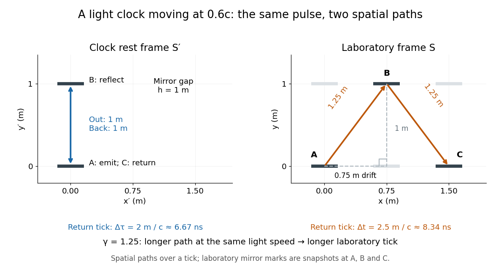

**[Figure 1](#image-one-return-tick-of-a-transverse-light-clock-at-rest-and-moving-at-0-6c-the-laboratory-light-path-is-longer). One return tick of a transverse light clock at rest and moving at 0.6c; the laboratory light path is longer**.

Reciprocal [time dilation](#time-dilation) is consistent: each [inertial frame](mathematical-physics.md#inertial-frame) times the other frame's single moving clock using its own synchronized clock network. These comparisons use different simultaneous [spacetime events](#event-relativity). Comparing reunited clocks instead requires their complete [world lines](#world-line), as in the [twin paradox](#twin-paradox).

#### Muon storage-ring time-dilation experiment

↑ **Parent:** [Time dilation](#time-dilation)

Accelerator-produced [muons](standard-model.md#muon) circulating in a magnetic storage ring allow a direct comparison between their measured laboratory [mean lifetime](relativistic-quantum-field.md#mean-lifetime-physics) and $\gamma$ times the rest lifetime. The 1977 experiment at $\gamma=29.33$ measured positive- and negative-muon lifetimes near $64.4\,\mathrm{\mu s}$, consistent with [time dilation](#time-dilation). This is a controlled complement to atmospheric survival measurements, with different systematic effects.[1977 abstract, Lorentz factor, lifetimes and comparison with the lifetime at rest](physics-bibliography.md#measurements-of-relativistic-time-dilatation-for-positive-and-negative-muons-in-a-circular-orbit-by-j-bailey-and-others)

#### Cosmic-ray muon time-dilation experiment

↑ **Parent:** [Time dilation](#time-dilation)

Atmospheric [cosmic rays](galaxy.md#cosmic-ray) generate [muons](standard-model.md#muon) whose [mean lifetime](relativistic-quantum-field.md#mean-lifetime-physics) at rest is about $2.2\,\mathrm{\mu s}$. For a selected speed $v$ and production-to-detection distance $h$ in the terrestrial frame, [special relativity](special-relativity.md) predicts survival fraction $e^{-h/(\gamma v\tau_0)}$, where $\gamma$ is the [Lorentz factor](#lorentz-factor). Without [time dilation](#time-dilation), the exponent would instead be $-h/(v\tau_0)$. Comparing altitude-dependent counts at controlled energies, allowing for acceptance and energy loss, tests these alternatives. In the [muon](standard-model.md#muon) [rest frame](mathematical-physics.md#rest-frame) the terrestrial distance is shortened to $h/\gamma$ by [length contraction](#length-contraction), so the proper flight time and survival fraction agree with the terrestrial calculation. This frame comparison does not turn the same decay measurement into two independent tests.

##### Mean-lifetime survival energy estimate

↑ **Parent:** [Cosmic-ray muon time-dilation experiment](#cosmic-ray-muon-time-dilation-experiment)

An unstable particle of rest lifetime $\tau_0$ traversing distance $H$ at constant [speed](classical-mechanics.md#speed) $v$ has [survival probability](markov-chain.md#survival-probability) $p=\exp[-H/(\gamma v\tau_0)]$. Requiring a flight time no greater than one dilated [mean lifetime](relativistic-quantum-field.md#mean-lifetime-physics) selects $p\ge e^{-1}$. In the ultrarelativistic approximation $v\simeq c$, this gives $\gamma\gtrsim H/(c\tau_0)$ and $E\gtrsim mc^2H/(c\tau_0)$. It is a specified survival-probability criterion, not a sharp cutoff for individual random decays. Continuous [energy](energy.md) loss requires integrating the decay probability along the path.

#### Light clock

↑ **Parent:** [Time dilation](#time-dilation)

A light clock measures time by counting round trips of a [light](optics.md#light) pulse between mirrors. In its [rest frame](mathematical-physics.md#rest-frame), mirrors separated by $h$ give a tick duration $2h/c$, where $c$ is the [speed of light](#speed-of-light). Comparing this round trip in another [inertial frame](mathematical-physics.md#inertial-frame) provides the geometric [time dilation](#time-dilation) argument above.

#### Twin paradox

↑ **Parent:** [Time dilation](#time-dilation)  
ⓦ [Wiki](https://en.wikipedia.org/wiki/Twin_paradox)

The twin paradox compares [proper time](#proper-time) along the different [world lines](#world-line) of a travelling observer and a stay-at-home observer who reunite. Reciprocal inertial [time dilation](#time-dilation) produces an apparent contradiction only if the traveller's change of [inertial frame](mathematical-physics.md#inertial-frame) is ignored.

The decisive experiment is local: put two clocks together at departure, separate them, then compare their readings together at reunion. Everyone agrees on those two [spacetime events](#event-relativity) and on the final difference. The [twin paradox](#twin-paradox) asks why two clocks can accumulate different [proper times](#proper-time) between the same [spacetime events](#event-relativity), despite reciprocal [time dilation](#time-dilation) during uniform motion. Its answer is the geometry of their complete [world lines](#world-line), together with the [relativity of simultaneity](#relativity-of-simultaneity) when comparing distant clocks.

##### Twin paradox with fixed reunion events

↑ **Parent:** [Twin paradox](#twin-paradox)

Work in [Minkowski spacetime](#minkowski-spacetime), neglect [gravity](physics.md#gravity), and choose the stay-at-home clock's [inertial frame](mathematical-physics.md#inertial-frame). Let departure be $O=(t,x)=(0,0)$ and reunion be $R=(T,0)$. The home clock follows $x_H(t)=0$. A traveller moves outward with [velocity](classical-mechanics.md#velocity) $+v$ and returns with [velocity](classical-mechanics.md#velocity) $-v$, where $0<v<c$ and $c$ is the [speed of light](#speed-of-light). The ideal [world line](#world-line) has a sharp turnaround at $P=(T/2,vT/2)$:

$$
x_T(t)=
\begin{cases}
vt,&0\leq t\leq T/2,\\
v(T-t),&T/2\leq t\leq T.
\end{cases}
$$

Each straight leg lies in an [inertial frame](mathematical-physics.md#inertial-frame), but no single traveller [inertial frame](mathematical-physics.md#inertial-frame) covers both legs.

For any differentiable [timelike curve](#timelike-curve) in this home [inertial frame](mathematical-physics.md#inertial-frame), its clock accumulates [proper time](#proper-time) through the [integral](integral.md)

$$
\Delta\tau=\int_0^T\sqrt{1-\frac{v(t)^2}{c^2}}\,dt.
$$

Apply it separately to the traveller's two legs. With the [Lorentz factor](#lorentz-factor) $\gamma=(1-v^2/c^2)^{-1/2}$,

$$
\Delta\tau_H=T,\qquad
\Delta\tau_T=\frac{T}{\gamma},\qquad
\Delta\tau_H-\Delta\tau_T=T\left(1-\frac1\gamma\right).
$$

For $v=0.6c$ and $T=10\,\mathrm{yr}$, the [Lorentz factor](#lorentz-factor) is $\gamma=1.25$. The turnaround is $3$ light-years away at home time $5\,\mathrm{yr}$. The traveller records $4\,\mathrm{yr}$ outward and $4\,\mathrm{yr}$ returning: the reunited clocks read $10\,\mathrm{yr}$ and $8\,\mathrm{yr}$. These are illustrative model values, not experimental measurements.

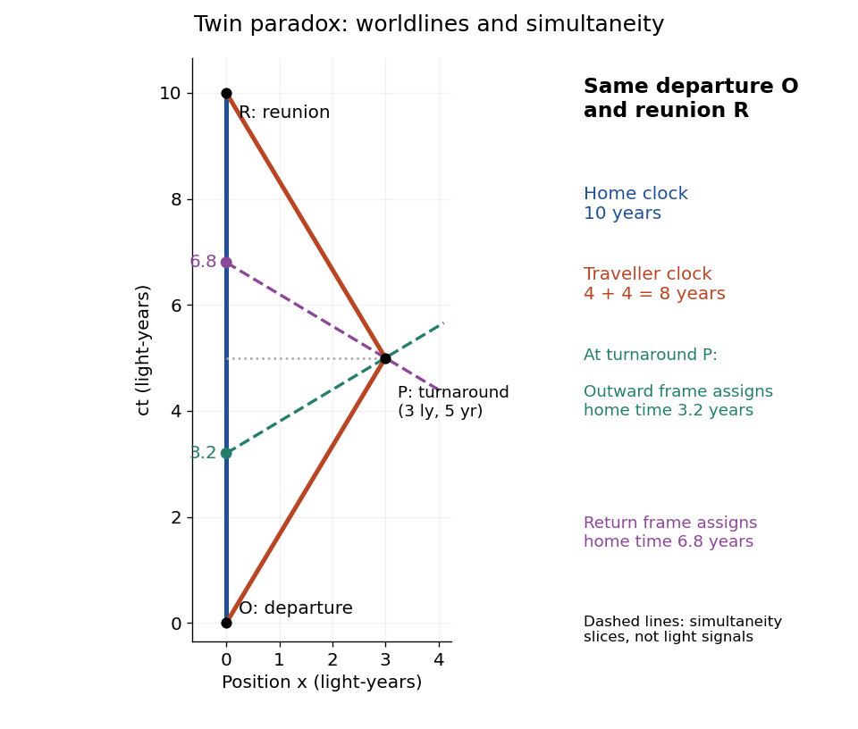

**[Figure 2](#image-fixed-departure-and-reunion-events-a-0-6c-traveller-records-eight-years-while-the-inertial-home-clock-records-ten-turnaround-simultaneity-slices-meet-the-home-world-line-at-3-2-and-6-8-years). Fixed departure and reunion events: a 0.6c traveller records eight years while the inertial home clock records ten; turnaround simultaneity slices meet the home world line at 3.2 and 6.8 years**.

The same [integral](integral.md) gives a short geometric explanation: $\sqrt{1-v(t)^2/c^2}\leq1$, so every such competing [timelike curve](#timelike-curve) between these fixed [spacetime events](#event-relativity) has $\Delta\tau\leq T$. Equality requires zero [velocity](classical-mechanics.md#velocity) throughout, apart from sets of zero duration. Thus the straight home [world line](#world-line) maximizes [proper time](#proper-time) in this [Minkowski spacetime](#minkowski-spacetime) problem. This statement concerns fixed endpoints and an inertial home clock; in a [gravitational field](physics.md#gravitational-field), compare paths using the appropriate [metric tensor](general-relativity.md#metric-tensor).

##### Twin paradox simultaneity change

↑ **Parent:** [Twin paradox](#twin-paradox)

During either inertial leg, the traveller can correctly say that the moving home clock runs slowly. The missing step is deciding which distant home-clock reading is simultaneous with turnaround. By the [Lorentz transformation](#lorentz-transformation), the outward [inertial frame](mathematical-physics.md#inertial-frame)'s constant-time line through $P$ obeys $t-vx/c^2=\text{constant}$. At $x=0$ it meets the home [world line](#world-line) at

$$
t_H^-=\frac T2-\frac{v^2T}{2c^2}.
$$

For the return [inertial frame](mathematical-physics.md#inertial-frame), use $t+vx/c^2=\text{constant}$ through the same [spacetime event](#event-relativity) $P$; its home-clock assignment is

$$
t_H^+=\frac T2+\frac{v^2T}{2c^2},\qquad
t_H^+-t_H^-=\frac{v^2T}{c^2}.
$$

The dashed lines in the [spacetime diagram](mathematical-physics.md#spacetime-diagram) illustrate this [relativity of simultaneity](#relativity-of-simultaneity). For $v=0.6c$ and $T=10\,\mathrm{yr}$, they assign $3.2\,\mathrm{yr}$ and $6.8\,\mathrm{yr}$ to the home clock. The difference of $3.6\,\mathrm{yr}$ is a change in the traveller's distant-time assignment, not a sudden physical advance of the home clock.

On each leg, the traveller's $4\,\mathrm{yr}$ of [proper time](#proper-time) corresponds to $4/\gamma=3.2\,\mathrm{yr}$ of home-clock advance according to that leg's [inertial frame](mathematical-physics.md#inertial-frame). Including the [twin paradox simultaneity change](#twin-paradox-simultaneity-change) gives $3.2+3.6+3.2=10\,\mathrm{yr}$, exactly the reading at reunion. Actual received [light](optics.md#light) signals remain continuous across a physical turnaround; their arrival times are distinct from the distant [spacetime events](#event-relativity) assigned as simultaneous by [Einstein synchronisation](#einstein-synchronisation).

##### Twin paradox with finite acceleration

↑ **Parent:** [Twin paradox](#twin-paradox)

An instantaneous reversal is an idealization. A real traveller changes [velocity](classical-mechanics.md#velocity) over a finite time, follows a smooth [world line](#world-line), and has finite [proper acceleration](#proper-acceleration). [Special relativity](special-relativity.md) still calculates the elapsed [proper time](#proper-time) using the home [inertial frame](mathematical-physics.md#inertial-frame) and the same [integral](integral.md); [general relativity](general-relativity.md) is not needed merely because the traveller accelerates in otherwise flat [spacetime](#spacetime). The [clock hypothesis](#clock-hypothesis) identifies an ideal clock's reading with this geometric [proper time](#proper-time).

One explicit smooth trip between the same $O$ and $R$ starts and ends at rest in the home [inertial frame](mathematical-physics.md#inertial-frame). Choose

$$
v(t)=v_{\max}\sin\left(\frac{2\pi t}{T}\right),\qquad
x_T(t)=\frac{v_{\max}T}{2\pi}\left[1-\cos\left(\frac{2\pi t}{T}\right)\right],
\qquad 0\leq t\leq T.
$$

Its [velocity](classical-mechanics.md#velocity) reverses continuously at $T/2$, and its [proper acceleration](#proper-acceleration) is bounded because $v_{\max}<c$ and $dv/dt$ is finite. With $v_{\max}=0.6c$ and $T=10\,\mathrm{yr}$, [numerical integration](numerical-integration.md) gives

$$
\Delta\tau_T=\int_0^{10\,\mathrm{yr}}\sqrt{1-0.36\sin^2\left(\frac{2\pi t}{10\,\mathrm{yr}}\right)}\,dt
\simeq9.028\,\mathrm{yr}.
$$

This comparison fixes the reunion [spacetime events](#event-relativity) and maximum [speed](classical-mechanics.md#speed), not the turnaround distance: the smooth trip reaches $v_{\max}T/\pi\simeq1.910$ light-years, whereas the ideal trip reaches $3$ light-years. The smooth traveller spends less time at high [speed](classical-mechanics.md#speed) and therefore accumulates more [proper time](#proper-time) than the ideal traveller, while still accumulating less than the home clock.

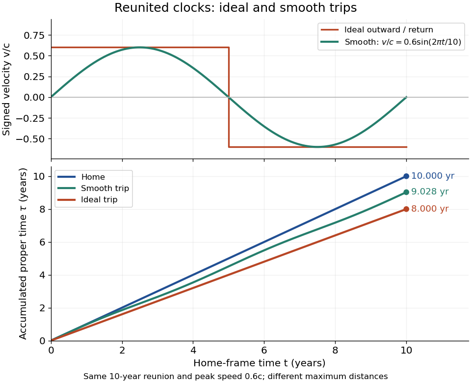

**[Figure 3](#image-signed-velocity-and-accumulated-proper-time-for-ideal-and-smooth-trips-with-the-same-ten-year-reunion-and-maximum-speed-0-6c-their-turnaround-distances-differ). Signed velocity and accumulated proper time for ideal and smooth trips with the same ten-year reunion and maximum speed 0.6c; their turnaround distances differ**.

For a sufficiently short smooth reversal replacing the corner, the [proper time](#proper-time) approaches the piecewise inertial result. A reversal interval of home duration $\delta t$ contributes between zero and $\delta t$ to the clock reading; shrinking that interval cannot create a finite extra loss concentrated at the corner. The finite difference survives in the long coasting legs. Keeping the same reversal manoeuvre while lengthening those legs changes the age difference. Conversely, two travellers following mirrored paths with the same [speed](classical-mechanics.md#speed) history accumulate equal [proper times](#proper-time), even though both accelerate. Thus [acceleration](classical-mechanics.md#acceleration) distinguishes paths and enables reunion here, but an amount of [acceleration](classical-mechanics.md#acceleration) alone does not determine the age difference.

The changing simultaneity assignment also becomes continuous. At a traveller [spacetime event](#event-relativity) $(t,x(t))$ with instantaneous [velocity](classical-mechanics.md#velocity) $v(t)$, the momentarily comoving [inertial frame](mathematical-physics.md#inertial-frame) assigns home time $t_H=t-v(t)x(t)/c^2$. Differentiating gives

$$
\frac{dt_H}{dt}=1-\frac{v(t)^2}{c^2}-\frac{x(t)}{c^2}\frac{dv}{dt}.
$$

During the reversal at positive $x$, the last term advances the assigned home time rapidly. It describes the traveller's changing [relativity of simultaneity](#relativity-of-simultaneity), not a locally measured alteration of the home clock's ticking.

###### Clock hypothesis

↑ **Parent:** [Twin paradox with finite acceleration](#twin-paradox-with-finite-acceleration)  
🏷️ **Tags:** [Proper time](#proper-time)

The [clock hypothesis](#clock-hypothesis) says that an ideal clock following a [timelike curve](#timelike-curve) measures its [proper time](#proper-time): its instantaneous rate depends on [velocity](classical-mechanics.md#velocity) through $d\tau=dt\sqrt{1-v^2/c^2}$, with no separate [acceleration](classical-mechanics.md#acceleration) term. [Acceleration](classical-mechanics.md#acceleration) still changes the [world line](#world-line) and hence the accumulated [proper time](#proper-time). A physical clock may suffer disturbances under forces or environmental changes, so experiments must distinguish its mechanism's errors from the geometric prediction.

##### Twin paradox clock experiments

↑ **Parent:** [Twin paradox](#twin-paradox)

The 1972 paper [Around-the-World Atomic Clocks: Observed Relativistic Time Gains by J. C. Hafele and others](physics-bibliography.md#around-the-world-atomic-clocks-observed-relativistic-time-gains-by-j-c-hafele-and-others) reports four cesium-beam [atomic clocks](#atomic-clock) flown around the world in October 1971, eastward and westward. Their readings were compared with the U.S. Naval Observatory reference time scale before and after travel. An electronic time-interval counter resolved differences to the nearest nanosecond; intercomparisons among the flying clocks continued during travel. The final ensemble results were $-59\pm10\,\mathrm{ns}$ eastward and $+273\pm7\,\mathrm{ns}$ westward; the quoted spreads are [standard deviations](variance.md#standard-deviation). These are corrected clock offsets, not raw readings or aircraft travel times. Four clocks allowed identification of individual rate changes through patterns in their mutual differences. The authors also report magnetic shielding and laboratory orientation checks. Their analysis could not detect a disturbance common to every flying clock, and the small ensemble limits statistical conclusions. This is a concrete reunited-clock experiment with apparatus, readout and drift controls.[pp. 168–170: Table 1, electronic counter, correlated rate-change analysis, magnetic shielding and common environmental effects](physics-bibliography.md#around-the-world-atomic-clocks-observed-relativistic-time-gains-by-j-c-hafele-and-others)

The companion paper [Around-the-World Atomic Clocks: Predicted Relativistic Time Gains by J. C. Hafele and others](physics-bibliography.md#around-the-world-atomic-clocks-predicted-relativistic-time-gains-by-j-c-hafele-and-others) computes $-40\pm23\,\mathrm{ns}$ eastward and $+275\pm21\,\mathrm{ns}$ westward from the recorded flight paths. These are predictions, with flight-data uncertainty estimates. Both [time dilation](#time-dilation) from motion and [gravitational time dilation](general-relativity.md#gravitational-time-dilation) matter: aircraft clocks at altitude experience a different [gravitational potential](newton-s-law-of-universal-gravitation.md#newtonian-potential-of-a-point-mass), while the rotating [Earth](planetary-science.md#earth) means a ground clock is not the inertial home clock of our simple model. Eastward and westward motion change the aircraft's [velocity](classical-mechanics.md#velocity) relative to an approximately nonrotating [inertial frame](mathematical-physics.md#inertial-frame), not merely its [speed](classical-mechanics.md#speed) relative to the ground. The measured agreement therefore tests combined [special relativity](special-relativity.md) and [general relativity](general-relativity.md); the westward gain does not contradict the maximum-[proper time](#proper-time) result for fixed endpoints in [Minkowski spacetime](#minkowski-spacetime).[pp. 166–167: Table 1, equations 1–4, gravitational potential term and integration of actual flight paths](physics-bibliography.md#around-the-world-atomic-clocks-predicted-relativistic-time-gains-by-j-c-hafele-and-others)

A complementary microscopic test is [Measurements of relativistic time dilatation for positive and negative muons in a circular orbit by J. Bailey and others](physics-bibliography.md#measurements-of-relativistic-time-dilatation-for-positive-and-negative-muons-in-a-circular-orbit-by-j-bailey-and-others). The authors measured [muon decay](standard-model.md#muon-decay) lifetimes in a storage ring at [Lorentz factor](#lorentz-factor) $\gamma=29.33$: $64.419\pm0.058\,\mathrm{\mu s}$ for [positive muons](standard-model.md#antimuon) and $64.368\pm0.029\,\mathrm{\mu s}$ for negative [muons](standard-model.md#muon). The reported positive-[muon](standard-model.md#muon) lifetime agrees with the independently measured lifetime at rest and [special relativity](special-relativity.md) to a fractional error of $2\times10^{-3}$ at 95% confidence. This is a decay-lifetime readout under continuous [centripetal acceleration](classical-mechanics.md#centripetal-acceleration), rather than a reunion of portable clocks. It supports the [clock hypothesis](#clock-hypothesis) for this physical process and regime; the inspected abstract does not establish universal immunity of every clock mechanism to [acceleration](classical-mechanics.md#acceleration). [Measurements of relativistic time dilatation for positive and negative muons in a circular orbit by J. Bailey and others](physics-bibliography.md#measurements-of-relativistic-time-dilatation-for-positive-and-negative-muons-in-a-circular-orbit-by-j-bailey-and-others)

###### Atomic clock

↑ **Parent:** [Twin paradox clock experiments](#twin-paradox-clock-experiments)  
🏷️ **Tags:** [Atomic physics](atomic-physics.md)  
ⓦ [Wiki](https://en.wikipedia.org/wiki/Atomic_clock)

An [atomic clock](#atomic-clock) uses an atomic transition as a [frequency](wave.md#frequency) reference for an [oscillator](wave.md#oscillator); counting its calibrated cycles realizes a time interval. In a passive beam implementation, the [chemical atoms](physics.md#atom-physics) are repeatedly prepared, interrogated and detected, while [feedback control](control-theory.md#closed-loop-control) corrects the continuously running [oscillator](wave.md#oscillator). The [Ramsey separated oscillatory fields experiment](quantum-system.md#ramsey-separated-oscillatory-fields-experiment) explains how internal [quantum phase](quantum-system.md#quantum-phase) becomes a measurable population signal.

The [SI](physics.md#international-system-of-units) [second](physics.md#second) fixes the unperturbed [ground state](quantum-mechanics.md#ground-state) [hyperfine structure](quantum-mechanics.md#hyperfine-structure) transition [frequency](wave.md#frequency) of [caesium](chemical-substance.md#caesium)-133 to exactly $9\,192\,631\,770\,\mathrm{Hz}$. This is a defining value for the ideal transition, rather than a guarantee that an operating apparatus has no shifts.[SI base unit: second (s), defining paragraph and equivalent duration in periods of the unperturbed caesium-133 ground-state hyperfine transition](physics-bibliography.md#si-base-unit-second-s-by-bureau-international-des-poids-et-mesures)

###### Cesium-beam clock procedure

↑ **Parent:** [Atomic clock](#atomic-clock)

An oven supplies a collimated [caesium](chemical-substance.md#caesium) beam. State-selecting magnets precede and follow two coherent [microwave](electromagnetic-radiation.md#microwave) interaction regions; a weak static [magnetic field](magnetic-field.md) separates sublevels. The clock transition connects $F=3,m_F=0$ and $F=4,m_F=0$. Transferred atoms reach a heated ionizing collector. A detector scan identifies the resonance before locking.[April 1971 edition, §5.3, pp. 36–38, Fig. 7](physics-bibliography.md#the-physical-basis-of-atomic-frequency-standards-by-a-s-risley)

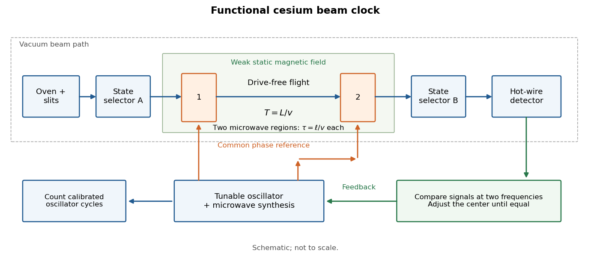

**[Figure 4](#image-a-beam-clock-compares-atoms-with-an-oscillator-and-feeds-back-the-error). A beam clock compares atoms with an oscillator and feeds back the error**. Original functional diagram of the [cesium-beam clock procedure](#cesium-beam-clock-procedure); magnetic selection, schematic paths.

Here $F$ labels the total [angular momentum](momentum.md#angular-momentum) and $m_F$ its projection. The selected pair is a [two-level system](canonical-ensemble.md#two-level-system) inside a larger set of atomic [energy levels](quantum-mechanics.md#energy-level); treating every oven atom as a prepared [qubit](quantum-system.md#qubit) would overstate the preparation. A measured detector signal may be modeled as $S(\nu)=S_{\mathrm{bg}}+A\overline P(2\pi(\nu_0-\nu))$, with background $S_{\mathrm{bg}}$ and gain $A>0$. Background subtraction and stable transmission are necessary before interpreting the signal as a transition [probability](probability-theory.md#probability). The [velocity-averaged Ramsey line](quantum-system.md#velocity-averaged-ramsey-line) provides one explicit ideal example; its chosen dimensions are not historical specifications.

###### Atomic clock frequency lock

↑ **Parent:** [Atomic clock](#atomic-clock)

A peak has zero slope at its center, so a single peak-height reading does not tell [feedback control](control-theory.md#closed-loop-control) which way to tune. Instead sample the two sides at ordinary [frequencies](wave.md#frequency) $\nu_c\pm d$, where $d>0$ is a chosen modulation offset, and subtract:

$$
E(\nu_c)=S(\nu_c+d)-S(\nu_c-d).
$$

For an even signal around the true center $\nu_0$, write $\epsilon=\nu_c-\nu_0$. A [Taylor expansion](calculus.md#taylor-expansion) gives $E(\nu_0+\epsilon)=2S'(\nu_0+d)\epsilon+O(\epsilon^3)$. On the descending side of a positive central peak $S'(\nu_0+d)<0$, so the update $\nu_c\mapsto\nu_c+gE$ has restoring sign for $g>0$ and is locally stable in this ideal discrete update when $0<-2gS'(\nu_0+d)<2$. A detector dip requires the opposite sign. These conditions follow from linearizing the update, not from assuming any particular electronics.

For the ideal signal $S=A\cos^2[\pi(\nu-\nu_0)T]+S_{\mathrm{bg}}$, choose $d=1/(4T)$. Then $E\simeq-2\pi AT\epsilon$. With $T=5\,\mathrm{ms}$ and $A=1$, a center error of $+1\,\mathrm{Hz}$ gives exact $E=-\sin(0.01\pi)\simeq-0.03141$. The sign directs the update toward lower [frequency](wave.md#frequency). Constant background cancels, but background drift between samples or asymmetric neighboring [spectral lines](stellar-astrophysics.md#spectral-line) can bias the zero. An initial scan matters because other fringes can also supply zeros.

###### Atomic clock frequency shifts

↑ **Parent:** [Atomic clock](#atomic-clock)

A narrow fringe makes the center easier to resolve statistically; it does not certify an unbiased [frequency](wave.md#frequency). For example, with ideal $\pi/2$ pulses and a second-pulse [oscillation phase](wave.md#phase-waves) offset $\varphi_c$, the [finite-pulse Ramsey transition probability](quantum-system.md#finite-pulse-ramsey-transition-probability) approaches

$$
P_{g\to e}=\cos^2\!\left(\frac{\delta T-\varphi_c}{2}\right),\qquad
\nu_{\mathrm{center}}-\nu_0=-\frac{\varphi_c}{2\pi T}.
$$

This sign uses exactly the [Rabi detuning](quantum-system.md#rabi-detuning) convention and pulse [Hamiltonian operator](quantum-system.md#hamiltonian-quantum-mechanics) above, with the second pulse replacing $\sigma_x$ by $\cos\varphi_c\,\sigma_x+\sin\varphi_c\,\sigma_y$. The factor $2\pi$ converts [angular frequency](lagrangian-mechanics.md#angular-frequency) to ordinary [frequency](wave.md#frequency). For the original example, $\varphi_c=0.010$ rad and $T=5\,\mathrm{ms}$ give a shift of about $-0.318\,\mathrm{Hz}$. For finite pulses or distributed flight times, use the full signal and its [atomic clock frequency lock](#atomic-clock-frequency-lock) rather than inserting an unweighted mean $T$.

NIST-7 used [optical pumping](atomic-physics.md#optical-pumping) and [fluorescence](fluorescence.md). Controls included field-sensitive transitions, independent beam-speed measurements, [microwave](electromagnetic-radiation.md#microwave) power stabilization, and beam reversal for cavity [quantum phase](quantum-system.md#quantum-phase) errors.[§2.2, pp. 50–52: optical readout and frequency-shift controls](physics-bibliography.md#primary-atomic-frequency-standards-at-nist-by-d-b-sullivan-and-others)

The connection to [special relativity](special-relativity.md) is quantitative. A freely moving emitter's [proper time](#proper-time) advances more slowly than laboratory time by $\sqrt{1-v^2/c^2}$. With first-order propagation effects removed in the ideal comparison, its internal laboratory [frequency](wave.md#frequency) is therefore

$$
\frac{\nu_{\mathrm{lab}}-\nu_0}{\nu_0}\simeq-\frac{v^2}{2c^2}.
$$

Correcting an ensemble signal requires the effective [velocity](classical-mechanics.md#velocity) weights of preparation, interrogation and detection, not simply the oven's mean [speed](classical-mechanics.md#speed). Additional shifts from [Zeeman splitting](atomic-physics.md#zeeman-splitting), unwanted light, [collisions](classical-mechanics.md#collision) and cavity fields likewise require separate evaluation; [feedback control](control-theory.md#closed-loop-control) locks to the observed line, including any uncorrected bias. Comparing clocks at different [gravitational potentials](newton-s-law-of-universal-gravitation.md#newtonian-potential-of-a-point-mass) additionally requires [gravitational time dilation](general-relativity.md#gravitational-time-dilation). The moving-clock experiments in [twin paradox clock experiments](#twin-paradox-clock-experiments) compare calibrated clock readings along different [world lines](#world-line); the beam atoms' internal motion is part of the clock mechanism's own correction.

## Ultrarelativistic particle

↑ **Parent:** [Special relativity](special-relativity.md)

An ultrarelativistic particle has energy much larger than its rest energy. Its dispersion relation is then approximated by $E=pc$.

## Galilean transformation

↑ **Parent:** [Special relativity](special-relativity.md)  
ⓦ [Wiki](https://en.wikipedia.org/wiki/Galilean_transformation)

For inertial frames with relative velocity $u$ along the $x$-axis, the Galilean transformation is

$$
t'=t,\qquad x'=x-ut.
$$

### Principle of Galilean relativity

↑ **Parent:** [Galilean transformation](#galilean-transformation)

The laws of Newtonian mechanics have the same form in every [inertial frame](mathematical-physics.md#inertial-frame) related by a [Galilean transformation](#galilean-transformation).

## Lorentz transformation

↑ **Parent:** [Special relativity](special-relativity.md)  
ⓦ [Wiki](https://en.wikipedia.org/wiki/Lorentz_transformation)

A [Lorentz transformation](#lorentz-transformation) preserves the [Minkowski metric](#minkowski-metric). For a [Lorentz boost](#lorentz-boost), let $S'$ move at constant [velocity](classical-mechanics.md#velocity) $+v$ along the $x$-axis of $S$, with parallel spatial axes and coincident origins at $t=t'=0$. With $\beta=v/c$ and the [Lorentz factor](#lorentz-factor) $\gamma$, the coordinates of the same [spacetime event](#event-relativity) obey

$$
ct'=\gamma(ct-\beta x),\qquad x'=\gamma(x-\beta ct),\qquad y'=y,\qquad z'=z.
$$

The inverse [Lorentz transformation](#lorentz-transformation) replaces $v$ by $-v$. In particular, $x'=0$ traces the moving origin $x=vt$, fixing the sign convention. The time formula is $t'=\gamma(t-vx/c^2)$; dropping its position term would lose the [relativity of simultaneity](#relativity-of-simultaneity). [Einstein (1905), section 3: transformation of coordinates and times](https://fourmilab.ch/etexts/einstein/specrel/www/).

For the moving-clock example in [time dilation](#time-dilation), the second tick has $(t,x)=(5\,\mu\mathrm s,3c\,\mu\mathrm s)$. At $v=0.6c$, substitution gives $t'=1.25(5-0.6\times3)\,\mu\mathrm s=4\,\mu\mathrm s$ and $x'=1.25(3-0.6\times5)c\,\mu\mathrm s=0$. The clock stays at its own origin, and its coordinate time there equals its [proper time](#proper-time).

### Transverse relativistic interception

↑ **Parent:** [Lorentz transformation](#lorentz-transformation)

In a station frame, a target begins at $(0,a)$ with [velocity](classical-mechanics.md#velocity) $(v,0)$, and an interceptor launches from the origin at [speed](classical-mechanics.md#speed) u greater than v. Straight-line interception requires its [velocity](classical-mechanics.md#velocity) components to be $(v,\sqrt{u^2-v^2})$, and takes station time $t=a/\sqrt{u^2-v^2}$. The target-frame coordinate interval is $\gamma_v(t-v\Delta x/c^2)=t/\gamma_v$, since $\Delta x=vt$. This differs from the interceptor's [proper time](#proper-time) $t/\gamma_u$. A symmetric return to the stationary launch point instead has target-frame round-trip coordinate duration $2\gamma_v t$, because its endpoint spatial separation in the station frame is zero.

### Universality of an invariant speed under boost composition

↑ **Parent:** [Lorentz transformation](#lorentz-transformation)

Suppose standard collinear boosts have the [Lorentz transformation](#lorentz-transformation) form, but initially assign speed scales $a$ and $b$ to two successive transformations with relative [velocities](classical-mechanics.md#velocity) $v$ and $u$. Their composition has spatial and temporal diagonal factors proportional to $1+uv/a^2$ and $1+uv/b^2$, respectively. Closure within the same calibrated transformation family requires these factors to agree, forcing $a^2=b^2$ for generic nonzero boosts.

This argument fixes a universal reciprocal squared speed; it does not establish that it is nonzero. The common limit $1/a^2=0$ gives the consistent [Galilean transformation](#galilean-transformation) family. A finite invariant [speed of light](#speed-of-light) is an additional empirical property of spacetime and electromagnetism, expressed by the second of the [postulates of special relativity](#postulates-of-special-relativity). It cannot be deduced by excluding the Galilean limit through boost composition alone.

### Local Lorentz transformation

↑ **Parent:** [Lorentz transformation](#lorentz-transformation)

An [orthonormal coframe in spacetime](general-relativity.md#orthonormal-coframe-in-spacetime) can be rotated by a position-dependent Lorentz matrix without changing the spacetime [metric tensor](general-relativity.md#metric-tensor). Its [spin connection](connection-1-form.md#spin-connection) transforms as $\omega'=\Lambda\omega\Lambda^{-1}-d\Lambda\,\Lambda^{-1}$. A [spinor field](riemannian-geometry.md#spinor-field) transforms through a chosen spin lift $\psi'=S(\Lambda)\psi$, not through the vector matrix $\Lambda$. With $S^{-1}\gamma^A S=\Lambda^A{}_B\gamma^B$, an infinitesimal parameter gives $S=1+\tfrac14\alpha_{AB}\gamma^{AB}+O(\alpha^2)$, where $\gamma^{AB}=\tfrac12[\gamma^A,\gamma^B]$. Consistent global transition lifts require a [spin structure](riemannian-geometry.md#spin-structure); a $2\pi$ spatial rotation lifts to minus the identity on spinors.

### Relativity of simultaneity

↑ **Parent:** [Lorentz transformation](#lorentz-transformation)  
ⓦ [Wiki](https://en.wikipedia.org/wiki/Relativity_of_simultaneity)

Spatially separated simultaneous events in one [inertial frame](mathematical-physics.md#inertial-frame) are generally not simultaneous in a relatively moving frame. The [Lorentz transformation](#lorentz-transformation) explicitly mixes position into time. This is essential when comparing distances between moving light pulses: one must compare their positions at the same time in the measuring frame.

At $v=0.6c$, the rod's simultaneous laboratory endpoint measurements in [length contraction](#length-contraction) have $(ct,x)=(0,0)$ and $(0,8\,\mathrm m)$. They become $(ct',x')=(0,0)$ and $(-6\,\mathrm m,10\,\mathrm m)$. In contrast, simultaneous rod-frame measurements at $t'=0$ use $(ct,x)=(0,0)$ and $(7.5\,\mathrm m,12.5\,\mathrm m)$. The latter front-end event occurs later in the laboratory, after the front has moved. The sloping $t'=0$ line in the figure is a set of simultaneous [spacetime events](#event-relativity), not a signal's trajectory. [Joe Wolfe, UNSW: Lorentz transformations and spacetime](https://newt.phys.unsw.edu.au/einsteinlight/jw/module4_Lorentz_transforms.htm).

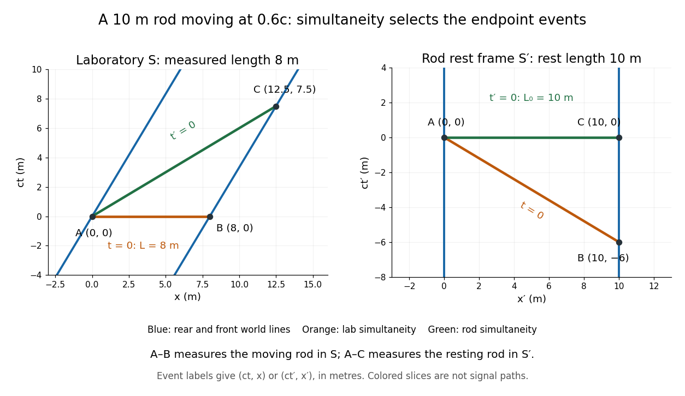

**[Figure 5](#image-the-same-moving-rod-measured-on-laboratory-and-rod-frame-simultaneity-slices-length-measurements-use-different-endpoint-events). The same moving rod measured on laboratory and rod-frame simultaneity slices; length measurements use different endpoint events**.

#### Rod containment and simultaneity

↑ **Parent:** [Relativity of simultaneity](#relativity-of-simultaneity)

A moving rod can have both ends inside a shorter shed on a single constant-time slice of the shed frame. [Lorentz transformation](#lorentz-transformation) sends the two simultaneous endpoint events to different times in the rod frame; it does not imply simultaneous containment there. Entrance and first collision can be spacelike separated and occur in reversed time order. After impact, length changes must propagate through the rod causally; a perfectly rigid instantaneous stopping model is not relativistically admissible.

#### Photon separation under a collinear Lorentz boost

↑ **Parent:** [Relativity of simultaneity](#relativity-of-simultaneity)

For two [photons](quantum-mechanics.md#photon) emitted simultaneously a distance $d$ apart in one frame and moving in the same positive direction, the world-line intercept $x-ct$ transforms to $\gamma(1+v/c)(x-ct)$. Their equal-time separation in the boosted frame is therefore the displayed constant $d'$. It is different from length contraction of the emitters, because the emission events are not simultaneous after the boost.

### Lorentz covariance

↑ **Parent:** [Lorentz transformation](#lorentz-transformation)  
ⓦ [Wiki](https://en.wikipedia.org/wiki/Lorentz_covariance)

#### Lorentz invariance

↑ **Parent:** [Lorentz covariance](#lorentz-covariance)

A physical quantity is Lorentz invariant when its value is unchanged under [Lorentz transformations](#lorentz-transformation). Tensor equations can be [Lorentz covariant](#lorentz-covariance) while their components transform. Fixed-vector gauge choices need not make covariance manifest, although physical gauge-invariant predictions retain the symmetry.

### Lorentz boost

↑ **Parent:** [Lorentz transformation](#lorentz-transformation)

A Lorentz boost relates [inertial frames](mathematical-physics.md#inertial-frame) moving at a constant relative velocity without an additional spatial rotation. In units with light speed one, the displayed transformation preserves $t^2-x^2$, with [Lorentz factor](#lorentz-factor) $\gamma=(1-v^2)^{-1/2}$. Applying it to a static [classical field-theory soliton](classical-field-theory-soliton.md) produces a uniformly moving solution in a Lorentz-invariant theory.

#### Wigner rotation

↑ **Parent:** [Lorentz boost](#lorentz-boost)

Two noncollinear [Lorentz boosts](#lorentz-boost) produce a [Lorentz transformation](#lorentz-transformation) with both a boost and a rotation. In the [SL(2,C)](group-theory.md#complex-special-linear-group-in-dimension-two) lift, the product of two positive Hermitian boost [matrices](vector-space.md#matrix) generally ceases to be Hermitian. Its [polar decomposition of an invertible complex matrix](quadratic-form.md#polar-decomposition-of-an-invertible-complex-matrix) separates a positive Hermitian boost factor and a unitary rotation factor. The rotation depends on both boosts and their order, and is called the Wigner rotation.

##### Noncollinear boost obstruction from Pauli products

↑ **Parent:** [Wigner rotation](#wigner-rotation)

For boost [matrices](vector-space.md#matrix) $A=cI+s\mathbf n\cdot\boldsymbol\sigma$ and $A'=c'I+s'\mathbf n'\cdot\boldsymbol\sigma$, the [Pauli matrix multiplication law](algebra.md#pauli-matrix-multiplication-law) gives the displayed anti-Hermitian part. If both rapidities are nonzero and the axes are noncollinear, it cannot vanish, while either lift of a pure boost is Hermitian. Thus an additional [Wigner rotation](#wigner-rotation) is necessary. A zero boost is a degenerate exception.

#### Rapidity

↑ **Parent:** [Lorentz boost](#lorentz-boost)  
ⓦ [Wiki](https://en.wikipedia.org/wiki/Rapidity)

[Rapidity](#rapidity) is a dimensionless parameter for a signed collinear [velocity](classical-mechanics.md#velocity) $u$ with $|u|<c$, defined using the [inverse hyperbolic functions](calculus.md#inverse-hyperbolic-functions) by

$$
\theta=\operatorname{artanh}(u/c)=\frac12\ln\frac{1+u/c}{1-u/c},\qquad u=c\tanh\theta.
$$

Here $c$ is the [speed of light](#speed-of-light), and $\tanh$ is the [hyperbolic tangent](calculus.md#hyperbolic-tangent). Zero [velocity](classical-mechanics.md#velocity) has zero [rapidity](#rapidity); negative [velocity](classical-mechanics.md#velocity) has negative [rapidity](#rapidity). Every finite real [rapidity](#rapidity) gives $|u|<c$, while $u\to\pm c$ requires $\theta\to\pm\infty$. Thus a [light](optics.md#light) ray has no finite [rapidity](#rapidity) in this parametrization. The header's formula uses [natural units](mathematical-physics.md#natural-units) $c=1$: its $v$ is the numerical [velocity](classical-mechanics.md#velocity) $u/c$.

For the [inertial frames](mathematical-physics.md#inertial-frame) in the [velocity-addition formula](#velocity-addition-formula), $S'$ moves at signed [velocity](classical-mechanics.md#velocity) $V$ along the $x$-axis of $S$. Set $\phi=\operatorname{artanh}(V/c)$. Re-expressing the same particle in the moving [inertial frame](mathematical-physics.md#inertial-frame) gives

$$
\theta'=\theta-\phi,\qquad \theta=\theta'+\phi.
$$

The subtraction is a passive change of [reference frame](mathematical-physics.md#reference-frame); the inverse adds the particle's [rapidity](#rapidity) in $S'$ to the frame's [rapidity](#rapidity) relative to $S$. For example, $V=0.6c$ and $u'=0.6c$ give $\phi=\theta'=\ln2$, so $\theta=\ln4$ and $u=c\tanh(\ln4)=15c/17$, exactly as in the [velocity-addition formula](#velocity-addition-formula).

For a massive particle of [rest mass](#invariant-mass) $m>0$ moving in one spatial dimension, its [energy](energy.md) and signed [momentum](momentum.md) are

$$
E=mc^2\cosh\theta,\qquad p=mc\sinh\theta.
$$

The [hyperbolic cosine](calculus.md#hyperbolic-cosine) is the particle's [Lorentz factor](#lorentz-factor), and the [hyperbolic sine](calculus.md#hyperbolic-sine) is $\gamma u/c$. The [hyperbolic Pythagorean identity](calculus.md#hyperbolic-pythagorean-identity) immediately gives the [relativistic energy-momentum relation](#energy-momentum-relation) $E^2-c^2p^2=m^2c^4$. In the older $c=1$ notation, writing the [rest mass](#invariant-mass) as $M$ recovers $v=\tanh\theta$, $E=M\cosh\theta$, and $p=M\sinh\theta$. These expressions use [natural units](mathematical-physics.md#natural-units) in which the factors of $c$ are numerically one; the preceding formulas restore those factors explicitly. [David Tong, Dynamics and Relativity, §7.3.2: rapidity; §7.4.3: energy and momentum](https://davidtong.org/pdfs/teaching/dynamics-and-relativity/dynrel7.pdf).

The useful simplification follows from the [hyperbolic-function identity](calculus.md#hyperbolic-function-identity) $\tanh(a+b)=(\tanh a+\tanh b)/(1+\tanh a\tanh b)$: the nonlinear [velocity-addition formula](#velocity-addition-formula) becomes ordinary addition of [rapidities](#rapidity). See [iterated collinear boosts with equal rapidity](#iterated-collinear-boosts-with-equal-rapidity) for a plotted example. A common collinear [Lorentz boost](#lorentz-boost) shifts every [rapidity](#rapidity) by the same constant, so a [rapidity](#rapidity) difference is invariant. This makes [rapidity](#rapidity) useful for relativistic [factorized scattering](quantum-field-theory.md#factorized-scattering) in one spatial dimension, where two-body [S-matrices](quantum-scattering.md#s-matrix) depend on the difference of the incoming [rapidities](#rapidity), with particle species fixed.

##### Iterated collinear boosts with equal rapidity

↑ **Parent:** [Rapidity](#rapidity)

Starting from rest, compose $n$ positive collinear [Lorentz boosts](#lorentz-boost), each with the same finite [rapidity](#rapidity) $\alpha>0$. Each step has relative [velocity](classical-mechanics.md#velocity) $w=c\tanh\alpha$, measured in the preceding rest [inertial frame](mathematical-physics.md#inertial-frame). The [relativistic velocity-addition formula](#velocity-addition-formula) gives

$$
u_0=0,\qquad u_{n+1}=\frac{u_n+w}{1+u_nw/c^2},\qquad \theta_n=n\alpha,\qquad u_n=c\tanh(n\alpha).
$$

These are equal increments of [rapidity](#rapidity), not equal increments of [velocity](classical-mechanics.md#velocity) measured in the original [inertial frame](mathematical-physics.md#inertial-frame). They can describe a chain of relatively moving [inertial frames](mathematical-physics.md#inertial-frame) or successive idealized changes of a massive particle's motion; no particular acceleration schedule is assumed. [David Tong, General Relativity, §1.2.4: collinear boost composition and rapidity](https://davidtong.org/teaching/general-relativity/grhtml/S1).

For a relative [velocity](classical-mechanics.md#velocity) $w=c/2$ at each step,

$$
\alpha=\operatorname{artanh}(1/2)=\frac12\ln3,\qquad \frac{u_n}{c}=\frac{3^n-1}{3^n+1}.
$$

The first four [velocities](classical-mechanics.md#velocity) are $u_0=0$, $u_1=c/2$, $u_2=4c/5$, and $u_3=13c/14$. At step eight, $u_8/c=3280/3281\approx0.99969521$. The [rapidities](#rapidity) grow by the same amount at each step, while the successive [velocity](classical-mechanics.md#velocity) increments become smaller.

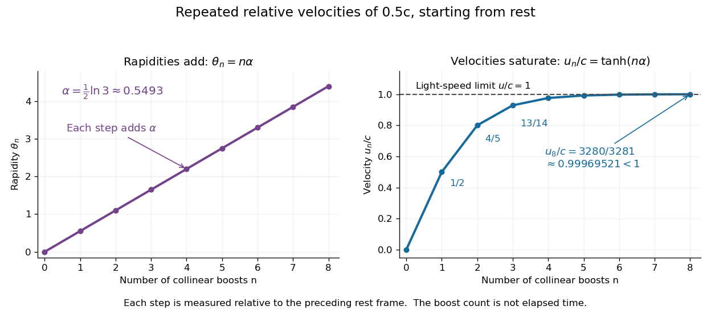

**[Figure 6](#image-rapidity-collinear-boosts). Equal collinear boosts add rapidities linearly while their composed velocities approach the speed of light**. The illustrative sequence uses relative [velocity](classical-mechanics.md#velocity) $c/2$ per step and $n=0,\ldots,8$. The horizontal coordinate counts boosts, rather than elapsed time. The line at $u_n/c=1$ marks the [speed of light](#speed-of-light); every plotted [velocity](classical-mechanics.md#velocity) is strictly below it.

A short derivation applies the [hyperbolic-function identity](calculus.md#hyperbolic-function-identity) for $\tanh(a+b)$ to the recurrence, giving $\theta_{n+1}=\theta_n+\alpha$. Substituting $\tanh x=(e^{2x}-1)/(e^{2x}+1)$ and $e^{2\alpha}=3$ gives the displayed closed expression. In particular,

$$
1-\frac{u_n}{c}=\frac{2}{3^n+1}>0
$$

for every finite nonnegative integer $n$. The [limit](calculus.md#limit-of-a-function) is $u_n\to c$ as $n\to\infty$, but no finite sequence reaches the [speed of light](#speed-of-light). This illustrates the beauty of [rapidity](#rapidity): unbounded additive parameters coexist with bounded physical [velocities](classical-mechanics.md#velocity). Replacing every step by a negative [rapidity](#rapidity) gives the corresponding approach to $-c$.

### Active Lorentz transformation of a vector field

↑ **Parent:** [Lorentz transformation](#lorentz-transformation)

An active transformation keeps the coordinate argument fixed and changes a contravariant vector field by $A'^\mu(x)=\Lambda^\mu{}_{\nu}A^\nu(\Lambda^{-1}x)$. Infinitesimally, $\delta A^\mu=\alpha\omega^\mu{}_{\nu}A^\nu-\alpha\omega^\rho{}_{\sigma}x^\sigma\partial_\rho A^\mu$. For a [Lorentz scalar](#lorentz-scalar) density, the spin-index term is absent, giving $\delta\mathcal L=-\alpha\omega^\rho{}_{\sigma}x^\sigma\partial_\rho\mathcal L$.

### Lorentz scalar

↑ **Parent:** [Lorentz transformation](#lorentz-transformation)  
ⓦ [Wiki](https://en.wikipedia.org/wiki/Lorentz_scalar)

A Lorentz scalar is unchanged under a [Lorentz transformation](#lorentz-transformation). Contracting every Lorentz index in a tensor expression produces a scalar when the constituent fields transform covariantly.

### Lorentz tensor

↑ **Parent:** [Lorentz transformation](#lorentz-transformation)  
ⓦ [Wiki](https://en.wikipedia.org/wiki/Lorentz_tensor)

A Lorentz tensor transforms by one Lorentz matrix for each contravariant index and one inverse matrix for each covariant index. Complete contraction of all indices produces a Lorentz scalar.

### Lorentz group

↑ **Parent:** [Lorentz transformation](#lorentz-transformation)  
ⓦ [Wiki](https://en.wikipedia.org/wiki/Lorentz_group)

The Lorentz group consists of real matrices preserving the [Minkowski metric](#minkowski-metric): $\Lambda^T\eta\Lambda=\eta$.

#### Component quotient of the real Lorentz group in two dimensions

↑ **Parent:** [Lorentz group](#lorentz-group)

Let $B(x)=\begin{pmatrix}\cosh x&-\sinh x\\-\sinh x&\cosh x\end{pmatrix}$, $T=\operatorname{diag}(1,-1)$ and $P=\operatorname{diag}(-1,1)$. Every real matrix preserving $\operatorname{diag}(1,-1)$ has a unique form $B(x)S$ with $S\in\{I,T,P,TP\}$. The boost subgroup is normal because $TB(x)T=PB(x)P=B(-x)$. Its four [cosets](group-theory.md#coset) form the [Klein four-group](finite-group-theory.md#klein-four-group), giving the displayed [quotient group](group-theory.md#quotient-group). In contrast, the four-element subgroup generated by $T,P$ is not normal: $B(x)TB(-x)=B(2x)T$ is not diagonal for $x\ne0$. This distinguishes the normal identity component from a chosen set of component representatives.

#### Time-orientation-preserving Lorentz group in one spatial dimension

↑ **Parent:** [Lorentz group](#lorentz-group)

For $J=\operatorname{diag}(1,-1)$, the [matrices](vector-space.md#matrix) satisfying $A^TJA=J$ and $A_{11}>0$ form the time-orientation-preserving [Lorentz group](#lorentz-group) in one spatial dimension. They are exactly $A=H(t)D_\varepsilon$, where $H(t)=\begin{pmatrix}\cosh t&\sinh t\\\sinh t&\cosh t\end{pmatrix}$, $D_\varepsilon=\operatorname{diag}(1,\varepsilon)$ and $\varepsilon=\pm1$. Preservation of the [Minkowski metric](#minkowski-metric) makes the first column a future-pointing unit timelike [vector](vector-space.md#vector); [Minkowski inner product](hyperbolic-geometry.md#minkowski-inner-product) orthogonality determines the second up to sign. The identity $D_\varepsilon H(s)=H(\varepsilon s)D_\varepsilon$ gives the multiplication law $(t,\varepsilon)(s,\eta)=(t+\varepsilon s,\varepsilon\eta)$ and inverse $(-\varepsilon t,\varepsilon)$.

#### Lie algebra of the Lorentz group

↑ **Parent:** [Lorentz group](#lorentz-group)

For $M=\operatorname{diag}(-1,1,1,1)$,

$$
\mathfrak o(1,3)=\{Y\in M_4(\mathbb R):Y^TM+MY=0\}.
$$

Every such matrix has the block form

$$
Y=\begin{pmatrix}0&v^T\\v&\Omega\end{pmatrix},
\qquad
v\in\mathbb R^3,\quad\Omega^T=-\Omega,
$$

so the Lie algebra and the [Lorentz group](#lorentz-group) have dimension six. At $A\in O(1,3)$, the tangent space is $A\mathfrak o(1,3)$.

#### Orthochronous Lorentz group

↑ **Parent:** [Lorentz group](#lorentz-group)

The orthochronous Lorentz group consists of Lorentz transformations preserving the future sheet of the unit timelike hyperboloid. Equivalently, $A_{00}>0$. This is an open subgroup of $O(1,3)$ and hence a full-dimensional submanifold.

#### Proper orthochronous Lorentz group

↑ **Parent:** [Lorentz group](#lorentz-group)

The proper orthochronous Lorentz group is the identity component of the [Lorentz group](#lorentz-group). Its elements have determinant one and preserve the future light cone.

##### Every proper orthochronous Lorentz transformation is an exponential

↑ **Parent:** [Proper orthochronous Lorentz group](#proper-orthochronous-lorentz-group)

Use the [Lorentz spinor double cover](#lorentz-spinor-double-cover) $SL(2,\mathbb C)\to SO^+(1,3)$. For a lift with distinct eigenvalues $\lambda,\lambda^{-1}$, diagonalize and choose logarithms $z,-z$; this gives a traceless matrix logarithm. For a repeated eigenvalue, choose the sign of the lift so it is $I+N$, where $N^2=0$, and use $\log(I+N)=N$. The two lifts have the same Lorentz image. Exponentiating the differential of the covering map therefore expresses every proper orthochronous transformation as the exponential of a real element of the [Lie algebra of the Lorentz group](#lie-algebra-of-the-lorentz-group). This argument does not assert that every element of $SL(2,\mathbb C)$ itself has a traceless logarithm.

##### Lorentz spinor double cover

↑ **Parent:** [Proper orthochronous Lorentz group](#proper-orthochronous-lorentz-group)

Identify Minkowski vectors with Hermitian matrices $X=x^0I+x^a\sigma_a$. The action $X\mapsto SXS^\dagger$ preserves $\det X=(x^0)^2-|\mathbf x|^2$. It gives a surjective homomorphism from $SL(2,\mathbb C)$ to the [proper orthochronous Lorentz group](#proper-orthochronous-lorentz-group) with kernel $\{I,-I\}$. Polar decomposition retracts the covering group onto [SU(2)](topological-group.md#su-2-group), making it simply connected. This cover permits half-integer spin [group representations](representation-theory.md#group-representation) that do not descend to the Lorentz group itself.

###### Hermitian matrix representation of Minkowski four-vectors

↑ **Parent:** [Lorentz spinor double cover](#lorentz-spinor-double-cover)

A real four-vector corresponds to a two-by-two Hermitian matrix with determinant equal to its Minkowski squared norm. The action $X\mapsto NXN^\dagger$ for $N\in SL(2,\mathbb C)$ preserves that determinant and the future cone. Expanding with $\tfrac12\operatorname{Tr}(\bar\sigma^\mu\sigma_\nu)=\delta^\mu{}_{\nu}$ yields $\Lambda^\mu{}_{\nu}(N)=\tfrac12\operatorname{Tr}(\bar\sigma^\mu N\sigma_\nu N^\dagger)$. The map has kernel $\{\pm I\}$ and image $SO^+(1,3)$.

###### Future-null spinor factorization

↑ **Parent:** [Hermitian matrix representation of Minkowski four-vectors](#hermitian-matrix-representation-of-minkowski-four-vectors)

A nonzero Hermitian rank-one [positive semidefinite matrix](quadratic-form.md#positive-semidefinite-matrix) has zero [determinant](multilinear-algebra.md#determinant) and positive [trace](linear-algebra.md#matrix-trace), representing a future-directed [null vector](#null-vector). It factors as $\chi\chi^\dagger$, with an irrelevant [spinor](algebra-over-a-field.md#spinor) phase. A past-directed [null vector](#null-vector) instead requires a minus sign; a positive outer product alone does not cover both [time](classical-mechanics.md#time-in-physics) directions.

###### Spinor azimuth convention

↑ **Parent:** [Future-null spinor factorization](#future-null-spinor-factorization)

With $X_{12}=x+iy$, a [spinor](algebra-over-a-field.md#spinor) whose components have phases $e^{-i\phi/2}$ and $e^{i\phi/2}$ has $x+iy\propto e^{-i\phi}$, so its physical [azimuth](astrophysics.md#azimuth) is $-\phi$. The usual positive [azimuth](astrophysics.md#azimuth) for those phases uses $X_{12}=x-iy$. Both conventions are valid if used consistently.

###### Trace form on scalar-plus-skew-Hermitian two-by-two matrices

↑ **Parent:** [Hermitian matrix representation of Minkowski four-vectors](#hermitian-matrix-representation-of-minkowski-four-vectors)

The real matrix space defined by $C+C^*=\operatorname{tr}(C)I$ consists exactly of $C=aI+i\mathbf v\cdot\boldsymbol\sigma$, with $a$ and the three components of $\mathbf v$ real. The [Pauli matrices](algebra.md#pauli-matrices) have $\operatorname{tr}(\sigma_i\sigma_j)=2\delta_{ij}$, giving the displayed real symmetric [bilinear form](bilinear-form.md) of signature $(3,1)$. The real isomorphism $C\mapsto aI-\mathbf v\cdot\boldsymbol\sigma$ to [Hermitian matrices](hilbert-space.md#hermitian-operator) preserves this form when the latter have the polarized negative-determinant form $[\operatorname{tr}(AB)-\operatorname{tr}A\operatorname{tr}B]/2$.

<h4 id="poincare-group">Poincaré group</h4>

↑ **Parent:** [Lorentz group](#lorentz-group)  
ⓦ [Wiki](https://en.wikipedia.org/wiki/Poincaré_group)

The Poincare group is the [semidirect product](group-theory.md#semidirect-product) of spacetime translations by the [Lorentz group](#lorentz-group). It is the isometry group of [Minkowski spacetime](#minkowski-spacetime).

<h5 id="poincare-symmetry">Poincaré symmetry</h5>

↑ **Parent:** [Poincaré group](#poincare-group)

Invariance under [spacetime](#spacetime) translations and [Lorentz transformations](#lorentz-transformation). A scalar action with constant coefficients and contracted Lorentz indices has this symmetry when its domain and [boundary conditions](differential-equation.md#boundary-condition) also permit the transformations.

##### Poincare algebra

↑ **Parent:** [Poincaré group](#poincare-group)

The Poincare algebra is generated by translations $P^\mu$ and Lorentz transformations $M^{\mu\nu}$. Its mixed commutator is $[M^{\mu\nu},P^\rho]=i(\eta^{\nu\rho}P^\mu-\eta^{\mu\rho}P^\nu)$.

###### Pauli-Lubanski pseudovector

↑ **Parent:** [Poincare algebra](#poincare-algebra)  
ⓦ [Wiki](https://en.wikipedia.org/wiki/Pauli-Lubanski_pseudovector)

The Pauli-Lubanski pseudovector is $W_\mu=\epsilon_{\mu\nu\rho\sigma}M^{\nu\rho}P^\sigma/2$, up to an overall sign convention. Its square is a Casimir of the Poincare algebra and measures spin in a massive irreducible representation.

###### Pauli-Lubanski orthogonality

↑ **Parent:** [Pauli-Lubanski pseudovector](#pauli-lubanski-pseudovector)

In $W^\mu=-\epsilon^{\mu\nu\rho\sigma}P_\nu M_{\rho\sigma}/2$, contracting with $P_\mu$ gives zero because the commuting momentum products are symmetric in $\mu,\nu$ while the alternating tensor is antisymmetric. Reordering $P$ and $M$ makes no difference because the resulting metric contractions with the alternating tensor vanish.

// Target: special-relativity.bigb

###### Massive Pauli-Lubanski Casimir

↑ **Parent:** [Pauli-Lubanski pseudovector](#pauli-lubanski-pseudovector)

For a massive positive-energy [unitary irreducible representation](representation-theory.md#unitary-irreducible-representation) of the [Poincaré group](#poincare-group) with signature $(+---)$, choose a rest frame. The [Pauli-Lubanski pseudovector](#pauli-lubanski-pseudovector) has zero time component and spatial components $mJ_i$, up to a common sign convention. Its square is therefore $-m^2\mathbf J^2$. The [SU(2)](topological-group.md#su-2-group) little-group representation has [spin](angular-momentum-operator.md#spin) $s$ and $\mathbf J^2=s(s+1)$, proving the invariant value. The mass and spin label the [massive induced representation of the Poincare double cover](#massive-induced-representation-of-the-poincare-double-cover).

###### Massless longitudinal Pauli-Lubanski eigenvalues

↑ **Parent:** [Pauli-Lubanski pseudovector](#pauli-lubanski-pseudovector)

With signature $(+---)$ and $\epsilon_{0123}=+1$, a momentum $(k,0,0,k)$ and [helicity](#helicity) $j_3$ give lower components $W_0=kj_3$ and $W_3=-kj_3$. They obey $W_\mu P^\mu=k(W_0+W_3)=0$. These longitudinal identities require only the momentum and rotation-projection eigenvalues, not a statement about transverse little-group translations.

###### Massive rest-frame Pauli-Lubanski eigenvalues

↑ **Parent:** [Pauli-Lubanski pseudovector](#pauli-lubanski-pseudovector)

With signature $(+---)$, $\epsilon_{0123}=+1$, $J_3=M^{12}$ and the lower-index definition of $W_\mu$, a rest momentum $(m,0,0,0)$ gives $W_0=0$ and $W_3=-mJ_3$ on that momentum eigenspace. A Hermitian spin projection $j_3$ consequently gives eigenvalues $0$ and $-mj_3$. Raising the third index changes its sign.

##### Little group

↑ **Parent:** [Poincaré group](#poincare-group)

The little group of a momentum $p$ is its stabilizer in the Lorentz group. Its [unitary irreducible representations](representation-theory.md#unitary-irreducible-representation) label the internal degrees of freedom of one-particle states on the orbit of $p$.

These stabilizer representations are used in [Wigner's classification](#wigner-s-classification) of relativistic particle states.

###### Particle polarization

↑ **Parent:** [Little group](#little-group)

A particle polarization specifies a physical spin state at fixed [four-momentum](#four-momentum). Massive spin states transform under the rotation [little group](#little-group) $SO(D-1)$; finite-spin massless states transform under its transverse rotation part $SO(D-2)$. A [massive two-form field](classical-field-theory.md#massive-two-form-field) has $\binom{D-1}{2}$ such states, while a [two-form gauge field](relativistic-quantum-field.md#two-form-gauge-field) has $\binom{D-2}{2}$. Polarization components must be counted after field equations and any gauge equivalence are imposed.

###### Longitudinal polarization vector

↑ **Parent:** [Particle polarization](#particle-polarization)

For an on-shell massive vector with $k^\mu=(E,|\mathbf k|\widehat{\mathbf k})$ in [Minkowski metric](#minkowski-metric) signature $+---$, the displayed vector satisfies $k\cdot\epsilon_L=0$ and $\epsilon_L^2=-1$. It specifies the longitudinal one of the three physical polarization states. It is not a replacement for a final polarization sum when other states are unobserved.

###### Massless particle little group

↑ **Parent:** [Little group](#little-group)

The stabilizer of a nonzero null [four-momentum](#four-momentum) has connected group $ISO(D-2)$. For ordinary finite-polarization particles its translation part acts trivially, leaving a representation of $SO(D-2)$.

###### Massless induced representation of the Poincare double cover

↑ **Parent:** [Massless particle little group](#massless-particle-little-group)

For a future null standard momentum $k$, choose [Lorentz transformations](#lorentz-transformation) $L(p)k=p$ and a [unitary irreducible representation](representation-theory.md#unitary-irreducible-representation) $d$ of its [little group](#little-group). The [Wigner rotation](#wigner-rotation) $R(\Lambda,p)=L(\Lambda p)^{-1}\Lambda L(p)$ acts on the internal state. The resulting [induced representation](representation-theory.md#induced-representation) acts on wavefunctions with invariant measure $d^3p/(2p^0)$. Trivial little-group translations give fixed [helicity](#helicity); nontrivial translations give a [continuous-spin representation](#continuous-spin-representation) with infinitely many polarization states.

###### Finite-dimensional unitary representations of the massless little group have trivial translations

↑ **Parent:** [Massless particle little group](#massless-particle-little-group)

In a finite-dimensional unitary representation of $ISO(2)$, its two commuting Hermitian translation generators have a finite joint spectrum. Conjugating by every planar rotation rotates that spectrum. A finite set invariant under all rotations contains only the origin, so both generators vanish. An irreducible representation is then a one-dimensional rotation character, giving a [helicity](#helicity) state. Nontrivial translations instead require the infinite-dimensional [continuous-spin representation](#continuous-spin-representation). The same argument applies to the physical double cover of this little group.

###### Massless little-group generators

↑ **Parent:** [Massless particle little group](#massless-particle-little-group)

For a standard null momentum $(E,0,0,E)$ in signature $(+---)$, define $K_i=M^{0i}$ and $J_i=\epsilon_{ijk}M^{jk}/2$. The stabilizing generators are $J_3,N_1,N_2$. The [Poincare algebra](#poincare-algebra) gives $[J_3,N_1]=iN_2$, $[J_3,N_2]=-iN_1$ and $[N_1,N_2]=0$, the Lie algebra of planar Euclidean motions. Evaluating the [Pauli-Lubanski pseudovector](#pauli-lubanski-pseudovector) gives $W^2=-E^2(N_1^2+N_2^2)$.

###### Massless vector particle

↑ **Parent:** [Massless particle little group](#massless-particle-little-group)

An ordinary massless spin-one particle has transverse vector polarizations under $SO(D-2)$. A covariant polarization satisfies $p\cdot\epsilon=0$ and is identified under $\epsilon\mapsto\epsilon+\lambda p$. The quotient has $D-2$ positive polarizations.

###### Massive particle little group

↑ **Parent:** [Little group](#little-group)

The stabilizer of a timelike [four-momentum](#four-momentum) in $D$-dimensional [Minkowski spacetime](#minkowski-spacetime) has connected group $SO(D-1)$. Massive particle polarizations form representations of this group.

###### Massive vector particle

↑ **Parent:** [Massive particle little group](#massive-particle-little-group)

A massive spin-one particle transforms as a vector under its [massive particle little group](#massive-particle-little-group) $SO(D-1)$. Its $D-1$ polarizations are orthogonal to its timelike [four-momentum](#four-momentum). Under transverse $SO(D-2)$ rotations they split into a vector and a scalar.

###### Little group with mixed string boundary conditions

↑ **Parent:** [Little group](#little-group)

The symmetry used to classify an [open string](bosonic-string-theory.md#open-string) must preserve its endpoint boundary background as well as its [momentum](momentum.md). A [Neumann-Dirichlet open-string boundary condition](bosonic-string-theory.md#neumann-dirichlet-open-string-boundary-condition) breaks target Lorentz transformations mixing ND and common directions with [Neumann boundary conditions](differential-equation.md#neumann-boundary-condition). For a D1–D25 pair with 24 ND directions, the common worldvolume has Lorentz group $SO(1,1)$, whose connected massive [little group](#little-group) is trivial. The transverse $SO(24)$ remains as an internal rotation group. Thus a massive 24-component oscillator multiplet is not an $SO(25)$ vector of the full 26-dimensional massive little group; a vector of that full group would have 25 components.

###### Vector-particle polarization

↑ **Parent:** [Little group](#little-group)

A massive vector in $D$ spacetime dimensions has $D-1$ polarizations perpendicular to its timelike [momentum](momentum.md). A massless vector has transverse polarizations modulo its null [longitudinal polarization](wave-equation.md#longitudinal-polarization), leaving $D-2$ physical [degrees of freedom](classical-mechanics.md#degree-of-freedom).

###### Helicity

↑ **Parent:** [Little group](#little-group)  
ⓦ [Wiki](https://en.wikipedia.org/wiki/Helicity)

Helicity is the projection of angular momentum onto the momentum direction. For a finite-helicity massless particle, the Pauli-Lubanski vector satisfies $W^\mu=\lambda P^\mu$.

###### Helicity decomposition of a transverse Fourier mode

↑ **Parent:** [Helicity](#helicity)

For $\mathbf k=k\hat z$, these complex vectors form an orthonormal basis of the transverse plane using the Hermitian [inner product](inner-product.md). They have opposite phases under rotations about $\hat z$, so they describe the two [helicity](#helicity) components. Since $\mathbf e\cdot m^{(\pm)}=\sin\theta e^{\pm i\varphi}/\sqrt2$, transverse-vector sources carry only the angular sectors $m=\pm1$ of [spherical harmonics](analysis.md#spherical-harmonic). Streaming by $ik\cos\theta$ preserves $m$ and couples neighboring angular degrees.

###### Continuous-spin representation

↑ **Parent:** [Little group](#little-group)  
ⓦ [Wiki](https://en.wikipedia.org/wiki/Continuous-spin_representation)

A continuous-spin representation is a massless unitary irreducible representation of the Poincare group in which the translation subgroup of the $ISO(2)$ little group acts nontrivially. It contains infinitely many helicities.

<h6 id="wigner-s-classification">Wigner's classification</h6>

↑ **Parent:** [Little group](#little-group)  
ⓦ [Wiki](https://en.wikipedia.org/wiki/Wigner's_classification)

Wigner's classification obtains irreducible positive-energy representations of the [Poincaré group](#poincare-group) by inducing from [unitary irreducible representations](representation-theory.md#unitary-irreducible-representation) of the [little group](#little-group) of a standard momentum.

###### Massive induced representation of the Poincare double cover

↑ **Parent:** [Wigner's classification](#wigner-s-classification)

Fix $m>0$, $k=(m,\mathbf0)$, and a rotationless [Lorentz boost](#lorentz-boost) $L(p)$ taking $k$ to $p$ on the positive-energy [mass shell](#mass-shell). The [little group](#little-group) on the [Lorentz spinor double cover](#lorentz-spinor-double-cover) is [SU(2)](topological-group.md#su-2-group). Its spin-$s$ irreducible representation induces a unitary representation on $L^2(d^3p/(2p^0))\otimes\mathbb C^{2s+1}$. Here $W(\Lambda,p)=L(\Lambda p)^{-1}\Lambda L(p)$ is the [Wigner rotation](#wigner-rotation), lifted to [SU(2)](topological-group.md#su-2-group) when necessary, and the translation convention is $U(I,a)|p\rangle=e^{ip\cdot a}|p\rangle$. The little-group cocycle proves the group law, and [Wigner's classification](#wigner-s-classification) gives irreducibility. Every nonnegative integer or half-integer spin is allowed on the double cover; descent to the ordinary proper orthochronous [Poincaré group](#poincare-group) requires integer spin, because its $2\pi$ rotation must act as the identity.

#### One-dimensional Lorentz group

↑ **Parent:** [Lorentz group](#lorentz-group)

The determinant-one Lorentz group in one space and one time dimension has two connected components. Its identity component consists of boosts

$$
\begin{pmatrix}\cosh\varphi&\sinh\varphi\\\sinh\varphi&\cosh\varphi\end{pmatrix},
$$

and the other component is its negative.

##### Null coordinates in two-dimensional Minkowski spacetime

↑ **Parent:** [One-dimensional Lorentz group](#one-dimensional-lorentz-group)

A boost of rapidity $\varphi$ acts on null coordinates by $u\mapsto e^\varphi u$ and $v\mapsto e^{-\varphi}v$, preserving $uv=x^2-y^2$.

###### Retarded and advanced null coordinates

↑ **Parent:** [Null coordinates in two-dimensional Minkowski spacetime](#null-coordinates-in-two-dimensional-minkowski-spacetime)

In the $(t,z)$ plane, $u=t-z$ is retarded time and $v=t+z$ is advanced time. The radial part of the [Minkowski metric](#minkowski-metric) is $-dt^2+dz^2=-du\,dv$.

###### Minkowski wave operator in null coordinates

↑ **Parent:** [Retarded and advanced null coordinates](#retarded-and-advanced-null-coordinates)

For $u=t-z$ and $v=t+z$, the four-dimensional Minkowski wave operator is

$$
\Box=-4\partial_u\partial_v+\partial_x^2+\partial_y^2.
$$

Every profile depending only on one null coordinate solves the wave equation when it is uniform in the transverse coordinates.

### Nonrelativistic limit

↑ **Parent:** [Lorentz transformation](#lorentz-transformation)

The nonrelativistic limit takes characteristic speeds much smaller than $c$. Lorentz transformations then reduce to Galilean transformations at leading order.

### Velocity-addition formula

↑ **Parent:** [Lorentz transformation](#lorentz-transformation)  
ⓦ [Wiki](https://en.wikipedia.org/wiki/Velocity-addition_formula)

The [velocity-addition formula](#velocity-addition-formula) translates a particle's [velocity](classical-mechanics.md#velocity) between two specified [inertial frames](mathematical-physics.md#inertial-frame). Let $S'$ move at signed [velocity](classical-mechanics.md#velocity) $V$ along the $x$-axis of $S$, with parallel axes and $|V|<c$, where $c$ is the [speed of light](#speed-of-light). Define $u_x=dx/dt$ and $u'_x=dx'/dt'$ for the same particle's [world line](#world-line), using position and time measured within the corresponding [inertial frame](mathematical-physics.md#inertial-frame). With [Lorentz factor](#lorentz-factor) $\gamma_V=(1-V^2/c^2)^{-1/2}$, the forward [Lorentz boost](#lorentz-boost) gives

$$
u'_x=\frac{u_x-V}{1-Vu_x/c^2},\qquad u'_y=\frac{u_y}{\gamma_V(1-Vu_x/c^2)},\qquad u'_z=\frac{u_z}{\gamma_V(1-Vu_x/c^2)}.
$$

For collinear motion, write $u=u_x$ and $u'=u'_x$. The inverse [velocity-addition formula](#velocity-addition-formula) is

$$
u=\frac{u'+V}{1+Vu'/c^2}.
$$

This is the composition of the particle's [velocity](classical-mechanics.md#velocity) in $S'$ and that frame's [velocity](classical-mechanics.md#velocity) relative to $S$. The [velocities](classical-mechanics.md#velocity) must belong to this same chain of [reference frames](mathematical-physics.md#reference-frame), with directions specified. Two arbitrary quoted speeds cannot be inserted blindly. Each [velocity](classical-mechanics.md#velocity) measurement uses distances and clocks in a single [inertial frame](mathematical-physics.md#inertial-frame), with [Einstein synchronisation](#einstein-synchronisation) for separated clocks.

For example, let $V=0.6c$ and let the particle travel at $u'=0.6c$ in $S'$. Its [velocity](classical-mechanics.md#velocity) in $S$ is

$$
u=\frac{0.6c+0.6c}{1+0.6\times0.6}=\frac{15}{17}c\approx0.88235294c.
$$

The [Galilean transformation](#galilean-transformation) would instead give $u=u'+V=1.2c$, which fails here. For [light](optics.md#light) moving along the positive axis, $u'=c$ gives $u=c$; $u'=-c$ similarly gives $u=-c$. Negative directions also work for massive particles: at $V=0.6c$, $u'=-0.6c$ gives $u=0$, while $u'=-0.8c$ gives $u=-5c/13$. Thus “addition” means composition of signed [velocities](classical-mechanics.md#velocity), rather than addition of their magnitudes.

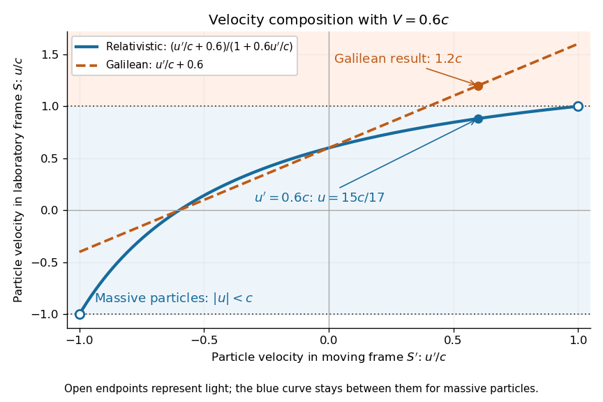

**[Figure 7](#image-relativistic-velocity-addition). Relativistic and Galilean velocity composition for a frame moving at 0.6 times the speed of light**. The horizontal coordinate is the particle's [velocity](classical-mechanics.md#velocity) in $S'$, and the vertical coordinate is its [velocity](classical-mechanics.md#velocity) in $S$. The [velocity-addition formula](#velocity-addition-formula) maps $-1<u'/c<1$ into $-1<u/c<1$; the endpoint values $\pm1$ describe [light](optics.md#light). The marked example is $u'/c=0.6$, giving $u/c=15/17$.

A short derivation differentiates the [Lorentz transformation](#lorentz-transformation): $dx'=\gamma_V(dx-Vdt)$ and $dt'=\gamma_V(dt-Vdx/c^2)$. Dividing these differentials gives the longitudinal [velocity-addition formula](#velocity-addition-formula). The transverse formulas use $dy'=dy$ and $dz'=dz$, but the same transformed time denominator; omitting it would ignore the [relativity of simultaneity](#relativity-of-simultaneity). Replacing $V$ by $-V$ gives the inverse. When both relative and particle [velocities](classical-mechanics.md#velocity) are small compared with the [speed of light](#speed-of-light), the denominator is close to one and the [nonrelativistic limit](#nonrelativistic-limit) recovers the [Galilean transformation](#galilean-transformation).

The formula lets us compare particle motion in a moving apparatus and a laboratory without losing the invariant [speed of light](#speed-of-light). Einstein's 1905 paper derives the coordinate change in §3 and the composition of [velocities](classical-mechanics.md#velocity) in §5, including the collinear formula, its light-speed case, and composition of parallel transformations. [Albert Einstein, On the Electrodynamics of Moving Bodies (1905), §§3 and 5; English translation by W. Perrett and G. B. Jeffery, electronic edition by John Walker](https://www.fourmilab.ch/etexts/einstein/specrel/www/). The [rapidity](#rapidity) parametrization makes the collinear composition particularly simple.

#### Relative speed from four-velocity contraction

↑ **Parent:** [Velocity-addition formula](#velocity-addition-formula)

For future-directed unit timelike [four-velocities](#four-velocity) in [metric signature](topological-manifold.md#metric-signature) $(+---)$, $U_1\cdot U_2/c^2$ is the [Lorentz factor](#lorentz-factor) of either observer measured in the [rest frame](mathematical-physics.md#rest-frame) of the other. In a common [inertial frame](mathematical-physics.md#inertial-frame) it equals $\gamma_1\gamma_2(1-\boldsymbol\beta_1\cdot\boldsymbol\beta_2)$. Therefore

$$
\beta_{\rm rel}^2=1-\frac{(1-\beta_1^2)(1-\beta_2^2)}{(1-\boldsymbol\beta_1\cdot\boldsymbol\beta_2)^2}.
$$

Expanding the numerator converts this to the dot-and-cross-product form of relativistic velocity addition. The invariant construction explains why the relative speed is symmetric even when the spatial velocity components belong to different [rest frames](mathematical-physics.md#rest-frame).

##### Orthogonal local velocities in Schwarzschild spacetime

↑ **Parent:** [Relative speed from four-velocity contraction](#relative-speed-from-four-velocity-contraction)

Compare two observers at one event using a common static [orthonormal frame](general-relativity.md#orthonormal-frame-in-spacetime) outside a Schwarzschild horizon. If one observer moves tangentially at speed $u$ and another radially at speed $w$, their [four-velocity](#four-velocity) contraction is $\gamma_u\gamma_w c^2$. Their relative speed therefore has the displayed form. The radial component measured by the tangential observer is $w/\gamma_u$, so Euclidean subtraction of the two original three-velocities fails. For a circular [timelike geodesic](general-relativity.md#timelike-geodesic) and radial fall from rest at infinity at radius $R$, the relative speed is $c\sqrt{3\mu/R}$, where $\mu=GM/c^2$ and $R>3\mu$.

#### Retarded radio reply to an approaching inertial observer

↑ **Parent:** [Velocity-addition formula](#velocity-addition-formula)

Let a receiver be initially at distance $D$ from a stationary responder and approach at speed $\beta c$. A light signal takes $D/c$ to reach the responder, which waits time $\delta$ and replies. Intersecting the reply's [null worldline](#null-worldline) with the receiver's [worldline](#world-line) gives

$$
t_D=\frac{2D/c+\delta}{1+\beta},\qquad\tau_D=\frac{t_D}{\gamma}.
$$

The receiver's [proper time](#proper-time) is $\tau_D$. These expressions describe reception before arrival when the reply is sent before the receiver reaches the responder; otherwise the trajectory after arrival must be specified.

#### Fizeau experiment

↑ **Parent:** [Velocity-addition formula](#velocity-addition-formula)  
ⓦ [Wiki](https://en.wikipedia.org/wiki/Fizeau_experiment)

In 1851 [Hippolyte Fizeau](physicist.md#hippolyte-fizeau) detected a change in [light](optics.md#light) propagation through moving [water](chemical-substance.md#water) using [interference fringes](physical-optics.md#interference-fringe). Sunlight entered a telescope through a partially reflecting mirror; two slits selected beams passing through parallel glass tubes, each $1.487\,\mathrm m$ long with $5.3\,\mathrm{mm}$ internal diameter. A second telescope and focal mirror exchanged the tubes on return, and the beams recombined at a graduated eyepiece. Compressed air drove [water](chemical-substance.md#water) between reservoirs, producing opposite flows; reversing both flows reversed the [interference fringe](physical-optics.md#interference-fringe) displacement. The double transit suppressed static differences in [temperature](temperature.md) and [pressure](pressure.md); filling only one tube with [water](chemical-substance.md#water) tested this compensation. Separate supports reduced mechanical disturbance. [Hippolyte Fizeau](physicist.md#hippolyte-fizeau) estimated flow [speed](classical-mechanics.md#speed) from [volumetric flow rate](fluid-mechanics.md#volumetric-flow-rate) divided by tube cross section.[1851 report, apparatus and compensation paragraphs; flow production, independent supports and fringe observations; scanned translation pp. 569–571](physics-bibliography.md#the-hypotheses-relating-to-the-luminous-aether-by-hippolyte-fizeau)

The [Fizeau experiment](#fizeau-experiment) turns a tiny change in [phase velocity](dispersion-relation.md#phase-velocity) into a visible fraction of an [interference fringe](physical-optics.md#interference-fringe). The [Fizeau experiment path-length convention](#fizeau-experiment-path-length-convention) below explains why both tube passages contribute with the same sign for one beam and the opposite sign for the other. This makes the apparatus sensitive to the part of the [phase difference](wave.md#phase-difference) that reverses with the flow, while rejecting disturbances shared by both beams.

##### Fresnel drag coefficient

↑ **Parent:** [Fizeau experiment](#fizeau-experiment)

The [Fresnel drag coefficient](#fresnel-drag-coefficient) is the factor $f=1-1/n^2$ multiplying a transparent medium's [velocity](classical-mechanics.md#velocity) in the first-order change of collinear [light](optics.md#light) [phase velocity](dispersion-relation.md#phase-velocity), when [optical dispersion](geometrical-optics.md#dispersion-optics) is neglected. Here $n$ is the medium's [refractive index](electromagnetic-wave.md#refractive-index) in its [rest frame](mathematical-physics.md#rest-frame). The name recalls [Augustin Jean Fresnel](physicist.md#augustin-jean-fresnel)'s partial-drag law; [special relativity](special-relativity.md) obtains the same coefficient from the [velocity-addition formula](#velocity-addition-formula) without introducing a [luminiferous aether](physics.md#luminiferous-aether).

Let the [water](chemical-substance.md#water) move at signed [velocity](classical-mechanics.md#velocity) $u$ along the positive laboratory axis, with $|u|\ll c/n$, where $c$ is the vacuum [speed of light](#speed-of-light). Assume a transparent medium with constant $n>1$, uniform flow and negligible [optical dispersion](geometrical-optics.md#dispersion-optics). In the [water](chemical-substance.md#water)'s local [rest frame](mathematical-physics.md#rest-frame), a collinear constant-phase surface travels at $v'=c/n$. Dividing the [Lorentz transformation](#lorentz-transformation) differentials along that surface gives the same longitudinal [velocity-addition formula](#velocity-addition-formula) as for a particle:

$$
v_{\rm lab}=\frac{c/n+u}{1+u/(nc)}
=\left(\frac cn+u\right)\left(1-\frac{u}{nc}+O\left(\frac{u^2}{c^2}\right)\right)
=\frac cn+u\left(1-\frac1{n^2}\right)+O\left(\frac{u^2}{c}\right).
$$

The correction comes from the transformed time denominator. Simply adding $u$ to $c/n$ would omit it. This argument concerns collinear [phase velocity](dispersion-relation.md#phase-velocity); in a medium with [optical dispersion](geometrical-optics.md#dispersion-optics), [group velocity](dispersion-relation.md#group-velocity) is a different quantity.[Section III, pp. 498–499, equation (1) and discussion of the collinear wave-four-vector derivation](physics-bibliography.md#fizeau’s-“aether-drag”-experiment-in-the-undergraduate-laboratory-by-thierry-lahaye-and-others)

For $n=4/3$, the [Fresnel drag coefficient](#fresnel-drag-coefficient) is $f=7/16$. A chosen flow [speed](classical-mechanics.md#speed) of $6\,\mathrm{m\,s^{-1}}$ therefore changes the forward [phase velocity](dispersion-relation.md#phase-velocity) by approximately $2.625\,\mathrm{m\,s^{-1}}$, even though the stationary-medium [phase velocity](dispersion-relation.md#phase-velocity) is about $2.25\times10^8\,\mathrm{m\,s^{-1}}$. These are model values. The invariant vacuum [speed of light](#speed-of-light) remains $c$; $c/n$ describes propagation through matter in its own [rest frame](mathematical-physics.md#rest-frame).

##### Fizeau experiment path-length convention

↑ **Parent:** [Fizeau experiment](#fizeau-experiment)

Use the schematic below to count the [water](chemical-substance.md#water) traversals explicitly. Each stationary tube has laboratory length $\ell$. In the displayed setting, upper-tube [water](chemical-substance.md#water) flows right and lower-tube [water](chemical-substance.md#water) flows left, each at [speed](classical-mechanics.md#speed) $u>0$. Beam A goes right through the upper tube, exchanges tubes at the far optics, and returns left through the lower tube: it follows the flow twice. Beam B goes right through the lower tube and returns left through the upper tube: it opposes the flow twice. Each complete beam path therefore contains total [water](chemical-substance.md#water) length $L=2\ell$, not $\ell$ or $4\ell$. The connecting air paths and fixed optics are assumed to contribute no flow-dependent [phase difference](wave.md#phase-difference).

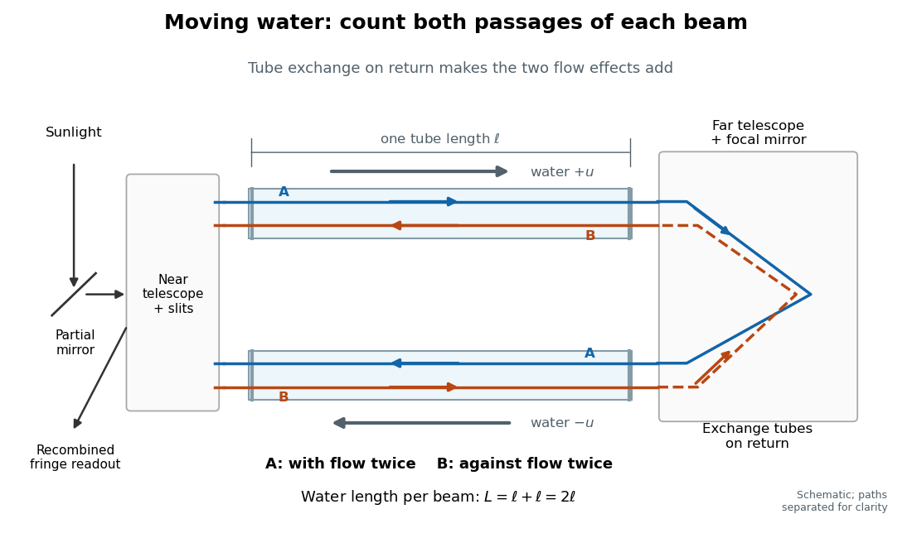

**[Figure 8](#image-fizeau-counterflow-paths). Counterflow path accounting: beam A follows the water in both tubes, beam B opposes it, and each beam traverses total water length 2ℓ**. Original schematic of the tube exchange and recombination, not a scaled optical ray trace. Parallel coloured lines separate overlapping counterpropagating beams for readability. The grey arrows show [water](chemical-substance.md#water) flow; reversing both grey arrows exchanges the roles of A and B.

Let $v_+$ and $v_-$ be positive [phase velocity](dispersion-relation.md#phase-velocity) magnitudes along and against the [water](chemical-substance.md#water) flow:

$$
v_+=\frac{c/n+u}{1+u/(nc)},\qquad
v_-=\frac{c/n-u}{1-u/(nc)},\qquad
\Delta t=t_B-t_A=L\left(\frac1{v_-}-\frac1{v_+}\right).
$$

For a laboratory source of [frequency](wave.md#frequency) $\nu=c/\lambda_0$, where $\lambda_0$ is its vacuum [wavelength](wave-equation.md#wavelength), define the signed [interference fringe](physical-optics.md#interference-fringe) offset $N$ by the propagation [phase difference](wave.md#phase-difference) $\Delta\phi=2\pi\nu\Delta t=2\pi N$. This is an equivalent phase delay between steady beams; no stopwatch resolves their transit-time difference. Subtract the zero-flow baseline and expand to first order:

$$
\Delta t\simeq\frac{2Lu}{c^2}(n^2-1)=\frac{4\ell u}{c^2}(n^2-1),\qquad
N(u)\simeq\frac{2Lu}{c\lambda_0}(n^2-1)=\frac{4\ell u}{c\lambda_0}(n^2-1).
$$

Thus one shifted fringe corresponds to one cycle of [phase difference](wave.md#phase-difference). If the stationary pattern has spatial [interference fringe spacing](physical-optics.md#interference-fringe-spacing) $d$, a simple readout model is $I(x)=I_0[1+\mathcal V\cos(2\pi x/d+2\pi N)]$, where $\mathcal V$ is the [interference visibility](physical-optics.md#interferometric-visibility). The maxima shift by $-dN$ with this choice of screen coordinate. A sign assigned to “rightward” motion depends on the image orientation; the magnitude in fringe units does not.

Reversing both flows gives $N(-u)=-N(u)$. The displacement between equal and opposite settings therefore has magnitude

$$
\left|N(u)-N(-u)\right|=2|N(u)|\simeq\frac{8\ell |u|}{c\lambda_0}(n^2-1).
$$

The factor $2$ from comparing opposite flows is additional to the factor $2$ already included in $L=2\ell$. Repeating a round trip in just one flowing tube would instead put a beam with the flow once and against it once; that geometry does not produce the two same-sign contributions drawn here.

##### Fizeau experiment worked example

↑ **Parent:** [Fizeau experiment](#fizeau-experiment)

Choose $\ell=1.50\,\mathrm m$, $n=4/3$, $\lambda_0=550\,\mathrm{nm}$ and $u=6.00\,\mathrm{m\,s^{-1}}$, with $c=299792458\,\mathrm{m\,s^{-1}}$. These are illustrative choices, not measured values or a reconstruction of [Hippolyte Fizeau](physicist.md#hippolyte-fizeau)'s data. Each beam traverses $L=3.00\,\mathrm m$ of [water](chemical-substance.md#water). The nondispersive prediction is

$$
N=\frac{4(1.50)(6.00)(7/9)}{(299792458)(550\times10^{-9})}\simeq0.16981,\qquad
2N\simeq0.33963,\qquad
\Delta t\simeq3.1154\times10^{-16}\,\mathrm s.
$$

The first number is the offset from rest to one flow setting; the second compares equal opposite settings. The very short equivalent delay explains why [interference](physical-optics.md#interference-wave-propagation) is useful: a measurable fraction of a [wavelength](wave-equation.md#wavelength) replaces an unattainable direct timing measurement.

**[Figure 9](#image-fizeau-fringe-shift-versus-flow). Calculated fringe offsets for chosen parameters: partial drag gives 0.16981 fringe at 6 m/s, whereas equal opposite flows differ by 0.33963 fringe**. Original model curves for tubes of length $\ell=1.50\,\mathrm m$, [refractive index](electromagnetic-wave.md#refractive-index) $n=4/3$ and vacuum [wavelength](wave-equation.md#wavelength) $\lambda_0=550\,\mathrm{nm}$. Solid curves show the first-order rest-to-flow offset and the offset between reversed settings; the dashed curve is the rest-to-flow prediction from ordinary addition of $c/n$ and $u$. No points represent experimental measurements, and [optical dispersion](geometrical-optics.md#dispersion-optics) is omitted.

The [Galilean transformation](#galilean-transformation) would give [phase velocity](dispersion-relation.md#phase-velocity) magnitudes $c/n\pm u$, hence $N_{\rm full}\simeq4\ell u n^2/(c\lambda_0)$. At the chosen values this is $0.38815$ fringe from rest, larger than the [special relativity](special-relativity.md) prediction by $n^2/(n^2-1)=16/7$. A model with no flow-induced change of [phase velocity](dispersion-relation.md#phase-velocity) instead gives $N=0$. The three alternatives are experimentally distinguishable even when $u/c$ is tiny.

[Hippolyte Fizeau](physicist.md#hippolyte-fizeau)'s positive displacement favoured [Augustin Jean Fresnel](physicist.md#augustin-jean-fresnel)'s partial-drag law over zero or full drag. He explicitly distinguished support for that law from establishing its underlying [luminiferous aether](physics.md#luminiferous-aether) hypothesis.[Comparison of the three predictions and final paragraph qualifying the inference about Fresnel's hypothesis; scanned translation pp. 572–573](physics-bibliography.md#the-hypotheses-relating-to-the-luminous-aether-by-hippolyte-fizeau) The [Fizeau experiment](#fizeau-experiment) therefore supplies a nonzero relative-motion measurement, not a null test proving an [luminiferous aether](physics.md#luminiferous-aether)'s absence. The derivation above exhibits the same first-order law within [special relativity](special-relativity.md), showing why agreement with the coefficient alone cannot select an physical interpretation.

Two limitations matter for precision. The [velocity profile](viscous-fluid-flow.md#velocity-profile) sampled by the beam need not equal the cross-sectional average inferred from [volumetric flow rate](fluid-mechanics.md#volumetric-flow-rate). Also, the [Doppler effect](wave.md#doppler-effect) gives opposite rest-frame [frequencies](wave.md#frequency) for the counterpropagating beams. With [optical dispersion](geometrical-optics.md#dispersion-optics), the coefficient $n^2-1$ in the [interference fringe](physical-optics.md#interference-fringe) formula becomes

$$
n^2-1+n\omega\frac{dn}{d\omega}
=n^2-1-n\lambda_0\frac{dn}{d\lambda_0},
$$

where the [refractive index](electromagnetic-wave.md#refractive-index) and its derivative are evaluated for stationary [water](chemical-substance.md#water) at the laboratory [angular frequency](lagrangian-mechanics.md#angular-frequency) $\omega=2\pi c/\lambda_0$. A wavelength-independent $n$ therefore defines an approximation, not a precision fit to real [water](chemical-substance.md#water).[Section III, p. 499, equation (7), dispersion from opposite Doppler shifts; section IV.B, pp. 499–500, mean flow versus velocity at the beam](physics-bibliography.md#fizeau’s-“aether-drag”-experiment-in-the-undergraduate-laboratory-by-thierry-lahaye-and-others) Flow reversal removes a fixed [phase difference](wave.md#phase-difference), but a mechanical or [temperature](temperature.md) change that reverses with the flow can still imitate the signal and must be controlled.

## Sagnac effect

↑ **Parent:** [Special relativity](special-relativity.md)  
ⓦ [Wiki](https://en.wikipedia.org/wiki/Sagnac_effect)

The [Sagnac effect](#sagnac-effect) is a difference in return times, or an associated [interference fringe](physical-optics.md#interference-fringe) displacement, for [light](optics.md#light) sent in opposite directions around a closed optical path in a rotating apparatus. The [light](optics.md#light) leaves one [beam splitter](optical-instrument.md#beam-splitter), travels around the same loop in opposite senses, and returns to the rotating [beam splitter](optical-instrument.md#beam-splitter) and readout. For a slowly rotating apparatus in flat [spacetime](#spacetime), the leading laboratory arrival-time difference is

$$
\Delta t=t_+-t_-\simeq\frac{4\boldsymbol\Omega\cdot\mathbf A}{c^2},\qquad
\mathbf A=\frac12\oint_C\mathbf r\times d\mathbf r.
$$

Here $c$ is the vacuum [speed of light](#speed-of-light), $\boldsymbol\Omega$ is the apparatus's [angular velocity](rigid-body-dynamics.md#angular-velocity) relative to an [inertial frame](mathematical-physics.md#inertial-frame), and $\mathbf A$ is the [vector area](differential-geometry.md#vector-area) oriented by the chosen positive direction around the [closed curve](topology.md#closed-curve) $C$. With positive [rotation](riemannian-geometry.md#rotation-mathematics) about the upward [normal vector](differential-geometry.md#normal-vector), the counterclockwise beam is labelled $+$ and arrives later. Reversing [rotation](riemannian-geometry.md#rotation-mathematics), or reversing the orientation convention alone, changes the sign of $\Delta t$.

The surprise is that a small loop can reveal its [rotation](riemannian-geometry.md#rotation-mathematics) by comparing two beams locally, even though each local vacuum [speed of light](#speed-of-light) measurement gives $c$. A [rotating reference frame](mathematical-physics.md#rotating-reference-frame) is not a single [inertial frame](mathematical-physics.md#inertial-frame): a beam must catch the moving receiver after a full circuit. The [Sagnac area law](#sagnac-area-law) makes this difference a practical way to measure [angular velocity](rigid-body-dynamics.md#angular-velocity), while the [Relativistic Sagnac delay on a circular ring](#relativistic-sagnac-delay-on-a-circular-ring) distinguishes laboratory coordinate time from the receiver's [proper time](#proper-time).

### Sagnac interferometer

↑ **Parent:** [Sagnac effect](#sagnac-effect)

A [Sagnac interferometer](#sagnac-interferometer) uses a [beam splitter](optical-instrument.md#beam-splitter) to send [light](optics.md#light) with [optical coherence](physical-optics.md#optical-coherence) around a common closed optical path in opposite directions, then recombines the beams to read their [phase difference](wave.md#phase-difference). [Mirrors](optical-instrument.md#mirror) or a guiding path define the loop; the source, [beam splitter](optical-instrument.md#beam-splitter), loop and readout rotate together in the basic experiment. A small relative beam tilt makes spatial [interference fringes](physical-optics.md#interference-fringe) whose displacement reveals a change of [phase difference](wave.md#phase-difference). At one fixed output, a [photodetector](optical-instrument.md#photodetector) can instead record the corresponding change in [light intensity](wave.md#light-intensity).

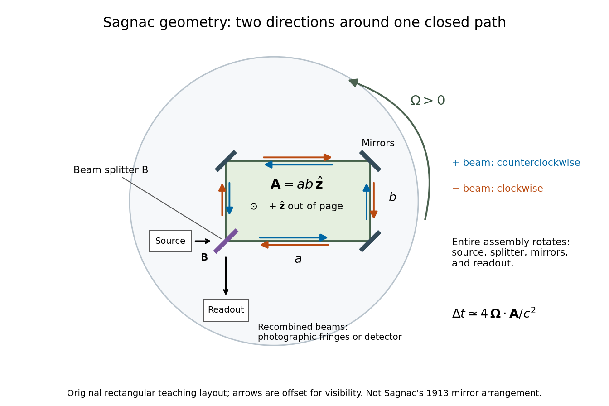

**[Figure 10](#image-sagnac-rotating-interferometer-geometry). Counterpropagating light around a rotating closed loop, with a shared beam splitter and readout**. Original rectangular teaching layout. The [vector area](differential-geometry.md#vector-area) points out of the page for the positive counterclockwise path. The source and readout rotate with the [mirrors](optical-instrument.md#mirror). Arrow offsets separate the two directions visually; they do not represent different physical paths. The drawing is not a reconstruction of the historical mirror arrangement.

#### Sagnac rotating-ring experiment

↑ **Parent:** [Sagnac interferometer](#sagnac-interferometer)

In 1913 [Georges Sagnac](physicist.md#georges-sagnac) mounted a lamp, [collimator](optical-instrument.md#collimator), [beam splitter](optical-instrument.md#beam-splitter), four [mirrors](optical-instrument.md#mirror) and [photographic plate](optical-instrument.md#photographic-plate) on a horizontal rotating platform. The [mirrors](optical-instrument.md#mirror) defined a closed polygon; the two beams traversed it in opposite senses. A slight [beam splitter](optical-instrument.md#beam-splitter) adjustment produced visible [interference fringes](physical-optics.md#interference-fringe). A motor brought the platform to steady [rotation](riemannian-geometry.md#rotation-mathematics), and switching the lamp exposed the plate. Comparing opposite senses of [rotation](riemannian-geometry.md#rotation-mathematics) revealed a reversing displacement. Changing the [beam splitter](optical-instrument.md#beam-splitter) adjustment supplied a further check against optical deformation. The report compared measured and calculated displacements. [Georges Sagnac](physicist.md#georges-sagnac) interpreted this as evidence for a [luminiferous aether](physics.md#luminiferous-aether); the relativistic derivation below reproduces the delay without that hypothesis.[Georges Sagnac, 1913 second report, inspected in William Lonc's 2008 English translation, pp. 77–80, §§1–3: rotating apparatus, photographic procedure, reversal and deformation controls, comparison table, historical interpretation](physics-bibliography.md#regarding-the-proof-for-the-existence-of-a-luminiferous-ether-using-a-rotating-inteferometer-experiment-by-georges-sagnac)

The readout measures a relative [wave phase](wave.md#phase-waves), not two stopwatch readings separated by an optical transit time. Reversal isolates a contribution odd in [angular velocity](rigid-body-dynamics.md#angular-velocity): if a signed [interference fringe](physical-optics.md#interference-fringe) position is $q(\Omega)=q_0+k\Omega$ to leading order, then $[q(\Omega)-q(-\Omega)]/2=k\Omega$ cancels the fixed offset $q_0$. Changes of alignment or [temperature](temperature.md) correlated with reversal can survive this subtraction. Thus the experimental inference concerns a reproducible rotating-loop [phase difference](wave.md#phase-difference), with controls for disturbances; it is not by itself a unique test of an underlying propagation hypothesis.

### Sagnac area law

↑ **Parent:** [Sagnac effect](#sagnac-effect)

For a rigidly rotating prescribed vacuum path, use spatial coordinates attached to the apparatus and laboratory time $t$. At a path [point](geometry-and-topology.md#point-geometry) $\mathbf r$, the local apparatus [velocity](classical-mechanics.md#velocity) is $\mathbf v=\boldsymbol\Omega\times\mathbf r$. A [light](optics.md#light) displacement has instantaneous laboratory displacement $d\mathbf r+\mathbf v\,dt$, up to the common rotation of the spatial axes. The [null condition](#null-condition) is therefore

$$
c^2dt^2=|d\mathbf r+\mathbf v\,dt|^2.
$$

Write $d\ell=|d\mathbf r|$. To first order in $|\mathbf v|/c$, the positive root is

$$
dt\simeq\frac{d\ell}{c}+\frac{\mathbf v\cdot d\mathbf r}{c^2}.
$$

Reversing the path reverses the [dot product](inner-product.md#dot-product) term but leaves the leading path-length term unchanged. Subtract the two return times and use the [scalar triple product](multilinear-algebra.md#scalar-triple-product) identity:

$$
\Delta t\simeq\frac{2}{c^2}\oint_C(\boldsymbol\Omega\times\mathbf r)\cdot d\mathbf r
=\frac{2}{c^2}\boldsymbol\Omega\cdot\oint_C\mathbf r\times d\mathbf r
=\frac{4\boldsymbol\Omega\cdot\mathbf A}{c^2}.
$$

This is a [line integral](multivariable-calculus.md#line-integral) version of the [Sagnac area law](#sagnac-area-law); the [vector area](differential-geometry.md#vector-area) identity also follows from [Stokes theorem](multivariable-calculus.md#stokes-theorem). For a mirror-defined polygon the actual ray paths move slightly as the [mirrors](optical-instrument.md#mirror) rotate; the stationary optical path at zero [rotation](riemannian-geometry.md#rotation-mathematics) gives the same first-order result. The prescribed-path calculation is an idealization, not an exact finite-speed formula for every moving-mirror layout.

The [dot product](inner-product.md#dot-product) explains the geometry: only the projection of the oriented [vector area](differential-geometry.md#vector-area) along the [angular velocity](rigid-body-dynamics.md#angular-velocity) contributes. A planar loop whose [normal vector](differential-geometry.md#normal-vector) is perpendicular to $\boldsymbol\Omega$ has zero leading delay. For repeated traversals with the same orientation, the signed [vector areas](differential-geometry.md#vector-area) add; oppositely oriented lobes can cancel even when the total unsigned [area](differential-geometry.md#surface-area) is large. Equal perimeter alone does not imply equal response. A constant translational [velocity](classical-mechanics.md#velocity) contributes nothing to this leading closed-path [line integral](multivariable-calculus.md#line-integral), since $\oint_Cd\mathbf r=0$.

#### Sagnac fringe shift worked example

↑ **Parent:** [Sagnac area law](#sagnac-area-law)

For a stationary rotating apparatus driven by a source with [optical coherence](physical-optics.md#optical-coherence) and proper [frequency](wave.md#frequency) $\nu_0$, define $\lambda_0=c/\nu_0$. The source [wave phase](wave.md#phase-waves) advances by $2\pi\nu_0\Delta\tau$ between the emission times of the two contributions that meet at one readout [spacetime event](#event-relativity). Define the signed phase lag $\Delta\phi$ of the $+$ contribution and the corresponding displacement $N$ in units of one [interference fringe](physical-optics.md#interference-fringe) by

$$
\Delta\phi=2\pi\nu_0\Delta\tau,\qquad
N=\frac{\Delta\phi}{2\pi}\simeq\frac{4\boldsymbol\Omega\cdot\mathbf A}{c\lambda_0}.
$$

The sign of a photographed spatial displacement also depends on the imposed fringe orientation; this definition fixes the theoretical sign through the delayed beam. In an equal-amplitude output, a representative [light intensity](wave.md#light-intensity) is $I(x)=I_{\max}[1+\cos(Kx-\Delta\phi)]/2$, where $K$ sets the chosen spatial [interference fringe spacing](physical-optics.md#interference-fringe-spacing) $2\pi/K$. Moving $\Delta\phi$ by $2\pi$ shifts the pattern by one fringe. A fixed output exactly at a bright or dark fringe has zero first-order intensity slope, so a known phase bias or a spatial fringe readout is useful for determining a small signed delay.

Choose a square of side $0.30\,\mathrm m$, a rectangle $0.40\,\mathrm m$ by $0.20\,\mathrm m$, $\lambda_0=633\,\mathrm{nm}$ and $\Omega=+10\,\mathrm{rad\,s^{-1}}$, with [angular velocity](rigid-body-dynamics.md#angular-velocity) parallel to the positive [normal vectors](differential-geometry.md#normal-vector). Both perimeters are $1.20\,\mathrm m$, but the [areas](differential-geometry.md#surface-area) are $0.090\,\mathrm{m^2}$ and $0.080\,\mathrm{m^2}$. Using $c=299792458\,\mathrm{m\,s^{-1}}$, the leading predictions are

$$
\begin{aligned}
\Delta t_{\rm square}&\simeq4.006\times10^{-17}\,\mathrm s,&N_{\rm square}&\simeq0.0189705,\\
\Delta t_{\rm rectangle}&\simeq3.560\times10^{-17}\,\mathrm s,&N_{\rm rectangle}&\simeq0.0168626.
\end{aligned}
$$

These are original model choices and predictions, not measured points. The square has $9/8$ times the response despite the equal path lengths. Reversing from $+\Omega$ to $-\Omega$ gives $N(-\Omega)-N(+\Omega)=-2N(+\Omega)$: the displacement magnitude between opposite rotations is twice the displacement magnitude from rest. Confusing these two comparisons introduces a factor-of-two error.

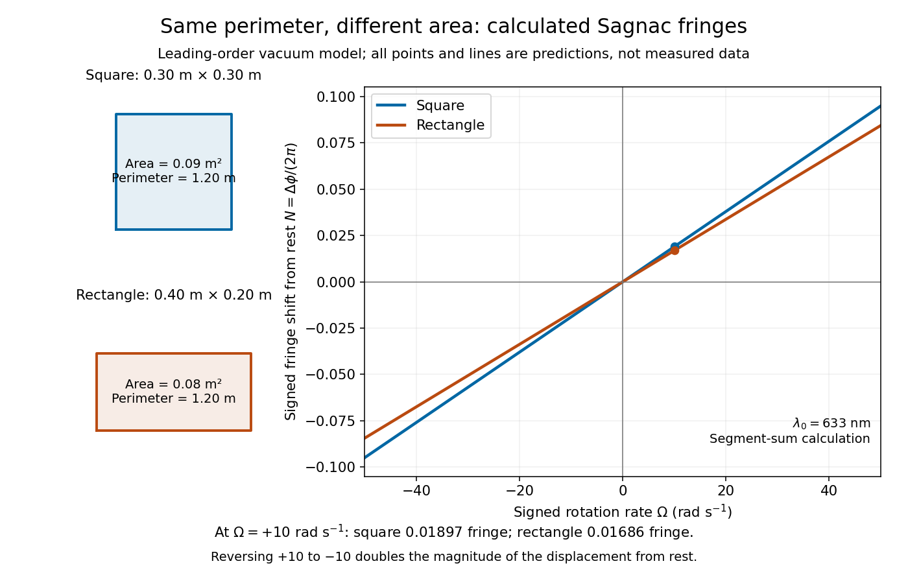

**[Figure 11](#image-sagnac-area-law-fringe-model). Independent path-segment calculation of the predicted fringe displacement for two equal-perimeter loops**. The generator sums $(\boldsymbol\Omega\times\mathbf r)\cdot d\mathbf r$ along each straight segment, rather than inserting the enclosed [area](differential-geometry.md#surface-area) into the answer. Both loops are oriented counterclockwise. Lines and marked values are leading-order vacuum model predictions; no historical measurements are plotted.

### Relativistic Sagnac delay on a circular ring

↑ **Parent:** [Sagnac effect](#sagnac-effect)

Consider an ideal circular vacuum path of laboratory radius $R$, a limit of closely spaced [mirrors](optical-instrument.md#mirror) constraining [light](optics.md#light) around the circle at laboratory [speed](classical-mechanics.md#speed) $c$. The source and detector rotate uniformly together with signed [angular velocity](rigid-body-dynamics.md#angular-velocity) $\Omega$, where $|\Omega|R<c$, in flat [spacetime](#spacetime). Let $L=2\pi R$ be the laboratory circumference and $A=\pi R^2$ the positive [area](differential-geometry.md#surface-area). The $+$ pulse travels counterclockwise and the $-$ pulse clockwise, independently of the sign of $\Omega$. Both depart from the detector at $t=0$.

Unwrap the circle into a laboratory arc coordinate. The two first-return conditions are

$$
ct_+=L+\Omega Rt_+,\qquad ct_-=L-\Omega Rt_-.
$$

Consequently the exact laboratory arrival times and their difference are

$$
t_+=\frac{L}{c-\Omega R},\qquad
t_-=\frac{L}{c+\Omega R},\qquad
\Delta t=\frac{4\Omega A}{c^2-\Omega^2R^2}.
$$

The denominators $c\mp\Omega R$ are closing rates in these laboratory equations; they are not local [speed of light](#speed-of-light) measurements by a rotating observer. The two arrival [spacetime events](#event-relativity) lie on the same detector [world line](#world-line). Its constant [speed](classical-mechanics.md#speed) is $|\Omega|R$, so [proper time](#proper-time) along that [world line](#world-line) gives

$$
\Delta\tau=\sqrt{1-\frac{\Omega^2R^2}{c^2}}\,\Delta t
=\frac{4\Omega A}{c^2\sqrt{1-\Omega^2R^2/c^2}}.
$$

Thus laboratory coordinate-time and rotating-detector [proper time](#proper-time) delays agree only to leading order at small $|\Omega|R/c$. The radius and circumference here are laboratory quantities, not lengths obtained by laying comoving rods around the rim. Finite mirror polygons, transparent media, and [optical dispersion](geometrical-optics.md#dispersion-optics) require their own path and propagation assumptions before using an exact formula.

An exact dimensionless check takes $\Omega R/c=1/5$. Relative to $L/c$, the laboratory arrival times are $5/4$ and $5/6$, giving $\Delta t/(L/c)=5/12$. The detector instead records $\Delta\tau/(L/c)=\sqrt6/6\simeq0.408248$. The leading [Sagnac area law](#sagnac-area-law) would give $\Delta t/(L/c)\simeq2/5$. These are model values chosen to make the relativistic distinction visible, not attainable parameters of the historical apparatus.

The rotating loop does not constitute a universal measurement of the [one-way speed of light](#one-way-speed-of-light). It compares completed circuits at a single readout; assigning a [velocity](classical-mechanics.md#velocity) to each remote leg additionally requires a clock synchronization convention. Local [Einstein synchronisation](#einstein-synchronisation) around a rotating rim does not close into a single globally synchronized clock network: the accumulated mismatch is another expression of the rotating-path asymmetry. Local comoving vacuum measurements still give $c$ in both directions. [Special relativity](special-relativity.md) predicts a nonzero closed-loop delay because the receiver moves during propagation, while no single comoving [inertial frame](mathematical-physics.md#inertial-frame) covers the whole circuit.

## Four-vector

↑ **Parent:** [Special relativity](special-relativity.md)  
ⓦ [Wiki](https://en.wikipedia.org/wiki/Four-vector)

A [four-vector](#four-vector) is a [vector](vector-space.md#vector) whose four [vector components](vector-space.md#coordinate-linear-algebra) transform under a [Lorentz transformation](#lorentz-transformation) as $U'^\mu=\Lambda^\mu{}_\nu U^\nu$. Its individual [vector components](vector-space.md#coordinate-linear-algebra) generally change between [inertial frames](mathematical-physics.md#inertial-frame); the [Minkowski metric](#minkowski-metric) combines them into invariant scalar products. Listing four quantities is not enough to make a [four-vector](#four-vector): their transformation law matters.

The most direct example is the displacement between two [spacetime events](#event-relativity), written $(c\Delta t,\Delta x,\Delta y,\Delta z)$. Multiplying the time difference by the [speed of light](#speed-of-light) gives all four [vector components](vector-space.md#coordinate-linear-algebra) the same length units. A [position four-vector](#position-four-vector) describes an event relative to a chosen origin, while a displacement does not depend on a common translation of the origin. [Four-momentum](#four-momentum) and [four-velocity](#four-velocity) use the same transformation rule for different physical quantities.

### Four-wavevector

↑ **Parent:** [Four-vector](#four-vector)

The [four-wavevector](#four-wavevector) combines the [angular frequency](lagrangian-mechanics.md#angular-frequency) and spatial [wavevector](elasticity-physics.md#wavevector) of a plane wave. Phase invariance gives $K'^\mu=\Lambda^\mu{}_{\nu}K^\nu$. Under a boost $\mathbf v$, $\omega'=\gamma(\omega-\mathbf v\cdot\mathbf k)$, $\mathbf k'_\parallel=\gamma(\mathbf k_\parallel-\omega\mathbf v/c^2)$ and $\mathbf k'_\perp=\mathbf k_\perp$. For metric signature $(+,-,-,-)$, $R_\mu K^\mu=\omega t-\mathbf k\cdot\mathbf r$ is a [Lorentz scalar](#lorentz-scalar). A vacuum light wave has $K_\mu K^\mu=0$.

#### Lorentz invariance of plane-wave phase

↑ **Parent:** [Four-wavevector](#four-wavevector)

The [wave phase](wave.md#phase-waves) labels a physical stage of an oscillation at a [spacetime](#spacetime) event. Treating it as a [Lorentz scalar](#lorentz-scalar) makes its [gradient](multivariable-calculus.md#gradient) $K_\mu=\partial_\mu\Phi$ a [covector](dual-space.md#covector); raising the index gives the [four-wavevector](#four-wavevector) $K^\mu=(\omega/c,\mathbf k)$. A boost along $x$ gives $\omega'=\gamma(\omega-vk_x)$ and $k_x'=\gamma(k_x-v\omega/c^2)$. Thus [angular frequency](lagrangian-mechanics.md#angular-frequency) and [wavevector](elasticity-physics.md#wavevector) transform together rather than independently.

### Position four-vector

↑ **Parent:** [Four-vector](#four-vector)

The spacetime coordinates of an event combine into a [four-vector](#four-vector) $X^a=(ct,x,y,z)$ under Lorentz transformations between inertial frames sharing an origin. For a massive particle, differentiation with respect to [proper time](#proper-time) gives its [four-velocity](#four-velocity). Under a spacetime translation, positions acquire an additive offset, while displacement four-vectors transform linearly under the Lorentz part.

### Future-pointing timelike four-vector

↑ **Parent:** [Four-vector](#four-vector)

In [metric signature](topological-manifold.md#metric-signature) $(+---)$, a future-pointing timelike [four-vector](#four-vector) has positive time component larger than its spatial magnitude. Two such vectors have strictly positive [Minkowski metric](#minkowski-metric) scalar product, since $P\cdot Q=P^0Q^0-\mathbf P\cdot\mathbf Q\geq P^0Q^0-|\mathbf P||\mathbf Q|>0$. In the opposite signature the scalar-product sign reverses, while the causal condition is the same. The future timelike cone is closed under addition, which rules out a null [photon](quantum-mechanics.md#photon) momentum equalling a sum of two massive future [four-momenta](#four-momentum).

### Four-divergence

↑ **Parent:** [Four-vector](#four-vector)

The four-divergence of a [four-vector](#four-vector) field is the [Lorentz scalar](#lorentz-scalar) contraction $\partial_\mu V^\mu$. With $x^\mu=(ct,\boldsymbol x)$, it equals $c^{-1}\partial_t V^0+\nabla\cdot\boldsymbol V$. The [four-current](electric-charge.md#four-current) has zero four-divergence, expressing local charge conservation.

## Causality

↑ **Parent:** [Special relativity](special-relativity.md)  
ⓦ [Wiki](https://en.wikipedia.org/wiki/Causality_(physics))

Causality requires an effect at an event to depend only on sources in its past light cone. Relativistic field equations implement this choice through retarded Green functions.

## Minkowski spacetime

↑ **Parent:** [Special relativity](special-relativity.md)  
ⓦ [Wiki](https://en.wikipedia.org/wiki/Minkowski_spacetime)

[Minkowski spacetime](#minkowski-spacetime) is the flat four-dimensional [spacetime](#spacetime) of [special relativity](special-relativity.md): one time coordinate and three spatial [coordinates](vector-space.md#coordinate-linear-algebra), equipped with a [Minkowski metric](#minkowski-metric). More precisely, it is an [affine space](geometry-and-topology.md#affine-space), so no [spacetime event](#event-relativity) is a preferred origin; differences between [spacetime events](#event-relativity) are [four-vectors](#four-vector). [Inertial frames](mathematical-physics.md#inertial-frame) give different [coordinates](vector-space.md#coordinate-linear-algebra) to the same [spacetime events](#event-relativity), but agree on their [Minkowski interval](#minkowski-interval).

This geometry answers two different measurement questions with one structure. Which [spacetime events](#event-relativity) can be connected by a light signal or a massive observer? The [light cone](#light-cone) classifies them. How much time does a moving clock record? Its [world line](#world-line) and the [Minkowski metric](#minkowski-metric) determine its [proper time](#proper-time). The minus sign in the [Minkowski metric](#minkowski-metric) is what allows these answers to differ from ordinary [Euclidean distance](topological-analysis.md#euclidean-distance).

For a concrete one-space-dimensional slice, start at the origin $O$ and measure $t$ in seconds and $x$ in [light-seconds](#light-second). The [spacetime event](#event-relativity) $A$ at $(t,x)=(4\,\mathrm s,3\,\mathrm{ls})$ can be reached by an observer moving at $0.75c$, whereas $B=(2\,\mathrm s,3\,\mathrm{ls})$ would require $1.5c$ to be reached directly from $O$. The [Minkowski interval](#minkowski-interval) distinguishes them even though both are three [light-seconds](#light-second) away in that [inertial frame](mathematical-physics.md#inertial-frame).

Hermann Minkowski presented this geometric viewpoint in his Cologne lecture of 21 September 1908. His account treats particle histories as [world lines](#world-line), changes of [inertial frame](mathematical-physics.md#inertial-frame) as choices of time axis, and clock readings as [proper time](#proper-time). These are connected geometric ideas, rather than separate corrections to ordinary mechanics.[Minkowski, Space and Time, §§I–III; Saha's translation in the 1920 collection](https://www.gutenberg.org/files/66944/old/66944-h/66944-h.htm)

### Time-dependent lapse can disguise flat spacetime

↑ **Parent:** [Minkowski spacetime](#minkowski-spacetime)

For positive lapse $N$, this time reparametrization gives a local [Minkowski metric](#minkowski-metric). If the new time coordinate ranges over the entire real line, it is a global isometry to Minkowski space. In particular $N=\cosh t$ gives $T=\sinh t$ and complete nonperiodic timelike geodesics. A lapse depending on the spatial coordinate instead can describe a different curved geometry; exchanging the arguments is not a harmless relabeling of the same metric.

### Complexified Minkowski spacetime

↑ **Parent:** [Minkowski spacetime](#minkowski-spacetime)

Allow the four affine Minkowski coordinates to take independent complex values, obtaining $M_{\mathbb C}\simeq\mathbb C^4$ with the holomorphic extension of the flat conformal metric. In two-spinor coordinates $x^{AA'}$, the metric is proportional to $\epsilon_{AB}\epsilon_{A'B'}dx^{AA'}dx^{BB'}$. The [twistor incidence relation](general-relativity.md#twistor-incidence-relation) associates a [complex projective line](algebraic-topology.md#complex-projective-line) to each affine point; compactification adds the points at conformal infinity.

### Rindler wedge

↑ **Parent:** [Minkowski spacetime](#minkowski-spacetime)

The right [Rindler wedge](#rindler-wedge) is the open region $X>|T|$ of Minkowski spacetime. Coordinates $T=\rho\sinh\tau$, $X=\rho\cosh\tau$, $\rho>0$, give metric $-\rho^2d\tau^2+d\rho^2+dY^2+dZ^2$. The wedge extends into Minkowski spacetime and is geodesically incomplete, while its constant-$\tau$ slices are Cauchy surfaces for the wedge itself.

### Rindler coordinates

↑ **Parent:** [Minkowski spacetime](#minkowski-spacetime)  
ⓦ [Wiki](https://en.wikipedia.org/wiki/Rindler_coordinates)

For $\rho>0$, these coordinates cover a wedge of [Minkowski spacetime](#minkowski-spacetime) and give $ds^2=-\kappa^2\rho^2dt^2+d\rho^2$ in two dimensions. A constant-$\rho$ observer has proper acceleration $1/\rho$ and the [Unruh effect](quantum-field-theory.md#unruh-effect) temperature $1/(2\pi\rho)$ in natural units. The apparent degeneration at $\rho=0$ is a coordinate horizon.

#### Rindler null geodesics

↑ **Parent:** [Rindler coordinates](#rindler-coordinates)

For $ds^2=(\alpha x)^2dt^2-dx^2$ in a patch with $x\ne0$, the null paths solve $dx/dt=\pm\alpha x$, giving $x=C e^{\pm\alpha t}$ with $C\ne0$. They are geodesics after choosing an [affine parameter](riemannian-geometry.md#affine-parameter). The [Rindler coordinates](#rindler-coordinates) $X=x\cosh(\alpha t)$, $cT=x\sinh(\alpha t)$ give $ds^2=c^2dT^2-dX^2$ and $X\pm cT=x e^{\pm\alpha t}$. Thus each exponential path is a straight inertial null line. A literal $x=0$ curve is outside this degenerate coordinate chart, not an extra null geodesic within it.

### Minkowski metric

↑ **Parent:** [Minkowski spacetime](#minkowski-spacetime)

With the mostly-plus [metric signature](topological-manifold.md#metric-signature) $(-,+,+,+)$ and [coordinates](vector-space.md#coordinate-linear-algebra) $X^\mu=(ct,x,y,z)$, the [Minkowski metric](#minkowski-metric) is the [nondegenerate bilinear form](bilinear-form.md#nondegenerate-bilinear-form)

$$
\eta_{\mu\nu}=\operatorname{diag}(-1,1,1,1),\qquad
U\cdot V=-U^0V^0+U^1V^1+U^2V^2+U^3V^3.
$$

It is a [symmetric bilinear form](bilinear-form.md#symmetric-bilinear-form), but not a [positive-definite bilinear form](bilinear-form.md#positive-definite-bilinear-form). For example, $U=(1,1,0,0)$ is nonzero yet $U\cdot U=0$, making it a [null vector](#null-vector). This does not make the [Minkowski metric](#minkowski-metric) degenerate: some other [vectors](vector-space.md#vector) have nonzero pairing with $U$.

Applied to infinitesimal displacements, the [Minkowski metric](#minkowski-metric) gives

$$
ds^2=-c^2dt^2+dx^2+dy^2+dz^2.
$$

For a [timelike curve](#timelike-curve), a clock records $d\tau=\sqrt{-ds^2}/c$. For a [null curve](#null-curve), $ds^2=0$. For [spacelike separation](#spacelike-separation), the positive [Minkowski interval](#minkowski-interval) measures a different kind of separation. A [Lorentz transformation](#lorentz-transformation) preserves this form, expressed in [matrix](vector-space.md#matrix) notation by $\Lambda^T\eta\Lambda=\eta$, although it need not preserve ordinary [Euclidean distance](topological-analysis.md#euclidean-distance) in the four-component coordinate list.

#### Minkowski interval

↑ **Parent:** [Minkowski metric](#minkowski-metric)

The squared interval between two events in [Minkowski spacetime](#minkowski-spacetime) is the quadratic form of their coordinate difference under the [Minkowski metric](#minkowski-metric). In signature $(-,+,+,+)$ it is $-c^2\Delta t^2+|\Delta\mathbf x|^2$. [Lorentz transformations](#lorentz-transformation) preserve this quadratic form; timelike, spacelike and null separation correspond to negative, positive and zero values.

The opposite [metric signature](topological-manifold.md#metric-signature) $(+,-,-,-)$ reverses the sign of the [Minkowski interval](#minkowski-interval), giving $c^2\Delta t^2-|\Delta\mathbf x|^2$; the physical classification and [proper time](#proper-time) stay the same. State the convention before using a sign to identify a separation. With the mostly-plus convention here, a straight clock segment has $s^2=-c^2\Delta\tau^2$, while a light signal has $s^2=0$. [Richard Fitzpatrick, University of Texas: Spacetime Interval, using the opposite sign convention](https://farside.ph.utexas.edu/teaching/355/Surveyhtml/node136.html).

##### Timelike separation

↑ **Parent:** [Minkowski interval](#minkowski-interval)

Two distinct [spacetime events](#event-relativity) have [timelike separation](#timelike-separation) when their displacement has negative [Minkowski interval](#minkowski-interval) in [metric signature](topological-manifold.md#metric-signature) $(-,+,+,+)$, equivalently $c|\Delta t|>|\Delta\mathbf x|$. A massive observer can connect them along a straight [timelike curve](#timelike-curve). If the later [spacetime event](#event-relativity) has $\Delta t>0$, every [Lorentz transformation](#lorentz-transformation) in the [orthochronous Lorentz group](#orthochronous-lorentz-group) keeps it later. The elapsed [proper time](#proper-time) on the straight inertial segment is $\sqrt{-s^2}/c$.

In the [light-second](#light-second) units of the [Minkowski spacetime](#minkowski-spacetime) example, $O$ to $A$ has $s^2=(-4^2+3^2)\,\mathrm{ls}^2=-7\,\mathrm{ls}^2$. Its straight moving clock therefore records $\sqrt7\,\mathrm s$, approximately $2.646\,\mathrm s$, while the coordinate time difference is $4\,\mathrm s$. Coordinate time and [proper time](#proper-time) answer different questions.

##### Null separation

↑ **Parent:** [Minkowski interval](#minkowski-interval)

Distinct [spacetime events](#event-relativity) have [null separation](#null-separation) when their displacement has zero [Minkowski interval](#minkowski-interval), equivalently $c|\Delta t|=|\Delta\mathbf x|$. They can be joined by a straight vacuum light ray. Their nonzero displacement is a [null vector](#null-vector), so the zero squared interval does not mean that the [spacetime events](#event-relativity) coincide. For example, $(t,x)=(3\,\mathrm s,3\,\mathrm{ls})$ is null separated from the origin.

#### Light-cone coordinates

↑ **Parent:** [Minkowski metric](#minkowski-metric)

For mostly-plus signature, $x^+=(x^{D-1}+x^0)/\sqrt2$ and $x^-=(x^{D-1}-x^0)/\sqrt2$ give $ds^2=2dx^+dx^-+dx^Idx^I$. In this convention raising a plus or minus derivative exchanges the two labels.

#### Minkowski norm

↑ **Parent:** [Minkowski metric](#minkowski-metric)

The Minkowski norm is the Lorentz-invariant quadratic form $U\cdot U=\eta_{\mu\nu}U^\mu U^\nu$.

This quadratic form belongs to the geometry of [Minkowski spacetime](#minkowski-spacetime); the spacetime itself is a broader concept than this squared norm.

#### Light cone

↑ **Parent:** [Minkowski metric](#minkowski-metric)  
ⓦ [Wiki](https://en.wikipedia.org/wiki/Light_cone)

The [light cone](#light-cone) of a [spacetime event](#event-relativity) $O$ consists of $O$ together with the [spacetime events](#event-relativity) having [null separation](#null-separation) from it. In the [coordinates](vector-space.md#coordinate-linear-algebra) of an [inertial frame](mathematical-physics.md#inertial-frame) centered on $O$, it obeys

$$
|\mathbf x|^2=c^2t^2.
$$

For $t>0$ it traces an expanding spherical flash of light, with radius $ct$ at time $t$; for $t<0$ it describes possible incoming light rays. A [spacetime diagram](mathematical-physics.md#spacetime-diagram) with one spatial coordinate shows the two lines $x=\pm ct$. The apparent $45^\circ$ angle uses equal scales for $x$ and $ct$ and is not a separate physical angle.

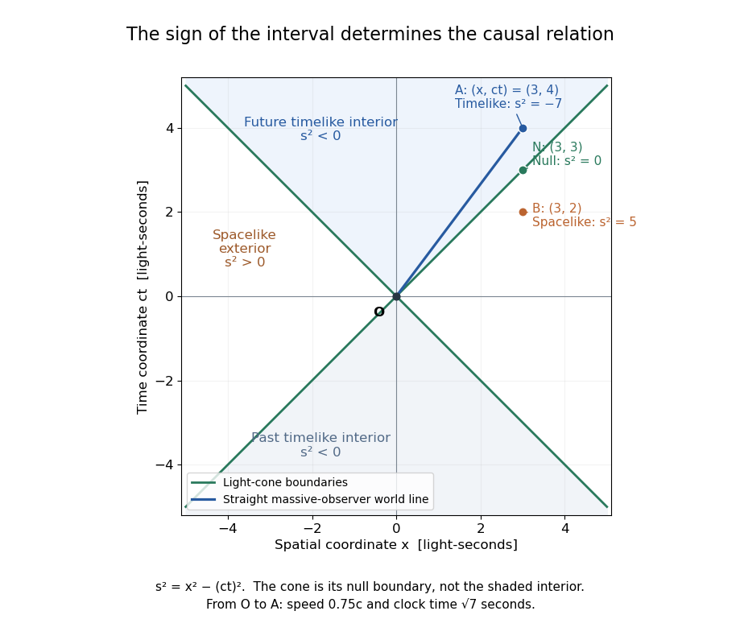

**[Figure 12](#image-light-cone-boundaries-separate-timelike-null-and-spacelike-events-relative-to-the-origin). Light-cone boundaries separate timelike, null and spacelike events relative to the origin**.

The [light cone](#light-cone) is the boundary, while its interior has [timelike separation](#timelike-separation) from $O$. An outgoing light ray follows the boundary; a future-directed massive observer's [world line](#world-line) remains inside it. The exterior has [spacelike separation](#spacelike-separation): no signal travelling at or below the [speed of light](#speed-of-light) can connect its [spacetime events](#event-relativity) directly to $O$. This separates possible causal influence from merely being assigned a later coordinate time.

In the diagram, $A=(4\,\mathrm s,3\,\mathrm{ls})$ is inside the future boundary, $N=(3\,\mathrm s,3\,\mathrm{ls})$ is on it, and $B=(2\,\mathrm s,3\,\mathrm{ls})$ is outside. Their squared [Minkowski intervals](#minkowski-interval) are respectively $-7,0,5$ in $\mathrm{ls}^2$. Thus $B$ occurs later than $O$ in the displayed [inertial frame](mathematical-physics.md#inertial-frame) while still being unable to receive a light-speed-or-slower signal sent from $O$.

The usefulness is immediate for an experiment: a detector's reading can depend on a source event only if a causal influence can reach it. A [Lorentz boost](#lorentz-boost) changes [coordinates](vector-space.md#coordinate-linear-algebra) but preserves this classification. For a boost with $\beta=0.8$ and [Lorentz factor](#lorentz-factor) $\gamma=5/3$, applying the [Lorentz transformation](#lorentz-transformation) gives, in [light-second](#light-second) length units,

$$
\begin{aligned}
(ct,x)_A=(4,3)&\longmapsto (ct',x')_A=(8/3,-1/3),\\
(ct,x)_N=(3,3)&\longmapsto (ct',x')_N=(1,1),\\
(ct,x)_B=(2,3)&\longmapsto (ct',x')_B=(-2/3,7/3).
\end{aligned}
$$

The corresponding squared [Minkowski intervals](#minkowski-interval) remain $-7,0,5$. In particular $B$ is now earlier than $O$, which is allowed for [spacelike separation](#spacelike-separation); $A$ remains later.

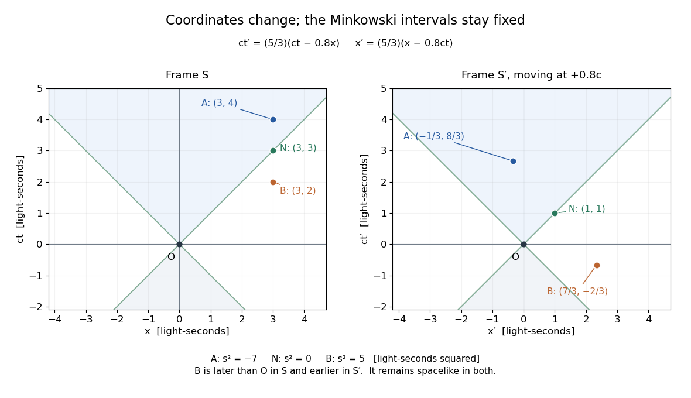

**[Figure 13](#image-a-boost-at-0-8c-changes-event-coordinates-and-spacelike-time-order-while-preserving-every-minkowski-interval). A boost at 0.8c changes event coordinates and spacelike time order while preserving every Minkowski interval**.

##### Past light cone

↑ **Parent:** [Light cone](#light-cone)

The [past light cone](#past-light-cone) of a [spacetime event](#event-relativity) $O$ is the past-directed part of its [light cone](#light-cone). In [Minkowski spacetime](#minkowski-spacetime), its [spacetime events](#event-relativity) satisfy $|\Delta\mathbf x|=-c\Delta t$ with $\Delta t<0$. They are the possible emission events of light rays arriving at $O$. The interior also contains events that can send slower signals to $O$. The [retarded potential](relativistic-electromagnetism.md#retarded-potential) of a moving point [electric charge](electric-charge.md), given by the [Liénard–Wiechert potential](relativistic-electromagnetism.md#lienard-wiechert-potential), uses the emission event where the source's [world line](#world-line) intersects this boundary.

##### Future light cone

↑ **Parent:** [Light cone](#light-cone)

The [future light cone](#future-light-cone) is the future-directed part of the [light cone](#light-cone) of a [spacetime event](#event-relativity). Its boundary consists of the events reached by outgoing light rays. Events reached by slower causal signals lie inside the boundary; [relativistic causality](#relativistic-causality) forbids a controllable signal from reaching the spacelike exterior.

##### Speed of light

↑ **Parent:** [Light cone](#light-cone)  
ⓦ [Wiki](https://en.wikipedia.org/wiki/Speed_of_light)

The speed of light $c$ is the invariant speed of every inertial frame and the limiting speed of causal propagation in special relativity.

###### One-way speed of light

↑ **Parent:** [Speed of light](#speed-of-light)  
ⓦ [Wiki](https://en.wikipedia.org/wiki/One-way_speed_of_light)

A one-way [speed of light](#speed-of-light) measurement assigns a travel time between spatially separated emission and reception events and therefore requires a distant-clock synchronization convention. In an [inertial frame](mathematical-physics.md#inertial-frame), [Einstein synchronisation](#einstein-synchronisation) assigns the vacuum value $c$ in either direction. A completed-loop comparison such as the [Sagnac effect](#sagnac-effect) is a different observable.

###### Light-second

↑ **Parent:** [Speed of light](#speed-of-light)

A [light-second](#light-second) is a unit of length: the distance vacuum [light](optics.md#light) travels in one second. It is useful in a [spacetime diagram](mathematical-physics.md#spacetime-diagram) because a time of one second corresponds to a $ct$ coordinate of one [light-second](#light-second), making the slopes $x=\pm ct$ of the [light cone](#light-cone) particularly easy to read. The unit is a distance, rather than an elapsed time.

##### Null directions

↑ **Parent:** [Light cone](#light-cone)

Null directions are tangent directions of the [light cone](#light-cone); their Minkowski squared norm is zero.

A direction represented by a nonzero [null vector](#null-vector) has zero [Minkowski norm](#minkowski-norm). Such directions form the generators of the [light cone](#light-cone).

#### Null curve

↑ **Parent:** [Minkowski metric](#minkowski-metric)

A null curve has tangent $u$ satisfying $g(u,u)=0$. It represents the possible spacetime path of a light signal.

Its nonzero tangent is a [null vector](#null-vector) at every regular point; this distinguishes the curve from a single null direction.

##### Null geodesic

↑ **Parent:** [Null curve](#null-curve)

A null geodesic is both a [null curve](#null-curve) and a [geodesic](riemannian-geometry.md#geodesic). In geometric optics, light rays follow null geodesics.

###### Radial null geodesic

↑ **Parent:** [Null geodesic](#null-geodesic)

A [radial null geodesic](#radial-null-geodesic) in a spherically symmetric [spacetime](#spacetime) has zero [angular momentum](momentum.md#angular-momentum) and fixed angular coordinates. Its projection is a null curve of the two-dimensional radial [Lorentzian metric](general-relativity.md#lorentzian-metric).

## World line

↑ **Parent:** [Special relativity](special-relativity.md)  
ⓦ [Wiki](https://en.wikipedia.org/wiki/World_line)

A [world line](#world-line) is an object's history as a curve of [spacetime events](#event-relativity). In an [inertial frame](mathematical-physics.md#inertial-frame), a particle at rest has constant spatial [coordinates](vector-space.md#coordinate-linear-algebra), so its [world line](#world-line) is vertical in a [spacetime diagram](mathematical-physics.md#spacetime-diagram) with $ct$ upward. A particle at constant [velocity](classical-mechanics.md#velocity) $v$ along one axis has $x=x_0+vt$, a straight sloping [world line](#world-line). The coordinate representation changes with the [inertial frame](mathematical-physics.md#inertial-frame), while the physical history is the same.

A massive observer follows a future-directed [timelike curve](#timelike-curve). Along a differentiable [world line](#world-line) with [velocity](classical-mechanics.md#velocity) $\mathbf v(t)$, its clock accumulates

$$
d\tau=dt\sqrt{1-\frac{|\mathbf v(t)|^2}{c^2}},
\qquad
\Delta\tau=\int_{t_0}^{t_1}\sqrt{1-\frac{|\mathbf v(t)|^2}{c^2}}\,dt.
$$

The [Minkowski metric](#minkowski-metric) therefore measures clock time along the curve, not just the difference between two coordinate readings. In the straight $O$-to-$A$ example, $v=0.75c$ for $4\,\mathrm s$, giving $4\sqrt{1-0.75^2}\,\mathrm s=\sqrt7\,\mathrm s$. If the observer changes [velocity](classical-mechanics.md#velocity) along the path, use the [integral](integral.md) rather than assigning the straight-segment formula to the whole path.

### Null worldline

↑ **Parent:** [World line](#world-line)

A [worldline](#world-line) whose tangent is a [null vector](#null-vector). In flat [Minkowski spacetime](#minkowski-spacetime), a freely propagating light signal follows a straight [null geodesic](#null-geodesic). Its coordinate speed is $c$ in an [inertial frame](mathematical-physics.md#inertial-frame), even when another observer moves relative to that frame.

### Timelike curve

↑ **Parent:** [World line](#world-line)

A [timelike curve](#timelike-curve) has a nonzero [tangent vector](tangent-vector.md) with negative [Minkowski norm](#minkowski-norm) in [metric signature](topological-manifold.md#metric-signature) $(-,+,+,+)$ at every regular point. A physical massive observer's [world line](#world-line) is also future-directed. Parametrizing it by coordinate time gives $-c^2+|\mathbf v|^2<0$, or $|\mathbf v|<c$: the local tangent condition is exactly the [subluminal speed](#subluminal-speed) condition. It is stronger than checking only that two endpoints have [timelike separation](#timelike-separation).

## Subluminal speed

↑ **Parent:** [Special relativity](special-relativity.md)

A subluminal speed has magnitude strictly below the speed of light: $|v|<c$. Massive particles follow timelike worldlines and therefore move subluminally in every inertial frame.

## Impossibility of photon decay into two massive particles

↑ **Parent:** [Special relativity](special-relativity.md)

The sum of two future-pointing timelike four-momenta is timelike. It therefore cannot equal a photon's null four-momentum, which forbids spontaneous photon decay into a massive particle pair in vacuum.

## Four-momentum

↑ **Parent:** [Special relativity](special-relativity.md)  
ⓦ [Wiki](https://en.wikipedia.org/wiki/Four-momentum)

A massive particle has four-momentum

$$
P^\mu=(E/c,\mathbf p)=m\gamma(c,\mathbf v),
\qquad P^2=m^2c^2.
$$

For a massless particle, $P^\mu=(E/c,\mathbf p)$ with $E=c|\mathbf p|$ and $P^2=0$.

### Impossibility of isolated massive-particle decay into one photon

↑ **Parent:** [Four-momentum](#four-momentum)

Conservation of [four-momentum](#four-momentum) forbids an isolated massive initial particle from decaying into a single [photon](quantum-mechanics.md#photon): the initial [Minkowski norm](#minkowski-norm) is $m^2c^2>0$, while the final norm would vanish. This argument is independent of [inertial frame](mathematical-physics.md#inertial-frame). A second final particle or external recoil changes the problem because the total final [four-momentum](#four-momentum) need not be null.

### Three-momentum

↑ **Parent:** [Four-momentum](#four-momentum)

[Three-momentum](#three-momentum) is the spatial part of a particle's [four-momentum](#four-momentum), $p^\mu=(E/c,\mathbf p)$. Its components depend on the reference frame, while $p_\mu p^\mu=m^2c^2$ is a [Lorentz invariant](#lorentz-invariance).

### Physical momentum

↑ **Parent:** [Four-momentum](#four-momentum)

An observer with future-directed unit velocity $u^\mu$ measures particle energy $E=-u_\mu p^\mu$ and spatial [physical momentum](#physical-momentum) given by the orthogonal projection of its [four-momentum](#four-momentum) in the displayed formula. With signature $(-+++)$ and $p_\mu p^\mu=-m^2$, its squared magnitude is $p_{\perp\mu}p_\perp^\mu=E^2-m^2$. Components in the observer's orthonormal spatial frame agree with $\gamma m\mathbf v$. They differ in general from coordinate [canonical momentum](hamiltonian-mechanics.md#canonical-momentum) components. For a comoving observer in flat FRW, a conserved conventional spatial comoving covector has locally measured magnitude divided by the scale factor.

### Center-of-mass energy

↑ **Parent:** [Four-momentum](#four-momentum)

For future-directed particles with total [four-momentum](#four-momentum) $P$ and [metric signature](topological-manifold.md#metric-signature) $(-+++)$, the positive square root of $-P_\mu P^\mu$ is their energy in the frame where total spatial momentum vanishes. Its invariant definition remains valid at a collision in [spacetime](#spacetime).

### Mass shell

↑ **Parent:** [Four-momentum](#four-momentum)

The [mass shell](#mass-shell) is the locus of [four-momenta](#four-momentum) satisfying the relativistic dispersion relation for a fixed [mass](classical-mechanics.md#mass) $m$. With mostly-minus [Minkowski metric](#minkowski-metric), $p^2=m^2$; with mostly-plus [Minkowski metric](#minkowski-metric), $p^2=-m^2$. The positive-energy sheet represents particle [four-momenta](#four-momentum). For $m=0$ this is the light cone. The condition of being [on shell](classical-field-theory.md#on-shell) refers more generally to satisfying the field equations.

### Four-momentum conservation

↑ **Parent:** [Four-momentum](#four-momentum)

In an isolated relativistic interaction, the sum of incoming four-momenta equals the sum of outgoing four-momenta.

#### Collinear inelastic capture followed by two photons

↑ **Parent:** [Four-momentum conservation](#four-momentum-conservation)

In an isolated collinear completely inelastic capture, add incoming total energies and signed momenta. Their invariant fixes the composite [rest mass](#invariant-mass), including internal excitation. If it later converts all [energy](energy.md) to two opposite axial [photons](quantum-mechanics.md#photon), the two conservation equations immediately give the displayed [photon energies](quantum-mechanics.md#photon-energy). The laboratory [frequency](wave.md#frequency) ratio is $(E+Pc)/(E-Pc)$, not generally one; equality holds in the composite [rest frame](mathematical-physics.md#rest-frame).

#### Soft-photon resonant capture threshold

↑ **Parent:** [Four-momentum conservation](#four-momentum-conservation)

In [energy](energy.md) units $m=m_{\rm in}c^2$ and $M=M_Ac^2$, capture of a [photon](quantum-mechanics.md#photon) of [energy](energy.md) $e$ by a massive particle into one [resonance](dynamical-systems.md#resonance) satisfies $E-P\cos\theta=(M^2-m^2)/(2e)=2E_0$, with $P=pc$. Head-on incidence gives the largest [invariant mass](#invariant-mass) at fixed $E$, so the threshold solves $E+P=2E_0$. Using $E^2-P^2=m^2$ gives the title expression. It is the minimum over incident angle; above that [energy](energy.md) the exact angle is fixed by the invariant equation, not arbitrary. The soft-photon regime $2E_0\gg m$ excludes exactly co-propagating incidence.

##### Maximum deflection in soft-photon capture

↑ **Parent:** [Soft-photon resonant capture threshold](#soft-photon-resonant-capture-threshold)

When $e\ll m\ll E_0$, the incoming massive-particle [energy](energy.md) is $E\simeq2E_0/(1-\cos\theta)$. [Momentum](momentum.md) addition then gives $\tan\phi\simeq[e/(2E_0)]\sin\theta(1-\cos\theta)$. Differentiating the angular factor gives its maximum at $\cos\theta=-1/2$. This is an asymptotic result for both the energy-angle constraint and final deflection; corrections are controlled by $m^2/E_0^2$ and $e/E_0$.

#### Right-angle Compton scattering in the centre-of-momentum frame

↑ **Parent:** [Four-momentum conservation](#four-momentum-conservation)

For a [photon](quantum-mechanics.md#photon) and a massive particle with zero total [momentum](momentum.md), their momenta are opposite and equal. Conservation of total [energy](energy.md) fixes the same [momentum](momentum.md) magnitude before and after elastic scattering, independently of direction. A right-angle [photon](quantum-mechanics.md#photon) turn therefore makes the recoiling particle move perpendicular to the original [photon](quantum-mechanics.md#photon) direction in that frame. Transform both [velocity](classical-mechanics.md#velocity) components, or the complete [four-momentum](#four-momentum), to obtain the laboratory recoil; a transverse component is reduced by the boost [Lorentz factor](#lorentz-factor) when the particle has zero longitudinal [velocity](classical-mechanics.md#velocity) in the zero-momentum frame.

#### Relativistic collision mass threshold

↑ **Parent:** [Four-momentum conservation](#four-momentum-conservation)

If the total incoming [four-momentum](#four-momentum) is timelike and has [centre-of-momentum energy](#centre-of-momentum-energy) $W$, production of particles with [rest masses](#invariant-mass) $\mu_i$ requires $W\geq\sum_i\mu_ic^2$. In the [centre-of-momentum frame](#center-of-momentum-frame), total final energy is a sum of $\sqrt{\mu_i^2c^4+c^2|\mathbf p_i|^2}$, each at least its rest energy. For massive products equality occurs with all at rest in that frame. A single product requires equality of the entire invariant mass, not just an inequality; a massless product cannot have nonzero energy and be at rest.

##### Fixed-target production threshold

↑ **Parent:** [Relativistic collision mass threshold](#relativistic-collision-mass-threshold)

For an incident particle of [rest mass](#invariant-mass) $m_1$ and total energy $E_1$ hitting a stationary target of mass $m_2>0$, [four-momentum conservation](#four-momentum-conservation) gives $W^2=m_1^2c^4+m_2^2c^4+2m_2c^2E_1$. Applying the [relativistic collision mass threshold](#relativistic-collision-mass-threshold) gives the displayed necessary condition. The incoming energy must also satisfy $E_1\geq m_1c^2$; other conserved quantum numbers or reaction dynamics can impose further restrictions.

###### Photon fixed-target production threshold

↑ **Parent:** [Fixed-target production threshold](#fixed-target-production-threshold)

For a [photon](quantum-mechanics.md#photon) of energy $h\nu$ hitting a stationary target of mass $m_2$, the incoming invariant energy satisfies $W^2=m_2^2c^4+2m_2c^2h\nu$. The massive multi-product threshold is the displayed value when $\sum_i\mu_i>m_2$. If the algebraic bound is nonpositive, the lower limit of allowed positive frequencies can be zero. A single final product instead fixes the frequency by invariant-mass equality, and a final massless particle can make a nominal threshold an infimum rather than an attained value.

// Target: classical-mechanics.bigb

###### Photon-induced triplet pair-production threshold

↑ **Parent:** [Photon fixed-target production threshold](#photon-fixed-target-production-threshold)

For a [photon](quantum-mechanics.md#photon) incident on a stationary [electron](physics.md#electron), producing an additional electron and positron leaves three massive particles in the final state. [Four-momentum conservation](#four-momentum-conservation) gives $W^2=m_e^2c^4+2m_ec^2E_\gamma$ for the [centre-of-momentum energy](#centre-of-momentum-energy). Its minimum is $3m_ec^2$, so the incident threshold is $4m_ec^2$. At threshold all final particles are at rest in their centre-of-momentum frame, which moves at $4c/5$ relative to the target laboratory frame. This differs from a heavy-target threshold because the electron target's recoil cannot be neglected.

###### Photon excitation threshold with a soft final photon

↑ **Parent:** [Photon fixed-target production threshold](#photon-fixed-target-production-threshold)

A photon hitting a resting mass $m$ has squared total energy invariant $m^2c^4+2mc^2E$. Producing a larger mass $M$ and an outgoing photon requires this invariant to exceed $M^2c^4$ if the photon has positive energy. The displayed threshold is therefore the limiting infimum as the final photon becomes soft, not an attained physical state with a zero-energy photon. Above threshold the outgoing photon energy in the centre-of-momentum frame is positive.

#### Fixed-target threshold for production of equal-mass particles

↑ **Parent:** [Four-momentum conservation](#four-momentum-conservation)

An incident particle of [rest mass](#invariant-mass) $m$ and energy $E$ striking a stationary identical target has total squared invariant energy $W^2=2mc^2(E+mc^2)$. Producing $N\geq2$ final particles of the same rest mass requires $W\geq Nmc^2$, giving the threshold. Equality means no final kinetic energy in the [centre-of-momentum frame](#center-of-momentum-frame). From the [Lorentz factor](#lorentz-factor), the corresponding incident speed is at least $cN\sqrt{N^2-4}/(N^2-2)$.

#### Angular relation for two-photon electron-positron annihilation

↑ **Parent:** [Four-momentum conservation](#four-momentum-conservation)

When an electron of Lorentz factor $\gamma>1$ annihilates with a stationary equal-mass positron, transverse [four-momentum conservation](#four-momentum-conservation) makes the [photons](quantum-mechanics.md#photon)' transverse components opposite. Eliminating their positive frequencies gives the displayed relation for noncollinear [photon](quantum-mechanics.md#photon) angles to the incoming electron. The exactly collinear forward/backward configuration is physically allowed but makes the quotient $0/0$; its undivided cross-multiplied identity remains valid. The angle relation thus requires nondegeneracy or an appropriate limit, rather than an assertion that every allowed angle pair defines the quotient.

#### Rest mass of a coalescing relativistic collision

↑ **Parent:** [Four-momentum conservation](#four-momentum-conservation)

When two massive particles coalesce without additional outgoing radiation, [four-momentum conservation](#four-momentum-conservation) makes the final [four-momentum](#four-momentum) their sum. For collinear incident [velocities](classical-mechanics.md#velocity), its [rest mass](#invariant-mass) is the positive square root of the displayed invariant, and its final [velocity](classical-mechanics.md#velocity) equals the [center-of-momentum frame](#center-of-momentum-frame) velocity $c^2p_{\rm total}/E_{\rm total}$. Relative [kinetic energy](energy.md#kinetic-energy) can become internal [rest energy](#rest-energy), so the final [rest mass](#invariant-mass) is generally larger than the sum of the incident [rest masses](#invariant-mass).

### Rest energy

↑ **Parent:** [Four-momentum](#four-momentum)  
ⓦ [Wiki](https://en.wikipedia.org/wiki/Rest_energy)

The rest energy of a particle of invariant mass $m$ is $mc^2$, the energy measured in its rest frame.

### Center-of-momentum frame

↑ **Parent:** [Four-momentum](#four-momentum)  
ⓦ [Wiki](https://en.wikipedia.org/wiki/Center-of-momentum_frame)

The center-of-momentum frame is an inertial frame in which the total spatial momentum of a system vanishes. For a two-particle initial state, the momenta are equal and opposite and the total invariant energy is $\sqrt s$.

#### Centre-of-momentum energy

↑ **Parent:** [Center-of-momentum frame](#center-of-momentum-frame)

The centre-of-momentum energy is the total energy measured in the [centre-of-momentum frame](#center-of-momentum-frame). For a scattering process with total four-momentum $P$, it is the Lorentz-invariant quantity $\sqrt{P^2}=\sqrt s$ in the mostly-minus convention.

<h3 id="energy-momentum-relation">Energy–momentum relation</h3>

↑ **Parent:** [Four-momentum](#four-momentum)  
ⓦ [Wiki](https://en.wikipedia.org/wiki/Energy–momentum_relation)

For a particle of rest mass $m$,

$$
\mathcal E^2=m^2c^4+c^2|\mathbf p|^2.
$$

#### Relativistic energy

↑ **Parent:** [Energy–momentum relation](#energy-momentum-relation)

For a massive free particle with invariant [rest mass](#invariant-mass) $m$, [speed](classical-mechanics.md#speed) $v<c$, and [Lorentz factor](#lorentz-factor) $\gamma=(1-v^2/c^2)^{-1/2}$, its total [energy](energy.md) is $E=\gamma mc^2$. It includes the rest [energy](energy.md) $mc^2$ and the [relativistic kinetic energy](energy.md#relativistic-kinetic-energy) $(\gamma-1)mc^2$. Here $c$ is the [speed of light](#speed-of-light). At fixed total [energy](energy.md), a larger [speed](classical-mechanics.md#speed) requires a smaller [rest mass](#invariant-mass).

##### Kinetic energy released by relativistic decay

↑ **Parent:** [Relativistic energy](#relativistic-energy)

For an isolated decay of a parent of [rest mass](#invariant-mass) $M$ into products of [rest masses](#invariant-mass) $m_i$, the difference between total final and initial [kinetic energies](energy.md#kinetic-energy) is $(M-\sum_i m_i)c^2$ in every [inertial frame](mathematical-physics.md#inertial-frame). Conservation of total [energy](energy.md) and inclusion of all products are essential.

#### Invariant mass

↑ **Parent:** [Energy–momentum relation](#energy-momentum-relation)  
ⓦ [Wiki](https://en.wikipedia.org/wiki/Invariant_mass)

Rest mass is the invariant mass $m$ in the [relativistic energy-momentum relation](#energy-momentum-relation). It equals the energy measured in the particle's rest frame divided by $c^2$.

##### Diphoton invariant mass

↑ **Parent:** [Invariant mass](#invariant-mass)

Adding two null [photon](quantum-mechanics.md#photon) four-momenta gives the displayed [invariant mass](#invariant-mass), with opening angle $\theta$ measured in the same frame as the energies. A nonzero [mass](classical-mechanics.md#mass) of the pair does not give either [photon](quantum-mechanics.md#photon) a [rest mass](#invariant-mass). At fixed energies it vanishes for parallel [photons](quantum-mechanics.md#photon) and is greatest for opposite directions. A reconstructed [mass](classical-mechanics.md#mass) peak must be assessed with background, resolution and identification controls before assigning a parent particle.

###### Correlated diphoton mass resolution

↑ **Parent:** [Diphoton invariant mass](#diphoton-invariant-mass)

Logarithmic differentiation of the diphoton [mass](classical-mechanics.md#mass) gives $dM/M=(dE_1/E_1+dE_2/E_2)/2$ at fixed angle. If $s_i$ are fractional [energy](energy.md) [standard deviations](variance.md#standard-deviation) and $\rho$ their [correlation coefficient](variance.md#pearson-correlation-coefficient), [covariance](variance.md#covariance) propagation gives the displayed formula. A common multiplicative [calibration](differential-geometry.md#calibration-differential-geometry) error transfers directly to the reconstructed [mass](classical-mechanics.md#mass); independent errors combine differently. Angular errors, if present, add the corresponding derivative and [covariance](variance.md#covariance) terms.

##### Cascade-decay invariant-mass endpoint

↑ **Parent:** [Invariant mass](#invariant-mass)

For sequential on-shell two-body decays $C\to B+t$ and $B\to A+s$, with massless $s,t$, evaluate their energies in the B [rest frame](mathematical-physics.md#rest-frame). Their pair [mass](classical-mechanics.md#mass) is $2E_sE_t(1-\cos\theta)$, so its squared [invariant mass](#invariant-mass) ranges from zero to the displayed endpoint. The [mass](classical-mechanics.md#mass) ordering is $m_C>m_B>m_A>0$. [spin](angular-momentum-operator.md#spin) correlations can alter the [distribution](distribution-theory.md#distribution-mathematical-analysis) inside these limits, but cannot move the kinematic endpoints while the same on-shell decay chain applies.

###### Complementary invariant masses in a sequential decay

↑ **Parent:** [Cascade-decay invariant-mass endpoint](#cascade-decay-invariant-mass-endpoint)

For the sequential decay defining the [cascade-decay invariant-mass endpoint](#cascade-decay-invariant-mass-endpoint), [momentum](momentum.md) conservation gives the displayed eventwise identity. Thus $m_{At}^2$ has minimum $m_A^2m_C^2/m_B^2$ and maximum $m_A^2+m_C^2-m_B^2$, attained at the opposite relative angles from the $s,t$ pair endpoints. The final A particle is massive, so its lower pair-mass bound need not vanish.

#### Conservation of relativistic energy

↑ **Parent:** [Energy–momentum relation](#energy-momentum-relation)

In an isolated relativistic collision, total four-momentum is conserved; its time component states conservation of total relativistic energy.

This is the relativistic form of [conservation of energy](mathematical-physics.md#conservation-of-energy), expressed through the conserved [four-momentum](#four-momentum).

#### Relativistic motion in a constant electric field with transverse momentum

↑ **Parent:** [Energy–momentum relation](#energy-momentum-relation)

For $\mathbf E=(0,0,E)$, $\mathbf B=0$, and initial momentum $(p_0,0,0)$,

$$
p_x=p_0,\qquad p_z=qEt,\qquad
\mathcal E(t)=\sqrt{\mathcal E_0^2+c^2q^2E^2t^2}.
$$

With the initial [position](classical-mechanics.md#position) at the origin,

$$
z(t)=\frac{\mathcal E(t)-\mathcal E_0}{qE},
\qquad
x(t)=\frac{cp_0}{qE}
\operatorname{arsinh}\frac{cqEt}{\mathcal E_0}.
$$

### Four-force

↑ **Parent:** [Four-momentum](#four-momentum)  
ⓦ [Wiki](https://en.wikipedia.org/wiki/Four-force)

The [four-force](#four-force) is the [proper time](#proper-time) derivative of [four-momentum](#four-momentum). For constant rest mass and coordinate three-force $\mathbf F=d\mathbf p/dt$, its components are $K^\mu=\gamma(\mathbf F\cdot\mathbf v/c,\mathbf F)$ in the convention $p^\mu=(E/c,\mathbf p)$. Thus it packages the power transfer and three-force into one Lorentz-covariant vector.

### Relativistic force

↑ **Parent:** [Four-momentum](#four-momentum)

For three-momentum $p=\gamma mv$, force and acceleration satisfy

$$
F=m\gamma\left(a+\frac{\gamma^2}{c^2}(v\mathbin{\cdot}a)v\right),
\qquad
a=\frac1{m\gamma}\left(F-\frac{F\mathbin{\cdot}v}{c^2}v\right).
$$

The associated [four-force](#four-force) uses [proper time](#proper-time) instead of coordinate time and is a different, four-dimensional object.

#### Relativistic motion under a constant force from rest

↑ **Parent:** [Relativistic force](#relativistic-force)

Under a constant force $F$ with $p(0)=0$, momentum is $p=Ft$ and

$$
v(t)=\frac{Ft/m}{\sqrt{1+|F|^2t^2/(m^2c^2)}}.
$$

The speed approaches $c$ without reaching it at finite time.

### Relativistic two-body decay

↑ **Parent:** [Four-momentum](#four-momentum)  
ⓦ [Wiki](https://en.wikipedia.org/wiki/Relativistic_two-body_decay)

For a rest-frame decay $1\to2+3$,

$$
E_2=\frac{m_1^2+m_2^2-m_3^2}{2m_1}c^2,
\qquad
E_3=\frac{m_1^2+m_3^2-m_2^2}{2m_1}c^2.
$$

The decay is allowed exactly when $m_1\geq m_2+m_3$.

<h4 id="parent-momentum-in-a-daughter-s-rest-frame">Parent momentum in a daughter's rest frame</h4>

↑ **Parent:** [Relativistic two-body decay](#relativistic-two-body-decay)

For $C\to B+t$ with massless $t$, use $p_C=p_B+p_t$ in the B [rest frame](mathematical-physics.md#rest-frame). The mass-shell identity gives $E_t=(m_C^2-m_B^2)/(2m_B)$ and $\mathbf p_C=\mathbf p_t$. The denominator differs from the familiar daughter-momentum formula in the parent's [rest frame](mathematical-physics.md#rest-frame). Units here have $c=1$.

#### Mass threshold after photon absorption

↑ **Parent:** [Relativistic two-body decay](#relativistic-two-body-decay)

A stationary particle of [rest mass](#invariant-mass) $m$ absorbing a [photon](quantum-mechanics.md#photon) of [energy](energy.md) $E$ acquires total [invariant mass](#invariant-mass)

$$
M=\sqrt{m^2+2mE/c^2}.
$$

This follows from [four-momentum conservation](#four-momentum-conservation), since the incoming [photon](quantum-mechanics.md#photon) has [momentum](momentum.md) magnitude $E/c$. If the system splits into two equal particles, the largest kinematically permitted daughter [rest mass](#invariant-mass) is $M/2$, attained when both are at rest in the [centre-of-momentum frame](#center-of-momentum-frame). Their common laboratory [speed](classical-mechanics.md#speed) at threshold is $cE/(mc^2+E)$. Above this daughter-mass threshold there is insufficient [centre-of-momentum energy](#centre-of-momentum-energy); below it, relative [kinetic energy](energy.md#kinetic-energy) is available.

<h4 id="kallen-function">Källén function</h4>

↑ **Parent:** [Relativistic two-body decay](#relativistic-two-body-decay)

The Källén function controls two-body relativistic kinematics. In the rest frame of total invariant mass $\sqrt s$, the magnitude of each final momentum is $\sqrt{\kappa(s,m_1^2,m_2^2)}/(2\sqrt s)$. It also determines the [invariant flux factor](quantum-scattering.md#invariant-flux-factor) in a two-particle collision.

### Mandelstam variables

↑ **Parent:** [Four-momentum](#four-momentum)  
ⓦ [Wiki](https://en.wikipedia.org/wiki/Mandelstam_variables)

For two-to-two scattering $A+B\to C+D$,

$$
s=(P_A+P_B)^2,\qquad
t=(P_A-P_C)^2,\qquad
u=(P_A-P_D)^2.
$$

They satisfy $s+t+u=m_A^2+m_B^2+m_C^2+m_D^2$ in units $c=1$.

#### Scattering t-channel

↑ **Parent:** [Mandelstam variables](#mandelstam-variables)

With a specified ordering of external legs, this crossed channel carries the difference between an incoming and an outgoing energy-momentum vector. A one-particle exchange [pole](isolated-singularity.md#pole) requires that difference to be on the exchanged particle's [mass shell](#mass-shell). Ordered amplitudes in one spatial dimension can label the crossed invariant using the difference of the two rapidity-parameterized external momenta; the external-leg convention fixes which crossed invariant is named $t$.

#### Scattering s-channel

↑ **Parent:** [Mandelstam variables](#mandelstam-variables)

The direct channel combines the two incoming [four-momentum](#four-momentum) vectors. A one-particle [pole](isolated-singularity.md#pole) in this channel has the intermediate particle's squared [mass](classical-mechanics.md#mass) equal to $s$. Imaginary [rapidity](#rapidity) differences can satisfy this [mass](classical-mechanics.md#mass) relation for a [bound state](quantum-system.md#bound-state) even though there is no [pole](isolated-singularity.md#pole) at real physical scattering [rapidity](#rapidity).

## Four-velocity

↑ **Parent:** [Special relativity](special-relativity.md)  
ⓦ [Wiki](https://en.wikipedia.org/wiki/Four-velocity)

A massive observer's [four-velocity](#four-velocity) is the tangent $U^\mu=dX^\mu/d\tau$ to its [worldline](#world-line), parametrized by [proper time](#proper-time). Its invariant squared [Minkowski norm](#minkowski-norm) is $c^2$ in the $+---$ [metric signature](topological-manifold.md#metric-signature), and $-c^2$ in the opposite convention. Unlike the coordinate values $X^\mu$, the tangent transforms as a [vector](vector-space.md#vector) under a general coordinate change.

### Proper-time normalization

↑ **Parent:** [Four-velocity](#four-velocity)

With signature $(-,+,+,+)$ and units $c=1$, parametrizing a timelike worldline by [proper time](#proper-time) makes its [four-velocity](#four-velocity) satisfy $U^aU_a=-1$.

## Four-acceleration

↑ **Parent:** [Special relativity](special-relativity.md)  
ⓦ [Wiki](https://en.wikipedia.org/wiki/Four-acceleration)

The [four-acceleration](#four-acceleration) is the [covariant derivative](general-relativity.md#covariant-derivative) of [four-velocity](#four-velocity) along a massive observer's [worldline](#world-line): $A^\mu=dU^\mu/d\tau+\Gamma^\mu_{\nu\rho}U^\nu U^\rho$. In Cartesian [Minkowski spacetime](#minkowski-spacetime) coordinates the [Christoffel symbols](riemannian-geometry.md#christoffel-symbol) vanish, leaving the ordinary [proper time](#proper-time) derivative. Differentiating the constant velocity norm gives $U\cdot A=0$; in the instantaneous [rest frame](mathematical-physics.md#rest-frame), $A=(0,\mathbf a)$, so $A\cdot A=-a^2$ with $+---$ [metric signature](topological-manifold.md#metric-signature). The magnitude $a$ is the [proper acceleration](#proper-acceleration).

### Four-acceleration in uniform circular motion

↑ **Parent:** [Four-acceleration](#four-acceleration)

For uniform [circular motion](classical-mechanics.md#circular-motion) in an inertial laboratory, the [Lorentz factor](#lorentz-factor) is constant. With [metric signature](topological-manifold.md#metric-signature) $+---$, [four-acceleration](#four-acceleration) is $A^\mu=(0,\gamma^2\mathbf a)$ and [proper acceleration](#proper-acceleration) has magnitude $\gamma^2v^2/r$. The instantaneous spatial [acceleration](classical-mechanics.md#acceleration) is perpendicular to [velocity](classical-mechanics.md#velocity), even though the particle has nonzero [proper acceleration](#proper-acceleration).

### Proper acceleration

↑ **Parent:** [Four-acceleration](#four-acceleration)  
ⓦ [Wiki](https://en.wikipedia.org/wiki/Proper_acceleration)

Proper acceleration is the acceleration measured in the particle’s instantaneous rest frame.

#### Proper acceleration from coordinate velocity and acceleration

↑ **Parent:** [Proper acceleration](#proper-acceleration)

In a Cartesian [inertial frame](mathematical-physics.md#inertial-frame), let $\mathbf v$ and $\mathbf a=d\mathbf v/dt$ be the coordinate [velocity](classical-mechanics.md#velocity) and [acceleration](classical-mechanics.md#acceleration) of a massive particle. With $\gamma=(1-v^2/c^2)^{-1/2}$, differentiating its [four-velocity](#four-velocity) gives

$$
A^\mu=\left(\frac{\gamma^4\mathbf v\cdot\mathbf a}{c},\ \gamma^2\mathbf a+\frac{\gamma^4(\mathbf v\cdot\mathbf a)\mathbf v}{c^2}\right).
$$

In the $+---$ [metric signature](topological-manifold.md#metric-signature), its invariant [Minkowski norm](#minkowski-norm) is $A^\mu A_\mu=-\alpha^2$. Expanding that contraction gives the displayed [proper acceleration](#proper-acceleration). Resolving the coordinate [acceleration](classical-mechanics.md#acceleration) into components parallel and perpendicular to $\mathbf v$ yields the equivalent formula $\alpha^2=\gamma^6a_\parallel^2+\gamma^4a_\perp^2$. In particular, constant coordinate [acceleration](classical-mechanics.md#acceleration) and constant [proper acceleration](#proper-acceleration) are different prescriptions.

#### Proper acceleration of a static Rindler observer

↑ **Parent:** [Proper acceleration](#proper-acceleration)

In $ds^2=(\alpha x)^2dt^2-dx^2$, a constant-$x_0>0$ observer has $t=c\tau/(\alpha x_0)$. The nonzero [Christoffel symbols](riemannian-geometry.md#christoffel-symbol) are $\Gamma^t{}_{tx}=\Gamma^t{}_{xt}=1/x$ and $\Gamma^x{}_{tt}=\alpha^2x$. Its covariant acceleration components are $a^t=0$, $a^x=c^2/x_0$, with invariant magnitude $c^2/x_0$. This is constant [proper acceleration](#proper-acceleration), not a covariantly constant four-vector. In inertial coordinates the worldline is the hyperbola $X^2-c^2T^2=x_0^2$.

#### Proper acceleration for one-dimensional motion

↑ **Parent:** [Proper acceleration](#proper-acceleration)

For motion on a fixed axis, the signed spatial [four-acceleration](#four-acceleration) in the instantaneous rest [inertial frame](mathematical-physics.md#inertial-frame) is $a=\gamma^3\dot u$. Its magnitude is the scalar [proper acceleration](#proper-acceleration). Constant signed $a$ from rest gives $\gamma u=at$ and the [hyperbolic motion](#hyperbolic-motion) worldline $x=(c^2/a)(\sqrt{1+a^2t^2/c^2}-1)$.

##### Rapidity form of one-dimensional proper acceleration

↑ **Parent:** [Proper acceleration for one-dimensional motion](#proper-acceleration-for-one-dimensional-motion)

For rectilinear motion write the [four-velocity](#four-velocity) in an [inertial frame](mathematical-physics.md#inertial-frame) as $U=(c\cosh\eta,c\sinh\eta)$, where $\eta$ is the [rapidity](#rapidity) and $\tau$ is [proper time](#proper-time). [Differentiation](calculus.md#differentiation) gives $A=c\dot\eta(\sinh\eta,\cosh\eta)$, with invariant $A\cdot A=-c^2\dot\eta^2$ in the $+-$ [metric signature](topological-manifold.md#metric-signature). The signed [proper acceleration](#proper-acceleration) is therefore $a=c\dot\eta$. Constant signed acceleration gives $\eta=\eta_0+a\tau/c$; specifying initial position alone leaves the initial rapidity $\eta_0$ undetermined.

#### Rindler horizon

↑ **Parent:** [Proper acceleration](#proper-acceleration)  
ⓦ [Wiki](https://en.wikipedia.org/wiki/Rindler_horizon)

A uniformly accelerated observer has a null boundary beyond which light signals can never reach the observer.

##### Photon reception by a uniformly accelerated observer

↑ **Parent:** [Rindler horizon](#rindler-horizon)

For the standard right-wedge [hyperbola](euclidean-geometry.md#hyperbola) and a stationary source at $x=L$ emitting rightmoving [photons](quantum-mechanics.md#photon), the retarded [null coordinate](general-relativity.md#null-coordinate) is $p=t-x=-e^{-a\tau}/a$. Equating it to the emission value $t_e-L$ gives the displayed reception relation. Differentiating yields the Doppler [frequency](wave.md#frequency) ratio $\nu/\nu_0=dt_e/d\tau=e^{-a\tau}$. The limiting emission time $L$ is a supremum: emission exactly at that time is never received at finite [proper time](#proper-time). These expressions use $c=1$ and [acceleration](classical-mechanics.md#acceleration) continued indefinitely.

##### Light reception by a uniformly accelerated observer

↑ **Parent:** [Rindler horizon](#rindler-horizon)

Let an observer start at rest at $T=0$, $X=R=c^2/a$ and accelerate towards increasing $X$ with constant [proper acceleration](#proper-acceleration) $a>0$. A signal emitted simultaneously from $X=R-d$ travels along $X=R-d+cT$. The observer follows [hyperbolic motion](#hyperbolic-motion), $X=R\cosh(a\tau/c)$ and $cT=R\sinh(a\tau/c)$. Their intersection obeys

$$
e^{-a\tau/c}=1-\frac{ad}{c^2},\qquad
\tau_{\rm rec}=\frac ca\log\frac1{1-ad/c^2}.
$$

A finite future reception exists only for $0\leq d<c^2/a$. At equality the ray lies on the limiting null horizon and never reaches the observer; for larger separation it remains outside the observer's receivable past. The proper reception time tends to $d/c$ as $a\to0$. The simultaneous emission and initial-rest conditions are essential; changing either changes the timing problem.

##### Doppler shift for a uniformly accelerated receiver

↑ **Parent:** [Rindler horizon](#rindler-horizon)

In units $c=1$, a receiver on the [hyperbolic motion](#hyperbolic-motion) worldline $t=a^{-1}\sinh(a\tau)$, $x=a^{-1}\cosh(a\tau)$ has retarded [null coordinate](general-relativity.md#null-coordinate) $p=t-x=-a^{-1}e^{-a\tau}$. A right-moving light ray emitted at $(t_0,L)$ has $p=t_0-L$, so it meets the receiver only if $t_0<L$. The [photon](quantum-mechanics.md#photon) wave covector is proportional to $(1,-1)$, and contraction with the receiver's [four-velocity](#four-velocity) gives its measured [frequency](wave.md#frequency) as $\nu_0(\dot t-\dot x)=\nu_0e^{-a\tau}$. The intersection condition gives the second displayed equality. Emission at $t_0=L$ lies on the [Rindler horizon](#rindler-horizon) and never reaches the receiver at finite [proper time](#proper-time); $L$ is the supremum of receivable emission times, not an attained latest time.

## Relativistic causality

↑ **Parent:** [Special relativity](special-relativity.md)

Relativistic causality requires physical influences and controllable information to propagate only within or on the future light cone of their source.

### Spacelike separation

↑ **Parent:** [Relativistic causality](#relativistic-causality)  
ⓦ [Wiki](https://en.wikipedia.org/wiki/Spacelike_separation)

Two events are spacelike separated when no signal traveling at or below the speed of light can connect them. Their temporal order can differ between inertial frames.

### Faster-than-light communication

↑ **Parent:** [Relativistic causality](#relativistic-causality)  
ⓦ [Wiki](https://en.wikipedia.org/wiki/Faster-than-light_communication)

Superluminal signalling would transmit controllable information outside the source event's future light cone and would violate [relativistic causality](#relativistic-causality).

## ↑ Ancestors (3)

1. [Branches of physics](physics.md#branches-of-physics)
2. [Physics](physics.md)
3. [Codex Wiki](README.md)

## ← Incoming links (51)

- [Albert Einstein](physicist.md#albert-einstein)
- [Atomic clock frequency shifts](#atomic-clock-frequency-shifts)
- [Classical mechanics](classical-mechanics.md)
- [Cold-plasma radio dispersion](geophysics.md#cold-plasma-radio-dispersion)
- [Cosmic-ray muon time-dilation experiment](#cosmic-ray-muon-time-dilation-experiment)
- [Degenerate-electron pressure crossover](stellar-astrophysics.md#degenerate-electron-pressure-crossover)
- [Einstein equivalence principle](general-relativity.md#einstein-equivalence-principle)
- [Einstein's principle of relativity](#einstein-s-principle-of-relativity)
- [Electron accelerating-voltage wavelength](wave-function.md#electron-accelerating-voltage-wavelength)
- [Equivalence principle](general-relativity.md#equivalence-principle)
- [Fizeau experiment worked example](#fizeau-experiment-worked-example)
- [Fresnel drag coefficient](#fresnel-drag-coefficient)
- [Goldstone theorem](quantum-field-theory.md#goldstone-theorem)
- [Hubble's law](cosmology.md#hubble-s-law)
- [Hyperbolic motion](#hyperbolic-motion)
- [Kinetic energy](energy.md#kinetic-energy)
- [Local inertial frame](mathematical-physics.md#local-inertial-frame)
- [Michelson-Morley experiment](#michelson-morley-experiment)
- [Minkowski spacetime](#minkowski-spacetime)
- [Momentum](momentum.md)
- [Newtonian mechanics](newtonian-mechanics.md)
- [Solution](past-exam-of-the-mathematics-course-of-the-university-of-cambridge/2001/iii/paper-61.md#4/ii/solution)
- [Solution](past-exam-of-the-mathematics-course-of-the-university-of-cambridge/2001/iii/paper-61.md#4/iii/solution)
- [Solution](past-exam-of-the-mathematics-course-of-the-university-of-cambridge/2005/iii/paper-60.md#2/solution)
- [Solution](past-exam-of-the-mathematics-course-of-the-university-of-cambridge/2008/iii/paper-63.md#2/solution)
- [Solution](past-exam-of-the-mathematics-course-of-the-university-of-cambridge/2009/iii/paper-53.md#1/c/solution)
- [Solution](past-exam-of-the-mathematics-course-of-the-university-of-cambridge/2022/iii/paper-325.md#2/solution)
- [Solution](past-exam-of-the-physics-b-course-of-the-university-of-cambridge/2022/paper-1.md#section-a/a3/solution)
- [Solution](past-exam-of-the-physics-course-of-the-year-1-of-the-natural-sciences-course-of-the-university-of-cambridge/2016/paper-1.md#section-b/b9/solution)
- [Solution](past-exam-of-the-physics-course-of-the-year-1-of-the-natural-sciences-course-of-the-university-of-cambridge/2018.md#section-a/2/solution)
- [Solution](past-exam-of-the-physics-course-of-the-year-1-of-the-natural-sciences-course-of-the-university-of-cambridge/2019.md#section-b/9/solution)
- [Solution](past-exam-of-the-physics-course-of-the-year-4-of-the-natural-sciences-course-of-the-university-of-cambridge/2015/paper-1.md#section-b/b4/solution)
- [Solution](past-exam-of-the-relativistic-astrophysics-and-cosmology-course-of-the-university-of-cambridge/2012/paper-1.md#3/d/solution)
- [Solution](past-exam-of-the-relativistic-astrophysics-and-cosmology-course-of-the-university-of-cambridge/2014/paper-1.md#3/d/solution)
- [Solution](past-exam-of-the-relativistic-astrophysics-and-cosmology-course-of-the-university-of-cambridge/2016/paper-1.md#3/e/solution)
- [Solution](past-exam-of-the-relativity-course-of-the-university-of-cambridge/2013/paper-1.md#2/a/solution)
- [Solution](past-exam-of-the-relativity-course-of-the-university-of-cambridge/2014/paper-1.md#2/a/solution)
- [Solution](past-exam-of-the-relativity-course-of-the-university-of-cambridge/2016/paper-1.md#2/a/solution)
- [Solution](past-exam-of-the-relativity-course-of-the-university-of-cambridge/2018.md#section-b/b4/solution)
- [Pion decay at rest in emulsion](photography.md#pion-decay-at-rest-in-emulsion)
- [Quantum field theory](quantum-field-theory.md)
- [Relativistic detuning of a cyclotron](particle-accelerator.md#relativistic-detuning-of-a-cyclotron)
- [Relativistic kinetic theory](boltzmann-equation.md#relativistic-kinetic-theory)
- [Relativistic quantum mechanics](quantum-mechanics.md#relativistic-quantum-mechanics)
- [Relativistic Sagnac delay on a circular ring](#relativistic-sagnac-delay-on-a-circular-ring)
- [Spacetime](#spacetime)
- [Special relativity](special-relativity.md)
- [Tests of special relativity](#tests-of-special-relativity)
- [Twin paradox clock experiments](#twin-paradox-clock-experiments)
- [Twin paradox with finite acceleration](#twin-paradox-with-finite-acceleration)
- [White dwarf](stellar-astrophysics.md#white-dwarf)
