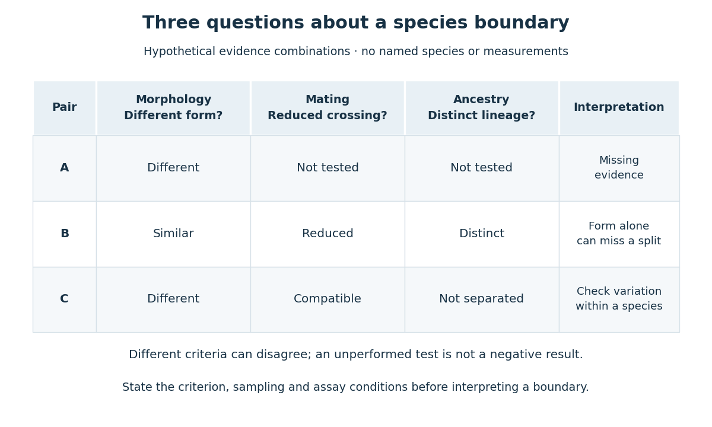

# Species delimitation

↑ **Parent:** [Species](species.md)

[Species delimitation](species-delimitation.md) infers the boundaries and number of [species](species.md) from evidence. No single arbitrary percentage of [nucleotide sequence](nucleic-acid-sequence.md) difference is a universal boundary. Divergence within an old, widespread [species](species.md) can exceed divergence between recently separated [species](species.md); geography and multiple kinds of evidence matter. [pp. 884–885, “Alternatives to the Traditional Properties”: divergence cutoffs and geographic differentiation](species-concepts-and-species-delimitation-by-kevin-de-queiroz.md)

An original counterexample to a universal percentage rule: an assay could examine a strongly conserved [gene](gene.md) in one comparison and a rapidly changing [nucleotide sequence](nucleic-acid-sequence.md) in another. Equal percentages then answer different historical questions. Even the denominator needs specifying: all sites, aligned sites, or only a filtered region? A threshold is an operational rule for a stated assay and group of [organisms](organism-split.md), whose errors need evaluating. It is not a definition that automatically transfers to every [species](species.md).

**[Figure 28](#image-contrasting-operational-evidence-for-species-delimitation). Contrasting operational evidence for species delimitation**. Original hypothetical comparison of [morphology](morphology-biology.md), mating and ancestry evidence. Each observation tests a different claim; the combinations are thought experiments, not a dataset or verdicts about named [species](species.md). “Not tested” does not mean absent.

The diagram's hypothetical pair B has similar [morphology](morphology-biology.md) but reduced mating and distinct ancestry evidence. A [morphological species concept](morphological-species-concept.md) could miss that distinction. Pair C instead has different [morphology](morphology-biology.md) but compatible mating and ancestry that fails to separate the samples. That combination calls for checking variation in [phenotype](phenotype.md) within a [species](species.md). Pair A has only a structural difference observed: the other criteria remain untested. These examples show why missing evidence, disagreeing evidence and agreeing evidence require different interpretations.

## ↑ Ancestors (4)

1. [Species](species.md)
2. [Taxonomy (biology)](taxonomy-biology.md)
3. [Biology](biology-split.md)
4. [Codex Wiki](split.md)

## ← Incoming links (1)

- [Species delimitation](species-delimitation.md)
