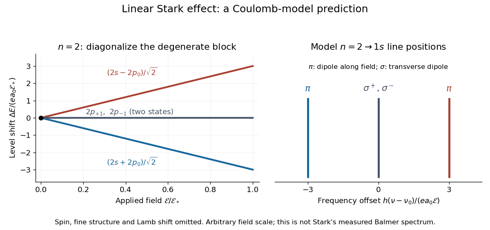

# Spectral components of the linear hydrogen Stark effect

↑ **Parent:** [Linear Stark effect in the first excited hydrogen eigenspace](linear-stark-effect-in-the-first-excited-hydrogen-eigenspace.md)

For an illustrative $n=2\to1s$ emission calculation, retain only the first-order shifts above and neglect the quadratic shift of the [hydrogen atom](hydrogen-atom.md) [ground state](ground-state.md). The unperturbed [Lyman-alpha line](lyman-alpha-line.md) [frequency](frequency.md) is $\nu_0=(E_2-E_1)/h$. The possible offsets are

$$
\nu-\nu_0=-\frac{3ea_0\mathcal E}{h},\quad 0,\quad +\frac{3ea_0\mathcal E}{h}.
$$

The outer pair originates in the $p_0$ parts of $|\psi_\pm\rangle$ and has transition [electric dipole moments](electric-dipole-moment.md) along the applied [electric field](electric-field-split.md), conventionally called $\pi$ components. The central pair originates in $p_{\pm1}$ and has transverse rotating transition [electric dipole moments](electric-dipole-moment.md), conventionally called $\sigma^\pm$ components. Because [electromagnetic radiation](electromagnetic-radiation-split.md) is transverse, the $\pi$ components disappear when viewed along the [electric field](electric-field-split.md). Viewed from the side, the $\pi$ and $\sigma$ components have [polarization of an electromagnetic wave](polarization-of-an-electromagnetic-wave.md) respectively parallel and perpendicular to the applied [electric field](electric-field-split.md). Line intensities additionally require the initial [quantum state](quantum-state.md) populations and the collection geometry.

**[Figure 6](#image-linear-stark-effect-a-coulomb-model-prediction). Linear Stark effect: a Coulomb-model prediction**. Original [first excited hydrogen eigenspace](first-excited-hydrogen-eigenspace.md) level shifts and schematic $n=2\to1s$ [spectral line](spectral-line.md) positions. Equal stick heights encode no intensities. The field scale is arbitrary. This [Lyman-alpha line](lyman-alpha-line.md) example is distinct from the visible [hydrogen](hydrogen.md) lines in the 1913 experiment.

## ↑ Ancestors (5)

1. [Linear Stark effect in the first excited hydrogen eigenspace](linear-stark-effect-in-the-first-excited-hydrogen-eigenspace.md)
2. [Stark effect](stark-effect.md)
3. [Mathematical physics](mathematical-physics-split.md)
4. [Physics](physics-split.md)
5. [Codex Wiki](split.md)
