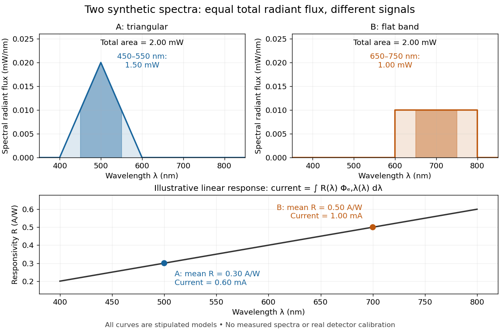

# Spectral radiant flux

↑ **Parent:** [Radiant flux](radiant-flux.md)

[Spectral radiant flux](spectral-radiant-flux.md) resolves [radiant flux](radiant-flux.md) by [wavelength](wavelength.md) or [frequency](frequency.md):

$$
\Phi_e=\int_0^\infty\Phi_{e,\lambda}(\lambda)\,d\lambda
=\int_0^\infty\Phi_{e,\nu}(\nu)\,d\nu.
$$

Its units are $\mathrm{W\,m^{-1}}$ per metre of [wavelength](wavelength.md) or $\mathrm{W\,Hz^{-1}}$ per hertz of [frequency](frequency.md). A density quoted per nanometre must be integrated with [wavelength](wavelength.md) intervals in nanometres; its numerical value is $10^{-9}$ times the per-metre density. The [frequency and wavelength spectral radiance conversion](frequency-and-wavelength-spectral-radiance-conversion.md) applies equally to [spectral radiant flux](spectral-radiant-flux.md), through the [change of variables formula](change-of-variables-formula.md):

$$
\Phi_{e,\nu}(\nu)=\Phi_{e,\lambda}(c/\nu)\frac{c}{\nu^2},
$$

with $c$ the [speed of light](speed-of-light.md) in [vacuum](vacuum.md) and $\Phi_{e,\lambda}$ expressed per metre. The [Jacobian determinant](jacobian-determinant.md) preserves integrated [power](power.md) rather than the height or location of an [optical spectrum](optical-spectrum.md)'s peak.

For two explicitly synthetic [optical spectra](optical-spectrum.md), let $x=\lambda/(1\,\mathrm{nm})$ and quote the following densities in $\mathrm{mW\,nm^{-1}}$:

$$
f_A(x)=\begin{cases}0.020(1-|x-500|/100),&400\leq x\leq600,\\0,&\text{otherwise},\end{cases}
\qquad
f_B(x)=\begin{cases}0.010,&600\leq x\leq800,\\0,&\text{otherwise}.\end{cases}
$$

The [triangle](triangle.md) under $f_A$ and the [rectangle](rectangle.md) under $f_B$ both have [area](surface-area.md) $2\,\mathrm{mW}$: $200\times0.020/2=200\times0.010=2$. Their band [radiant fluxes](radiant-flux.md) differ: $450$–$550\,\mathrm{nm}$ contains $1.5\,\mathrm{mW}$ of $A$, while $650$–$750\,\mathrm{nm}$ contains $1.0\,\mathrm{mW}$ of $B$. These are specified functions, not measured source spectra.

**[Figure 2](#radiant-flux-synthetic-spectral-integrals). Equal total radiant flux can hide different band radiant fluxes and detector signals**. Original synthetic [optical spectra](optical-spectrum.md) with exact total [radiant flux](radiant-flux.md) $2\,\mathrm{mW}$ each. Darker shading marks the stated 100 nm bands. The lower panel uses a stipulated linear [spectral responsivity](spectral-responsivity.md) $R(\lambda)=\bigl(0.2+0.001(x-400)\bigr)\,\mathrm{A\,W^{-1}}$; integrating it against the two [spectral radiant fluxes](spectral-radiant-flux.md) gives dark-subtracted [electric currents](electric-current.md) $0.60$ and $1.00\,\mathrm{mA}$. The response is illustrative and is not a calibration curve for a real [photodiode](photodiode.md).

The dark-subtracted [electric current](electric-current.md) of a linear [photodiode](photodiode.md) is

$$
i=\int R(\lambda)\Phi_{e,\lambda}(\lambda)\,d\lambda,
\qquad [R]=\mathrm{A\,W^{-1}},
$$

using its [spectral responsivity](spectral-responsivity.md). The figure's stipulated $R$ gives $i_A=0.60\,\mathrm{mA}$ and $i_B=1.00\,\mathrm{mA}$ despite equal total [radiant flux](radiant-flux.md). Symmetry places $A$'s mean [wavelength](wavelength.md) at $500\,\mathrm{nm}$ and $B$'s at $700\,\mathrm{nm}$; a linear $R$ averages to its value at that mean. A single [electric current](electric-current.md) therefore cannot determine an unknown broadband [radiant flux](radiant-flux.md) without additional spectral information or a sufficiently flat calibrated response.

## ↑ Ancestors (6)

1. [Radiant flux](radiant-flux.md)
2. [Radiometry](radiometry-split.md)
3. [Optics](optics-split.md)
4. [Branches of physics](branches-of-physics.md)
5. [Physics](physics-split.md)
6. [Codex Wiki](split.md)

## ← Incoming links (5)

- [Calibrated radiant-flux measurement](calibrated-radiant-flux-measurement.md)
- [Photopic luminous efficiency function](photopic-luminous-efficiency-function.md)
- [Radiometric absorptance](radiometric-absorptance.md)
- [Spectral mismatch correction](spectral-mismatch-correction.md)
- [Spectral radiant flux](spectral-radiant-flux.md)
