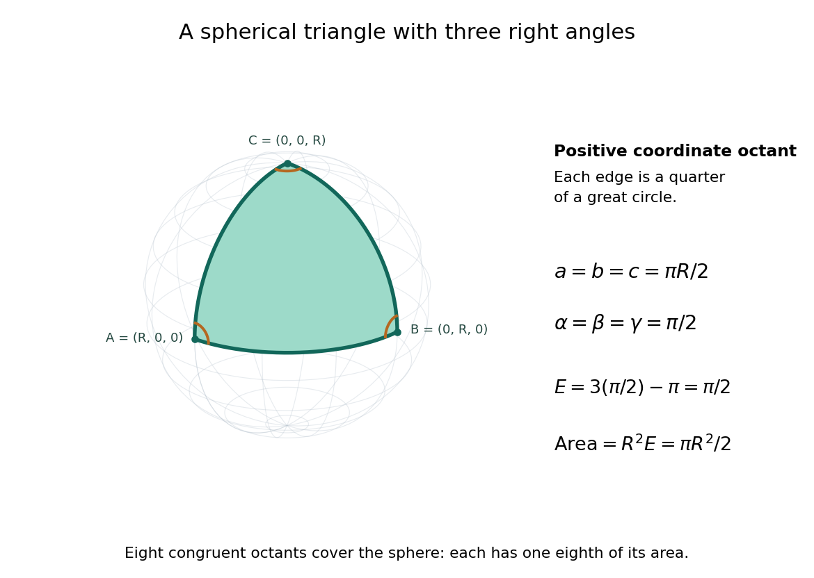

# Spherical geometry

↑ **Parent:** [Geometry and topology](geometry-and-topology-split.md)  
ⓦ [Wiki](https://en.wikipedia.org/wiki/Spherical_geometry)

[Spherical geometry](spherical-geometry.md) studies [lengths](length.md) and [angles](angle.md) measured along the surface of a [sphere](sphere.md), rather than through its interior. It is a useful model whenever travel is constrained to a round surface. Its straightest paths are [great circle](great-circle.md) arcs: they are [geodesics](geodesic.md), even though they appear curved in the surrounding [Euclidean space](euclidean-norm.md). Two distinct [great circles](great-circle.md) meet at an [antipodal pair](antipodal-pair.md), so the parallel-line picture of [Euclidean geometry](euclidean-geometry.md) does not apply.

For a [sphere](sphere.md) of radius $R>0$, write two positions as $Ru,Rv$, with $u,v$ [unit vectors](unit-vector.md). Their shorter surface route has [great-circle distance](great-circle-distance.md)

$$
d=R\arccos(u\cdot v),
$$

where the [dot product](dot-product.md) gives the central [angle](angle.md) in [radians](radian.md). The straight chord through the surrounding [Euclidean space](euclidean-norm.md) instead has [length](length.md) $2R\sin(d/(2R))$. For a quarter-circle separation these are $\pi R/2\approx1.571R$ and $\sqrt2R\approx1.414R$: specifying which distance we mean has a measurable effect. On the [unit sphere](unit-sphere.md), $R=1$ and [great-circle distance](great-circle-distance.md) equals the central [angle](angle.md).

Consider the [spherical triangle](spherical-triangle.md) with vertices $(R,0,0)$, $(0,R,0)$ and $(0,0,R)$, joined by the shorter [great circle](great-circle.md) arcs. Each side has [length](length.md) $\pi R/2$. At each vertex the two outgoing [tangent vectors](tangent-vector.md) point along the other coordinate axes and are [orthogonal](orthogonal-vectors.md), so all three interior [angles](angle.md) are $\pi/2$. This is the positive coordinate octant of the [sphere](sphere.md), not a flat [triangle](triangle.md) drawn inside it.

For a convex minor [spherical triangle](spherical-triangle.md) with interior [angles](angle.md) $\alpha,\beta,\gamma$ in [radians](radian.md), the [spherical excess formula](spherical-excess-formula.md) states

$$
\mathcal A=R^2(\alpha+\beta+\gamma-\pi).
$$

Our octant therefore has [area](surface-area.md) $R^2(3\pi/2-\pi)=\pi R^2/2$. Independently, eight congruent octants partition the [sphere](sphere.md), giving $4\pi R^2/8$ again. Thus [angles](angle.md) alone determine [area](surface-area.md) when $R$ is fixed, unlike [Euclidean geometry](euclidean-geometry.md), where [similar triangles](similar-triangle.md) can have arbitrarily different [areas](surface-area.md). The [Gauss-Bonnet theorem](gauss-bonnet-theorem.md) explains the connection: the [sphere](sphere.md)'s constant [Gaussian curvature](gaussian-curvature.md) $1/R^2$ times the [area](surface-area.md) equals this excess. For [spherical triangles](spherical-triangle.md) whose [area](surface-area.md) is small compared with $R^2$, the excess is small, recovering the familiar flat picture.

**[Figure 1](#image-three-quarter-great-circle-sides-enclose-a-spherical-octant-with-three-right-angles-and-area-pi-r-2-2). Three quarter-great-circle sides enclose a spherical octant with three right angles and area $\pi R^2/2$**.

**Table of contents**

- [Convex regular spherical polygon](convex-regular-spherical-polygon.md)
- [Spherical circle](spherical-circle.md)
- [Spherical lune](spherical-lune.md)
- [Great-circle distance](great-circle-distance.md)
- [Spherical trigonometry](spherical-trigonometry.md)
  - [Spherical law of sines](spherical-law-of-sines.md)
  - [Spherical law of cosines](spherical-law-of-cosines.md)
- [Spherical triangle](spherical-triangle.md)
  - [Spherical triangle reflection group](spherical-triangle-reflection-group.md)

## ↑ Ancestors (4)

1. [Geometry and topology](geometry-and-topology-split.md)
2. [Area of mathematics](area-of-mathematics.md)
3. [Mathematics](mathematics-split.md)
4. [Codex Wiki](split.md)

## ← Incoming links (5)

- [Euclidean geometry](euclidean-geometry.md)
- [Geometry and topology](geometry-and-topology-split.md)
- [Spherical geometry](spherical-geometry.md)
- [Spherical trigonometry](spherical-trigonometry.md)
- [Triangle group](triangle-group.md)
