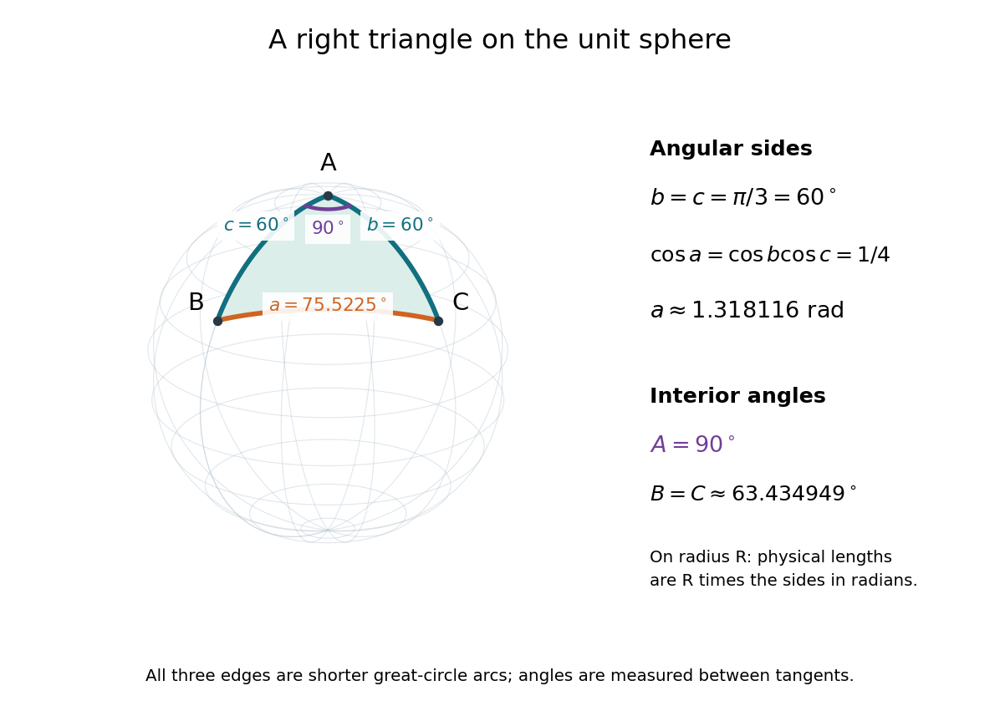

# Spherical law of cosines

↑ **Parent:** [Spherical trigonometry](spherical-trigonometry.md)  
ⓦ [Wiki](https://en.wikipedia.org/wiki/Spherical_law_of_cosines)

For a nondegenerate convex minor [spherical triangle](spherical-triangle.md), the [spherical law of cosines](spherical-law-of-cosines.md) relates two angular sides $b,c$, their included interior [angle](angle.md) $A$, and the opposite angular side $a$:

$$
\cos a=\cos b\cos c+\sin b\sin c\cos A.
$$

Relabelling the vertices gives the corresponding formulas for $b,B$ and $c,C$. As with the [spherical law of sines](spherical-law-of-sines.md), physical side [lengths](length.md) must first be divided by the [sphere](sphere.md)'s [radius](radius.md). The [spherical law of cosines](spherical-law-of-cosines.md) determines $a\in(0,\pi)$ uniquely from $b,c,A$ when the data describe such a [spherical triangle](spherical-triangle.md). It also recovers each interior [angle](angle.md) from three sides, for example

$$
\cos A=\frac{\cos a-\cos b\cos c}{\sin b\sin c}.
$$

Using the [cosine](cosine.md) and the range $0<A<\pi$ selects a unique [angle](angle.md), avoiding the supplementary-angle ambiguity of an [inverse sine](inverse-sine.md) calculation.

To derive the [spherical law of cosines](spherical-law-of-cosines.md), let $u,v,w$ be the vertex [unit vectors](unit-vector.md) at $A,B,C$, so $u\cdot v=\cos c$, $u\cdot w=\cos b$ and $v\cdot w=\cos a$. The outgoing unit [tangent vectors](tangent-vector-split.md) at $u$ are $t_B=(v-\cos c\,u)/\sin c$ and $t_C=(w-\cos b\,u)/\sin b$. Their [dot product](dot-product.md) is both $\cos A$ and $(\cos a-\cos b\cos c)/(\sin b\sin c)$, proving the identity. This gives a geometric explanation: [spherical trigonometry](spherical-trigonometry.md) compares [angles](angle.md) in the [tangent plane](tangent-plane.md) using [vectors](vector.md) in the surrounding [Euclidean space](euclidean-norm.md).

For a worked example on the [unit sphere](unit-sphere.md), take the vertices

$$
A=(0,0,1),\qquad B=(\sqrt3/2,0,1/2),\qquad C=(0,\sqrt3/2,1/2).
$$

At $A$, the outgoing unit [tangent vectors](tangent-vector-split.md) are $(1,0,0)$ and $(0,1,0)$, so the interior [angle](angle.md) is a [right angle](right-angle.md). The vertex [dot products](dot-product.md) give $b=c=\pi/3=60^\circ$. The [spherical law of cosines](spherical-law-of-cosines.md) then reduces to the right-angle identity $\cos a=\cos b\cos c$, giving

$$
\cos a=\frac14,\qquad a=\arccos(1/4)\approx1.318116\text{ radians}=75.522488^\circ.
$$

To find $B$, use the relabelled [spherical law of cosines](spherical-law-of-cosines.md):

$$
\cos B=\frac{\cos b-\cos a\cos c}{\sin a\sin c}=\frac{1/2-1/8}{(\sqrt{15}/4)(\sqrt3/2)}=\frac1{\sqrt5},\qquad B=C\approx63.434949^\circ.
$$

The physical side [lengths](length.md) on a [sphere](sphere.md) of [radius](radius.md) $R$ are $\ell_a\approx1.318116R$ and $\ell_b=\ell_c=\pi R/3\approx1.047198R$. For example, on a toy [sphere](sphere.md) with $R=10$ metres they are approximately $13.18116$, $10.47198$ and $10.47198$ metres; the interior [angles](angle.md) stay the same. Applying the planar [Pythagorean theorem](pythagorean-theorem.md) directly to the angular sides would instead give $\sqrt{60^2+60^2}\approx84.852814^\circ$. That flat [right triangle](right-triangle.md) calculation does not give the [great-circle distance](great-circle-distance.md) between $B$ and $C$.

**[Figure 3](#image-a-non-octant-spherical-triangle-with-a-right-angle-at-a-angular-sides-b-c-60-circ-and-a-75-522488-circ-and-interior-angles-b-c-63-434949-circ). A non-octant spherical triangle with a right angle at $A$, angular sides $b=c=60^\circ$ and $a=75.522488^\circ$, and interior angles $B=C=63.434949^\circ$**.

The familiar [law of cosines](law-of-cosines.md) reappears as a local approximation. With $a,b,c$ all small in [radians](radian.md), substitute the [small-angle approximations](small-angle-approximation.md) $\sin x\approx x$ and $\cos x\approx1-x^2/2$ into the [spherical law of cosines](spherical-law-of-cosines.md) and keep terms through second order:

$$
1-\frac{a^2}{2}\approx1-\frac{b^2+c^2}{2}+bc\cos A,\qquad a^2\approx b^2+c^2-2bc\cos A.
$$

Multiplication by $R^2$ gives the planar [law of cosines](law-of-cosines.md) for the physical side [lengths](length.md). For a fixed small surface [triangle](triangle.md) on a progressively larger [sphere](sphere.md), the angular sides shrink and this approximation improves. Thus the curved and flat formulas fit together: the [Pythagorean theorem](pythagorean-theorem.md) is recovered locally when $A$ is a [right angle](right-angle.md).

## ↑ Ancestors (6)

1. [Spherical trigonometry](spherical-trigonometry.md)
2. [Spherical geometry](spherical-geometry.md)
3. [Geometry and topology](geometry-and-topology-split.md)
4. [Area of mathematics](area-of-mathematics.md)
5. [Mathematics](mathematics-split.md)
6. [Codex Wiki](split.md)

## ← Incoming links (7)

- [Convex regular spherical polygon](convex-regular-spherical-polygon.md)
- [Solution](past-exam-of-the-mathematics-course-of-the-university-of-cambridge/2003/ib/paper-3/14f/solution.md)
- [Solution](past-exam-of-the-mathematics-course-of-the-university-of-cambridge/2009/ia/paper-1/5c/solution.md)
- [Spherical law of cosines](spherical-law-of-cosines.md)
- [Spherical law of sines](spherical-law-of-sines.md)
- [Spherical triangle](spherical-triangle.md)
- [Spherical trigonometry](spherical-trigonometry.md)
