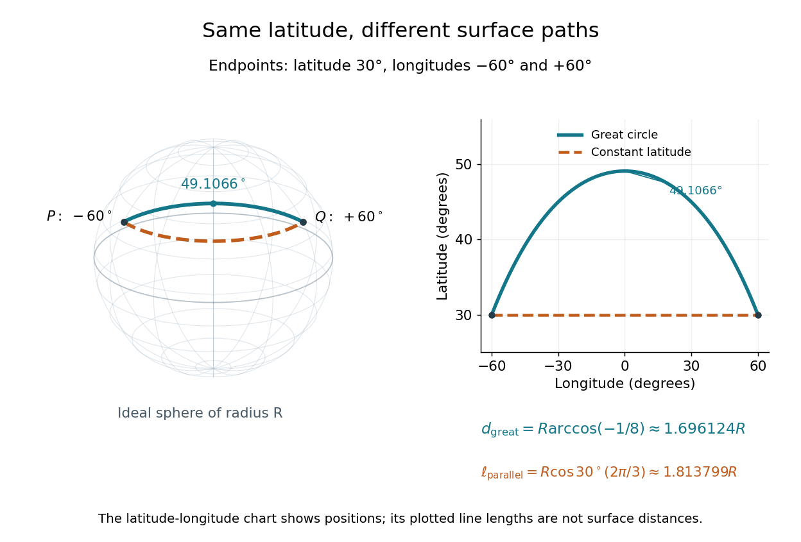

# Spherical trigonometry

↑ **Parent:** [Spherical geometry](spherical-geometry.md)  
ⓦ [Wiki](https://en.wikipedia.org/wiki/Spherical_trigonometry)

[Spherical trigonometry](spherical-trigonometry.md) calculates the sides and interior [angles](angle.md) of [spherical triangles](spherical-triangle.md) using [trigonometric functions](trigonometric-function.md). Its sides must be shorter [great circle](great-circle.md) arcs, which are [geodesics](geodesic.md) on a round [sphere](sphere.md). A curve at constant nonzero [latitude](geographical-latitude.md) does not qualify. The [spherical law of sines](spherical-law-of-sines.md) and [spherical law of cosines](spherical-law-of-cosines.md) play the roles of the familiar flat-triangle rules, but account for the [sphere](sphere.md)'s [curvature](curvature.md).

Use uppercase $A,B,C$ both for the vertices and for their interior [angles](angle.md), and lowercase $a,b,c$ for the opposite angular sides. For example, $a$ is the central [angle](angle.md) subtended by the arc from $B$ to $C$. On a [sphere](sphere.md) of [radius](radius.md) $R$, its physical [arc length](arc-length.md) is $\ell_a=Ra$ when $a$ is in [radians](radian.md); similarly $\ell_b=Rb$ and $\ell_c=Rc$. Only on the [unit sphere](unit-sphere.md) do the angular and physical side [lengths](length.md) have the same numerical values. See [J. B. Tatum, Celestial Mechanics, chapter 3, section 3.5: great-circle sides and angular units](https://www.astro.uvic.ca/~tatum/celmechs/celm3.pdf).

One useful application of [spherical trigonometry](spherical-trigonometry.md) is finding [great-circle distance](great-circle-distance.md) from [spherical coordinates](spherical-coordinate-system.md). Write a [unit vector](unit-vector.md) as $u(\phi,\lambda)=(\cos\phi\cos\lambda,\cos\phi\sin\lambda,\sin\phi)$, where $\phi$ is [latitude](geographical-latitude.md) and $\lambda$ is the equatorial [azimuth](azimuth.md), or longitude, measured from a chosen reference direction. The [dot product](dot-product.md) of two such [unit vectors](unit-vector.md) gives

$$
\cos\delta=\sin\phi_1\sin\phi_2+\cos\phi_1\cos\phi_2\cos(\lambda_2-\lambda_1),\qquad d=R\delta.
$$

Here $\delta\in[0,\pi]$ is the central [angle](angle.md) and $d$ is the [great-circle distance](great-circle-distance.md). The same identity follows from the [spherical law of cosines](spherical-law-of-cosines.md) by adding the north pole as the third vertex, with angular sides $\pi/2-\phi_1$ and $\pi/2-\phi_2$. This connects [spherical geometry](spherical-geometry.md) to position calculations in [astronomy](astronomy-split.md) and to navigation on a spherical model of [Earth](earth.md). Choosing the surface model matters: [Paula Neeley and Anthony Narkawicz, Map Projection Induced Variations in Locations of Polygon Geofence Edges, NASA/TM-2017-219675 (2017), sections 2-3](https://ntrs.nasa.gov/api/citations/20170011116/downloads/20170011116.pdf) distinguishes spherical and ellipsoidal [geodesics](geodesic.md) and gives this coordinate identity.

For a toy example, put two points at [latitude](geographical-latitude.md) $30^\circ$, with equatorial [azimuths](azimuth.md) $-60^\circ$ and $60^\circ$. The [great-circle distance](great-circle-distance.md) and the [arc length](arc-length.md) along constant [latitude](geographical-latitude.md) are

$$
d=R\arccos\!\left(\frac14+\frac34\cos120^\circ\right)=R\arccos(-1/8)\approx1.696124R,\qquad \ell_{\mathrm{parallel}}=R\cos30^\circ\frac{2\pi}{3}\approx1.813799R.
$$

The [great circle](great-circle.md) takes a shorter route by bending towards the pole in these [spherical coordinates](spherical-coordinate-system.md). To locate its highest [latitude](geographical-latitude.md), the endpoint [unit vectors](unit-vector.md) are $p=(\sqrt3/4,-3/4,1/2)$ and $q=(\sqrt3/4,3/4,1/2)$. Their [great circle](great-circle.md) lies in the [plane](plane.md) through the origin with $z=2x/\sqrt3$. On its shorter arc, the maximum [latitude](geographical-latitude.md) occurs at $y=0$ and is $\arctan(2/\sqrt3)\approx49.106605^\circ$. Thus a [geodesic](geodesic.md) can change [latitude](geographical-latitude.md) substantially even when its endpoints have equal [latitude](geographical-latitude.md). These are lengths on an ideal [sphere](sphere.md); the example illustrates the geometry rather than specifying an actual flight route.

**[Figure 2](#image-on-an-ideal-sphere-two-points-at-latitude-30-circ-and-longitudes-pm60-circ-are-joined-by-a-shorter-great-circle-arc-reaching-latitude-49-106605-circ). On an ideal sphere, two points at latitude $30^\circ$ and longitudes $\pm60^\circ$ are joined by a shorter great-circle arc reaching latitude $49.106605^\circ$**.

Historically, [spherical trigonometry](spherical-trigonometry.md) was prominent in teaching as well as in [astronomy](astronomy-split.md). John Conway and Alex Ryba note its presence in early twentieth-century school textbooks in [Remembering spherical trigonometry, The Mathematical Gazette 100(547), March 2016, pages 1-8, DOI 10.1017/mag.2016.3](https://www.cambridge.org/core/journals/mathematical-gazette/article/abs/remembering-spherical-trigonometry/5282E6A1C67D0BF0DBEC096EF8C1CBF5). Their introductory observation documents that teaching history; it does not identify a single inventor of the [spherical law of sines](spherical-law-of-sines.md) or [spherical law of cosines](spherical-law-of-cosines.md).

**Table of contents**

- [Spherical law of sines](spherical-law-of-sines.md)
- [Spherical law of cosines](spherical-law-of-cosines.md)

## ↑ Ancestors (5)

1. [Spherical geometry](spherical-geometry.md)
2. [Geometry and topology](geometry-and-topology-split.md)
3. [Area of mathematics](area-of-mathematics.md)
4. [Mathematics](mathematics-split.md)
5. [Codex Wiki](split.md)

## ← Incoming links (2)

- [Spherical law of cosines](spherical-law-of-cosines.md)
- [Spherical trigonometry](spherical-trigonometry.md)
