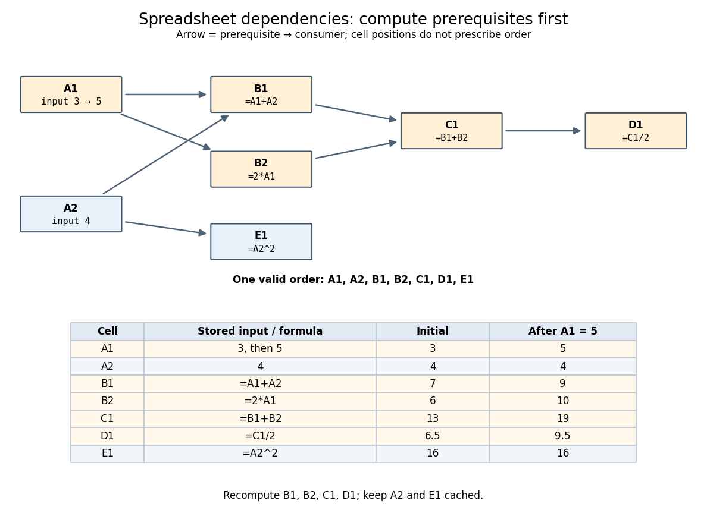

# Spreadsheet dependency evaluation

↑ **Parent:** [Spreadsheet](spreadsheet.md)

Evaluate numeric formula dependencies using [depth-first search](depth-first-search.md) and [memoization](memoization.md), or a [topological ordering](topological-ordering.md). Marking active evaluations detects cycles; repeated numerical sweeps need not terminate or determine a unique result.

A [spreadsheet dependency graph](spreadsheet-dependency-graph.md) turns a page of [spreadsheet formulas](spreadsheet-formula.md) into a plan: compute each prerequisite before the [spreadsheet cell](spreadsheet-cell.md) that consumes it. This section uses a deliberately small model with explicit cell references, fixed [spreadsheet formulas](spreadsheet-formula.md), and [deterministic computation](deterministic-computation.md) from numerical [inputs](input-computer-science.md). There are no external data changes or formulas that change their references while running. Within these assumptions, a [topological order](topological-order.md) gives a reproducible answer without repeatedly sweeping the visible grid.

Take two input [spreadsheet cells](spreadsheet-cell.md) and five [spreadsheet formulas](spreadsheet-formula.md):

| [Spreadsheet cell](spreadsheet-cell.md) | Stored input or [spreadsheet formula](spreadsheet-formula.md) | Initial value | Value after changing `A1` to 5 |
| --- | --- | --- | --- |
| `A1` | `3`, later `5` | $3$ | $5$ |
| `A2` | `4` | $4$ | $4$ |
| `B1` | `=A1+A2` | $7$ | $9$ |
| `B2` | `=2*A1` | $6$ | $10$ |
| `C1` | `=B1+B2` | $13$ | $19$ |
| `D1` | `=C1/2` | $13/2$ | $19/2$ |
| `E1` | `=A2^2` | $16$ | $16$ |

**[Figure 22](#image-an-original-spreadsheet-dependency-graph-and-a-topological-order-with-values-before-and-after-one-edit). An original spreadsheet dependency graph and a topological order with values before and after one edit**.

Our [directed edge](directed-edge.md) convention is _prerequisite to consumer_: `A1` $\to$ `B1` means that `B1` reads `A1`, not the reverse. The seven [directed edges](directed-edge.md) are `A1` $\to$ `B1`, `A2` $\to$ `B1`, `A1` $\to$ `B2`, `B1` $\to$ `C1`, `B2` $\to$ `C1`, `C1` $\to$ `D1`, and `A2` $\to$ `E1`. This [spreadsheet dependency graph](spreadsheet-dependency-graph.md) is a [Directed acyclic graph](directed-acyclic-graph.md). One [topological order](topological-order.md) is `A1,A2,B1,B2,C1,D1,E1`; `E1` could instead be computed immediately after `A2`. A [topological order](topological-order.md) constrains prerequisites, not the physical positions of [spreadsheet cells](spreadsheet-cell.md).

In that order, the initial [arithmetic operations](arithmetic-operation.md) give $B1=3+4=7$, $B2=2\cdot3=6$, $C1=7+6=13$, $D1=13/2$, and $E1=4^2=16$. The [spreadsheet formulas](spreadsheet-formula.md) define one value per [spreadsheet cell](spreadsheet-cell.md): an outline by [induction](mathematical-induction.md) along any [topological order](topological-order.md) shows that every prerequisite already has its uniquely determined value when its consumer is computed. Different permitted orders therefore agree in this model. The useful idea is that information flows through the [Directed acyclic graph](directed-acyclic-graph.md) even when the visible grid does not display that flow.

A concrete implementation history illustrates this separation. Microsoft's documentation distinguishes the per-worksheet calculation chains used in Excel 2002 and earlier from calculation using multiple [software threads](thread-computing.md) introduced in Excel 2007 for independent chain sections. This is a documented implementation example, not a definition of [spreadsheet dependency evaluation](spreadsheet-dependency-evaluation.md).[Dependence, Dirty Cells, and Recalculated Cells: paragraphs beginning “In Excel 2002 and earlier versions” and “In Excel 2007”](excel-recalculation-by-microsoft.md)

**Table of contents**

- [Spreadsheet dependency graph](spreadsheet-dependency-graph.md)
  - [Spreadsheet circular reference](spreadsheet-circular-reference.md)
    - [Iterative spreadsheet calculation](iterative-spreadsheet-calculation.md)
- [Cached cell value](cached-cell-value.md)

## ↑ Ancestors (3)

1. [Spreadsheet](spreadsheet.md)
2. [Computer science](computer-science-split.md)
3. [Codex Wiki](split.md)

## ← Incoming links (5)

- [Iterative spreadsheet calculation](iterative-spreadsheet-calculation.md)
- [Memoization](memoization.md)
- [Memoization cache contract](memoization-cache-contract.md)
- [Solution](past-exam-of-the-mathematics-course-of-the-university-of-cambridge/2007/ia/paper-5/9/b/i/solution.md)
- [Spreadsheet dependency evaluation](spreadsheet-dependency-evaluation.md)
