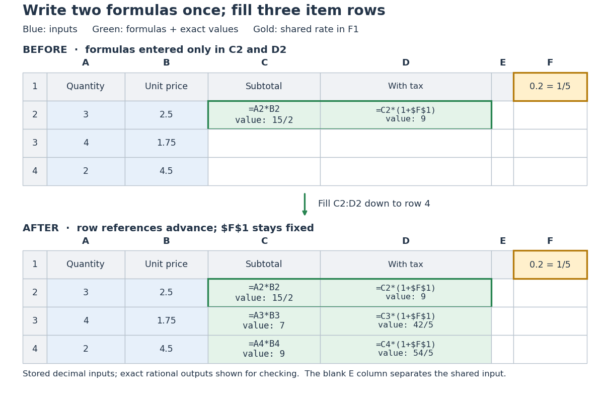
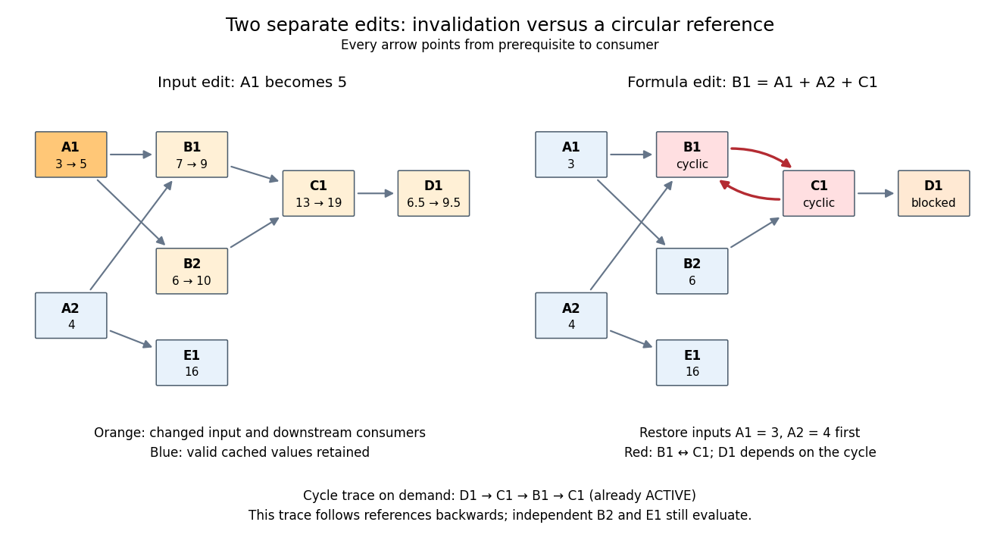
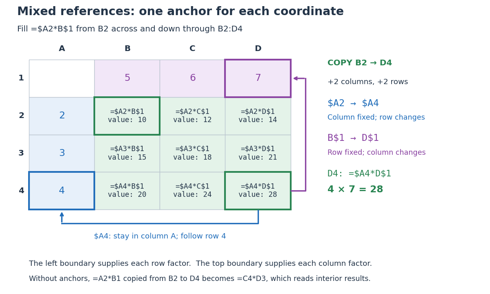

# Spreadsheet

↑ **Parent:** [Computer science](computer-science.md)  
ⓦ [Wiki](https://en.wikipedia.org/wiki/Spreadsheet)

A [spreadsheet](spreadsheet.md) is [software](computer-science.md#software) for organizing information in a rectangular grid of [spreadsheet cells](#spreadsheet-cell) and calculating with it. Rows are numbered and columns are lettered: `B3` is the [spreadsheet cell](#spreadsheet-cell) at column `B`, row `3`. A [spreadsheet cell](#spreadsheet-cell) can hold a label, a numerical [input](theoretical-computer-science.md#input-computer-science), or a [spreadsheet formula](#spreadsheet-formula) whose value supplies an [output](theoretical-computer-science.md#output-computing). This brings a [mathematical model](mathematics.md#mathematical-model) close to its data: quantities, assumptions and results can be read side by side. The address convention is described in LibreOffice's official help. [Addresses and References, Absolute and Relative: Cell references, column letters and row numbers](computer-science-bibliography.md#addresses-and-references-absolute-and-relative-libreoffice-help)

The useful idea is to write a relationship once and reuse it across similar rows. [Relative spreadsheet references](#relative-spreadsheet-reference) follow each row's data; [absolute spreadsheet references](#absolute-spreadsheet-reference) retain a shared assumption; [mixed spreadsheet references](#mixed-spreadsheet-reference) let one coordinate vary while the other stays fixed. [Spreadsheet dependency evaluation](#spreadsheet-dependency-evaluation) then computes the resulting [spreadsheet formulas](#spreadsheet-formula). A rectangular layout organizes the model for its reader, while the [spreadsheet dependency graph](#spreadsheet-dependency-graph) organizes its calculation.

**Table of contents**

- [Spreadsheet tabular model](#spreadsheet-tabular-model)
- [Spreadsheet dependency evaluation](#spreadsheet-dependency-evaluation)
  - [Spreadsheet dependency graph](#spreadsheet-dependency-graph)
    - [Spreadsheet circular reference](#spreadsheet-circular-reference)
      - [Iterative spreadsheet calculation](#iterative-spreadsheet-calculation)
  - [Cached cell value](#cached-cell-value)
- [Spreadsheet cell](#spreadsheet-cell)
  - [Spreadsheet formula](#spreadsheet-formula)
    - [Spreadsheet cell reference](#spreadsheet-cell-reference)
      - [Relative spreadsheet reference](#relative-spreadsheet-reference)
      - [Absolute spreadsheet reference](#absolute-spreadsheet-reference)
      - [Mixed spreadsheet reference](#mixed-spreadsheet-reference)

## Spreadsheet tabular model

↑ **Parent:** [Spreadsheet](spreadsheet.md)

A [spreadsheet tabular model](#spreadsheet-tabular-model) assigns a consistent meaning to each row and column. For an original example, let rows 2–4 describe three items, with quantity in column `A`, unit price in column `B`, subtotal in column `C`, and total including tax in column `D`. Put the single shared tax rate in `F1`. The chosen rate $1/5$ is an illustrative assumption. Quantities, unit prices and `F1` are [inputs](theoretical-computer-science.md#input-computer-science); columns `C` and `D` hold [spreadsheet formulas](#spreadsheet-formula) and display their computed values as [outputs](theoretical-computer-science.md#output-computing).

Enter decimal [inputs](theoretical-computer-science.md#input-computer-science) `2.5`, `1.75`, `4.5` for the unit prices and `0.2` for the tax rate. The following table expresses those values as exact [fractions](number-theory.md#fraction) so that the [arithmetic](arithmetic.md) is easy to check. It does not require typing a fraction into an input [spreadsheet cell](#spreadsheet-cell) or assume that all [software](computer-science.md#software) calculates with exact [rational numbers](number-theory.md#rational-number).

| Row | Quantity (`A`) | Unit price (`B`) | Subtotal (`C`) | Total including tax (`D`) |
| --- | --- | --- | --- | --- |
| 2 | $3$ | $5/2$ | $15/2$ | $9$ |
| 3 | $4$ | $7/4$ | $7$ | $42/5$ |
| 4 | $2$ | $9/2$ | $9$ | $54/5$ |

Start with `C2` containing `=A2*B2` and `D2` containing `=C2*(1+$F$1)`. Here `*` requests [multiplication](arithmetic.md#multiplication), and `1+$F$1` adds the tax fraction to one. Copy these two [spreadsheet formulas](#spreadsheet-formula) down into rows 3 and 4, a fill operation. The [relative spreadsheet references](#relative-spreadsheet-reference) change with the destination row: `C3` becomes `=A3*B3` and `D3` becomes `=C3*(1+$F$1)`; `C4` becomes `=A4*B4` and `D4` becomes `=C4*(1+$F$1)`. The [absolute spreadsheet reference](#absolute-spreadsheet-reference) `$F$1` continues to read the shared rate. Copying [spreadsheet formulas](#spreadsheet-formula) adjusts relative coordinates while retaining absolute coordinates. [Addresses and References, Absolute and Relative: Relative Addressing; Absolute Addressing; When to Use Relative and Absolute References, final two paragraphs](computer-science-bibliography.md#addresses-and-references-absolute-and-relative-libreoffice-help)

<a id="image-original-three-row-spreadsheet-tabular-model-before-and-after-filling-two-spreadsheet-formulas-with-a-shared-absolute-spreadsheet-reference"></a>


**[Figure 1](#image-original-three-row-spreadsheet-tabular-model-before-and-after-filling-two-spreadsheet-formulas-with-a-shared-absolute-spreadsheet-reference). Original three-row spreadsheet tabular model before and after filling two spreadsheet formulas, with a shared absolute spreadsheet reference**.

The same [mathematical expression](algebra.md#expression-mathematics) applies to every item. Writing $q_i$ for quantity, $p_i$ for unit price and $t$ for the shared tax rate gives

$$
s_i=q_i p_i,\qquad d_i=s_i(1+t).
$$

For row 2, the exact [arithmetic](arithmetic.md) is $(3\cdot5/2)(1+1/5)=(15/2)(6/5)=9$. The subtotals add to $47/2$, so the totals add to $(47/2)(6/5)=141/5$, agreeing with $9+42/5+54/5$. The [spreadsheet formulas](#spreadsheet-formula) encode the relationship; the displayed numbers are its results for these particular [inputs](theoretical-computer-science.md#input-computer-science).

This separation is useful for forecasting and [sensitivity analysis](probability-and-statistics.md#sensitivity-analysis). Keeping quantities and unit prices fixed while changing only `F1` from $1/5$ to $1/4$ gives exact totals $75/8$, $35/4$, and $45/4$. More generally, a rate change $\Delta t$ changes each total by

$$
d_i(t+\Delta t)-d_i(t)=s_i\Delta t.
$$

This follows by expanding the two [mathematical expressions](algebra.md#expression-mathematics) and cancelling $s_i(1+t)$. Here $\Delta t=1/20$, so the increases are $3/8$, $7/20$, and $9/20$, adding to $47/40$. One shared [input](theoretical-computer-science.md#input-computer-science) makes the assumption visible and consistent across all rows. Overwriting a computed total with a number would instead remove that [spreadsheet formula](#spreadsheet-formula); its value would cease to follow the model when the rate changes.

// Target: computer-science.bigb

## Spreadsheet dependency evaluation

↑ **Parent:** [Spreadsheet](spreadsheet.md)

Evaluate numeric formula dependencies using [depth-first search](algorithm.md#depth-first-search) and [memoization](algorithm.md#memoization), or a [topological ordering](combinatorics.md#topological-ordering). Marking active evaluations detects cycles; repeated numerical sweeps need not terminate or determine a unique result.

A [spreadsheet dependency graph](#spreadsheet-dependency-graph) turns a page of [spreadsheet formulas](#spreadsheet-formula) into a plan: compute each prerequisite before the [spreadsheet cell](#spreadsheet-cell) that consumes it. This section uses a deliberately small model with explicit cell references, fixed [spreadsheet formulas](#spreadsheet-formula), and [deterministic computation](theoretical-computer-science.md#deterministic-computation) from numerical [inputs](theoretical-computer-science.md#input-computer-science). There are no external data changes or formulas that change their references while running. Within these assumptions, a [topological order](combinatorics.md#topological-order) gives a reproducible answer without repeatedly sweeping the visible grid.

Take two input [spreadsheet cells](#spreadsheet-cell) and five [spreadsheet formulas](#spreadsheet-formula):

| [Spreadsheet cell](#spreadsheet-cell) | Stored input or [spreadsheet formula](#spreadsheet-formula) | Initial value | Value after changing `A1` to 5 |
| --- | --- | --- | --- |
| `A1` | `3`, later `5` | $3$ | $5$ |
| `A2` | `4` | $4$ | $4$ |
| `B1` | `=A1+A2` | $7$ | $9$ |
| `B2` | `=2*A1` | $6$ | $10$ |
| `C1` | `=B1+B2` | $13$ | $19$ |
| `D1` | `=C1/2` | $13/2$ | $19/2$ |
| `E1` | `=A2^2` | $16$ | $16$ |

<a id="image-an-original-spreadsheet-dependency-graph-and-a-topological-order-with-values-before-and-after-one-edit"></a>


**[Figure 2](#image-an-original-spreadsheet-dependency-graph-and-a-topological-order-with-values-before-and-after-one-edit). An original spreadsheet dependency graph and a topological order with values before and after one edit**.

Our [directed edge](graph-theory.md#directed-edge) convention is _prerequisite to consumer_: `A1` $\to$ `B1` means that `B1` reads `A1`, not the reverse. The seven [directed edges](graph-theory.md#directed-edge) are `A1` $\to$ `B1`, `A2` $\to$ `B1`, `A1` $\to$ `B2`, `B1` $\to$ `C1`, `B2` $\to$ `C1`, `C1` $\to$ `D1`, and `A2` $\to$ `E1`. This [spreadsheet dependency graph](#spreadsheet-dependency-graph) is a [Directed acyclic graph](combinatorics.md#directed-acyclic-graph). One [topological order](combinatorics.md#topological-order) is `A1,A2,B1,B2,C1,D1,E1`; `E1` could instead be computed immediately after `A2`. A [topological order](combinatorics.md#topological-order) constrains prerequisites, not the physical positions of [spreadsheet cells](#spreadsheet-cell).

In that order, the initial [arithmetic operations](numerical-analysis.md#arithmetic-operation) give $B1=3+4=7$, $B2=2\cdot3=6$, $C1=7+6=13$, $D1=13/2$, and $E1=4^2=16$. The [spreadsheet formulas](#spreadsheet-formula) define one value per [spreadsheet cell](#spreadsheet-cell): an outline by [induction](foundations-of-mathematics.md#mathematical-induction) along any [topological order](combinatorics.md#topological-order) shows that every prerequisite already has its uniquely determined value when its consumer is computed. Different permitted orders therefore agree in this model. The useful idea is that information flows through the [Directed acyclic graph](combinatorics.md#directed-acyclic-graph) even when the visible grid does not display that flow.

A concrete implementation history illustrates this separation. Microsoft's documentation distinguishes the per-worksheet calculation chains used in Excel 2002 and earlier from calculation using multiple [software threads](operating-system.md#thread-computing) introduced in Excel 2007 for independent chain sections. This is a documented implementation example, not a definition of [spreadsheet dependency evaluation](#spreadsheet-dependency-evaluation).[Dependence, Dirty Cells, and Recalculated Cells: paragraphs beginning “In Excel 2002 and earlier versions” and “In Excel 2007”](computer-science-bibliography.md#excel-recalculation-by-microsoft)

### Spreadsheet dependency graph

↑ **Parent:** [Spreadsheet dependency evaluation](#spreadsheet-dependency-evaluation)

The [directed graph](graph-theory.md#directed-graph) whose [vertices](graph.md#vertex-graph-theory) are the [spreadsheet cells](#spreadsheet-cell) and whose [directed edges](graph-theory.md#directed-edge) $u\to v$ mean that the [spreadsheet formula](#spreadsheet-formula) in $v$ references $u$. Input [spreadsheet cells](#spreadsheet-cell) have no prerequisites in this model. Retain both incoming references and outgoing consumers: [depth-first search](algorithm.md#depth-first-search) for evaluation follows incoming references backwards, whereas downstream invalidation follows outgoing consumers forwards. A [directed path](graph-theory.md#directed-path) then expresses indirect dependence, and a [directed cycle](graph-theory.md#directed-cycle) expresses a [spreadsheet circular reference](#spreadsheet-circular-reference).

#### Spreadsheet circular reference

↑ **Parent:** [Spreadsheet dependency graph](#spreadsheet-dependency-graph)

A [spreadsheet cell](#spreadsheet-cell) depends on itself along a nonempty [directed path](graph-theory.md#directed-path). For a separate formula-edit experiment, restore the initial inputs and replace only `B1` by `=A1+A2+C1`. Now `B1` $\to$ `C1` $\to$ `B1` is a [directed cycle](graph-theory.md#directed-cycle). Requesting `D1` makes `D1,C1,B1` active and then requests the still-active `C1`; the [algorithm](algorithm.md) reports `C1,B1,C1` rather than returning an old value. This witness follows references backwards, opposite to our dependency arrows; reversing it gives a [directed cycle](graph-theory.md#directed-cycle) in the [spreadsheet dependency graph](#spreadsheet-dependency-graph).

`D1` is not itself on that [directed cycle](graph-theory.md#directed-cycle), but it cannot receive a value from this evaluator because it needs `C1`. Independent requests for `B2` and `E1` still succeed. A [topological order](combinatorics.md#topological-order) of the entire modified [spreadsheet dependency graph](#spreadsheet-dependency-graph) is impossible: the two cyclic [directed edges](graph-theory.md#directed-edge) would require `B1` before `C1` and `C1` before `B1`. For the initial inputs, the associated [system of linear equations](linear-algebra.md#system-of-linear-equations) is even inconsistent: $B1=7+C1$ and $C1=B1+6$ imply $B1=B1+13$. Detecting a [directed cycle](graph-theory.md#directed-cycle) is a structural check, not an attempt to solve these [linear equations](linear-algebra.md#linear-equation).

##### Iterative spreadsheet calculation

↑ **Parent:** [Spreadsheet circular reference](#spreadsheet-circular-reference)

A different interpretation can treat cyclic [spreadsheet formulas](#spreadsheet-formula) as simultaneous equations and seek a [fixed point](function.md#fixed-point) by repeated numerical updates. This requires an explicit update rule, initial values and stopping condition. It is not automatically the meaning of a [spreadsheet formula](#spreadsheet-formula). In particular, a [directed cycle](graph-theory.md#directed-cycle) alone tells us neither whether a [fixed point](function.md#fixed-point) exists nor whether a chosen update rule approaches it.

Two original toy examples make the distinction exact. The cyclic pair `X1=Y1+1`, `Y1=X1+1` has no solution over the [real numbers](arithmetic.md#real-number): substitution gives $X1=X1+2$. For `X1=Y1`, `Y1=X1`, every equal pair is a [fixed point](function.md#fixed-point), so there is no unique answer. Simultaneously updating both [spreadsheet cells](#spreadsheet-cell) from the previous pair gives $(x_{n+1},y_{n+1})=(y_n,x_n)$. Starting at $(0,1)$ produces the [periodic sequence](sequence-and-series.md#periodic-sequence) $(0,1),(1,0),(0,1),\ldots$, which does not approach a [fixed point](function.md#fixed-point). Updating `X1` first and immediately using its new value for `Y1` instead gives $(1,1)$ in one sweep. That difference follows from the specified rules, not from a claim about any current spreadsheet product. Numerical iteration can be useful for a deliberately chosen model with a justification such as the [contraction mapping theorem](analysis.md#contraction-mapping-theorem); ordinary acyclic [spreadsheet dependency evaluation](#spreadsheet-dependency-evaluation) already has its answer from prerequisite order.

### Cached cell value

↑ **Parent:** [Spreadsheet dependency evaluation](#spreadsheet-dependency-evaluation)

A numerical value retained for reuse by [memoization](algorithm.md#memoization). It is usable only while the [spreadsheet formula](#spreadsheet-formula) and all its relevant [inputs](theoretical-computer-science.md#input-computer-science) remain valid. After changing `A1` from 3 to 5, following outgoing [directed edges](graph-theory.md#directed-edge) finds exactly `B1,B2,C1,D1`. Invalidate their [cached cell values](#cached-cell-value) before evaluating another requested result; install the new input value for `A1`. The [cached cell values](#cached-cell-value) of `A2` and `E1` remain valid because neither has a [directed path](graph-theory.md#directed-path) from `A1`.

<a id="image-downstream-invalidation-after-an-input-edit-and-a-different-formula-edit-creating-a-spreadsheet-circular-reference"></a>


**[Figure 3](#image-downstream-invalidation-after-an-input-edit-and-a-different-formula-edit-creating-a-spreadsheet-circular-reference). Downstream invalidation after an input edit, and a different formula edit creating a spreadsheet circular reference**.

One recomputation in the restricted [topological order](combinatorics.md#topological-order) `B1,B2,C1,D1` gives $9,10,19,19/2$. Four [spreadsheet formulas](#spreadsheet-formula) are recomputed, while `E1` stays at 16. Removing invalid values from the cache prevents a subtle error: a finished marker from the previous evaluation does not prove that the old value is correct after an edit. The affected set is conservative; a changed prerequisite might leave a consumer's value numerically equal, but this simple scheme still invalidates it. For a formula edit, update the incoming [directed edges](graph-theory.md#directed-edge) and corresponding outgoing consumer lists as well as invalidating the edited [spreadsheet cell](#spreadsheet-cell) and its downstream consumers. Microsoft's documentation explicitly describes both direct and indirect dependents being marked for recalculation.[Dependence, Dirty Cells, and Recalculated Cells: paragraph beginning “When a structural change is made”; B1/A1 and C1/B1 dirty-cell example](computer-science-bibliography.md#excel-recalculation-by-microsoft)

For demand-driven evaluation, [memoization](algorithm.md#memoization) combines with [depth-first search](algorithm.md#depth-first-search). Each [spreadsheet cell](#spreadsheet-cell) has one of three states: `UNSEEN` means no valid [cached cell value](#cached-cell-value); `ACTIVE` means its evaluation is on the current [call stack](data-structure.md#call-stack); `FINISHED` means a valid value is available. Initialize valid input [spreadsheet cells](#spreadsheet-cell) as `FINISHED`. Start with all [spreadsheet formulas](#spreadsheet-formula) `UNSEEN`, or retain only valid `FINISHED` entries after invalidation. The following original [algorithm](algorithm.md) uses an ordered `references` list and an `apply_formula` operation for each [spreadsheet formula](#spreadsheet-formula):

```
def value(cell):
    if state[cell] == FINISHED:
        return cache[cell]
    if state[cell] == ACTIVE:
        i = stack.index(cell)
        raise CircularReference(stack[i:] + [cell])
    state[cell] = ACTIVE
    stack.append(cell)
    try:
        args = [value(p) for p in references[cell]]
        cache[cell] = apply_formula(cell, args)
        state[cell] = FINISHED
        return cache[cell]
    except Exception:
        state[cell] = UNSEEN
        raise
    finally:
        stack.pop()
```

Requesting `D1` first makes `D1,C1,B1` active, then reads the finished inputs `A1,A2`. `B1` finishes at 7. Evaluating `B2` reuses the finished value of `A1` and finishes at 6; `C1` finishes at 13 and `D1` at $13/2$. A later request for `D1` immediately returns its [cached cell value](#cached-cell-value). The shared prerequisite `A1` is not a [directed cycle](graph-theory.md#directed-cycle): it was finished before the second request. The crucial distinction is between a previously visited [vertex](graph.md#vertex-graph-theory) and a still-active [vertex](graph.md#vertex-graph-theory). The exceptional path restores unfinished states while unwinding the [call stack](data-structure.md#call-stack), so failed evaluations are not cached as successful results. MIT's [depth-first search](algorithm.md#depth-first-search) notes use stack-duration marks to distinguish an [edge](graph-theory.md#edge-of-a-graph) to an active ancestor and to detect a [directed cycle](graph-theory.md#directed-cycle).[Lecture 14: Graphs II: Depth-First Search, printed pp. 3–4: stack-duration marks and cycle detection](computer-science-bibliography.md#6-006-introduction-to-algorithms-fall-2011-by-massachusetts-institute-of-technology-6-006-course-staff/lecture-14-graphs-ii-depth-first-search)

With [adjacency lists](data-structure.md#adjacency-list) and constant-time state/cache access, the structural work of a successful demand-driven evaluation is $O(|V_R|+|E_R|)$ in [big O notation](real-analysis.md#big-o-notation), where $V_R$ and $E_R$ are the requested [spreadsheet cells](#spreadsheet-cell) and their recursively reached prerequisites and references. Each reached [spreadsheet formula](#spreadsheet-formula) is computed once; each reference is inspected once. This [time complexity](theoretical-computer-science.md#time-complexity) counts dependency bookkeeping separately from the cost of the [arithmetic operations](numerical-analysis.md#arithmetic-operation). Detecting a [spreadsheet circular reference](#spreadsheet-circular-reference) can additionally scan the current [call stack](data-structure.md#call-stack) once to report its witness.

## Spreadsheet cell

↑ **Parent:** [Spreadsheet](spreadsheet.md)

An addressed entry of a [spreadsheet](spreadsheet.md), such as `A1`. Here it stores either a literal numerical [input](theoretical-computer-science.md#input-computer-science) or a [spreadsheet formula](#spreadsheet-formula); its current value is distinct from the stored formula. A [cached cell value](#cached-cell-value) records a previously computed value, not an instruction to compute it again.

In a [spreadsheet tabular model](#spreadsheet-tabular-model), `D2` can store `=C2*(1+$F$1)` while displaying `9`. The [spreadsheet cell reference](#spreadsheet-cell-reference) `D2` identifies the location, the [spreadsheet formula](#spreadsheet-formula) describes the calculation, and `9` is the value obtained from the present [inputs](theoretical-computer-science.md#input-computer-science). Keeping those three ideas distinct makes copying and checking a model much easier.

### Spreadsheet formula

↑ **Parent:** [Spreadsheet cell](#spreadsheet-cell)

A [mathematical expression](algebra.md#expression-mathematics) stored in a [spreadsheet cell](#spreadsheet-cell), with references to other [spreadsheet cells](#spreadsheet-cell). In this example `=A1+A2` asks for [addition](arithmetic.md#addition), `=2*A1` for [multiplication](arithmetic.md#multiplication), and `=A2^2` for [exponentiation](arithmetic.md#exponentiation). The evaluator in [spreadsheet dependency evaluation](#spreadsheet-dependency-evaluation) assumes these [spreadsheet formulas](#spreadsheet-formula) have already been represented by their ordered lists of referenced [spreadsheet cells](#spreadsheet-cell) and operations on the resulting numbers; it does not execute arbitrary formula text.

Copying a [spreadsheet formula](#spreadsheet-formula) produces a new expression by adjusting its [spreadsheet cell references](#spreadsheet-cell-reference). Copying only its displayed value produces a number instead. For example, copying the [spreadsheet formula](#spreadsheet-formula) `=A2*B2` down one row gives `=A3*B3`; entering its former value $15/2$ in the next row would give neither the required relationship nor this example's correct subtotal $7$.

#### Spreadsheet cell reference

↑ **Parent:** [Spreadsheet formula](#spreadsheet-formula)

A [spreadsheet cell reference](#spreadsheet-cell-reference) identifies the [spreadsheet cell](#spreadsheet-cell) read by a [spreadsheet formula](#spreadsheet-formula). In A1 notation, `B3` combines a column letter with a row number. For copying, the column and row can each be relative or absolute, independently: a `$` immediately before a coordinate fixes that coordinate during the copy. The `$` is an addressing marker, not a currency symbol. [Switch between relative, absolute, and mixed references: opening paragraphs and table of reference changes when copying two cells down and two cells right](computer-science-bibliography.md#switch-between-relative-absolute-and-mixed-references-microsoft-support)

Number columns as $A=1$, $B=2$, and so on. If a [spreadsheet formula](#spreadsheet-formula) moves by $\Delta c$ columns and $\Delta r$ rows during copying, a referenced coordinate $(c,r)$ becomes

$$
(c',r')=(c+\varepsilon_c\Delta c,\ r+\varepsilon_r\Delta r),
$$

where each $\varepsilon$ is $1$ for a relative coordinate and $0$ for an absolute coordinate. This is a [translation](geometry-and-topology.md#translation-geometry) on the unfixed coordinates. For ordinary in-sheet references whose translated addresses exist, repeated copies compose by [addition](arithmetic.md#addition) of their displacements: substitute the rule twice to obtain $c''=c+\varepsilon_c(\Delta c_1+\Delta c_2)$, and likewise for the row. Copying therefore preserves either a fixed coordinate or an offset from the formula's location.

##### Relative spreadsheet reference

↑ **Parent:** [Spreadsheet cell reference](#spreadsheet-cell-reference)

A [relative spreadsheet reference](#relative-spreadsheet-reference), such as `A2`, allows both coordinates to change when its [spreadsheet formula](#spreadsheet-formula) is copied. From `C2`, `A2` means two columns left, in the same row. Copy `=A2*B2` from `C2` to `C4`: the displacement is zero columns and two rows, so it becomes `=A4*B4`. The row number changes to retain the same positional relationship to the [spreadsheet formula](#spreadsheet-formula).

##### Absolute spreadsheet reference

↑ **Parent:** [Spreadsheet cell reference](#spreadsheet-cell-reference)

An [absolute spreadsheet reference](#absolute-spreadsheet-reference), such as `$F$1`, fixes both coordinates when its [spreadsheet formula](#spreadsheet-formula) is copied. In the [spreadsheet tabular model](#spreadsheet-tabular-model), every copied total reads the same tax rate. Absolute addressing retains the [spreadsheet cell reference](#spreadsheet-cell-reference), not the value: changing the [input](theoretical-computer-science.md#input-computer-science) in `F1` changes the computed totals even though the references remain `$F$1`.

##### Mixed spreadsheet reference

↑ **Parent:** [Spreadsheet cell reference](#spreadsheet-cell-reference)

A [mixed spreadsheet reference](#mixed-spreadsheet-reference) fixes exactly one coordinate. `$A2` fixes column `A` and lets the row follow the copy; `B$1` fixes row `1` and lets the column follow the copy. Put $2,3,4$ in `A2:A4` and $5,6,7$ in `B1:D1`. Store `=$A2*B$1` in `B2`, then fill the rectangle `B2:D4`. The colon denotes the inclusive rectangular range between the named corner [spreadsheet cells](#spreadsheet-cell). Each [spreadsheet formula](#spreadsheet-formula) reads its row's factor from column `A` and its column's factor from row `1`, producing a [multiplication table](arithmetic.md#multiplication-table).

<a id="image-original-multiplication-table-showing-how-two-mixed-spreadsheet-references-anchor-the-column-and-row-independently-during-two-dimensional-copying"></a>


**[Figure 4](#image-original-multiplication-table-showing-how-two-mixed-spreadsheet-references-anchor-the-column-and-row-independently-during-two-dimensional-copying). Original multiplication table showing how two mixed spreadsheet references anchor the column and row independently during two-dimensional copying**.

Copying from `B2` to `D4` moves two columns right and two rows down. The [mixed spreadsheet references](#mixed-spreadsheet-reference) become `$A4` and `D$1`, so `D4` contains `=$A4*D$1` and has value $4\cdot7=28$. For comparison, under that same displacement `A2` becomes `C4`, `$A$2` remains `$A$2`, `$A2` becomes `$A4`, and `A$2` becomes `C$2`. These four cases express the independent choice for each coordinate. Microsoft's official table demonstrates the same four possibilities for a two-row, two-column copy. [Switch between relative, absolute, and mixed references: final four-row table, absolute column/row, relative column/absolute row, absolute column/relative row, and relative column/row](computer-science-bibliography.md#switch-between-relative-absolute-and-mixed-references-microsoft-support)

The filled rows have values $(10,12,14)$, $(15,18,21)$, and $(20,24,28)$. The [multiplication table](arithmetic.md#multiplication-table) works because the left factor moves only vertically and the top factor moves only horizontally. Without the anchors, copying `=A2*B1` from `B2` to `D4` would give `=C4*D3`, reading interior results rather than the intended boundary [inputs](theoretical-computer-science.md#input-computer-science).

// Target: computer-science.bigb

## ↑ Ancestors (2)

1. [Computer science](computer-science.md)
2. [Codex Wiki](README.md)

## ← Incoming links (3)

- [Software](computer-science.md#software)
- [Spreadsheet](spreadsheet.md)
- [Spreadsheet cell](#spreadsheet-cell)
