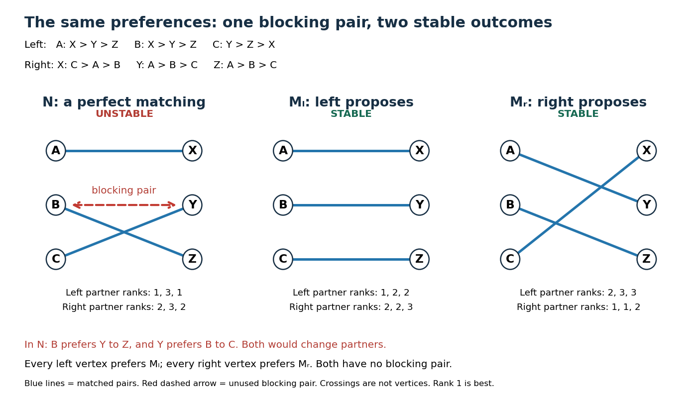

# Stable matching in a bipartite graph

↑ **Parent:** [Matching (graph theory)](matching-graph-theory-split.md)

A [stable matching in a bipartite graph](stable-matching-in-a-bipartite-graph.md) pairs two groups so that no acceptable unpaired pair would both rather be together. Give a finite [bipartite graph](bipartite-graph-split.md) $G=(L\cup R,E)$ a [strict preference](strict-preference.md) ordering at each [vertex](vertex-graph-theory.md) over its [neighbours of a vertex](neighbour-of-a-vertex.md). An [edge](edge-of-a-graph.md) means that both endpoints regard the pair as acceptable; every acceptable partner ranks above being unmatched. Lists may be incomplete, and $L$ and $R$ may have unequal [cardinalities](cardinality.md). A [matching in a graph](matching-graph-theory-split.md) $M\subseteq E$ is stable when it has no [blocking pair in stable matching](blocking-pair-in-stable-matching.md).

Write $M(v)$ for the partner of a [vertex](vertex-graph-theory.md) $v$, or $\bot$ if $v$ is an [unmatched vertex in a matching](unmatched-vertex-in-a-matching.md). An unused [edge](edge-of-a-graph.md) $(\ell,r)$ is a [blocking pair in stable matching](blocking-pair-in-stable-matching.md) precisely when

$$
r\succ_\ell M(\ell)\quad\text{and}\quad \ell\succ_r M(r),
$$

where $\succ_v$ denotes the [strict preference](strict-preference.md) at $v$ and $\bot$ ranks below every [neighbour of a vertex](neighbour-of-a-vertex.md). Both inequalities matter: wanting a different partner alone cannot upset a [stable matching](stable-matching-in-a-bipartite-graph.md). A [stable matching](stable-matching-in-a-bipartite-graph.md) need not be a [perfect matching](perfect-matching.md); the [Gale-Shapley algorithm](gale-shapley-algorithm.md) still finds one with incomplete lists and unequal sides.

Here is an original example on the [complete bipartite graph](complete-bipartite-graph.md) $K_{3,3}$, with $L=\{A,B,C\}$ and $R=\{X,Y,Z\}$. Read each row from best to worst:

$$
\begin{array}{c|ccc|c|ccc}
\text{left}&1&2&3&\text{right}&1&2&3\\\hline
A&X&Y&Z&X&C&A&B\\
B&X&Y&Z&Y&A&B&C\\
C&Y&Z&X&Z&A&B&C
\end{array}
$$

There are two [stable matchings](stable-matching-in-a-bipartite-graph.md),

$$
M_L=\{(A,X),(B,Y),(C,Z)\},\qquad
M_R=\{(A,Y),(B,Z),(C,X)\}.
$$

For $M_L$, the only unpaired partners preferred by left [vertices](vertex-graph-theory.md) are $B$ wanting $X$ and $C$ wanting $Y$. But $X$ prefers its partner $A$ to $B$, and $Y$ prefers its partner $B$ to $C$. Hence neither is a [blocking pair in stable matching](blocking-pair-in-stable-matching.md). For $M_R$, the left [vertices](vertex-graph-theory.md) want $A$ with $X$, $B$ with $X$ or $Y$, and $C$ with $Y$ or $Z$. In every case the right [vertex](vertex-graph-theory.md) prefers its current partner: $X$ has $C$, $Y$ has $A$, and $Z$ has $B$.

By contrast, $N=\{(A,X),(B,Z),(C,Y)\}$ is a [perfect matching](perfect-matching.md) with a [blocking pair in stable matching](blocking-pair-in-stable-matching.md) $(B,Y)$: $B$ prefers $Y$ to $Z$, while $Y$ prefers $B$ to $C$. The abandoned partners need not agree to the change; stability tests the incentives of the two endpoints of the unused [edge](edge-of-a-graph.md).

**[Figure 1](#image-one-blocking-pair-in-stable-matching-and-two-stable-matchings-for-the-same-strict-preference-lists). One blocking pair in stable matching and two stable matchings for the same strict preference lists**.

There are $3!=6$ [permutations](permutation.md) of right partners. The following table lists every [blocking pair in stable matching](blocking-pair-in-stable-matching.md) for each [perfect matching](perfect-matching.md); the middle column gives the partners of $A,B,C$ in that order:

$$
\begin{array}{c|c|l}
& (M(A),M(B),M(C))&\text{blocking pairs}\\\hline
M_L&(X,Y,Z)&\text{none}\\
N&(X,Z,Y)&(B,Y)\\
&(Y,X,Z)&(A,X)\\
M_R&(Y,Z,X)&\text{none}\\
&(Z,X,Y)&(A,X),\ (A,Y)\\
&(Z,Y,X)&(A,Y)
\end{array}
$$

This exhausts the [stable matchings](stable-matching-in-a-bipartite-graph.md): any nonperfect [matching in a graph](matching-graph-theory-split.md) here leaves an unmatched [vertex](vertex-graph-theory.md) on each side, and those two form a [blocking pair in stable matching](blocking-pair-in-stable-matching.md) because every cross-pair is acceptable. Notice that every left [vertex](vertex-graph-theory.md) prefers $M_L$ and every right [vertex](vertex-graph-theory.md) prefers $M_R$. Stability can accommodate opposing interests without selecting a single universally preferred outcome.

A [stable matching](stable-matching-in-a-bipartite-graph.md) addresses the possibility of mutually beneficial departures. Its definition contains no numerical total social benefit or [maximum-weight matching](maximum-weight-matching.md) objective. For example, assigning benefit $100$ to each [edge](edge-of-a-graph.md) of $N$ and zero to every other [edge](edge-of-a-graph.md) makes $N$ the unique [maximum-weight matching](maximum-weight-matching.md), yet $(B,Y)$ still blocks it under the displayed [preference relations](preference-relation.md). Such external benefits need not represent participants' rankings.

**Table of contents**

- [Mutual-worst edge in stable matchings](mutual-worst-edge-in-stable-matchings.md)
- [Gale-Shapley algorithm](gale-shapley-algorithm.md)
  - [Proposer-optimal stable matching](proposer-optimal-stable-matching.md)
    - [Receiver-pessimal stable matching](receiver-pessimal-stable-matching.md)
- [Blocking pair in stable matching](blocking-pair-in-stable-matching.md)

## ↑ Ancestors (6)

1. [Matching (graph theory)](matching-graph-theory-split.md)
2. [Graph theory](graph-theory-split.md)
3. [Foundations of mathematics](foundations-of-mathematics-split.md)
4. [Area of mathematics](area-of-mathematics.md)
5. [Mathematics](mathematics-split.md)
6. [Codex Wiki](split.md)

## ← Incoming links (5)

- [Galvin theorem for bipartite list edge coloring](galvin-theorem-for-bipartite-list-edge-coloring.md)
- [Kernel-perfect directed graph](kernel-perfect-directed-graph.md)
- [Mutual-worst edge in stable matchings](mutual-worst-edge-in-stable-matchings.md)
- [Solution](past-exam-of-the-mathematics-course-of-the-university-of-cambridge/2002/iii/paper-9/2/solution.md)
- [Stable matching in a bipartite graph](stable-matching-in-a-bipartite-graph.md)
