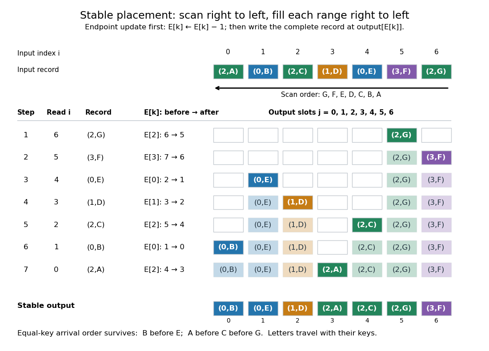

# Stable record placement in counting sort

↑ **Parent:** [Counting sort](counting-sort.md)

Initialize a mutable endpoint [array](array-data-structure.md) $E$ to the inclusive cumulative counts $P$. Scan [input](input-computer-science.md) [array indices](array-index.md) $i=n-1,n-2,\ldots,0$. For each complete [sorting record](sorting-record.md) $A_i$ with [sort key](sort-key.md) $k$, first decrement $E_k$, then write $A_i$ at [output](output-computing.md) [array index](array-index.md) $E_k$. This is equivalent to writing at the old endpoint minus one and then decrementing the endpoint.[Open Data Structures: An Introduction by Pat Morin; §11.2.1 Counting Sort, final scan paragraph and stability paragraph after Theorem 11.7](open-data-structures-an-introduction-by-pat-morin/11-2-counting-sort-and-radix-sort.md)

In the worked example, the first [input](input-computer-science.md) [sorting record](sorting-record.md) read is $(2,\mathrm G)$ at [array index](array-index.md) six. Its endpoint changes from $E_2=6$ to $E_2=5$, so the complete [sorting record](sorting-record.md) goes to $B_5$. Next, $(3,\mathrm F)$ changes $E_3$ from seven to six and goes to $B_6$. Writing before the decrement at the old endpoint would put $\mathrm G$ outside its reserved [integer interval](integer-interval.md) and try to put $\mathrm F$ beyond the [output](output-computing.md) [array](array-data-structure.md). All seven writes are:

$$
\begin{array}{c|c|c|c|c}
\text{step}&\text{input index }i&A_i& E_k\text{ before}\to\text{after}&\text{output index}\\\hline
1&6&(2,\mathrm G)&6\to5&5\\
2&5&(3,\mathrm F)&7\to6&6\\
3&4&(0,\mathrm E)&2\to1&1\\
4&3&(1,\mathrm D)&3\to2&2\\
5&2&(2,\mathrm C)&5\to4&4\\
6&1&(0,\mathrm B)&1\to0&0\\
7&0&(2,\mathrm A)&4\to3&3
\end{array}
$$

Each endpoint changes only when a [sorting record](sorting-record.md) with its own [sort key](sort-key.md) is placed. Consequently, $E_2$ stays at five through the placements of $\mathrm F,\mathrm E,\mathrm D$ before dropping to four for $\mathrm C$.

<a id="image-a-backward-input-scan-gives-forward-order-among-equal-sort-keys"></a>


**[Figure 21](#image-a-backward-input-scan-gives-forward-order-among-equal-sort-keys). A backward input scan gives forward order among equal sort keys**. Original complete trace of the seven-[sorting record](sorting-record.md) example. Each row shows the endpoint decrement and resulting [output](output-computing.md) [array](array-data-structure.md); the newly written complete [sorting record](sorting-record.md) is dark. Both [input](input-computer-science.md) and [output](output-computing.md) [array indices](array-index.md) start at zero. The final order is $\mathrm B,\mathrm E,\mathrm D,\mathrm A,\mathrm C,\mathrm G,\mathrm F$.

Here is a complete implementation under the stated [input](input-computer-science.md) contract; each [sorting record](sorting-record.md) is a pair whose first component is its [integer](integer-split.md) [sort key](sort-key.md):

```
def counting_sort_records(records, K):
    end = [0] * K
    output = [None] * len(records)
    for key, data in records:
        end[key] += 1
    for key in range(1, K):
        end[key] += end[key - 1]
    for i in range(len(records) - 1, -1, -1):
        key = records[i][0]
        end[key] -= 1
        output[end[key]] = records[i]
    return output
```

The same [array](array-data-structure.md) `end` successively stores frequencies, inclusive cumulative counts, and moving exclusive endpoints; the formulas $c,S,P$ describe their mathematical values without requiring three stored [arrays](array-data-structure.md). The write copies the complete [sorting record](sorting-record.md), including its associated data. In particular, two occurrences of an identical pair still cause two separate writes.

For a short [algorithm correctness](algorithm-correctness.md) proof, let $r_k$ be the number of already placed [sorting records](sorting-record.md) with [sort key](sort-key.md) $k$. A [loop invariant](loop-invariant.md) is

$$
E_k=P_k-r_k,\qquad [S_k,E_k)\text{ is unfilled},\qquad [E_k,P_k)\text{ is filled}.
$$

All [integer intervals](integer-interval.md) here mean [output](output-computing.md) [array indices](array-index.md). Initially $r_k=0$, so each whole reserved [integer interval](integer-interval.md) is unfilled. When the next [sorting record](sorting-record.md) has [sort key](sort-key.md) $k$, fewer than $c_k$ such occurrences have been placed, giving $E_k>S_k$. Decrementing selects a fresh slot inside its reserved [integer interval](integer-interval.md). At termination, $r_k=c_k$ and $E_k=S_k$: every [output](output-computing.md) slot has been filled exactly once with a complete [input](input-computer-science.md) occurrence. The disjoint, increasing [sort key](sort-key.md) ranges establish [sortedness](sortedness.md), while the fresh-slot property establishes [sorting permutation preservation](sorting-permutation-preservation.md).

For [stable sorting](stable-sorting.md), take two [input](input-computer-science.md) occurrences with equal [sort keys](sort-key.md) at [array indices](array-index.md) $i<j$. The backward scan visits $j$ first and puts it farther right in their shared [integer interval](integer-interval.md). When $i$ is visited, the endpoint has decreased at least once, so its [output](output-computing.md) position is smaller. Thus their original order survives. A forward scan with this same decrement rule reverses every equal-[sort key](sort-key.md) group: it would put $\mathrm A,\mathrm C,\mathrm G$ at positions five, four, three. A forward scan can instead be stable if it starts from $S_k$ and fills each [integer interval](integer-interval.md) left to right, incrementing after each write. The scan direction and endpoint convention must agree.

Count initialization takes $K$ writes, [output](output-computing.md) initialization takes $n$ writes, counting takes $n$ updates, the [prefix sum](prefix-sum.md) pass takes $K-1$ updates, and placement takes $n$ writes. Hence [time complexity](time-complexity.md) and auxiliary storage are $O(n+K)$ in [Big O notation](big-o-notation.md), assuming constant-cost [sort key](sort-key.md) access, [integer](integer-split.md) arithmetic, [array](array-data-structure.md) indexing and complete [sorting record](sorting-record.md) movement. Large records can instead be represented by constant-size references.[Open Data Structures: An Introduction by Pat Morin; §11.2.1 Counting Sort, auxiliary counter and output arrays, loop-cost discussion and Theorem 11.7](open-data-structures-an-introduction-by-pat-morin/11-2-counting-sort-and-radix-sort.md)

For example, three [sorting records](sorting-record.md) with [sort keys](sort-key.md) zero, $999999$ and zero require one million counters if $K=1000000$; unused [sort keys](sort-key.md) still incur initialization and [prefix sum](prefix-sum.md) work. The bound is therefore linear in the [input](input-computer-science.md) length only when $K=O(n)$. Empty [input](input-computer-science.md) skips the record scans, but this implementation still initializes $K$ counters and accumulates their [prefix sums](prefix-sum.md). For nonempty [input](input-computer-science.md), counting all $n$ records and filling their ranges gives a concrete termination argument.

Direct [sort key](sort-key.md) indexing is a different operation from a binary comparison. The [comparison sorting lower bound](comparison-sorting-lower-bound.md) concerns [comparison sorts](comparison-sort.md); [counting sort](counting-sort.md) uses its restricted [integer](integer-split.md) [sort keys](sort-key.md) as [array indices](array-index.md). Its small-$K$ speed is particularly useful for categorical numerical labels and for each [stable sorting](stable-sorting.md) pass of [radix sort](radix-sort.md): the reserved [integer intervals](integer-interval.md) turn group sizes into exact destinations.

## ↑ Ancestors (5)

1. [Counting sort](counting-sort.md)
2. [Sorting algorithm](sorting-algorithm.md)
3. [Algorithm](algorithm-split.md)
4. [Computer science](computer-science-split.md)
5. [Codex Wiki](split.md)

## ← Incoming links (2)

- [Counting sort](counting-sort.md)
- [Stable digit sort](stable-digit-sort.md)
