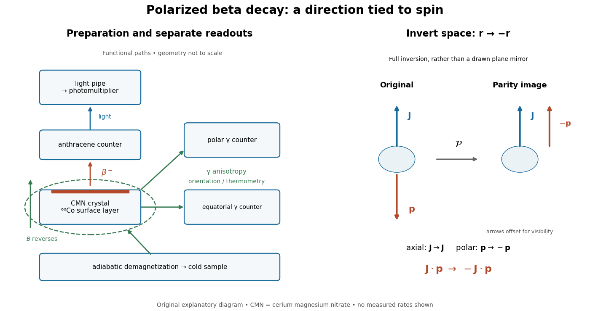
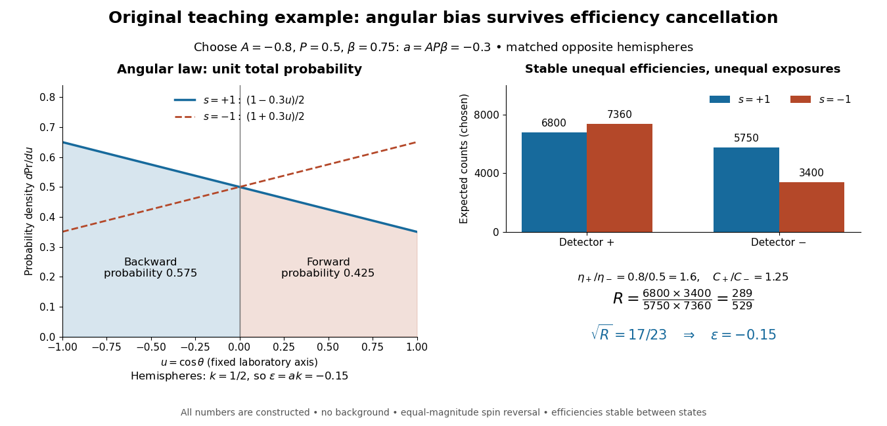
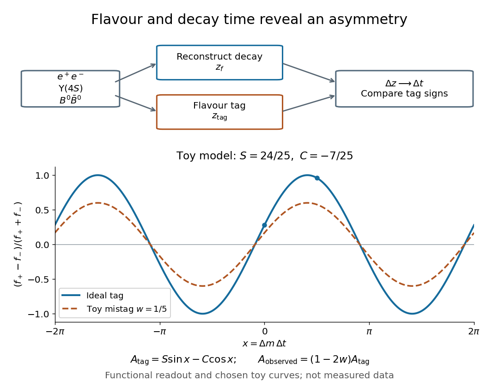

# Standard Model

↑ **Parent:** [Quantum field theory](quantum-field-theory.md)  
ⓦ [Wiki](https://en.wikipedia.org/wiki/Standard_Model)

The Standard Model is a gauge theory with gauge group $SU(3)_c\times SU(2)_L\times U(1)_Y$. Its Higgs field breaks the electroweak subgroup to the electromagnetic $U(1)_Q$.

**Table of contents**

- [Strong interaction](#strong-interaction)
  - [Hadronic final-state interaction](#hadronic-final-state-interaction)
  - [Quark-line flavour rearrangement](#quark-line-flavour-rearrangement)
  - [Meson-baryon scattering](#meson-baryon-scattering)
    - [Strangeness selection in pion-proton and kaon-proton resonances](#strangeness-selection-in-pion-proton-and-kaon-proton-resonances)
    - [Pion-nucleon octet channels](#pion-nucleon-octet-channels)
- [Weak interaction](#weak-interaction)
  - [Weak radiative hyperon decay](#weak-radiative-hyperon-decay)
  - [Sargent's rule](#sargent-s-rule)
  - [Second-order strangeness-changing weak decay](#second-order-strangeness-changing-weak-decay)
  - [Parity violation](#parity-violation)
    - [Lee-Yang proposal for a parity test](#lee-yang-proposal-for-a-parity-test)
    - [Wu experiment](#wu-experiment)
    - [Polarized beta-decay angular distribution](#polarized-beta-decay-angular-distribution)
      - [Spin-reversal cross-ratio for beta decay](#spin-reversal-cross-ratio-for-beta-decay)
        - [Finite-acceptance dilution of beta asymmetry](#finite-acceptance-dilution-of-beta-asymmetry)
  - [Charged-lepton flavor violation](#charged-lepton-flavor-violation)
    - [Dimension-six Higgs Yukawa misalignment](#dimension-six-higgs-yukawa-misalignment)
  - [Charged current](#charged-current)
    - [V-A interaction](#v-a-interaction)
    - [Orthogonal completion of mixed neutral lepton kinetic terms](#orthogonal-completion-of-mixed-neutral-lepton-kinetic-terms)
    - [Lepton universality](#lepton-universality)
    - [Quark mixing](#quark-mixing)
    - [Transverse massless leptonic current](#transverse-massless-leptonic-current)
    - [Weak flavour selection in neutrino-electron scattering](#weak-flavour-selection-in-neutrino-electron-scattering)
    - [Helicity suppression](#helicity-suppression)
      - [Spin-zero two-body helicity selection](#spin-zero-two-body-helicity-selection)
        - [One-photon spin-zero transition prohibition](#one-photon-spin-zero-transition-prohibition)
    - [Weak charged-current quark scattering](#weak-charged-current-quark-scattering)
      - [Neutrino scattering on an antiquark](#neutrino-scattering-on-an-antiquark)
      - [Chiral weak-current trace contraction](#chiral-weak-current-trace-contraction)
      - [Angular asymmetry of a chiral charged-current interaction](#angular-asymmetry-of-a-chiral-charged-current-interaction)
  - [Neutral current](#neutral-current)
    - [Gargamelle](#gargamelle)
    - [Muon-neutrino electron recoil spectrum](#muon-neutrino-electron-recoil-spectrum)
    - [Neutral-current vector and axial couplings](#neutral-current-vector-and-axial-couplings)
    - [Flavor-changing neutral current](#flavor-changing-neutral-current)
      - [GIM mechanism](#gim-mechanism)
      - [Glashow-Iliopoulos-Maiani mechanism](#glashow-iliopoulos-maiani-mechanism)
- [Accidental symmetry](#accidental-symmetry)
- [Hierarchy problem](#hierarchy-problem)
  - [Technical hierarchy problem](#technical-hierarchy-problem)
  - [Naturalness (physics)](#naturalness-physics)
    - [Symmetry protection of a small mass](#symmetry-protection-of-a-small-mass)
      - [Chiral protection of a fermion mass](#chiral-protection-of-a-fermion-mass)
      - [Gauge protection of a vector mass](#gauge-protection-of-a-vector-mass)
- [Quantum chromodynamics](#quantum-chromodynamics)
  - [Distinct-flavor quark scattering color factor](#distinct-flavor-quark-scattering-color-factor)
  - [Lattice QCD](#lattice-qcd)
  - [Massless two-flavor QCD symmetries](#massless-two-flavor-qcd-symmetries)
  - [Jet (particle physics)](#jet-particle-physics)
    - [Three-jet event](#three-jet-event)
  - [Real-virtual infrared cancellation in inclusive QCD](#real-virtual-infrared-cancellation-in-inclusive-qcd)
  - [Hadronization](#hadronization)
    - [Hadronization time](#hadronization-time)
  - [Quark-hadron duality](#quark-hadron-duality)
  - [Large-Nc baryon scaling](#large-nc-baryon-scaling)
  - [Strong coupling constant](#strong-coupling-constant)
  - [Color charge](#color-charge)
    - [Colour singlet](#colour-singlet)
    - [Color multiplicity in a decay width](#color-multiplicity-in-a-decay-width)
  - [Parton](#parton)
    - [Parton model](#parton-model)
      - [Parton convolution normalization for a hadronic tensor](#parton-convolution-normalization-for-a-hadronic-tensor)
      - [Bjorken scaling](#bjorken-scaling)
      - [Callan-Gross relation](#callan-gross-relation)
      - [Massless collinear parton approximation](#massless-collinear-parton-approximation)
        - [Parton on-shell delta identity](#parton-on-shell-delta-identity)
      - [Parton distribution function](#parton-distribution-function)
        - [Quark number sum rule](#quark-number-sum-rule)
          - [Valence-only proton and neutron structure-function moments](#valence-only-proton-and-neutron-structure-function-moments)
        - [Parton factorization scale](#parton-factorization-scale)
  - [Deep inelastic scattering](#deep-inelastic-scattering)
    - [SLAC-MIT deep inelastic electron scattering experiment](#slac-mit-deep-inelastic-electron-scattering-experiment)
      - [SLAC-MIT spectrometer readout and corrections](#slac-mit-spectrometer-readout-and-corrections)
      - [Fixed-x electron scattering kinematics](#fixed-x-electron-scattering-kinematics)
      - [Structure-function scaling versus elastic suppression](#structure-function-scaling-versus-elastic-suppression)
    - [Breit frame](#breit-frame)
    - [Inelasticity](#inelasticity)
    - [Bjorken scaling variable](#bjorken-scaling-variable)
    - [Bjorken x](#bjorken-x)
    - [Hadronic tensor](#hadronic-tensor)
      - [Physical momentum support of a deep-inelastic hadronic tensor](#physical-momentum-support-of-a-deep-inelastic-hadronic-tensor)
      - [Transverse decomposition of an unpolarized hadronic tensor](#transverse-decomposition-of-an-unpolarized-hadronic-tensor)
      - [Spin-averaged electromagnetic parton tensor](#spin-averaged-electromagnetic-parton-tensor)
      - [Deep-inelastic structure function](#deep-inelastic-structure-function)
        - [Longitudinal deep-inelastic structure function](#longitudinal-deep-inelastic-structure-function)
    - [Leptonic tensor](#leptonic-tensor)
      - [Integrated massless leptonic tensor](#integrated-massless-leptonic-tensor)
  - [Gluon](#gluon)
  - [Confinement](#confinement)
  - [QCD scale](#qcd-scale)
  - [Flavor symmetry](#flavor-symmetry)
    - [Zero flavour triality of a light-quark hadron](#zero-flavour-triality-of-a-light-quark-hadron)
    - [U-spin](#u-spin)
    - [Flavor SU(3) Cartan generators](#flavor-su-3-cartan-generators)
    - [Strangeness](#strangeness)
      - [Strangeness-changing hyperon decay](#strangeness-changing-hyperon-decay)
    - [Flavor hypercharge](#flavor-hypercharge)
      - [Half-hypercharge convention](#half-hypercharge-convention)
        - [Baryon weight diagrams in the half-hypercharge convention](#baryon-weight-diagrams-in-the-half-hypercharge-convention)
      - [Gell-Mann--Nishijima formula](#gell-mann-nishijima-formula)
    - [Chiral symmetry](#chiral-symmetry)
      - [Quark chiral condensate](#quark-chiral-condensate)
      - [Nonsinglet axial charge algebra of quark densities](#nonsinglet-axial-charge-algebra-of-quark-densities)
        - [Flavor-nonsinglet axial Ward identity with equal quark masses](#flavor-nonsinglet-axial-ward-identity-with-equal-quark-masses)
    - [Isospin](#isospin)
      - [Two-pion isospin decomposition](#two-pion-isospin-decomposition)
      - [Isobaric analog state](#isobaric-analog-state)
        - [Analogue beta-decay branching estimate](#analogue-beta-decay-branching-estimate)
      - [Highest-weight weak-isospin selection in kaon decay](#highest-weight-weak-isospin-selection-in-kaon-decay)
      - [Two-isovector singlet](#two-isovector-singlet)
      - [Isospin multiplet](#isospin-multiplet)
        - [Isospin-invariant two-body decay amplitude](#isospin-invariant-two-body-decay-amplitude)
        - [Half-turn phase of an SU(2) multiplet](#half-turn-phase-of-an-su-2-multiplet)
      - [Weak isospin](#weak-isospin)
      - [G parity](#g-parity)
        - [G-parity of an isospin multiplet](#g-parity-of-an-isospin-multiplet)
          - [G-parity selection rule for pion multiplicities](#g-parity-selection-rule-for-pion-multiplicities)
        - [Pion G-parity](#pion-g-parity)
      - [Isorotation](#isorotation)
    - [Eightfold way](#eightfold-way)
      - [Three-quark flavour singlet](#three-quark-flavour-singlet)
      - [Baryon decuplet](#baryon-decuplet)
      - [Meson octet](#meson-octet)
        - [Eta octet state](#eta-octet-state)
      - [Baryon octet](#baryon-octet)
  - [Chiral symmetry breaking](#chiral-symmetry-breaking)
    - [Linear sigma model](#linear-sigma-model)
    - [Chiral perturbation theory](#chiral-perturbation-theory)
      - [Leading pion mass from a two-flavour condensate](#leading-pion-mass-from-a-two-flavour-condensate)
      - [Uniqueness of the two-derivative two-flavour chiral action](#uniqueness-of-the-two-derivative-two-flavour-chiral-action)
    - [Pion decay constant](#pion-decay-constant)
  - [Pion](#pion)
    - [Neutral pion](#neutral-pion)
    - [Leptonic pion decay](#leptonic-pion-decay)
      - [State-counting and helicity factors in pion decay](#state-counting-and-helicity-factors-in-pion-decay)
      - [Vacuum-to-pseudoscalar current selection rule](#vacuum-to-pseudoscalar-current-selection-rule)
      - [Pion electron-to-muon decay ratio](#pion-electron-to-muon-decay-ratio)
      - [Leptonic pseudoscalar decay width](#leptonic-pseudoscalar-decay-width)
- [Electroweak interaction](#electroweak-interaction)
  - [Electroweak gauge symmetry](#electroweak-gauge-symmetry)
  - [Electroweak triple gauge coupling](#electroweak-triple-gauge-coupling)
  - [Electroweak precision test with the W, top and Higgs masses](#electroweak-precision-test-with-the-w-top-and-higgs-masses)
  - [Electroweak unification history](#electroweak-unification-history)
  - [Electromagnetic coupling of a weak multiplet](#electromagnetic-coupling-of-a-weak-multiplet)
  - [Weinberg angle](#weinberg-angle)
  - [Electroweak gauge invariance](#electroweak-gauge-invariance)
  - [Sphaleron](#sphaleron)
  - [Hypercharge](#hypercharge)
    - [Charge quantization](#charge-quantization)
  - [Higgs field](#higgs-field)
    - [Polar coordinates for the electroweak Higgs doublet](#polar-coordinates-for-the-electroweak-higgs-doublet)
    - [Higgs conjugate doublet](#higgs-conjugate-doublet)
    - [Higgs field potential](#higgs-field-potential)
      - [Higgs radial mass for a half-normalized quartic potential](#higgs-radial-mass-for-a-half-normalized-quartic-potential)
      - [Shifted quartic Higgs potential normalization](#shifted-quartic-higgs-potential-normalization)
    - [Higgs mechanism](#higgs-mechanism)
      - [SO(4) vector-Higgs gauge-boson spectrum](#so-4-vector-higgs-gauge-boson-spectrum)
      - [Higgs mechanism history](#higgs-mechanism-history)
      - [Higgs degree-of-freedom count](#higgs-degree-of-freedom-count)
      - [Goldstone-boson equivalence theorem](#goldstone-boson-equivalence-theorem)
        - [Higgs cancellation in longitudinal vector scattering](#higgs-cancellation-in-longitudinal-vector-scattering)
      - [Cubic and quartic Higgs couplings to electroweak gauge bosons](#cubic-and-quartic-higgs-couplings-to-electroweak-gauge-bosons)
      - [SO(3) vector Higgs model](#so-3-vector-higgs-model)
        - [Axial transformation of orthogonal gauge connections](#axial-transformation-of-orthogonal-gauge-connections)
        - [Adjoint triplet Higgs spectrum](#adjoint-triplet-higgs-spectrum)
        - [SO(3) invariant quartic scalar potential](#so-3-invariant-quartic-scalar-potential)
        - [Vector Higgs field](#vector-higgs-field)
          - [Covariantly constant vector Higgs field](#covariantly-constant-vector-higgs-field)
      - [SU2 adjoint Higgs model](#su2-adjoint-higgs-model)
      - [Adjoint-Higgs breaking of SU(3) to SU(2) and U(1)](#adjoint-higgs-breaking-of-su-3-to-su-2-and-u-1)
      - [Gauge-boson mass matrix from an adjoint scalar](#gauge-boson-mass-matrix-from-an-adjoint-scalar)
      - [Electroweak symmetry breaking](#electroweak-symmetry-breaking)
        - [Electroweak phase transition](#electroweak-phase-transition)
          - [Mass window in a cubic electroweak transition model](#mass-window-in-a-cubic-electroweak-transition-model)
        - [Radiative electroweak symmetry breaking](#radiative-electroweak-symmetry-breaking)
        - [Electroweak scale](#electroweak-scale)
        - [Electroweak doublet gauge-boson mass matrix](#electroweak-doublet-gauge-boson-mass-matrix)
        - [Tree-level electroweak gauge-boson masses](#tree-level-electroweak-gauge-boson-masses)
      - [Unitary gauge](#unitary-gauge)
        - [Orthogonal unitary-gauge slice near a scalar vacuum](#orthogonal-unitary-gauge-slice-near-a-scalar-vacuum)
    - [Higgs boson](#higgs-boson)
      - [Vector-boson fusion](#vector-boson-fusion)
      - [Gluon-fusion Higgs production](#gluon-fusion-higgs-production)
      - [Muon-collider Higgs resonance](#muon-collider-higgs-resonance)
      - [Higgs boson coupling to W bosons](#higgs-boson-coupling-to-w-bosons)
      - [Electron Yukawa suppression of Higgs production](#electron-yukawa-suppression-of-higgs-production)
      - [Higgs boson discovery in 2012](#higgs-boson-discovery-in-2012)
        - [Higgs resonance resolution and background model](#higgs-resonance-resolution-and-background-model)
      - [Higgsstrahlung](#higgsstrahlung)
      - [Higgs decay to a fermion pair](#higgs-decay-to-a-fermion-pair)
        - [Higgs branching-fraction normalization from mass-weighted channels](#higgs-branching-fraction-normalization-from-mass-weighted-channels)
      - [Higgs decay to two W bosons](#higgs-decay-to-two-w-bosons)
        - [Higgs decay to longitudinal W bosons](#higgs-decay-to-longitudinal-w-bosons)
      - [Higgs boson coupling to Z bosons](#higgs-boson-coupling-to-z-bosons)
        - [Higgs decay to two Z bosons](#higgs-decay-to-two-z-bosons)
    - [Electroweak scalar triplet](#electroweak-scalar-triplet)
  - [Electroweak gauge boson](#electroweak-gauge-boson)
    - [Electromagnetic charge matrix of electroweak gauge fields](#electromagnetic-charge-matrix-of-electroweak-gauge-fields)
    - [W boson](#w-boson)
      - [Charged-current W branching-fraction counting](#charged-current-w-branching-fraction-counting)
      - [W boson propagator](#w-boson-propagator)
      - [Tree-level W branching fractions](#tree-level-w-branching-fractions)
      - [Massless leptonic W decay width](#massless-leptonic-w-decay-width)
        - [Polarized massless leptonic W decay](#polarized-massless-leptonic-w-decay)
      - [W boson decay to a quark pair](#w-boson-decay-to-a-quark-pair)
    - [Z boson](#z-boson)
      - [Chiral Z-boson partial width](#chiral-z-boson-partial-width)
      - [Massless leptonic Z decay width](#massless-leptonic-z-decay-width)
        - [Light-neutrino counting from the Z width](#light-neutrino-counting-from-the-z-width)
        - [Massless fermion Z decay spin sum](#massless-fermion-z-decay-spin-sum)
- [Standard Model fermion](#standard-model-fermion)
  - [Fermion generation](#fermion-generation)
    - [Quark generation](#quark-generation)
  - [Lepton](#lepton)
    - [Antilepton](#antilepton)
    - [Charged lepton](#charged-lepton)
    - [Tau (particle)](#tau-particle)
      - [SPEAR Mark I tau discovery experiment](#spear-mark-i-tau-discovery-experiment)
        - [Collider luminosity](#collider-luminosity)
          - [Integrated collider luminosity](#integrated-collider-luminosity)
        - [Tau-pair electron-muon missing-energy signature](#tau-pair-electron-muon-missing-energy-signature)
          - [Three-body leptonic tau-decay kinematic bounds](#three-body-leptonic-tau-decay-kinematic-bounds)
            - [Tau-pair missing-mass teaching model](#tau-pair-missing-mass-teaching-model)
        - [Missing four-momentum in electron-positron collisions](#missing-four-momentum-in-electron-positron-collisions)
          - [Missing invariant mass](#missing-invariant-mass)
    - [Muon](#muon)
      - [Muon decay](#muon-decay)
        - [Polarized muon decay](#polarized-muon-decay)
      - [Antimuon](#antimuon)
  - [Quark](#quark)
    - [Valence quark](#valence-quark)
    - [Quark mass](#quark-mass)
      - [Constituent quark mass](#constituent-quark-mass)
    - [Quark field](#quark-field)
    - [Quark flavor](#quark-flavor)
    - [Heavy quark](#heavy-quark)
    - [Top quark](#top-quark)
      - [Top-quark decay before hadronization](#top-quark-decay-before-hadronization)
        - [Two-body top-quark decay width](#two-body-top-quark-decay-width)
    - [Spectator quark](#spectator-quark)
    - [Bottom quark](#bottom-quark)
    - [Charm quark](#charm-quark)
      - [Charm antiquark](#charm-antiquark)
    - [Strange quark](#strange-quark)
      - [Strange antiquark](#strange-antiquark)
    - [Down quark](#down-quark)
      - [Down antiquark](#down-antiquark)
    - [Up quark](#up-quark)
    - [Antiquark](#antiquark)
  - [Standard Model representation](#standard-model-representation)
    - [Quark doublet](#quark-doublet)
    - [Electroweak representation and hypercharge table](#electroweak-representation-and-hypercharge-table)
  - [Baryon number](#baryon-number)
    - [Baryon-minus-lepton number](#baryon-minus-lepton-number)
    - [Baryon plus lepton number](#baryon-plus-lepton-number)
    - [Proton decay](#proton-decay)
      - [Proton-decay operator](#proton-decay-operator)
  - [Lepton number](#lepton-number)
    - [Lepton-number test of a decay channel](#lepton-number-test-of-a-decay-channel)
    - [Neutrino](#neutrino)
      - [Dirac neutrino](#dirac-neutrino)
      - [Active neutrino](#active-neutrino)
      - [Charged-current neutrino-electron threshold](#charged-current-neutrino-electron-threshold)
      - [Sterile neutrino](#sterile-neutrino)
        - [Neutrino dark-matter longevity constraint](#neutrino-dark-matter-longevity-constraint)
        - [Standard Model gauge singlet neutrino](#standard-model-gauge-singlet-neutrino)
      - [Majorana neutrino](#majorana-neutrino)
      - [Atmospheric neutrino](#atmospheric-neutrino)
      - [Electron neutrino](#electron-neutrino)
      - [Tau neutrino](#tau-neutrino)
      - [Neutrino mass](#neutrino-mass)
      - [Neutrino flavor](#neutrino-flavor)
      - [Mixing of exactly massless neutrinos is removable](#mixing-of-exactly-massless-neutrinos-is-removable)
      - [Muon neutrino](#muon-neutrino)
      - [Antineutrino](#antineutrino)
        - [Muon antineutrino](#muon-antineutrino)
        - [Electron antineutrino](#electron-antineutrino)
      - [Neutrino oscillation](#neutrino-oscillation)
        - [Lepton mixing matrix](#lepton-mixing-matrix)
  - [Right-handed neutrino](#right-handed-neutrino)
    - [Gauge-invariant right-handed neutrino Majorana mass](#gauge-invariant-right-handed-neutrino-majorana-mass)
    - [Seesaw mechanism](#seesaw-mechanism)
      - [Seesaw light-mass estimate needs a Dirac scale](#seesaw-light-mass-estimate-needs-a-dirac-scale)
      - [One-family Dirac-Majorana mass matrix](#one-family-dirac-majorana-mass-matrix)
      - [Weinberg operator](#weinberg-operator)
        - [Majorana neutrino mass from the Weinberg operator](#majorana-neutrino-mass-from-the-weinberg-operator)
      - [Type-II seesaw mechanism](#type-ii-seesaw-mechanism)
  - [Yukawa interaction](#yukawa-interaction)
    - [Higgs-electron coupling](#higgs-electron-coupling)
    - [Yukawa scalar self-energy pole coefficients](#yukawa-scalar-self-energy-pole-coefficients)
    - [Tree scattering in Yukawa theory](#tree-scattering-in-yukawa-theory)
      - [Tree scattering with pseudoscalar exchange](#tree-scattering-with-pseudoscalar-exchange)
    - [Gauge-invariant electron Yukawa mass](#gauge-invariant-electron-yukawa-mass)
    - [Pseudoscalar Yukawa interaction](#pseudoscalar-yukawa-interaction)
      - [Hermiticity of a pseudoscalar Dirac bilinear](#hermiticity-of-a-pseudoscalar-dirac-bilinear)
    - [Fermion mass matrix](#fermion-mass-matrix)
    - [Yukawa matrix](#yukawa-matrix)
      - [Charged-lepton Yukawa matrix diagonalization](#charged-lepton-yukawa-matrix-diagonalization)
  - [Cabibbo-Kobayashi-Maskawa matrix](#cabibbo-kobayashi-maskawa-matrix)
    - [CKM unitarity triangle](#ckm-unitarity-triangle)
    - [Wolfenstein parametrization](#wolfenstein-parametrization)
    - [Quark rephasing and CP conservation](#quark-rephasing-and-cp-conservation)
      - [CP transformation of a charged quark current](#cp-transformation-of-a-charged-quark-current)
    - [CKM parameter counting](#ckm-parameter-counting)
    - [Cabibbo angle](#cabibbo-angle)
      - [Cabibbo-angle extraction from semileptonic decay rates](#cabibbo-angle-extraction-from-semileptonic-decay-rates)
      - [Cabibbo suppression](#cabibbo-suppression)
        - [Cabibbo hierarchy of neutral-D two-body decays](#cabibbo-hierarchy-of-neutral-d-two-body-decays)
    - [Jarlskog invariant](#jarlskog-invariant)
    - [BABAR time-dependent CP violation experiment](#babar-time-dependent-cp-violation-experiment)
      - [Time-dependent neutral-B CP asymmetry](#time-dependent-neutral-b-cp-asymmetry)

## Strong interaction

↑ **Parent:** [Standard Model](standard-model.md)  
ⓦ [Wiki](https://en.wikipedia.org/wiki/Strong_interaction)

The strong interaction is the $SU(3)_c$ gauge interaction described by [Quantum chromodynamics](#quantum-chromodynamics). It couples quarks and gluons through color charge.

### Hadronic final-state interaction

↑ **Parent:** [Strong interaction](#strong-interaction)

An interaction among outgoing [hadrons](physics.md#hadron) that changes the observed channel amplitude or its phase after the short-distance production vertex. Rescattering can mix channels with the same conserved quantum numbers. Consequently identical CKM suppression orders do not imply equal [branching fractions](relativistic-quantum-field.md#branching-fraction), and a free-quark spectator diagram need not determine the ordering of exclusive hadronic [decay rates](relativistic-quantum-field.md#decay-width).

### Quark-line flavour rearrangement

↑ **Parent:** [Strong interaction](#strong-interaction)

A quark-line diagram can show how existing [valence quarks](#valence-quark) are regrouped into outgoing [hadrons](physics.md#hadron) while [gluons](#gluon) exchange [momentum](momentum.md) and colour. Alternatively, a quark-antiquark pair can annihilate and create a different flavour pair with zero net flavour. Such drawings enforce global charge, [baryon number](#baryon-number) and flavour constraints; they are not controlled perturbative calculations of an exclusive low-energy hadronic [amplitude](wave.md#wave-amplitude) because binding is nonperturbative.

### Meson-baryon scattering

↑ **Parent:** [Strong interaction](#strong-interaction)

Scattering with one [meson](physics.md#meson) and one [baryon](physics.md#baryon) in the initial and final states. The [strong interaction](#strong-interaction) conserves [electric charge](electric-charge.md), [baryon number](#baryon-number), net [strangeness](#strangeness), four-momentum, total [angular momentum](momentum.md#angular-momentum), and parity. Approximate [isospin](#isospin) symmetry imposes additional relations among charge-channel amplitudes.

#### Strangeness selection in pion-proton and kaon-proton resonances

↑ **Parent:** [Meson-baryon scattering](#meson-baryon-scattering)

The $\pi^+p$ channel has baryon number one, strangeness zero and $I_3=3/2$, matching the ordinary $uuu$ [Delta baryon](physics.md#delta-baryon). The $K^+p$ channel has strangeness plus one, which no three-light-quark baryon can have because each strange quark contributes minus one. A resonance in that channel would require exotic content such as four quarks and an antiquark; the ordinary low-energy qqq multiplets therefore explain the contrast.

#### Pion-nucleon octet channels

↑ **Parent:** [Meson-baryon scattering](#meson-baryon-scattering)

For an initial [pion](#pion)-[nucleon](physics.md#nucleon) state and outgoing [meson octet](#meson-octet)-[baryon octet](#baryon-octet) pair, conservation of [baryon number](#baryon-number) and [strangeness](#strangeness) allows $\pi N$, $\eta_8N$, $K\Lambda$, and $K\Sigma$, subject to [electric charge](electric-charge.md) and production thresholds. Total [isospin](#isospin) is $1/2$ or $3/2$; the $\eta_8N$ and $K\Lambda$ channels contain only $1/2$.

## Weak interaction

↑ **Parent:** [Standard Model](standard-model.md)  
ⓦ [Wiki](https://en.wikipedia.org/wiki/Weak_interaction)

The [weak interaction](#weak-interaction) changes particle species through the [charged current](#charged-current) and also acts through the [neutral current](#neutral-current). Familiar examples include [beta-minus decay](physics.md#beta-minus-decay) and [neutrino](#neutrino) scattering. It is short-range and chiral: its [W boson](#w-boson) and [Z boson](#z-boson) couplings distinguish [chirality](relativistic-quantum-field.md#chirality-physics). Above the electroweak scale it belongs to the unbroken $SU(2)_L\times U(1)_Y$ [electroweak interaction](#electroweak-interaction). At much lower [energies](energy.md), [W boson](#w-boson) exchange is approximated by the [Fermi interaction](quantum-field-theory.md#fermi-interaction).

A particularly direct window into the [weak interaction](#weak-interaction) is the [Wu experiment](#wu-experiment): a sample with oriented nuclear [spins](angular-momentum-operator.md#spin) emits [electrons](physics.md#electron) preferentially toward one end of its [spin](angular-momentum-operator.md#spin) axis. The comparison tests [parity conservation](quantum-mechanics.md#parity-conservation), because [spin](angular-momentum-operator.md#spin) is an [axial vector](vector-space.md#pseudovector) and [momentum](momentum.md) is a [polar vector](vector-space.md#polar-vector). The [polarized beta-decay angular distribution](#polarized-beta-decay-angular-distribution) translates that geometric distinction into a measurable counting asymmetry.

### Weak radiative hyperon decay

↑ **Parent:** [Weak interaction](#weak-interaction)

A [hyperon](physics.md#hyperon) decay that changes [quark flavour](#quark-flavor) while emitting a [photon](quantum-mechanics.md#photon). An example is $\Xi^0\to\Lambda\gamma$, which changes [strangeness](#strangeness) and cannot be purely electromagnetic. Its amplitude can contain short-distance loops and long-distance hadronic contributions. [photon](quantum-mechanics.md#photon) attachments to a weak quark-exchange graph must be completed consistently with electromagnetic gauge invariance. A [quark](#quark) topology identifies allowed flavour flow but does not by itself calculate a reliable hadronic rate.

<h3 id="sargent-s-rule">Sargent's rule</h3>

↑ **Parent:** [Weak interaction](#weak-interaction)

In a low-energy allowed weak three-body decay, negligible final-state masses and a nearly constant effective matrix element give a fifth-power energy-release dependence. For muon decay in [natural units](mathematical-physics.md#natural-units), $\Gamma\simeq G_F^2m_\mu^5/(192\pi^3)$. This four-fermion approximation requires momentum transfers small compared with the [W boson](#w-boson) mass. Extrapolation to a heavy particle able to emit a real W changes the decay kinematics and the mass scaling, so it is not a reliable heavy-particle lifetime prediction.

### Second-order strangeness-changing weak decay

↑ **Parent:** [Weak interaction](#weak-interaction)

A [decay amplitude](relativistic-quantum-field.md#decay-amplitude) changing [strangeness](#strangeness) by two units requires at least two insertions of the low-energy [weak interaction](#weak-interaction) in the [Standard Model](standard-model.md). Each charged-current insertion can remove only one net strange [quark](#quark) in such a process. Both two-[W boson](#w-boson) tree topologies and loop contributions can occur; a loop is not required for every exclusive final state. At hadronic energies, the extra power of the [Fermi constant](quantum-field-theory.md#fermi-constant), with the needed powers of an energy scale to balance units, strongly suppresses a second-order amplitude relative to a first-order one. This is distinct from [Cabibbo suppression](#cabibbo-suppression) within a fixed weak order.

### Parity violation

↑ **Parent:** [Weak interaction](#weak-interaction)

[Parity violation](#parity-violation) means that a physical law fails to be invariant under the [spatial reflection](quantum-mechanics.md#spatial-reflection) represented by the [parity operator](quantum-mechanics.md#parity-operator). A process and its fully inverted counterpart can then have different [probabilities](probability-theory.md#probability). For [beta-minus decay](physics.md#beta-minus-decay) with polarized parent [atomic nuclei](atomic-nucleus.md), a nonzero correlation between nuclear [spin](angular-momentum-operator.md#spin) and emitted [electron](physics.md#electron) [momentum](momentum.md) is such a test. [Rotational symmetry](linear-algebra.md#rotational-symmetry) alone allows this correlation: a [pseudoscalar](quantum-mechanics.md#pseudoscalar) is unchanged by proper [rotations](riemannian-geometry.md#rotation-mathematics) but changes sign under [spatial reflection](quantum-mechanics.md#spatial-reflection).

#### Lee-Yang proposal for a parity test

↑ **Parent:** [Parity violation](#parity-violation)

In 1956, [Tsung-Dao Lee](physicist.md#tsung-dao-lee) and [Chen Ning Yang](physicist.md#chen-ning-yang) examined the evidence for [parity conservation](quantum-mechanics.md#parity-conservation) in the [weak interaction](#weak-interaction). Their paper, Question of Parity Conservation in Weak Interactions, distinguished an untested assumption from an established experimental result and proposed comparing [electron](physics.md#electron) emission along opposite directions relative to oriented nuclear [spins](angular-momentum-operator.md#spin), explicitly considering [cobalt-60](chemical-substance.md#cobalt-60). It proposed a test; it did not report the later [Wu experiment](#wu-experiment).[pp. 254–255; evidence review and “Possible Experimental Tests of Parity Conservation in beta Decays,” first proposal](physics-bibliography.md#question-of-parity-conservation-in-weak-interactions-by-tsung-dao-lee-and-chen-ning-yang)

The conceptual improvement is the choice of observable. An angle between two [polar vectors](vector-space.md#polar-vector) is preserved by [spatial reflection](quantum-mechanics.md#spatial-reflection); its distribution can conceal [parity violation](#parity-violation). An angle between an [axial vector](vector-space.md#pseudovector) and a [polar vector](vector-space.md#polar-vector) changes to its supplement. Thus a [spin](angular-momentum-operator.md#spin)-resolved directional measurement asks a different question from an unpolarized total [decay rate](relativistic-quantum-field.md#decay-width).

#### Wu experiment

↑ **Parent:** [Parity violation](#parity-violation)  
ⓦ [Wiki](https://en.wikipedia.org/wiki/Wu_experiment)

The [Wu experiment](#wu-experiment) was performed by [Chien-Shiung Wu](physicist.md#chien-shiung-wu), [Ernest Ambler](physicist.md#ernest-ambler), [Raymond Webster Hayward](physicist.md#raymond-webster-hayward), [Dale D. Hoppes](physicist.md#dale-d-hoppes), and [Ralph Percy Hudson](physicist.md#ralph-percy-hudson); its 1957 report was Experimental Test of Parity Conservation in Beta Decay. Their experiment supplied the evidence that the [Lee-Yang proposal for a parity test](#lee-yang-proposal-for-a-parity-test) had called for.[Experimentalists: the five named biographies; theorists: Lee and Yang](physics-bibliography.md#the-fall-of-parity-photo-gallery-with-short-biographies-by-national-institute-of-standards-and-technology)

A [cobalt-60](chemical-substance.md#cobalt-60) surface layer on a [cerium magnesium nitrate](chemical-substance.md#cerium-magnesium-nitrate) [crystal](thermodynamics.md#crystal) was cooled by [adiabatic demagnetization](temperature.md#adiabatic-demagnetization); a solenoid's [magnetic field](magnetic-field.md) polarized its [atomic nuclei](atomic-nucleus.md). An internal [anthracene](chemical-substance.md#anthracene) counter detected [electrons](physics.md#electron) by [particle scintillation](physics.md#scintillation-physics); a light pipe carried flashes to a [photomultiplier](particle-detection.md#photomultiplier). Polar and equatorial [gamma ray](quantum-mechanics.md#gamma-ray) counters monitored [nuclear polarization](physics.md#nuclear-polarization) and effective [temperature](temperature.md); bulk thermometry could miss surface heating.[p. 1413, Fig. 1 and apparatus paragraphs; p. 1414, demagnetization followed by vertical solenoid](physics-bibliography.md#experimental-test-of-parity-conservation-in-beta-decay-by-chien-shiung-wu-and-others)

Reversing [nuclear polarization](physics.md#nuclear-polarization) reversed the [electron](physics.md#electron) excess; warming erased it with [gamma ray](quantum-mechanics.md#gamma-ray) anisotropy. Warm rates were field-independent. Cooling-field reversal checked remanence; poorly polarized sources checked magnetic deflection. [Electrons](physics.md#electron) favored the direction opposite [spin](angular-momentum-operator.md#spin).[p. 1414, Fig. 2; warm rates, cooling-field reversal, sign, and two control-source preparations](physics-bibliography.md#experimental-test-of-parity-conservation-in-beta-decay-by-chien-shiung-wu-and-others)

**[Figure 1](#image-what-the-apparatus-measures-and-what-spatial-inversion-changes). What the apparatus measures, and what spatial inversion changes**. Functional layout, with paths separated for readability. The right-hand construction inverts every spatial coordinate: a polar momentum reverses while an axial spin remains fixed. It is a geometric argument, not a second historical apparatus.

The [gamma ray](quantum-mechanics.md#gamma-ray) anisotropy diagnoses the preparation; the [electron](physics.md#electron) asymmetry diagnoses [parity violation](#parity-violation). These are different jobs. A directionally uneven [gamma ray](quantum-mechanics.md#gamma-ray) signal alone need not violate [parity conservation](quantum-mechanics.md#parity-conservation): a distribution even in the cosine of the angle can distinguish an axis from its perpendicular without distinguishing its two ends. The [spin](angular-momentum-operator.md#spin)-[momentum](momentum.md) correlation instead distinguishes those ends.

The inference requires control of changes in [detection efficiency](physics.md#detection-efficiency), [electron](physics.md#electron) transport and [nuclear polarization](physics.md#nuclear-polarization). A fixed detector under [spin](angular-momentum-operator.md#spin) reversal avoids physically exchanging detector positions, but still requires checks for [magnetic field](magnetic-field.md) effects. The result establishes [parity violation](#parity-violation) in this [weak interaction](#weak-interaction) process. A precise microscopic coupling requires more information than the existence or sign of a counting asymmetry; the following model makes that distinction explicit.

#### Polarized beta-decay angular distribution

↑ **Parent:** [Parity violation](#parity-violation)

Consider a parent [atomic nucleus](atomic-nucleus.md) at rest. Write its signed [nuclear polarization](physics.md#nuclear-polarization) along a fixed axis $\widehat{\mathbf z}$ as $P=\langle J_z\rangle/(I\hbar)$, where $I\hbar$ is its maximal [spin](angular-momentum-operator.md#spin) component. Let $\theta$ be the angle of the emitted [electron](physics.md#electron) [momentum](momentum.md) to that axis and let $\beta=v/c$. Use $\mathcal P$ for the [parity operator](quantum-mechanics.md#parity-operator), so it is not confused with $P$.

For an axially symmetric leading-dipole model, retain a constant and the term linear in the polarization [vector](vector-space.md#vector) $\mathbf P=P\widehat{\mathbf z}$. [Rotational symmetry](linear-algebra.md#rotational-symmetry) makes the directional term proportional to $\mathbf P\cdot\widehat{\mathbf p}$. Define its dimensionless coefficient as $A\beta$. At fixed [electron](physics.md#electron) [energy](energy.md) the relative intensity and normalized [probability density function](continuous-probability-distribution.md#probability-density-function) per [solid angle](euclidean-geometry.md#solid-angle) are therefore

$$
f(\theta)=1+a\cos\theta,\qquad a=A P\beta,\qquad
\frac{d\Pr}{d\Omega}=\frac{1+a\cos\theta}{4\pi},\qquad |a|\leq1.
$$

The factor $\beta$ is the conventional separation of the speed dependence; [rotational symmetry](linear-algebra.md#rotational-symmetry) alone does not determine that dependence or $A$. The coefficient $A$ contains the decay dynamics. This leading model omits higher angular terms and detailed recoil and radiative effects. A partially oriented higher-[spin](angular-momentum-operator.md#spin) ensemble can also have alignment that is not specified by its vector [nuclear polarization](physics.md#nuclear-polarization) alone.

The unit-integral condition follows without any model of a detector:

$$
\int d\Omega=4\pi,\qquad
\int \cos\theta\,d\Omega=2\pi\int_{-1}^{1}u\,du=0.
$$

Thus $f$ has unit angular average, while the [probability density function](continuous-probability-distribution.md#probability-density-function) in the polar angle alone contains the [Jacobian determinant](multivariable-calculus.md#jacobian-determinant) factor:

$$
\frac{d\Pr}{d\theta}=\frac12(1+a\cos\theta)\sin\theta,\qquad
\frac{d\Pr}{du}=\frac12(1+au),\quad u=\cos\theta.
$$

In particular, $f$ itself is neither a normalized [probability density function](continuous-probability-distribution.md#probability-density-function) in $\theta$ nor a detector count. Positivity on $-1\leq u\leq1$ gives $|a|\leq1$.

Under full [spatial reflection](quantum-mechanics.md#spatial-reflection), $\mathbf p\mapsto-\mathbf p$ but $\mathbf J\mapsto\mathbf J$. The latter follows already for [orbital angular momentum](quantum-mechanics.md#orbital-angular-momentum) from $\mathbf r\times\mathbf p\mapsto(-\mathbf r)\times(-\mathbf p)=\mathbf r\times\mathbf p$; [spin](angular-momentum-operator.md#spin) has the same [axial vector](vector-space.md#pseudovector) transformation. Hence $\mathbf P\cdot\widehat{\mathbf p}$ is a [pseudoscalar](quantum-mechanics.md#pseudoscalar), and $\cos\theta\mapsto-\cos\theta$. If [parity conservation](quantum-mechanics.md#parity-conservation) held for this model, equal [probabilities](probability-theory.md#probability) for the inverted process would force $a=0$. Conversely, $a=0$ in an unpolarized sample proves nothing about $A$.

Integrating over the two hemispheres gives a useful original check:

$$
\Pr(u>0)=\frac12+\frac a4,\qquad
\Pr(u<0)=\frac12-\frac a4,\qquad
\mathcal A_{\rm hemispheres}=\frac a2.
$$

Choose $A=-0.8$, $P=0.5$, and $\beta=0.75$, so $a=-0.3$. Then the forward and backward hemisphere [probabilities](probability-theory.md#probability) are $0.425$ and $0.575$, and their counting asymmetry is $-0.15$. These are chosen teaching values, not measured values from the [Wu experiment](#wu-experiment). At a single [energy](energy.md), the angular shape determines the product $AP\beta$; it cannot separately determine $A$ without a polarization calibration.

**[Figure 2](#image-chosen-angular-probabilities-and-detector-efficiency-cancellation). Chosen angular probabilities and detector-efficiency cancellation**. Original model with $a=-0.3$. The angular probability is distinct from a detector count; opposite hemispheres average the cosine to $\pm1/2$. Unequal efficiencies and exposures distort individual detector ratios, while a reversal cross-ratio recovers the chosen hemispheric asymmetry. All counts are constructed.

##### Spin-reversal cross-ratio for beta decay

↑ **Parent:** [Polarized beta-decay angular distribution](#polarized-beta-decay-angular-distribution)

Consider a teaching extension with two opposite detectors, labelled $+$ and $-$ by fixed laboratory directions, and two preparation states $s=+1,-1$ with equal and opposite [nuclear polarization](physics.md#nuclear-polarization). This is an original two-detector model; the historical [Wu experiment](#wu-experiment) used a fixed internal [electron](physics.md#electron) counter with reversal.[Apparatus explanation and December 27 notebook: fixed beta counter, reversed solenoid current, and warming](physics-bibliography.md#the-reversal-of-parity-law-in-nuclear-physics-by-national-institute-of-standards-and-technology) Let $C_s>0$ describe the exposure in each state and $\eta_d>0$ the stable [detection efficiency](physics.md#detection-efficiency) of detector $d$.

For matched opposite acceptances, write their common mean absolute cosine as $k$. The four expected positive counts are

$$
N_+^{\,+}=C_+\eta_+(1+\epsilon),\qquad
N_-^{\,+}=C_+\eta_-(1-\epsilon),\qquad
N_+^{\,-}=C_-\eta_+(1-\epsilon),\qquad
N_-^{\,-}=C_-\eta_-(1+\epsilon),\qquad
\epsilon=ak,\quad |\epsilon|<1.
$$

The same-state ratios each retain the unequal [detection efficiencies](physics.md#detection-efficiency):

$$
\frac{N_+^{\,+}}{N_-^{\,+}}=\frac{\eta_+}{\eta_-}\frac{1+\epsilon}{1-\epsilon},\qquad
\frac{N_+^{\,-}}{N_-^{\,-}}=\frac{\eta_+}{\eta_-}\frac{1-\epsilon}{1+\epsilon}.
$$

Dividing these ratios gives the [spin-reversal cross-ratio for beta decay](#spin-reversal-cross-ratio-for-beta-decay):

$$
R=\frac{N_+^{\,+}N_-^{\,-}}{N_-^{\,+}N_+^{\,-}}
=\left(\frac{1+\epsilon}{1-\epsilon}\right)^2,\qquad
\epsilon=\frac{\sqrt R-1}{\sqrt R+1}.
$$

Both the exposure ratio $C_+/C_-$ and the [detection efficiency](physics.md#detection-efficiency) ratio $\eta_+/\eta_-$ cancel. The positive square root is essential: positive expected counts and $|\epsilon|<1$ make $(1+\epsilon)/(1-\epsilon)$ positive.

For the chosen $a=-0.3$, opposite hemispheres give $k=1/2$, hence $\epsilon=-0.15$. Choose $C_+=10000$, $C_-=8000$, $\eta_+=0.8$, and $\eta_-=0.5$, with their common acceptance factor absorbed into $C_s$. The four expected counts in the displayed order are $6800$, $5750$, $7360$, and $3400$. Thus

$$
\frac{N_+^{\,+}}{N_-^{\,+}}=\frac{136}{115},\qquad
\frac{N_+^{\,-}}{N_-^{\,-}}=\frac{184}{85},\qquad
R=\frac{289}{529},\qquad \sqrt R=\frac{17}{23},\qquad
\epsilon=-\frac3{20}.
$$

The first raw detector ratio exceeds one despite negative $\epsilon$: detector imbalance can overwhelm the physical directional preference. Reversal separates the stable imbalance from the term that changes sign.

###### Finite-acceptance dilution of beta asymmetry

↑ **Parent:** [Spin-reversal cross-ratio for beta decay](#spin-reversal-cross-ratio-for-beta-decay)

A detector collects a range of [solid angles](euclidean-geometry.md#solid-angle), not a single direction. If its nonnegative angular response is $w(\Omega)$, define

$$
G=\int w(\Omega)\,d\Omega,\qquad
k=\frac1G\int w(\Omega)\cos\theta\,d\Omega.
$$

Integrating the [polarized beta-decay angular distribution](#polarized-beta-decay-angular-distribution) gives a count proportional to $G(1+ak)$. For a uniform forward cone with half-angle $\theta_0$, put $c_0=\cos\theta_0$. Direct integration gives

$$
k=\frac{\int_{c_0}^{1}u\,du}{\int_{c_0}^{1}du}=\frac{1+c_0}{2}.
$$

The opposite cone has mean cosine $-k$. A hemisphere gives $k=1/2$; a narrow cone tends to $k=1$. Hence a [spin-reversal cross-ratio for beta decay](#spin-reversal-cross-ratio-for-beta-decay) measures $ak$, and an acceptance correction is needed to obtain $a$.

With unequal angular responses, let the two laboratory mean cosines be $k_+$ and $k_-$, including their signs. Then the actual expectation is

$$
R=\frac{(1+ak_+)(1-ak_-)}{(1+ak_-)(1-ak_+)},
$$

which reduces to the simple square only when $k_-=-k_+$. The cancellation of stable multiplicative [detection efficiencies](physics.md#detection-efficiency) survives, but their angular shapes still matter. An [energy](energy.md)-integrated response likewise averages $A(E)P\beta(E)\cos\theta$ with the accepted spectrum; a mean speed cannot in general be substituted independently of acceptance.

Additive backgrounds, unequal polarization magnitudes or [detection efficiencies](physics.md#detection-efficiency) that change on reversal do not have the assumed factorization. For example, a reversal-dependent efficiency cross-ratio multiplies $R$ by $\eta_+^{\,+}\eta_-^{\,-}/(\eta_-^{\,+}\eta_+^{\,-})$. [Background subtraction](optical-instrument.md#background-subtraction) also creates statistical complications: positive expected signal counts are assumed in this derivation, whereas finite samples with [Poisson distributions](discrete-probability-distribution.md#poisson-distribution) can contain zero counts. Taking square roots of negative background-subtracted counts is not a valid estimator. These limits explain why reversal and independent preparation checks belong together.

### Charged-lepton flavor violation

↑ **Parent:** [Weak interaction](#weak-interaction)

Processes that change individual charged-lepton family numbers are absent perturbatively in the minimal massless-neutrino [Standard Model](standard-model.md). A flavour-misaligned Higgs coupling can permit decays such as $h\to\mu\tau$. Neutrino masses and mixing permit extremely suppressed loop effects, while additional flavour structures can give larger rates.

#### Dimension-six Higgs Yukawa misalignment

↑ **Parent:** [Charged-lepton flavor violation](#charged-lepton-flavor-violation)

An operator $(\bar L_i\phi e_{Rj})(\phi^\dagger\phi)/\Lambda^2$ contains three factors of $v+h$. Its contribution to the mass matrix is proportional to $v^3$, while its single-Higgs coupling is three times the corresponding mass-over-v contribution. With the normalization $-\sqrt2\lambda^\prime/\Lambda^2$, the mass-basis coupling is $Y_h=M_{\mathrm{diag}}/v+v^2\widehat\lambda^\prime/\Lambda^2$. Nonzero off-diagonal coefficients permit charged-lepton flavour-violating Higgs decays.

### Charged current

↑ **Parent:** [Weak interaction](#weak-interaction)  
ⓦ [Wiki](https://en.wikipedia.org/wiki/Charged_current)

The weak charged current couples a [W boson](#w-boson) to two members of a left-handed electroweak doublet. In the quark mass basis its flavor coefficients are entries of the [Cabibbo-Kobayashi-Maskawa matrix](#cabibbo-kobayashi-maskawa-matrix).

#### V-A interaction

↑ **Parent:** [Charged current](#charged-current)

The vector-minus-axial-vector charged weak current contains the left-chiral projector $P_L=(1-\gamma^5)/2$. It violates [parity](quantum-mechanics.md#parity) because [parity](quantum-mechanics.md#parity) interchanges left and right chiral fields. For a massless particle [chirality](relativistic-quantum-field.md#chirality-physics) fixes [helicity](special-relativity.md#helicity), but a massive charged [fermion](tensor-product-of-quantum-systems.md#fermion)'s [helicity](special-relativity.md#helicity) need not be pure even when the vertex selects a chiral field. Nuclear [beta decay](physics.md#beta-decay) uses the nonrelativistic reduction of vector and axial nucleon currents, giving Fermi and Gamow-Teller operators in the allowed limit.

#### Orthogonal completion of mixed neutral lepton kinetic terms

↑ **Parent:** [Charged current](#charged-current)

If a [chiral fermion](relativistic-quantum-field.md#weyl-spinor) triplet uses one normalized linear combination of two neutral [leptons](#lepton), adding the perpendicular combination as a [gauge singlet](representation-theory.md#gauge-singlet) completes their canonical [kinetic terms](classical-field-theory.md#kinetic-term). The two combinations are related to the original fields by a real [orthogonal matrix](linear-algebra.md#orthogonal-matrix). Hence their summed kinetic quadratic form is exactly that of the two original fields, with no mixed terms. The singlet carries the same chirality; no right-handed component is created for a purely left-handed massless [neutrino](#neutrino).

#### Lepton universality

↑ **Parent:** [Charged current](#charged-current)

The [Standard Model](standard-model.md) assigns the same [gauge coupling](relativistic-quantum-field.md#gauge-coupling) to each lepton generation in the [weak charged current](#charged-current). Different decay rates still arise from masses and phase space. Ratios of [leptonic pion decay](#leptonic-pion-decay) rates cancel the common hadronic decay constant and quark mixing coefficient, isolating universality and [helicity suppression](#helicity-suppression). Electromagnetic [radiative corrections](perturbative-quantum-field-theory.md#radiative-correction) must be included for precision comparisons to inclusive measured decay rates.

#### Quark mixing

↑ **Parent:** [Charged current](#charged-current)

The up-type and down-type [fermion mass matrices](#fermion-mass-matrix) need different left-handed transformations represented by [unitary matrices](linear-operator-theory.md#unitary-matrix) to diagonalize them. Their relative transformation appears in the [charged weak current](#charged-current) as the [Cabibbo-Kobayashi-Maskawa matrix](#cabibbo-kobayashi-maskawa-matrix). The [weak neutral currents](#neutral-current) remain diagonal in the minimal [Standard Model](standard-model.md), since the same-charge couplings are generation-independent. Three nondegenerate generations give three mixing angles and one physical weak [CP](quantum-field-theory.md#cp-symmetry) phase after [quantum field rephasings](quantum-field-theory.md#quantum-field-rephasing).

#### Transverse massless leptonic current

↑ **Parent:** [Charged current](#charged-current)

For two outgoing massless leptons, $\ell_\mu=\bar u(q_1)\gamma_\mu(1-\gamma^5)v(q_2)$ is transverse to $q=q_1+q_2$. This follows from the [massless Dirac equation](relativistic-quantum-field.md#massless-dirac-equation) and anticommutation of the [chirality matrix](algebra-over-a-field.md#chirality-matrix) with the [gamma matrices](algebra-over-a-field.md#gamma-matrices). Thus the $q^\mu f_-(q^2)$ term in a [pseudoscalar-to-pseudoscalar form factor](physics.md#pseudoscalar-to-pseudoscalar-form-factor) does not contribute to this [scattering amplitude](quantum-scattering.md#scattering-amplitude). A nonzero charged-lepton mass spoils exact transversality and restores a mass-suppressed scalar-form-factor contribution.

#### Weak flavour selection in neutrino-electron scattering

↑ **Parent:** [Charged current](#charged-current)

The [weak charged current](#charged-current) pairs each neutrino with its corresponding charged lepton. Thus elastic muon-neutrino/electron scattering has only tree-level neutral-current exchange, while electron-neutrino and electron-antineutrino scattering also have crossed and annihilation charged-current diagrams. A contact term pairing a muon neutrino directly with an electron would violate this Standard Model flavour assignment.

#### Helicity suppression

↑ **Parent:** [Charged current](#charged-current)

A spin-zero parent decaying through a chiral [weak charged current](#charged-current) to a charged lepton and a massless [neutrino](#neutrino) cannot supply the helicities selected by a massless interaction. A charged-lepton mass insertion makes the amplitude proportional to $m_\ell$ and the [decay width](relativistic-quantum-field.md#decay-width) proportional to $m_\ell^2$. A spin-one [W boson](#w-boson) does not suffer this suppression.

##### Spin-zero two-body helicity selection

↑ **Parent:** [Helicity suppression](#helicity-suppression)

A spin-zero parent at rest decaying to two particles requires their helicities to be equal. Choosing particle 1 along $+z$ and particle 2 along $-z$ gives total projection $J_z=h_1-h_2=0$. In negative-[pion](#pion) decay, the massless [antineutrino](#antineutrino) has positive [helicity](special-relativity.md#helicity), so the negative charged [lepton](#lepton) must also have positive helicity. This is the suppressed component for a left-chiral [weak charged current](#charged-current).

###### One-photon spin-zero transition prohibition

↑ **Parent:** [Spin-zero two-body helicity selection](#spin-zero-two-body-helicity-selection)

A spin-zero particle cannot decay into a spin-zero particle and one on-shell real [photon](quantum-mechanics.md#photon). In the parent rest frame the two final [helicities](special-relativity.md#helicity) must be equal for total [angular momentum](momentum.md#angular-momentum) zero, whereas the [photon](quantum-mechanics.md#photon) has [helicity](special-relativity.md#helicity) $\pm1$ and the scalar has [helicity](special-relativity.md#helicity) zero. The prohibition is rotational and independent of charge-conjugation conservation. An off-shell [photon](quantum-mechanics.md#photon) producing additional particles is a different process.

#### Weak charged-current quark scattering

↑ **Parent:** [Charged current](#charged-current)

For the massless contact interaction $-(G_F/\sqrt2)[\bar d\gamma^\alpha(P+Q\gamma^5)u][\bar c\gamma_\alpha(P+Q\gamma^5)s]$ with real $P,Q$, spin and colour averaging gives

$$
\frac{d\sigma}{d\Omega}=\frac{G_F^2s}{128\pi^2}\left[(P^2+Q^2)^2(1+\cos^2\theta)+8P^2Q^2\cos\theta\right].
$$

The [gamma matrix trace identities](algebra-over-a-field.md#gamma-matrix-trace-identities) give the averaged amplitude $4G_F^2[(C^2+4P^2Q^2)(p_2\cdot k_1)(p_1\cdot k_2)+(C^2-4P^2Q^2)(p_2\cdot k_2)(p_1\cdot k_1)]$, where $C=P^2+Q^2$. Substitute the massless [Mandelstam variables](special-relativity.md#mandelstam-variables) and divide by $64\pi^2s$. The two singlet colour contractions give factor one after final summation and initial averaging. This is a low-energy [Fermi interaction](quantum-field-theory.md#fermi-interaction) result, not its high-energy extrapolation.

##### Neutrino scattering on an antiquark

↑ **Parent:** [Weak charged-current quark scattering](#weak-charged-current-quark-scattering)

For a massless [neutrino](#neutrino) scattering on an unpolarized up [antiquark](#antiquark) through the [Fermi interaction](quantum-field-theory.md#fermi-interaction), $d\sigma/dy=G_F^2s(1-y)^2/\pi$. The corresponding down-quark channel has $d\sigma/dy=G_F^2s/\pi$. Their difference follows from the [chiral weak-current trace contraction](#chiral-weak-current-trace-contraction). The [parton distribution functions](#parton-distribution-function) weight these rates in a hadron.

##### Chiral weak-current trace contraction

↑ **Parent:** [Weak charged-current quark scattering](#weak-charged-current-quark-scattering)

For massless momenta, define $T^{\alpha\beta}(a,b)=\operatorname{Tr}[\not a\gamma^\alpha(1-\gamma^5)\not b\gamma^\beta(1-\gamma^5)]$. The [gamma matrix trace identities](algebra-over-a-field.md#gamma-matrix-trace-identities) and the antisymmetric tensor contraction give $T^{\alpha\beta}(a,b)T_{\alpha\beta}(c,d)=256(a\cdot c)(b\cdot d)$. Reversing an antiquark's spinor order changes the momentum pairing and creates the $(1-y)^2$ angular factor in a [weak charged-current quark scattering](#weak-charged-current-quark-scattering) rate.

##### Angular asymmetry of a chiral charged-current interaction

↑ **Parent:** [Weak charged-current quark scattering](#weak-charged-current-quark-scattering)

For the massless common vector-axial coupling at both vertices in [weak charged-current quark scattering](#weak-charged-current-quark-scattering), subtracting opposite directions gives

$$
\boxed{A(\theta)=\frac{8P^2Q^2}{(P^2+Q^2)^2}\frac{\cos\theta}{1+\cos^2\theta}.}
$$

It is undefined for $P=Q=0$. Overall rate normalization cancels. Pure vector or axial interactions have zero asymmetry, while $P=\pm Q$ gives its maximal coefficient. The inequality $4P^2Q^2\leq(P^2+Q^2)^2$ implies $|A|\leq1$. This unpolarized observable does not distinguish purely left- from purely right-handed couplings applied at both vertices.

### Neutral current

↑ **Parent:** [Weak interaction](#weak-interaction)  
ⓦ [Wiki](https://en.wikipedia.org/wiki/Neutral_current)

The weak neutral current couples the [Z boson](#z-boson) to a fermion without changing its electric charge. Its vector and axial-vector coefficients depend on weak isospin, electric charge, and the weak mixing angle.

The [neutral current](#neutral-current) transfers no [electric charge](electric-charge.md) at a [fermion](tensor-product-of-quantum-systems.md#fermion) vertex; “neutral” does not mean that every participating [particle](physics.md#particle-physics) is uncharged. For example, $\nu_\mu e^-\to\nu_\mu e^-$ transfers [energy](energy.md) and [momentum](momentum.md) to an [electron](physics.md#electron) through [Z boson](#z-boson) exchange. By contrast, a [charged current](#charged-current) can convert a [muon neutrino](#muon-neutrino) into a [muon](#muon), as in $\nu_\mu n\to\mu^-p$. Both processes conserve total [electric charge](electric-charge.md). A [photon](quantum-mechanics.md#photon) also carries no [electric charge](electric-charge.md), but an active [neutrino](#neutrino) has no electromagnetic charge coupling: its [neutral current](#neutral-current) is a distinct [weak interaction](#weak-interaction).

The experimentally useful contrast on a [nucleon](physics.md#nucleon) target is

$$
\nu_\mu+N\longrightarrow\mu^-+X\quad\text{(charged current)},\qquad
\nu_\mu+N\longrightarrow\nu_\mu+X\quad\text{(neutral current)},
$$

where $N$ is a [nucleon](physics.md#nucleon) and $X$ is an allowed final state of [hadrons](physics.md#hadron). The [charged current](#charged-current) makes a charged [lepton](#lepton) available for identification; the outgoing [neutrino](#neutrino) in a [neutral current](#neutral-current) leaves no [bubble-chamber track](particle-detection.md#bubble-chamber-track). A sample of hadronic events without an identified [muon](#muon) therefore poses an experimental question: how many could instead be [neutron](neutron.md) interactions, or [charged current](#charged-current) events whose [muon](#muon) was missed? The answer requires a detector-response and background analysis, not merely an inspection for an absent line.

#### Gargamelle

↑ **Parent:** [Neutral current](#neutral-current)  
ⓦ [Wiki](https://en.wikipedia.org/wiki/Gargamelle)

[Gargamelle](#gargamelle) was a heavy-liquid [bubble chamber](particle-detection.md#bubble-chamber) at CERN. Its 1973 collaboration report, Observation of neutrino-like interactions without muon or electron in the Gargamelle neutrino experiment, by [F. J. Hasert](physics-author.md#f-j-hasert) and colleagues, described hadronic events with no identified [muon](#muon) or [electron](physics.md#electron) and evaluated rates relative to [charged current](#charged-current) events. This is evidence for a [neutral current](#neutral-current), rather than direct production or photography of a [Z boson](#z-boson).[Physics Letters B 46 (1973), pp. 138–140, title, abstract and author list](physics-bibliography.md#observation-of-neutrino-like-interactions-without-muon-or-electron-in-the-gargamelle-neutrino-experiment-by-f-j-hasert)

CERN's [Gargamelle](#gargamelle) account identifies the target liquid as $\mathrm{CF_3Br}$ and distinguishes hadronic events from the separate isolated-[electron](physics.md#electron) signal. The latter is an [antineutrino](#antineutrino) transferring [momentum](momentum.md) to an [electron](physics.md#electron), whose electromagnetic [particle shower](particle-detection.md#particle-shower) supplies visible tracks. These are different final states, not two names for one event.[Forty years of neutral currents, 19 July 2013, chamber description and isolated-electron caption](physics-bibliography.md#forty-years-of-neutral-currents-by-cian-o’luanaigh)

A [neutrino beam](physics.md#neutrino-beam) uses [protons](physics.md#proton) striking a target to produce charged [pions](#pion) and [kaons](physics.md#kaon); focusing selects parents that undergo [particle decay](physics.md#particle-decay) in flight. Their [neutrinos](#neutrino) pass through shielding into the target. Scanning photographs locates vertices and classifies outgoing tracks.[§2, printed pp. 3–4: beam and scanning](physics-bibliography.md#the-discovery-of-weak-neutral-currents-by-dieter-haidt)

Expansion prepares a [bubble chamber](particle-detection.md#bubble-chamber)'s [superheated liquid](critical-phenomenon.md#superheated-liquid); [ionization](atomic-physics.md#ionization) by charged secondaries seeds bubbles for [photography](photography.md).[Operating sequence](physics-bibliography.md#how-it-works-bubble-chamber-cern-teaching-archive)

The recorded light reveals bubbles, not a directly visible incoming or outgoing [neutrino](#neutrino). Reconstructing a vertex and classifying [bubble-chamber tracks](particle-detection.md#bubble-chamber-track) connects that optical record to a hypothesis about a [particle](physics.md#particle-physics) interaction.

**[Figure 3](#image-charged-current-and-neutral-current-exchange-process-versus-visible-bubble-chamber-tracks). Charged current and neutral current: exchange process versus visible bubble-chamber tracks**. Original functional schematic. The upper processes are quark-level illustrations; the lower panels represent possible hadronic readouts. Dashed neutrino paths are inferred and virtual exchange bosons are not photographed. Dots denote visible charged-particle trails. No historical photograph or measured geometry is reproduced.

The collaboration compared samples with matched hadronic cuts. A flat longitudinal vertex distribution resembled [neutrino](#neutrino) interactions, but sideways [neutrons](neutron.md) and multi-step cascades could also flatten it. The background estimate combined visible parent-interaction/secondary-[neutron](neutron.md) pairs with a cascade calculation including surrounding material. Later [proton](physics.md#proton) exposures tested the predicted cascade lengths. Escaping charged [hadrons](physics.md#hadron) could imitate [muons](#muon); there was no independent perfect [muon](#muon) tag.[§§2–5, printed pp. 3–9; Fig. 4, side-entry and cascade objections, associated-event normalization, Figs. 5–8, later proton control](physics-bibliography.md#the-discovery-of-weak-neutral-currents-by-dieter-haidt)

The inference combines positive evidence for an interaction with controlled alternatives for its visible final state. Shielding suppresses unwanted beam components, yet interactions in surrounding material can generate secondary [neutrons](neutron.md); shielding alone cannot certify a [neutral current](#neutral-current). Nor does a successful [neutral current](#neutral-current) search by itself establish every coupling or the [Higgs mechanism](#higgs-mechanism). Its importance for the [electroweak interaction](#electroweak-interaction) is that the theory predicts an additional weak channel, with coupling relations that further [cross section](physics.md#cross-section-physics) measurements can test.

#### Muon-neutrino electron recoil spectrum

↑ **Parent:** [Neutral current](#neutral-current)

For an especially simple [neutral current](#neutral-current) example, scatter a [muon neutrino](#muon-neutrino) elastically from an initially stationary unpolarized [electron](physics.md#electron):

$$
\nu_\mu e^-\longrightarrow\nu_\mu e^-,\qquad
y=\frac{T_e}{E_\nu},\qquad
s_W^2=\sin^2\theta_W,\qquad
g_L=-\frac12+s_W^2,\qquad g_R=s_W^2.
$$

Here $T_e$ is the final [electron](physics.md#electron) [kinetic energy](energy.md#kinetic-energy), $E_\nu$ is the incident [neutrino](#neutrino) [energy](energy.md), and $\theta_W$ is the [Weinberg angle](#weinberg-angle). These are electron [chiral](stereochemistry.md#chirality-chemistry) couplings in the $g/\cos\theta_W$ vertex convention of [neutral-current vector and axial couplings](#neutral-current-vector-and-axial-couplings). The chosen [muon neutrino](#muon-neutrino) elastic channel has no additional [W boson](#w-boson) exchange amplitude; the electron-neutrino elastic channel would have one. Other charged-current final states can become kinematically accessible at sufficiently high incident [energies](energy.md) and are not part of this elastic model.

Use [natural units](mathematical-physics.md#natural-units) $\hbar=c=1$, retain only [tree-level Feynman diagrams](perturbative-quantum-field-theory.md#tree-level-feynman-diagram), and take the contact limit $|q^2|\ll m_Z^2$ with $E_\nu\gg m_e$. Neglect [electron](physics.md#electron)-mass terms relative to $E_\nu$, [radiative corrections](perturbative-quantum-field-theory.md#radiative-correction) and detector response. Then

$$
K=\frac{2G_F^2m_eE_\nu}{\pi},\qquad
\frac{d\sigma_\nu}{dy}=K\bigl[g_L^2+g_R^2(1-y)^2\bigr],\qquad
\frac{d\sigma_{\bar\nu}}{dy}=K\bigl[g_R^2+g_L^2(1-y)^2\bigr],\qquad 0\leq y\leq1.
$$

$G_F$ is the [Fermi constant](quantum-field-theory.md#fermi-constant). The approximate endpoint $y=1$ replaces the exact elastic endpoint $y_{\max}=2E_\nu/(m_e+2E_\nu)$. The omitted leading mass-dependent interference term in $d\sigma_\nu/dy$ is $-K g_Lg_Rm_ey/E_\nu$. Thus the approximation is not appropriate for arbitrarily soft [neutrinos](#neutrino).

The shape follows from the two [chiral](stereochemistry.md#chirality-chemistry) contributions to the massless [scattering amplitude](quantum-scattering.md#scattering-amplitude). The [spin sum](relativistic-quantum-field.md#spin-sum) gives terms proportional to $s^2$ and $u^2$ in [Mandelstam variables](special-relativity.md#mandelstam-variables); in this limit $u/s=-(1-y)$, giving the square $(1-y)^2$. The two electron [chiralities](relativistic-quantum-field.md#chirality-physics) do not interfere when the relevant mass corrections are dropped. Replacing the [neutrino](#neutrino) by its [antineutrino](#antineutrino) exchanges which coupling multiplies each kinematic term. This is the same [chiral](stereochemistry.md#chirality-chemistry) angular weighting that appears in [neutrino scattering on an antiquark](#neutrino-scattering-on-an-antiquark), now with a target whose couplings are particularly simple.

Integrating the two elementary terms gives

$$
\int_0^1(1-y)^2\,dy=\frac13,\qquad
\sigma_\nu=K\left(g_L^2+\frac{g_R^2}{3}\right),\qquad
\sigma_{\bar\nu}=K\left(g_R^2+\frac{g_L^2}{3}\right).
$$

For an original teaching example choose $s_W^2=1/4$, so $g_L=-1/4$ and $g_R=1/4$. This is a stipulated parameter, not a measurement of the [Weinberg angle](#weinberg-angle). Then

$$
\frac{1}{K}\frac{d\sigma_\nu}{dy}=\frac{1+(1-y)^2}{16},\qquad
\frac{\sigma_\nu}{K}=\frac1{12},\qquad
\langle y\rangle=\frac{\int_0^1y[1+(1-y)^2]dy}{4/3}=\frac7{16}.
$$

The normalized [probability density function](continuous-probability-distribution.md#probability-density-function) is $p(y)=3[1+(1-y)^2]/4$, not the unnormalized differential [cross section](physics.md#cross-section-physics). Its endpoints have ratio two, and the fraction with $y>1/2$ is $13/32$. The [antineutrino](#antineutrino) spectrum happens to coincide at this chosen parameter because $g_L^2=g_R^2$; this equality is not a general prediction for arbitrary [Weinberg angles](#weinberg-angle).

**[Figure 4](#image-chosen-muon-neutrino-electron-recoil-spectra-and-their-chiral-contributions). Chosen muon neutrino electron recoil spectra and their chiral contributions**. Original tree-level curves divided by $K=2G_F^2m_eE_\nu/\pi$. The left panel chooses $s_W^2=1/4$; the right compares three stipulated values in $(0,1)$. All omit finite electron-mass corrections and radiative corrections; none is historical data or a fitted mixing angle.

Unlike a visible [electron](physics.md#electron) recoil, the scattered [neutrino](#neutrino) is unrecorded. A measured recoil spectrum must therefore be compared with incident [neutrino](#neutrino) flux, [energy](energy.md) distribution, acceptance, [detection efficiency](physics.md#detection-efficiency) and backgrounds. A shape or rate tests a specified theoretical model only after these experimental ingredients have been supplied.

#### Neutral-current vector and axial couplings

↑ **Parent:** [Neutral current](#neutral-current)

If a neutral-current vertex has prefactor $g/\cos\theta_W$ and chiral coefficients $g_L,g_R$, then $g_LP_L+g_RP_R=c_V-c_A\gamma^5$, with $c_V=(g_L+g_R)/2$ and $c_A=(g_L-g_R)/2$. For one [Standard Model](standard-model.md) charged [lepton](#lepton), $(c_V,c_A)=(-1/4+\sin^2\theta_W,-1/4)$; for an active [neutrino](#neutrino), $(c_V,c_A)=(1/4,1/4)$. A prefactor $g/(2\cos\theta_W)$ instead requires doubled coefficients. Mixing these conventions creates a factor-of-four error in squared amplitudes.

#### Flavor-changing neutral current

↑ **Parent:** [Neutral current](#neutral-current)  
ⓦ [Wiki](https://en.wikipedia.org/wiki/Flavor-changing_neutral_current)

A flavor-changing neutral current changes fermion flavor without changing electric charge. Such currents are absent at tree level in the Standard Model and are strongly suppressed at loop level by the [Glashow-Iliopoulos-Maiani mechanism](#glashow-iliopoulos-maiani-mechanism).

##### GIM mechanism

↑ **Parent:** [Flavor-changing neutral current](#flavor-changing-neutral-current)  
ⓦ [Wiki](https://en.wikipedia.org/wiki/GIM_mechanism)

Unitarity of the [CKM matrix](#cabibbo-kobayashi-maskawa-matrix) cancels flavour-independent contributions to weak flavour-changing neutral amplitudes. In a quark loop, equal internal masses would give a common contribution whose off-diagonal CKM sum vanishes; unequal masses leave a suppressed nonzero amplitude. This explains why [neutral kaon mixing](physics.md#neutral-kaon-mixing) occurs through loops rather than a tree neutral-current vertex.

##### Glashow-Iliopoulos-Maiani mechanism

↑ **Parent:** [Flavor-changing neutral current](#flavor-changing-neutral-current)  
ⓦ [Wiki](https://en.wikipedia.org/wiki/Glashow-Iliopoulos-Maiani_mechanism)

The Glashow-Iliopoulos-Maiani mechanism uses the unitarity of the quark mixing matrix to cancel flavor-changing neutral-current amplitudes when equal-charge quark masses are degenerate. The remaining loop amplitudes are suppressed by quark-mass differences.

## Accidental symmetry

↑ **Parent:** [Standard Model](standard-model.md)  
ⓦ [Wiki](https://en.wikipedia.org/wiki/Accidental_symmetry)

An accidental symmetry is respected by every operator of the chosen field content and dimension even though it was not imposed when constructing the theory. Higher-dimensional operators can violate it.

## Hierarchy problem

↑ **Parent:** [Standard Model](standard-model.md)  
ⓦ [Wiki](https://en.wikipedia.org/wiki/Hierarchy_problem)

The hierarchy problem asks why the Higgs mass remains far below a much larger ultraviolet scale when scalar mass parameters receive additive radiative corrections proportional to that scale squared.

### Technical hierarchy problem

↑ **Parent:** [Hierarchy problem](#hierarchy-problem)

The technical [hierarchy problem](#hierarchy-problem) asks why a small mass scale, once chosen, remains stable under quantum corrections from much larger scales. A symmetry can protect this radiative stability without explaining the numerical origin of the scale separation. For a fundamental [scalar mass](classical-field-theory.md#scalar-mass), heavy thresholds often give additive corrections proportional to the heavy mass squared; [supersymmetric cancellation of quadratic divergences](supersymmetry.md#supersymmetric-cancellation-of-quadratic-divergences) supplies one protection mechanism when supersymmetry breaking is sufficiently soft.

### Naturalness (physics)

↑ **Parent:** [Hierarchy problem](#hierarchy-problem)  
ⓦ [Wiki](https://en.wikipedia.org/wiki/Naturalness_(physics))

Naturalness is the expectation that a dimensionless observable should not be extremely small because unrelated large contributions cancel with high precision. It is a heuristic guide to model building rather than a mathematical consistency condition.

#### Symmetry protection of a small mass

↑ **Parent:** [Naturalness (physics)](#naturalness-physics)

A small mass is technically protected when its vanishing restores a symmetry that restricts the corresponding quantum corrections. [Gauge protection of a vector mass](#gauge-protection-of-a-vector-mass), [chiral protection of a fermion mass](#chiral-protection-of-a-fermion-mass), and [supersymmetry](supersymmetry.md) protection of scalar masses use different symmetry constraints. This is a radiative-stability statement, not a proof that all small numerical parameters require such protection.

##### Chiral protection of a fermion mass

↑ **Parent:** [Symmetry protection of a small mass](#symmetry-protection-of-a-small-mass)

A fermion mass that violates an otherwise restored chiral symmetry is multiplicatively rather than additively renormalized in perturbation theory: corrections vanish with the symmetry-breaking mass or coupling. A chiral gauge representation can forbid a bare mass altogether until a [Higgs mechanism](#higgs-mechanism) and [Yukawa coupling](#yukawa-interaction) make a gauge-invariant term possible. A scalar-partner bilinear may respect all those ordinary symmetries and therefore needs separate [supersymmetry](supersymmetry.md) protection.

##### Gauge protection of a vector mass

↑ **Parent:** [Symmetry protection of a small mass](#symmetry-protection-of-a-small-mass)

An unbroken [gauge symmetry](relativistic-quantum-field.md#gauge-invariance) forbids an explicit local Proca mass for its gauge vector. A [Higgs mechanism](#higgs-mechanism) can generate that mass through a charged [vacuum expectation value](quantum-field-theory.md#vacuum-expectation-value), but the stability of the resulting vector scale then depends on the scalar sector that fixes the expectation. Gauge invariance alone does not protect a fundamental [scalar mass](classical-field-theory.md#scalar-mass).

## Quantum chromodynamics

↑ **Parent:** [Standard Model](standard-model.md)  
ⓦ [Wiki](https://en.wikipedia.org/wiki/Quantum_chromodynamics)

Quantum chromodynamics is the $SU(3)_c$ gauge theory of quarks and gluons. At low energies it confines coloured fields into gauge-singlet hadrons.

### Distinct-flavor quark scattering color factor

↑ **Parent:** [Quantum chromodynamics](#quantum-chromodynamics)

For massless distinguishable [quarks](#quark) exchanging one [gluon](#gluon), summing the squared generator contraction gives two with $\operatorname{Tr}(T^aT^b)=\delta^{ab}/2$. Averaging nine initial colors and four initial spins leaves the coefficient $1/18$ multiplying the two Dirac [traces](linear-algebra.md#matrix-trace). Their contraction is $8(s^2+u^2)$, yielding the displayed tree-level result. Identical [quarks](#quark) require an additional exchange amplitude and its interference.

### Lattice QCD

↑ **Parent:** [Quantum chromodynamics](#quantum-chromodynamics)  
ⓦ [Wiki](https://en.wikipedia.org/wiki/Lattice_QCD)

Lattice QCD is a [lattice gauge theory](classical-field-theory.md#lattice-gauge-theory) formulation of [Quantum chromodynamics](#quantum-chromodynamics). A [Euclidean path integral](quantum-field-theory.md#euclidean-path-integral) on a discrete spacetime lattice provides a route to computing [hadron](physics.md#hadron) observables numerically, particularly when weak-coupling expansions are inadequate. Physical predictions require control of lattice spacing, finite spatial volume and quark-mass effects.

### Massless two-flavor QCD symmetries

↑ **Parent:** [Quantum chromodynamics](#quantum-chromodynamics)

The [gauge-covariant kinetic term](classical-field-theory.md#gauge-covariant-kinetic-term) for two massless [quarks](#quark) separates into left- and right-handed parts. Independent constant unitary [quark flavor](#quark-flavor) rotations preserve these terms, giving classical $U(2)_L\times U(2)_R$ internal [symmetry](physics.md#symmetry-physics) in addition to local color $SU(3)$. The singlet axial $U(1)_A$ has a [chiral anomaly](relativistic-quantum-field.md#chiral-anomaly), while the nonsinglet [chiral symmetry](#chiral-symmetry) and vector [baryon number](#baryon-number) remain exact quantum symmetries, up to their shared discrete identifications. Equal nonzero [quark masses](#quark-mass) reduce the continuous [flavor symmetry](#flavor-symmetry) to $SU(2)_V\times U(1)_V$.

### Jet (particle physics)

↑ **Parent:** [Quantum chromodynamics](#quantum-chromodynamics)  
ⓦ [Wiki](https://en.wikipedia.org/wiki/Jet_(particle_physics))

A collimated collection of final hadrons associated with an energetic parton and its radiation and hadronization. A precise perturbative prediction requires an [infrared-safe observable](quantum-field-theory.md#infrared-safe-observable) that specifies how particles are grouped into jets.

#### Three-jet event

↑ **Parent:** [Jet (particle physics)](#jet-particle-physics)  
ⓦ [Wiki](https://en.wikipedia.org/wiki/Three-jet_event)

In [inclusive electron-positron annihilation into hadrons](quantum-scattering.md#inclusive-electron-positron-annihilation-into-hadrons), hard gluon radiation produces a quark, an antiquark and a gluon, giving three resolved [particle jets](#jet-particle-physics). Observation of such events at PETRA in 1979 provided direct evidence for [gluons](#gluon). The institutional account is [https://www.desy.de/news/news_search/index_eng.html?openDirectAnchor=1643&printversion=1](https://www.desy.de/news/news_search/index_eng.html?openDirectAnchor=1643&printversion=1) .

### Real-virtual infrared cancellation in inclusive QCD

↑ **Parent:** [Quantum chromodynamics](#quantum-chromodynamics)

For an [infrared-safe observable](quantum-field-theory.md#infrared-safe-observable), loop corrections and integrated unresolved real emissions have compensating [infrared divergences](quantum-field-theory.md#infrared-divergence) and [collinear divergences](quantum-field-theory.md#collinear-divergence). Keep a common regulator until they are added. At the first QCD correction to photon-mediated quark production, virtual gluon exchange corrects the two-parton state and real emission supplies the three-parton state. Their inclusive sum is finite after ultraviolet renormalization; resolved three-jet rates additionally depend on an infrared-safe resolution prescription.

### Hadronization

↑ **Parent:** [Quantum chromodynamics](#quantum-chromodynamics)  
ⓦ [Wiki](https://en.wikipedia.org/wiki/Hadronization)

[Hadronization](#hadronization) is the conversion of colored quarks and gluons into color-neutral [hadrons](physics.md#hadron). It affects exclusive final-state distributions even when an inclusive observable can be approximated through a short-distance partonic calculation. A tree-level partonic [decay width](relativistic-quantum-field.md#decay-width) does not by itself model this conversion.

#### Hadronization time

↑ **Parent:** [Hadronization](#hadronization)

A characteristic proper timescale for strong bound-state formation, estimated by [dimensional analysis](mathematical-physics.md#dimensional-analysis) from the [QCD scale](#qcd-scale). A scale of a few tenths of a GeV corresponds to a few $10^{-24}\,\mathrm s$. It is an order-of-magnitude guide rather than a universal sharply defined formation time.

### Quark-hadron duality

↑ **Parent:** [Quantum chromodynamics](#quantum-chromodynamics)

[Quark-hadron duality](#quark-hadron-duality) is the correspondence, in suitable inclusive or averaged observables, between a quark-level description and a sum over hadronic states. [Asymptotic freedom](perturbative-quantum-field-theory.md#asymptotic-freedom) supports perturbative short-distance production, but sharp resonances and threshold regions can invalidate a pointwise partonic approximation. Inclusive predictions can have both radiative and nonperturbative corrections.

### Large-Nc baryon scaling

↑ **Parent:** [Quantum chromodynamics](#quantum-chromodynamics)

In the large-color limit of [QCD](#quantum-chromodynamics) with $g_s^2N_c$ fixed, baryon masses scale as $N_c$ while meson masses remain of order one. A [Skyrme model](classical-field-theory-soliton.md#skyrme-model) action with coefficients of order $N_c$ has soliton mass and rotational moment of inertia of order $N_c$, and rotor splittings of order $1/N_c$. This motivates a semiclassical mesonic description of [baryons](physics.md#baryon); it does not uniquely determine every term in a finite-color effective theory.

### Strong coupling constant

↑ **Parent:** [Quantum chromodynamics](#quantum-chromodynamics)

The strong coupling constant parametrizes the strength of [Quantum chromodynamics](#quantum-chromodynamics) interactions. Its dependence on the [renormalization scale](perturbative-quantum-field-theory.md#renormalization-scale) is governed by the [renormalization-group beta function](perturbative-quantum-field-theory.md#beta-function-physics). It is dimensionless in four dimensions.

### Color charge

↑ **Parent:** [Quantum chromodynamics](#quantum-chromodynamics)  
ⓦ [Wiki](https://en.wikipedia.org/wiki/Color_charge)

Color charge is the [gauge group](relativistic-quantum-field.md#gauge-group) charge of [Quantum chromodynamics](#quantum-chromodynamics), associated with its $SU(3)$ symmetry. A [quark](#quark) transforms in the fundamental three-dimensional representation, an [antiquark](#antiquark) in its conjugate, and a [lepton](#lepton) is a singlet. The word color is a label for this charge, unrelated to visible light.

#### Colour singlet

↑ **Parent:** [Color charge](#color-charge)

A colour singlet transforms in the [trivial representation](representation-theory.md#trivial-representation) of the [SU(3)](topological-group.md#su-3-group) colour group. Global colour rotations leave it invariant, and its colour generators annihilate it. A [three-quark colour singlet](physics.md#three-quark-colour-singlet) uses the completely antisymmetric colour tensor; a quark–antiquark singlet contracts their colour indices.

#### Color multiplicity in a decay width

↑ **Parent:** [Color charge](#color-charge)

For a colorless parent decaying through a color-diagonal interaction into a [quark](#quark) and [antiquark](#antiquark), the three orthogonal matching-color states add incoherently. The inclusive flavor [decay width](relativistic-quantum-field.md#decay-width) is $N_c=3$ times the one-color width. In a parton scattering rate, an initial color average instead cancels the matching final color sum.

### Parton

↑ **Parent:** [Quantum chromodynamics](#quantum-chromodynamics)  
ⓦ [Wiki](https://en.wikipedia.org/wiki/Parton_(particle_physics))

#### Parton model

↑ **Parent:** [Parton](#parton)

A high-energy [hadron](physics.md#hadron) is treated as constituents scattering incoherently. In electromagnetic [deep inelastic scattering](#deep-inelastic-scattering), the charged constituents are [quarks](#quark) and [antiquarks](#antiquark).

##### Parton convolution normalization for a hadronic tensor

↑ **Parent:** [Parton model](#parton-model)

In the incoherent [massless collinear parton approximation](#massless-collinear-parton-approximation), $f_f(\xi)d\xi$ is the number of quarks in a momentum-fraction interval, not a covariantly normalized external state weight. A single-particle response divided by its external-state normalization is proportional to $w/(2k^0)$; the hadron normalization is $2P^0$. Thus converting a number-weighted parton sum to the target tensor contributes $P^0/k^0=1/\xi$. This gives the displayed convolution, including antiquarks. The [spin-averaged electromagnetic parton tensor](#spin-averaged-electromagnetic-parton-tensor) and $\delta(2\xi P\cdot q-Q^2)=\delta(\xi-x)/(2P\cdot q)$ then give $F_1=\tfrac12\sum_fQ_f^2(f_f+\bar f_f)$ and $F_2=x\sum_fQ_f^2(f_f+\bar f_f)$, proving the [Callan-Gross relation](#callan-gross-relation) at this order. Target masses, transverse momentum and radiative effects are beyond this leading approximation.

##### Bjorken scaling

↑ **Parent:** [Parton model](#parton-model)

At leading order in the naive [parton model](#parton-model), dimensionless [deep-inelastic structure functions](#deep-inelastic-structure-function) depend only on [Bjorken x](#bjorken-x). [Quantum chromodynamics](#quantum-chromodynamics) evolution introduces scale dependence.

##### Callan-Gross relation

↑ **Parent:** [Parton model](#parton-model)

For massless spin-one-half [partons](#parton) at leading order, the unpolarized electromagnetic [deep-inelastic structure functions](#deep-inelastic-structure-function) obey this relation. Radiative [Quantum chromodynamics](#quantum-chromodynamics) corrections and target-mass effects can modify it.

##### Massless collinear parton approximation

↑ **Parent:** [Parton model](#parton-model)

The leading high-energy approximation neglects [quark](#quark) and target masses and transverse constituent momentum. A lightlike reference momentum is used for the [hadron](physics.md#hadron); this does not describe a massless particle at rest.

###### Parton on-shell delta identity

↑ **Parent:** [Massless collinear parton approximation](#massless-collinear-parton-approximation)

In the leading [massless collinear parton approximation](#massless-collinear-parton-approximation), $P^2=0$ and $q^2=-Q^2$ imply $(\xi P+q)^2=2\xi P\cdot q-Q^2$. With [Bjorken x](#bjorken-x) $x=Q^2/(2P\cdot q)$ and $P\cdot q>0$, the [Dirac delta](distribution-theory.md#dirac-delta-function) change-of-variable formula yields the displayed identity. The positive-energy branch of the final [parton](#parton) also gives $\delta(E_q+\xi E_P-E_k)/E_k=2\delta((E_q+\xi E_P)^2-E_k^2)$ locally on physical support. Keeping target mass instead introduces $\xi^2M^2$ and changes the root and Jacobian.

##### Parton distribution function

↑ **Parent:** [Parton model](#parton-model)

A density of [partons](#parton) with a given flavour and momentum fraction at a specified [parton factorization scale](#parton-factorization-scale). It is a number density, not generally a distribution normalized to one.

###### Quark number sum rule

↑ **Parent:** [Parton distribution function](#parton-distribution-function)

The [parton distribution function](#parton-distribution-function) is a number density. Integrating the quark distribution minus the antiquark distribution counts the net flavour charge of the [hadron](physics.md#hadron), since every sea quark-antiquark pair contributes zero. The corresponding flavour-vector [conserved current](classical-field-theory.md#conserved-current) counts particles minus antiparticles. For a [proton](physics.md#proton), the net up/down numbers are two and one; for a [neutron](neutron.md) they are one and two. The rule fixes the difference of distributions, not their sum, and does not imply absence of a sea.

###### Valence-only proton and neutron structure-function moments

↑ **Parent:** [Quark number sum rule](#quark-number-sum-rule)

With only up/down valence quarks and no antiquarks, the [quark number sum rule](#quark-number-sum-rule) and leading [parton model](#parton-model) expression give the charge-squared number moment $\int F_2(x)dx/x=\sum_fQ_f^2N_f$. The squared charges are $4/9$ for up and $1/9$ for down, so the [proton](physics.md#proton) has $8/9+1/9=1$ and the [neutron](neutron.md) has $4/9+2/9=2/3$. Restricting the flavour list to up/down does not itself remove antiquarks; the no-sea assumption is essential for these individual moments.

###### Parton factorization scale

↑ **Parent:** [Parton distribution function](#parton-distribution-function)

The scale at which collinear contributions are assigned to [parton distribution functions](#parton-distribution-function) rather than the hard scattering coefficient. The separate factors depend on this scale, while a consistently calculated physical [differential scattering cross-section](quantum-scattering.md#differential-scattering-cross-section) does not.

### Deep inelastic scattering

↑ **Parent:** [Quantum chromodynamics](#quantum-chromodynamics)  
ⓦ [Wiki](https://en.wikipedia.org/wiki/Deep_inelastic_scattering)

Scattering that resolves the constituents of a [hadron](physics.md#hadron) at large spacelike [momentum transfer](quantum-scattering.md#momentum-transfer), with an inclusive sum over final [hadron](physics.md#hadron) states.

In [electron](physics.md#electron) scattering from a [proton](physics.md#proton), write the reaction as $e^-p\to e^-X$: the outgoing [electron](physics.md#electron) is measured, while $X$ denotes all allowed final [hadron](physics.md#hadron) states. Large [momentum transfer](quantum-scattering.md#momentum-transfer) supplies a short-distance probe; a large final [invariant mass](special-relativity.md#invariant-mass) separates the deep continuum from [elastic scattering](quantum-scattering.md#elastic-scattering) and individual [particle resonances](quantum-scattering.md#particle-resonance). The useful surprise is that an extended [proton](physics.md#proton) can have a response characteristic of much smaller constituents. [Deep inelastic scattering](#deep-inelastic-scattering) turns measurements outside the [proton](physics.md#proton) into constraints on its internal [parton distribution functions](#parton-distribution-function).

The [SLAC-MIT deep inelastic electron scattering experiment](#slac-mit-deep-inelastic-electron-scattering-experiment) connects this definition to an actual measurement. Its evidence came from distributions of outgoing [electron](physics.md#electron) [energies](energy.md) and [scattering angles](quantum-scattering.md#scattering-angle), rather than a photograph of a [quark](#quark). [Bjorken scaling](#bjorken-scaling) concerns [deep-inelastic structure functions](#deep-inelastic-structure-function) after known scattering factors have been accounted for; it does not say that the raw [differential scattering cross-section](quantum-scattering.md#differential-scattering-cross-section) is constant.

#### SLAC-MIT deep inelastic electron scattering experiment

↑ **Parent:** [Deep inelastic scattering](#deep-inelastic-scattering)

Starting in 1967, a collaboration at the Stanford Linear Accelerator Center and the Massachusetts Institute of Technology directed an [electron](physics.md#electron) beam at [liquid](thermodynamics.md#liquid) [hydrogen](chemical-substance.md#hydrogen), providing [proton](physics.md#proton) targets. [Jerome Isaac Friedman](physicist.md#jerome-isaac-friedman), [Henry Way Kendall](physicist.md#henry-way-kendall) and [Richard Edward Taylor](physicist.md#richard-edward-taylor) participated in this experimental program.[1990 Nobel lecture, section I.A, opening account of the program](physics-bibliography.md#deep-inelastic-scattering-experiments-on-the-proton-and-the-observation-of-scaling-by-henry-way-kendall)

The 1969 paper Observed Behavior of Highly Inelastic Electron-Proton Scattering reports inclusive [electron](physics.md#electron) spectra at $6^\circ$ and $10^\circ$ with incident [energies](energy.md) from $7$ to $17\,\mathrm{GeV}$. Its scaling comparison estimated $\nu_{\rm lab}W_2$ under a transverse-[virtual photon](quantum-field-theory.md#virtual-photon) assumption, finding approximate agreement as a function of $\omega=1/x$ for $Q^2>1\,\mathrm{GeV}^2$ and $\omega>4$. These are the paper's conditions, not a claim of exact [Bjorken scaling](#bjorken-scaling) at every [momentum transfer](quantum-scattering.md#momentum-transfer).[1969, printed p. 935, abstract, opening paragraphs and Fig. 1; the paper writes its positive transfer variable as q squared](physics-bibliography.md#observed-behavior-of-highly-inelastic-electron-proton-scattering-by-m-breidenbach-and-others)

##### SLAC-MIT spectrometer readout and corrections

↑ **Parent:** [SLAC-MIT deep inelastic electron scattering experiment](#slac-mit-deep-inelastic-electron-scattering-experiment)

A movable [magnetic spectrometer](optical-instrument.md#magnetic-spectrometer) selected scattered [electrons](physics.md#electron) by [momentum](momentum.md) and [scattering angle](quantum-scattering.md#scattering-angle). [Magnetic fields](magnetic-field.md) dispersed [momenta](momentum.md) at the focal plane. With relativistic [electrons](physics.md#electron), the inferred [momentum](momentum.md) determines outgoing [energy](energy.md) $E'$. Commissioning included steering the beam through the spectrometer at zero angle to check its optics and accepted [solid angle](euclidean-geometry.md#solid-angle). Counters sorted events into [momentum](momentum.md) and angle bins. The acceptance entered the conversion from counts to [differential scattering cross-sections](quantum-scattering.md#differential-scattering-cross-section).[1990 Nobel lecture, Fig. 15, magnet optics; Fig. 33 and adjacent acceptance-calibration account](physics-bibliography.md#deep-inelastic-scattering-the-early-years-by-richard-edward-taylor)

**[Figure 5](#image-functional-electron-spectrometer-readout-for-deep-inelastic-scattering). Functional electron-spectrometer readout for deep inelastic scattering**. Original schematic, not an engineering drawing. The [magnetic spectrometer](optical-instrument.md#magnetic-spectrometer) measures the outgoing [electron](physics.md#electron); the inclusive final [hadron](physics.md#hadron) state is unobserved.

[Radiative corrections](perturbative-quantum-field-theory.md#radiative-correction) matter because photon emission can move events from an [elastic scattering](quantum-scattering.md#elastic-scattering) peak into lower outgoing-[energy](energy.md) bins. The analyses subtracted the elastic radiative tail before unfolding inelastic radiation. Independent MIT and SLAC procedures provided a check. An uncorrected low-$E'$ tail alone therefore cannot establish [deep inelastic scattering](#deep-inelastic-scattering).[Section IV.C, radiative-tail subtraction, unfolding and independent analyses; Figs. 6–8](physics-bibliography.md#deep-inelastic-scattering-experiments-on-the-proton-and-the-observation-of-scaling-by-henry-way-kendall)

##### Fixed-x electron scattering kinematics

↑ **Parent:** [SLAC-MIT deep inelastic electron scattering experiment](#slac-mit-deep-inelastic-electron-scattering-experiment)

Work in [natural units](mathematical-physics.md#natural-units) with $c=1$, neglect the [electron mass](physics.md#electron-mass), and put the initial [proton](physics.md#proton) at rest with [mass](classical-mechanics.md#mass) $M$. Let $k$ and $k'$ be the initial and final [electron](physics.md#electron) [four-momenta](special-relativity.md#four-momentum), $q=k-k'$, and $Q^2=-q^2>0$. Define the laboratory [energy](energy.md) transfer $\nu_{\rm lab}=E-E'=P\cdot q/M$. This $\nu_{\rm lab}$ has units of [energy](energy.md); the invariant $P\cdot q$ has units of [energy](energy.md) squared. The [Bjorken scaling variable](#bjorken-scaling-variable) and the final [hadron](physics.md#hadron) [invariant mass](special-relativity.md#invariant-mass) obey

$$
Q^2=4EE'\sin^2(\theta/2),\qquad x=\frac{Q^2}{2M\nu_{\rm lab}},\qquad W^2=(P+q)^2=M^2+Q^2\left(\frac1x-1\right).
$$

These follow by squaring $k-k'$ and $P+q$, using $k^2=k'^2=0$ and $P=(M,\mathbf0)$. Solving the [Bjorken x](#bjorken-x) definition gives the outgoing [energy](energy.md) and then the [scattering angle](quantum-scattering.md#scattering-angle):

$$
E'=E-\frac{Q^2}{2Mx},\qquad \sin^2\frac\theta2=\frac{Q^2}{4E(E-Q^2/(2Mx))}.
$$

Alternatively, substituting $Q^2=4EE'\sin^2(\theta/2)$ before solving gives $E'=E/[1+2E\sin^2(\theta/2)/(Mx)]$. A chosen $x,E,Q^2$ must satisfy $E'>0$ and $0\leq\sin^2(\theta/2)\leq1$. In addition, $W$ must exceed the lightest allowed inelastic [hadron](physics.md#hadron) threshold; positive $W^2$ alone is insufficient.

For an original numerical example, take $M=0.938\,\mathrm{GeV}$, $x=0.3$, $E=15\,\mathrm{GeV}$ and $Q^2=3\,\mathrm{GeV}^2$. Then $\nu_{\rm lab}\simeq5.330\,\mathrm{GeV}$, $E'\simeq9.670\,\mathrm{GeV}$, $\theta\simeq8.25^\circ$, and $W\simeq2.807\,\mathrm{GeV}$. Varying $2\leq Q^2/\mathrm{GeV}^2\leq5$ and $10\leq E/\mathrm{GeV}\leq20$ at this same [Bjorken x](#bjorken-x) keeps every setting physical and gives $W^2>5.54\,\mathrm{GeV}^2$, above the [proton](physics.md#proton)-[pion](#pion) threshold and the stricter chosen continuum selection $W>2\,\mathrm{GeV}$. These are calculated settings, not historical measurements.

##### Structure-function scaling versus elastic suppression

↑ **Parent:** [SLAC-MIT deep inelastic electron scattering experiment](#slac-mit-deep-inelastic-electron-scattering-experiment)

An ideal [Bjorken scaling](#bjorken-scaling) model has $F_2(x,Q^2)=f(x)$: varying $Q^2$ at fixed [Bjorken x](#bjorken-x) leaves this dimensionless [deep-inelastic structure function](#deep-inelastic-structure-function) unchanged. The comparison requires extracting a [deep-inelastic structure function](#deep-inelastic-structure-function), rather than plotting raw event counts. [Quantum chromodynamics](#quantum-chromodynamics) predicts departures from exact [Bjorken scaling](#bjorken-scaling); finite [hadron](physics.md#hadron) masses also limit the idealization.

For an original shape comparison, choose $f(x)=x(1-x)^3$ and define $S(Q^2)=F_2(0.3,Q^2)/F_2(0.3,Q_0^2)$ with $Q_0^2=2\,\mathrm{GeV}^2$. The ideal model has $S=1$. To display a contrasting size-dependent suppression, define an illustrative elastic-form-factor shape $G(Q^2)=(1+Q^2/\Lambda^2)^{-2}$ with the freely chosen $\Lambda^2=1\,\mathrm{GeV}^2$. Its normalized squared magnitude is

$$
A(Q^2)=\left|\frac{G(Q^2)}{G(Q_0^2)}\right|^2=\left(\frac{1+Q_0^2/\Lambda^2}{1+Q^2/\Lambda^2}\right)^4.
$$

Thus $A(5\,\mathrm{GeV}^2)=1/16$, whereas $S(5\,\mathrm{GeV}^2)=1$. The elastic-form-factor shape is a comparison of suppression mechanisms, not an elastic [differential scattering cross-section](quantum-scattering.md#differential-scattering-cross-section) assigned to $x=0.3$: actual [elastic scattering](quantum-scattering.md#elastic-scattering) from a [proton](physics.md#proton) has $W=M$ and $x=1$. Neither curve is measured data or a fit to the SLAC-MIT experiment.

**[Figure 6](#image-fixed-x-scaling-model-and-illustrative-elastic-form-factor-suppression). Fixed-x scaling model and illustrative elastic-form-factor suppression**. Original calculated curves. The left panel compares normalized response shapes; the right checks physical outgoing [electron](physics.md#electron) [energies](energy.md) at the same [Bjorken x](#bjorken-x). The flat curve is an ideal [Bjorken scaling](#bjorken-scaling) model, not an assertion of exact scaling in [Quantum chromodynamics](#quantum-chromodynamics).

The experimental interpretation required more than a flat curve. The angular dependence and small longitudinal response supported [spin one-half](angular-momentum-operator.md#spin-one-half) [partons](#parton), expressed at leading order by the [Callan-Gross relation](#callan-gross-relation) $F_2=2xF_1$. Identification with fractionally charged [quarks](#quark) also drew on later [electron](physics.md#electron), [muon](#muon) and [neutrino](#neutrino) comparisons. A scaling plot alone does not determine the individual [electric charges](electric-charge.md) of constituents.[1990 Nobel lecture, identification of the constituents and early neutrino results; 1991 reprint p. 623](physics-bibliography.md#deep-inelastic-scattering-comparisons-with-the-quark-model-by-jerome-isaac-friedman)

The leading [parton model](#parton-model) formula already shows the ambiguity: $F_2=x\sum_f Q_f^2(q_f+\bar q_f)$ combines squared [electric charges](electric-charge.md) with unknown [parton distribution functions](#parton-distribution-function). One measured function cannot independently fix all these quantities. [Confinement](#confinement) also explains why an inclusive final [hadron](physics.md#hadron) state need not contain an isolated outgoing [quark](#quark).

#### Breit frame

↑ **Parent:** [Deep inelastic scattering](#deep-inelastic-scattering)

In [deep inelastic scattering](#deep-inelastic-scattering), the [reference frame](mathematical-physics.md#reference-frame) where the exchanged [virtual photon](quantum-field-theory.md#virtual-photon) has zero [energy](energy.md) and spatial [momentum](momentum.md) magnitude $Q$.

#### Inelasticity

↑ **Parent:** [Deep inelastic scattering](#deep-inelastic-scattering)

The inelasticity in [deep inelastic scattering](#deep-inelastic-scattering) is $y=P\cdot q/(P\cdot p)$, where $p$ is the incoming lepton momentum, $P$ the target momentum and $q$ the transfer. In the target rest frame it is the fraction of the incoming lepton energy transferred to the target. It is unchanged by replacing $P$ by a collinear parton momentum $\xi P$, and $Q^2=xyS$ in massless kinematics.

#### Bjorken scaling variable

↑ **Parent:** [Deep inelastic scattering](#deep-inelastic-scattering)

In [deep inelastic scattering](#deep-inelastic-scattering), the scaling variable is $x=Q^2/(2P\cdot q)$ with $Q^2=-q^2$. In the massless collinear [parton model](#parton-model), the outgoing on-shell condition $(xP+q)^2=0$ identifies $x$ with the struck parton's incoming longitudinal momentum fraction.

#### Bjorken x

↑ **Parent:** [Deep inelastic scattering](#deep-inelastic-scattering)

Here $Q^2=-q^2>0$. In the leading [massless collinear parton approximation](#massless-collinear-parton-approximation), this kinematic variable equals the momentum fraction of the struck [parton](#parton).

#### Hadronic tensor

↑ **Parent:** [Deep inelastic scattering](#deep-inelastic-scattering)

The inclusive product of hadronic-current [matrix elements](vector-space.md#matrix-element), summed over final states with a [Lorentz-invariant phase-space measure](quantum-scattering.md#lorentz-invariant-phase-space-measure). Electromagnetic [current conservation](classical-field-theory.md#conserved-current) makes both indices transverse to the exchanged [four-momentum](special-relativity.md#four-momentum).

##### Physical momentum support of a deep-inelastic hadronic tensor

↑ **Parent:** [Hadronic tensor](#hadronic-tensor)

For an absorbed spacelike photon, use $q^2=-Q^2<0$, $\nu=P\cdot q>0$, $x=Q^2/(2\nu)$ and the physical momentum delta function $\delta^{(4)}(P+q-p_X)$. The displayed invariant final mass is compatible with [deep inelastic scattering](#deep-inelastic-scattering) for $0<x<1$. Using $P-q$ with the same positive-$x$ definition instead gives $M^2-Q^2(1+1/x)$, which becomes negative in the [Bjorken scaling](#bjorken-scaling) limit and has no physical hadronic spectral support. Reversing the photon convention requires reversing the associated scalar-product and scaling-variable conventions too.

##### Transverse decomposition of an unpolarized hadronic tensor

↑ **Parent:** [Hadronic tensor](#hadronic-tensor)

For electromagnetic [deep inelastic scattering](#deep-inelastic-scattering) with an unpolarized target, [Lorentz invariance](special-relativity.md#lorentz-invariance), parity and [current conservation](classical-field-theory.md#conserved-current) leave two independent [deep-inelastic structure functions](#deep-inelastic-structure-function). With $T^{\mu\nu}=g^{\mu\nu}-q^\mu q^\nu/q^2$ and $\widetilde P=P-(P\cdot q/q^2)q$, both tensor structures are transverse to $q$. Terms with a free $q$ index disappear on contraction with a conserved [leptonic tensor](#leptonic-tensor), although such terms can still be necessary to make the full [hadronic tensor](#hadronic-tensor) transverse.

##### Spin-averaged electromagnetic parton tensor

↑ **Parent:** [Hadronic tensor](#hadronic-tensor)

For an on-shell massless [quark](#quark) with incoming momentum $k$ and outgoing momentum $k+q$, average the initial spin and sum the final spin. The [gamma matrix trace identities](algebra-over-a-field.md#gamma-matrix-trace-identities) give $S^{\mu\nu}=\tfrac12\operatorname{Tr}[\not k\gamma^\mu(\not k+\not q)\gamma^\nu]=2[k^\mu(k+q)^\nu+k^\nu(k+q)^\mu-g^{\mu\nu}k\cdot q]$. On shell $2k\cdot q=Q^2=-q^2$, and defining $T^{\mu\nu}=-g^{\mu\nu}+q^\mu q^\nu/q^2$ and $\widetilde k=k-(k\cdot q/q^2)q$ yields the displayed transverse decomposition. With the hadronic-tensor prefactor $1/(4\pi)$, one-particle [Lorentz-invariant phase space](relativistic-quantum-field.md#lorentz-invariant-phase-space) gives $w_f^{\mu\nu}=(Q_f^2/2)\delta_+((k+q)^2)S^{\mu\nu}$. The antiquark has the same unpolarized tensor and squared electric charge.

##### Deep-inelastic structure function

↑ **Parent:** [Hadronic tensor](#hadronic-tensor)

The two scalar coefficients in the unpolarized electromagnetic [hadronic tensor](#hadronic-tensor). Extra polarization or parity-violating currents can require further coefficients.

###### Longitudinal deep-inelastic structure function

↑ **Parent:** [Deep-inelastic structure function](#deep-inelastic-structure-function)

In the massless-target convention, the [Callan-Gross relation](#callan-gross-relation) sets this coefficient to zero at leading order in the [parton model](#parton-model).

#### Leptonic tensor

↑ **Parent:** [Deep inelastic scattering](#deep-inelastic-scattering)

The product of lepton-current [matrix elements](vector-space.md#matrix-element) with a specified [spin sum](relativistic-quantum-field.md#spin-sum) or [spin average](relativistic-quantum-field.md#spin-average). Its normalization must be stated when quoting a [differential scattering cross-section](quantum-scattering.md#differential-scattering-cross-section).

##### Integrated massless leptonic tensor

↑ **Parent:** [Leptonic tensor](#leptonic-tensor)

For the current with $(1-\gamma^5)$ rather than $P_L$, the spin-summed symmetric [leptonic tensor](#leptonic-tensor) is $8(q_{1\mu}q_{2\nu}+q_{1\nu}q_{2\mu}-g_{\mu\nu}q_1\cdot q_2)$. Integrating the standard [two-body Lorentz-invariant phase space](relativistic-quantum-field.md#two-body-lorentz-invariant-phase-space) of two massless particles gives

$$
\int d\Phi_2(q;q_1,q_2)\,L_{\mu\nu}=\frac1{3\pi}(q_\mu q_\nu-g_{\mu\nu}q^2).
$$

Its antisymmetric [Levi-Civita symbol](multivariable-calculus.md#levi-civita-symbol) term integrates to zero. The normalization changes by a factor of four if the current uses $P_L$ instead. The result separates the leptonic integration from hadronic [pseudoscalar-to-pseudoscalar form factors](physics.md#pseudoscalar-to-pseudoscalar-form-factor) in a three-body [decay rate](relativistic-quantum-field.md#decay-width).

### Gluon

↑ **Parent:** [Quantum chromodynamics](#quantum-chromodynamics)  
ⓦ [Wiki](https://en.wikipedia.org/wiki/Gluon)

A gluon is a massless spin-one gauge boson of quantum chromodynamics. The eight gluons transform in the adjoint representation of $SU(3)_c$ and carry color charge.

### Confinement

↑ **Parent:** [Quantum chromodynamics](#quantum-chromodynamics)  
ⓦ [Wiki](https://en.wikipedia.org/wiki/Confinement)

Confinement is the absence of isolated color-charged asymptotic states. Quarks and gluons instead occur inside color-singlet hadrons.

### QCD scale

↑ **Parent:** [Quantum chromodynamics](#quantum-chromodynamics)

The QCD scale is the renormalization-group invariant energy at which the perturbative running coupling becomes strong. It sets the characteristic scale of confinement and most hadron masses.

It is a characteristic energy scale of [Quantum chromodynamics](#quantum-chromodynamics).

### Flavor symmetry

↑ **Parent:** [Quantum chromodynamics](#quantum-chromodynamics)  
ⓦ [Wiki](https://en.wikipedia.org/wiki/Flavor_symmetry)

Flavor symmetry rotates quark species whose strong interactions are identical. Quark masses break it explicitly, so it is a useful approximate symmetry only among quarks light compared with the hadronic scale.

#### Zero flavour triality of a light-quark hadron

↑ **Parent:** [Flavor symmetry](#flavor-symmetry)

For a [colour singlet](#colour-singlet) [hadron](physics.md#hadron) built entirely from [up quarks](#up-quark), [down quarks](#down-quark), [strange quarks](#strange-quark), [antiquarks](#antiquark) and [gluons](#gluon), the net number of quarks is a multiple of three. The central [SU(3)](topological-group.md#su-3-group) colour element multiplies the state by $\omega^{n_q-n_{\bar q}}$, while a singlet must be unchanged. The central flavour element supplies the same phase because all three light flavours form the fundamental representation. Every resulting flavour multiplet therefore has zero [SU(3) triality](topological-group.md#triality-su-3). [Heavy quarks](#heavy-quark) are singlets of light-flavour SU(3), so hadrons containing them do not obey this argument. The zero-triality restriction allows higher light-quark multiplets as well as the familiar singlet, octet and decuplet.

#### U-spin

↑ **Parent:** [Flavor symmetry](#flavor-symmetry)  
ⓦ [Wiki](https://en.wikipedia.org/wiki/U-spin)

The $SU(2)$ [flavor symmetry](#flavor-symmetry) rotating down and strange [quarks](#quark), with the up [quark](#quark) a singlet. Since down and strange [quarks](#quark) have equal [electric charge](electric-charge.md), the charge operator commutes with all U-spin generators, and every irreducible U-spin multiplet has a common charge. Unequal down- and strange-quark masses break this symmetry.

<h4 id="flavor-su-3-cartan-generators">Flavor SU(3) Cartan generators</h4>

↑ **Parent:** [Flavor symmetry](#flavor-symmetry)

For [flavor symmetry](#flavor-symmetry) acting on $(u,d,s)$, trace-orthonormal Hermitian diagonal generators are $h_1=\operatorname{diag}(1,-1,0)/\sqrt2$ and $h_2=\operatorname{diag}(1,1,-2)/\sqrt6$. The [isospin](#isospin) and [flavor hypercharge](#flavor-hypercharge) operators are $I_3=h_1/\sqrt2$ and $Y=\sqrt{2/3}\,h_2$. Their multiples by $i$ lie in the compact [SU(3) Lie algebra](lie-algebra.md#su-3-lie-algebra).

#### Strangeness

↑ **Parent:** [Flavor symmetry](#flavor-symmetry)  
ⓦ [Wiki](https://en.wikipedia.org/wiki/Strangeness)

An additive [flavor symmetry](#flavor-symmetry) quantum number: a strange [quark](#quark) has $S=-1$, its [antiquark](#antiquark) has $S=+1$, and up and down [quarks](#quark) have $S=0$. The [strong interaction](#strong-interaction) conserves net strangeness. Together with [baryon number](#baryon-number), it determines [flavor hypercharge](#flavor-hypercharge) $Y=B+S$.

##### Strangeness-changing hyperon decay

↑ **Parent:** [Strangeness](#strangeness)

Strong and [electromagnetic interactions](electromagnetism.md#electromagnetic-interaction) conserve net [strangeness](#strangeness); a decay changing it requires the [weak interaction](#weak-interaction). A strange [baryon](physics.md#baryon) decay into a less-strange [baryon](physics.md#baryon) and a [pion](#pion) is an example. The [weak interaction](#weak-interaction) does not impose a [parity](quantum-mechanics.md#parity) [selection rule](atomic-physics.md#selection-rule), so a final orbital [partial wave](quantum-scattering.md#partial-wave) cannot by itself determine the parent's [parity](quantum-mechanics.md#parity). Qualitative lifetime classes do not provide an exact lifetime without an [amplitude](wave.md#wave-amplitude) calculation or measurement.

#### Flavor hypercharge

↑ **Parent:** [Flavor symmetry](#flavor-symmetry)

The additive [flavor symmetry](#flavor-symmetry) quantum number $Y=B+S$ combines [baryon number](#baryon-number) with [strangeness](#strangeness). For the $(u,d,s)$ [quark](#quark) triplet its values are $(1/3,1/3,-2/3)$. The [Gell-Mann--Nishijima formula](#gell-mann-nishijima-formula) is $Q=I_3+Y/2$. This is distinct from the normalization of [electroweak hypercharge](#hypercharge).

##### Half-hypercharge convention

↑ **Parent:** [Flavor hypercharge](#flavor-hypercharge)

Some formulas write $Q=I_3+Y$ rather than $Q=I_3+Y_{\rm usual}/2$. Then $Y=(B+S)/2$, where $B$ is [baryon number](#baryon-number) and $S$ is [strangeness](#strangeness). The light-quark weights are $u:(1/2,1/6)$, $d:(-1/2,1/6)$, $s:(0,-1/3)$. Baryon weight rows therefore have half the usual vertical coordinates. This is a flavour convention, distinct from [weak hypercharge](#hypercharge).

###### Baryon weight diagrams in the half-hypercharge convention

↑ **Parent:** [Half-hypercharge convention](#half-hypercharge-convention)

The [baryon octet](#baryon-octet) has rows $Y=1/2,0,-1/2$ with isospins $1/2$, $1\oplus0$, $1/2$. The central weight has two states, $\Sigma^0$ and $\Lambda^0$. The [baryon decuplet](#baryon-decuplet) has rows $Y=1/2,0,-1/2,-1$ with isospins $3/2,1,1/2,0$. The three-quark flavour singlet has one state at the origin. Both abstract octet copies in $\mathbf3^{\otimes3}$ share the same weights.

<h5 id="gell-mann-nishijima-formula">Gell-Mann--Nishijima formula</h5>

↑ **Parent:** [Flavor hypercharge](#flavor-hypercharge)

For the light [quark](#quark) flavors, [electric charge](electric-charge.md) is $Q=I_3+Y/2$, with [flavor hypercharge](#flavor-hypercharge) $Y=B+S$. On $(u,d,s)$ it gives $(2/3,-1/3,-1/3)$, and additivity extends it to the [baryon octet](#baryon-octet) and [meson octet](#meson-octet).

#### Chiral symmetry

↑ **Parent:** [Flavor symmetry](#flavor-symmetry)

[Chiral symmetry](#chiral-symmetry) allows independent flavor rotations of left-handed and right-handed fields. For two massless quark flavors, the non-Abelian chiral transformations form $SU(2)_L\times SU(2)_R$. The additional vector $U(1)$ symmetry of [baryon number](#baryon-number) acts trivially on the [pion](#pion) field $U$. The low-energy [pion](#pion) field $U\in SU(2)$ transforms as $U\mapsto LUR^\dagger$. Its derivative [Skyrme model](classical-field-theory-soliton.md#skyrme-model) terms are invariant under constant $L,R$. A chosen vacuum $U=1$ preserves the diagonal subgroup $L=R$, which acts by conjugation and is the [isospin](#isospin) symmetry. An ordinary common nonzero [pion](#pion) mass explicitly breaks the independent left/right symmetry to that vector subgroup; vacuum selection in the massless theory is instead [spontaneous symmetry breaking](quantum-field-theory.md#spontaneous-symmetry-breaking). The singlet axial anomaly is a separate issue and is not part of this two-flavor non-anomalous group.

##### Quark chiral condensate

↑ **Parent:** [Chiral symmetry](#chiral-symmetry)

A nonzero vacuum value of the [scalar](vector-space.md#scalar) [quark](#quark) density breaks the massless nonsinglet [chiral symmetry](#chiral-symmetry) to its diagonal vector subgroup. Indeed, the [nonsinglet axial charge algebra of quark densities](#nonsinglet-axial-charge-algebra-of-quark-densities) gives $\langle[Q_{5,a},P_b]\rangle=-i\delta_{ab}\langle\bar q q\rangle$, whereas invariance of the vacuum under every conserved [axial charge](relativistic-quantum-field.md#axial-charge) would make these expectations vanish. The three broken generators produce three massless [Goldstone bosons](critical-phenomenon.md#goldstone-boson) in the exact chiral limit. Small equal [quark masses](#quark-mass) explicitly break that [symmetry](physics.md#symmetry-physics) and turn the [pions](#pion) into [pseudo-Goldstone bosons](quantum-field-theory.md#pseudo-goldstone-boson), with squared masses linear in the [quark](#quark) [mass](classical-mechanics.md#mass) at leading order.

##### Nonsinglet axial charge algebra of quark densities

↑ **Parent:** [Chiral symmetry](#chiral-symmetry)

Let $S=\bar q q$, $P_a=i\bar q\gamma_5\tau_aq$ and $Q_{5,a}=\int q^\dagger\gamma_5\tau_aq/2\,d^3x$. The [canonical anticommutation relations](supersymmetric-quantum-mechanics.md#canonical-anticommutation-relations) imply $[Q_{5,a},q]=-\gamma_5\tau_aq/2$ and $[Q_{5,a},\bar q]=-\bar q\gamma_5\tau_a/2$. The [Leibniz rule](calculus.md#leibniz-rule) for the [commutator](lie-algebra.md#commutator), together with $\{\tau_a,\tau_b\}=2\delta_{ab}$ and $\gamma_5^2=1$, gives the displayed transformations. These are equal-time operator relations; common nonzero [quark masses](#quark-mass) remove conservation of the charges without changing their canonical action on the fields.

###### Flavor-nonsinglet axial Ward identity with equal quark masses

↑ **Parent:** [Nonsinglet axial charge algebra of quark densities](#nonsinglet-axial-charge-algebra-of-quark-densities)

For the [Dirac equation](relativistic-quantum-field.md#dirac-equation) with two equal [quark masses](#quark-mass) $m$, the equations for $q$ and $\bar q$ give the divergence of the nonsinglet [axial current](relativistic-quantum-field.md#axial-current) as $im\bar q\gamma_5\tau_aq=mP_a$. The color [chiral anomaly](relativistic-quantum-field.md#chiral-anomaly) is absent in this nonsinglet identity because the [quark flavor](#quark-flavor) generator is traceless. Equivalently, the [mass](classical-mechanics.md#mass) term in the [Hamiltonian](hamiltonian-mechanics.md#hamiltonian) is $m\int S\,d^3x$, and the [nonsinglet axial charge algebra of quark densities](#nonsinglet-axial-charge-algebra-of-quark-densities) gives $\dot Q_{5,a}=m\int P_a\,d^3x$.

#### Isospin

↑ **Parent:** [Flavor symmetry](#flavor-symmetry)  
ⓦ [Wiki](https://en.wikipedia.org/wiki/Isospin)

Isospin is the approximate $SU(2)$ flavor symmetry rotating the up and down quarks. It is accurate because their masses are close and both are small compared with the QCD scale.

##### Two-pion isospin decomposition

↑ **Parent:** [Isospin](#isospin)

Two [pions](#pion), each of [isospin](#isospin) one, have a nine-dimensional charge-state space. [Clebsch-Gordan coefficients](representation-theory.md#clebsch-gordan-coefficients) decompose it into an isospin-two quintet, an isospin-one triplet and an isospin-zero singlet. Under exchange of the two particle slots, the $I=2,0$ states are symmetric and the $I=1$ states are antisymmetric. Because [pions](#pion) have zero [spin](angular-momentum-operator.md#spin) and obey [bosonic exchange symmetry](tensor-product-of-quantum-systems.md#bosonic-exchange-symmetry), the $I=1$ two-pion channel requires odd relative [orbital angular momentum](quantum-mechanics.md#orbital-angular-momentum), while $I=0,2$ require even orbital angular momentum.

##### Isobaric analog state

↑ **Parent:** [Isospin](#isospin)

Nuclear [quantum states](quantum-system.md#quantum-state) in different [nuclear isobars](atomic-nucleus.md#isobar-nuclide) belonging to the same [isospin multiplet](#isospin-multiplet), with equal total [isospin](#isospin) and approximately the same spatial and spin structure. An [isospin](#isospin) raising or lowering operator connects the states in the limit of exact isospin symmetry. [Nuclear Coulomb energy](atomic-nucleus.md#nuclear-coulomb-energy) and other isospin-breaking effects shift their [energies](energy.md) and modify this ideal relationship.

###### Analogue beta-decay branching estimate

↑ **Parent:** [Isobaric analog state](#isobaric-analog-state)

Compare an unknown allowed branch of parent $P$ with a reference allowed decay of mean lifetime $\tau_R$ and unit branching fraction. Its [branching fraction](relativistic-quantum-field.md#branching-fraction) is the parent mean lifetime $\tau_P$ times the inferred partial rate. The phase-space ratio $f_X/f_R$ and the total vector-plus-axial strengths $S_X/S_R$ enter separately. Approximating both strengths by their [Fermi transition](physics.md#fermi-transition) contributions and both phase-space integrals by $Q^5$ gives a useful scale, but does not establish a unique branch fraction if the axial strengths are unknown.

##### Highest-weight weak-isospin selection in kaon decay

↑ **Parent:** [Isospin](#isospin)

Suppose a transition operator obeys $[I_3,H]=H/2$ and $[I_+,H]=0$, and acts on the lower component of an isospin-half [kaon](physics.md#kaon). Its output has third component zero, and $I_+^2H|K\rangle=HI_+^2|K\rangle=0$. This excludes an isospin-two output. A spinless parent decaying to two spinless [pions](#pion) has zero relative [orbital angular momentum](quantum-mechanics.md#orbital-angular-momentum), so [Bose-Einstein statistics](quantum-ideal-gas-statistics.md#bose-einstein-statistics) excludes the antisymmetric isospin-one sector. The output is therefore the [two-isovector singlet](#two-isovector-singlet). In the equal-mass isospin limit, charged and neutral two-pion decay widths have ratio two, including the identical-particle counting.

##### Two-isovector singlet

↑ **Parent:** [Isospin](#isospin)

Two spin-one [isospin](#isospin) multiplets have a unique normalized singlet. In the displayed formula each ket on the right records the two third components, not their individual total isospins. The total raising operator annihilates this combination because the coefficients of $|1,0\rangle$ and $|0,1\rangle$ cancel. Its exchange symmetry is positive; the five-dimensional total-isospin-two sector is also symmetric and the three-dimensional total-isospin-one sector antisymmetric.

##### Isospin multiplet

↑ **Parent:** [Isospin](#isospin)

An [isospin multiplet](#isospin-multiplet) is an irreducible finite-dimensional [SU(2) representation](representation-theory.md#representation-theory-of-su-2) with labels $I,M$, where $I\ge0$, $2I$ is an integer and $M=I,I-1,\ldots,-I$. With Hermitian generators, the lowering coefficient is $\sqrt{(I+M)(I-M+1)}$. The [quadratic Casimir operator](semisimple-lie-algebra.md#quadratic-casimir-operator) has value $I(I+1)$, fixing all ladder norms and the termination at $M=-I$.

###### Isospin-invariant two-body decay amplitude

↑ **Parent:** [Isospin multiplet](#isospin-multiplet)

An [isospin](#isospin)-invariant [decay amplitude](relativistic-quantum-field.md#decay-amplitude) is an intertwining map from the initial [isospin multiplet](#isospin-multiplet) into the final tensor product. The [Clebsch-Gordan decomposition for SU2](representation-theory.md#clebsch-gordan-decomposition-for-su2) contains each allowed final isospin once. Commutation with the third generator and the [quadratic Casimir operator](semisimple-lie-algebra.md#quadratic-casimir-operator) places the image in the matching coupled state. Commutation with the [ladder operators](semisimple-lie-algebra.md#ladder-operator) makes its scalar coefficient independent of the magnetic component. Orthogonality of the [Clebsch-Gordan coefficients](representation-theory.md#clebsch-gordan-coefficients) then gives a summed squared amplitude $|a|^2$. A physical [decay rate](relativistic-quantum-field.md#decay-width) additionally includes phase space and spin sums, which can be absorbed into a common reduced coefficient when exact isospin symmetry makes them identical between channels.

<h6 id="half-turn-phase-of-an-su-2-multiplet">Half-turn phase of an SU(2) multiplet</h6>

↑ **Parent:** [Isospin multiplet](#isospin-multiplet)

With positive ladder coefficients, the second-axis half-turn is $e^{-i\pi I_2}|I,M\rangle=(-1)^{I-M}|I,-M\rangle$. Conjugation sends $I_\pm$ to $-I_\mp$, making consecutive phases differ by a minus sign. The highest-state rotation formula, expanded through its last nonzero lowering term, fixes the highest-state phase to one.

##### Weak isospin

↑ **Parent:** [Isospin](#isospin)  
ⓦ [Wiki](https://en.wikipedia.org/wiki/Weak_isospin)

[Weak isospin](#weak-isospin) labels representations of the [SU(2)](topological-group.md#su-2-group) factor in the electroweak gauge group. A left-handed [lepton](#lepton) doublet has $T=1/2$ with third-component [eigenvalues](linear-operator-theory.md#eigenvalue) $+1/2,-1/2$; a right-handed charged-[lepton](#lepton) singlet has $T=0$. Along with [electric charge](electric-charge.md), the third component determines the [weak neutral current](#neutral-current) through $T^3-Q\sin^2\theta_W$.

##### G parity

↑ **Parent:** [Isospin](#isospin)  
ⓦ [Wiki](https://en.wikipedia.org/wiki/G_parity)

The product of [charge conjugation](quantum-field-theory.md#charge-conjugation) and a half-turn in [isospin](#isospin) is G parity. Both conjugations act on the [isospin](#isospin) generators by $(J_1,J_2,J_3)\mapsto(-J_1,J_2,-J_3)$, so their product commutes with every generator. The [Schur lemma](representation-theory.md#schur-s-lemma) therefore gives a common G-parity value throughout each irreducible [isospin](#isospin) multiplet on which the operator acts internally. It can classify a charged multiplet even though individual charged states are not eigenstates of [charge conjugation](quantum-field-theory.md#charge-conjugation).

###### G-parity of an isospin multiplet

↑ **Parent:** [G parity](#g-parity)

For integer [isospin](#isospin) $I$ and neutral-state [charge conjugation](quantum-field-theory.md#charge-conjugation) value $\eta$, the entire [isospin multiplet](#isospin-multiplet) has $G=\eta(-1)^I$. Both charge conjugation and the second-axis half-turn reverse the first and third generators, so their product commutes with the full isospin algebra. Evaluate it on the $M=0$ state and use ladder connectivity to obtain the value for every $M$.

###### G-parity selection rule for pion multiplicities

↑ **Parent:** [G-parity of an isospin multiplet](#g-parity-of-an-isospin-multiplet)

Each [pion](#pion) has [G parity](#g-parity) minus one, so an $n$-pion state has $G=(-1)^n$. In the isospin-symmetric [strong interaction](#strong-interaction), a parent with positive G parity can decay only to an even pion multiplicity, and a negative parent only to an odd multiplicity. The rule does not forbid small isospin-breaking or electromagnetic amplitudes.

###### Pion G-parity

↑ **Parent:** [G parity](#g-parity)

The neutral [pion](#pion) has positive [charge conjugation](quantum-field-theory.md#charge-conjugation) [eigenvalue](linear-operator-theory.md#eigenvalue) and its spin-one [isospin](#isospin) half-turn has [eigenvalue](linear-operator-theory.md#eigenvalue) minus one. Hence the [G parity](#g-parity) [eigenvalue](linear-operator-theory.md#eigenvalue) is minus one. Since G parity commutes with [isospin](#isospin), both charged members have the same value. Charged-state phase changes alter individual charge-conjugation and rotation formulas together, leaving this [eigenvalue](linear-operator-theory.md#eigenvalue) unchanged.

##### Isorotation

↑ **Parent:** [Isospin](#isospin)

An [isorotation](#isorotation) is a global transformation generated by [isospin](#isospin). In the [pion](#pion) [Skyrme model](classical-field-theory-soliton.md#skyrme-model) it acts as $U\mapsto AUA^\dagger$, with constant $A\in SU(2)$, rotating the three [pion](#pion) components while preserving the scalar component. The matrices $A$ and $-A$ induce the same classical rotation, so this action factors through $SO(3)$; quantum states may carry half-integer [isospin](#isospin) on its $SU(2)$ cover. This global internal rotation is distinct from a spatial rotation or a local [gauge transformation](electromagnetism.md#gauge-transformation).

#### Eightfold way

↑ **Parent:** [Flavor symmetry](#flavor-symmetry)  
ⓦ [Wiki](https://en.wikipedia.org/wiki/Eightfold_way_(physics))

The eightfold way organizes light hadrons into approximate $SU(3)$ flavor multiplets built from the up, down, and strange quarks.

##### Three-quark flavour singlet

↑ **Parent:** [Eightfold way](#eightfold-way)

The antisymmetric flavour representation $\bigwedge^3\mathbf3$ has dimension one and consists of the alternating $uds$ combination. Its sole weight is $(I_3,Y)=(0,0)$, distinct as a representation from the octet $\Lambda$ at the same weight. The [Pauli constraint on three-quark flavour multiplets](physics.md#pauli-constraint-on-three-quark-flavour-multiplets) requires orbital excitation for a three-quark colour-singlet realization.

##### Baryon decuplet

↑ **Parent:** [Eightfold way](#eightfold-way)

The completely symmetric three-quark representation of [flavour symmetry](#flavor-symmetry) has dimension ten. Its [weight diagram](semisimple-lie-algebra.md#weight-diagram) has rows $(Y,I)=(1,3/2),(0,1),(-1,1/2),(-2,0)$. It includes $uuu$ at the $\Delta^{++}$ weight and $sss$ at the $\Omega^-$ weight. A spatially symmetric three-quark colour singlet realizes this multiplet with spin $3/2$.

##### Meson octet

↑ **Parent:** [Eightfold way](#eightfold-way)

The pseudoscalar octet of [flavor symmetry](#flavor-symmetry) contains three [pions](#pion), four [kaons](physics.md#kaon) and the [Eta octet state](#eta-octet-state). In its [weight diagram](semisimple-lie-algebra.md#weight-diagram), the neutral [pion](#pion) and $\eta_8$ are separate states at the origin.

###### Eta octet state

↑ **Parent:** [Meson octet](#meson-octet)

The zero-[isospin](#isospin), zero-[flavor hypercharge](#flavor-hypercharge) state $\eta_8=(u\bar u+d\bar d-2s\bar s)/\sqrt6$ in the pseudoscalar [meson octet](#meson-octet). It is a pure octet basis state; the physical eta may mix it with the flavor-singlet state.

##### Baryon octet

↑ **Parent:** [Eightfold way](#eightfold-way)

The spin-one-half octet of [flavor symmetry](#flavor-symmetry) contains the [nucleons](physics.md#nucleon), [Sigma baryons](physics.md#sigma-baryon), [Lambda baryon](physics.md#lambda-baryon), and [Xi baryons](physics.md#xi-baryon). Its [weight diagram](semisimple-lie-algebra.md#weight-diagram) has six peripheral states and two states at $(I_3,Y)=(0,0)$: $\Sigma^0$ and $\Lambda^0$, with different total [isospin](#isospin).

### Chiral symmetry breaking

↑ **Parent:** [Quantum chromodynamics](#quantum-chromodynamics)  
ⓦ [Wiki](https://en.wikipedia.org/wiki/Chiral_symmetry_breaking)

In massless QCD, a quark condensate breaks $SU(N_f)_L\times SU(N_f)_R$ to the diagonal vector subgroup. The associated Goldstone modes are the light pseudoscalar mesons.

#### Linear sigma model

↑ **Parent:** [Chiral symmetry breaking](#chiral-symmetry-breaking)  
ⓦ [Wiki](https://en.wikipedia.org/wiki/Linear_sigma_model)

The linear sigma model packages scalar and pseudoscalar fields into a linearly transforming multiplet. A symmetry-breaking potential gives a massive radial sigma mode and massless pions before explicit breaking is added.

#### Chiral perturbation theory

↑ **Parent:** [Chiral symmetry breaking](#chiral-symmetry-breaking)  
ⓦ [Wiki](https://en.wikipedia.org/wiki/Chiral_perturbation_theory)

Chiral perturbation theory is the low-energy effective field theory of pseudo-Goldstone bosons from chiral symmetry breaking. It expands amplitudes in derivatives and light-quark masses over the chiral scale.

##### Leading pion mass from a two-flavour condensate

↑ **Parent:** [Chiral perturbation theory](#chiral-perturbation-theory)

For condensate normalization $\langle\bar q_{Lj}q_{Ri}\rangle=-v\delta_{ij}$, replacing the condensate matrix by $-vU$ maps the real quark mass matrix $M=\operatorname{diag}(m_u,m_d)$ to $v\operatorname{tr}[M(U+U^\dagger)]$. Since $(\boldsymbol\pi\cdot\boldsymbol\tau)^2=|\boldsymbol\pi|^2I$, expansion gives a constant minus $v(m_u+m_d)|\boldsymbol\pi|^2/F^2$. Comparison with $-m_\pi^2|\boldsymbol\pi|^2/2$ gives the displayed common leading mass. Strong isospin-breaking mass splitting enters beyond this leading action; electromagnetic effects are also excluded.

##### Uniqueness of the two-derivative two-flavour chiral action

↑ **Parent:** [Chiral perturbation theory](#chiral-perturbation-theory)

For $U\in SU(2)$ with $U\mapsto AUB^{-1}$, the chiral group acts transitively. A derivative-free invariant is therefore constant. At $U=I$, its diagonal stabilizer acts on tangent vectors by the irreducible three-dimensional rotation representation; the only invariant symmetric metric is a multiple of $\delta_{ab}$. Transporting this metric gives the displayed unique Lorentz-invariant two-derivative action up to normalization and total derivatives. Equivalently, $U^\dagger\partial_\mu U$ is traceless, eliminating a separate double-trace invariant. Writing $U=\exp(i\pi_a\tau_a/F)$ and using $\operatorname{tr}(\tau_a\tau_b)=2\delta_{ab}$ gives canonically normalized [pion](#pion) kinetic terms.

#### Pion decay constant

↑ **Parent:** [Chiral symmetry breaking](#chiral-symmetry-breaking)  
ⓦ [Wiki](https://en.wikipedia.org/wiki/Pion_decay_constant)

The pion decay constant normalizes the axial current matrix element and the leading pion nonlinear-sigma-model action. It has mass dimension one in four spacetime dimensions.

### Pion

↑ **Parent:** [Quantum chromodynamics](#quantum-chromodynamics)  
ⓦ [Wiki](https://en.wikipedia.org/wiki/Pion)

A pion is one of the light pseudoscalar mesons produced by chiral symmetry breaking in quantum chromodynamics. The charge states are $\pi^+$, $\pi^0$ and $\pi^-$.

#### Neutral pion

↑ **Parent:** [Pion](#pion)

The [neutral pion](#neutral-pion) is the neutral member of the [pion](#pion) isospin triplet, with leading flavour wavefunction $(u\bar u-d\bar d)/\sqrt2$. Its dominant decay is to two [photons](quantum-mechanics.md#photon).

#### Leptonic pion decay

↑ **Parent:** [Pion](#pion)

The [pion decay constant](#pion-decay-constant) gives $\langle0|J_A^\mu|\pi(p)\rangle\propto f_\pi p^\mu$. Contracting the momentum with the leptonic [weak charged current](#charged-current) and applying the external Dirac equations makes the amplitude proportional to the charged-lepton mass. This is an explicit example of [helicity suppression](#helicity-suppression).

##### State-counting and helicity factors in pion decay

↑ **Parent:** [Leptonic pion decay](#leptonic-pion-decay)

In a box-normalized treatment of negative-[pion](#pion) two-body decay with a massless [antineutrino](#antineutrino), $dp/dE_0=E_\ell/m_\pi$. The simple [density of states](quantum-ideal-gas-statistics.md#density-of-states) is therefore proportional to $p_\ell^2E_\ell/m_\pi$. The [spin-zero two-body helicity selection](#spin-zero-two-body-helicity-selection) requires positive charged-lepton helicity, whose left-chiral weight is $(1-\beta_\ell)/2$. Since $1-\beta_\ell=2m_\ell^2/(m_\pi E_\ell)$, the energy factors cancel in the product and give the standard relative rate proportional to $m_\ell^2p_\ell^2$. A [Lorentz-invariant phase-space measure](quantum-scattering.md#lorentz-invariant-phase-space-measure) distributes normalization factors differently but gives the same observable ratio when the amplitude is normalized consistently.

##### Vacuum-to-pseudoscalar current selection rule

↑ **Parent:** [Leptonic pion decay](#leptonic-pion-decay)

[Lorentz covariance](special-relativity.md#lorentz-covariance) allows only a multiple of $p^\mu$ for a vacuum-to-[spin](angular-momentum-operator.md#spin)-zero one-particle current. In its rest frame only the temporal component can remain. A parity-even temporal [vector current](relativistic-quantum-field.md#vector-current) between a parity-even vacuum and parity-odd particle changes sign, forcing that component to vanish. A temporal [axial current](relativistic-quantum-field.md#axial-current) is parity-odd and is allowed. This explains why the [pion decay constant](#pion-decay-constant) enters the axial, rather than vector, part of the [weak charged current](#charged-current).

##### Pion electron-to-muon decay ratio

↑ **Parent:** [Leptonic pion decay](#leptonic-pion-decay)

At tree level with universal [weak charged current](#charged-current) coupling and massless neutrinos, the [leptonic pseudoscalar decay width](#leptonic-pseudoscalar-decay-width) gives the displayed ratio. The [pion decay constant](#pion-decay-constant), Fermi constant and common quark mixing coefficient cancel. The charged-lepton mass factor is [helicity suppression](#helicity-suppression): a spin-zero parent cannot emit the two massless helicities selected by the chiral weak interaction. The ratio tests this suppression and lepton universality; scalar or pseudoscalar four-fermion interactions can modify it. Radiative corrections must be included for a precision comparison.

##### Leptonic pseudoscalar decay width

↑ **Parent:** [Leptonic pion decay](#leptonic-pion-decay)

In the convention $\langle0|J^\mu|P(p)\rangle=-i\sqrt2F_Pp^\mu$, the [Fermi interaction](quantum-field-theory.md#fermi-interaction) gives $\mathcal M=G_FF_Pp_\mu\bar u_\ell\gamma^\mu(1-\gamma_5)v_\nu$. With a massless [antineutrino](#antineutrino), the external [Dirac equations](relativistic-quantum-field.md#dirac-equation) reduce this to $G_FF_Pm_\ell\bar u_\ell(1-\gamma_5)v_\nu$. The spin sum is $8G_F^2F_P^2m_\ell^2 k\cdot q=4G_F^2F_P^2m_\ell^2(M_P^2-m_\ell^2)$. The [two-body Lorentz-invariant phase space](relativistic-quantum-field.md#two-body-lorentz-invariant-phase-space) has integrated value $(1-m_\ell^2/M_P^2)/(8\pi)$, and the initial flux factor is $1/(2M_P)$, giving the displayed width. If the decay constant is instead defined without the square root of two, $f_P=\sqrt2F_P$ and the denominator is $8\pi$. A weak mixing coefficient multiplies the amplitude and its modulus squared multiplies the width.

## Electroweak interaction

↑ **Parent:** [Standard Model](standard-model.md)  
ⓦ [Wiki](https://en.wikipedia.org/wiki/Electroweak_interaction)

The electroweak interaction is the $SU(2)_L\times U(1)_Y$ gauge theory that unifies the weak and electromagnetic interactions.

An instructive tension motivates the unification: the [photon](quantum-mechanics.md#photon) is massless, while the [W boson](#w-boson) and [Z boson](#z-boson) are massive; [electromagnetic interaction](electromagnetism.md#electromagnetic-interaction) and [weak interaction](#weak-interaction) also have different observed low-energy strengths and [chiral](stereochemistry.md#chirality-chemistry) couplings. A [gauge theory](classical-field-theory.md#gauge-theory) can relate their interactions while the [Higgs field](#higgs-field) gives different masses after [electroweak symmetry breaking](#electroweak-symmetry-breaking). The resulting theory predicts relationships between processes, not merely a common name for observed phenomena.

Its useful organizing principle is the combination of [weak isospin](#weak-isospin) and [hypercharge](#hypercharge). The surviving electromagnetic generator is $Q=T_3+Y$ in the convention used here. The [photon](quantum-mechanics.md#photon) and [Z boson](#z-boson) are different mixtures of neutral [gauge fields](relativistic-quantum-field.md#gauge-field), while the [charged current](#charged-current) uses the charged combinations. The [electroweak doublet gauge-boson mass matrix](#electroweak-doublet-gauge-boson-mass-matrix) explains why one neutral mixture stays massless. At low [energies](energy.md), a massive [W boson](#w-boson) propagator instead produces the approximate [Fermi interaction](quantum-field-theory.md#fermi-interaction), with

$$
\frac{G_F}{\sqrt2}=\frac{g^2}{8m_W^2}=\frac1{2v^2},\qquad
m_W=\frac{gv}{2}.
$$

Here $g$ is the $SU(2)_L$ [gauge coupling](relativistic-quantum-field.md#gauge-coupling) and $v$ the [Higgs doublet](#higgs-field) [vacuum expectation value](quantum-field-theory.md#vacuum-expectation-value). The inverse squared mediator [mass](classical-mechanics.md#mass) suppresses low-energy weak rates. Unification does not require setting $g$ equal to the electromagnetic coupling $e$: their relation is $e=g\sin\theta_W$.

A striking experimental consequence is a [neutral current](#neutral-current) in addition to the familiar [charged current](#charged-current). The [Gargamelle](#gargamelle) experiment tests this extra channel through visible charged secondaries, with a background problem fundamentally different from directly identifying a [Z boson](#z-boson). The [muon-neutrino electron recoil spectrum](#muon-neutrino-electron-recoil-spectrum) shows how the same [Weinberg angle](#weinberg-angle) enters another process quantitatively.

### Electroweak gauge symmetry

↑ **Parent:** [Electroweak interaction](#electroweak-interaction)

The local gauge structure of the [Standard Model](standard-model.md) electroweak sector. Left-chiral [fermions](tensor-product-of-quantum-systems.md#fermion) form weak-isospin doublets and hypercharge assignments determine the electromagnetic generator $Q=T_3+Y$ in one common normalization. A chosen [Higgs field](#higgs-field) vacuum leaves the electromagnetic subgroup manifest. Gauge transformations remain a redundancy of the description; physical vector masses are gauge-invariant observables.

### Electroweak triple gauge coupling

↑ **Parent:** [Electroweak interaction](#electroweak-interaction)

An interaction of three [electroweak gauge bosons](#electroweak-gauge-boson), especially $W^+W^-\gamma$ and $W^+W^-Z$. Their [Standard Model](standard-model.md) coefficients and momentum dependence come from the [cubic and quartic Yang-Mills self-interactions](relativistic-quantum-field.md#cubic-and-quartic-yang-mills-self-interactions) after neutral-field mixing. W-pair production tests their relative strengths through interference with neutrino exchange; effective anomalous couplings require a stated convention and consistency constraints.[2004 abstract: measured charged triple-gauge parameters](physics-bibliography.md#measurement-of-triple-gauge-boson-couplings-of-the-w-boson-at-lep-by-l3-collaboration)

### Electroweak precision test with the W, top and Higgs masses

↑ **Parent:** [Electroweak interaction](#electroweak-interaction)

In an on-shell convention, the [Standard Model](standard-model.md) relates the [W boson](#w-boson) [mass](classical-mechanics.md#mass) to measured electroweak inputs through

$$
m_W^2\left(1-\frac{m_W^2}{m_Z^2}\right)=\frac{\pi\alpha}{\sqrt2G_F(1-\Delta r)}.
$$

The [radiative corrections](perturbative-quantum-field-theory.md#radiative-correction) in $\Delta r$ depend on the [top quark](#top-quark) and [Higgs boson](#higgs-boson) masses. The leading heavy-top contribution to the electroweak rho parameter is $\Delta\rho\simeq3G_Fm_t^2/(8\sqrt2\pi^2)$, reflecting the large mass splitting in the top-bottom weak doublet. The Higgs dependence in the precision corrections is mainly logarithmic over the relevant range. Direct measurements of $m_t$ and $m_H$ therefore allow an indirect prediction of $m_W$; comparing it with a direct measurement tests loops as well as tree-level [electroweak symmetry breaking](#electroweak-symmetry-breaking). Any tension must include input uncertainties, experimental systematics and higher-order corrections.[CDF electroweak physics: relation between W, top and Higgs mass measurements](https://www-cdf.lbl.gov/cdf_ewk/cdf_ewk.html)

### Electroweak unification history

↑ **Parent:** [Electroweak interaction](#electroweak-interaction)

[Sheldon Lee Glashow](physicist.md#sheldon-lee-glashow)'s 1979 lecture, Towards a Unified Theory: Threads in a Tapestry, recalls his 1961 $SU(2)\times U(1)$ construction: a [photon](quantum-mechanics.md#photon), a massive neutral intermediary and a mixing angle. It also stresses its unresolved mass problem: symmetry-breaking masses had been inserted, rather than generated by the [Higgs mechanism](#higgs-mechanism). Establishing the gauge structure and explaining the [gauge boson](relativistic-quantum-field.md#gauge-boson) masses were complementary steps.[Authored Nobel-lecture scan, 8 December 1979, printed pp. 497–499, “The weak and electromagnetic interactions”](physics-bibliography.md#towards-a-unified-theory-threads-in-a-tapestry-by-sheldon-lee-glashow)

[Steven Weinberg](physicist.md#steven-weinberg)'s A Model of Leptons (1967) builds a spontaneously broken [gauge theory](classical-field-theory.md#gauge-theory) for the electron-type [leptons](#lepton), using a scalar doublet to give masses while retaining a massless [photon](quantum-mechanics.md#photon). It derives neutral and charged couplings and discusses [neutrino](#neutrino)-[electron](physics.md#electron) scattering. Its closing question about [renormalizability](perturbative-quantum-field-theory.md#renormalizable-quantum-field-theory) is explicitly unresolved; the paper is neither a proof of that property nor a complete treatment of [quarks](#quark).[A Model of Leptons, Physical Review Letters 19 (1967), pp. 1264–1266; opening scope, Eqs. (4)–(8), closing renormalizability question and footnote 1](physics-bibliography.md#a-model-of-leptons-by-steven-weinberg)

[Abdus Salam](physicist.md#abdus-salam)'s 1979 lecture, Gauge Unification of Fundamental Forces, describes his and [Steven Weinberg](physicist.md#steven-weinberg)'s completion of the spontaneously broken $SU(2)\times U(1)$ formulation for [leptons](#lepton). He separates that construction from the subsequent establishment of [renormalizability](perturbative-quantum-field-theory.md#renormalizable-quantum-field-theory). Its role is to connect the mass mechanism with predictive neutral and charged couplings, not to identify a photographed event. The [Gargamelle](#gargamelle) evidence subsequently tested the predicted [neutral current](#neutral-current).[Salam's authored Nobel lecture, 8 December 1979, §II, printed pp. 519–522, especially p. 521; university-hosted collected scan](physics-bibliography.md#gauge-unification-of-fundamental-forces-by-abdus-salam)

### Electromagnetic coupling of a weak multiplet

↑ **Parent:** [Electroweak interaction](#electroweak-interaction)

With the plus-sign convention $D_\mu=\partial_\mu+igT_3W_\mu^3+ig'YB_\mu$, let $\tan\theta_W=g'/g$ and $A_\mu=\sin\theta_WW_\mu^3+\cos\theta_WB_\mu$. The coefficient of $A_\mu$ is $g\sin\theta_WT_3+g'\cos\theta_WY=e(T_3+Y)$, where $e=g\sin\theta_W=g'\cos\theta_W$. The extra minus sign in the interaction Lagrangian comes from the $i$ in $\bar\psi i\gamma^\mu D_\mu\psi$. It reproduces the [electric charges](electric-charge.md) of every component of an [Standard Model representation](#standard-model-representation).

### Weinberg angle

↑ **Parent:** [Electroweak interaction](#electroweak-interaction)  
ⓦ [Wiki](https://en.wikipedia.org/wiki/Weinberg_angle)

The [Weinberg angle](#weinberg-angle) rotates the neutral [gauge fields](relativistic-quantum-field.md#gauge-field) into the [photon](quantum-mechanics.md#photon) and [Z boson](#z-boson):

$$
\begin{pmatrix}A_\mu\\ Z_\mu\end{pmatrix}
=\begin{pmatrix}\sin\theta_W&\cos\theta_W\\ \cos\theta_W&-\sin\theta_W\end{pmatrix}
\begin{pmatrix}W^3_\mu\\ B_\mu\end{pmatrix},\qquad
\tan\theta_W=\frac{g'}{g},\qquad
e=g\sin\theta_W=g'\cos\theta_W.
$$

$g$ belongs to $SU(2)_L$, $g'$ to $U(1)_Y$, and $e$ is the positive magnitude of the [electron](physics.md#electron) [electric charge](electric-charge.md). These definitions use $Q=T_3+Y$; doubling the definition of [hypercharge](#hypercharge) requires halving its coefficient in the [covariant derivative](general-relativity.md#covariant-derivative). The [electromagnetic coupling of a weak multiplet](#electromagnetic-coupling-of-a-weak-multiplet) follows by substituting this rotation.

For a [fermion](tensor-product-of-quantum-systems.md#fermion) component, the corresponding neutral coefficient is

$$
g\cos\theta_W T_3-g'\sin\theta_WY
=\frac{g}{\cos\theta_W}\left(T_3-Q\sin^2\theta_W\right).
$$

For a left-handed charged [lepton](#lepton), $T_3=-1/2$ and $Q=-1$, giving $g_L=-1/2+\sin^2\theta_W$. Its right-handed component has $T_3=0$, giving $g_R=\sin^2\theta_W$. This algebra links the [neutral current](#neutral-current) to the electromagnetic charge assignment. Together with the [Higgs doublet](#higgs-field), it also gives the [tree-level electroweak gauge-boson masses](#tree-level-electroweak-gauge-boson-masses) with $m_W/m_Z=\cos\theta_W$; precise comparisons require a defined renormalization convention and [radiative corrections](perturbative-quantum-field-theory.md#radiative-correction).

### Electroweak gauge invariance

↑ **Parent:** [Electroweak interaction](#electroweak-interaction)

Electroweak gauge invariance is invariance under local $SU(2)_L\times U(1)_Y$ transformations. It fixes the gauge couplings and organizes left-handed fermions into weak doublets while right-handed charged fermions are weak singlets.

### Sphaleron

↑ **Parent:** [Electroweak interaction](#electroweak-interaction)  
ⓦ [Wiki](https://en.wikipedia.org/wiki/Sphaleron)

A sphaleron is an unstable static electroweak field configuration at the top of the barrier between vacua of different topological number. Thermal transitions across this barrier violate $B+L$ while preserving $B-L$.

### Hypercharge

↑ **Parent:** [Electroweak interaction](#electroweak-interaction)  
ⓦ [Wiki](https://en.wikipedia.org/wiki/Hypercharge)

Hypercharge is the generator of the electroweak $U(1)_Y$ factor. With the convention $D_\mu=\partial_\mu-igW_\mu^aT^a-ig'YB_\mu$, electric charge is $Q=T^3+Y$.

#### Charge quantization

↑ **Parent:** [Hypercharge](#hypercharge)  
ⓦ [Wiki](https://en.wikipedia.org/wiki/Charge_quantization)

Charge quantization is the restriction of electric charges to discrete multiples of a basic unit. In the Standard Model, Yukawa gauge invariance and gauge-anomaly cancellation relate the quark and lepton hypercharges and imply that the proton and electron have opposite charges.

### Higgs field

↑ **Parent:** [Electroweak interaction](#electroweak-interaction)  
ⓦ [Wiki](https://en.wikipedia.org/wiki/Higgs_field)

The Standard Model Higgs field is a complex $SU(2)_L$ doublet of hypercharge $1/2$. Its nonzero vacuum expectation value triggers the [Higgs mechanism](#higgs-mechanism).

The [Higgs field](#higgs-field) is a [scalar field](classical-field-theory.md#scalar-field): its components carry internal [weak isospin](#weak-isospin) and [hypercharge](#hypercharge), but no spacetime [spin](angular-momentum-operator.md#spin). A complex [Higgs doublet](#higgs-field) contains four real field components. The [vacuum expectation value](quantum-field-theory.md#vacuum-expectation-value) is a property of the lowest-[energy](energy.md) state, not a gas of [Higgs bosons](#higgs-boson). A [Higgs boson](#higgs-boson) is an excitation about that state.

Why introduce this field? A bare mass term for a [gauge field](relativistic-quantum-field.md#gauge-field) generally fails to respect the local [gauge symmetry](relativistic-quantum-field.md#gauge-invariance). A bare [Dirac mass term](relativistic-quantum-field.md#dirac-mass-term) for a charged [Standard Model fermion](#standard-model-fermion) also joins left- and right-handed fields with different [Standard Model representations](#standard-model-representation). A [Higgs doublet](#higgs-field) permits [gauge-invariant](relativistic-quantum-field.md#gauge-invariance) interactions whose expansion about a nonzero [vacuum expectation value](quantum-field-theory.md#vacuum-expectation-value) supplies both masses and definite [Higgs boson](#higgs-boson) interactions. The field therefore links the mass problem to experimentally testable coupling relations, as illustrated by the [Higgs boson coupling to Z bosons](#higgs-boson-coupling-to-z-bosons).

#### Polar coordinates for the electroweak Higgs doublet

↑ **Parent:** [Higgs field](#higgs-field)

A nonzero [Higgs doublet](#higgs-field) has a real radial magnitude and three real angular coordinates. For a normalized vector $z=(z_1,z_2)^T$, the [SU(2) matrix](topological-group.md#su-2-matrix) $U=\left(\begin{smallmatrix}z_2^*&z_1\\-z_1^*&z_2\end{smallmatrix}\right)$ satisfies $U(0,1)^T=z$. Near the vacuum, the three broken generators can equivalently be parameterized by $e^{-i\boldsymbol n\cdot\boldsymbol\sigma+in_3}$. A local [gauge transformation](electromagnetism.md#gauge-transformation) removes these angular fields in [unitary gauge](#unitary-gauge). This coordinate choice is local about a nonzero vacuum and need not extend through zeros or topological defects.

#### Higgs conjugate doublet

↑ **Parent:** [Higgs field](#higgs-field)

Set $\varepsilon=i\tau_2$, whose [Pauli matrix](algebra.md#pauli-matrices) identity is $\varepsilon\tau_i^*=-\tau_i\varepsilon$. Exponentiation gives $\varepsilon U^*=U\varepsilon$ for $U\in SU(2)$. Hence complex conjugating a [Higgs doublet](#higgs-field) and multiplying by $\varepsilon$ restores the [fundamental representation](semisimple-lie-algebra.md#fundamental-representation) of $SU(2)$, while reversing [hypercharge](#hypercharge). A Higgs field of hypercharge $1/2$ yields a conjugate doublet of hypercharge $-1/2$. Its product $\widetilde\phi^\dagger L$ with a lepton doublet $L$ of hypercharge $-1/2$ transforms in the [trivial representation](representation-theory.md#trivial-representation) of the whole electroweak [gauge group](relativistic-quantum-field.md#gauge-group). At vacuum $(0,v)^T/\sqrt2$, this composite is $v\nu_L/\sqrt2$.

#### Higgs field potential

↑ **Parent:** [Higgs field](#higgs-field)

For $\mu_h^2>0$ and $\lambda>0$, the minimum has $\phi^\dagger\phi=v^2/2$ with $v^2=\mu_h^2/\lambda$. In [unitary gauge](#unitary-gauge), $\phi=(0,v+H)^T/\sqrt2$ gives $V=\text{constant}+\lambda v^2H^2+\lambda vH^3+\lambda H^4/4$. The canonically normalized [Higgs boson](#higgs-boson) therefore has $m_H^2=2\lambda v^2$. The angular modes produce the [Goldstone bosons](critical-phenomenon.md#goldstone-boson) absorbed in the [Higgs mechanism](#higgs-mechanism).

Set $r=\sqrt{2\phi^\dagger\phi}$. The same [Higgs potential](#higgs-field-potential) becomes

$$
V(r)=-\frac{\mu_h^2r^2}{2}+\frac{\lambda r^4}{4},\qquad
V'(r)=r(-\mu_h^2+\lambda r^2),\qquad
V''(v)=2\lambda v^2.
$$

The origin has negative radial curvature, while $r=v$ minimizes the [scalar potential](classical-field-theory.md#scalar-potential). Changing the field's angular coordinates at fixed $r$ costs no potential [energy](energy.md); changing its radial magnitude does. This geometric distinction explains why the surviving physical [scalar field](classical-field-theory.md#scalar-field) has a mass even though the angular directions are flat in the [scalar potential](classical-field-theory.md#scalar-potential). Local angular variations still enter the [gauge-covariant kinetic term](classical-field-theory.md#gauge-covariant-kinetic-term).

**[Figure 7](#image-radial-curvature-angular-gauge-directions-and-conserved-degrees-of-freedom). Radial curvature, angular gauge directions and conserved degrees of freedom**. Original two-coordinate slice through the four real [Higgs doublet](#higgs-field) components. The full vacuum orbit has three angular directions. Its points represent gauge-related descriptions; the radial [Higgs boson](#higgs-boson) changes the field magnitude. The plotted [Higgs potential](#higgs-field-potential) uses the normalization of this section.

For a chosen model, not fitted physical constants, take $v=240\,\mathrm{GeV}$ and $\lambda=1/8$ in units $\hbar=c=1$. Then $\mu_h^2=7200\,\mathrm{GeV}^2$ and $m_H=120\,\mathrm{GeV}$. Direct expansion gives a quadratic coefficient $7200\,\mathrm{GeV}^2$, cubic coefficient $30\,\mathrm{GeV}$ and quartic coefficient $1/32$. The quadratic coefficient is $m_H^2/2$, not $m_H^2$. Keeping the same named $\lambda$ in the [Higgs radial mass for a half-normalized quartic potential](#higgs-radial-mass-for-a-half-normalized-quartic-potential) would instead give $m_H^2=7200\,\mathrm{GeV}^2$; these are different potentials. The [shifted quartic Higgs potential normalization](#shifted-quartic-higgs-potential-normalization) agrees with this section when $\kappa=\lambda$.

##### Higgs radial mass for a half-normalized quartic potential

↑ **Parent:** [Higgs field potential](#higgs-field-potential)

For $V=\tfrac12\lambda(\phi^\dagger\phi-v^2/2)^2$ and the canonically normalized radial field, the expansion is $V=\tfrac12\lambda v^2H^2+\tfrac12\lambda vH^3+\tfrac18\lambda H^4$. Comparing the quadratic term with $m_H^2H^2/2$ gives the displayed mass. Replacing the prefactor $\lambda/2$ by $\lambda$ changes the answer to $2\lambda v^2$, so the potential's normalization must be retained.

##### Shifted quartic Higgs potential normalization

↑ **Parent:** [Higgs field potential](#higgs-field-potential)

In [unitary gauge](#unitary-gauge), $\phi^\dagger\phi-v^2/2=vH+H^2/2$, so this [Higgs potential](#higgs-field-potential) gives $M_H^2=2\kappa v^2$, a cubic coefficient $\kappa v$ and a quartic coefficient $\kappa/4$. The corresponding [Feynman rules](perturbative-quantum-field-theory.md#feynman-rules) are $-3iM_H^2/v$ and $-3iM_H^2/v^2$. Writing the potential with an additional factor $1/2$ changes the relation between its named coupling and the [Higgs boson](#higgs-boson) mass; it does not change these mass-based rules.

#### Higgs mechanism

↑ **Parent:** [Higgs field](#higgs-field)  
ⓦ [Wiki](https://en.wikipedia.org/wiki/Higgs_mechanism)

In the Higgs mechanism, gauge fields associated with broken generators acquire longitudinal polarizations and masses by absorbing Goldstone modes. Gauge fields of the unbroken subgroup remain massless.

The phrase “absorbing” describes a rearrangement of [degrees of freedom](classical-mechanics.md#degree-of-freedom), not a collision in which a [gauge boson](relativistic-quantum-field.md#gauge-boson) swallows another particle. The [gauge symmetry](relativistic-quantum-field.md#gauge-invariance) remains a redundancy of the description. A chosen [vacuum expectation value](quantum-field-theory.md#vacuum-expectation-value) leaves a smaller subgroup manifest, while [gauge-invariant](relativistic-quantum-field.md#gauge-invariance) observables describe the physical masses.

A one-field calculation isolates the mechanism. In an [Abelian Higgs model](classical-field-theory-soliton.md#abelian-higgs-model), write a complex [scalar field](classical-field-theory.md#scalar-field) locally as $\Phi=(v+H)e^{i\theta}/\sqrt2$, use $D_\mu=\partial_\mu-ieA_\mu$, and define $B_\mu=A_\mu-\partial_\mu\theta/e$. Then

$$
|D_\mu\Phi|^2=\frac12(\partial_\mu H)^2+\frac12e^2(v+H)^2B_\mu B^\mu.
$$

The second term contains a [Proca field](electromagnetism.md#proca-field) mass $m_B=ev$ and its interactions with the radial [Higgs boson](#higgs-boson). A local [gauge transformation](electromagnetism.md#gauge-transformation) removes $\theta$ from the [scalar field](classical-field-theory.md#scalar-field) but leaves its information in the longitudinal vector polarization. The [electroweak symmetry breaking](#electroweak-symmetry-breaking) calculation applies this idea to three broken directions.

<h5 id="so-4-vector-higgs-gauge-boson-spectrum">SO(4) vector-Higgs gauge-boson spectrum</h5>

↑ **Parent:** [Higgs mechanism](#higgs-mechanism)

A real four-vector vacuum $\Phi_0=ve_4$ leaves the rotations of its perpendicular three-space unbroken. In a Hermitian generator basis split into two commuting SU(2) triples with $(T^a+T^{a+3})e_4=0$, define $A^{a,\pm}=(A^a\pm A^{a+3})/\sqrt2$. For scalar kinetic term $|D\Phi|^2$ and canonical vector kinetic terms, its vacuum value is $g^2v^2\sum_a(A^{a,-})^2/2$. Comparison with $m^2A^2/2$ gives three massless and three mass-$|gv|$ [gauge bosons](relativistic-quantum-field.md#gauge-boson).

The factor multiplying the scalar kinetic term matters: replacing it by $|D\Phi|^2/2$ at fixed numerical $v$ changes the massive value to $|gv|/\sqrt2$. The unbroken global subgroup is SO(3), rather than its simply connected SU(2) cover. The [Spin(4) double cover](semisimple-lie-algebra.md#spin-4-double-cover) accounts for that central identification.

##### Higgs mechanism history

↑ **Parent:** [Higgs mechanism](#higgs-mechanism)

In their 1964 paper, [François Englert](physicist.md#francois-englert) and [Robert Brout](physicist.md#robert-brout) showed that [gauge bosons](relativistic-quantum-field.md#gauge-boson) associated with generators that rotate the chosen vacuum acquire masses while [gauge invariance](relativistic-quantum-field.md#gauge-invariance) is maintained. Their discussion included both scalar and fermionic models.[pp. 321–323, especially Eq. (6)](physics-bibliography.md#broken-symmetry-and-the-mass-of-gauge-vector-mesons-by-francois-englert-and-robert-brout)

Independently, [Peter Higgs](physicist.md#peter-higgs) exhibited a massive vector and a surviving massive [scalar field](classical-field-theory.md#scalar-field) by linearizing a simple [gauge theory](classical-field-theory.md#gauge-theory). His paper explicitly distinguishes this classical calculation from a proof for the full quantized theory. These 1964 mechanisms supplied an ingredient for the later [electroweak interaction](#electroweak-interaction), rather than the complete [Standard Model](standard-model.md).[p. 508, Eqs. (2b)–(4); p. 509, note 4](physics-bibliography.md#broken-symmetries-and-the-masses-of-gauge-bosons-by-peter-higgs)

##### Higgs degree-of-freedom count

↑ **Parent:** [Higgs mechanism](#higgs-mechanism)

In four spacetime dimensions a massless vector has two physical polarizations, while a [Proca field](electromagnetism.md#proca-field) has three. Before rearrangement, the electroweak sector has four vector fields and four real [Higgs doublet](#higgs-field) components, hence twelve propagating [degrees of freedom](classical-mechanics.md#degree-of-freedom). In the broken description, [W bosons](#w-boson) of both charges and the [Z boson](#z-boson) contribute nine, the [photon](quantum-mechanics.md#photon) contributes two, and the radial [Higgs boson](#higgs-boson) contributes one. The three angular scalar components supply the three additional longitudinal polarizations. Gauge components and constraint variables are excluded from both counts. The [gluon](#gluon) sector is unaffected.

##### Goldstone-boson equivalence theorem

↑ **Parent:** [Higgs mechanism](#higgs-mechanism)

At tree level and energies much greater than a gauge-vector mass, an amplitude with longitudinal external [gauge bosons](relativistic-quantum-field.md#gauge-boson) equals the corresponding amplitude with their would-be [Goldstone bosons](critical-phenomenon.md#goldstone-boson), up to conventional external-state phases and relative $O(m_V/E)$ corrections for a nonzero leading amplitude. In a renormalizable gauge, the broken-symmetry identities relate $k_\mu\mathcal M^\mu$ to $m_V\mathcal M_\chi$; inserting $\varepsilon_L^\mu=k^\mu/m_V+O(m_V/E)$ explains the result. Loop-level versions include field-normalization factors. This is different from an [equivalence theorem for field redefinitions](perturbative-quantum-field-theory.md#equivalence-theorem-for-field-redefinitions).

###### Higgs cancellation in longitudinal vector scattering

↑ **Parent:** [Goldstone-boson equivalence theorem](#goldstone-boson-equivalence-theorem)

The [Goldstone-boson equivalence theorem](#goldstone-boson-equivalence-theorem) reduces high-energy electroweak longitudinal scattering to scalar scattering. Without the radial [Higgs boson](#higgs-boson), a nonlinear sigma-model description gives an amplitude of order $s/v^2$. In the corresponding linear scalar model, the contact and Higgs-exchange terms give, for the charged-to-neutral Goldstone channel,

$$
\mathcal M=-\frac{m_H^2}{v^2}-\frac{m_H^4}{v^2(s-m_H^2)}
=\frac{s}{v^2}-\frac{s^2}{v^2(s-m_H^2)}.
$$

The growing terms cancel, leaving $-m_H^2/v^2$ at high energy. Thus the [Higgs mechanism](#higgs-mechanism) supplies both vector masses and the interactions required for controlled longitudinal scattering. The tree expression is not valid as an unresummed approximation arbitrarily close to the Higgs pole.

##### Cubic and quartic Higgs couplings to electroweak gauge bosons

↑ **Parent:** [Higgs mechanism](#higgs-mechanism)

The [gauge-covariant kinetic term](classical-field-theory.md#gauge-covariant-kinetic-term) of the [Higgs doublet](#higgs-field) gives $M_W^2(1+H/v)^2W^+_\mu W^{-\mu}+M_Z^2(1+H/v)^2Z_\mu Z^\mu/2$. Differentiation with respect to the external fields yields [Feynman rules](perturbative-quantum-field-theory.md#feynman-rules) $2iM_V^2g_{\mu\nu}/v$ for one [Higgs boson](#higgs-boson) and two matching massive [electroweak gauge bosons](#electroweak-gauge-boson), and $2iM_V^2g_{\mu\nu}/v^2$ for two [Higgs bosons](#higgs-boson) and the same pair. Identical neutral fields supply combinatorial factors. The neutral radial [Higgs boson](#higgs-boson) has no corresponding elementary coupling to [photons](quantum-mechanics.md#photon) at tree level.

<h5 id="so-3-vector-higgs-model">SO(3) vector Higgs model</h5>

↑ **Parent:** [Higgs mechanism](#higgs-mechanism)

A [Yang-Mills theory](relativistic-quantum-field.md#yang-mills-theory) with [gauge group](relativistic-quantum-field.md#gauge-group) $SO(3)$ and a real three-component [scalar field](classical-field-theory.md#scalar-field) in its defining vector representation. With a symmetry-breaking [scalar potential](classical-field-theory.md#scalar-potential), a nonzero vector vacuum leaves its $SO(2)$ [stabilizer subgroup](group-action.md#stabilizer-subgroup) unbroken. The two transverse internal directions produce massive [gauge bosons](relativistic-quantum-field.md#gauge-boson).

###### Axial transformation of orthogonal gauge connections

↑ **Parent:** [SO(3) vector Higgs model](#so-3-vector-higgs-model)

For an [orthogonal group](linear-algebra.md#orthogonal-group) gauge transformation $R\in O(3)$, a scalar vector transforms as $\phi\mapsto R\phi$. The [gauge connection](vector-bundle.md#connection-vector-bundle) belongs to the [Adjoint representation](lie-algebra.md#adjoint-representation-of-a-lie-algebra), identified with axial vectors: the displayed cross-product identity makes its homogeneous transformation $A\mapsto(\det R)RA$. The matrix connection also has the usual inhomogeneous derivative term. Thus $D\phi$ transforms as an ordinary vector, including under improper orthogonal transformations. Treating both fields as ordinary vectors would fail because a [cross product](vector-space.md#cross-product) changes sign under an orientation reversal. A nonzero vector vacuum has [stabilizer subgroup](group-action.md#stabilizer-subgroup) $O(2)$; its connected part is $SO(2)$.

###### Adjoint triplet Higgs spectrum

↑ **Parent:** [SO(3) vector Higgs model](#so-3-vector-higgs-model)

For a gauged [real scalar triplet](scalar-field-theory.md#real-scalar-triplet) with vacuum $ve_3$ and generators $(t^a)_{bc}=-i\epsilon^{abc}$, the covariant [kinetic term](classical-field-theory.md#kinetic-term) yields gauge-boson squared masses $g^2v^2\operatorname{diag}(1,1,0)$. Two [Goldstone bosons](critical-phenomenon.md#goldstone-boson) become longitudinal vector modes through the [Higgs mechanism](#higgs-mechanism). One radial scalar, two massive three-polarization vector fields and one massless two-polarization field remain. The physical count $3+3\cdot2=1+2\cdot3+2=9$ is unchanged. In [unitary gauge](#unitary-gauge), the scalar [kinetic term](classical-field-theory.md#kinetic-term) includes $\frac12g^2(v+h)^2[(B^1)^2+(B^2)^2]$.

<h6 id="so-3-invariant-quartic-scalar-potential">SO(3) invariant quartic scalar potential</h6>

↑ **Parent:** [SO(3) vector Higgs model](#so-3-vector-higgs-model)

The [scalar potential](classical-field-theory.md#scalar-potential) $V(\Phi)=\lambda(\Phi^T\Phi-v^2)^2/4$, with $\lambda>0$, is invariant under the [SO(3) group](linear-algebra.md#so-3-group). For $v>0$, its vacuum manifold is a sphere. Canonical scalar normalization gives radial mass squared $2\lambda v^2$.

###### Vector Higgs field

↑ **Parent:** [SO(3) vector Higgs model](#so-3-vector-higgs-model)

In the [SO(3) vector Higgs model](#so-3-vector-higgs-model), a real [scalar field](classical-field-theory.md#scalar-field) $\Phi\in\mathbb R^3$ transforms as $\Phi\mapsto R\Phi$. Its [gauge covariant derivative](relativistic-quantum-field.md#gauge-covariant-derivative) is $D_\mu\Phi=\partial_\mu\Phi+g\mathbf A_\mu\times\Phi$ for generators acting by the [cross product](vector-space.md#cross-product).

###### Covariantly constant vector Higgs field

↑ **Parent:** [Vector Higgs field](#vector-higgs-field)

If $D_\mu\Phi=0$ in the [SO(3) vector Higgs model](#so-3-vector-higgs-model), antisymmetry of the [gauge potential](relativistic-quantum-field.md#gauge-field) implies $\partial_\mu|\Phi|^2=0$. On a local patch with nonzero constant norm, [unitary gauge](#unitary-gauge) aligns the field with a fixed axis. The connection and [gauge field strength](relativistic-quantum-field.md#gauge-field-strength) then take values in the axis stabilizer; curvature can remain nonzero. Global alignment can require several bundle patches.

##### SU2 adjoint Higgs model

↑ **Parent:** [Higgs mechanism](#higgs-mechanism)

An $SU(2)$ [gauge theory](classical-field-theory.md#gauge-theory) with a real adjoint scalar and a vacuum $\phi=ve_3$ breaks to $U(1)$. The [Higgs mechanism](#higgs-mechanism) gives two charged vectors mass $gv$, leaves one massless neutral vector, and gives the radial scalar mass $\sqrt{2\lambda}\,v$ for the quartic potential. Unlike the [Standard Model](standard-model.md) [electroweak interaction](#electroweak-interaction), this model has no additional hypercharge field and no massive neutral [Z boson](#z-boson).

<h5 id="adjoint-higgs-breaking-of-su-3-to-su-2-and-u-1">Adjoint-Higgs breaking of SU(3) to SU(2) and U(1)</h5>

↑ **Parent:** [Higgs mechanism](#higgs-mechanism)

For an adjoint [vacuum expectation value](quantum-field-theory.md#vacuum-expectation-value) proportional to $\operatorname{diag}(1,1,-2)$, the [centralizer](group-action.md#centralizer) is $(SU(2)\times U(1))/\mathbb Z_2$. Four [gauge bosons](relativistic-quantum-field.md#gauge-boson) remain massless and four acquire a common mass. This differs from [Fundamental-Higgs breaking of SU(3) to SU(2)](relativistic-quantum-field.md#fundamental-higgs-breaking-of-su-3-to-su-2).

##### Gauge-boson mass matrix from an adjoint scalar

↑ **Parent:** [Higgs mechanism](#higgs-mechanism)

For generators normalized by $\operatorname{Tr}(t^at^b)=\delta^{ab}/2$, a constant adjoint [vacuum expectation value](quantum-field-theory.md#vacuum-expectation-value) $\Phi_0$ gives this [matrix](vector-space.md#matrix). A generator commuting with $\Phi_0$ corresponds to a massless [gauge boson](relativistic-quantum-field.md#gauge-boson).

##### Electroweak symmetry breaking

↑ **Parent:** [Higgs mechanism](#higgs-mechanism)  
ⓦ [Wiki](https://en.wikipedia.org/wiki/Electroweak_symmetry_breaking)

Electroweak symmetry breaking is the Higgs-field breaking $SU(2)_L\times U(1)_Y\to U(1)_Q$. It gives masses to the $W$ and $Z$ bosons while leaving the photon massless.

With the [hypercharge](#hypercharge) convention $Q=T_3+Y$, the lower component of the [Higgs doublet](#higgs-field) has $T_3=-1/2$ and $Y=1/2$. Thus $Q\langle\phi\rangle=0$: the [vacuum expectation value](quantum-field-theory.md#vacuum-expectation-value) is electrically neutral. This is why one combination of the neutral [gauge fields](relativistic-quantum-field.md#gauge-field) remains the massless [photon](quantum-mechanics.md#photon), as the [electroweak doublet gauge-boson mass matrix](#electroweak-doublet-gauge-boson-mass-matrix) shows.

Continue the chosen [Higgs field potential](#higgs-field-potential) example with $g=3/5$ and $g'=4/5$. The [tree-level electroweak gauge-boson masses](#tree-level-electroweak-gauge-boson-masses) are $m_W=72\,\mathrm{GeV}$, $m_Z=120\,\mathrm{GeV}$ and $m_A=0$. In the $(W^3,B)$ basis,

$$
M_{\rm neutral}^2=\begin{pmatrix}5184&-6912\\-6912&9216\end{pmatrix}\mathrm{GeV}^2.
$$

Its orthonormal [eigenvectors](linear-operator-theory.md#eigenvector) $(4/5,3/5)^T$ and $(3/5,-4/5)^T$ have [eigenvalues](linear-operator-theory.md#eigenvalue) zero and $14400\,\mathrm{GeV}^2$. Thus $\cos\theta_W=3/5=m_W/m_Z$. This is an exact model check, not a fit to measured [electroweak interaction](#electroweak-interaction) parameters.

A diagonal charged-fermion [Yukawa coupling](#yukawa-interaction) expands as

$$
-\frac{y_f}{\sqrt2}(v+H)\bar f f=-m_f\bar f f-\frac{m_f}{v}H\bar f f,\qquad m_f=\frac{y_fv}{\sqrt2}.
$$

The [Yukawa coupling](#yukawa-interaction) remains a free parameter: the mechanism relates a [fermion](tensor-product-of-quantum-systems.md#fermion) mass to its scalar interaction but does not predict the numerical mass. This example concerns charged [fermions](tensor-product-of-quantum-systems.md#fermion); the minimal [Standard Model](standard-model.md) has no right-handed [neutrino](#neutrino) and does not account for [neutrino oscillations](#neutrino-oscillation) without an extension.

###### Electroweak phase transition

↑ **Parent:** [Electroweak symmetry breaking](#electroweak-symmetry-breaking)

A thermal change in the electroweak Higgs sector as the early Universe cools. Its order and strength depend on the particle content, couplings and effective description. A [polynomial](polynomial.md) [landau free energy](critical-phenomenon.md#landau-free-energy) is a simplified model and does not, by itself, establish a model-independent Higgs-mass bound.

###### Mass window in a cubic electroweak transition model

↑ **Parent:** [Electroweak phase transition](#electroweak-phase-transition)

If $\lambda/a=x=m_H^2/m_0^2$ and $c/a=A+x$, then $\gamma=[72\pi^2x(A+x)]^{-1}$ and $\phi^*/T^*=(6\pi x)^{-1}$. Requiring both $\gamma<1$ and $\phi^*>T^*$ gives $x_-<x<1/(6\pi)$, where $x_-=[-A+\sqrt{A^2+1/(18\pi^2)}]/2$. This is an open interval for the specified model. Failing the strength condition does not alone eliminate its first-order jump.

###### Radiative electroweak symmetry breaking

↑ **Parent:** [Electroweak symmetry breaking](#electroweak-symmetry-breaking)

Renormalization-group evolution can change a Higgs squared-mass parameter from positive at a high input scale to negative at lower scales, making a symmetry-breaking scalar expectation energetically favorable. In the [Minimal supersymmetric Standard Model](supersymmetry.md#minimal-supersymmetric-standard-model), the large top Yukawa coupling can drive the up-type Higgs soft squared mass downwards as the scale is lowered. Actual breaking also requires the other Higgs-potential parameters to give a stable suitable minimum; the running of one mass alone is not sufficient.

###### Electroweak scale

↑ **Parent:** [Electroweak symmetry breaking](#electroweak-symmetry-breaking)

The [electroweak scale](#electroweak-scale) is the characteristic energy associated with [electroweak symmetry breaking](#electroweak-symmetry-breaking). With the [Standard Model](standard-model.md) Higgs doublet normalized by $\langle H\rangle=(0,v/\sqrt2)^T$, its [vacuum expectation value](quantum-field-theory.md#vacuum-expectation-value) satisfies $v=(\sqrt2G_F)^{-1/2}\simeq246\,\mathrm{GeV}$ and $m_W=gv/2$. Its smallness compared with possible ultraviolet scales motivates the [hierarchy problem](#hierarchy-problem).

###### Electroweak doublet gauge-boson mass matrix

↑ **Parent:** [Electroweak symmetry breaking](#electroweak-symmetry-breaking)

For a [Higgs doublet](#higgs-field) with [hypercharge](#hypercharge) $1/2$ and [vacuum expectation value](quantum-field-theory.md#vacuum-expectation-value) $(0,v/\sqrt2)^T$, its [gauge-covariant kinetic term](classical-field-theory.md#gauge-covariant-kinetic-term) gives the neutral [gauge-boson mass matrix](relativistic-quantum-field.md#gauge-boson-mass-matrix)

$$
M_{\mathrm{neutral}}^2=\frac{v^2}{4}\begin{pmatrix}g^2&-gg'\\-gg'&g'^2\end{pmatrix}
$$

in the $(W^3,B)$ basis. Its [eigenvalues](linear-operator-theory.md#eigenvalue) are zero and $(g^2+g'^2)v^2/4$, and the [Weinberg angle](#weinberg-angle) rotation gives the [photon](quantum-mechanics.md#photon) and Z boson. The two charged [electroweak gauge bosons](#electroweak-gauge-boson) have $m_W^2=g^2v^2/4$. The zero [eigenvalue](linear-operator-theory.md#eigenvalue) expresses the unbroken electric-charge [gauge symmetry](relativistic-quantum-field.md#gauge-invariance).

###### Tree-level electroweak gauge-boson masses

↑ **Parent:** [Electroweak symmetry breaking](#electroweak-symmetry-breaking)

For the [Higgs doublet](#higgs-field) vacuum $(0,v)^T/\sqrt2$, the neutral [gauge-boson mass matrix](relativistic-quantum-field.md#gauge-boson-mass-matrix) in $(W^3,B)$ is $(v^2/4)\begin{pmatrix}g^2&-gg'\\-gg'&g'^2\end{pmatrix}$. Its zero [eigenvector](linear-operator-theory.md#eigenvector) is proportional to $(g',g)$, the [photon](quantum-mechanics.md#photon); the perpendicular vector is the [Z boson](#z-boson). The charged fields $W^\pm=(W^1\mp iW^2)/\sqrt2$ have the stated [W boson](#w-boson) mass. Thus $m_W=m_Z\cos\theta_W$, where $\theta_W$ is the [Weinberg angle](#weinberg-angle). The unbroken charge generator annihilates the vacuum and explains the zero eigenvalue.

##### Unitary gauge

↑ **Parent:** [Higgs mechanism](#higgs-mechanism)  
ⓦ [Wiki](https://en.wikipedia.org/wiki/Unitary_gauge)

Unitary gauge uses a gauge transformation to remove the Goldstone fields from the Higgs multiplet, leaving the physical radial Higgs excitation and massive vector fields.

###### Orthogonal unitary-gauge slice near a scalar vacuum

↑ **Parent:** [Unitary gauge](#unitary-gauge)

For a real orthogonal [gauge group representation](relativistic-quantum-field.md#gauge-group-representation), the tangent vectors to the vacuum orbit are $v_a=T_a\phi_0$. Choose an independent basis of these vectors. Under an infinitesimal [gauge transformation](electromagnetism.md#gauge-transformation), the derivative of the displayed slice conditions with respect to the broken gauge parameters is the [Gram matrix](inner-product.md#gram-matrix) $v_a^Tv_b$. It is invertible on the independent tangent directions, so the [implicit function theorem](multivariable-calculus.md#implicit-function-theorem) selects this [unitary gauge](#unitary-gauge) locally near the vacuum. The remaining scalar fluctuations are orthogonal to the gauge orbit, and their derivative has no quadratic mixing with the massive [gauge fields](relativistic-quantum-field.md#gauge-field). The statement is local and does not assert a global gauge slice through zeros of the scalar field.

#### Higgs boson

↑ **Parent:** [Higgs field](#higgs-field)  
ⓦ [Wiki](https://en.wikipedia.org/wiki/Higgs_boson)

The Higgs boson is the neutral radial excitation of the Higgs field about its vacuum expectation value.

In the single-doublet [Standard Model](standard-model.md) this physical excitation is a [spin](angular-momentum-operator.md#spin) zero excitation of a [scalar field](classical-field-theory.md#scalar-field). Its mass depends on the [Higgs potential](#higgs-field-potential), so the theory's [gauge symmetry](relativistic-quantum-field.md#gauge-invariance) alone does not specify where to search. The [Higgs boson discovery in 2012](#higgs-boson-discovery-in-2012) tested the existence of a new [particle resonance](quantum-scattering.md#particle-resonance); establishing its detailed identity requires testing its interactions and [spin](angular-momentum-operator.md#spin) as well.

##### Vector-boson fusion

↑ **Parent:** [Higgs boson](#higgs-boson)

Production through exchange of weak [gauge bosons](relativistic-quantum-field.md#gauge-boson) emitted by incoming fermions. A characteristic [Higgs boson](#higgs-boson) process at a hadron collider has two outgoing quark jets and tests the Higgs coupling to weak vectors. Predictions for a specified measured final state must include the consistent set of interfering amplitudes rather than treating a diagram label as a separately measurable event.

##### Gluon-fusion Higgs production

↑ **Parent:** [Higgs boson](#higgs-boson)

Production of a [Higgs boson](#higgs-boson) from two [gluons](#gluon), mediated at leading order in the [Standard Model](standard-model.md) by a quark loop. The large [top quark](#top-quark) [Yukawa coupling](#yukawa-interaction) makes the top loop important. There is no direct renormalizable tree-level coupling of the colorless [Higgs field](#higgs-field) to two gluons.

##### Muon-collider Higgs resonance

↑ **Parent:** [Higgs boson](#higgs-boson)

A [muon](#muon) and [antimuon](#antimuon) can form a [Higgs boson](#higgs-boson) directly in the annihilation channel. Their Higgs [Yukawa coupling](#yukawa-interaction) is proportional to the muon [mass](classical-mechanics.md#mass), making the corresponding partial width much larger than for an electron pair. The observable resonant cross section also depends on the collider's energy distribution: a beam spread broader than the resonance smears its ideal peak.

##### Higgs boson coupling to W bosons

↑ **Parent:** [Higgs boson](#higgs-boson)

Expanding the [Higgs doublet](#higgs-field) kinetic term about its [vacuum expectation value](quantum-field-theory.md#vacuum-expectation-value) gives $\mathcal L\supset(2m_W^2/v)hW_\mu^+W^{-\mu}$. Its vertex is proportional to $g_{\mu\nu}$, so scalar exchange contracts the external [particle polarization](special-relativity.md#particle-polarization) vectors.

##### Electron Yukawa suppression of Higgs production

↑ **Parent:** [Higgs boson](#higgs-boson)

With the conventional electroweak vacuum value $v\simeq246\,\mathrm{GeV}$, the [electron](physics.md#electron) [Yukawa coupling](#yukawa-interaction) is $y_e\simeq2.9\times10^{-6}$ and the physical Higgs-electron vertex coefficient is $m_e/v\simeq2.1\times10^{-6}$. Direct s-channel Higgs production in [electron-positron annihilation](relativistic-quantum-field.md#electron-positron-annihilation) is consequently very small away from a compensating resonance enhancement. This suppression belongs to the coupling at the initial vertex, not to a prohibition on the [Higgs boson](#higgs-boson) coupling to [W bosons](#w-boson).

##### Higgs boson discovery in 2012

↑ **Parent:** [Higgs boson](#higgs-boson)

The [ATLAS experiment](particle-accelerator.md#atlas-experiment) and [CMS experiment](particle-accelerator.md#compact-muon-solenoid) searched [proton](physics.md#proton)-[proton](physics.md#proton) collisions at the [Large Hadron Collider](particle-accelerator.md#large-hadron-collider) at collision [energies](energy.md) of $7$ and $8\,\mathrm{TeV}$. The [ATLAS experiment](particle-accelerator.md#atlas-experiment) used [silicon](chemical-substance.md#silicon) tracking, a $2\,\mathrm T$ solenoid, liquid-argon [electromagnetic calorimeters](particle-detection.md#electromagnetic-calorimeter) and an external [muon](#muon) spectrometer. Its July 2012 paper reported a combined local [statistical significance](statistical-hypothesis-test.md#statistical-significance) of $6.0$ [standard deviations](variance.md#standard-deviation) near $126.5\,\mathrm{GeV}$; this paper result is distinct from the initial 4 July announcement.[abstract; Section 2; Section 9.2 and Table 7](physics-bibliography.md#observation-of-a-new-particle-in-the-search-for-the-standard-model-higgs-boson-with-the-atlas-detector-at-the-lhc-by-atlas-collaboration)

The [CMS experiment](particle-accelerator.md#compact-muon-solenoid) used [silicon](chemical-substance.md#silicon) tracking in a $3.8\,\mathrm T$ solenoid, lead-tungstate [electromagnetic calorimeters](particle-detection.md#electromagnetic-calorimeter) and external [muon](#muon) chambers. [Electrons](physics.md#electron) combine tracks and [particle showers](particle-detection.md#particle-shower); [muons](#muon) combine tracking and chamber hits; [photons](quantum-mechanics.md#photon) supply shower [energies](energy.md) and directions. Selected $H\to\gamma\gamma$ and $H\to ZZ^*\to4\ell$ candidates, with $\ell=e,\mu$, yielded [invariant mass](special-relativity.md#invariant-mass) peaks. It checked lepton efficiencies with [Z boson](#z-boson) decays, estimated fake-lepton backgrounds from control samples with relaxed identification, and fitted the smooth diphoton background from data. Its combined local [statistical significance](statistical-hypothesis-test.md#statistical-significance) was $5.0$ [standard deviations](variance.md#standard-deviation) near $125\,\mathrm{GeV}$.[abstract; Sections 2, 5.1–5.2 and 7.1](physics-bibliography.md#observation-of-a-new-boson-at-a-mass-of-125-gev-with-the-cms-experiment-at-the-lhc-by-cms-collaboration)

The [ATLAS experiment](particle-accelerator.md#atlas-experiment) compared signal-plus-background and background-only hypotheses with a [profile likelihood](maximum-likelihood-estimation.md#profile-likelihood), accounting for systematic uncertainties and correlations between [decay channels](physics.md#decay-channel). Diphoton and four-lepton candidates gave precise [invariant masses](special-relativity.md#invariant-mass); $WW^*$ decays supplied additional evidence with poorer mass reconstruction because of escaping [neutrinos](#neutrino). A local [p-value](statistical-hypothesis-test.md#p-value) concerns one specified mass; scanning masses requires a [look-elsewhere effect](statistical-hypothesis-test.md#look-elsewhere-effect) correction.[Sections 6–7 and 9.2](physics-bibliography.md#observation-of-a-new-particle-in-the-search-for-the-standard-model-higgs-boson-with-the-atlas-detector-at-the-lhc-by-atlas-collaboration)

Two-[photon](quantum-mechanics.md#photon) decay excludes [spin](angular-momentum-operator.md#spin) one under the usual assumptions, but does not prove [spin](angular-momentum-operator.md#spin) zero. A mass peak does not determine every [Higgs boson](#higgs-boson) coupling. Production rates, [branching fractions](relativistic-quantum-field.md#branching-fraction) and angular correlations require additional tests.[Sections 7.1–7.3 and Summary](physics-bibliography.md#observation-of-a-new-boson-at-a-mass-of-125-gev-with-the-cms-experiment-at-the-lhc-by-cms-collaboration)

###### Higgs resonance resolution and background model

↑ **Parent:** [Higgs boson discovery in 2012](#higgs-boson-discovery-in-2012)

The bridge from detector readout to a [particle resonance](quantum-scattering.md#particle-resonance) is [four-momentum](special-relativity.md#four-momentum) conservation. In units $c=1$, sum the measured final-state [four-momenta](special-relativity.md#four-momentum):

$$
m^2=\left(\sum_i E_i\right)^2-\left|\sum_i\mathbf p_i\right|^2.
$$

For two [photons](quantum-mechanics.md#photon) separated by angle $\alpha$, $|\mathbf p_i|=E_i$ gives the displayed diphoton formula. Two back-to-back [photons](quantum-mechanics.md#photon) of $60\,\mathrm{GeV}$ each have $m_{\gamma\gamma}=120\,\mathrm{GeV}$. A four-lepton candidate instead uses four [four-momenta](special-relativity.md#four-momentum) in the same sum. Collision debris outside the selected decay is not included. Since the [partons](#parton) carry unknown fractions of the incoming [proton](physics.md#proton) momenta, reconstructing the decay products is more informative than assigning the full beam [energy](energy.md) to each candidate.

**[Figure 8](#image-detector-functions-reconstructed-mass-and-a-chosen-resolution-comparison). Detector functions, reconstructed mass and a chosen resolution comparison**. Functional schematic followed by an original expectation model: sixty selected signal events at $120\,\mathrm{GeV}$, a flat background of eight events per $10^9$ [electronvolts](electronegativity.md#electronvolt), and chosen [Gaussian](probability-distribution.md#normal-distribution) mass widths $1.5$ and $3\,\mathrm{GeV}$. No historical event counts or copied discovery histograms are shown.

Suppose the intrinsic [decay width](relativistic-quantum-field.md#decay-width) is negligible compared with the stipulated detector spread. Let the reconstructed signal mass follow a [normal distribution](probability-distribution.md#normal-distribution) with mean $m_0=120\,\mathrm{GeV}$ and [standard deviation](variance.md#standard-deviation) $\sigma_m$. For a total expected selected signal $S=60$ and flat background density $b=8$ events per $10^9$ [electronvolts](electronegativity.md#electronvolt), the expected count density is

$$
\frac{dN}{dm}=b+\frac{S}{\sqrt{2\pi}\sigma_m}\exp\!\left[-\frac{(m-m_0)^2}{2\sigma_m^2}\right].
$$

This is a deliberately chosen response model, not a fit to either experiment. In the fixed window $m_0-a<m<m_0+a$ with $a=3\,\mathrm{GeV}$, direct integration gives

$$
B_w=2ab=48,\qquad S_w=S\operatorname{erf}\!\left(\frac{a}{\sqrt2\sigma_m}\right).
$$

The expected signal counts are $57.2700$ for $\sigma_m=1.5\,\mathrm{GeV}$ and $40.9614$ for $\sigma_m=3\,\mathrm{GeV}$. Doubling the spread lowers the fraction in the same window without changing the total signal. Detector resolution can therefore change the visibility of a peak even with identical particle production.

As a separate counting example, stipulate an observed integer count $n=70$ and an exactly known background mean $B_w=48$. The [Poisson distribution](discrete-probability-distribution.md#poisson-distribution) gives a [likelihood](maximum-likelihood-estimation.md#likelihood-function) $L(s)=e^{-(48+s)}(48+s)^{70}/70!$ for nonnegative signal mean $s$. Its [maximum-likelihood estimator](maximum-likelihood-estimation.md#maximum-likelihood-estimator) is $\widehat s=22$, and the [likelihood ratio](statistical-hypothesis-test.md#likelihood-ratio) statistic against $s=0$ is

$$
q_0=-2\log\frac{L(0)}{L(22)}=2\left[70\log\frac{70}{48}-22\right]\simeq8.82119.
$$

This tests a specified window with a specified background, and is not either experiment's discovery significance. If the background mean is allowed to vary freely, background alone can choose $70$ and fit that count exactly. Control samples, a defensible mass-shape model, [nuisance parameters](statistical-model.md#nuisance-parameter) and corrections for searching many masses are therefore essential to the experimental inference.

##### Higgsstrahlung

↑ **Parent:** [Higgs boson](#higgs-boson)

[Higgsstrahlung](#higgsstrahlung) produces a [Higgs boson](#higgs-boson) together with a massive [electroweak gauge boson](#electroweak-gauge-boson). At an electron-positron collider the process $e^+e^-\to Z^*\to ZH$ uses the [Higgs boson coupling to Z bosons](#higgs-boson-coupling-to-z-bosons). The associated [Z boson](#z-boson) provides a recoil and identifiable decay products. This was the dominant [Standard Model](standard-model.md) Higgs-production channel used at LEP2.

##### Higgs decay to a fermion pair

↑ **Parent:** [Higgs boson](#higgs-boson)

A scalar [Yukawa coupling](#yukawa-interaction) $-m_fH\bar f f/v$ gives

$$
\Gamma=\frac{N_cm_f^2m_H}{8\pi v^2}\left(1-\frac{4m_f^2}{m_H^2}\right)^{3/2}
$$

above threshold. The [fermion spin sum](relativistic-quantum-field.md#fermion-spin-sum) provides the additional factor of momentum squared that turns the phase-space threshold factor into its third power. The [color multiplicity in a decay width](#color-multiplicity-in-a-decay-width) is $N_c=3$ for a quark pair and one for a lepton pair.

###### Higgs branching-fraction normalization from mass-weighted channels

↑ **Parent:** [Higgs decay to a fermion pair](#higgs-decay-to-a-fermion-pair)

At leading order, neglecting phase-space suppression and radiative corrections, [Higgs decay to a fermion pair](#higgs-decay-to-a-fermion-pair) has partial [decay width](relativistic-quantum-field.md#decay-width) proportional to $N_c^fm_f^2$, with $N_c=3$ for a quark and one for a lepton. A known sum of [branching fractions](relativistic-quantum-field.md#branching-fraction) therefore fixes the proportionality between these weights and individual branching fractions without requiring the Higgs vacuum expectation value. The same normalization estimates a small additional fermionic channel if its weight is not included in the known sum.

##### Higgs decay to two W bosons

↑ **Parent:** [Higgs boson](#higgs-boson)

The tree-level two-body [decay width](relativistic-quantum-field.md#decay-width) from $2m_W^2HW^+_\mu W^{-\mu}/v$ is

$$
\Gamma=\frac{m_H^3}{16\pi v^2}\sqrt{1-4x}\,(1-4x+12x^2),\qquad x=m_W^2/m_H^2,
$$

above the on-shell threshold. The charged pair is distinguishable, so no identical-particle factor divides this result. Below threshold, physical multi-particle decays through virtual [W bosons](#w-boson) require a different [Lorentz-invariant phase-space measure](quantum-scattering.md#lorentz-invariant-phase-space-measure).

###### Higgs decay to longitudinal W bosons

↑ **Parent:** [Higgs decay to two W bosons](#higgs-decay-to-two-w-bosons)

For $x=m_W^2/m_H^2<1/4$, the on-shell longitudinal pair contributes the displayed tree-level partial [decay width](relativistic-quantum-field.md#decay-width). In the [Higgs boson](#higgs-boson) rest frame, its [polarization vectors](relativistic-quantum-field.md#polarization-vector) have contraction $(m_H^2/2-m_W^2)/m_W^2$. Multiplying by the [Higgs boson coupling to W bosons](#higgs-boson-coupling-to-w-bosons) gives $|\mathcal M_{LL}|^2=m_H^4(1-2x)^2/v^2$; the [two-body Lorentz-invariant phase space](relativistic-quantum-field.md#two-body-lorentz-invariant-phase-space) then gives the width. The sum over transverse polarizations adds $8x^2$ to the longitudinal polynomial. Below threshold, physical decays through virtual [W bosons](#w-boson) require a different multiparticle calculation.

##### Higgs boson coupling to Z bosons

↑ **Parent:** [Higgs boson](#higgs-boson)

The neutral vector mass term is $\frac12m_Z^2Z_\mu Z^\mu(1+H/v)^2$. Expanding it gives the cubic $HZZ$ and quartic $HHZZ$ interactions in [unitary gauge](#unitary-gauge). Differentiating the action with respect to identical fields gives [Feynman rules](perturbative-quantum-field-theory.md#feynman-rules) $2im_Z^2g_{\mu\nu}/v$ and $2im_Z^2g_{\mu\nu}/v^2$. A single $Z$ does not couple to two copies of the real neutral radial [Higgs boson](#higgs-boson) through an elementary vertex.

###### Higgs decay to two Z bosons

↑ **Parent:** [Higgs boson coupling to Z bosons](#higgs-boson-coupling-to-z-bosons)

For $m_H>2m_Z$, the [Higgs boson coupling to Z bosons](#higgs-boson-coupling-to-z-bosons) gives $\mathcal M=(2m_Z^2/v)\epsilon_1^*\cdot\epsilon_2^*$. The [massive vector polarization sum](relativistic-quantum-field.md#polarization-sum-for-a-massive-vector-boson) gives $\sum|\mathcal M|^2=(m_H^4/v^2)(1-4x+12x^2)$, with $x=m_Z^2/m_H^2$. The [two-body decay phase space](quantum-scattering.md#two-body-decay-phase-space) and [identical final-state symmetry factor](quantum-scattering.md#identical-particle-factor-in-a-final-state-phase-space-integral) $1/2$ give

$$
\boxed{\Gamma(H\to ZZ)=\frac{m_H^3}{32\pi v^2}\sqrt{1-4x}(1-4x+12x^2).}
$$

The contraction uses $k_1\cdot k_2=(m_H^2-2m_Z^2)/2$. The on-shell rate vanishes at threshold; below threshold an off-shell calculation is required.

#### Electroweak scalar triplet

↑ **Parent:** [Higgs field](#higgs-field)

An electroweak scalar triplet transforms in the three-dimensional adjoint representation of $SU(2)_L$. A complex triplet of [hypercharge](#hypercharge) one has components of electric charge two, one and zero, and its neutral component can couple to two left-handed lepton doublets.

### Electroweak gauge boson

↑ **Parent:** [Electroweak interaction](#electroweak-interaction)

#### Electromagnetic charge matrix of electroweak gauge fields

↑ **Parent:** [Electroweak gauge boson](#electroweak-gauge-boson)

In the $(A^1,A^2,A^3,B)$ basis with [gauge transformations](electromagnetism.md#gauge-transformation) $U=e^{i\alpha Q}$ and $Q=T_3+Y$, the non-Abelian connection transforms by conjugation. The [Lie brackets](lie-algebra.md#lie-bracket) $[T_3,T_1]=iT_2$ and $[T_3,T_2]=-iT_1$ give $\delta A^1=\alpha A^2$, $\delta A^2=-\alpha A^1$, with neutral $A^3,B$. Thus $\delta A=i\alpha Q_{\rm gauge}A$ gives the displayed Hermitian matrix. The fields $W^\pm=(A^1\mp iA^2)/\sqrt2$ transform as $e^{\pm i\alpha}W^\pm$, while both neutral combinations are uncharged. This separates the [Adjoint representation](lie-algebra.md#adjoint-representation-of-a-lie-algebra) on the gauge fields from the doublet charge matrix $\operatorname{diag}(1,0)$ on the [Higgs field](#higgs-field).

#### W boson

↑ **Parent:** [Electroweak gauge boson](#electroweak-gauge-boson)  
ⓦ [Wiki](https://en.wikipedia.org/wiki/W_boson)

The charged electroweak gauge fields are $W^\pm_\mu=(W^1_\mu\mp iW^2_\mu)/\sqrt2$. After electroweak symmetry breaking they have electric charges $\pm1$ and mass $gv/2$.

##### Charged-current W branching-fraction counting

↑ **Parent:** [W boson](#w-boson)

Neglect final-state masses and QCD corrections. Each of the three leptonic [W boson](#w-boson) decay channels contributes one common unit of width. Each open quark channel contributes $3|V_{ij}|^2$, with the factor three counting final colours. The [top quark](#top-quark) is kinematically inaccessible in an on-shell W decay because $m_t>m_W$. Thus $B(W\to\ell\nu)=1/D\simeq1/9$ and $B(W^-\to b\bar u,b\bar c)=3(|V_{ub}|^2+|V_{cb}|^2)/D$. The large $V_{tb}$ does not open a forbidden top-quark channel.

##### W boson propagator

↑ **Parent:** [W boson](#w-boson)

In unitary gauge, the free massive [W boson](#w-boson) has the displayed momentum-space propagator. At external momentum small compared with $M_W$, its leading term is $ig_{\mu\nu}/M_W^2$. Inserting it between two [weak charged current](#charged-current) vertices produces the local [Fermi interaction](quantum-field-theory.md#fermi-interaction), with $G_F/\sqrt2=g^2/(8M_W^2)$ when each vertex is written with $1-\gamma_5$. Higher momentum terms give higher-dimensional operators; other gauges distribute the longitudinal contribution differently while giving the same physical amplitudes.

##### Tree-level W branching fractions

↑ **Parent:** [W boson](#w-boson)

With three massless [lepton](#lepton) families, two accessible up-type [quarks](#quark), three colors, and no [Quantum chromodynamics](#quantum-chromodynamics) radiative correction, a [W boson](#w-boson) has total [decay width](relativistic-quantum-field.md#decay-width) $9\Gamma_\ell$. With an identity [CKM matrix](#cabibbo-kobayashi-maskawa-matrix), each leptonic channel has [branching fraction](relativistic-quantum-field.md#branching-fraction) $1/9$ and each of the two allowed quark-flavour channels has $1/3$. With mixing, each accessible quark channel is weighted by $|V_{ij}|^2$, while row [unitarity](vector-space.md#unitary-operator) preserves the total at this order if all down-type channels are accessible.

##### Massless leptonic W decay width

↑ **Parent:** [W boson](#w-boson)

The chiral [weak charged current](#charged-current) vertex $-ig\gamma^\mu(1-\gamma_5)/(2\sqrt2)$ gives the spin-averaged squared [matrix element](vector-space.md#matrix-element) $g^2M_W^2/3$ for an on-shell [W boson](#w-boson) decaying to a massless charged [lepton](#lepton) and [antineutrino](#antineutrino). Integrating [two-body Lorentz-invariant phase space](relativistic-quantum-field.md#two-body-lorentz-invariant-phase-space) gives $\Gamma_\ell=g^2M_W/(48\pi)$. The [massive-vector spin average](relativistic-quantum-field.md#massive-vector-spin-average) divides by three; an extra neutrino-helicity factor would incorrectly double count the [chiral projector](relativistic-quantum-field.md#chiral-projector).

###### Polarized massless leptonic W decay

↑ **Parent:** [Massless leptonic W decay width](#massless-leptonic-w-decay-width)

For a resting [W boson](#w-boson) with real spatial [polarization vector](relativistic-quantum-field.md#polarization-vector) along $z$, the [fermion spin sum](relativistic-quantum-field.md#fermion-spin-sum) gives $\sum|\mathcal M|^2=g^2M_W^2\sin^2\theta/2$ for massless charged [lepton](#lepton) and [antineutrino](#antineutrino) momenta. The [two-body Lorentz-invariant phase space](relativistic-quantum-field.md#two-body-lorentz-invariant-phase-space) gives the displayed angular [decay rate](relativistic-quantum-field.md#decay-width). Since $\int\sin^2\theta\,d\Omega=8\pi/3$, the integrated width is $g^2M_W/(48\pi)$, equal to the unpolarized width. The [massive-vector spin average](relativistic-quantum-field.md#massive-vector-spin-average) changes the angular distribution, not the total width. No initial [spin average](relativistic-quantum-field.md#spin-average) is taken for a specified pure polarization.

##### W boson decay to a quark pair

↑ **Parent:** [W boson](#w-boson)

Ignoring accessible quark masses and strong corrections, the [W boson](#w-boson) flavor width is $\Gamma(W^+\to q\bar q')=N_cG_FM_W^3|V_{qq'}|^2/(6\pi\sqrt2)$. The [CKM matrix](#cabibbo-kobayashi-maskawa-matrix) fixes the flavor factor, while the [color multiplicity in a decay width](#color-multiplicity-in-a-decay-width) supplies $N_c=3$. Only the up and charm rows are accessible for an on-shell [W boson](#w-boson), giving a total hadronic width $G_FM_W^3/(\pi\sqrt2)$ by row unitarity.

#### Z boson

↑ **Parent:** [Electroweak gauge boson](#electroweak-gauge-boson)  
ⓦ [Wiki](https://en.wikipedia.org/wiki/Z_boson)

The neutral massive electroweak gauge field is proportional to $gW^3_\mu-g'B_\mu$ and has mass $v\sqrt{g^2+g'^2}/2$.

##### Chiral Z-boson partial width

↑ **Parent:** [Z boson](#z-boson)

At leading order, for final [fermions](tensor-product-of-quantum-systems.md#fermion) much lighter than the [Z boson](#z-boson), the partial [decay width](relativistic-quantum-field.md#decay-width) is proportional to $N_c(|g_L|^2+|g_R|^2)$. Here $N_c$ is the final-state [color multiplicity in a decay width](#color-multiplicity-in-a-decay-width), and $g_L=T_{3L}-Q\sin^2\theta_W$, $g_R=T_{3R}-Q\sin^2\theta_W$ are the dimensionless left- and right-[chirality](relativistic-quantum-field.md#chirality-physics) couplings. The common normalization cancels in ratios.

For an [electron](physics.md#electron), $g_L=-1/2+\sin^2\theta_W$, $g_R=\sin^2\theta_W$. For one active [neutrino](#neutrino) flavour, $g_L=1/2$, $g_R=0$. Therefore

$$
\frac{\Gamma(Z\to\nu\bar\nu)}{\Gamma(Z\to e^-e^+)}=\frac{1/4}{(-1/2+\sin^2\theta_W)^2+\sin^4\theta_W}.
$$

There is no extra flavour factor for a single specified [neutrino](#neutrino) species. Summing the three active species produces three times that invisible partial width, within the same massless approximation.

##### Massless leptonic Z decay width

↑ **Parent:** [Z boson](#z-boson)

For a vertex $(g/c_W)\gamma^\mu(c_V-c_A\gamma^5)$ into one massless color-singlet particle-antiparticle pair, the [massive-vector spin average](relativistic-quantum-field.md#massive-vector-spin-average) and [two-body Lorentz-invariant phase space](relativistic-quantum-field.md#two-body-lorentz-invariant-phase-space) give $\Gamma=g^2m_Z(c_V^2+c_A^2)/(12\pi c_W^2)$. With [Standard Model](standard-model.md) [neutral-current vector and axial couplings](#neutral-current-vector-and-axial-couplings), one [neutrino](#neutrino) flavor has $\Gamma_\nu=g^2m_Z/(96\pi c_W^2)$ and one charged-[lepton](#lepton) flavor has $\Gamma_\ell=\Gamma_\nu(1-4s_W^2+8s_W^4)$. [Chiral projectors](relativistic-quantum-field.md#chiral-projector) already remove inactive [neutrino](#neutrino) helicities. These are tree-level massless results.

###### Light-neutrino counting from the Z width

↑ **Parent:** [Massless leptonic Z decay width](#massless-leptonic-z-decay-width)

Each effectively massless active [neutrino](#neutrino) species contributes the same invisible [Z boson](#z-boson) partial [decay width](relativistic-quantum-field.md#decay-width). Subtracting calculated or measured visible widths from the total width therefore measures the displayed number, assuming no additional invisible channels. The inference concerns particles lighter than $M_Z/2$ with ordinary weak couplings. It does not exclude heavier neutrinos or [right-handed neutrinos](#right-handed-neutrino) that are [gauge singlets](representation-theory.md#gauge-singlet). Early LEP resonance measurements were consistent with three light active species, with statistical uncertainty. See the [OPAL report on its 1989 data](https://inspirehep.net/files/afa87f449c4b3cb87894b53955b564da) for the original resonance-width comparison.

###### Massless fermion Z decay spin sum

↑ **Parent:** [Massless leptonic Z decay width](#massless-leptonic-z-decay-width)

For the [Z boson](#z-boson) vertex $g\gamma^\mu(c_v-c_a\gamma^5)/(2c_W)$, sum over the three initial polarizations and final [fermion](tensor-product-of-quantum-systems.md#fermion) spins. The symmetric [Dirac trace](relativistic-quantum-field.md#gamma-matrix-trace) is $4(c_v^2+c_a^2)(k_1^\mu k_2^\nu+k_1^\nu k_2^\mu-g^{\mu\nu}k_1\cdot k_2)$. The vector-axial interference is antisymmetric and drops out of the [massive vector polarization sum](relativistic-quantum-field.md#polarization-sum-for-a-massive-vector-boson). The longitudinal term drops out by current conservation for massless final particles. Contracting the remaining trace gives the displayed result. The [massive-vector spin average](relativistic-quantum-field.md#massive-vector-spin-average) divides it by three; [two-body Lorentz-invariant phase space](relativistic-quantum-field.md#two-body-lorentz-invariant-phase-space) then gives $\Gamma=g^2M_Z(c_v^2+c_a^2)/(48\pi c_W^2)$ per color. These coefficients are twice those used with a vertex prefactor $g/c_W$.

## Standard Model fermion

↑ **Parent:** [Standard Model](standard-model.md)

A Standard Model generation contains left-handed quark and lepton doublets and right-handed up-quark, down-quark and charged-lepton singlets. A right-handed neutrino may be added as a gauge singlet.

### Fermion generation

↑ **Parent:** [Standard Model fermion](#standard-model-fermion)

A generation groups corresponding [quarks](#quark) and [leptons](#lepton) with the same gauge quantum numbers as their counterparts in other generations. The [Standard Model](standard-model.md) has three such families. [Yukawa matrices](#yukawa-matrix) assign their different masses, and the mismatch of up-type and down-type mass bases produces the [CKM matrix](#cabibbo-kobayashi-maskawa-matrix).

#### Quark generation

↑ **Parent:** [Fermion generation](#fermion-generation)

The three [quark](#quark) generations pair $(u,d)$, $(c,s)$ and $(t,b)$, each containing one charge-$2/3$ and one charge-$-1/3$ quark. The number of generations controls the number of physical mixing angles and [CP-violating phases](quantum-field-theory.md#cp-violating-phase) in the [CKM matrix](#cabibbo-kobayashi-maskawa-matrix).

### Lepton

↑ **Parent:** [Standard Model fermion](#standard-model-fermion)  
ⓦ [Wiki](https://en.wikipedia.org/wiki/Lepton)

A lepton is a [Standard Model fermion](#standard-model-fermion) without [color charge](#color-charge). The charged leptons have [electric charge](electric-charge.md) $-1$ and their corresponding [neutrinos](#neutrino) have charge zero. There are three generations; their [antiparticles](relativistic-quantum-field.md#antiparticle) carry opposite [electric charge](electric-charge.md) and [lepton number](#lepton-number). Charged leptons and neutrinos have [lepton number](#lepton-number) $+1$, with the corresponding antiparticles carrying $-1$.

#### Antilepton

↑ **Parent:** [Lepton](#lepton)

An [antilepton](#antilepton) is the [antiparticle](relativistic-quantum-field.md#antiparticle) of a [lepton](#lepton), with opposite additive quantum numbers. A [Positron](physics.md#positron) is the charged [antilepton](#antilepton) corresponding to an [electron](physics.md#electron).

#### Charged lepton

↑ **Parent:** [Lepton](#lepton)

A [lepton](#lepton) with nonzero [electric charge](electric-charge.md), such as an [electron](physics.md#electron) or [muon](#muon); [neutrinos](#neutrino) are electrically neutral.

#### Tau (particle)

↑ **Parent:** [Lepton](#lepton)  
ⓦ [Wiki](https://en.wikipedia.org/wiki/Tau_(particle))

The tau is the charged [lepton](#lepton) of the third [fermion generation](#fermion-generation). In the massless approximation its charged-current [W boson](#w-boson) partial [decay width](relativistic-quantum-field.md#decay-width) equals those of the [electron](physics.md#electron) and [muon](#muon), reflecting lepton universality.

The [tau lepton](#tau-particle) has [electric charge](electric-charge.md) $-1$ in units of the positive elementary [electric charge](electric-charge.md); $\tau^+$ is its [antiparticle](relativistic-quantum-field.md#antiparticle). Its [weak charged current](#charged-current) decays make the [tau lepton](#tau-particle) useful for testing [lepton universality](#lepton-universality). They also illustrate how [particle detection](particle-detection.md) can establish a short-lived parent through visible daughters and a consistent invisible recoil.

##### SPEAR Mark I tau discovery experiment

↑ **Parent:** [Tau (particle)](#tau-particle)

Counterrotating [electron](physics.md#electron) and [Positron](physics.md#positron) beams at SPEAR collided inside the Mark I magnetic [particle detector](particle-detection.md#particle-detector). Lead–scintillator [scintillation counters](particle-detection.md#scintillation-counter) identified [electrons](physics.md#electron) through large shower pulses; small pulses plus hits beyond the iron return identified [muons](#muon).[SLAC-PUB-1626, pp. 2–3](physics-bibliography.md#evidence-for-anomalous-lepton-production-in-e-plus-e-annihilation-by-martin-lewis-perl-and-others)

The selection required opposite-charge [electron](physics.md#electron)–[muon](#muon) tracks, no detected [photons](quantum-mechanics.md#photon), [momenta](momentum.md) above $0.65\,\mathrm{GeV}/c$, and transverse noncoplanarity above $20^\circ$. Multitrack [hadron](physics.md#hadron) samples calibrated momentum-dependent misidentification; collinear [lepton](#lepton) pairs checked identification losses. Photon and charge control samples tested backgrounds. Acceptance corrections depended on the proposed signal.[SLAC-PUB-1626, pp. 3–5, Table I](physics-bibliography.md#evidence-for-anomalous-lepton-production-in-e-plus-e-annihilation-by-martin-lewis-perl-and-others)

The 1975 claim was anomalous events without a conventional explanation; new-particle pair production was a possible interpretation.[Abstract; SLAC-PUB-1626, pp. 5–6](physics-bibliography.md#evidence-for-anomalous-lepton-production-in-e-plus-e-annihilation-by-martin-lewis-perl-and-others) [Martin Lewis Perl](physicist.md#martin-lewis-perl)'s lecture describes subsequent evidence for a [charged lepton](#charged-lepton).[pp. 184–187](physics-bibliography.md#reflections-on-the-discovery-of-the-tau-lepton-by-martin-lewis-perl)

**[Figure 9](#image-an-electron-muon-signature-and-its-invisible-recoil). An electron–muon signature and its invisible recoil**. Functional identification paths beside an original, conserved event in a massless-daughter teaching model. Solid arrows show visible transverse momenta; the dashed arrow is the sum of four neutrino momenta in this chosen interpretation. It is neither a measured track nor a historical event.

The [particle identification](particle-detection.md#particle-identification) problem matters as much as the apparent [missing four-momentum in electron-positron collisions](#missing-four-momentum-in-electron-positron-collisions). A penetrating [hadron](physics.md#hadron) can imitate a [muon](#muon); a [particle shower](particle-detection.md#particle-shower) can imitate an [electron](physics.md#electron); an undetected [photon](quantum-mechanics.md#photon) or a detector gap can imitate invisible recoil. An absence of additional recorded signals is conditional on [detection efficiency](physics.md#detection-efficiency). In a proposed signal model, the selected count has the schematic form

$$
N_{\rm selected}=\mathcal L\,\sigma\,\varepsilon+N_{\rm background},
$$

where $\mathcal L$ is integrated [collider luminosity](#collider-luminosity), $\sigma$ a [cross section](physics.md#cross-section-physics), and $\varepsilon$ the combined acceptance and [detection efficiency](physics.md#detection-efficiency). A single count cannot determine all three factors. A control sample must probe the relevant [momentum](momentum.md) and angular range; its abundant events do not automatically calibrate a differently distributed signal.

###### Collider luminosity

↑ **Parent:** [SPEAR Mark I tau discovery experiment](#spear-mark-i-tau-discovery-experiment)

The beam-overlap factor $L$ relating a reaction's [cross section](physics.md#cross-section-physics) $\sigma$ to its ideal production rate $dN/dt$. Integrated [collider luminosity](#collider-luminosity) $\mathcal L=\int L\,dt$ has units of inverse area and gives the expected production count $\mathcal L\sigma$ when $\sigma$ is constant.

###### Integrated collider luminosity

↑ **Parent:** [Collider luminosity](#collider-luminosity)

The time integral of the incident-beam overlap flux, with inverse-area units. For a fixed production [cross section](physics.md#cross-section-physics), the mean produced event count is $N=\mathcal L_{\rm int}\sigma$. A selected count includes efficiency and acceptance, often integrated over final-state kinematics. This is distinct from astrophysical radiative [luminosity](astrophysics.md#luminosity), which has power units.

###### Tau-pair electron-muon missing-energy signature

↑ **Parent:** [SPEAR Mark I tau discovery experiment](#spear-mark-i-tau-discovery-experiment)

In the modern [weak charged current](#charged-current) interpretation, one allowed assignment is

$$
e^+e^-\to\tau^-\tau^+,\qquad
\tau^-\to e^-\bar\nu_e\nu_\tau,\qquad
\tau^+\to\mu^+\nu_\mu\bar\nu_\tau.
$$

The [electron antineutrino](#electron-antineutrino), [tau neutrino](#tau-neutrino), [muon neutrino](#muon-neutrino) and [antineutrino](#antineutrino) of the [tau neutrino](#tau-neutrino) carry away [energy](energy.md) and [momentum](momentum.md). There are four undetected [particles](physics.md#particle-physics) in this decay assignment. Interchanging which parent decays electronically gives the opposite [electric charge](electric-charge.md) assignment. Each parent conserves [electric charge](electric-charge.md) and, in this approximation, total [lepton number](#lepton-number); [four-momentum conservation](special-relativity.md#four-momentum-conservation) applies separately to production and to each [particle decay](physics.md#particle-decay).

If $B_e$ and $B_\mu$ denote the corresponding [branching fractions](relativistic-quantum-field.md#branching-fraction), independent parent decays give an inclusive mixed-flavour fraction $2B_eB_\mu$. The factor two counts the two assignments to opposite parent charges. For chosen $B_e=B_\mu=1/5$, the mixed fraction is $2/25$, before acceptance and [detection efficiency](physics.md#detection-efficiency). Correlations between the parents' [spins](angular-momentum-operator.md#spin) can affect angular selection even when the fully inclusive [branching fractions](relativistic-quantum-field.md#branching-fraction) factorize.

The [neutrinos](#neutrino) in that equation are a physical interpretation to test. Neither a deficit in visible [energy](energy.md) nor two unusual tracks alone establishes their identities or uniquely counts them. Even a compatible [invariant mass](special-relativity.md#invariant-mass) and an angular distribution require [particle identification](particle-detection.md#particle-identification), background checks and agreement across further [particle decay](physics.md#particle-decay) channels. The direct detection milestone for the [tau neutrino](#tau-neutrino) was in 2000, separate from the charged [tau lepton](#tau-particle) discovery.

###### Three-body leptonic tau-decay kinematic bounds

↑ **Parent:** [Tau-pair electron-muon missing-energy signature](#tau-pair-electron-muon-missing-energy-signature)

Combine the two massless [neutrinos](#neutrino) in $\tau^-\to\ell^-\bar\nu_\ell\nu_\tau$ into $q$. In the parent rest frame, [four-momentum conservation](special-relativity.md#four-momentum-conservation) gives

$$
q^2=m_\tau^2+m_\ell^2-2m_\tau E_\ell^*,\qquad
0\leq q^2\leq(m_\tau-m_\ell)^2.
$$

The lower bound follows from the nonnegative [Minkowski norm](special-relativity.md#minkowski-norm) of the sum of two future-directed null [four-vectors](special-relativity.md#four-vector); the upper bound follows from $E_\ell^*\geq m_\ell$. Substituting gives the displayed [energy](energy.md) bounds. They are kinematic: they do not specify the [weak interaction](#weak-interaction) [decay amplitude](relativistic-quantum-field.md#decay-amplitude) or the [probability density function](continuous-probability-distribution.md#probability-density-function) inside the interval.

If the charged daughter is also massless, put $x=2E_\ell^*/m_\tau\in[0,1]$. A parent with [Lorentz factor](special-relativity.md#lorentz-factor) $\gamma$ and [speed](classical-mechanics.md#speed) $\beta$ in [natural units](mathematical-physics.md#natural-units) produces

$$
E_\ell=\gamma\frac{m_\tau x}{2}(1+\beta\cos\theta^*),\qquad
0\leq E_\ell\leq\frac{E_\tau}{2}(1+\beta).
$$

Here $\theta^*$ is the daughter angle relative to the boost direction in the parent rest frame. Two opposite parent [momenta](momentum.md) therefore need not produce two opposite visible daughter [momenta](momentum.md): the invisible system can recoil differently in each [particle decay](physics.md#particle-decay).

###### Tau-pair missing-mass teaching model

↑ **Parent:** [Three-body leptonic tau-decay kinematic bounds](#three-body-leptonic-tau-decay-kinematic-bounds)

Choose $m_\tau=2\,\mathrm{GeV}$ and $\sqrt{s}=6\,\mathrm{GeV}$ purely for illustration. Then each parent has $E_\tau=3\,\mathrm{GeV}$, $|\mathbf p_\tau|=\sqrt5\,\mathrm{GeV}$ and $\beta=\sqrt5/3$. Treat all six daughters as massless, including the charged [electron](physics.md#electron) and [antimuon](#antimuon), and generate each three-body [particle decay](physics.md#particle-decay) with constant squared [decay amplitude](relativistic-quantum-field.md#decay-amplitude). Choose the parent direction isotropically and the two decays independently; this omits the physical production angular law and [spin](angular-momentum-operator.md#spin) correlations.

The [Lorentz-invariant phase space](relativistic-quantum-field.md#lorentz-invariant-phase-space) factorizes through $t=q^2$ into a two-body decay to $\ell+q$, followed by a two-body decay of $q$:

$$
d\Phi_3=\frac{dt}{2\pi}\,d\Phi_2(P_\tau;p_\ell,q)\,d\Phi_2(q;q_1,q_2).
$$

After angular integration the first factor contributes $1-t/m_\tau^2=x$, while the massless second factor is constant. Since $|dt|=m_\tau^2dx$, the normalized chosen density is $f(x)=2x$. Drawing $x=\sqrt U$ with $U$ uniform on $[0,1]$ implements this density. Isotropic directions, followed by a [Lorentz boost](special-relativity.md#lorentz-boost) for the invisible pair and another for the parent, conserve the complete [four-momentum](special-relativity.md#four-momentum) of each generated event.

**[Figure 10](#image-three-body-phase-space-spreads-visible-energies-and-invisible-recoil). Three-body phase space spreads visible energies and invisible recoil**. Original fixed-seed teaching sample with chosen masses, massless daughters and a constant decay amplitude. The two-body control has all outgoing four-momentum visible. The transverse acoplanarity convention is $180^\circ-\Delta\phi$; this is a geometric diagnostic, without the historical selection cuts. These are not historical data or a true weak-decay spectrum.

Define transverse acoplanarity by $\alpha=\pi-\Delta\phi$, where $\Delta\phi\in[0,\pi]$ is the angle between the two visible [momentum](momentum.md) projections perpendicular to the beam. A fully visible two-body event with zero initial transverse [momentum](momentum.md) has $\alpha=0$ and $M_{\rm miss}^2=0$. The toy [tau lepton](#tau-particle) events spread away from that point. These observables are complementary: an angular imbalance asks about directions, while the [missing invariant mass](#missing-invariant-mass) also uses the visible [energies](energy.md) and longitudinal [momenta](momentum.md).

A [Lorentz-invariant phase space](relativistic-quantum-field.md#lorentz-invariant-phase-space) density supplies allowed configurations and their geometric measure. A physical [weak interaction](#weak-interaction) [decay amplitude](relativistic-quantum-field.md#decay-amplitude) reweights them and correlates [spins](angular-momentum-operator.md#spin). Consequently the plotted density is a lesson about conservation and available configurations, not a predicted experimental rate or a fit to the discovery sample. The massless charged-daughter approximation is also unsuitable near the [muon](#muon) rest-energy threshold.

###### Missing four-momentum in electron-positron collisions

↑ **Parent:** [SPEAR Mark I tau discovery experiment](#spear-mark-i-tau-discovery-experiment)

Use [natural units](mathematical-physics.md#natural-units) $c=1$ and the [Minkowski metric](special-relativity.md#minkowski-metric) with signs $(+,-,-,-)$. In the ideal [centre-of-momentum frame](special-relativity.md#center-of-momentum-frame), assume a known initial [four-momentum](special-relativity.md#four-momentum) $P=(\sqrt{s},\mathbf0)$, no unaccounted radiation and exact visible reconstruction. Define

$$
P_{\rm miss}=P-p_e-p_\mu=(E_{\rm miss},\mathbf p_{\rm miss}),\qquad
M_{\rm miss}^2=P_{\rm miss}^2=E_{\rm miss}^2-|\mathbf p_{\rm miss}|^2.
$$

The [missing four-momentum in electron-positron collisions](#missing-four-momentum-in-electron-positron-collisions) is a subtraction of measured quantities. It is not itself a [particle detector](particle-detection.md#particle-detector) hit. With $M_{e\mu}^2=(p_e+p_\mu)^2$, expansion gives the useful identity

$$
M_{\rm miss}^2=s+M_{e\mu}^2-2\sqrt{s}(E_e+E_\mu).
$$

For any collection of future-directed massless invisible [four-momenta](special-relativity.md#four-momentum) $q_i=E_i(1,\widehat{\mathbf n}_i)$,

$$
M_{\rm miss}^2=2\sum_{i<j}E_iE_j(1-\widehat{\mathbf n}_i\cdot\widehat{\mathbf n}_j)\geq0.
$$

Thus a positive [missing invariant mass](#missing-invariant-mass) excludes exactly one massless invisible [particle](physics.md#particle-physics) under the stated assumptions. It does not exclude one massive invisible [particle](physics.md#particle-physics), identify a [neutrino flavor](#neutrino-flavor), or determine the number of massless invisible [particles](physics.md#particle-physics) beyond that lower bound. Several collinear massless [particles](physics.md#particle-physics) can even have zero combined [invariant mass](special-relativity.md#invariant-mass). Detector resolution and unaccounted radiation invalidate a literal event-by-event interpretation of these ideal inequalities.

For an original exact example in [natural units](mathematical-physics.md#natural-units), choose total [energy](energy.md) $6\,\mathrm{GeV}$ and visible massless [four-momenta](special-relativity.md#four-momentum), in $\mathrm{GeV}$,

$$
p_e=(1;1,0,0),\quad p_\mu=(1;0,1,0),\quad
P_{\rm miss}=(4;-1,-1,0),\quad M_{\rm miss}^2=14\,\mathrm{GeV}^2.
$$

Two possible invisible massless [four-momenta](special-relativity.md#four-momentum) are $(2;-1/2,-1/2,\sqrt{14}/2)$ and $(2;-1/2,-1/2,-\sqrt{14}/2)$. Splitting either into two positive collinear parts gives a three-particle interpretation with identical recoil. Alternatively, one invisible [particle](physics.md#particle-physics) of [mass](classical-mechanics.md#mass) $\sqrt{14}\,\mathrm{GeV}$ has that recoil. This example tests the ambiguity of the subtraction, without asserting any of these alternatives is a [tau lepton](#tau-particle) decay.

###### Missing invariant mass

↑ **Parent:** [Missing four-momentum in electron-positron collisions](#missing-four-momentum-in-electron-positron-collisions)

The [invariant mass](special-relativity.md#invariant-mass) of the inferred invisible system, obtained from its [four-momentum](special-relativity.md#four-momentum). It is generally different from the [mass](classical-mechanics.md#mass) of each invisible constituent.

#### Muon

↑ **Parent:** [Lepton](#lepton)  
ⓦ [Wiki](https://en.wikipedia.org/wiki/Muon)

The muon is the negatively charged second-generation [lepton](#lepton), with [electric charge](electric-charge.md) $-1$ and [lepton number](#lepton-number) $+1$. Its [antiparticle](relativistic-quantum-field.md#antiparticle) is the [antimuon](#antimuon).

##### Muon decay

↑ **Parent:** [Muon](#muon)

A [weak charged current](#charged-current) decay described at energies much below the [W boson](#w-boson) mass by a [four-fermion interaction](quantum-field-theory.md#four-fermion-interaction) with coefficient given by the [Fermi constant](quantum-field-theory.md#fermi-constant). At leading order with negligible final-state masses, its width is $G_F^2m_\mu^5/(192\pi^3)$.

###### Polarized muon decay

↑ **Parent:** [Muon decay](#muon-decay)

For a negative [muon](#muon) with rest-frame [spin](angular-momentum-operator.md#spin) vector $\mathbf s$, the leading massless-electron distribution is $d\Gamma/(dx\,d\Omega)=G_F^2m_\mu^5x^2[(3-2x)+(1-2x)\widehat{\mathbf k}\cdot\mathbf s]/(384\pi^4)$, where $x=2E_e/m_\mu\in[0,1]$. Its final-spin sum is $64G_F^2(k\cdot q')(q\cdot(p-m_\mu s))$. The [spin](angular-momentum-operator.md#spin) vector is axial whereas the electron direction is polar, so their scalar product reverses under [parity](quantum-mechanics.md#parity). Its occurrence demonstrates parity violation by the left-chiral [weak charged current](#charged-current).

##### Antimuon

↑ **Parent:** [Muon](#muon)

The antimuon is the [antiparticle](relativistic-quantum-field.md#antiparticle) of the [muon](#muon). It has [electric charge](electric-charge.md) $+1$ and [lepton number](#lepton-number) $-1$.

### Quark

↑ **Parent:** [Standard Model fermion](#standard-model-fermion)  
ⓦ [Wiki](https://en.wikipedia.org/wiki/Quark)

#### Valence quark

↑ **Parent:** [Quark](#quark)

A constituent used to specify the net [quark flavor](#quark-flavor) content of a [hadron](physics.md#hadron). The [quark model](physics.md#quark-model) uses three [valence quarks](#valence-quark) for an ordinary [baryon](physics.md#baryon) and a [quark](#quark)-[antiquark](#antiquark) pair for an ordinary [meson](physics.md#meson); this does not exclude additional sea pairs and [gluons](#gluon) in the full state.

#### Quark mass

↑ **Parent:** [Quark](#quark)

A [quark mass](#quark-mass) is the coefficient of its [Dirac mass](relativistic-quantum-field.md#dirac-mass-term) term. This term couples left- and right-handed [quarks](#quark), so nonzero [quark masses](#quark-mass) explicitly break independent rotations of the two [chiralities](relativistic-quantum-field.md#chirality-physics). For two equal masses, the vector [flavor symmetry](#flavor-symmetry) survives, while the nonsinglet [axial current](relativistic-quantum-field.md#axial-current) obeys the [flavor-nonsinglet axial Ward identity with equal quark masses](#flavor-nonsinglet-axial-ward-identity-with-equal-quark-masses). In the renormalized theory the [mass](classical-mechanics.md#mass) parameter depends on the subtraction scale and scheme, while measurable hadron masses are physical observables.

##### Constituent quark mass

↑ **Parent:** [Quark mass](#quark-mass)

A [constituent quark mass](#constituent-quark-mass) is an effective mass parameter in a low-energy [constituent-quark model](physics.md#constituent-quark-model). It accounts approximately for strong-interaction dressing and some spin-independent bound-state dynamics; it is not identical to a renormalized [quark mass](#quark-mass) in the [Standard Model](standard-model.md) [Lagrangian](calculus-of-variations.md#lagrangian).

#### Quark field

↑ **Parent:** [Quark](#quark)

A [quark field](#quark-field) is a [Dirac field](relativistic-quantum-field.md#dirac-field) or a chiral [Weyl spinor](relativistic-quantum-field.md#weyl-spinor) carrying the colour [fundamental representation](semisimple-lie-algebra.md#fundamental-representation) of $SU(3)$. Its three colour components transform as $\psi^i\mapsto U^i{}_j\psi^j$ under local [gauge transformations](electromagnetism.md#gauge-transformation). The colour index is independent of the Lorentz spinor index, and the weak [representations](representation-theory.md#group-representation) of its left and right chiral components differ in the [Standard Model](standard-model.md).

#### Quark flavor

↑ **Parent:** [Quark](#quark)

A quark flavor is one of the six [Standard Model](standard-model.md) quark species: up, down, strange, charm, bottom and top. Each flavor occurs in three colour states and is counted as one Dirac species when both chiralities are included. The active flavor number in a low-energy [QCD](#quantum-chromodynamics) description excludes quarks heavier than the relevant scale, with matching of the [running coupling](perturbative-quantum-field-theory.md#running-coupling) when a heavy threshold is crossed.

#### Heavy quark

↑ **Parent:** [Quark](#quark)

#### Top quark

↑ **Parent:** [Quark](#quark)  
ⓦ [Wiki](https://en.wikipedia.org/wiki/Top_quark)

The top quark is the up-type member of the third [quark generation](#quark-generation). Its mass exceeds the [W boson](#w-boson) mass, so a real [W boson](#w-boson) cannot decay into an on-shell top quark. A massless approximation for accessible decay products must not silently remove this channel threshold.

##### Top-quark decay before hadronization

↑ **Parent:** [Top quark](#top-quark)

Here $x=m_W^2/m_t^2$, and the tree-level [decay width](relativistic-quantum-field.md#decay-width) neglects the [bottom quark](#bottom-quark) mass. The open two-body W channel gives a [top quark](#top-quark) lifetime of a few $10^{-25}\,\mathrm s$, shorter than the [hadronization time](#hadronization-time). A fifth-power [Sargent's rule](#sargent-s-rule) extrapolation misses this physical regime.[Top Quark review, section 61.2, equation 61.1 and the accompanying lifetime discussion](physics-bibliography.md#review-of-particle-physics-by-particle-data-group-2022)

###### Two-body top-quark decay width

↑ **Parent:** [Top-quark decay before hadronization](#top-quark-decay-before-hadronization)

Here $x=m_W^2/m_t^2$, the [bottom quark](#bottom-quark) [mass](classical-mechanics.md#mass) is neglected, and the [W boson](#w-boson) is on shell. The [weak charged current](#charged-current) gives the spin-averaged squared [scattering amplitude](quantum-scattering.md#scattering-amplitude) $g_W^2|V_{tb}|^2(m_t^2-m_W^2)(m_t^2+2m_W^2)/(4m_W^2)$. The [two-body Lorentz-invariant phase space](relativistic-quantum-field.md#two-body-lorentz-invariant-phase-space) has $p^*=(m_t^2-m_W^2)/(2m_t)$; multiplying by $p^*/(8\pi m_t^2)$ gives the displayed [decay width](relativistic-quantum-field.md#decay-width). Its longitudinal-vector contribution explains the large-$m_t$ cubic growth, and its threshold factor makes the width vanish as $m_t\downarrow m_W$. The formula requires $m_t>m_W$ and receives finite-mass and [radiative corrections](perturbative-quantum-field-theory.md#radiative-correction).

#### Spectator quark

↑ **Parent:** [Quark](#quark)

A constituent [quark](#quark) that does not participate in the elementary weak vertex of a [meson](physics.md#meson) decay. It combines with a produced [quark](#quark) or [antiquark](#antiquark) in the final [hadron](physics.md#hadron).

#### Bottom quark

↑ **Parent:** [Quark](#quark)  
ⓦ [Wiki](https://en.wikipedia.org/wiki/Bottom_quark)

#### Charm quark

↑ **Parent:** [Quark](#quark)  
ⓦ [Wiki](https://en.wikipedia.org/wiki/Charm_quark)

##### Charm antiquark

↑ **Parent:** [Charm quark](#charm-quark)

#### Strange quark

↑ **Parent:** [Quark](#quark)  
ⓦ [Wiki](https://en.wikipedia.org/wiki/Strange_quark)

##### Strange antiquark

↑ **Parent:** [Strange quark](#strange-quark)

The [antiparticle](relativistic-quantum-field.md#antiparticle) of the [strange quark](#strange-quark) has [electric charge](electric-charge.md) $+1/3$ and [baryon number](#baryon-number) $-1/3$.

#### Down quark

↑ **Parent:** [Quark](#quark)  
ⓦ [Wiki](https://en.wikipedia.org/wiki/Down_quark)

##### Down antiquark

↑ **Parent:** [Down quark](#down-quark)

The [antiparticle](relativistic-quantum-field.md#antiparticle) of the [down quark](#down-quark) has [electric charge](electric-charge.md) $+1/3$ and [baryon number](#baryon-number) $-1/3$.

#### Up quark

↑ **Parent:** [Quark](#quark)  
ⓦ [Wiki](https://en.wikipedia.org/wiki/Up_quark)

#### Antiquark

↑ **Parent:** [Quark](#quark)

The [antiparticle](relativistic-quantum-field.md#antiparticle) of a [quark](#quark).

### Standard Model representation

↑ **Parent:** [Standard Model fermion](#standard-model-fermion)

The Standard Model representations under $SU(3)_C\times SU(2)_L\times U(1)_Y$ are $Q_L=(\mathbf3,\mathbf2)_{1/6}$, $u_R=(\mathbf3,\mathbf1)_{2/3}$, $d_R=(\mathbf3,\mathbf1)_{-1/3}$, $L_L=(\mathbf1,\mathbf2)_{-1/2}$, $e_R=(\mathbf1,\mathbf1)_{-1}$, and $H=(\mathbf1,\mathbf2)_{1/2}$.

#### Quark doublet

↑ **Parent:** [Standard Model representation](#standard-model-representation)

In one [Standard Model](standard-model.md) generation, the left-handed up and down [quark fields](#quark-field) form a weak $SU(2)$ doublet of [hypercharge](#hypercharge) $1/6$. Each weak component has three colours. The same field therefore counts as three doublets for weak gauge-loop contributions and two colour fundamentals for strong gauge-loop contributions. Right-handed up and down quarks are separate weak singlets.

#### Electroweak representation and hypercharge table

↑ **Parent:** [Standard Model representation](#standard-model-representation)

In normalization $Q=T_3+Y$, the left quark doublet has $Y=1/6$, right up/down singlets have $2/3,-1/3$, the left lepton doublet has $-1/2$, the right charged lepton has $-1$, and the Higgs doublet has $1/2$. The alternative convention $Q=T_3+\widehat Y/2$ uses $\widehat Y=2Y$. Up-type [Yukawa interactions](#yukawa-interaction) use the conjugate doublet of hypercharge $-1/2$.

### Baryon number

↑ **Parent:** [Standard Model fermion](#standard-model-fermion)  
ⓦ [Wiki](https://en.wikipedia.org/wiki/Baryon_number)

Baryon number assigns $B=1/3$ to each quark, $B=-1/3$ to each antiquark and zero to leptons. A proton has baryon number one.

#### Baryon-minus-lepton number

↑ **Parent:** [Baryon number](#baryon-number)

The difference between [baryon number](#baryon-number) and [lepton number](#lepton-number). Standard electroweak [sphalerons](#sphaleron) violate $B+L$ while conserving $B-L$. Consequently an early [baryon asymmetry](cosmology.md#baryon-asymmetry) with zero $B-L$ need not survive equilibration; a surviving nonzero $B-L$ can be redistributed between [baryons](physics.md#baryon) and [leptons](#lepton). Additional lepton-number-violating interactions can change this conclusion.

#### Baryon plus lepton number

↑ **Parent:** [Baryon number](#baryon-number)

Baryon plus lepton number is the sum of [baryon number](#baryon-number) and [lepton number](#lepton-number). It is an accidental classical symmetry of the renormalizable Standard Model but has an $SU(2)_L$ chiral anomaly, so electroweak instantons and sphalerons violate it.

#### Proton decay

↑ **Parent:** [Baryon number](#baryon-number)  
ⓦ [Wiki](https://en.wikipedia.org/wiki/Proton_decay)

Proton decay is a hypothetical baryon-number-violating transition of the proton into lighter particles. Its nonobservation places strong lower bounds on the scale, or strong upper bounds on the couplings, of baryon-number-violating interactions.

##### Proton-decay operator

↑ **Parent:** [Proton decay](#proton-decay)

A proton-decay operator is a local effective interaction that violates baryon number. Standard Model gauge invariance first permits such operators at dimension six, including $QQQL$ and $u^cu^cd^ce^c$.

### Lepton number

↑ **Parent:** [Standard Model fermion](#standard-model-fermion)  
ⓦ [Wiki](https://en.wikipedia.org/wiki/Lepton_number)

Lepton number assigns $L=1$ to leptons, $L=-1$ to antileptons and zero to quarks. Neutrino masses show that separate family lepton numbers need not be exact.

#### Lepton-number test of a decay channel

↑ **Parent:** [Lepton number](#lepton-number)

Sum the [lepton numbers](#lepton-number) of every final particle and compare with the initial sum. For example, $e^-\nu_e e^-e^+$ has $L_e=2$, whereas $e^-\bar\nu_e e^-e^+$ has $L_e=0$. The two differ physically; changing a neutrino bar is not a harmless typographic simplification. Overall [lepton number](#lepton-number) is conserved by the usual charged-current [Standard Model](standard-model.md) amplitudes with Dirac or massless [neutrinos](#neutrino).

#### Neutrino

↑ **Parent:** [Lepton number](#lepton-number)  
ⓦ [Wiki](https://en.wikipedia.org/wiki/Neutrino)

A neutrino is an electrically neutral spin-one-half lepton. The Standard Model has three active neutrino flavours associated with the electron, muon and tau.

##### Dirac neutrino

↑ **Parent:** [Neutrino](#neutrino)

A [neutrino](#neutrino) with distinct particle and [antiparticle](relativistic-quantum-field.md#antiparticle) states and a Dirac [mass](classical-mechanics.md#mass) term connecting left- and right-chiral fields. If conventional [lepton number](#lepton-number) is conserved, such a [mass](classical-mechanics.md#mass) does not cause [neutrinoless double beta decay](physics.md#neutrinoless-double-beta-decay). Oscillation evidence for nonzero [neutrino masses](#neutrino-mass) does not alone distinguish the Dirac and Majorana possibilities.

##### Active neutrino

↑ **Parent:** [Neutrino](#neutrino)

A [neutrino](#neutrino) participating in the weak interactions of the [Standard Model](standard-model.md), in contrast to a sterile state. Its thermal cosmological abundance and momentum distribution depend on weak decoupling and subsequent cosmic history.

##### Charged-current neutrino-electron threshold

↑ **Parent:** [Neutrino](#neutrino)

For a massless incident [neutrino](#neutrino) and a stationary target [electron](physics.md#electron), the invariant squared center-of-mass [energy](energy.md) is $s=m_e^2+2m_eE_\nu$ in [natural units](mathematical-physics.md#natural-units). Production of a charged [lepton](#lepton) of mass $m_\ell$ and a massless neutrino requires $s\ge m_\ell^2$, giving the displayed threshold. For the electron flavour the threshold is zero; for heavier charged leptons it is enhanced by the small stationary-target mass.

##### Sterile neutrino

↑ **Parent:** [Neutrino](#neutrino)

A neutral [fermion](tensor-product-of-quantum-systems.md#fermion) without the ordinary active-neutrino weak gauge couplings. Mixing can still let it interact or decay. Its possible dark-matter role depends on lifetime, production and [free streaming](linear-cosmological-density-perturbation.md#free-streaming), rather than on Majorana character alone.

###### Neutrino dark-matter longevity constraint

↑ **Parent:** [Sterile neutrino](#sterile-neutrino)

###### Standard Model gauge singlet neutrino

↑ **Parent:** [Sterile neutrino](#sterile-neutrino)

A right-handed neutrino can transform as $(1,1,0)$ under colour, weak isospin and hypercharge. It has no direct Standard Model gauge coupling, but may mix with active neutrinos. Sterility under the low-energy group does not imply sterility under an enlarged unbroken gauge group.

##### Majorana neutrino

↑ **Parent:** [Neutrino](#neutrino)

A [Majorana neutrino](#majorana-neutrino) is its own [antiparticle](relativistic-quantum-field.md#antiparticle). A corresponding mass term can violate conventional [lepton number](#lepton-number) by two. Observing a wrong-helicity charged-current process is nevertheless suppressed by the very small [neutrino mass](#neutrino-mass) relative to its energy, rather than having the ordinary charge-conjugate branching fraction.

##### Atmospheric neutrino

↑ **Parent:** [Neutrino](#neutrino)

An [atmospheric neutrino](#atmospheric-neutrino) is a [neutrino](#neutrino) produced by [particle decays](physics.md#particle-decay) in a [cosmic ray](galaxy.md#cosmic-ray) [air shower](galaxy.md#air-shower).

##### Electron neutrino

↑ **Parent:** [Neutrino](#neutrino)  
ⓦ [Wiki](https://en.wikipedia.org/wiki/Electron_neutrino)

The [electron neutrino](#electron-neutrino) is the [neutrino](#neutrino) flavour associated with the [electron](physics.md#electron) in the [weak charged current](#charged-current).

##### Tau neutrino

↑ **Parent:** [Neutrino](#neutrino)  
ⓦ [Wiki](https://en.wikipedia.org/wiki/Tau_neutrino)

The [neutrino flavor](#neutrino-flavor) associated with the [tau lepton](#tau-particle) in the [weak charged current](#charged-current). Its direct detection through interactions producing a [tau lepton](#tau-particle) was announced by the DONUT experiment in 2000.[July 21, 2000 announcement](physics-bibliography.md#physicists-find-first-direct-evidence-for-tau-neutrino-at-fermilab-by-fermilab)

##### Neutrino mass

↑ **Parent:** [Neutrino](#neutrino)

The [mass](classical-mechanics.md#mass) of a [neutrino](#neutrino) [mass eigenstate](finite-element-method.md#mass-eigenstate). A [neutrino flavor](#neutrino-flavor) need not have one definite [mass](classical-mechanics.md#mass); [neutrino oscillation](#neutrino-oscillation) probes differences of squared [masses](classical-mechanics.md#mass).

##### Neutrino flavor

↑ **Parent:** [Neutrino](#neutrino)

A [neutrino](#neutrino) label defined by the associated [charged lepton](#charged-lepton) in [weak charged current](#charged-current) production or detection. A produced flavour state can evolve through [neutrino oscillation](#neutrino-oscillation).

##### Mixing of exactly massless neutrinos is removable

↑ **Parent:** [Neutrino](#neutrino)

If all [neutrinos](#neutrino) are exactly massless, arbitrary unitary rotations among them preserve both their [kinetic terms](classical-field-theory.md#kinetic-term) and their zero mass matrix. After diagonalizing the charged-lepton [Yukawa matrix](#yukawa-matrix), choose the neutrino basis to coincide with that rotation. The resulting [weak charged current](#charged-current) has no physical lepton mixing matrix. With nondegenerate neutrino masses this extra basis freedom is lost, permitting observable [neutrino oscillations](#neutrino-oscillation) and lepton mixing.

##### Muon neutrino

↑ **Parent:** [Neutrino](#neutrino)  
ⓦ [Wiki](https://en.wikipedia.org/wiki/Muon_neutrino)

The muon neutrino is the neutral [lepton](#lepton) coupled to a [muon](#muon) by the [weak charged current](#charged-current). It carries [lepton number](#lepton-number) $+1$; its antineutrino has the opposite [lepton number](#lepton-number).

##### Antineutrino

↑ **Parent:** [Neutrino](#neutrino)  
ⓦ [Wiki](https://en.wikipedia.org/wiki/Antineutrino)

An antineutrino is the antiparticle of a neutrino and carries the opposite additive lepton number.

###### Muon antineutrino

↑ **Parent:** [Antineutrino](#antineutrino)

The [antineutrino](#antineutrino) associated with the [muon](#muon) flavour of the [weak charged current](#charged-current) has zero [electric charge](electric-charge.md) and [lepton number](#lepton-number) $-1$ in the usual production-and-detection description. A negative [muon](#muon) decays to an [electron](physics.md#electron), an [electron antineutrino](#electron-antineutrino) and a [muon neutrino](#muon-neutrino); the charge-conjugate process instead produces the muon antineutrino.

###### Electron antineutrino

↑ **Parent:** [Antineutrino](#antineutrino)

The [antineutrino](#antineutrino) associated with the [electron](physics.md#electron) flavour of the [weak charged current](#charged-current). It has zero [electric charge](electric-charge.md) and [lepton number](#lepton-number) $-1$ in the usual production-and-detection description.

##### Neutrino oscillation

↑ **Parent:** [Neutrino](#neutrino)  
ⓦ [Wiki](https://en.wikipedia.org/wiki/Neutrino_oscillation)

[Neutrino oscillation](#neutrino-oscillation) is coherent conversion between [neutrino flavors](#neutrino-flavor): different [mass eigenstates](finite-element-method.md#mass-eigenstate) acquire different propagation phases. It measures squared-[mass](classical-mechanics.md#mass) differences and mixing, rather than an absolute [neutrino mass](#neutrino-mass). The [Super-Kamiokande atmospheric-neutrino experiment](particle-detection.md#super-kamiokande-atmospheric-neutrino-experiment) tests path-dependent disappearance; the [Sudbury Neutrino Observatory](particle-detection.md#sudbury-neutrino-observatory) compares reactions with complementary [neutrino flavor](#neutrino-flavor) sensitivity. [Solar neutrino](stellar-astrophysics.md#solar-neutrino) propagation also requires matter effects; the [two-flavour vacuum survival model](particle-detection.md#two-flavour-vacuum-survival-model) is only an illustration.

###### Lepton mixing matrix

↑ **Parent:** [Neutrino oscillation](#neutrino-oscillation)

The matrix relating weak-interaction [neutrino](#neutrino) flavour fields to [mass](classical-mechanics.md#mass) eigenfields, $\nu_{\alpha L}=\sum_iU_{\alpha i}\nu_{iL}$. In the standard three-active-neutrino description it is unitary. Oscillation probabilities involve products of entries and mass-squared differences; lepton-number-violating amplitudes can depend on additional Majorana phases through products such as $U_{ei}^2m_i$.

### Right-handed neutrino

↑ **Parent:** [Standard Model fermion](#standard-model-fermion)  
ⓦ [Wiki](https://en.wikipedia.org/wiki/Right-handed_neutrino)

A right-handed neutrino transforms as $(\mathbf1,\mathbf1)_0$ under $SU(3)_c\times SU(2)_L\times U(1)_Y$, so it is neutral under every Standard Model gauge interaction.

#### Gauge-invariant right-handed neutrino Majorana mass

↑ **Parent:** [Right-handed neutrino](#right-handed-neutrino)

A [right-handed neutrino](#right-handed-neutrino) is a singlet of the entire [Standard Model](standard-model.md) gauge group. Its same-chirality bilinear with the field obtained by [charge conjugation](quantum-field-theory.md#charge-conjugation) therefore admits the displayed renormalizable [Majorana mass term](relativistic-quantum-field.md#majorana-mass-term), in addition to a Higgs-induced [Dirac mass term](relativistic-quantum-field.md#dirac-mass-term). It violates [lepton number](#lepton-number) by two units. Analogous terms for electrically charged Standard Model fermions carry nonzero [electric charge](electric-charge.md); quarks also have nontrivial [color charge](#color-charge). The presence of a right-handed field permits mass but does not force a nonzero mass parameter.

#### Seesaw mechanism

↑ **Parent:** [Right-handed neutrino](#right-handed-neutrino)  
ⓦ [Wiki](https://en.wikipedia.org/wiki/Seesaw_mechanism)

The type-I seesaw mechanism combines a Dirac neutrino mass $m_D$ with a much larger right-handed-neutrino [Majorana mass term](relativistic-quantum-field.md#majorana-mass-term) $M$. Diagonalizing the mass matrix gives a light eigenvalue of order $m_D^2/M$ and a heavy eigenvalue of order $M$.

##### Seesaw light-mass estimate needs a Dirac scale

↑ **Parent:** [Seesaw mechanism](#seesaw-mechanism)

In the type-I regime $M_L\simeq0$, $M_R\gg m_D$, the light [mass](classical-mechanics.md#mass) is $m_D^2/M_R$. Specifying only the right-handed scale does not fix a numerical light [mass](classical-mechanics.md#mass). A choice of Dirac [mass](classical-mechanics.md#mass) is an extra assumption, not a result of [matrix](vector-space.md#matrix) diagonalization.

##### One-family Dirac-Majorana mass matrix

↑ **Parent:** [Seesaw mechanism](#seesaw-mechanism)

In an all-left-handed Weyl [basis](vector-space.md#basis) $(\nu_L,\nu_R^c)$, the symmetric [matrix](vector-space.md#matrix) has left and right Majorana entries $M_L,M_R$ and off-diagonal Dirac entry $m$. Real [eigenvalues](linear-operator-theory.md#eigenvalue) can have signs; physical Majorana [masses](classical-mechanics.md#mass) are nonnegative after appropriate field rephasings.

##### Weinberg operator

↑ **Parent:** [Seesaw mechanism](#seesaw-mechanism)  
ⓦ [Wiki](https://en.wikipedia.org/wiki/Weinberg_operator)

The Weinberg operator is the dimension-five Standard Model operator $(LH)(LH)/\Lambda$. After the [Higgs field](#higgs-field) condenses, it gives a left-handed neutrino Majorana mass of order $v^2/\Lambda$.

###### Majorana neutrino mass from the Weinberg operator

↑ **Parent:** [Weinberg operator](#weinberg-operator)

For the gauge-singlet composite $\chi=\widetilde\phi^\dagger L$, the interaction $G\chi^TC^{-1}\chi-G^*\bar\chi C\bar\chi^T$ is electroweak [gauge-invariant](relativistic-quantum-field.md#gauge-invariance). At the [Higgs field](#higgs-field) vacuum, $\chi=v\nu_L/\sqrt2$, giving $\tfrac12(Gv^2\nu_L^TC^{-1}\nu_L-G^*v^2\bar\nu_L C\bar\nu_L^T)$. The [Grassmann variation of a chiral Majorana mass term](relativistic-quantum-field.md#grassmann-variation-of-a-chiral-majorana-mass-term) therefore identifies the mass parameter as $Gv^2$, with physical mass $|G|v^2$. The dimension-five interaction has a coupling of mass dimension minus one. Under [lepton number](#lepton-number) phase rotation, its two terms acquire factors $e^{\pm2i\alpha}$, so it violates continuous lepton number by two units. It is an effective extension of the minimal renormalizable [Standard Model](standard-model.md).

##### Type-II seesaw mechanism

↑ **Parent:** [Seesaw mechanism](#seesaw-mechanism)  
ⓦ [Wiki](https://en.wikipedia.org/wiki/Type-II_seesaw_mechanism)

The type-II seesaw mechanism couples two lepton doublets to an [electroweak scalar triplet](#electroweak-scalar-triplet). A small neutral-triplet vacuum expectation value directly generates a left-handed neutrino [Majorana mass term](relativistic-quantum-field.md#majorana-mass-term).

### Yukawa interaction

↑ **Parent:** [Standard Model fermion](#standard-model-fermion)  
ⓦ [Wiki](https://en.wikipedia.org/wiki/Yukawa_interaction)

A Yukawa interaction couples left- and right-handed fermions through a scalar field. Replacing the Higgs field by its vacuum expectation value turns a gauge-invariant Standard Model Yukawa interaction into a fermion mass term.

#### Higgs-electron coupling

↑ **Parent:** [Yukawa interaction](#yukawa-interaction)

The physical [Higgs boson](#higgs-boson) interaction $\mathcal L\supset-(m_e/v)h\bar ee$ after [electroweak symmetry breaking](#electroweak-symmetry-breaking). It is distinguished from the unbroken-phase electron [Yukawa coupling](#yukawa-interaction) $y_e=\sqrt2m_e/v$. This small coefficient explains the [electron Yukawa suppression of Higgs production](#electron-yukawa-suppression-of-higgs-production) in direct electron–positron annihilation.

#### Yukawa scalar self-energy pole coefficients

↑ **Parent:** [Yukawa interaction](#yukawa-interaction)

For one four-component [Dirac field](relativistic-quantum-field.md#dirac-field) with scalar interaction $-y\bar\psi\psi\phi$ and the mostly-plus propagator convention, the [fermion loop](perturbative-quantum-field-theory.md#fermion-loop) numerator is $4[M^2-k\cdot(k-p)]$. Reduce it to a bubble and tadpole: $-4y^2[(2M^2+p^2/2)J-I]$. [Dimensional regularization](perturbative-quantum-field-theory.md#dimensional-regularization) gives [pole](isolated-singularity.md#pole) parts $J=2/(\varepsilon16\pi^2)$ and $I=-2M^2/(\varepsilon16\pi^2)$. The local [pole](isolated-singularity.md#pole) then requires both [wavefunction renormalization](perturbative-quantum-field-theory.md#wave-function-renormalization) and a scalar [mass counterterm](perturbative-quantum-field-theory.md#mass-counterterm).

#### Tree scattering in Yukawa theory

↑ **Parent:** [Yukawa interaction](#yukawa-interaction)

For a real scalar coupled through $-g\bar\psi\phi\psi$, the scalar-fermion [Feynman vertex](perturbative-quantum-field-theory.md#interaction-vertex) is $-ig$. Two-fermion scattering has scalar exchange in the $t$ and $u$ channels with a relative minus from exchanging identical external fermions. Fermion-antifermion scattering has $t$ exchange and $s$ annihilation, again with a relative fermionic minus for a fixed state ordering. Fermion-scalar scattering has the two orderings along one open fermion line, using internal momenta $p_1+p_2$ and $p_1-p_4$; these have the same sign. The [Mandelstam variables](special-relativity.md#mandelstam-variables) specify the propagator denominators.

##### Tree scattering with pseudoscalar exchange

↑ **Parent:** [Tree scattering in Yukawa theory](#tree-scattering-in-yukawa-theory)

The [pseudoscalar Yukawa interaction](#pseudoscalar-yukawa-interaction) with coefficient $-g$ has the displayed [Feynman vertex](perturbative-quantum-field-theory.md#interaction-vertex). Its two-fermion [tree-level Feynman diagrams](perturbative-quantum-field-theory.md#tree-level-feynman-diagram) are the $t$ and $u$ exchanges; antisymmetry of the final identical fermions requires their relative minus. Fermion-antifermion scattering has $t$ exchange and $s$ annihilation, again with a relative minus. With initial and final states ordered as $b_1^\dagger d_2^\dagger|0\rangle$ and $b_3^\dagger d_4^\dagger|0\rangle$, the normal-ordered current contributes $-d^\dagger d\,\bar v\gamma^5v$ in the exchange channel but $db$ and $b^\dagger d^\dagger$ in the annihilation channel. These [fermionic signs](perturbative-quantum-field-theory.md#fermionic-sign) fix the overall sign as well as their interference; changing an external-state phase changes both terms together.

#### Gauge-invariant electron Yukawa mass

↑ **Parent:** [Yukawa interaction](#yukawa-interaction)

The [Standard Model](standard-model.md) lepton doublet $L=(\nu_L,e_L)^T$ has [hypercharge](#hypercharge) $-1/2$, the electron singlet $e_R$ has $-1$, and the [Higgs doublet](#higgs-field) has $1/2$. Therefore $-y_e\bar L\phi e_R+\mathrm{h.c.}$ is [gauge-invariant](relativistic-quantum-field.md#gauge-invariance) even though a bare $\bar e_Le_R$ mass is not. The [vacuum expectation value](quantum-field-theory.md#vacuum-expectation-value) generates a [Dirac mass](relativistic-quantum-field.md#dirac-mass-term) $|y_e|v/\sqrt2$. In [unitary gauge](#unitary-gauge), the [Higgs boson](#higgs-boson) coupling is $-(m_e/v)h\bar ee$ after rephasing the electron.

#### Pseudoscalar Yukawa interaction

↑ **Parent:** [Yukawa interaction](#yukawa-interaction)

A [pseudoscalar](quantum-mechanics.md#pseudoscalar) [Yukawa interaction](#yukawa-interaction) couples a [Dirac field](relativistic-quantum-field.md#dirac-field) bilinear containing the [chirality](relativistic-quantum-field.md#chirality-physics) matrix to a spin-zero field. In the standard mostly-minus [gamma matrix](algebra-over-a-field.md#gamma-matrices) convention with $\gamma^5=i\gamma^0\gamma^1\gamma^2\gamma^3$ and the usual [Dirac adjoint](relativistic-quantum-field.md#dirac-adjoint), $ig\bar\psi\gamma^5\psi\phi$ is Hermitian for real $g$ and real $\phi$. If $\phi$ is a pseudoscalar, the interaction also preserves [parity symmetry in quantum field theory](quantum-field-theory.md#parity-symmetry-in-quantum-field-theory); if $\phi$ is parity even, it breaks that [symmetry](physics.md#symmetry-physics). Moving the factor $i$ into the definition of $\gamma^5$ changes the displayed vertex coefficient but not the interaction. Each vertex has one bosonic leg and two oppositely oriented fermion legs, and preserves [Dirac fermion number conservation](relativistic-quantum-field.md#dirac-fermion-number-conservation).

##### Hermiticity of a pseudoscalar Dirac bilinear

↑ **Parent:** [Pseudoscalar Yukawa interaction](#pseudoscalar-yukawa-interaction)

With the usual [Dirac adjoint](relativistic-quantum-field.md#dirac-adjoint), Hermitian $\gamma^5$ and $\{\gamma^0,\gamma^5\}=0$, taking the adjoint gives $\psi^\dagger\gamma^5\gamma^0\psi=-\psi^\dagger\gamma^0\gamma^5\psi$. Consequently a real pseudoscalar with coupling $-g\phi\bar\psi\gamma^5\psi$ has a Hermitian interaction only if $g^*=-g$. Writing $g=i g_P$ with real $g_P$ gives the familiar interaction $-i g_P\phi\bar\psi\gamma^5\psi$. Formal [Euler-Lagrange field equations](classical-field-theory.md#euler-lagrange-field-equation) obtained with independent spinor and adjoint variables can still be computed for the original symbolic coupling; it must not silently be identified with a real physical coupling.

#### Fermion mass matrix

↑ **Parent:** [Yukawa interaction](#yukawa-interaction)

After a scalar vacuum expectation value, a [Yukawa matrix](#yukawa-matrix) produces a bilinear $-\bar f_LM_ff_R+\mathrm{h.c.}$. Independent unitary left/right rotations diagonalize $M_f$ with nonnegative masses. Extra scalar-dependent operators can make the physical scalar coupling matrix fail to diagonalize with the mass matrix.

#### Yukawa matrix

↑ **Parent:** [Yukawa interaction](#yukawa-interaction)

A Yukawa matrix contains the flavor-space couplings between left-handed fermions, right-handed fermions, and a scalar field. Its singular values determine fermion masses after symmetry breaking, while mismatches between its diagonalizing transformations produce flavor mixing.

##### Charged-lepton Yukawa matrix diagonalization

↑ **Parent:** [Yukawa matrix](#yukawa-matrix)

A [singular value decomposition](linear-algebra.md#singular-value-decomposition) of the charged-lepton [Yukawa matrix](#yukawa-matrix) uses independent unitary rotations of left- and right-handed [leptons](#lepton). Their [gauge-covariant kinetic terms](classical-field-theory.md#gauge-covariant-kinetic-term) are unchanged because each rotation mixes identical [Standard Model representations](#standard-model-representation). After [electroweak symmetry breaking](#electroweak-symmetry-breaking), the nonnegative singular values give [Dirac masses](relativistic-quantum-field.md#dirac-mass-term) $m_i=y_iv/\sqrt2$ and diagonal [Higgs boson](#higgs-boson) couplings $m_i/v$. When the [neutrinos](#neutrino) are massless, rotating their left-handed fields with the charged partners preserves the diagonal [weak charged current](#charged-current).

### Cabibbo-Kobayashi-Maskawa matrix

↑ **Parent:** [Standard Model fermion](#standard-model-fermion)  
ⓦ [Wiki](https://en.wikipedia.org/wiki/Cabibbo–Kobayashi–Maskawa_matrix)

The [Cabibbo-Kobayashi-Maskawa matrix](#cabibbo-kobayashi-maskawa-matrix) $V=U_{uL}^\dagger U_{dL}$ compares the left-handed [unitary matrices](linear-operator-theory.md#unitary-matrix) that diagonalize the up-type and down-type [Yukawa matrices](#yukawa-matrix). Its rows label [up quarks](#up-quark), [charm quarks](#charm-quark) and [top quarks](#top-quark); its columns label [down quarks](#down-quark), [strange quarks](#strange-quark) and [bottom quarks](#bottom-quark). In the [weak charged current](#charged-current), the coefficient of $\bar u_{Li}\gamma^\mu d_{Lj}W_\mu^+$ is $V_{ij}$. A single [CKM matrix](#cabibbo-kobayashi-maskawa-matrix) therefore connects [quark](#quark) masses, flavour-changing [decay amplitudes](relativistic-quantum-field.md#decay-amplitude), and [CP violation](quantum-field-theory.md#cp-violation).

Write $s_{ij}=\sin\theta_{ij}$ and $c_{ij}=\cos\theta_{ij}$. An exactly [unitary matrix](linear-operator-theory.md#unitary-matrix) with three mixing angles and one [CP-violating phase](quantum-field-theory.md#cp-violating-phase) is

$$
V=\begin{pmatrix}
c_{12}c_{13}&s_{12}c_{13}&s_{13}e^{-i\delta}\\
-s_{12}c_{23}-c_{12}s_{23}s_{13}e^{i\delta}&c_{12}c_{23}-s_{12}s_{23}s_{13}e^{i\delta}&s_{23}c_{13}\\
s_{12}s_{23}-c_{12}c_{23}s_{13}e^{i\delta}&-c_{12}s_{23}-s_{12}c_{23}s_{13}e^{i\delta}&c_{23}c_{13}
\end{pmatrix}.
$$

This convention agrees with [Makoto Kobayashi](physicist.md#makoto-kobayashi)'s account of three-generation [quark mixing](#quark-mixing).[p. 1022, Section III, exact mixing matrix](physics-bibliography.md#nobel-lecture-cp-violation-and-flavor-mixing-by-makoto-kobayashi)

The [Christenson-Cronin-Fitch-Turlay kaon CP violation experiment](quantum-field-theory.md#christenson-cronin-fitch-turlay-kaon-cp-violation-experiment) established the phenomenon that required an explanation. [Makoto Kobayashi](physicist.md#makoto-kobayashi) and [Toshihide Maskawa](physicist.md#toshihide-maskawa) showed that two-generation [quark mixing](#quark-mixing) cannot supply it, whereas adding a third [quark generation](#quark-generation) permits an irreducible [weak phase](quantum-field-theory.md#weak-phase-cp-violation). Their 1973 paper also considered additional fields as alternative mechanisms; the three-generation conclusion concerns [CP violation](quantum-field-theory.md#cp-violation) from the minimal [unitary](vector-bundle.md#unitary-connection) [quark mixing](#quark-mixing) mechanism.[pp. 654 and 657, Eq. (6) and six-plet model, Eq. (13)](physics-bibliography.md#cp-violation-in-the-renormalizable-theory-of-weak-interaction-by-makoto-kobayashi-and-toshihide-maskawa)

A common [weak phase](quantum-field-theory.md#weak-phase-cp-violation) makes [CP violation](quantum-field-theory.md#cp-violation) across [mesons](physics.md#meson) testable through the [BABAR time-dependent CP violation experiment](#babar-time-dependent-cp-violation-experiment). It does not explain the cosmic [baryon asymmetry](cosmology.md#baryon-asymmetry).[p. 1024, Section IV, concluding limitations](physics-bibliography.md#nobel-lecture-cp-violation-and-flavor-mixing-by-makoto-kobayashi)

#### CKM unitarity triangle

↑ **Parent:** [Cabibbo-Kobayashi-Maskawa matrix](#cabibbo-kobayashi-maskawa-matrix)

Column [orthogonality](inner-product.md#orthogonal-vectors) of the [CKM matrix](#cabibbo-kobayashi-maskawa-matrix) gives three [complex numbers](complex-analysis.md#complex-number)

$$
a=V_{ud}V_{ub}^*,\qquad b=V_{cd}V_{cb}^*,\qquad c=V_{td}V_{tb}^*,\qquad a+b+c=0.
$$

Drawing these as successive vectors in the [complex plane](complex-analysis.md#complex-plane) produces a closed [triangle](euclidean-geometry.md#triangle). Its area is $\tfrac12|\operatorname{Im}(ab^*)|=|J|/2$, because [unitarity](vector-space.md#unitary-operator) identifies this imaginary quartet with a signed [Jarlskog invariant](#jarlskog-invariant). A nonzero area therefore detects physical [CP violation](quantum-field-theory.md#cp-violation) for nondegenerate [quark masses](#quark-mass).

For a worked example, choose the exact parametrization of the [CKM matrix](#cabibbo-kobayashi-maskawa-matrix) with $s_{12}=1/4$, $s_{23}=1/10$, $s_{13}=1/100$ and $\delta=\pi/3$. These are illustrative choices, not fitted [quark mixing](#quark-mixing) parameters. They give $J\simeq2.085597\times10^{-4}$. The unscaled [triangle](euclidean-geometry.md#triangle) has area approximately $1.042799\times10^{-4}$.

Divide the closure relation by $-b$, assuming $b\ne0$, and define the [complex number](complex-analysis.md#complex-number)

$$
z=\bar\rho+i\bar\eta=-\frac{a}{b}.
$$

The normalized [triangle](euclidean-geometry.md#triangle) has vertices $0,1,z$, with $z\simeq0.195376+0.335788i$ for these choices. Dividing each side by $|b|$ divides area by $|b|^2$: its area is $|J|/(2|V_{cd}V_{cb}^*|^2)=|\bar\eta|/2$, approximately $0.167894$. The familiar normalized picture therefore does not itself have area $|J|/2$.

**[Figure 11](#image-an-exactly-unitary-illustrative-ckm-matrix-closes-a-triangle). An exactly unitary illustrative CKM matrix closes a triangle**. The [CKM unitarity triangle](#ckm-unitarity-triangle) is shown after normalization to a unit base; the two area formulas distinguish the original [triangle](euclidean-geometry.md#triangle) from its rescaled version. The chosen parameters are illustrative.

Under [quantum field rephasings](quantum-field-theory.md#quantum-field-rephasing), $a,b,c$ all acquire the same phase, so the original [triangle](euclidean-geometry.md#triangle) merely rotates and $z$ stays fixed. Ratios and angles can thus compare [quark mixing](#quark-mixing) measurements without dependence on field conventions. If the [Jarlskog invariant](#jarlskog-invariant) vanishes, the [triangle](euclidean-geometry.md#triangle) collapses; additional [quark mass](#quark-mass) degeneracies require extra care in interpreting the converse.

#### Wolfenstein parametrization

↑ **Parent:** [Cabibbo-Kobayashi-Maskawa matrix](#cabibbo-kobayashi-maskawa-matrix)

The [Wolfenstein parametrization](#wolfenstein-parametrization) organizes the [CKM matrix](#cabibbo-kobayashi-maskawa-matrix) in powers of a small parameter $\lambda=s_{12}$, defining $s_{23}=A\lambda^2$ and $s_{13}e^{i\delta}=A\lambda^3(\rho+i\eta)$. Substitution into the exact [unitary matrix](linear-operator-theory.md#unitary-matrix) gives the cubic truncation

$$
V^{(3)}=\begin{pmatrix}
1-\lambda^2/2&\lambda&A\lambda^3(\rho-i\eta)\\
-\lambda&1-\lambda^2/2&A\lambda^2\\
A\lambda^3(1-\rho-i\eta)&-A\lambda^2&1
\end{pmatrix}.
$$

This is a useful truncation, with entrywise corrections starting at order $\lambda^4$, rather than an exactly [unitary matrix](linear-operator-theory.md#unitary-matrix). For example, its first-row squared norm is $1+\lambda^4/4+A^2\lambda^6(\rho^2+\eta^2)$, already different from one. The exact definitions of the sines can instead be inserted into the exact [CKM matrix](#cabibbo-kobayashi-maskawa-matrix), retaining every cosine, to obtain exact [unitarity](vector-space.md#unitary-operator).

For the illustrative parameters of the [CKM unitarity triangle](#ckm-unitarity-triangle), the exact definitions give $\lambda=1/4$, $A=8/5$, $\rho=1/5$ and $\eta=\sqrt3/5$. The first-row norm error in $V^{(3)}$ is $0.0010765625$, whereas the exact [CKM matrix](#cabibbo-kobayashi-maskawa-matrix) has unit row norms. To leading order the [Jarlskog invariant](#jarlskog-invariant) is $J\simeq A^2\lambda^6\eta$, but the exact expression includes cosine factors. The barred parameters $\bar\rho,\bar\eta$ are defined by the exact ratio in the [CKM unitarity triangle](#ckm-unitarity-triangle); they differ from $\rho,\eta$ beyond leading order. This distinction matters when a geometrical closure test is used to test [unitarity](vector-space.md#unitary-operator).

#### Quark rephasing and CP conservation

↑ **Parent:** [Cabibbo-Kobayashi-Maskawa matrix](#cabibbo-kobayashi-maskawa-matrix)

For nondegenerate [quark masses](#quark-mass), changing the constant [quantum phases](quantum-system.md#quantum-phase) of [quark fields](#quark-field) preserves their diagonal mass terms. Adopt the convention

$$
V'_{ij}=e^{-i\alpha_i}V_{ij}e^{i\beta_j}.
$$

Such [quantum field rephasings](quantum-field-theory.md#quantum-field-rephasing) alter individual entries of the [CKM matrix](#cabibbo-kobayashi-maskawa-matrix) without altering physics. Physical [CP symmetry](quantum-field-theory.md#cp-symmetry) in this mixing sector means that some allowed convention makes the [CKM matrix](#cabibbo-kobayashi-maskawa-matrix) real. [Toshihide Maskawa](physicist.md#toshihide-maskawa) emphasized the distinction between complex entries and an irremovable [CP-violating phase](quantum-field-theory.md#cp-violating-phase).[pp. 1029–1030, Eqs. (1)–(2) and phase counting](physics-bibliography.md#nobel-lecture-what-does-cp-violation-tell-us-by-toshihide-maskawa)

Here is a constructive two-generation argument. For a generic $2\times2$ [unitary matrix](linear-operator-theory.md#unitary-matrix), use the three effective row/column phases to make $V_{11},V_{12},V_{22}$ real and positive. Column [orthogonality](inner-product.md#orthogonal-vectors) then forces $V_{21}$ to be real and negative. Row normalization leaves just the real rotation specified by the [Cabibbo angle](#cabibbo-angle). Zero entries are limiting cases and introduce no [weak phase](quantum-field-theory.md#weak-phase-cp-violation). Thus two-generation [quark mixing](#quark-mixing) cannot violate [CP symmetry](quantum-field-theory.md#cp-symmetry) through this mechanism, even when its entries initially look complex.

For three [quark generations](#quark-generation), the [Jarlskog invariant](#jarlskog-invariant) provides an obstruction to repeating that construction: all four phase factors cancel from its defining quartet. If its imaginary part is nonzero, no choice of [quantum field rephasings](quantum-field-theory.md#quantum-field-rephasing) can make every entry real. With nondegenerate [quark masses](#quark-mass), this proves physical [CP violation](quantum-field-theory.md#cp-violation) in the mixing sector. This argument concerns the [weak interaction](#weak-interaction); it does not dispose of the separate [Strong CP problem](relativistic-quantum-field.md#strong-cp-problem).

##### CP transformation of a charged quark current

↑ **Parent:** [Quark rephasing and CP conservation](#quark-rephasing-and-cp-conservation)

Under [charge conjugation](quantum-field-theory.md#charge-conjugation), $\bar u\gamma^\mu(1-\gamma^5)d$ becomes $-\bar d\gamma^\mu(1+\gamma^5)u$. [Parity](quantum-mechanics.md#parity) reverses the chirality again and applies the Lorentz parity matrix. The minus sign cancels that of charge conjugation on the charged vector field. Thus each charged-current operator is exchanged with its Hermitian conjugate under [CP symmetry](quantum-field-theory.md#cp-symmetry), giving the displayed transformation for the [CKM matrix](#cabibbo-kobayashi-maskawa-matrix) $V$. For nondegenerate quark masses, physical CP conservation means that allowed quark rephasings can make $V$ real. A nonzero [Jarlskog invariant](#jarlskog-invariant) obstructs this. A merely complex phase convention is not proof of physical CP violation, and $V=I$ is a CP-conserving counterexample to unconditional noninvariance.

#### CKM parameter counting

↑ **Parent:** [Cabibbo-Kobayashi-Maskawa matrix](#cabibbo-kobayashi-maskawa-matrix)

An $N\times N$ [unitary matrix](linear-operator-theory.md#unitary-matrix) has $N^2$ real parameters. Its real rotation subgroup has $N(N-1)/2$ mixing angles, leaving $N(N+1)/2$ phases. The $N$ up-type and $N$ down-type [quark fields](#quark-field) allow $2N$ [quantum field rephasings](quantum-field-theory.md#quantum-field-rephasing), but their common phase acts trivially on the [CKM matrix](#cabibbo-kobayashi-maskawa-matrix). Removing $2N-1$ phases therefore leaves

$$
N_{\rm angles}=\frac{N(N-1)}2,\qquad
N_{\rm phases}=\frac{(N-1)(N-2)}2.
$$

For two [quark generations](#quark-generation), there is one mixing angle and no physical [CP-violating phase](quantum-field-theory.md#cp-violating-phase). For three [quark generations](#quark-generation), there are three mixing angles and one physical [CP-violating phase](quantum-field-theory.md#cp-violating-phase). The count describes generic, nondegenerate [quark masses](#quark-mass) and generic mixing; a vanishing mixing angle can make the remaining phase unobservable, and mass degeneracies enlarge the allowed basis changes. Three [quark generations](#quark-generation) permit [CP violation](quantum-field-theory.md#cp-violation) but do not force it.

#### Cabibbo angle

↑ **Parent:** [Cabibbo-Kobayashi-Maskawa matrix](#cabibbo-kobayashi-maskawa-matrix)

The [Cabibbo angle](#cabibbo-angle) $\theta_C$ describes the real two-generation [quark mixing](#quark-mixing) rotation

$$
V=\begin{pmatrix}\cos\theta_C&\sin\theta_C\\-\sin\theta_C&\cos\theta_C\end{pmatrix}.
$$

Thus $V_{ud}=V_{cs}=\cos\theta_C$, $V_{us}=\sin\theta_C$ and $V_{cd}=-\sin\theta_C$. [Nicola Cabibbo](physicist.md#nicola-cabibbo) formulated the mixing of [weak charged current](#charged-current) couplings before the three-generation mechanism of [CP violation](quantum-field-theory.md#cp-violation); this foundational contribution is distinct from the later extension.[description, original weak-current formulation and later three-family extension](physics-bibliography.md#nicola-cabibbo-1935-2010-by-cern)

##### Cabibbo-angle extraction from semileptonic decay rates

↑ **Parent:** [Cabibbo angle](#cabibbo-angle)

If two [semileptonic decays](physics.md#semileptonic-decay) differ by $s\to u$ versus $d\to u$, an equal-hadronic-strength approximation and a fifth-power [phase space](hamiltonian-mechanics.md#phase-space) ansatz give $r_s=K\sin^2\theta_C\,\Delta_s^5$ and $r_d=K\cos^2\theta_C\,\Delta_d^5$. Their partial decay rates are $r_i=B_i/\tau_i$, where $B_i$ is the appropriate [branching fraction](relativistic-quantum-field.md#branching-fraction) and $\tau_i$ the total [mean lifetime](relativistic-quantum-field.md#mean-lifetime-physics). Taking the ratio gives the displayed expression. Different hadronic [hadronic form factors](physics.md#hadronic-form-factor), finite [electron](physics.md#electron) [mass](classical-mechanics.md#mass) and recoil corrections prevent this simplified extraction from being an exact determination.

##### Cabibbo suppression

↑ **Parent:** [Cabibbo angle](#cabibbo-angle)

A small [weak charged current](#charged-current) amplitude factor associated with $\sin\theta_C$. A doubly suppressed amplitude contains two such factors, giving a rate suppression of order $\tan^4\theta_C$ relative to a favoured process when other matrix elements are comparable.

###### Cabibbo hierarchy of neutral-D two-body decays

↑ **Parent:** [Cabibbo suppression](#cabibbo-suppression)

In the charged-current spectator topology $c\to qW^+$, $W^+\to u\bar q'$, the magnitudes of the CKM factors give favoured, singly suppressed and doubly suppressed amplitudes of orders $1$, $\tan\theta_C$ and $\tan^2\theta_C$. Squaring gives rate orders $1$, $\tan^2\theta_C$ and $\tan^4\theta_C$. Two singly suppressed channels are not thereby predicted to have equal rates: hadronic matrix elements, [phase space](hamiltonian-mechanics.md#phase-space) and rescattering can differ.

#### Jarlskog invariant

↑ **Parent:** [Cabibbo-Kobayashi-Maskawa matrix](#cabibbo-kobayashi-maskawa-matrix)  
ⓦ [Wiki](https://en.wikipedia.org/wiki/Jarlskog_invariant)

The [Jarlskog invariant](#jarlskog-invariant) is a measure of [CP violation](quantum-field-theory.md#cp-violation) that survives [quantum field rephasings](quantum-field-theory.md#quantum-field-rephasing). Fix its sign by the quartet

$$
J=\operatorname{Im}(V_{ud}V_{cs}V_{us}^*V_{cd}^*).
$$

For the exact three-generation [CKM matrix](#cabibbo-kobayashi-maskawa-matrix), direct multiplication gives

$$
J=c_{12}c_{23}c_{13}^2s_{12}s_{23}s_{13}\sin\delta.
$$

The [CKM unitarity triangle](#ckm-unitarity-triangle)'s illustrative parameters give $J=89991\sqrt{55}/3200000000\simeq2.085597\times10^{-4}$. Setting $s_{13}=0$ or $\delta=0$ makes $J=0$: the existence of three [quark generations](#quark-generation) is necessary for this mechanism, but not sufficient for [CP violation](quantum-field-theory.md#cp-violation).

To see the invariance directly, the phases multiplying $V_{ud}V_{cs}V_{us}^*V_{cd}^*$ sum to

$$
(-\alpha_u+\beta_d)+(-\alpha_c+\beta_s)+(\alpha_u-\beta_s)+(\alpha_c-\beta_d)=0.
$$

Under [CP](quantum-field-theory.md#cp-symmetry), the [CKM matrix](#cabibbo-kobayashi-maskawa-matrix) is complex conjugated and $J$ changes sign. In an exactly [unitary](vector-bundle.md#unitary-connection) three-generation [CKM matrix](#cabibbo-kobayashi-maskawa-matrix), quartets formed from any distinct pair of rows and columns have imaginary parts equal to $J$ up to sign. This follows by multiplying a row [orthogonality](inner-product.md#orthogonal-vectors) relation by a suitable pair of entries and taking its imaginary part: its diagonal product is real, forcing the two remaining imaginary parts to cancel. The same [Jarlskog invariant](#jarlskog-invariant) therefore determines the areas of all six unscaled [CKM unitarity triangles](#ckm-unitarity-triangle).

#### BABAR time-dependent CP violation experiment

↑ **Parent:** [Cabibbo-Kobayashi-Maskawa matrix](#cabibbo-kobayashi-maskawa-matrix)

BABAR used asymmetric [electron](physics.md#electron)-[Positron](physics.md#positron) collisions near the [Upsilon meson](physics.md#upsilon-meson) $4S$ resonance to prepare neutral [B meson](physics.md#b-meson) pairs. It reconstructed one decay into [charmonium](physics.md#charmonium) plus a [kaon](physics.md#kaon), and used [flavour tagging](particle-detection.md#flavor-tagging) on the other [B meson](physics.md#b-meson) with charged [leptons](#lepton) or [kaons](physics.md#kaon). [Silicon](chemical-substance.md#silicon) tracking reconstructed [decay vertices](particle-detection.md#decay-vertex) for the decay-time difference. Self-tagging decays calibrated mistags and time resolution; charged decays provided a control. The tagged time distributions established [CP violation](quantum-field-theory.md#cp-violation), limited by backgrounds, mistags and vertex alignment.[PDF pp. 4–6, Eq. (1), controls, tagging, vertices and systematics](physics-bibliography.md#observation-of-cp-violation-in-the-b0-meson-system-by-babar-collaboration)

The [Lorentz boost](special-relativity.md#lorentz-boost) converts vertex separation to $\Delta t\simeq\Delta z/(\beta_{\rm boost}\gamma_{\rm boost}c)$ at leading order. Unequal beam energies thus make a time difference measurable as a distance.[p. 1023, Section IV, Fig. 5](physics-bibliography.md#nobel-lecture-cp-violation-and-flavor-mixing-by-makoto-kobayashi)

**[Figure 12](#image-from-flavour-tag-and-decay-vertices-to-a-toy-cp-asymmetry). From flavour tag and decay vertices to a toy CP asymmetry**. Functional [B meson](physics.md#b-meson) readout above, an original illustrative [time-dependent neutral-B CP asymmetry](#time-dependent-neutral-b-cp-asymmetry) below. The curves are a teaching model, not measured events or a detector drawing.

##### Time-dependent neutral-B CP asymmetry

↑ **Parent:** [BABAR time-dependent CP violation experiment](#babar-time-dependent-cp-violation-experiment)

With [CPT symmetry](quantum-field-theory.md#cpt-symmetry), write the propagating states of [neutral meson mixing](physics.md#neutral-meson-mixing) as $p|B^0\rangle\pm q|\bar B^0\rangle$, defining the coefficient ratio $q/p$. Let $\Delta m$ be their mass splitting and use units $\hbar=1$.

For rates $f_\pm$ tagged as $B^0,\bar B^0$ and $\Delta t=t_f-t_{\rm tag}$, neglect the [decay width](relativistic-quantum-field.md#decay-width) difference and take $|q/p|=1$. Define

$$
\lambda_f=\frac qp\frac{\bar A_f}{A_f},\qquad
S=\frac{2\operatorname{Im}\lambda_f}{1+|\lambda_f|^2},\qquad
C=\frac{1-|\lambda_f|^2}{1+|\lambda_f|^2}.
$$

Here $A_f,\bar A_f$ are [decay amplitudes](relativistic-quantum-field.md#decay-amplitude). The tagged asymmetry is $(f_+-f_-)/(f_++f_-)=S\sin(\Delta m\Delta t)-C\cos(\Delta m\Delta t)$ in this convention.[PDF p. 4, Eq. (1), tag signs and time convention](physics-bibliography.md#observation-of-cp-violation-in-the-b0-meson-system-by-babar-collaboration)

For a single [weak phase](quantum-field-theory.md#weak-phase-cp-violation) in a [charmonium](physics.md#charmonium)-[kaon](physics.md#kaon) [CP eigenstate](quantum-field-theory.md#cp-eigenstate) with eigenvalue $\eta_f$, $\lambda_f\simeq\eta_f e^{-2i\beta}$ gives $S=-\eta_f\sin2\beta$, $C\simeq0$, with

$$
\beta=\arg\!\left(-\frac{V_{cd}V_{cb}^*}{V_{td}V_{tb}^*}\right).
$$

This connects the [CKM unitarity triangle](#ckm-unitarity-triangle) to [quantum interference](quantum-system.md#quantum-interference) between direct decay and decay after [neutral meson mixing](physics.md#neutral-meson-mixing).[PDF p. 4, Eq. (1) and charmonium weak phase](physics-bibliography.md#observation-of-cp-violation-in-the-b0-meson-system-by-babar-collaboration)

For an independent teaching example choose $x=\Delta m\Delta t$, $\lambda_f=4i/3$ and an arbitrary common positive envelope $F(\Delta t)$. Then $S=24/25$, $C=-7/25$ and

$$
f_\pm=F(\Delta t)\left[1\pm\left(\frac{24}{25}\sin x+\frac7{25}\cos x\right)\right].
$$

Because $(24/25)^2+(7/25)^2=1$, both rates remain nonnegative. At $x=0$, the asymmetry is $7/25$; at $x=\pi/2$, it is $24/25$. These chosen values illustrate the sign convention and are not experimental estimates. More generally $S^2+C^2=1-[2\operatorname{Re}\lambda_f/(1+|\lambda_f|^2)]^2\le1$.

If a tag flips independently with probability $w$, exchanging $f_+$ and $f_-$ for that fraction of events gives $A_{\rm observed}=(1-2w)A_{\rm tag}$ by direct subtraction. The plotted toy choice $w=1/5$ reduces the amplitude to $3/5$ of its ideal value; at $w=1/2$ the tag contains no flavour information. Finite time resolution additionally averages over nearby oscillation phases. Extracting a [weak phase](quantum-field-theory.md#weak-phase-cp-violation) consequently requires calibrated readout as well as a [CKM matrix](#cabibbo-kobayashi-maskawa-matrix) prediction.

## ↑ Ancestors (4)

1. [Quantum field theory](quantum-field-theory.md)
2. [Branches of physics](physics.md#branches-of-physics)
3. [Physics](physics.md)
4. [Codex Wiki](README.md)

## ← Incoming links (112)

- [Active neutrino](#active-neutrino)
- [Charged-lepton flavor violation](#charged-lepton-flavor-violation)
- [Charged weak box contribution to kaon mixing](physics.md#charged-weak-box-contribution-to-kaon-mixing)
- [Chirality constraint on extended supersymmetry](supersymmetry.md#chirality-constraint-on-extended-supersymmetry)
- [Constituent quark mass](#constituent-quark-mass)
- [Doublet-triplet splitting](perturbative-quantum-field-theory.md#doublet-triplet-splitting)
- [Electromagnetic gauge symmetry](relativistic-quantum-field.md#electromagnetic-gauge-symmetry)
- [Electron-positron annihilation into electron neutrinos](relativistic-quantum-field.md#electron-positron-annihilation-into-electron-neutrinos)
- [Electron-positron annihilation into W-boson pairs](relativistic-quantum-field.md#electron-positron-annihilation-into-w-boson-pairs)
- [Electroweak gauge symmetry](#electroweak-gauge-symmetry)
- [Electroweak precision test with the W, top and Higgs masses](#electroweak-precision-test-with-the-w-top-and-higgs-masses)
- [Electroweak scale](#electroweak-scale)
- [Electroweak symmetry breaking](#electroweak-symmetry-breaking)
- [Electroweak triple gauge coupling](#electroweak-triple-gauge-coupling)
- [Elementary charge](electric-charge.md#elementary-charge)
- [Fermion generation](#fermion-generation)
- [From renormalizability to electroweak predictions](perturbative-quantum-field-theory.md#from-renormalizability-to-electroweak-predictions)
- [Gauge-invariant electron Yukawa mass](#gauge-invariant-electron-yukawa-mass)
- [Gauge-invariant right-handed neutrino Majorana mass](#gauge-invariant-right-handed-neutrino-majorana-mass)
- [Gauge singlet](representation-theory.md#gauge-singlet)
- [Gluon-fusion Higgs production](#gluon-fusion-higgs-production)
- [Grand unified theory](classical-field-theory.md#grand-unified-theory)
- [Higgs boson](#higgs-boson)
- [Higgs mechanism history](#higgs-mechanism-history)
- [Higgs self-coupling Landau-pole bound](perturbative-quantum-field-theory.md#higgs-self-coupling-landau-pole-bound)
- [Higgsstrahlung](#higgsstrahlung)
- [Lepton-number test of a decay channel](#lepton-number-test-of-a-decay-channel)
- [Lepton universality](#lepton-universality)
- [Majorana neutrino mass from the Weinberg operator](#majorana-neutrino-mass-from-the-weinberg-operator)
- [Massless leptonic Z decay width](#massless-leptonic-z-decay-width)
- [Monopole core and mass scales in an SU(5) transition](perturbative-quantum-field-theory.md#monopole-core-and-mass-scales-in-an-su-5-transition)
- [Neutral-current vector and axial couplings](#neutral-current-vector-and-axial-couplings)
- [One-generation hypercharge anomaly traces](relativistic-quantum-field.md#one-generation-hypercharge-anomaly-traces)
- [Solution](past-exam-of-the-gauge-field-theory-course-of-the-university-of-cambridge/2012/paper-1.md#1/solution)
- [Solution](past-exam-of-the-gauge-field-theory-course-of-the-university-of-cambridge/2012/paper-1.md#3/b/solution)
- [Solution](past-exam-of-the-gauge-field-theory-course-of-the-university-of-cambridge/2012/paper-1.md#3/c/solution)
- [Solution](past-exam-of-the-gauge-field-theory-course-of-the-university-of-cambridge/2013/paper-1.md#2/solution)
- [Solution](past-exam-of-the-gauge-field-theory-course-of-the-university-of-cambridge/2013/paper-1.md#3/b/solution)
- [Solution](past-exam-of-the-gauge-field-theory-course-of-the-university-of-cambridge/2014/paper-1.md#2/solution)
- [Solution](past-exam-of-the-gauge-field-theory-course-of-the-university-of-cambridge/2014/paper-1.md#3/c/solution)
- [Solution](past-exam-of-the-gauge-field-theory-course-of-the-university-of-cambridge/2016/paper-1.md#2/a/solution)
- [Solution](past-exam-of-the-gauge-field-theory-course-of-the-university-of-cambridge/2016/paper-1.md#2/b/solution)
- [Solution](past-exam-of-the-mathematics-course-of-the-university-of-cambridge/2001/iii/paper-63.md#1/solution)
- [Solution](past-exam-of-the-mathematics-course-of-the-university-of-cambridge/2001/iii/paper-63.md#4/solution)
- [Solution](past-exam-of-the-mathematics-course-of-the-university-of-cambridge/2001/iii/paper-70.md#3/c/i/solution)
- [Solution](past-exam-of-the-mathematics-course-of-the-university-of-cambridge/2002/iii/paper-68.md#1/a/solution)
- [Solution](past-exam-of-the-mathematics-course-of-the-university-of-cambridge/2002/iii/paper-68.md#1/c/solution)
- [Solution](past-exam-of-the-mathematics-course-of-the-university-of-cambridge/2002/iii/paper-75.md#4/ii/solution)
- [Solution](past-exam-of-the-mathematics-course-of-the-university-of-cambridge/2003/iii/paper-49.md#3/solution)
- [Solution](past-exam-of-the-mathematics-course-of-the-university-of-cambridge/2003/iii/paper-49.md#4/solution)
- [Solution](past-exam-of-the-mathematics-course-of-the-university-of-cambridge/2004/iii/paper-48.md#3/solution)
- [Solution](past-exam-of-the-mathematics-course-of-the-university-of-cambridge/2004/iii/paper-50.md#1/b/solution)
- [Solution](past-exam-of-the-mathematics-course-of-the-university-of-cambridge/2005/iii/paper-53.md#3/solution)
- [Solution](past-exam-of-the-mathematics-course-of-the-university-of-cambridge/2005/iii/paper-55.md#1/b/solution)
- [Solution](past-exam-of-the-mathematics-course-of-the-university-of-cambridge/2006/iii/paper-52.md#1/solution)
- [Solution](past-exam-of-the-mathematics-course-of-the-university-of-cambridge/2006/iii/paper-52.md#3/solution)
- [Solution](past-exam-of-the-mathematics-course-of-the-university-of-cambridge/2006/iii/paper-52.md#4/solution)
- [Solution](past-exam-of-the-mathematics-course-of-the-university-of-cambridge/2006/iii/paper-54.md#1/i/solution)
- [Solution](past-exam-of-the-mathematics-course-of-the-university-of-cambridge/2006/iii/paper-54.md#1/ii/solution)
- [Solution](past-exam-of-the-mathematics-course-of-the-university-of-cambridge/2006/iii/paper-54.md#1/iii/solution)
- [Solution](past-exam-of-the-mathematics-course-of-the-university-of-cambridge/2007/iii/paper-53.md#3/solution)
- [Solution](past-exam-of-the-mathematics-course-of-the-university-of-cambridge/2007/iii/paper-55.md#1/solution)
- [Solution](past-exam-of-the-mathematics-course-of-the-university-of-cambridge/2007/iii/paper-55.md#5/solution)
- [Solution](past-exam-of-the-mathematics-course-of-the-university-of-cambridge/2008/iii/paper-53.md#1/solution)
- [Solution](past-exam-of-the-mathematics-course-of-the-university-of-cambridge/2008/iii/paper-54.md#2/solution)
- [Solution](past-exam-of-the-mathematics-course-of-the-university-of-cambridge/2009/iii/paper-47.md#3/solution)
- [Solution](past-exam-of-the-mathematics-course-of-the-university-of-cambridge/2009/iii/paper-55.md#3/b/solution)
- [Solution](past-exam-of-the-mathematics-course-of-the-university-of-cambridge/2010/iii/paper-45.md#2/solution)
- [Solution](past-exam-of-the-mathematics-course-of-the-university-of-cambridge/2013/iii/paper-43.md#1/b/solution)
- [Solution](past-exam-of-the-mathematics-course-of-the-university-of-cambridge/2013/iii/paper-45.md#1/b/solution)
- [Solution](past-exam-of-the-mathematics-course-of-the-university-of-cambridge/2014/iii/paper-43.md#1/solution)
- [Solution](past-exam-of-the-mathematics-course-of-the-university-of-cambridge/2014/iii/paper-45.md#2/solution)
- [Solution](past-exam-of-the-mathematics-course-of-the-university-of-cambridge/2014/iii/paper-48.md#2/solution)
- [Solution](past-exam-of-the-mathematics-course-of-the-university-of-cambridge/2015/iii/paper-47.md#4/a/solution)
- [Solution](past-exam-of-the-mathematics-course-of-the-university-of-cambridge/2015/iii/paper-53.md#2/1/ii/solution)
- [Solution](past-exam-of-the-mathematics-course-of-the-university-of-cambridge/2016/iii/paper-305.md#2/b/solution)
- [Solution](past-exam-of-the-mathematics-course-of-the-university-of-cambridge/2016/iii/paper-305.md#4/a/solution)
- [Solution](past-exam-of-the-mathematics-course-of-the-university-of-cambridge/2016/iii/paper-307.md#1/i/solution)
- [Solution](past-exam-of-the-mathematics-course-of-the-university-of-cambridge/2017/iii/paper-305.md#1/d/solution)
- [Solution](past-exam-of-the-mathematics-course-of-the-university-of-cambridge/2017/iii/paper-305.md#3/a/i/solution)
- [Solution](past-exam-of-the-mathematics-course-of-the-university-of-cambridge/2017/iii/paper-305.md#3/a/ii/solution)
- [Solution](past-exam-of-the-mathematics-course-of-the-university-of-cambridge/2017/iii/paper-305.md#3/a/iii/solution)
- [Solution](past-exam-of-the-mathematics-course-of-the-university-of-cambridge/2017/iii/paper-305.md#3/c/solution)
- [Solution](past-exam-of-the-mathematics-course-of-the-university-of-cambridge/2017/iii/paper-310.md#3/b/solution)
- [Solution](past-exam-of-the-mathematics-course-of-the-university-of-cambridge/2018/iii/paper-305.md#1/f/solution)
- [Solution](past-exam-of-the-mathematics-course-of-the-university-of-cambridge/2018/iii/paper-305.md#2/a/solution)
- [Solution](past-exam-of-the-mathematics-course-of-the-university-of-cambridge/2018/iii/paper-305.md#3/a/solution)
- [Solution](past-exam-of-the-mathematics-course-of-the-university-of-cambridge/2019/iii/paper-305.md#3/a/i/solution)
- [Solution](past-exam-of-the-mathematics-course-of-the-university-of-cambridge/2019/iii/paper-305.md#3/a/v/solution)
- [Solution](past-exam-of-the-mathematics-course-of-the-university-of-cambridge/2025/iii/paper-305.md#4/solution)
- [Solution](past-exam-of-the-particle-and-nuclear-physics-course-of-the-university-of-cambridge/2012/paper-1.md#2/a/solution)
- [Solution](past-exam-of-the-particle-and-nuclear-physics-course-of-the-university-of-cambridge/2015/paper-1.md#3/solution)
- [Solution](past-exam-of-the-particle-and-nuclear-physics-course-of-the-university-of-cambridge/2016/paper-1.md#2/c/solution)
- [Solution](past-exam-of-the-particle-and-nuclear-physics-course-of-the-university-of-cambridge/2017.md#2/c/solution)
- [Solution](past-exam-of-the-particle-and-nuclear-physics-course-of-the-university-of-cambridge/2021.md#section-b/4/a/solution)
- [Solution](past-exam-of-the-particle-and-nuclear-physics-course-of-the-university-of-cambridge/2022.md#section-a/3/d/solution)
- [Solution](past-exam-of-the-particle-and-nuclear-physics-course-of-the-university-of-cambridge/2022.md#section-b/6/d/solution)
- [Solution](past-exam-of-the-particle-astrophysics-course-of-the-university-of-cambridge/2012/paper-1.md#3/c/solution)
- [Solution](past-exam-of-the-particle-astrophysics-course-of-the-university-of-cambridge/2015/paper-1.md#1/solution)
- [Solution](past-exam-of-the-particle-astrophysics-course-of-the-university-of-cambridge/2015/paper-1.md#2/b/solution)
- [Solution](past-exam-of-the-particle-astrophysics-course-of-the-university-of-cambridge/2015/paper-1.md#2/solution)
- [Solution](past-exam-of-the-particle-astrophysics-course-of-the-university-of-cambridge/2016/paper-1.md#1/solution)
- [Solution](past-exam-of-the-particle-astrophysics-course-of-the-university-of-cambridge/2016/paper-1.md#3/b/solution)
- [Quark doublet](#quark-doublet)
- [Quark field](#quark-field)
- [Quark flavor](#quark-flavor)
- [Quark mixing](#quark-mixing)
- [Relativistic entropy content of the Standard Model](cosmology.md#relativistic-entropy-content-of-the-standard-model)
- [Renormalization of spontaneously broken gauge theories](perturbative-quantum-field-theory.md#renormalization-of-spontaneously-broken-gauge-theories)
- [Second-order strangeness-changing weak decay](#second-order-strangeness-changing-weak-decay)
- [SU2 adjoint Higgs model](#su2-adjoint-higgs-model)
- [Time-reversal parity of a fermion electric dipole operator](quantum-field-theory.md#time-reversal-parity-of-a-fermion-electric-dipole-operator)
