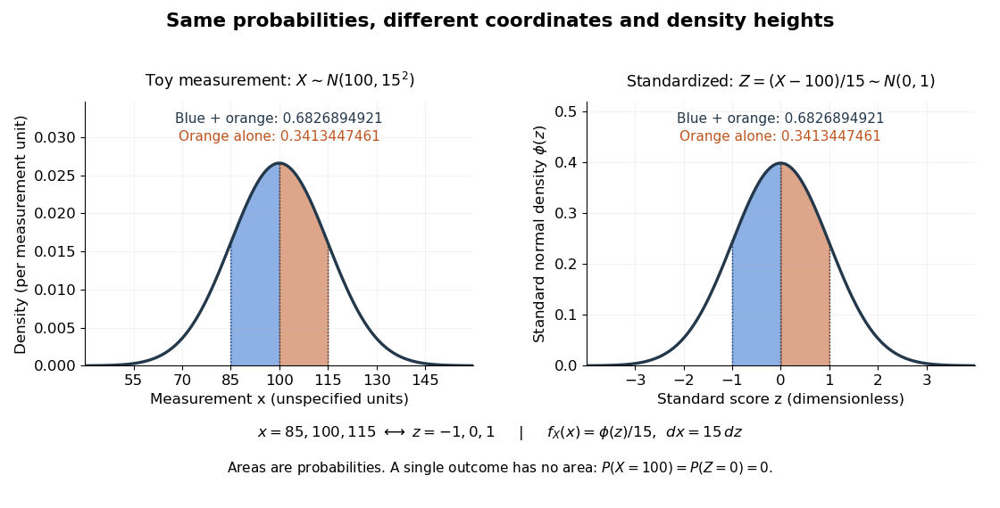

# Standard normal distribution

↑ **Parent:** [Normal distribution](normal-distribution.md)  
ⓦ [Wiki](https://en.wikipedia.org/wiki/Standard_normal_distribution)

The [standard normal distribution](standard-normal-distribution.md) is $N(0,1)$: the [normal distribution](normal-distribution.md) with [mean](expected-value.md) zero, [variance](variance-split.md) one and [standard deviation](standard-deviation.md) one. Its [standard normal density](standard-normal-density.md) $\phi$ integrates to one; its [standard normal distribution function](standard-normal-distribution-function.md) $\Phi$ records the area accumulated from $-\infty$ to a threshold. The distinction matters: $\phi(0)=1/\sqrt{2\pi}\approx0.398942$, $\Phi(0)=1/2$, and $\mathbb P(Z=0)=0$ for a [standard normal random variable](standard-normal-random-variable.md) $Z$.

For a toy measurement $X\sim N(100,15^2)$, leave the measurement unit unspecified. The [standardization of a normal random variable](standardization-of-a-normal-random-variable.md) $Z=(X-100)/15$ converts $x=85,100,115$ into [standard scores](standard-score.md) $z=-1,0,1$. Using the [standard normal distribution function](standard-normal-distribution-function.md),

$$
\begin{aligned}
\mathbb P(85\leq X\leq115)&=\Phi(1)-\Phi(-1)\approx0.6826894921,\\
\mathbb P(100\leq X\leq115)&=\Phi(1)-\Phi(0)\approx0.3413447461,\\
\mathbb P(X=100)&=0.
\end{aligned}
$$

The second area is half the first because the [normal distribution](normal-distribution.md) is a [symmetric probability distribution](symmetric-probability-distribution.md) about its [mean](expected-value.md). The numerical heights differ: $f_X(115)=\phi(1)/15$, yet the corresponding shaded areas are equal because $dx=15\,dz$ in the [change of variables](change-of-variables-formula.md).

**[Figure 30](#image-standardization-changes-density-heights-and-coordinates-but-preserves-probabilities). Standardization changes density heights and coordinates but preserves probabilities**. The same toy [normal distribution](normal-distribution.md) is shown before and after [standardization of a normal random variable](standardization-of-a-normal-random-variable.md). The blue and orange areas together have [probability](probability.md) approximately $0.6826894921$; the orange area alone has [probability](probability.md) approximately $0.3413447461$. The threshold $115$ becomes [standard score](standard-score.md) $1$. Each [probability density function](probability-density-function.md) has total area one over the whole [real line](real-line.md); a single outcome has zero [probability](probability.md).

**Table of contents**

- [Standard normal density](standard-normal-density.md)
- [Moment-generating function of a standard normal variable](moment-generating-function-of-a-standard-normal-variable.md)
  - [Exponential moment of an absolute standard normal variable](exponential-moment-of-an-absolute-standard-normal-variable.md)
- [Standard normal distribution function](standard-normal-distribution-function.md)
- [Standard normal quantile](standard-normal-quantile.md)
- [Standardization of a normal random variable](standardization-of-a-normal-random-variable.md)

## ↑ Ancestors (7)

1. [Normal distribution](normal-distribution.md)
2. [Probability distribution](probability-distribution.md)
3. [Probability theory](probability-theory-split.md)
4. [Probability and statistics](probability-and-statistics-split.md)
5. [Area of mathematics](area-of-mathematics.md)
6. [Mathematics](mathematics-split.md)
7. [Codex Wiki](split.md)

## ← Incoming links (104)

- [Boundary bias of a kernel density estimator](boundary-bias-of-a-kernel-density-estimator.md)
- [Cantelli inequality](cantelli-inequality.md)
- [Causally minimal nonfaithful Gaussian model](causally-minimal-nonfaithful-gaussian-model.md)
- [Central limit theorem](central-limit-theorem.md)
- [Chebyshev's inequality](chebyshev-s-inequality.md)
- [Debiased-Lasso asymptotic normality](debiased-lasso-asymptotic-normality.md)
- [Differential entropy of a Gaussian law](differential-entropy-of-a-gaussian-law.md)
- [Erdős-Kac theorem](erdos-kac-theorem.md)
- [Excess kurtosis](excess-kurtosis.md)
- [Expected utility of a Gaussian location-scale family](expected-utility-of-a-gaussian-location-scale-family.md)
- [Exponential moment of an absolute standard normal variable](exponential-moment-of-an-absolute-standard-normal-variable.md)
- [Finite-dimensional distribution](finite-dimensional-distribution.md)
- [Finite-set example of the Johnson–Lindenstrauss lemma](finite-set-example-of-the-johnson-lindenstrauss-lemma.md)
- [Gaussian characterization by independent sum and difference](gaussian-characterization-by-independent-sum-and-difference.md)
- [Gaussian Gibbs sweep autocorrelation](gaussian-gibbs-sweep-autocorrelation.md)
- [Gaussian Johnson–Lindenstrauss concentration argument](gaussian-johnson-lindenstrauss-concentration-argument.md)
- [Gaussian Johnson–Lindenstrauss transform](gaussian-johnson-lindenstrauss-transform.md)
- [Gaussian kernel density worked example](gaussian-kernel-density-worked-example.md)
- [Gaussian maximum bound without independence](gaussian-maximum-bound-without-independence.md)
- [Gaussian scale mixture](gaussian-scale-mixture.md)
- [Half-normal distribution](half-normal-distribution.md)
- [Log absolute value stabilization of a normal scale family](log-absolute-value-stabilization-of-a-normal-scale-family.md)
- [Marsaglia polar method](marsaglia-polar-method.md)
- [McNemar's test](mcnemar-s-test.md)
- [Method of moments (probability theory)](method-of-moments-probability-theory.md)
- [Moment determinacy](moment-determinacy.md)
- [Moment-generating function of a chi-squared distribution](moment-generating-function-of-a-chi-squared-distribution.md)
- [Normal distribution](normal-distribution.md)
- [Normal mean confidence interval and hypothesis test duality](normal-mean-confidence-interval-and-hypothesis-test-duality.md)
- [Normal mean confidence interval with known variance](normal-mean-confidence-interval-with-known-variance.md)
- [Normal Q-Q plot](normal-q-q-plot.md)
- [Normal rejection sampling with an exponential envelope](normal-rejection-sampling-with-an-exponential-envelope.md)
- [Normalized Black-Scholes call function](normalized-black-scholes-call-function.md)
- [Solution](past-exam-of-the-mathematics-course-of-the-university-of-cambridge/2001/iii/paper-33/2/ii/solution.md)
- [Solution](past-exam-of-the-mathematics-course-of-the-university-of-cambridge/2001/iii/paper-33/2/iii/solution.md)
- [Solution](past-exam-of-the-mathematics-course-of-the-university-of-cambridge/2002/iii/paper-29/5/solution.md)
- [Solution](past-exam-of-the-mathematics-course-of-the-university-of-cambridge/2005/iii/paper-34/5/c/solution.md)
- [Solution](past-exam-of-the-mathematics-course-of-the-university-of-cambridge/2005/iii/paper-41/2/ii/solution.md)
- [Solution](past-exam-of-the-mathematics-course-of-the-university-of-cambridge/2005/iii/paper-41/3/ii/solution.md)
- [Solution](past-exam-of-the-mathematics-course-of-the-university-of-cambridge/2005/iii/paper-41/4/solution.md)
- [Solution](past-exam-of-the-mathematics-course-of-the-university-of-cambridge/2005/iii/paper-42/4/i/solution.md)
- [Solution](past-exam-of-the-mathematics-course-of-the-university-of-cambridge/2005/iii/paper-47/5/b/solution.md)
- [Solution](past-exam-of-the-mathematics-course-of-the-university-of-cambridge/2006/iii/paper-42/1/i/solution.md)
- [Solution](past-exam-of-the-mathematics-course-of-the-university-of-cambridge/2007/ia/paper-2/4f/solution.md)
- [Solution](past-exam-of-the-mathematics-course-of-the-university-of-cambridge/2007/iii/paper-47/2/c/solution.md)
- [Solution](past-exam-of-the-mathematics-course-of-the-university-of-cambridge/2008/ia/paper-2/11f/solution.md)
- [Solution](past-exam-of-the-mathematics-course-of-the-university-of-cambridge/2008/iii/paper-34/2/c/solution.md)
- [Solution](past-exam-of-the-mathematics-course-of-the-university-of-cambridge/2008/iii/paper-44/1/c/solution.md)
- [Solution](past-exam-of-the-mathematics-course-of-the-university-of-cambridge/2008/iii/paper-44/3/b/solution.md)
- [Solution](past-exam-of-the-mathematics-course-of-the-university-of-cambridge/2009/iii/paper-32/5/solution.md)
- [Solution](past-exam-of-the-mathematics-course-of-the-university-of-cambridge/2010/iii/paper-33/3/solution.md)
- [Solution](past-exam-of-the-mathematics-course-of-the-university-of-cambridge/2010/iii/paper-39/5/b/solution.md)
- [Solution](past-exam-of-the-mathematics-course-of-the-university-of-cambridge/2011/ia/paper-2/3f/b/solution.md)
- [Solution](past-exam-of-the-mathematics-course-of-the-university-of-cambridge/2012/ia/paper-2/9f/iii/solution.md)
- [Solution](past-exam-of-the-mathematics-course-of-the-university-of-cambridge/2012/iii/paper-38/3/i/solution.md)
- [Solution](past-exam-of-the-mathematics-course-of-the-university-of-cambridge/2013/iii/paper-29/3/solution.md)
- [Solution](past-exam-of-the-mathematics-course-of-the-university-of-cambridge/2013/iii/paper-31/2/solution.md)
- [Solution](past-exam-of-the-mathematics-course-of-the-university-of-cambridge/2014/iii/paper-32/1/a/i/solution.md)
- [Solution](past-exam-of-the-mathematics-course-of-the-university-of-cambridge/2014/iii/paper-32/1/b/solution.md)
- [Solution](past-exam-of-the-mathematics-course-of-the-university-of-cambridge/2014/iii/paper-32/1/d/solution.md)
- [Solution](past-exam-of-the-mathematics-course-of-the-university-of-cambridge/2014/iii/paper-36/3/a/solution.md)
- [Solution](past-exam-of-the-mathematics-course-of-the-university-of-cambridge/2014/iii/paper-36/3/e/solution.md)
- [Solution](past-exam-of-the-mathematics-course-of-the-university-of-cambridge/2015/ia/paper-2/10f/solution.md)
- [Solution](past-exam-of-the-mathematics-course-of-the-university-of-cambridge/2015/iii/paper-36/2/solution.md)
- [Solution](past-exam-of-the-mathematics-course-of-the-university-of-cambridge/2015/iii/paper-36/4/solution.md)
- [Solution](past-exam-of-the-mathematics-course-of-the-university-of-cambridge/2015/iii/paper-37/4/c/ii/solution.md)
- [Solution](past-exam-of-the-mathematics-course-of-the-university-of-cambridge/2015/iii/paper-37/4/c/iii/solution.md)
- [Solution](past-exam-of-the-mathematics-course-of-the-university-of-cambridge/2016/ia/paper-2/4f/solution.md)
- [Solution](past-exam-of-the-mathematics-course-of-the-university-of-cambridge/2016/iii/paper-124/5/a/solution.md)
- [Solution](past-exam-of-the-mathematics-course-of-the-university-of-cambridge/2016/iii/paper-124/5/c/solution.md)
- [Solution](past-exam-of-the-mathematics-course-of-the-university-of-cambridge/2016/iii/paper-205/1/solution.md)
- [Solution](past-exam-of-the-mathematics-course-of-the-university-of-cambridge/2016/iii/paper-205/3/solution.md)
- [Solution](past-exam-of-the-mathematics-course-of-the-university-of-cambridge/2016/iii/paper-208/2/2/3/solution.md)
- [Solution](past-exam-of-the-mathematics-course-of-the-university-of-cambridge/2016/iii/paper-208/4/a/solution.md)
- [Solution](past-exam-of-the-mathematics-course-of-the-university-of-cambridge/2016/iii/paper-208/4/b/solution.md)
- [Solution](past-exam-of-the-mathematics-course-of-the-university-of-cambridge/2016/iii/paper-208/6/d/solution.md)
- [Solution](past-exam-of-the-mathematics-course-of-the-university-of-cambridge/2016/iii/paper-211/1/b/solution.md)
- [Solution](past-exam-of-the-mathematics-course-of-the-university-of-cambridge/2016/iii/paper-211/1/d/solution.md)
- [Solution](past-exam-of-the-mathematics-course-of-the-university-of-cambridge/2017/ia/paper-2/10f/a/solution.md)
- [Solution](past-exam-of-the-mathematics-course-of-the-university-of-cambridge/2017/ia/paper-2/9f/c/solution.md)
- [Solution](past-exam-of-the-mathematics-course-of-the-university-of-cambridge/2017/ib/paper-2/8h/b/solution.md)
- [Solution](past-exam-of-the-mathematics-course-of-the-university-of-cambridge/2018/ii/paper-4/29k/a/solution.md)
- [Solution](past-exam-of-the-mathematics-course-of-the-university-of-cambridge/2018/iii/paper-203/3/a/iii/solution.md)
- [Solution](past-exam-of-the-mathematics-course-of-the-university-of-cambridge/2018/iii/paper-218/6/a/solution.md)
- [Solution](past-exam-of-the-mathematics-course-of-the-university-of-cambridge/2019/iii/paper-211/2/c-2/solution.md)
- [Solution](past-exam-of-the-mathematics-course-of-the-university-of-cambridge/2019/iii/paper-348/1/c/solution.md)
- [Solution](past-exam-of-the-mathematics-course-of-the-university-of-cambridge/2020/ia/paper-1/12f/c/solution.md)
- [Solution](past-exam-of-the-mathematics-course-of-the-university-of-cambridge/2020/ii/paper-3/28j/ii/solution.md)
- [Solution](past-exam-of-the-mathematics-course-of-the-university-of-cambridge/2021/ii/paper-3/28j/b/solution.md)
- [Solution](past-exam-of-the-mathematics-course-of-the-university-of-cambridge/2021/iii/paper-223/1/a/solution.md)
- [Solution](past-exam-of-the-mathematics-course-of-the-university-of-cambridge/2021/iii/paper-223/3/b/solution.md)
- [Solution](past-exam-of-the-mathematics-course-of-the-university-of-cambridge/2023/ii/paper-2/5j/solution.md)
- [Solution](past-exam-of-the-mathematics-course-of-the-university-of-cambridge/2024/iii/paper-223/1/a/solution.md)
- [Solution](past-exam-of-the-mathematics-course-of-the-university-of-cambridge/2024/iii/paper-356/2/b/solution.md)
- [Probit model](probit-model.md)
- [Random hyperplane rounding](random-hyperplane-rounding.md)
- [Rayleigh-normal scale mixture](rayleigh-normal-scale-mixture.md)
- [Reparameterization gradient](reparameterization-gradient.md)
- [Sharp two-sided Gaussian tail bound](sharp-two-sided-gaussian-tail-bound.md)
- [Signed normal Wald statistic](signed-normal-wald-statistic.md)
- [Standard normal distribution](standard-normal-distribution.md)
- [Standard normal random variable](standard-normal-random-variable.md)
- [Standard score](standard-score.md)
- [Standardization of a normal random variable](standardization-of-a-normal-random-variable.md)
