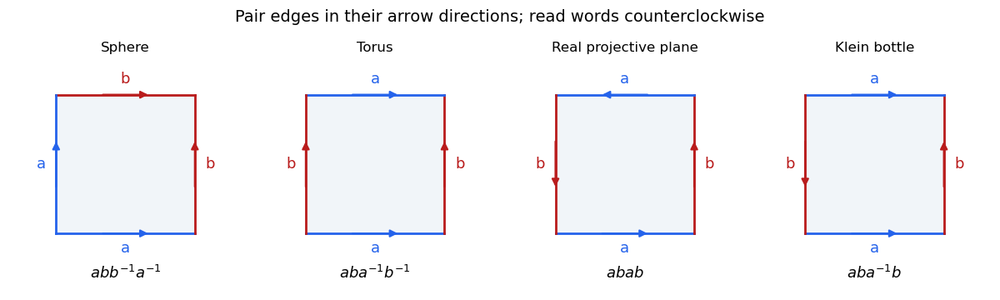

# Standard polygon words for closed surfaces

↑ **Parent:** [Polygonal schema](polygonal-schema.md)

Read a boundary word counterclockwise, giving every paired edge a label. A positive exponent means the edge arrow agrees with the boundary traversal, and an inverse means it disagrees. Identify equally labelled edges in their arrow directions. The [sphere](sphere.md) has a square word $abb^{-1}a^{-1}$; the vertex count is three, giving [Euler characteristic](euler-characteristic.md) $3-2+1=2$. A [closed orientable surface](closed-orientable-surface.md) of [genus](genus-of-a-surface.md) $g\geq1$ has word

$$
\prod_{j=1}^g a_jb_ja_j^{-1}b_j^{-1}.
$$

A [nonorientable surface](non-orientable-surface.md) which is the [connected sum of surfaces](connected-sum-of-surfaces.md) of $k$ [real projective planes](real-projective-plane.md) has word $c_1c_1\cdots c_kc_k$. For $k=1$, this is a digon; the square word $abab$, identifying antipodal boundary points, is another model of the [real projective plane](real-projective-plane.md). The [Klein bottle](klein-bottle.md) has square word $aba^{-1}b$, representing the nonorientable case $k=2$. The [classification theorem for closed combinatorial surfaces](classification-theorem-for-closed-combinatorial-surfaces.md) says that these orientable and nonorientable families exhaust the connected closed cases.

**[Figure 1](#image-square-polygon-models-of-four-closed-surfaces). Square polygon models of four closed surfaces**. Read the boundary word counterclockwise and identify paired edges in their arrow directions. The sphere model has three vertex classes; the projective-plane square has two.

## ↑ Ancestors (7)

1. [Polygonal schema](polygonal-schema.md)
2. [Topological surface](topological-surface-split.md)
3. [Topology](topology-split.md)
4. [Geometry and topology](geometry-and-topology-split.md)
5. [Area of mathematics](area-of-mathematics.md)
6. [Mathematics](mathematics-split.md)
7. [Codex Wiki](split.md)

## ← Incoming links (1)

- [Solution](past-exam-of-the-topology-course-of-the-university-of-oxford/2017/3/a/ii/solution.md)
