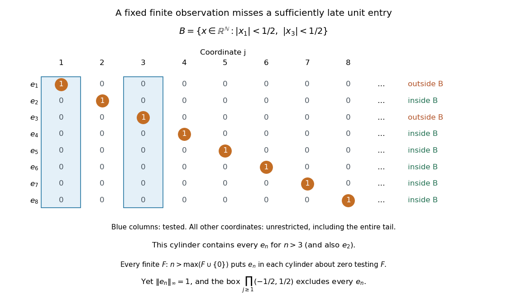

# Standard unit sequences in the real countable product

↑ **Parent:** [Convergence in a product space](convergence-in-a-product-space.md)

Let $\mathbb N=\{1,2,\ldots\}$ and give each factor of $\mathbb R^{\mathbb N}$ the usual [topology](topology-split.md) of the [real line](real-line.md). The familiar [standard basis](standard-basis.md) vectors extend to unit [sequences](sequence.md) $e_n$ with $(e_n)_j=1$ when $j=n$ and zero otherwise. Their finite [linear combinations](linear-combination.md) are exactly the [finitely supported sequences](finitely-supported-sequence.md), rather than all of $\mathbb R^{\mathbb N}$.

For every fixed coordinate $j$, $(e_n)_j=0$ for all $n>j$. Therefore $e_n\to0$ in the [product topology](product-topology.md). More directly, any basic [cylinder set](cylinder-set.md) $B(F,U)$ containing zero contains every $e_n$ with $n>\max(F\cup\{0\})$: all of its tested coordinates are then zero. The moving unit entry escapes every fixed finite collection of observations.

**[Figure 11](#image-a-moving-unit-entry-escapes-each-fixed-finite-coordinate-cylinder). A moving unit entry escapes each fixed finite-coordinate cylinder**. Only coordinates 1 and 3 are tested in the displayed cylinder, with values required to lie between minus one-half and one-half. All later coordinates remain unrestricted. The finite display illustrates the pattern; the threshold argument in the text applies to every finite coordinate set.

In the [l-infinity sequence space](l-infinity-sequence-space.md) of bounded real [sequences](sequence.md), however,

$$
\|e_n-0\|_\infty=\sup_{j\geq1}|(e_n)_j|=1.
$$

Thus the same [sequence](sequence.md) does not converge to zero in the [supremum norm](supremum-norm.md). Here the comparison is between the [subspace topology](subspace-topology.md) inherited from the [product topology](product-topology.md) and the [norm topology](norm-topology.md) on $\ell^\infty$. The [supremum norm](supremum-norm.md) is not a finite-valued [norm](norm.md) on all of $\mathbb R^{\mathbb N}$, which also contains unbounded [sequences](sequence.md). In the [box topology](box-topology.md) on $\mathbb R^{\mathbb N}$, the [neighborhood](neighbourhood-mathematics.md) $\prod_{j\geq1}(-1/2,1/2)$ of zero excludes every $e_n$, so $e_n$ is not a [convergent sequence](convergent-sequence.md) with limit zero there either.

## ↑ Ancestors (6)

1. [Convergence in a product space](convergence-in-a-product-space.md)
2. [Product topology](product-topology.md)
3. [Geometry and topology](geometry-and-topology-split.md)
4. [Area of mathematics](area-of-mathematics.md)
5. [Mathematics](mathematics-split.md)
6. [Codex Wiki](split.md)
