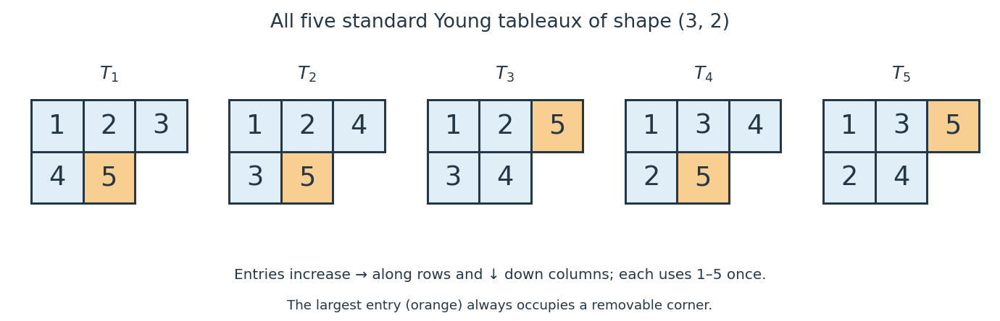

# Standard Young tableau

↑ **Parent:** [Young tableau](young-tableau.md)

**[Figure 2](#image-all-five-standard-young-tableaux-of-shape-3-2-in-the-english-convention). All five standard Young tableaux of shape $(3,2)$ in the English convention**.

A standard Young tableau of shape $\lambda\vdash n$ is a [Young tableau](young-tableau.md) that uses $1,\ldots,n$ exactly once and strictly increases left to right along every row and top to bottom down every column. Formally, a [bijection](bijection.md) $T:Y(\lambda)\to\{1,\ldots,n\}$ is standard when

$$
T(i,j)<T(i,j+1),\qquad T(i,j)<T(i+1,j)
$$

whenever the indicated cells belong to the [Young diagram](young-diagram.md). We write $\operatorname{SYT}(\lambda)$ for the [set](set-split.md) of such fillings and $f^\lambda=|\operatorname{SYT}(\lambda)|$ for its [cardinality](cardinality.md).

For $(3,2)$, the five [standard Young tableaux](standard-young-tableau.md) are listed below, with each pair giving the top row followed by the bottom row:

$$
\begin{aligned}
T_1&=((1,2,3),(4,5)),&T_2&=((1,2,4),(3,5)),\\
T_3&=((1,2,5),(3,4)),&T_4&=((1,3,4),(2,5)),\\
T_5&=((1,3,5),(2,4)).
\end{aligned}
$$

There are no others: the upper-left entry must be $1$, and choosing the two bottom-row entries fixes both increasing row orders. Of the six choices of two entries from $\{2,3,4,5\}$, only bottom row $(2,3)$ fails, because its $3$ would lie below $4$. Hence $f^{(3,2)}=5$ by direct enumeration, independently of the [hook-length formula](hook-length-formula.md).

The cells occupied by $1,\ldots,r$ form a [Young diagram](young-diagram.md): every cell above or to the left of an occupied cell has a smaller label. Consequently a [standard Young tableau](standard-young-tableau.md) is equivalently a path from the empty shape to $\lambda$ in the [Young branching graph](young-branching-graph.md), adjoining one [addable node of a Young diagram](addable-node-of-a-young-diagram.md) at each step. For $T_2$, the successive shapes are

$$
\varnothing,\ (1),\ (2),\ (2,1),\ (3,1),\ (3,2).
$$

Conversely, number the cell added at step $r$ by $r$ to recover the [standard Young tableau](standard-young-tableau.md). This path interpretation also makes a [standard Young tableau](standard-young-tableau.md) a [linear extension of a partially ordered set](linear-extension.md) defined by the row and column requirements; see [Stanley's Algebraic Combinatorics, Chapter 8, on tableaux and paths in Young's lattice](https://math.mit.edu/~rstan/algcomb/algcomb.pdf).

The usefulness goes beyond counting: the [standard polytabloid basis](standard-polytabloid-basis.md) of a [Specht module](specht-module.md) $S^\lambda$ over the [complex numbers](complex-number.md) is indexed by $\operatorname{SYT}(\lambda)$, so $\dim_{\mathbb C}S^\lambda=f^\lambda$. Each of the five pictured [standard Young tableaux](standard-young-tableau.md) therefore labels one [basis](basis.md) element of the [irreducible representation](irreducible-representation.md) $S^{(3,2)}$ of the [symmetric group](symmetric-group.md) $S_5$, whose [dimension](dimension-vector-space.md) over the [complex numbers](complex-number.md) is five. The filled diagrams index the [basis](basis.md); the actual [vectors](vector.md) are [polytabloids](polytabloid.md). The [hook-length formula](hook-length-formula.md) computes this [dimension](dimension-vector-space.md) without listing all the [standard Young tableaux](standard-young-tableau.md).

**Table of contents**

- [Column-reading order of standard Young tableaux](column-reading-order-of-standard-young-tableaux.md)
  - [Triangular vanishing of Young-symmetrizer products](triangular-vanishing-of-young-symmetrizer-products.md)
- [Admissible adjacent swap of a standard Young tableau](admissible-adjacent-swap-of-a-standard-young-tableau.md)
- [Content vector of a standard Young tableau](content-vector-of-a-standard-young-tableau.md)
  - [Axial distance in a Young tableau](axial-distance-in-a-young-tableau.md)

## ↑ Ancestors (8)

1. [Young tableau](young-tableau.md)
2. [Partition of an integer](partition-of-an-integer.md)
3. [Representation theory of the symmetric group](representation-theory-of-the-symmetric-group-split.md)
4. [Representation theory](representation-theory-split.md)
5. [Algebra](algebra-split.md)
6. [Area of mathematics](area-of-mathematics.md)
7. [Mathematics](mathematics-split.md)
8. [Codex Wiki](split.md)

## ← Incoming links (38)

- [Admissible adjacent swap of a standard Young tableau](admissible-adjacent-swap-of-a-standard-young-tableau.md)
- [Axial distance in a Young tableau](axial-distance-in-a-young-tableau.md)
- [Content vector of a standard Young tableau](content-vector-of-a-standard-young-tableau.md)
- [Determinant formula for Specht module dimension](determinant-formula-for-specht-module-dimension.md)
- [Gelfand–Tsetlin basis](gelfand-tsetlin-basis.md)
- [Hook-length formula](hook-length-formula.md)
- [Hook partition](hook-partition.md)
- [Jucys–Murphy element](jucys-murphy-element.md)
- [Solution](past-exam-of-the-mathematics-course-of-the-university-of-cambridge/2005/iii/paper-3/5/solution.md)
- [Solution](past-exam-of-the-mathematics-course-of-the-university-of-cambridge/2006/iii/paper-4/2/solution.md)
- [Solution](past-exam-of-the-mathematics-course-of-the-university-of-cambridge/2012/iii/paper-3/2/solution.md)
- [Solution](past-exam-of-the-mathematics-course-of-the-university-of-cambridge/2016/iii/paper-103/1/c/iv/solution.md)
- [Solution](past-exam-of-the-mathematics-course-of-the-university-of-cambridge/2016/iii/paper-103/2/a/solution.md)
- [Solution](past-exam-of-the-mathematics-course-of-the-university-of-cambridge/2016/iii/paper-103/2/b/solution.md)
- [Solution](past-exam-of-the-mathematics-course-of-the-university-of-cambridge/2016/iii/paper-103/3/iii/solution.md)
- [Solution](past-exam-of-the-mathematics-course-of-the-university-of-cambridge/2016/iii/paper-103/3/iv/solution.md)
- [Solution](past-exam-of-the-mathematics-course-of-the-university-of-cambridge/2016/iii/paper-103/3/v/solution.md)
- [Solution](past-exam-of-the-mathematics-course-of-the-university-of-cambridge/2016/iii/paper-103/4/b/ii/solution.md)
- [Solution](past-exam-of-the-mathematics-course-of-the-university-of-cambridge/2016/iii/paper-103/5/i/solution.md)
- [Solution](past-exam-of-the-mathematics-course-of-the-university-of-cambridge/2016/iii/paper-103/5/ii/solution.md)
- [Solution](past-exam-of-the-mathematics-course-of-the-university-of-cambridge/2016/iii/paper-103/5/iii/solution.md)
- [Solution](past-exam-of-the-mathematics-course-of-the-university-of-cambridge/2016/iii/paper-103/6/a/i/solution.md)
- [Solution](past-exam-of-the-mathematics-course-of-the-university-of-cambridge/2017/iii/paper-103/2/a/solution.md)
- [Solution](past-exam-of-the-mathematics-course-of-the-university-of-cambridge/2017/iii/paper-103/2/c/solution.md)
- [Solution](past-exam-of-the-mathematics-course-of-the-university-of-cambridge/2017/iii/paper-103/2/d/solution.md)
- [Solution](past-exam-of-the-mathematics-course-of-the-university-of-cambridge/2017/iii/paper-103/3/a/solution.md)
- [Solution](past-exam-of-the-mathematics-course-of-the-university-of-cambridge/2017/iii/paper-103/3/b/solution.md)
- [Solution](past-exam-of-the-mathematics-course-of-the-university-of-cambridge/2017/iii/paper-103/3/c/iii/solution.md)
- [Solution](past-exam-of-the-mathematics-course-of-the-university-of-cambridge/2017/iii/paper-103/3/c/iv/solution.md)
- [Solution](past-exam-of-the-mathematics-course-of-the-university-of-cambridge/2017/iii/paper-103/6/a/solution.md)
- [Solution](past-exam-of-the-mathematics-course-of-the-university-of-cambridge/2017/iii/paper-103/6/b/solution.md)
- [Robinson–Schensted correspondence](robinson-schensted-correspondence.md)
- [Standard polytabloid basis](standard-polytabloid-basis.md)
- [Standard Young tableau](standard-young-tableau.md)
- [Young diagram](young-diagram.md)
- [Young's lattice](young-s-lattice.md)
- [Young seminormal form](young-seminormal-form.md)
- [Young tableau](young-tableau.md)
