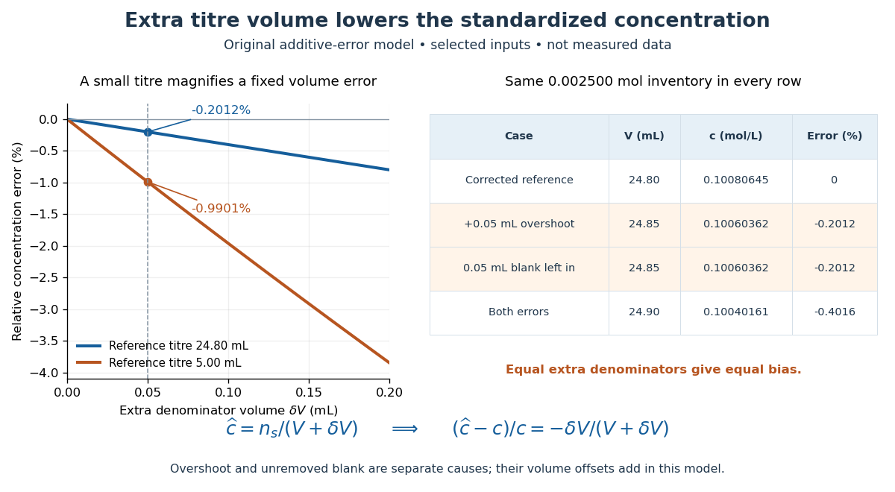

# Standardization endpoint and blank bias

↑ **Parent:** [Titrant standardization](titrant-standardization.md)

Hold the known [primary standard inventory](primary-standard-inventory.md) fixed, and let $V$ be the correct blank-subtracted [titre](titre.md). In the following model, any remaining endpoint offset has been removed from this reference. If a [titration endpoint](titration-endpoint.md) overshoot adds $\delta V>0$, the inferred [titrant](titrant.md) [concentration](concentration.md) is too small:

$$
c=\frac{n_s}{V},\qquad \widehat c=\frac{n_s}{V+\delta V},\qquad
\frac{\widehat c-c}{c}=-\frac{\delta V}{V+\delta V}.
$$

The denominator grows while the numerator stays fixed. For $\delta V\ll V$, the relative effect is approximately $-\delta V/V$, but the displayed fraction is exact for this additive model. An unremoved positive [titration blank](titration-blank.md) $b$ has the same mathematical effect: replace $\delta V$ by $b$. If both remain, replace it by $\delta V+b$. This analogy concerns their effects on the denominator; it does not mean a blank measures endpoint overshoot.

For the chosen $24.80\,\mathrm{mL}$ reference [titre](titre.md), an extra $0.05\,\mathrm{mL}$ gives $\widehat c=0.1006036217\ldots\,\mathrm{mol\,L^{-1}}$ and relative error $-0.05/24.85=-0.201207\ldots\%$. Leaving both a $0.05\,\mathrm{mL}$ blank and a $0.05\,\mathrm{mL}$ overshoot gives denominator $24.90\,\mathrm{mL}$ and relative error $-0.10/24.90=-0.401606\ldots\%$.

**[Figure 4](#image-endpoint-overshoot-and-an-unremoved-positive-titration-blank-both-lower-the-inferred-titrant-concentration). Endpoint overshoot and an unremoved positive titration blank both lower the inferred titrant concentration**. Original additive-error model, not measured data. The curves compare reference [titres](titre.md) of $24.80\,\mathrm{mL}$ and $5.00\,\mathrm{mL}$. The table uses the selected $0.002500\,\mathrm{mol}$ inventory and $24.80\,\mathrm{mL}$ reference. Equal extra denominator [volumes](volume.md) give equal bias, whether caused by overshoot or an unremoved blank.

For comparison, the same extra $0.05\,\mathrm{mL}$ on a $5.00\,\mathrm{mL}$ reference [titre](titre.md) gives $-0.05/5.05=-0.990099\ldots\%$. The ratio of these error magnitudes is $24.85/5.05=4.920792\ldots$, while the small-error approximation would give $24.80/5.00=4.96$. A larger [titre](titre.md) reduces the fractional effect of a fixed extra [volume](volume-thermodynamics.md); it does not fix unknown purity, incomplete transfer, or an incorrect [stoichiometry](stoichiometry.md).

## ↑ Ancestors (8)

1. [Titrant standardization](titrant-standardization.md)
2. [Acid-base titration](acid-base-titration.md)
3. [Weak acid dissociation measurement](weak-acid-dissociation-measurement.md)
4. [Weak acid](weak-acid.md)
5. [Acid (chemistry)](acid-chemistry.md)
6. [Acid-base chemistry](acid-base-chemistry-split.md)
7. [Chemistry](chemistry-split.md)
8. [Codex Wiki](split.md)

## ← Incoming links (1)

- [Titrant standardization](titrant-standardization.md)
