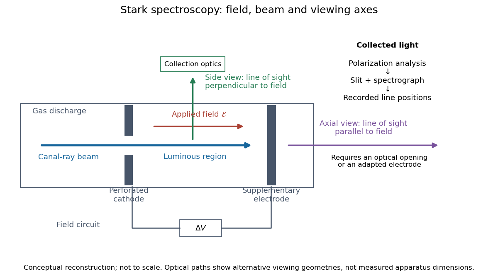

# Stark canal-ray experiment

↑ **Parent:** [Stark effect](stark-effect.md)

In 1913 [Johannes Stark](johannes-stark.md) reported that an applied [electric field](electric-field-split.md) resolved the [hydrogen](hydrogen.md) $H_\beta$ and $H_\gamma$ [spectral lines](spectral-line.md) into five components at his instrument's [spectral resolving power](spectral-resolving-power.md), viewed perpendicular to the [electric field](electric-field-split.md). Three inner components had [polarization of an electromagnetic wave](polarization-of-an-electromagnetic-wave.md) perpendicular to the [electric field](electric-field-split.md); two outer components had it parallel.[Stark, Nature 92 (1913), p. 401, two opening paragraphs; issue dated 4 December](observation-of-the-separation-of-spectral-lines-by-an-electric-field-by-johannes-stark.md)

In his lecture of 3 June 1920 for the 1919 prize, [Johannes Stark](johannes-stark.md) describes [canal rays](anode-ray.md) emerging through a perforated [cathode](cathode.md) into the [electric field](electric-field-split.md) between it and a supplementary [electrode](electrode.md). A [spectrograph](spectrograph.md) recorded the emitted [light](light.md). His earlier [Doppler effect](doppler-effect.md) comparison used a [collimator](collimator.md) perpendicular to the beam and then along approaching rays. Later beam/[electric field](electric-field-split.md) reversal changed component intensities.[Nobel Lectures, Physics 1901–1921; Stark, Structural and spectral changes of chemical atoms, printed pp. 430, 433–435; lecture date p. 427](nobel-lectures-physics-1901-1921/structural-and-spectral-changes-of-chemical-atoms-by-johannes-stark.md)

The historical account distinguishes observation perpendicular to the [electric field](electric-field-split.md), with five resolved components, from observation parallel to it, with three. These are viewing directions, distinct from the direction of the [polarization of an electromagnetic wave](polarization-of-an-electromagnetic-wave.md).[Kox, The discovery of the Stark effect and its early theoretical explanations, §2 Johannes Stark, paragraph following Figure 2](the-discovery-of-the-stark-effect-and-its-early-theoretical-explanations-by-a-j-kox.md)

The experimental distinctions matter. Changing the viewing direction tests a [Doppler effect](doppler-effect.md) contribution; changing the applied [electric field](electric-field-split.md) tests the [Stark effect](stark-effect.md); analyzing [polarization of an electromagnetic wave](polarization-of-an-electromagnetic-wave.md) separates components that may overlap in an unpolarized record. A comparison with the unperturbed [spectral line](spectral-line.md) fixes the origin of a displacement. These are different controls, and the earlier [Doppler effect](doppler-effect.md) comparison should not be described as a field-off control of the later discovery. A [spectrograph](spectrograph.md)'s finite [spectral resolving power](spectral-resolving-power.md) can merge several components into one. In particular, a count of visible [spectral lines](spectral-line.md) does not by itself count all [energy eigenstates](energy-eigenstate.md).

**[Figure 5](#image-stark-spectroscopy-field-beam-and-viewing-axes). Stark spectroscopy: field, beam and viewing axes**. Original conceptual reconstruction of the [canal ray](anode-ray.md) source and two alternative viewing geometries. No dimensions, [electric field](electric-field-split.md) strengths or measured [wavelengths](wavelength.md) are specified. The axial optical path requires an opening or adapted [electrode](electrode.md); it is not a ray passing through the solid [electrode](electrode.md) drawn here.

For a modern idealization of the gap, an [electric potential difference](electric-potential-difference.md) $\Delta V$ over separation $d$ gives $|\mathcal E|\simeq|\Delta V|/d$ only if edge effects and the [charge density](charge-density.md) in the gas are negligible. This is a calibration model, not a historical value assigned to Stark's apparatus. Similarly, a [canal ray](anode-ray.md) beam need not be a pure beam of neutral excited [hydrogen atoms](hydrogen-atom.md); the [quantum mechanics](quantum-mechanics-split.md) model below isolates one neutral [hydrogen atom](hydrogen-atom.md) from the source's preparation and collision processes.

## ↑ Ancestors (4)

1. [Stark effect](stark-effect.md)
2. [Mathematical physics](mathematical-physics-split.md)
3. [Physics](physics-split.md)
4. [Codex Wiki](split.md)

## ← Incoming links (1)

- [Nobel Prize in Physics in 1919](nobel-prize-in-physics-in-1919.md)
