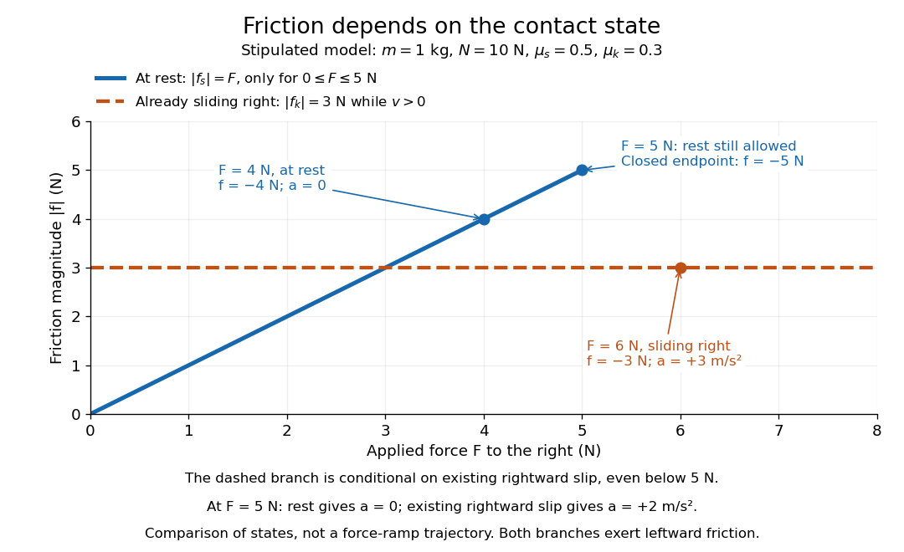

# Static friction

↑ **Parent:** [Force](force.md)

[Static friction](static-friction.md) is the tangential contact [force](force.md) that maintains zero [contact slip](contact-slip.md). “Static” describes the contact state: both surfaces can move together in the chosen [inertial frame](inertial-frame.md). In the ideal Coulomb dry-contact model, the allowable magnitude is bounded by

$$
|f_s|\le\mu_sN,
$$

where $N\ge0$ is the magnitude of the [normal force](normal-force.md) and $\mu_s\ge0$ is the [coefficient of static friction](coefficient-of-static-friction.md). The actual [static friction](static-friction.md) is whatever the [equations of motion](equation-of-motion.md) require to maintain zero [contact slip](contact-slip.md), provided it lies within this bound. Equality specifies limiting [static friction](static-friction.md); a smaller load generally requires a smaller contact [force](force.md). [Ling, Sanny and Moebs, OpenStax University Physics 1, §6.2: responsive static friction](https://openstax.org/books/university-physics-volume-1/pages/6-2-friction)

Use the stipulated toy model from [kinetic friction](kinetic-friction.md): [mass](mass.md) $m=1\,\mathrm{kg}$, [normal force](normal-force.md) $N=10\,\mathrm N$, [coefficient of static friction](coefficient-of-static-friction.md) $\mu_s=0.5$, and [coefficient of kinetic friction](coefficient-of-kinetic-friction.md) $\mu_k=0.3$. A box initially at rest on stationary horizontal ground is pushed right by $F\ge0$. To remain at rest, [Newton's second law](newton-s-second-law.md) requires $F+f_s=ma=0$, hence $f_s=-F$. For $F=4\,\mathrm N$, this gives $f_s=-4\,\mathrm N$ and $a=0$, within the $5\,\mathrm N$ bound. Automatically setting $|f_s|=\mu_sN$ would predict the wrong [force](force.md) and [acceleration](acceleration.md).

For $F=6\,\mathrm N$, maintaining rest would require $|f_s|=6\,\mathrm N>5\,\mathrm N$, so rest cannot persist. Once the box slides right, [kinetic friction](kinetic-friction.md) is $f_k=-3\,\mathrm N$ and the [acceleration](acceleration.md) is $a=(6-3)/1=3\,\mathrm{m/s^2}$. At exactly $F=5\,\mathrm N$, the inequality still permits rest with $f_s=-5\,\mathrm N$. An already right-sliding box under the same applied [force](force.md) instead has $f_k=-3\,\mathrm N$ and $a=2\,\mathrm{m/s^2}$. Applied [force](force.md) alone therefore does not specify the [friction](friction.md) branch: the contact state and motion history matter.

**[Figure 30](#image-state-dependent-friction-magnitudes-a-resting-box-can-balance-up-to-5-n-while-a-box-already-sliding-right-has-3-n-of-friction). State-dependent friction magnitudes: a resting box can balance up to 5 N, while a box already sliding right has 3 N of friction**.

The diagram compares conditional states, rather than specifying a force-ramp trajectory. The static branch includes its $5\,\mathrm N$ endpoint; the sliding branch also exists below that load when rightward [contact slip](contact-slip.md) is already present. To solve a new problem, first impose zero [contact slip](contact-slip.md), find the required [static friction](static-friction.md) and [normal force](normal-force.md) from the [equations of motion](equation-of-motion.md), and check the inequality. If that contact condition fails, use [kinetic friction](kinetic-friction.md) with the actual slip direction.

This distinction makes [static friction](static-friction.md) useful for traction. For an ideal driven tire undergoing [rolling without slipping](rolling-without-slipping.md) on stationary ground, the road can exert a forward [static friction](static-friction.md) that accelerates the vehicle while the tire's contact point has zero [velocity](velocity.md). Thus [static friction](static-friction.md) can point along the [center of mass](center-of-mass.md) motion; its role is to prevent [contact slip](contact-slip.md), rather than always to oppose the motion of the whole body.

**Table of contents**

- [Coefficient of static friction](coefficient-of-static-friction.md)

## ↑ Ancestors (5)

1. [Force](force.md)
2. [Classical mechanics](classical-mechanics-split.md)
3. [Branches of physics](branches-of-physics.md)
4. [Physics](physics-split.md)
5. [Codex Wiki](split.md)

## ← Incoming links (16)

- [Coefficient of static friction](coefficient-of-static-friction.md)
- [Constant-burn rocket with ground friction](constant-burn-rocket-with-ground-friction.md)
- [Friction](friction.md)
- [Kinetic friction](kinetic-friction.md)
- [Solution](past-exam-of-the-mathematics-course-of-the-university-of-cambridge/2001/ia/paper-4/12a/solution.md)
- [Solution](past-exam-of-the-mathematics-course-of-the-university-of-cambridge/2003/ia/paper-4/3e/solution.md)
- [Solution](past-exam-of-the-mathematics-course-of-the-university-of-cambridge/2004/ia/paper-4/12a/solution.md)
- [Solution](past-exam-of-the-mathematics-course-of-the-university-of-cambridge/2008/ia/paper-4/12b/solution.md)
- [Solution](past-exam-of-the-mathematics-course-of-the-university-of-cambridge/2009/ia/paper-4/11a/solution.md)
- [Solution](past-exam-of-the-mathematics-course-of-the-university-of-cambridge/2010/ia/paper-4/9b/solution.md)
- [Solution](past-exam-of-the-mathematics-course-of-the-university-of-cambridge/2018/iii/paper-345/4/a/solution.md)
- [Rolling-time factor on a straight incline](rolling-time-factor-on-a-straight-incline.md)
- [Sediment entrainment threshold](sediment-entrainment-threshold.md)
- [Shields parameter](shields-parameter.md)
- [Slipping solid cylinder on an incline](slipping-solid-cylinder-on-an-incline.md)
- [Static friction](static-friction.md)
