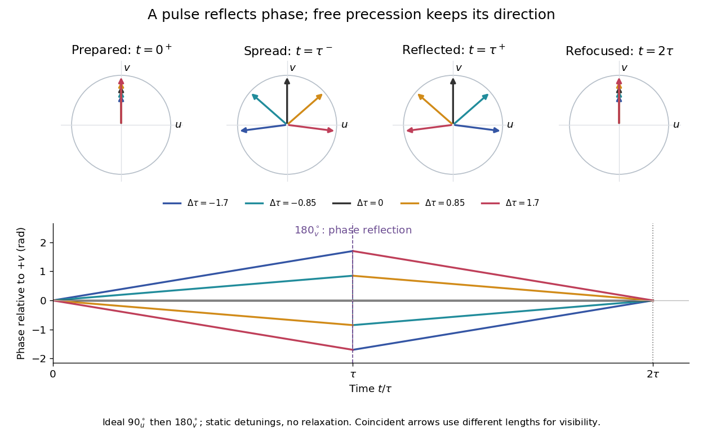
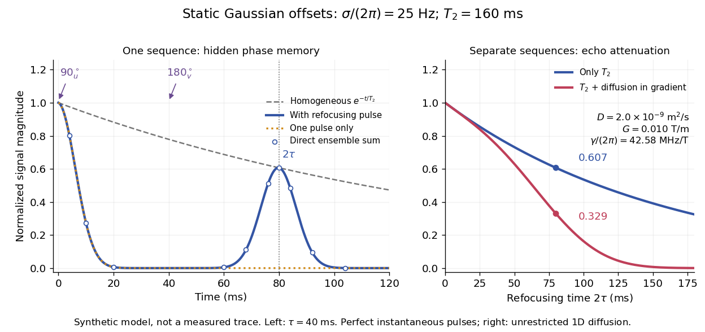

# Static inhomogeneity refocusing

↑ **Parent:** [Spin echo](spin-echo.md)

Use the [rotating frame](rotating-reference-frame.md) and positive [gyromagnetic ratio](gyromagnetic-ratio.md) convention of [free induction decay](free-induction-decay.md). Let $\Delta=\omega_0-\omega$ be each component's fixed detuning, and normalize its [magnetization](magnetization.md) by the equilibrium value. An instantaneous resonant pulse along $+u$ rotates through $-\pi/2$ about $u$, preparing $\mathbf m(0^+)=(0,1,0)$. A second pulse along $+v$ rotates through $-\pi$ about $v$. These ideal pulses require a drive much stronger than the relevant detunings and negligible relaxation during either pulse. The corresponding [rotation matrices](rotation-matrix.md), acting on column [vectors](vector.md), are

$$
R_u(-\pi/2)=\begin{pmatrix}1&0&0\\0&0&1\\0&-1&0\end{pmatrix},\qquad
P=R_v(-\pi)=\begin{pmatrix}-1&0&0\\0&1&0\\0&0&-1\end{pmatrix},\qquad
F_\Delta(t)=\begin{pmatrix}\cos\Delta t&\sin\Delta t&0\\-\sin\Delta t&\cos\Delta t&0\\0&0&1\end{pmatrix}.
$$

Here $F_\Delta(t)$ is free [Larmor precession](larmor-precession.md) in the [rotating frame](rotating-reference-frame.md), before including [transverse relaxation](transverse-relaxation.md). Define a calibrated complex [signal](signal.md) $s=-i(m_u+im_v)$ so the prepared component has $s(0^+)=1$. The pulse $P$ sends $m_u+im_v$ to its negative [complex conjugate](complex-conjugate.md), hence sends $s$ to $s^*$. Direct multiplication gives

$$
s_\Delta(t)=\begin{cases}
e^{-t/T_2}e^{-i\Delta t},&0\leq t<\tau,\\
e^{-t/T_2}e^{-i\Delta(t-2\tau)},&t>\tau.
\end{cases}
$$

The [phase](phase-waves.md) accumulated before the pulse is reflected; the [angular velocity](angular-velocity.md) during subsequent free evolution keeps its sign. At $2\tau$ every fixed detuning has zero residual [phase](phase-waves.md). Equivalently, $PF_\Delta(t)P=F_\Delta(-t)$, so $F_\Delta(\tau)PF_\Delta(\tau)=P$. This is not the identity on arbitrary three-dimensional [magnetization](magnetization.md): it returns the prepared $+v$ component because $P(0,1,0)=(0,1,0)$. The two transverse pulse axes specified here also fix the receiver sign of the echo.

**[Figure 3](#image-how-a-180°-pulse-refocuses-a-static-spread-of-larmor-precession-frequencies). How a 180° pulse refocuses a static spread of Larmor precession frequencies**. Original [Bloch vector](bloch-vector.md) projections and accumulated [phases](phase-waves.md) for five illustrative detunings, with no relaxation. A $-\pi/2$ rotation about $u$ prepares $+v$; a $-\pi$ rotation about $v$ reflects transverse phases at $t=\tau$. Colors identify the same components throughout. Their subsequent free [angular velocities](angular-velocity.md) are unchanged.

For an original ensemble example, let the static detunings have a [Gaussian distribution](normal-distribution.md) with mean zero and [standard deviation](standard-deviation.md) $\sigma$, independent of a common homogeneous $T_2$. Averaging $s_\Delta$ uses the [characteristic function](characteristic-function-split.md) of that [Gaussian distribution](normal-distribution.md):

$$
p(\Delta)=\frac{e^{-\Delta^2/(2\sigma^2)}}{\sqrt{2\pi}\sigma},\qquad
S(t)=e^{-t/T_2}\begin{cases}
e^{-\sigma^2t^2/2},&0\leq t<\tau,\\
e^{-\sigma^2(t-2\tau)^2/2},&t>\tau.
\end{cases}
$$

Choose $\sigma/(2\pi)=25\,\mathrm{Hz}$, $\tau=40\,\mathrm{ms}$ and $T_2=160\,\mathrm{ms}$. Immediately before the refocusing pulse the normalized [signal](signal.md) is only $2.08\times10^{-9}$, yet $S(80\,\mathrm{ms})=e^{-1/2}=0.60653$. A one-pulse [free induction decay](free-induction-decay.md) at 80 ms would instead be about $3.11\times10^{-35}$. These chosen numbers describe a calculation, not a measured trace. Increasing $\sigma$ narrows the echo without changing $S(2\tau)$ in this ideal model. Because this [Gaussian distribution](normal-distribution.md) produces a Gaussian factor rather than an [exponential decay](exponential-decay.md), its inhomogeneous decay is not characterized by a unique exponential $T_2^*$.

**[Figure 4](#image-synthetic-gaussian-distribution-ensemble-a-vanished-free-induction-decay-and-a-recovered-spin-echo). Synthetic Gaussian distribution ensemble: a vanished free induction decay and a recovered spin echo**. Left: the stated instantaneous $90_u^\circ$ and $180_v^\circ$ sequence, ensemble magnitude, one-pulse comparison and homogeneous $T_2$ envelope. Direct sums over weighted detunings agree with the analytic curve. Right: samples at exact refocusing times for a series of separate sequences, with and without the [diffusion](diffusion.md) model below. No panel reproduces an experimental trace.

The exact phase-refocusing time is $2\tau$. A slowly falling [transverse relaxation](transverse-relaxation.md) envelope moves the maximum of this particular echo shape slightly earlier: differentiating $\log S$ after the pulse gives $t_{\rm max}=2\tau-1/(\sigma^2T_2)$, or $79.747\,\mathrm{ms}$ here. Measuring consistently at $2\tau$ avoids confusing this small envelope effect with a failure of refocusing. A series of such measurements gives $\log S(2\tau)=-2\tau/T_2$ only when the assumed homogeneous [exponential decay](exponential-decay.md), pulse quality and negligible additional attenuation are appropriate.

## ↑ Ancestors (4)

1. [Spin echo](spin-echo.md)
2. [Nuclear magnetic resonance](nuclear-magnetic-resonance-split.md)
3. [Chemistry](chemistry-split.md)
4. [Codex Wiki](split.md)
