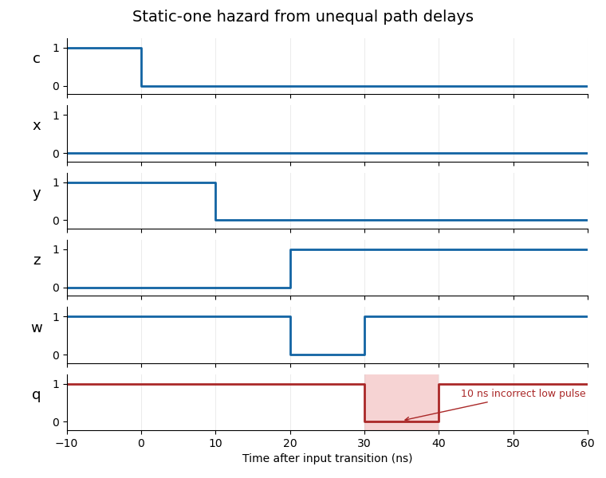
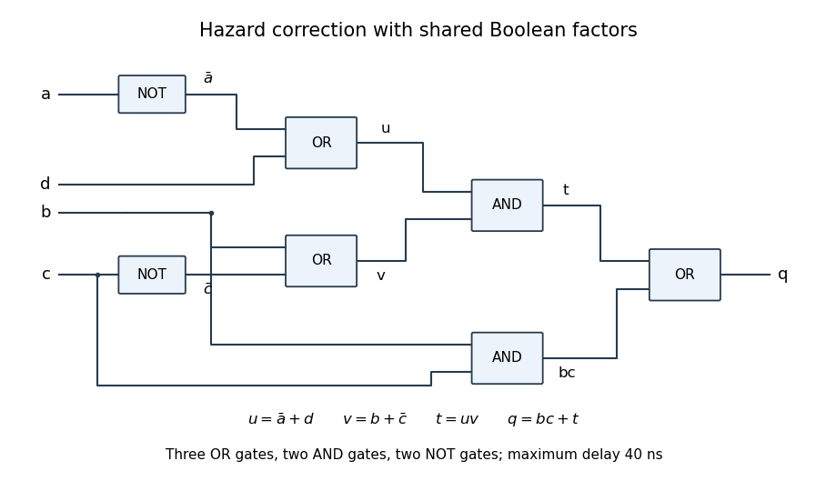

# Static-one logic hazard

↑ **Parent:** [Hazard (logic)](hazard-logic.md)

A [logic hazard](hazard-logic.md) in which an output intended to remain one briefly falls to zero. In a [sum of products](disjunctive-normal-form.md), cover every adjacent pair of one-cells in a [Karnaugh map](karnaugh-map.md) with a common product [implicant](implicant.md). That term omits the changing input and remains one throughout the transition, holding the OR output high regardless of the other path delays. This argument assumes one input changes at a time and the circuit starts settled.

For a concrete circuit, let $x=\bar a\bar c$, $y=bc$, $z=\bar cd$, $w=y+z$ and $q=x+w$. Give every gate, including each inverter, [propagation delay](propagation-delay.md) 10 ns. Starting from $a=b=c=d=1$, lower $c$ at time zero. Signal $y$ falls at 10 ns, while $z$ rises only at 20 ns. Their gap passes through the two OR gates, making $q$ fall during 30–40 ns even though its steady-state value remains one.

**[Figure 9](#image-a-static-one-logic-hazard-from-unequal-inversion-and-product-paths). A static-one logic hazard from unequal inversion and product paths**.

Adding the two [consensus theorem](consensus-theorem.md) products $\bar ab$ and $bd$ preserves the [Boolean function](boolean-function.md) and holds the output high across every potentially hazardous single-input transition. The resulting five-term expression factors as $q=bc+(\bar a+d)(b+\bar c)$. When a change of $c$ could leave the output steadily one, $b=1$ and $\bar a+d=1$ keep the second product steadily one. In the zero-to-zero case with changing $c$, $b=0$ and $\bar a+d=0$ keep both output products zero. Changes of $a,b,d$ use only one polarity each and therefore have no opposite-polarity race. This factored implementation uses three OR gates, two AND gates and two NOT gates, with a 40 ns maximum input-to-output path at the stated delays.

**[Figure 10](#image-a-shared-factor-implementation-of-the-consensus-theorem-correction). A shared-factor implementation of the consensus theorem correction**.

## ↑ Ancestors (8)

1. [Hazard (logic)](hazard-logic.md)
2. [Combinational logic](combinational-logic.md)
3. [Boolean circuit](boolean-circuit.md)
4. [Circuit complexity](circuit-complexity.md)
5. [Computational complexity theory](computational-complexity-theory.md)
6. [Theoretical computer science](theoretical-computer-science-split.md)
7. [Computer science](computer-science-split.md)
8. [Codex Wiki](split.md)

## ← Incoming links (3)

- [Consensus theorem](consensus-theorem.md)
- [Solution](past-exam-of-the-year-1-of-the-computer-science-course-of-the-university-of-oxford/2018/digital-systems-linear-algebra-introduction-to-formal-proof/2/a/solution.md)
- [Static-one logic hazard](static-one-logic-hazard.md)
