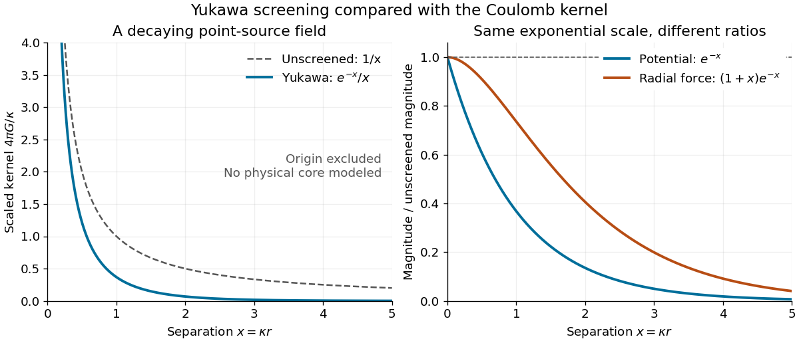

# Static Yukawa Green function

↑ **Parent:** [Yukawa meson theory of nuclear forces](yukawa-meson-theory-of-nuclear-forces.md)

Let $\kappa>0$ be an inverse length. In three spatial dimensions, seek the [Green's function](green-s-function-split.md) that decays at infinity and satisfies

$$
(-\nabla^2+\kappa^2)G_\kappa(\mathbf r)=\delta^{(3)}(\mathbf r),\qquad r=|\mathbf r|,
$$

where $\nabla^2$ is the [Laplacian](laplacian.md) and $\delta^{(3)}$ the three-dimensional [Dirac delta function](dirac-delta-function.md). The [point source](point-source.md) and the [differential operator](differential-operator.md) have [spherical symmetry](spherical-symmetry.md). For $r>0$, the [radial Laplacian](radial-laplacian.md) gives

$$
G_\kappa''+\frac2rG_\kappa'-\kappa^2G_\kappa=0.
$$

Writing $u(r)=rG_\kappa(r)$ reduces this to $u''-\kappa^2u=0$. Decay at infinity removes the growing [exponential function](exponential-function.md), leaving $G_\kappa(r)=C e^{-\kappa r}/r$.

The [Dirac delta function](dirac-delta-function.md) fixes the coefficient. Integrating over a ball $B_\epsilon$ and using the [divergence theorem](divergence-theorem.md) gives

$$
-4\pi\epsilon^2G_\kappa'(\epsilon)+\kappa^2\int_{B_\epsilon}G_\kappa\,d^3r=1.
$$

The first term tends to $4\pi C$, while the second is $O(\epsilon^2)$. Hence $C=1/(4\pi)$ and

$$
G_\kappa(r)=\frac{e^{-\kappa r}}{4\pi r}.
$$

This solves the source equation in the sense of [distributions](distribution-mathematical-analysis.md), including at the origin. Merely verifying the equation for $r>0$ would leave the normalization undetermined. The limit $\kappa\to0$ at fixed $r>0$ is $1/(4\pi r)$, the [Green function of the Laplacian](green-function-of-the-laplacian.md) for the convention $-\nabla^2$.

For an attractive scalar toy interaction, absorb constants into $A>0$ and set

$$
V(r)=-A\frac{e^{-\kappa r}}r,\qquad F_r=-\frac{dV}{dr}=-A\frac{e^{-\kappa r}}{r^2}(1+\kappa r).
$$

Here $A$ has units of [energy](energy-split.md) times length, and negative $F_r$ points inward. At equal $A$, comparison with the unscreened model $V_0=-A/r$ gives

$$
\frac{|V|}{|V_0|}=e^{-x},\qquad \frac{|F_r|}{|F_{0r}|}=(1+x)e^{-x},\qquad x=\kappa r.
$$

Thus the [potential energy](potential-energy.md) and [force](force-split.md) have the same exponential scale but different suppression factors. At $x=1$, these ratios are approximately $0.368$ and $0.736$; at $x=3$, they are $0.0498$ and $0.199$. Finite range means rapid decay, not an abrupt cutoff.

**[Figure 1](#image-the-yukawa-green-function-and-its-decay-relative-to-the-coulomb-kernel). The Yukawa Green function and its decay relative to the Coulomb kernel**. Original scalar-model calculation. Left: $4\pi G_\kappa/\kappa=e^{-x}/x$ compared with the unscreened $1/x$, for $x=\kappa r>0$. Right: relative [potential energy](potential-energy.md) and radial [force](force-split.md) magnitudes. The source singularity is excluded from the plotted interval; this is not a measured [nucleon](nucleon.md) [potential energy](potential-energy.md) or a model of its core.

## ↑ Ancestors (5)

1. [Yukawa meson theory of nuclear forces](yukawa-meson-theory-of-nuclear-forces.md)
2. [Nuclear force](nuclear-force-split.md)
3. [Nuclear physics](nuclear-physics.md)
4. [Physics](physics-split.md)
5. [Codex Wiki](split.md)

## ← Incoming links (3)

- [Dirichlet image kernel for the three-dimensional modified Helmholtz equation](dirichlet-image-kernel-for-the-three-dimensional-modified-helmholtz-equation.md)
- [Mass and range of a nuclear exchange field](mass-and-range-of-a-nuclear-exchange-field.md)
- [Solution](past-exam-of-the-mathematics-course-of-the-year-2-of-the-natural-sciences-course-of-the-university-of-cambridge/2021/paper-2/3/b/solution.md)
