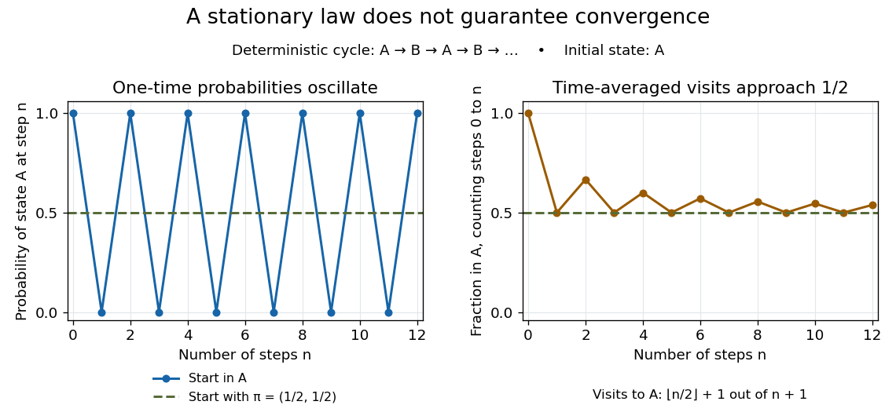

# Stationary distribution

↑ **Parent:** [Markov chain](markov-chain.md)  
ⓦ [Wiki](https://en.wikipedia.org/wiki/Stationary_distribution)

A stationary distribution is a [probability distribution](probability-distribution.md) $\pi$ preserved by a [Markov chain](markov-chain.md)'s evolution. For a [Discrete-time Markov chain](discrete-time-markov-chain.md) in the row convention,

$$
\pi P=\pi,\qquad \pi_i\geq0,\qquad\sum_i\pi_i=1.
$$

Thus $\pi$ is a normalized nonnegative [left eigenvector](left-eigenvector.md) of the [transition matrix](stochastic-matrix.md) for [eigenvalue](eigenvalue.md) one. Starting with $X_0$ distributed as $\pi$ makes every $X_n$ have that same [probability distribution](probability-distribution.md). For a time-homogeneous [Markov chain](markov-chain.md), the path [probabilities](probability.md) are also unchanged by shifting all observation times together: the process has [strict stationarity](strictly-stationary-process.md). This does not mean its individual paths are constant. See [Hao Wu's MIT lecture 2, stationary distributions](https://ocw.mit.edu/courses/18-445-introduction-to-stochastic-processes-spring-2015/2edaa8542469ce692226813a8bd1ec88_MIT18_445S15_lecture2.pdf).

For the sunny/rainy [transition matrix](stochastic-matrix.md), write $\pi=(a,1-a)$. The sunny component of $\pi P=\pi$ gives $a=0.8a+0.4(1-a)$, so $0.6a=0.4$ and

$$
\pi=\left(\frac23,\frac13\right),\qquad
\pi P=\left(\frac{8}{15}+\frac{2}{15},\frac{2}{15}+\frac{3}{15}\right)=\pi.
$$

Moreover,

$$
\pi_SP_{SR}=\frac23\frac15=\frac{2}{15}=\frac13\frac25=\pi_RP_{RS}.
$$

These equal stationary flows verify [detailed balance](detailed-balance.md) and show that the [Markov chain](markov-chain.md) is [reversible](reversible-markov-chain.md). The diagonal [detailed balance equations](detailed-balance.md) hold automatically. Only $1/3$ of the stationary days are rainy, but $0.6$ of the days following a rainy day are rainy: [stationarity](stationary-process.md) permits dependence.

A [finite Markov chain](finite-markov-chain.md) that is an [irreducible Markov chain](irreducible-markov-chain.md) has a unique [stationary distribution](stationary-distribution.md). If it is also an [aperiodic Markov chain](aperiodic-markov-chain.md), $\mu_0P^n\to\pi$ for every initial [probability distribution](probability-distribution.md). The sunny/rainy example satisfies both conditions: both directions are possible and each state has a positive [holding probability of a Markov chain](holding-probability-of-a-markov-chain.md). See [Hao Wu's MIT lecture 4, convergence theorem](https://ocw.mit.edu/courses/18-445-introduction-to-stochastic-processes-spring-2015/5bd4774f613aa28bd111c36f3a3beeed_MIT18_445S15_lecture4.pdf). For an infinite [state space](state-space.md), the additional [positive recurrence](positive-recurrent-markov-chain.md) hypothesis in the [countable-state Markov chain convergence theorem](countable-state-markov-chain-convergence-theorem.md) matters.

Existence of a [stationary distribution](stationary-distribution.md) alone does not give this convergence. Consider the deterministic two-cycle

$$
C=\begin{pmatrix}0&1\\1&0\end{pmatrix},\qquad\pi=\left(\frac12,\frac12\right).
$$

Here $\pi C=\pi$, but starting in the first state gives alternating [probability distributions](probability-distribution.md) $(1,0),(0,1),(1,0),\ldots$. Its [period of a state in a Markov chain](period-of-a-state-in-a-markov-chain.md) is two. The running fraction of visits to either state nevertheless tends to $1/2$, illustrating the [Markov chain ergodic theorem](markov-chain-ergodic-theorem.md). Starting with $\pi$ instead keeps the one-time [probability distributions](probability-distribution.md) stationary even though every path alternates.

**[Figure 8](#image-a-deterministic-two-cycle-has-a-stationary-law-but-its-one-time-probabilities-oscillate-while-its-time-averaged-visits-converge). A deterministic two-cycle has a stationary law, but its one-time probabilities oscillate while its time-averaged visits converge.**

**Table of contents**

- [Product stationarity under single-coordinate Markov updates](product-stationarity-under-single-coordinate-markov-updates.md)

## ↑ Ancestors (7)

1. [Markov chain](markov-chain.md)
2. [Markov process](markov-process-split.md)
3. [Probability theory](probability-theory-split.md)
4. [Probability and statistics](probability-and-statistics-split.md)
5. [Area of mathematics](area-of-mathematics.md)
6. [Mathematics](mathematics-split.md)
7. [Codex Wiki](split.md)

## ← Incoming links (123)

- [Alternative routing](alternative-routing.md)
- [Biased-step entropy production model](biased-step-entropy-production-model.md)
- [Binary Markov source](binary-markov-source.md)
- [Brownian zero mode of a fluctuating interface](brownian-zero-mode-of-a-fluctuating-interface.md)
- [Countable-state Markov chain convergence theorem](countable-state-markov-chain-convergence-theorem.md)
- [Discrete-time Markov chain](discrete-time-markov-chain.md)
- [Ehrenfest urn model](ehrenfest-urn-model.md)
- [Eigenvalue lower bound for total variation mixing](eigenvalue-lower-bound-for-total-variation-mixing.md)
- [Entropy maximization for loss-network occupancy](entropy-maximization-for-loss-network-occupancy.md)
- [Entropy rate of a fully observed Markov source](entropy-rate-of-a-fully-observed-markov-source.md)
- [Ergodic theorem for a finite continuous-time Markov chain](ergodic-theorem-for-a-finite-continuous-time-markov-chain.md)
- [Four-cycle partition function](four-cycle-partition-function.md)
- [Fully observed Markov source](fully-observed-markov-source.md)
- [Geometric-arrival single-service queue](geometric-arrival-single-service-queue.md)
- [Interchange process](interchange-process.md)
- [Irreducible Markov chain](irreducible-markov-chain.md)
- [Kac's lemma](kac-s-lemma.md)
- [M/M/1 utilization and delay](m-m-1-utilization-and-delay.md)
- [Markov chain](markov-chain.md)
- [Markov chain ergodic theorem](markov-chain-ergodic-theorem.md)
- [Mean recurrence time](mean-recurrence-time.md)
- [Multiclass single-server queue](multiclass-single-server-queue.md)
- [Ornstein-Uhlenbeck stationary initialization](ornstein-uhlenbeck-stationary-initialization.md)
- [Pairwise mixing diameter](pairwise-mixing-diameter.md)
- [Solution](past-exam-of-the-mathematics-course-of-the-university-of-cambridge/2001/iii/paper-52/6/a/solution.md)
- [Solution](past-exam-of-the-mathematics-course-of-the-university-of-cambridge/2001/iii/paper-73/1/solution.md)
- [Solution](past-exam-of-the-mathematics-course-of-the-university-of-cambridge/2001/iii/paper-73/2/solution.md)
- [Solution](past-exam-of-the-mathematics-course-of-the-university-of-cambridge/2002/iii/paper-35/4/a/solution.md)
- [Solution](past-exam-of-the-mathematics-course-of-the-university-of-cambridge/2003/iii/paper-34/2/i/solution.md)
- [Solution](past-exam-of-the-mathematics-course-of-the-university-of-cambridge/2003/iii/paper-34/2/ii/solution.md)
- [Solution](past-exam-of-the-mathematics-course-of-the-university-of-cambridge/2003/iii/paper-34/2/iii/solution.md)
- [Solution](past-exam-of-the-mathematics-course-of-the-university-of-cambridge/2003/iii/paper-34/4/solution.md)
- [Solution](past-exam-of-the-mathematics-course-of-the-university-of-cambridge/2004/ib/paper-1/22h/solution.md)
- [Solution](past-exam-of-the-mathematics-course-of-the-university-of-cambridge/2004/ib/paper-2/11h/solution.md)
- [Solution](past-exam-of-the-mathematics-course-of-the-university-of-cambridge/2004/iii/paper-13/1/solution.md)
- [Solution](past-exam-of-the-mathematics-course-of-the-university-of-cambridge/2005/ib/paper-1/19d/solution.md)
- [Solution](past-exam-of-the-mathematics-course-of-the-university-of-cambridge/2006/ib/paper-3/9c/solution.md)
- [Solution](past-exam-of-the-mathematics-course-of-the-university-of-cambridge/2006/ib/paper-4/9c/solution.md)
- [Solution](past-exam-of-the-mathematics-course-of-the-university-of-cambridge/2006/ii/paper-3/26j/a/solution.md)
- [Solution](past-exam-of-the-mathematics-course-of-the-university-of-cambridge/2006/ii/paper-3/26j/b/solution.md)
- [Solution](past-exam-of-the-mathematics-course-of-the-university-of-cambridge/2006/iii/paper-34/1/solution.md)
- [Solution](past-exam-of-the-mathematics-course-of-the-university-of-cambridge/2006/iii/paper-34/2/solution.md)
- [Solution](past-exam-of-the-mathematics-course-of-the-university-of-cambridge/2006/iii/paper-34/4/solution.md)
- [Solution](past-exam-of-the-mathematics-course-of-the-university-of-cambridge/2007/ib/paper-2/20c/solution.md)
- [Solution](past-exam-of-the-mathematics-course-of-the-university-of-cambridge/2007/ib/paper-3/9c/solution.md)
- [Solution](past-exam-of-the-mathematics-course-of-the-university-of-cambridge/2007/iii/paper-35/1/solution.md)
- [Solution](past-exam-of-the-mathematics-course-of-the-university-of-cambridge/2007/iii/paper-35/4/solution.md)
- [Solution](past-exam-of-the-mathematics-course-of-the-university-of-cambridge/2007/iii/paper-45/4/solution.md)
- [Solution](past-exam-of-the-mathematics-course-of-the-university-of-cambridge/2008/ib/paper-4/9h/solution.md)
- [Solution](past-exam-of-the-mathematics-course-of-the-university-of-cambridge/2008/ii/paper-1/26i/ii/solution.md)
- [Solution](past-exam-of-the-mathematics-course-of-the-university-of-cambridge/2008/ii/paper-1/26i/iii/solution.md)
- [Solution](past-exam-of-the-mathematics-course-of-the-university-of-cambridge/2008/ii/paper-1/26i/v/solution.md)
- [Solution](past-exam-of-the-mathematics-course-of-the-university-of-cambridge/2008/ii/paper-3/25i/b/solution.md)
- [Solution](past-exam-of-the-mathematics-course-of-the-university-of-cambridge/2008/ii/paper-3/25i/solution.md)
- [Solution](past-exam-of-the-mathematics-course-of-the-university-of-cambridge/2008/iii/paper-35/1/solution.md)
- [Solution](past-exam-of-the-mathematics-course-of-the-university-of-cambridge/2009/ii/paper-2/29i/solution.md)
- [Solution](past-exam-of-the-mathematics-course-of-the-university-of-cambridge/2009/ii/paper-4/26j/a/solution.md)
- [Solution](past-exam-of-the-mathematics-course-of-the-university-of-cambridge/2009/iii/paper-30/1/i/solution.md)
- [Solution](past-exam-of-the-mathematics-course-of-the-university-of-cambridge/2009/iii/paper-30/1/ii/solution.md)
- [Solution](past-exam-of-the-mathematics-course-of-the-university-of-cambridge/2009/iii/paper-30/5/solution.md)
- [Solution](past-exam-of-the-mathematics-course-of-the-university-of-cambridge/2010/iii/paper-30/1/a/solution.md)
- [Solution](past-exam-of-the-mathematics-course-of-the-university-of-cambridge/2010/iii/paper-30/1/b/solution.md)
- [Solution](past-exam-of-the-mathematics-course-of-the-university-of-cambridge/2010/iii/paper-30/3/c/solution.md)
- [Solution](past-exam-of-the-mathematics-course-of-the-university-of-cambridge/2011/ii/paper-4/26j/iv/solution.md)
- [Solution](past-exam-of-the-mathematics-course-of-the-university-of-cambridge/2014/iii/paper-28/4/solution.md)
- [Solution](past-exam-of-the-mathematics-course-of-the-university-of-cambridge/2015/iii/paper-39/1/solution.md)
- [Solution](past-exam-of-the-mathematics-course-of-the-university-of-cambridge/2015/iii/paper-39/2/solution.md)
- [Solution](past-exam-of-the-mathematics-course-of-the-university-of-cambridge/2015/iii/paper-39/5/solution.md)
- [Solution](past-exam-of-the-mathematics-course-of-the-university-of-cambridge/2016/ib/paper-1/20h/b/solution.md)
- [Solution](past-exam-of-the-mathematics-course-of-the-university-of-cambridge/2016/ib/paper-2/20h/b/iii/solution.md)
- [Solution](past-exam-of-the-mathematics-course-of-the-university-of-cambridge/2016/ib/paper-4/9h/a/solution.md)
- [Solution](past-exam-of-the-mathematics-course-of-the-university-of-cambridge/2016/iii/paper-213/1/i/solution.md)
- [Solution](past-exam-of-the-mathematics-course-of-the-university-of-cambridge/2016/iii/paper-213/2/solution.md)
- [Solution](past-exam-of-the-mathematics-course-of-the-university-of-cambridge/2016/iii/paper-213/5/solution.md)
- [Solution](past-exam-of-the-mathematics-course-of-the-university-of-cambridge/2017/ib/paper-2/20h/c/solution.md)
- [Solution](past-exam-of-the-mathematics-course-of-the-university-of-cambridge/2017/iii/paper-207/3/a/iii/solution.md)
- [Solution](past-exam-of-the-mathematics-course-of-the-university-of-cambridge/2017/iii/paper-207/3/c/ii/solution.md)
- [Solution](past-exam-of-the-mathematics-course-of-the-university-of-cambridge/2017/iii/paper-215/1/a/solution.md)
- [Solution](past-exam-of-the-mathematics-course-of-the-university-of-cambridge/2017/iii/paper-215/2/a/solution.md)
- [Solution](past-exam-of-the-mathematics-course-of-the-university-of-cambridge/2017/iii/paper-215/2/b/solution.md)
- [Solution](past-exam-of-the-mathematics-course-of-the-university-of-cambridge/2017/iii/paper-215/3/c/solution.md)
- [Solution](past-exam-of-the-mathematics-course-of-the-university-of-cambridge/2017/iii/paper-215/4/a/solution.md)
- [Solution](past-exam-of-the-mathematics-course-of-the-university-of-cambridge/2017/iii/paper-215/4/b/solution.md)
- [Solution](past-exam-of-the-mathematics-course-of-the-university-of-cambridge/2017/iii/paper-215/4/c/solution.md)
- [Solution](past-exam-of-the-mathematics-course-of-the-university-of-cambridge/2017/iii/paper-216/6/solution.md)
- [Solution](past-exam-of-the-mathematics-course-of-the-university-of-cambridge/2018/iii/paper-213/1/i/solution.md)
- [Solution](past-exam-of-the-mathematics-course-of-the-university-of-cambridge/2018/iii/paper-213/1/iii/solution.md)
- [Solution](past-exam-of-the-mathematics-course-of-the-university-of-cambridge/2018/iii/paper-213/4/solution.md)
- [Solution](past-exam-of-the-mathematics-course-of-the-university-of-cambridge/2018/iii/paper-344/1/d/solution.md)
- [Solution](past-exam-of-the-mathematics-course-of-the-university-of-cambridge/2019/ib/paper-1/20h/a/solution.md)
- [Solution](past-exam-of-the-mathematics-course-of-the-university-of-cambridge/2019/ib/paper-2/20h/b/solution.md)
- [Solution](past-exam-of-the-mathematics-course-of-the-university-of-cambridge/2019/ii/paper-3/27k/a/solution.md)
- [Solution](past-exam-of-the-mathematics-course-of-the-university-of-cambridge/2019/iii/paper-219/3/d/solution.md)
- [Solution](past-exam-of-the-mathematics-course-of-the-university-of-cambridge/2020/ib/paper-2/7h/solution.md)
- [Solution](past-exam-of-the-mathematics-course-of-the-university-of-cambridge/2020/ii/paper-4/27k/i/solution.md)
- [Solution](past-exam-of-the-mathematics-course-of-the-university-of-cambridge/2021/ii/paper-3/27k/a/solution.md)
- [Solution](past-exam-of-the-mathematics-course-of-the-university-of-cambridge/2022/ib/paper-2/18h/a/solution.md)
- [Solution](past-exam-of-the-mathematics-course-of-the-university-of-cambridge/2023/ib/paper-2/18h/d/solution.md)
- [Solution](past-exam-of-the-mathematics-course-of-the-university-of-cambridge/2023/ib/paper-3/8h/a/solution.md)
- [Solution](past-exam-of-the-mathematics-course-of-the-university-of-cambridge/2023/iii/paper-216/2/a/solution.md)
- [Solution](past-exam-of-the-mathematics-course-of-the-university-of-cambridge/2023/iii/paper-216/3/c/solution.md)
- [Solution](past-exam-of-the-mathematics-course-of-the-university-of-cambridge/2024/iii/paper-356/1/d/ii/solution.md)
- [Solution](past-exam-of-the-mathematics-course-of-the-university-of-cambridge/2025/ib/paper-4/7h/b/solution.md)
- [Poisson arrivals see time averages](poisson-arrivals-see-time-averages.md)
- [Positive recurrent Markov chain](positive-recurrent-markov-chain.md)
- [Product-form stationary distribution of a closed migration process](product-form-stationary-distribution-of-a-closed-migration-process.md)
- [Product-form stationary distribution of a loss network](product-form-stationary-distribution-of-a-loss-network.md)
- [Product stationarity under single-coordinate Markov updates](product-stationarity-under-single-coordinate-markov-updates.md)
- [Random adjacent transposition shuffle](random-adjacent-transposition-shuffle.md)
- [Random transposition shuffle](random-transposition-shuffle.md)
- [Reflected Brownian motion with negative drift](reflected-brownian-motion-with-negative-drift.md)
- [Reversible density-ratio propagation](reversible-density-ratio-propagation.md)
- [Reversible four-cycle flow model](reversible-four-cycle-flow-model.md)
- [Separation chain for two labels in a circular transposition shuffle](separation-chain-for-two-labels-in-a-circular-transposition-shuffle.md)
- [Separation distance](separation-distance.md)
- [Stationary distribution](stationary-distribution.md)
- [Stationary flow conservation in a finite-line switchboard](stationary-flow-conservation-in-a-finite-line-switchboard.md)
- [Stationary law of a two-resource linear flow network](stationary-law-of-a-two-resource-linear-flow-network.md)
- [Steady-state asymptotic fluctuation theorem](steady-state-asymptotic-fluctuation-theorem.md)
- [Strong stationary time](strong-stationary-time.md)
- [Three-level discount equilibrium with geometric annual counts](three-level-discount-equilibrium-with-geometric-annual-counts.md)
- [Three-level no claims discount equilibrium](three-level-no-claims-discount-equilibrium.md)
- [Two-lane Markov chain with a deterministic restart](two-lane-markov-chain-with-a-deterministic-restart.md)
