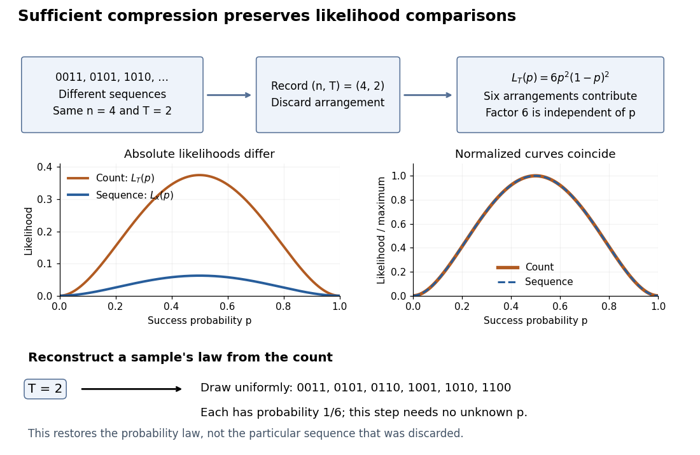

# Statistical data compression by a sufficient statistic

↑ **Parent:** [Sufficient statistic](sufficient-statistic.md)

A [sufficient statistic](sufficient-statistic.md) allows the observed [likelihood function](likelihood-function.md) to be stored through a shorter record, up to a parameter-independent factor. For the [Bernoulli sample sum as a sufficient statistic](bernoulli-sample-sum-as-a-sufficient-statistic.md), write

$$
L_x(p)=p^t(1-p)^{n-t},\qquad L_t(p)=\binom nt p^t(1-p)^{n-t}=\binom nt L_x(p).
$$

The second [likelihood function](likelihood-function.md) belongs to the observed count; the first belongs to the observed sequence. Their absolute values differ by the [binomial coefficient](binomial-coefficient-split.md), but their [likelihood ratios](likelihood-ratio.md) between any two interior parameter values agree. A [maximum-likelihood estimator](maximum-likelihood-estimator.md) can therefore use just $(n,t)$.

**[Figure 12](#image-sequence-to-count-sufficient-compression-preserves-likelihood-comparisons). Sequence to count: sufficient compression preserves likelihood comparisons**. For $n=4,t=2$, three example sequences share $L_x(p)=p^2(1-p)^2$. Recording $(n,t)$ produces the count [likelihood](likelihood-function.md) $L_t(p)=6L_x(p)$. Normalizing each curve by its maximum makes the two curves coincide. A reverse random draw from the six arrangements restores the full-data [probability distribution](probability-distribution-split.md), using no unknown $p$.

This compression discards which arrangement actually occurred. To reproduce the original experiment's [probability distribution](probability-distribution-split.md), first draw $T$ from its [binomial distribution](binomial-distribution.md) and then draw uniformly from the arrangements with that sum. The second step is independent of $p$, so it supplies no additional evidence about $p$. It does not recover the particular discarded sequence. If the scientific question changes to time trends or [statistical dependence](statistical-dependence.md) between observations, the common-$p$ [independent and identically distributed](independent-and-identically-distributed-random-variables.md) [Bernoulli](bernoulli-distribution.md) model may no longer apply, and the ordering can become informative.

## ↑ Ancestors (5)

1. [Sufficient statistic](sufficient-statistic.md)
2. [Probability and statistics](probability-and-statistics-split.md)
3. [Area of mathematics](area-of-mathematics.md)
4. [Mathematics](mathematics-split.md)
5. [Codex Wiki](split.md)
