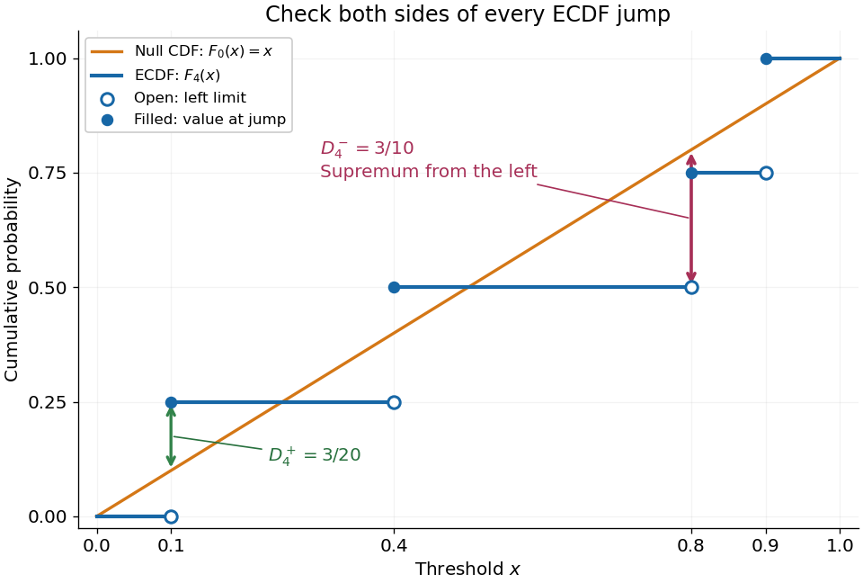
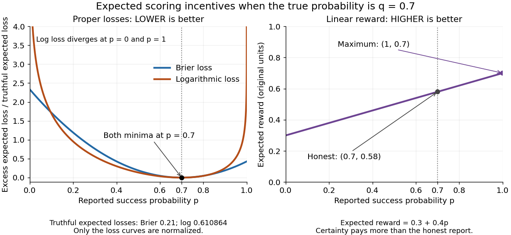
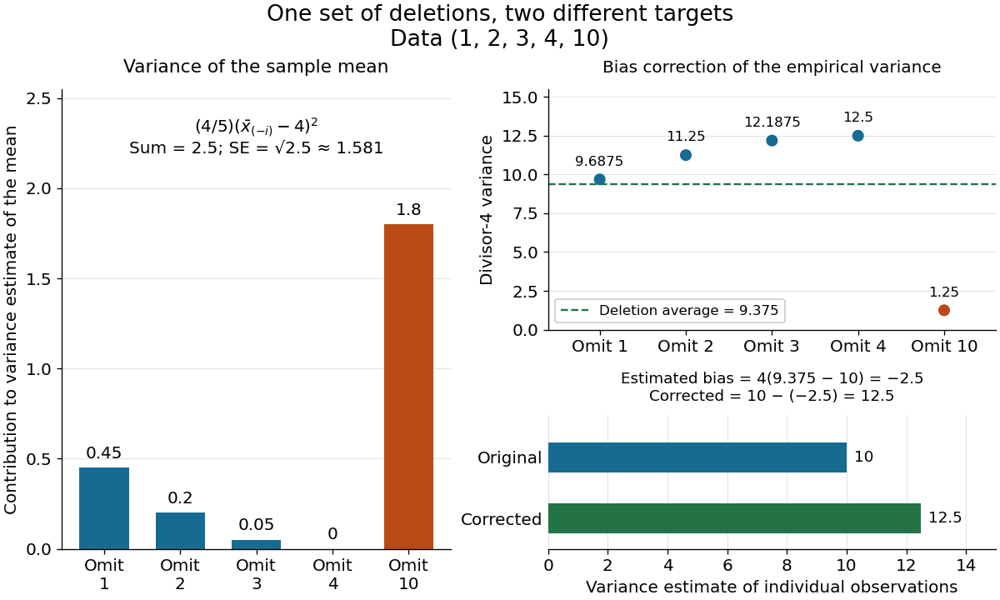

# Statistical inference

↑ **Parent:** [Probability and statistics](probability-and-statistics.md)  
ⓦ [Wiki](https://en.wikipedia.org/wiki/Statistical_inference)

[Statistical inference](statistical-inference.md) uses observed data and a [statistical model](statistical-model.md) to learn about unknown features of the process that generated them. In a [parametric statistical model](statistical-model.md#parametric-statistical-model), write $X\sim P_\theta$: the [probability distribution](probability-theory.md#probability-distribution) depends on an unknown [statistical parameter](statistical-model.md#statistical-parameter) $\theta$. An [estimand](#estimand) specifies the target, such as a [mean](probability-theory.md#expected-value) or a difference of [means](probability-theory.md#expected-value). A [statistic](#statistic) is a function of the observations; an [estimator](statistical-modelling.md#estimator) is a [statistic](#statistic) used to estimate the target. Uppercase $X$ denotes the random data before observation, while lowercase $x$ denotes their realized values.

Three questions lead to different outputs. [Statistical estimation](#statistical-estimation) asks which target value the observations suggest. A [confidence interval](#confidence-interval) asks for a range produced by a procedure with calibrated [coverage probability](#coverage-probability). A [hypothesis test](statistical-modelling.md#statistical-hypothesis-test) asks whether the observations depart sufficiently from a specified [null hypothesis](statistical-modelling.md#null-hypothesis) to enter its [rejection region](statistical-modelling.md#rejection-region). These outputs complement one another: an estimated [effect size](#effect-size) describes magnitude, while a [standard error](#standard-error) describes the [sampling distribution](statistical-modelling.md#sampling-distribution) of an [estimator](statistical-modelling.md#estimator). A [p-value](statistical-modelling.md#p-value) describes a tail [probability](probability-theory.md#probability) under the [null hypothesis](statistical-modelling.md#null-hypothesis).

The appeal of [statistical inference](statistical-inference.md) is that it turns variable observations into reproducible uncertainty statements. In the [normal mean confidence interval with known variance](#normal-mean-confidence-interval-with-known-variance) below, a [sample mean](variance.md#sample-mean) of $1.2$ has [standard error](#standard-error) $0.5$: both the estimated shift and its precision matter. The calibration depends on the [statistical model](statistical-model.md), including [independence](random-variable.md#independent-random-variables) and the specified [probability distribution](probability-theory.md#probability-distribution). Increasing [sample size](probability-and-statistics.md#sample-size) improves precision under those assumptions; it does not repair a systematically misleading sampling procedure. [Bayesian inference](#bayesian-statistics) provides another framework, using a [prior distribution](#prior-probability) and a [likelihood function](statistical-modelling.md#likelihood-function) to obtain a [posterior distribution](#bayesian-posterior).

**Table of contents**

- [Effect size](#effect-size)
- [Statistical process control](#statistical-process-control)
  - [CUSUM](#cusum)
    - [Poisson likelihood-ratio CUSUM](#poisson-likelihood-ratio-cusum)
    - [Average run length](#average-run-length)
    - [Fast initial response CUSUM](#fast-initial-response-cusum)
  - [Hospital mortality funnel plot](#hospital-mortality-funnel-plot)
    - [Binomial funnel control limits](#binomial-funnel-control-limits)
  - [Control limits](#control-limits)
- [Jackknife resampling](#jackknife-resampling)
  - [Jackknife variance estimator](#jackknife-variance-estimator)
    - [Jackknife and bootstrap variance of a sample second moment](#jackknife-and-bootstrap-variance-of-a-sample-second-moment)
- [Fisherian conditional inference](#fisherian-conditional-inference)
  - [Conditionality principle](#conditionality-principle)
- [Kolmogorov-Smirnov test](#kolmogorov-smirnov-test)
  - [Kolmogorov-Smirnov statistic](#kolmogorov-smirnov-statistic)
  - [Lilliefors test](#lilliefors-test)
  - [Two-sample Kolmogorov-Smirnov test](#two-sample-kolmogorov-smirnov-test)
- [Likelihood principle](#likelihood-principle)
  - [Exponential sampling stopped by a data-dependent coin](#exponential-sampling-stopped-by-a-data-dependent-coin)
- [Estimand](#estimand)
- [Efficiency (statistics)](#efficiency-statistics)
- [Statistical functional](#statistical-functional)
  - [Functional statistic](#functional-statistic)
  - [Density fourth-power functional](#density-fourth-power-functional)
    - [Spike obstruction to density-power differentiability](#spike-obstruction-to-density-power-differentiability)
  - [Pathwise differentiability of a statistical functional](#pathwise-differentiability-of-a-statistical-functional)
    - [Influence-function representer](#influence-function-representer)
      - [Canonical gradient](#canonical-gradient)
- [Statistical estimation](#statistical-estimation)
  - [Ratio estimator](#ratio-estimator)
    - [Absolute error bound for a ratio estimator with a controlled denominator](#absolute-error-bound-for-a-ratio-estimator-with-a-controlled-denominator)
- [Probability sampling](#probability-sampling)
  - [Sampling without replacement](#sampling-without-replacement)
    - [First marked item in a random permutation](#first-marked-item-in-a-random-permutation)
  - [Cluster sampling](#cluster-sampling)
    - [Design effect](#design-effect)
  - [Stratified sampling](#stratified-sampling)
    - [Optimal cost-constrained stratified sampling allocation](#optimal-cost-constrained-stratified-sampling-allocation)
  - [Simple random sampling](#simple-random-sampling)
- [Scoring rule](#scoring-rule)
  - [Linear probability score](#linear-probability-score)
  - [Proper scoring rule](#proper-scoring-rule)
    - [Strictly proper scoring rule](#strictly-proper-scoring-rule)
      - [Brier score](#brier-score)
      - [Logarithmic scoring rule](#logarithmic-scoring-rule)
        - [Prequential log score identity](#prequential-log-score-identity)
- [Statistical degrees of freedom](#statistical-degrees-of-freedom)
- [Statistic](#statistic)
  - [Complete statistic](#complete-statistic)
    - [Boundedly complete statistic](#boundedly-complete-statistic)
- [Meta-analysis](#meta-analysis)
  - [Subgroup analysis in meta-analysis](#subgroup-analysis-in-meta-analysis)
  - [Forest plot](#forest-plot)
  - [Funnel plot](#funnel-plot)
    - [Small-study effect](#small-study-effect)
  - [Publication bias](#publication-bias)
    - [Selection model for publication bias](#selection-model-for-publication-bias)
      - [Odds under at-least-one-positive selection](#odds-under-at-least-one-positive-selection)
    - [Trim and fill](#trim-and-fill)
  - [Independent subgroup contrast in meta-analysis](#independent-subgroup-contrast-in-meta-analysis)
  - [Within-study bias](#within-study-bias)
    - [Bias-adjusted meta-analysis](#bias-adjusted-meta-analysis)
  - [Fixed-effect meta-analysis](#fixed-effect-meta-analysis)
    - [Mantel–Haenszel pooled odds ratio](#mantel-haenszel-pooled-odds-ratio)
  - [Leave-one-study-out influence analysis](#leave-one-study-out-influence-analysis)
  - [Random-effects meta-analysis](#random-effects-meta-analysis)
    - [Student t random-effect model](#student-t-random-effect-model)
    - [Between-study heterogeneity](#between-study-heterogeneity)
      - [Meta-regression](#meta-regression)
      - [Prior calibration for normal random-effect range](#prior-calibration-for-normal-random-effect-range)
      - [I-squared statistic](#i-squared-statistic)
      - [DerSimonian–Laird estimator](#dersimonian-laird-estimator)
      - [Cochran's Q statistic](#cochran-s-q-statistic)
  - [Network meta-analysis](#network-meta-analysis)
    - [Indirect treatment comparison](#indirect-treatment-comparison)
      - [Transitivity in network meta-analysis](#transitivity-in-network-meta-analysis)
- [Confidence region](#confidence-region)
  - [Confidence band](#confidence-band)
    - [Kolmogorov-Smirnov confidence band](#kolmogorov-smirnov-confidence-band)
  - [Confidence ellipsoid](#confidence-ellipsoid)
- [Statistical sample](#statistical-sample)
  - [Normal sample](#normal-sample)
- [Semiparametric statistics](#semiparametric-statistics)
  - [Adaptivity to an unknown covariate distribution](#adaptivity-to-an-unknown-covariate-distribution)
  - [Nuisance tangent space](#nuisance-tangent-space)
    - [Mean-preserving error tangent space](#mean-preserving-error-tangent-space)
    - [Efficient score](#efficient-score)
      - [Efficient score in independent-error regression](#efficient-score-in-independent-error-regression)
      - [Efficient-score projection identity](#efficient-score-projection-identity)
      - [Efficient information](#efficient-information)
  - [Semiparametric estimator](#semiparametric-estimator)
  - [Partially linear model](#partially-linear-model)
- [Fisher consistency](#fisher-consistency)
- [Scale estimator](#scale-estimator)
- [Consistency (statistics)](#consistency-statistics)
- [Plug-in estimator](#plug-in-estimator)
- [Assouad's lemma](#assouad-s-lemma)
  - [Assouad hypercube](#assouad-hypercube)
- [Robust statistics](#robust-statistics)
  - [Translation-invariant estimator](#translation-invariant-estimator)
  - [Minimax asymptotic bias](#minimax-asymptotic-bias)
  - [Trimmed mean](#trimmed-mean)
    - [Influence function of a trimmed mean](#influence-function-of-a-trimmed-mean)
  - [M-estimator](#m-estimator)
    - [Sandwich variance of an M-estimator](#sandwich-variance-of-an-m-estimator)
    - [Argmin consistency under uniform convergence in probability](#argmin-consistency-under-uniform-convergence-in-probability)
      - [Global argmin may escape a compact convergence set](#global-argmin-may-escape-a-compact-convergence-set)
    - [Scale M-estimator](#scale-m-estimator)
  - [Catoni mean estimator](#catoni-mean-estimator)
  - [B-robust estimator](#b-robust-estimator)
  - [Contamination (statistics)](#contamination-statistics)
    - [Kolmogorov neighborhood of a distribution](#kolmogorov-neighborhood-of-a-distribution)
    - [Epsilon-contamination neighborhood](#epsilon-contamination-neighborhood)
      - [Huber contamination](#huber-contamination)
  - [Influence function](#influence-function)
    - [Influence function of the mean](#influence-function-of-the-mean)
    - [Influence function of a Huber location estimator](#influence-function-of-a-huber-location-estimator)
    - [Normal-location influence curves](#normal-location-influence-curves)
    - [Finite contamination bias of normal location](#finite-contamination-bias-of-normal-location)
    - [Local influence versus replacement breakdown](#local-influence-versus-replacement-breakdown)
    - [Rejection point of an influence function](#rejection-point-of-an-influence-function)
    - [Local-shift sensitivity](#local-shift-sensitivity)
    - [Influence function of a quantile](#influence-function-of-a-quantile)
    - [Empirical influence function](#empirical-influence-function)
    - [Sensitivity curve](#sensitivity-curve)
    - [One-step estimator](#one-step-estimator)
    - [Asymptotic linear representation](#asymptotic-linear-representation)
    - [Gross-error sensitivity](#gross-error-sensitivity)
    - [Influence function of the sample median](#influence-function-of-the-sample-median)
  - [Breakdown point](#breakdown-point)
    - [Finite-sample maximum bias](#finite-sample-maximum-bias)
    - [Replacement breakdown point](#replacement-breakdown-point)
  - [Huber location estimator](#huber-location-estimator)
    - [Huber score](#huber-score)
      - [Optimal bounded influence function for normal location](#optimal-bounded-influence-function-for-normal-location)
    - [Huber loss](#huber-loss)
      - [Huber gradient regularizer](#huber-gradient-regularizer)
  - [Median-of-means estimator](#median-of-means-estimator)
  - [Tukey median](#tukey-median)
  - [Asymptotic distribution of a sample median](#asymptotic-distribution-of-a-sample-median)
- [Nonparametric statistics](nonparametric-statistics.md)
  - [Rank test](nonparametric-statistics.md#rank-test)
  - [Wilcoxon signed-rank test](nonparametric-statistics.md#wilcoxon-signed-rank-test)
    - [Walsh average](nonparametric-statistics.md#walsh-average)
    - [Wilcoxon signed-rank statistic](nonparametric-statistics.md#wilcoxon-signed-rank-statistic)
  - [Mann–Whitney U test](nonparametric-statistics.md#mann-whitney-u-test)
    - [Normal approximation for a rank sum](nonparametric-statistics.md#normal-approximation-for-a-rank-sum)
    - [Exact null distribution of a rank sum](nonparametric-statistics.md#exact-null-distribution-of-a-rank-sum)
      - [Exact rank-sum tail one above the minimum](nonparametric-statistics.md#exact-rank-sum-tail-one-above-the-minimum)
  - [Fourier deconvolution](nonparametric-statistics.md#fourier-deconvolution)
  - [Empirical likelihood](nonparametric-statistics.md#empirical-likelihood)
    - [Empirical likelihood with mixed censoring](nonparametric-statistics.md#empirical-likelihood-with-mixed-censoring)
      - [Likelihood support reduction under censoring](nonparametric-statistics.md#likelihood-support-reduction-under-censoring)
      - [Monotonicity bound for a mixed-censoring likelihood](nonparametric-statistics.md#monotonicity-bound-for-a-mixed-censoring-likelihood)
  - [Nonparametric maximum-likelihood estimator](nonparametric-statistics.md#nonparametric-maximum-likelihood-estimator)
  - [Density estimation](nonparametric-statistics.md#density-estimation)
    - [Haar density estimator](nonparametric-statistics.md#haar-density-estimator)
    - [Quadratic density derivative functional](nonparametric-statistics.md#quadratic-density-derivative-functional)
      - [Diagonal correction for a quadratic density derivative estimate](nonparametric-statistics.md#diagonal-correction-for-a-quadratic-density-derivative-estimate)
    - [Nearest neighbour density estimation](nonparametric-statistics.md#nearest-neighbour-density-estimation)
    - [Kernel for density estimation](nonparametric-statistics.md#kernel-for-density-estimation)
      - [Triweight kernel](nonparametric-statistics.md#triweight-kernel)
        - [Triweight density minimizes integrated squared curvature](nonparametric-statistics.md#triweight-density-minimizes-integrated-squared-curvature)
      - [Gaussian density kernel](nonparametric-statistics.md#gaussian-density-kernel)
      - [Epanechnikov kernel](nonparametric-statistics.md#epanechnikov-kernel)
        - [Optimality of the Epanechnikov kernel](nonparametric-statistics.md#optimality-of-the-epanechnikov-kernel)
      - [Flat-top kernel for density estimation](nonparametric-statistics.md#flat-top-kernel-for-density-estimation)
        - [Parametric-rate kernel estimation of a bandlimited density](nonparametric-statistics.md#parametric-rate-kernel-estimation-of-a-bandlimited-density)
      - [Kernel of order ell](nonparametric-statistics.md#kernel-of-order-ell)
        - [Legendre polynomial kernel construction](nonparametric-statistics.md#legendre-polynomial-kernel-construction)
      - [Kernel density estimation](nonparametric-statistics.md#kernel-density-estimation)
        - [Gaussian kernel density worked example](nonparametric-statistics.md#gaussian-kernel-density-worked-example)
        - [History of kernel density estimation](nonparametric-statistics.md#history-of-kernel-density-estimation)
        - [Exact mean integrated squared error of a kernel density estimator](nonparametric-statistics.md#exact-mean-integrated-squared-error-of-a-kernel-density-estimator)
        - [Pointwise optimal kernel bandwidth](nonparametric-statistics.md#pointwise-optimal-kernel-bandwidth)
          - [Normal-density local-to-global bandwidth ratio](nonparametric-statistics.md#normal-density-local-to-global-bandwidth-ratio)
        - [Canonical kernel for density estimation](nonparametric-statistics.md#canonical-kernel-for-density-estimation)
        - [Pointwise central limit theorem for a kernel density estimator](nonparametric-statistics.md#pointwise-central-limit-theorem-for-a-kernel-density-estimator)
        - [Third-order pointwise kernel error bound](nonparametric-statistics.md#third-order-pointwise-kernel-error-bound)
        - [Integrated variance of a kernel density estimator](nonparametric-statistics.md#integrated-variance-of-a-kernel-density-estimator)
          - [Gaussian autoregressive kernel variance correction](nonparametric-statistics.md#gaussian-autoregressive-kernel-variance-correction)
        - [Pointwise minimax rate for Hölder density estimation](nonparametric-statistics.md#pointwise-minimax-rate-for-holder-density-estimation)
        - [Bias of a kernel density estimator](nonparametric-statistics.md#bias-of-a-kernel-density-estimator)
          - [Boundary bias of a kernel density estimator](nonparametric-statistics.md#boundary-bias-of-a-kernel-density-estimator)
          - [Integrated second-order kernel bias bound](nonparametric-statistics.md#integrated-second-order-kernel-bias-bound)
          - [Integrated squared bias from a density jump](nonparametric-statistics.md#integrated-squared-bias-from-a-density-jump)
            - [Box-kernel bias of a piecewise constant density](nonparametric-statistics.md#box-kernel-bias-of-a-piecewise-constant-density)
          - [Second-order pointwise bias bound for kernel density estimation](nonparametric-statistics.md#second-order-pointwise-bias-bound-for-kernel-density-estimation)
        - [Lepski bandwidth selection method](nonparametric-statistics.md#lepski-bandwidth-selection-method)
        - [Derivative kernel density estimator](nonparametric-statistics.md#derivative-kernel-density-estimator)
          - [Second derivative kernel density estimator](nonparametric-statistics.md#second-derivative-kernel-density-estimator)
            - [Integrated squared density curvature](nonparametric-statistics.md#integrated-squared-density-curvature)
              - [Scale-invariant density curvature](nonparametric-statistics.md#scale-invariant-density-curvature)
          - [Nikolsky class](nonparametric-statistics.md#nikolsky-class)
          - [MISE rate for derivative kernel density estimation](nonparametric-statistics.md#mise-rate-for-derivative-kernel-density-estimation)
  - [Nonparametric regression](nonparametric-statistics.md#nonparametric-regression)
    - [Random-design nonparametric regression](nonparametric-statistics.md#random-design-nonparametric-regression)
    - [Smoothing parameter](nonparametric-statistics.md#smoothing-parameter)
    - [Smoothing spline](nonparametric-statistics.md#smoothing-spline)
      - [Quadratic smoothing spline for interval averages](nonparametric-statistics.md#quadratic-smoothing-spline-for-interval-averages)
      - [Cubic smoothing spline](nonparametric-statistics.md#cubic-smoothing-spline)
        - [Roughness-matrix formula for a natural cubic smoothing spline](nonparametric-statistics.md#roughness-matrix-formula-for-a-natural-cubic-smoothing-spline)
    - [Fixed-design nonparametric regression](nonparametric-statistics.md#fixed-design-nonparametric-regression)
      - [Wavelet regression estimator](nonparametric-statistics.md#wavelet-regression-estimator)
        - [Wavelet coefficient thresholding](nonparametric-statistics.md#wavelet-coefficient-thresholding)
          - [Simultaneous wavelet coefficient noise bound](nonparametric-statistics.md#simultaneous-wavelet-coefficient-noise-bound)
      - [Window occupancy for an equally spaced regression design](nonparametric-statistics.md#window-occupancy-for-an-equally-spaced-regression-design)
      - [Pointwise minimax rate for Lipschitz regression](nonparametric-statistics.md#pointwise-minimax-rate-for-lipschitz-regression)
    - [Linear estimator in nonparametric regression](nonparametric-statistics.md#linear-estimator-in-nonparametric-regression)
      - [Smoothing matrix](nonparametric-statistics.md#smoothing-matrix)
    - [Kernel regression](nonparametric-statistics.md#kernel-regression)
    - [Local polynomial regression](nonparametric-statistics.md#local-polynomial-regression)
      - [Mean absolute error bound for local polynomial regression](nonparametric-statistics.md#mean-absolute-error-bound-for-local-polynomial-regression)
      - [Local linear regression](nonparametric-statistics.md#local-linear-regression)
      - [Kernel for nonparametric regression](nonparametric-statistics.md#kernel-for-nonparametric-regression)
        - [Smoothing bandwidth](nonparametric-statistics.md#smoothing-bandwidth)
          - [Plug-in bandwidth selection](nonparametric-statistics.md#plug-in-bandwidth-selection)
            - [Fourth-derivative pilot estimate of density curvature](nonparametric-statistics.md#fourth-derivative-pilot-estimate-of-density-curvature)
        - [Uniform smoothing kernel](nonparametric-statistics.md#uniform-smoothing-kernel)
          - [Unit-width box kernel](nonparametric-statistics.md#unit-width-box-kernel)
      - [Local polynomial Gram matrix](nonparametric-statistics.md#local-polynomial-gram-matrix)
      - [Effective kernel weight](nonparametric-statistics.md#effective-kernel-weight)
      - [Polynomial reproduction property of local polynomial regression](nonparametric-statistics.md#polynomial-reproduction-property-of-local-polynomial-regression)
      - [Local polynomial derivative estimator](nonparametric-statistics.md#local-polynomial-derivative-estimator)
      - [Nadaraya–Watson estimator](nonparametric-statistics.md#nadaraya-watson-estimator)
        - [Interior absolute-error rate of the Nadaraya-Watson estimator](nonparametric-statistics.md#interior-absolute-error-rate-of-the-nadaraya-watson-estimator)
        - [Boundary bias of local constant regression](nonparametric-statistics.md#boundary-bias-of-local-constant-regression)
          - [Second-order boundary expansion for local constant regression](nonparametric-statistics.md#second-order-boundary-expansion-for-local-constant-regression)
        - [Mean absolute error of local constant regression](nonparametric-statistics.md#mean-absolute-error-of-local-constant-regression)
        - [Interior first-order bias cancellation for local constant regression](nonparametric-statistics.md#interior-first-order-bias-cancellation-for-local-constant-regression)
    - [Isotonic regression](nonparametric-statistics.md#isotonic-regression)
      - [Minimax rate for isotonic sequence estimation](nonparametric-statistics.md#minimax-rate-for-isotonic-sequence-estimation)
- [Kolmogorov-Smirnov theorem](#kolmogorov-smirnov-theorem)
- [Standard error](#standard-error)
- [Efficient unbiased estimator implies exponential family](#efficient-unbiased-estimator-implies-exponential-family)
- [Wilks theorem](#wilks-theorem)
- [Chi-squared test](#chi-squared-test)
  - [Chi-squared test of independence](#chi-squared-test-of-independence)
- [Statistical decision theory](#statistical-decision-theory)
  - [Statistical invariance principle](#statistical-invariance-principle)
  - [Cost-effectiveness analysis](#cost-effectiveness-analysis)
    - [Incremental net monetary benefit](#incremental-net-monetary-benefit)
      - [Cost-effectiveness acceptability curve](#cost-effectiveness-acceptability-curve)
    - [Cost-effectiveness plane](#cost-effectiveness-plane)
    - [Incremental cost-effectiveness ratio](#incremental-cost-effectiveness-ratio)
  - [Bayesian decision problem](#bayesian-decision-problem)
  - [Decision rule](#decision-rule)
  - [Absolute-error loss](#absolute-error-loss)
    - [Asymmetric absolute-error loss](#asymmetric-absolute-error-loss)
      - [Bayes quantile under asymmetric absolute-error loss](#bayes-quantile-under-asymmetric-absolute-error-loss)
  - [Squared-error loss](#squared-error-loss)
    - [Quadratic risk](#quadratic-risk)
      - [Mean-vector prediction risk](#mean-vector-prediction-risk)
        - [Unbiased Gaussian projection risk estimate](#unbiased-gaussian-projection-risk-estimate)
          - [Unknown-variance risk estimation in a saturated Gaussian model](#unknown-variance-risk-estimation-in-a-saturated-gaussian-model)
  - [Le Cam two-point lemma](#le-cam-two-point-lemma)
    - [Metric two-point risk bound](#metric-two-point-risk-bound)
    - [Metric squared-loss two-point bound](#metric-squared-loss-two-point-bound)
      - [Mean-estimation minimax lower bound for continuous densities](#mean-estimation-minimax-lower-bound-for-continuous-densities)
    - [Chi-squared testing lower bound](#chi-squared-testing-lower-bound)
    - [Le Cam lower bound under absolute-error loss](#le-cam-lower-bound-under-absolute-error-loss)
      - [Gaussian location minimax lower bound under absolute-error loss](#gaussian-location-minimax-lower-bound-under-absolute-error-loss)
    - [Two-point lower bound with a triangular bump](#two-point-lower-bound-with-a-triangular-bump)
  - [Bayes classifier](#bayes-classifier)
    - [Cost-sensitive Bayes classifier](#cost-sensitive-bayes-classifier)
    - [Minimum-integral decision region](#minimum-integral-decision-region)
    - [Gaussian Bayes classifier](#gaussian-bayes-classifier)
      - [Prior-dependent Gaussian discriminant boundary](#prior-dependent-gaussian-discriminant-boundary)
      - [Equal-covariance Gaussian classification error](#equal-covariance-gaussian-classification-error)
    - [Uniqueness of a Bayes classifier](#uniqueness-of-a-bayes-classifier)
  - [Risk of a decision rule](#risk-of-a-decision-rule)
  - [Bayes risk](#bayes-risk)
    - [Bayes act](#bayes-act)
      - [Highest density region](#highest-density-region)
    - [Least favorable prior](#least-favorable-prior)
  - [Minimax decision rule](#minimax-decision-rule)
    - [Equalizer rule](#equalizer-rule)
      - [Minimax Gaussian Bayes classifier from equal class errors](#minimax-gaussian-bayes-classifier-from-equal-class-errors)
    - [Constant-risk limit-of-Bayes-risk criterion](#constant-risk-limit-of-bayes-risk-criterion)
    - [Minimax sample mean for a nonnegative normal location](#minimax-sample-mean-for-a-nonnegative-normal-location)
- [Confidence interval](#confidence-interval)
  - [Normal mean confidence interval with known variance](#normal-mean-confidence-interval-with-known-variance)
    - [Normal mean confidence interval and hypothesis test duality](#normal-mean-confidence-interval-and-hypothesis-test-duality)
  - [Coverage probability](#coverage-probability)
  - [Extreme-order-statistic tolerance interval](#extreme-order-statistic-tolerance-interval)
  - [Exponential-mean confidence interval by pivot inversion](#exponential-mean-confidence-interval-by-pivot-inversion)
  - [Fieller's theorem](#fieller-s-theorem)
  - [Confidence bound](#confidence-bound)
  - [Likelihood-ratio confidence interval](#likelihood-ratio-confidence-interval)
  - [Confidence interval for a reciprocal rate](#confidence-interval-for-a-reciprocal-rate)
  - [Order-statistic confidence interval for a median](#order-statistic-confidence-interval-for-a-median)
  - [Support-restricted confidence interval for a uniform location parameter](#support-restricted-confidence-interval-for-a-uniform-location-parameter)
- [Prediction interval](#prediction-interval)
  - [Normal prediction interval with maximum-likelihood variance](#normal-prediction-interval-with-maximum-likelihood-variance)
  - [Prediction interval in a normal linear model](#prediction-interval-in-a-normal-linear-model)
    - [Zero-residual degeneracy of regression prediction](#zero-residual-degeneracy-of-regression-prediction)
  - [Prediction interval for a ratio of log-normal responses](#prediction-interval-for-a-ratio-of-log-normal-responses)
- [Student t confidence interval](#student-t-confidence-interval)
  - [Confidence interval for the difference of independent regression slopes](#confidence-interval-for-the-difference-of-independent-regression-slopes)
  - [Student t confidence interval for a centered regression intercept](#student-t-confidence-interval-for-a-centered-regression-intercept)
- [Bayesian statistics](#bayesian-statistics)
  - [Likelihood reconstruction from posterior simulation](#likelihood-reconstruction-from-posterior-simulation)
  - [BUGS](#bugs)
    - [Zeros trick](#zeros-trick)
  - [Variational inference](#variational-inference)
    - [Reparameterization gradient](#reparameterization-gradient)
    - [Markov chain variational inference](#markov-chain-variational-inference)
    - [Mean-field variational inference](#mean-field-variational-inference)
  - [Data augmentation](#data-augmentation)
  - [Hierarchical Bayesian model](#hierarchical-bayesian-model)
    - [Conditional exchangeability of hospital risks](#conditional-exchangeability-of-hospital-risks)
    - [Non-centered Gaussian random-effect parameterization](#non-centered-gaussian-random-effect-parameterization)
    - [Partial pooling](#partial-pooling)
    - [Gamma–Poisson hierarchical model](#gamma-poisson-hierarchical-model)
      - [Poisson–exponential posterior shrinkage formula](#poisson-exponential-posterior-shrinkage-formula)
      - [Gamma-integrated baseline Poisson likelihood](#gamma-integrated-baseline-poisson-likelihood)
    - [Gaussian–exponential hierarchical colour model](#gaussian-exponential-hierarchical-colour-model)
  - [Maximum a posteriori estimation](#maximum-a-posteriori-estimation)
    - [Maximum a posteriori estimate](#maximum-a-posteriori-estimate)
  - [Credible interval](#credible-interval)
    - [Equal-tailed credible interval](#equal-tailed-credible-interval)
    - [One-sided credible interval](#one-sided-credible-interval)
  - [Empirical Bayes method](#empirical-bayes-method)
    - [Maximum marginal likelihood estimator](#maximum-marginal-likelihood-estimator)
    - [Hyperparameter](#hyperparameter)
  - [Dirichlet process](#dirichlet-process)
    - [Dirichlet-multinomial conjugacy](#dirichlet-multinomial-conjugacy)
  - [Prior probability](#prior-probability)
    - [Prior elicitation](#prior-elicitation)
    - [Prior odds](#prior-odds)
    - [Prior density](#prior-density)
    - [Continuous spike-and-slab prior](#continuous-spike-and-slab-prior)
    - [Uniform prior](#uniform-prior)
  - [Bayesian posterior](#bayesian-posterior)
    - [Exponential posterior for a uniform endpoint](#exponential-posterior-for-a-uniform-endpoint)
    - [Bounded uniform-location posterior](#bounded-uniform-location-posterior)
    - [Discrete uniform endpoint posterior](#discrete-uniform-endpoint-posterior)
    - [Posterior rank distribution](#posterior-rank-distribution)
    - [Posterior variance](#posterior-variance)
      - [Posterior covariance matrix](#posterior-covariance-matrix)
    - [Posterior predictive distribution](#posterior-predictive-distribution)
      - [Posterior predictive check](#posterior-predictive-check)
        - [Conditional versus marginal posterior predictive checks](#conditional-versus-marginal-posterior-predictive-checks)
    - [Flat-prior elimination of a Gaussian common mean](#flat-prior-elimination-of-a-gaussian-common-mean)
    - [Posterior predictive probability](#posterior-predictive-probability)
    - [Posterior density](#posterior-density)
      - [Log-posterior](#log-posterior)
    - [Posterior mean](#posterior-mean)
      - [Posterior expectation by Laplace approximation](#posterior-expectation-by-laplace-approximation)
    - [Posterior probability](#posterior-probability)
      - [Posterior odds](#posterior-odds)
        - [Base-rate effect in a positive study](#base-rate-effect-in-a-positive-study)
    - [Point-null mixture prior](#point-null-mixture-prior)
      - [Marginal likelihood for a Gaussian point-null mixture](#marginal-likelihood-for-a-gaussian-point-null-mixture)
        - [Posterior probability of a Gaussian point null](#posterior-probability-of-a-gaussian-point-null)
          - [Jeffreys-Lindley paradox for a Gaussian point null](#jeffreys-lindley-paradox-for-a-gaussian-point-null)
    - [Improper prior](#improper-prior)
      - [Haldane prior](#haldane-prior)
      - [Scale-invariant prior](#scale-invariant-prior)
      - [Improper posterior from a log-uniform random-effect scale prior](#improper-posterior-from-a-log-uniform-random-effect-scale-prior)
      - [Posterior propriety](#posterior-propriety)
        - [Empty component under an improper prior](#empty-component-under-an-improper-prior)
    - [Poisson-gamma conjugacy](#poisson-gamma-conjugacy)
      - [Log-gamma prior for a Poisson log-intercept](#log-gamma-prior-for-a-poisson-log-intercept)
      - [Poisson-gamma conjugacy with unequal exposures](#poisson-gamma-conjugacy-with-unequal-exposures)
    - [Gamma-exponential conjugacy](#gamma-exponential-conjugacy)
    - [Beta-binomial conjugacy](#beta-binomial-conjugacy)
      - [Beta-binomial distribution](#beta-binomial-distribution)
        - [Uniform-count predictive property](#uniform-count-predictive-property)
          - [Hypergeometric allocation of exchangeable Bernoulli counts](#hypergeometric-allocation-of-exchangeable-bernoulli-counts)
      - [Beta-binomial exchangeable coupling](#beta-binomial-exchangeable-coupling)
  - [Bayes estimator](#bayes-estimator)
    - [Bayes estimator under weighted absolute loss](#bayes-estimator-under-weighted-absolute-loss)
    - [Bayes decision rule](#bayes-decision-rule)
      - [Extended Bayes rule](#extended-bayes-rule)
    - [Bayes estimator under squared error loss](#bayes-estimator-under-squared-error-loss)
      - [Proper-prior obstruction to homogeneous variance Bayes rules](#proper-prior-obstruction-to-homogeneous-variance-bayes-rules)
      - [Gaussian normal-mean shrinkage Bayes estimator](#gaussian-normal-mean-shrinkage-bayes-estimator)
    - [Bayes estimator under parameter-weighted squared error](#bayes-estimator-under-parameter-weighted-squared-error)
    - [Bayes estimator under reciprocal weighted quadratic loss](#bayes-estimator-under-reciprocal-weighted-quadratic-loss)
    - [Posterior expected loss](#posterior-expected-loss)
  - [Markov chain Monte Carlo](#markov-chain-monte-carlo)
    - [MCMC trace diagnosis and proposal tuning](#mcmc-trace-diagnosis-and-proposal-tuning)
    - [Coupling from the past](#coupling-from-the-past)
      - [Monotone coupling from the past](#monotone-coupling-from-the-past)
    - [Reversible-jump Markov chain Monte Carlo](#reversible-jump-markov-chain-monte-carlo)
      - [Trans-dimensional annealing for penalized likelihood](#trans-dimensional-annealing-for-penalized-likelihood)
        - [Binomial-normal reversible-jump annealing](#binomial-normal-reversible-jump-annealing)
      - [Birth and death moves for Bayesian variable selection](#birth-and-death-moves-for-bayesian-variable-selection)
      - [Centered polynomial birth move in reversible-jump sampling](#centered-polynomial-birth-move-in-reversible-jump-sampling)
      - [Pseudo-prior](#pseudo-prior)
        - [Pseudo-prior augmentation for model comparison](#pseudo-prior-augmentation-for-model-comparison)
          - [Poisson mean equality model comparison](#poisson-mean-equality-model-comparison)
      - [Equal-dimension reversible-jump acceptance probability](#equal-dimension-reversible-jump-acceptance-probability)
    - [Hit-and-run sampler](#hit-and-run-sampler)
      - [Hit-and-run kernel density](#hit-and-run-kernel-density)
    - [Markov chain Monte Carlo convergence diagnostics](#markov-chain-monte-carlo-convergence-diagnostics)
      - [Trace plot](#trace-plot)
    - [Thinning of a Markov chain](#thinning-of-a-markov-chain)
    - [Geometric ergodicity](#geometric-ergodicity)
      - [Central limit theorem for a geometrically ergodic Markov chain](#central-limit-theorem-for-a-geometrically-ergodic-markov-chain)
      - [Uniform geometric ergodicity](#uniform-geometric-ergodicity)
      - [Burn-in total variation comparison](#burn-in-total-variation-comparison)
      - [Absolute L2 spectral gap of a reversible Markov chain](#absolute-l2-spectral-gap-of-a-reversible-markov-chain)
        - [Stationary covariance bound for reversible Markov chains](#stationary-covariance-bound-for-reversible-markov-chains)
      - [Markov-chain law of large numbers](#markov-chain-law-of-large-numbers)
      - [Minorization condition](#minorization-condition)
        - [Doeblin's condition](#doeblin-s-condition)
      - [Small set](#small-set)
      - [Drift-minorisation condition](#drift-minorisation-condition)
        - [Geometric drift condition](#geometric-drift-condition)
          - [Bounded conditional moments imply a geometric drift](#bounded-conditional-moments-imply-a-geometric-drift)
    - [Markov chain Monte Carlo asymptotic variance](#markov-chain-monte-carlo-asymptotic-variance)
    - [Discrete-time Poincaré inequality for a Markov kernel](#discrete-time-poincare-inequality-for-a-markov-kernel)
    - [Peskun ordering](#peskun-ordering)
    - [Hamiltonian Monte Carlo](#hamiltonian-monte-carlo)
      - [Surrogate Hamiltonian Monte Carlo](#surrogate-hamiltonian-monte-carlo)
    - [Metropolis–Hastings algorithm](#metropolis-hastings-algorithm)
      - [Metropolis-within-Gibbs algorithm](#metropolis-within-gibbs-algorithm)
      - [Pseudo-marginal Metropolis–Hastings algorithm](#pseudo-marginal-metropolis-hastings-algorithm)
        - [Unbiased likelihood estimator](#unbiased-likelihood-estimator)
      - [Metropolis–Hastings acceptance probability](#metropolis-hastings-acceptance-probability)
      - [Proposal distribution](#proposal-distribution)
        - [Involutive Metropolis proposal](#involutive-metropolis-proposal)
        - [Orthogonal-mixture Metropolis proposal](#orthogonal-mixture-metropolis-proposal)
        - [Gaussian autoregressive proposal reversible with respect to a standard normal distribution](#gaussian-autoregressive-proposal-reversible-with-respect-to-a-standard-normal-distribution)
          - [Preconditioned Crank–Nicolson algorithm](#preconditioned-crank-nicolson-algorithm)
      - [Random-walk Metropolis algorithm](#random-walk-metropolis-algorithm)
        - [Positive-parameter random walk with boundary rejection](#positive-parameter-random-walk-with-boundary-rejection)
        - [Proposal scale and random-walk Metropolis efficiency](#proposal-scale-and-random-walk-metropolis-efficiency)
      - [Independence Metropolis–Hastings algorithm](#independence-metropolis-hastings-algorithm)
    - [Effective sample size of a Markov chain](#effective-sample-size-of-a-markov-chain)
      - [Integrated autocorrelation time](#integrated-autocorrelation-time)
    - [Gibbs sampler](#gibbs-sampler)
      - [Gaussian Gibbs sweep autocorrelation](#gaussian-gibbs-sweep-autocorrelation)
      - [Gaussian two-coordinate Gibbs recursion](#gaussian-two-coordinate-gibbs-recursion)
      - [WinBUGS](#winbugs)
      - [Linear contraction of a two-coordinate Gaussian Gibbs sweep](#linear-contraction-of-a-two-coordinate-gaussian-gibbs-sweep)
      - [Gibbs sampling for a finite hidden spin field](#gibbs-sampling-for-a-finite-hidden-spin-field)
        - [Local likelihood factors in a hidden spin field](#local-likelihood-factors-in-a-hidden-spin-field)
      - [Systematic Gibbs sampling need not be reversible](#systematic-gibbs-sampling-need-not-be-reversible)
      - [Blocked Gibbs sampler](#blocked-gibbs-sampler)
        - [Checkerboard Gibbs sampling](#checkerboard-gibbs-sampling)
      - [Random-scan Gibbs sampler](#random-scan-gibbs-sampler)
        - [Detailed balance of a random-scan Gibbs sampler](#detailed-balance-of-a-random-scan-gibbs-sampler)
      - [Tempered Gibbs sampler](#tempered-gibbs-sampler)
      - [Stationarity of the two-coordinate Gibbs sampler](#stationarity-of-the-two-coordinate-gibbs-sampler)
      - [Normal mean-precision Gibbs sampler](#normal-mean-precision-gibbs-sampler)
  - [Bayesian model evidence](#bayesian-model-evidence)
    - [Prior predictive check](#prior-predictive-check)
    - [Harmonic mean estimator of Bayesian model evidence](#harmonic-mean-estimator-of-bayesian-model-evidence)
    - [Bayes factor](#bayes-factor)
      - [Uniform-alternative binomial Bayes factor](#uniform-alternative-binomial-bayes-factor)
      - [Gaussian practical-null mixture](#gaussian-practical-null-mixture)
      - [Savage-Dickey density ratio](#savage-dickey-density-ratio)
  - [Bayesian model averaging](#bayesian-model-averaging)
  - [Evidence lower bound](#evidence-lower-bound)
- [Jackknife bias correction](#jackknife-bias-correction)
  - [Sample variance](#sample-variance)
    - [Empirical variance](#empirical-variance)
    - [Pooled sample variance](#pooled-sample-variance)
- [Estimating equation](#estimating-equation)
  - [Generalized estimating equation](#generalized-estimating-equation)
    - [Working correlation matrix](#working-correlation-matrix)
    - [Population-averaged logistic model for repeated binary outcomes](#population-averaged-logistic-model-for-repeated-binary-outcomes)
      - [Inverse-observation-weighted estimating equations for longitudinal dropout](#inverse-observation-weighted-estimating-equations-for-longitudinal-dropout)
    - [Marginal incidence trend with clustered observations](#marginal-incidence-trend-with-clustered-observations)
  - [Z-estimator](#z-estimator)
    - [Consistency of a uniquely bracketed zero](#consistency-of-a-uniquely-bracketed-zero)
- [Asymptotic normality](#asymptotic-normality)
  - [Slutsky theorem](#slutsky-theorem)
  - [Sandwich covariance matrix](#sandwich-covariance-matrix)
  - [Delta method](#delta-method)
    - [Variance-stabilizing transformation](#variance-stabilizing-transformation)
      - [Log absolute value stabilization of a normal scale family](#log-absolute-value-stabilization-of-a-normal-scale-family)
    - [Functional delta method](#functional-delta-method)
    - [Asymptotic distribution of the Gaussian sample correlation](#asymptotic-distribution-of-the-gaussian-sample-correlation)
  - [Endpoint asymptotics of the symmetric-uniform maximum likelihood estimator](#endpoint-asymptotics-of-the-symmetric-uniform-maximum-likelihood-estimator)
- [Asymptotic relative efficiency](#asymptotic-relative-efficiency)
- [Wald confidence interval](#wald-confidence-interval)
- [Heteroskedasticity-consistent standard errors](#heteroskedasticity-consistent-standard-errors)

## Effect size

↑ **Parent:** [Statistical inference](statistical-inference.md)  
ⓦ [Wiki](https://en.wikipedia.org/wiki/Effect_size)

An [effect size](#effect-size) measures the magnitude of an observed or modeled relationship. A [standardized mean difference](causal-inference.md#standardized-mean-difference) expresses a mean contrast in standard-deviation units; other [effect sizes](#effect-size) include a [correlation coefficient](variance.md#pearson-correlation-coefficient) or [odds ratio](statistical-modelling.md#odds-ratio). Magnitude is distinct from the evidence against a [null hypothesis](statistical-modelling.md#null-hypothesis) supplied by a [p-value](statistical-modelling.md#p-value): a small [effect size](#effect-size) can have a small [p-value](statistical-modelling.md#p-value) in a sufficiently large sample.

## Statistical process control

↑ **Parent:** [Statistical inference](statistical-inference.md)

Statistical process control compares observed process outcomes with a stable reference model and [control limits](#control-limits) reflecting expected sampling variation. An observation outside those limits is a signal to investigate, not proof of a specific cause. Varying sample volumes require varying limits, and [multiple testing](statistical-modelling.md#multiple-hypothesis-testing) changes the chance of a chance signal somewhere in the display.

### CUSUM

↑ **Parent:** [Statistical process control](#statistical-process-control)

A [CUSUM](#cusum) accumulates evidence for a change in a monitored [probability distribution](probability-theory.md#probability-distribution). With $W_t$ a [log-likelihood ratio](statistical-modelling.md#log-likelihood-ratio) increment favoring a specified changed distribution, reset the accumulated score at zero and signal when it exceeds a chosen boundary $h$. For $C_0=0$, $C_t$ is the largest nonnegative sum of successive increments ending at $t$. This permits repeated detection of a change with an unknown onset, rather than a single fixed-start test.

#### Poisson likelihood-ratio CUSUM

↑ **Parent:** [CUSUM](#cusum)

For independent [Poisson](discrete-probability-distribution.md#poisson-distribution) observations, comparing mean $\lambda_{0t}$ with $\theta\lambda_{0t}$ gives the displayed [log-likelihood ratio](statistical-modelling.md#log-likelihood-ratio). Updating a [CUSUM](#cusum) with these scores targets the specified multiplicative increase. Its expected score is negative under the null and positive under the alternative when $\theta>1$, so resetting at zero discards earlier evidence against an increase.

#### Average run length

↑ **Parent:** [CUSUM](#cusum)

The average run length of a [CUSUM](#cusum) is the [expectation](probability-theory.md#expected-value) of its first signalling time under a specified data model and initial chart state. A large in-control average run length discourages false alarms; a small out-of-control value indicates rapid detection. The mean alone does not give a finite-horizon [Type I error](information-theory.md#type-i-and-type-ii-errors) probability or the complete detection-delay distribution.

#### Fast initial response CUSUM

↑ **Parent:** [CUSUM](#cusum)

A [fast initial response CUSUM](#fast-initial-response-cusum) starts a [CUSUM](#cusum) with a positive head start below its signalling boundary. Before its first reset, it accumulates a fixed-start [log-likelihood ratio](statistical-modelling.md#log-likelihood-ratio) like a [sequential probability ratio test](statistical-modelling.md#sequential-probability-ratio-test); after resetting to zero it behaves as an ordinary [CUSUM](#cusum). It gives faster initial detection when the process may already be out of control, at the cost of changed initial false-alarm behavior.

### Hospital mortality funnel plot

↑ **Parent:** [Statistical process control](#statistical-process-control)

A hospital mortality funnel plot places each hospital's observed mortality proportion against its case volume. Under an independent [binomial distribution](discrete-probability-distribution.md#binomial-distribution) model with common target p, the [standard error](#standard-error) is $\sqrt{p(1-p)/n_i}$, so uncertainty bands contract as volume grows. This is a provider-performance plot, distinct in purpose and axes from a meta-analysis funnel plot. A signal requires investigation of data quality and patient case mix before drawing a causal conclusion.

#### Binomial funnel control limits

↑ **Parent:** [Hospital mortality funnel plot](#hospital-mortality-funnel-plot)

The displayed pointwise [control limits](#control-limits) follow from the [normal approximation](convergence-of-random-variables.md#normal-approximation) to an observed [binomial proportion](discrete-probability-distribution.md#binomial-proportion). Clip plotted limits to the probability range. Their nominal coverage is approximate and can be poor for small expected counts; exact binomial tails give a discrete alternative. Pointwise coverage does not provide simultaneous coverage of all hospitals; use [Bonferroni correction](statistical-modelling.md#bonferroni-correction) or another [familywise error rate](statistical-modelling.md#familywise-error-rate) procedure when that is the required guarantee.

### Control limits

↑ **Parent:** [Statistical process control](#statistical-process-control)

Control limits bound the sampling outcomes expected under a specified reference process. An observation outside a limit is a [statistical hypothesis testing](statistical-modelling.md#statistical-hypothesis-test) signal to investigate the reference model. These are limits for observations under that model, rather than a [confidence interval](#confidence-interval) constructed around each observed estimate. Their calibration may be pointwise, simultaneous or sequential.

## Jackknife resampling

↑ **Parent:** [Statistical inference](statistical-inference.md)  
ⓦ [Wiki](https://en.wikipedia.org/wiki/Jackknife_resampling)

The delete-one form of [jackknife resampling](#jackknife-resampling) recalculates a [statistic](#statistic) after deleting each observation in turn. It uses one observed [statistical sample](#statistical-sample) to investigate how sensitive an [estimator](statistical-modelling.md#estimator) is to its individual observations, and supplies both a [jackknife variance estimator](#jackknife-variance-estimator) and [jackknife bias correction](#jackknife-bias-correction). The calculations are deterministic once the data are fixed: no random draws are needed.

In the basic setting, $X_1,\ldots,X_n$ are [independent and identically distributed random variables](random-variable.md#independent-and-identically-distributed-random-variables), with [sample size](probability-and-statistics.md#sample-size) $n>1$. Let $x_1,\ldots,x_n$ be the observed values and $\widehat\theta_n=t_n(x_1,\ldots,x_n)$ a scalar [estimator](statistical-modelling.md#estimator) of an [estimand](#estimand) $\theta$. Apply the same estimation rule to each reduced [statistical sample](#statistical-sample), using its new [sample size](probability-and-statistics.md#sample-size) $n-1$ wherever the rule requires it:

$$
\widehat\theta_{(-i)}=t_{n-1}(x_1,\ldots,x_{i-1},x_{i+1},\ldots,x_n),\qquad
i=1,\ldots,n,\qquad
\overline\theta_J=\frac1n\sum_{i=1}^n\widehat\theta_{(-i)}.
$$

Every index is deleted exactly once; an unusual value is treated by the same rule as every other value. The [mean](probability-theory.md#expected-value) $\overline\theta_J$ summarizes the deletion estimates. They overlap in $n-2$ observations, so they are generally not [independent random variables](random-variable.md#independent-random-variables) representing fresh repetitions of the original experiment. Cosma Shalizi's [Carnegie Mellon jackknife notes, Sections 1–3 and 5](https://stat.cmu.edu/~cshalizi/490/23/2023-11-29-jackknife.pdf) explain this construction and its scaling.

For a concrete [sample mean](variance.md#sample-mean), use the data $(1,2,3,4,10)$, whose full [sample mean](variance.md#sample-mean) is $\overline x=4$. The five deletion [sample means](variance.md#sample-mean), in observation order, are

$$
(\widehat\theta_{(-1)},\ldots,\widehat\theta_{(-5)})
=(4.75,4.5,4.25,4,2.5),\qquad \overline\theta_J=4.
$$

Deleting $1$ raises the [sample mean](variance.md#sample-mean) by $0.75$, while deleting $10$ lowers the [sample mean](variance.md#sample-mean) by $1.5$. Thus $10$ has the largest deletion effect in this [statistical sample](#statistical-sample). This is a descriptive sensitivity calculation, not a rule for removing that observation: the full [sample mean](variance.md#sample-mean) remains $4$.

**[Figure 1](#image-delete-each-observation-once-and-recompute-the-sample-mean). Delete each observation once and recompute the sample mean**. The left panel shows all five reduced [statistical samples](#statistical-sample) from $(1,2,3,4,10)$; each crossed entry is omitted only for that row. The right panel shows their [sample means](variance.md#sample-mean) against the full [sample mean](variance.md#sample-mean) $4$. The orange row makes the deletion effect of $10$ visible.

Early literature includes M. H. Quenouille's [Approximate Tests of Correlation in Time-Series, JRSS B 11(1), 68–84 (1949)](https://academic.oup.com/jrsssb/article/11/1/68/7026551) and John W. Tukey's one-paragraph abstract [Bias and Confidence in Not-Quite Large Samples, Annals of Mathematical Statistics 29(2), 614 (1958)](https://www.jstor.org/stable/2237363), within the issue's collected abstracts. Shalizi's [historical notes and bibliography](https://stat.cmu.edu/~cshalizi/490/23/2023-11-29-jackknife.pdf) discuss the later development of [jackknife bias correction](#jackknife-bias-correction) and the [jackknife variance estimator](#jackknife-variance-estimator).

### Jackknife variance estimator

↑ **Parent:** [Jackknife resampling](#jackknife-resampling)

The [jackknife variance estimator](#jackknife-variance-estimator) estimates the [sampling variance](statistical-modelling.md#variance-of-an-estimator) of the full-data [estimator](statistical-modelling.md#estimator), using the deletion estimates and their [mean](probability-theory.md#expected-value) from [jackknife resampling](#jackknife-resampling):

$$
\widehat V_J=\frac{n-1}{n}\sum_{i=1}^n
(\widehat\theta_{(-i)}-\overline\theta_J)^2,\qquad
\widehat{\operatorname{SE}}_J=\sqrt{\widehat V_J}.
$$

The square root is the estimated [standard error](#standard-error). The factor $n-1$ multiplies the divisor-$n$ [variance](variance.md) of the deletion estimates: those estimates vary less than estimates from new [independent](random-variable.md#independent-random-variables) experiments because almost all their observations are shared. Ryan Tibshirani's [Carnegie Mellon notes on computing jackknife standard errors](https://www.stat.cmu.edu/~ryantibs/statcomp-F15/lectures/design.html) give the same scaling in terms of the divisor-$(n-1)$ [sample variance](#sample-variance) of the deletion estimates.

For the [sample mean](variance.md#sample-mean), this formula has an exact algebraic simplification. With $s_n^2$ denoting the usual [sample variance](#sample-variance),

$$
\widehat\theta_{(-i)}=\frac{n\overline x-x_i}{n-1},\qquad
\overline\theta_J=\overline x,\qquad
\widehat\theta_{(-i)}-\overline\theta_J
=-\frac{x_i-\overline x}{n-1},
$$

and therefore

$$
\widehat V_J=\frac{1}{n(n-1)}\sum_{i=1}^n(x_i-\overline x)^2
=\frac{s_n^2}{n}.
$$

Under the [independent and identically distributed](random-variable.md#independent-and-identically-distributed-random-variables) assumption and a finite second [moment](probability-theory.md#moment), $s_n^2$ is an [unbiased estimator](statistical-modelling.md#unbiased-estimator) of the population [variance](variance.md) $\sigma^2$. Consequently $\widehat V_J$ is an [unbiased estimator](statistical-modelling.md#unbiased-estimator) of the [sample mean](variance.md#sample-mean)'s [sampling variance](statistical-modelling.md#variance-of-an-estimator) $\sigma^2/n$. The equality $\widehat V_J=s_n^2/n$ itself holds for any observed data with $n>1$; its sampling interpretation uses the stated assumptions.

For $(1,2,3,4,10)$, the sum of squared deviations from the [sample mean](variance.md#sample-mean) is $50$, giving [sample variance](#sample-variance) $s_5^2=50/4=12.5$. The deletion [sample means](variance.md#sample-mean) have squared deviations totaling $3.125$, so

$$
\widehat V_J=\frac45(3.125)=2.5=\frac{12.5}{5},\qquad
\widehat{\operatorname{SE}}_J=\sqrt{2.5}\approx1.58114.
$$

Here $12.5$ estimates the [variance](variance.md) of individual observations, while $2.5$ estimates the [sampling variance](statistical-modelling.md#variance-of-an-estimator) of their [sample mean](variance.md#sample-mean). These answer different questions.

For more general [statistics](#statistic), validity requires regularity beyond the deletion formula, such as a sufficiently [smooth function](analysis.md#smooth-function) of [sample means](variance.md#sample-mean) with suitable [moments](probability-theory.md#moment). Ordinary delete-one [jackknife resampling](#jackknife-resampling) can fail for nonsmooth [quantiles](probability-theory.md#quantile-function), including the [median](probability-theory.md#median); see Larry Wasserman's [All of Nonparametric Statistics, Section 3.1](https://www.stat.cmu.edu/~brian/valerie/617-2022/0%20-%20books/2006%20-%20Wasserman%20All%20Of%20Nonparametric%20Statistics.pdf). With [statistical dependence](random-variable.md#statistical-dependence), deleting individual observations need not reproduce the relevant [sampling variance](statistical-modelling.md#variance-of-an-estimator); the deletion scheme must reflect that [statistical dependence](random-variable.md#statistical-dependence). Shalizi's [jackknife notes, Sections 4 and 7](https://stat.cmu.edu/~cshalizi/490/23/2023-11-29-jackknife.pdf) distinguish the basic [independent and identically distributed](random-variable.md#independent-and-identically-distributed-random-variables) case from extensions.

#### Jackknife and bootstrap variance of a sample second moment

↑ **Parent:** [Jackknife variance estimator](#jackknife-variance-estimator)

For independent identically distributed observations with finite fourth [moment](probability-theory.md#moment), the [sample mean](variance.md#sample-mean) of their squares has [sampling variance](statistical-modelling.md#variance-of-an-estimator) $\operatorname{Var}(X^2)/n$. Its [jackknife variance estimator](#jackknife-variance-estimator) is exactly the displayed unbiased estimator, since its leave-one-out values differ from their average by $-(x_i^2-\overline{x^2})/(n-1)$. The [conditional bootstrap variance of a sample mean](statistical-modelling.md#conditional-bootstrap-variance-of-a-sample-mean) is $\widehat v_B=n^{-2}\sum_i(x_i^2-\overline{x^2})^2=(n-1)\widehat v_J/n$. Thus the two methods have a known finite-sample scaling difference, despite sharing the same large-sample target.

## Fisherian conditional inference

↑ **Parent:** [Statistical inference](statistical-inference.md)

In a [parametric statistical model](statistical-model.md#parametric-statistical-model), the [likelihood function](statistical-modelling.md#likelihood-function) compares parameter values, while sampling distributions calibrate tests and [confidence intervals](#confidence-interval). A [sufficient statistic](probability-and-statistics.md#sufficient-statistic) retains the parameter information. Conditioning on an observed [ancillary statistic](probability-and-statistics.md#ancillary-statistic) restricts that calibration to experiments with the same ancillary configuration, instead of averaging over configurations whose distribution is unrelated to the parameter. Since the ancillary's marginal law is parameter-free, conditional and unconditional likelihoods have the same parameter-dependent factor. With a [nuisance parameter](statistical-model.md#nuisance-parameter), a conditional law or [pivotal quantity](probability-and-statistics.md#pivotal-quantity) must remove it before inference for the parameter of interest can use a nuisance-free reference law.

### Conditionality principle

↑ **Parent:** [Fisherian conditional inference](#fisherian-conditional-inference)

When an experiment's configuration is observed, inference conditions on the experiment actually performed rather than averaging over its possible configurations. Conditioning on an [ancillary statistic](probability-and-statistics.md#ancillary-statistic) is a central application; freedom from a [nuisance parameter](statistical-model.md#nuisance-parameter) must still be checked in the resulting [conditional distribution](probability-theory.md#conditional-distribution).

## Kolmogorov-Smirnov test

↑ **Parent:** [Statistical inference](statistical-inference.md)

The one-sample [Kolmogorov-Smirnov test](#kolmogorov-smirnov-test) checks [goodness of fit](statistical-modelling.md#goodness-of-fit) by comparing an [empirical distribution function](probability-theory.md#empirical-distribution-function) $F_n$ with a specified [cumulative distribution function](probability-theory.md#cumulative-distribution-function) $F_0$. Its [Kolmogorov-Smirnov statistic](#kolmogorov-smirnov-statistic) $D_n$ is the largest vertical gap anywhere between the two curves. Every threshold asks the same concrete question: what proportion of the observations are at or below it, and what [probability](probability-theory.md#probability) does the proposed [probability distribution](probability-theory.md#probability-distribution) assign there? A large discrepancy supplies evidence against the [null hypothesis](statistical-modelling.md#null-hypothesis).

For example, four stipulated observations $(1/10,2/5,4/5,9/10)$ compared with the [uniform distribution](continuous-probability-distribution.md#continuous-uniform-distribution) on $[0,1]$ give $D_4=3/10$. Just before $4/5$, only two observations have been counted, so the [empirical distribution function](probability-theory.md#empirical-distribution-function) approaches $1/2$, while $F_0$ approaches $4/5$. The [Kolmogorov-Smirnov statistic](#kolmogorov-smirnov-statistic) section calculates every jump-side gap. These are exact illustrative numbers, not experimental measurements or a claim of [statistical significance](statistical-modelling.md#statistical-significance).

The ordinary one-sample calibration assumes [independent and identically distributed](random-variable.md#independent-and-identically-distributed-random-variables) real observations and a [simple hypothesis](statistical-modelling.md#simple-hypothesis) $H_0:F=F_0$, with $F_0$ a [continuous function](calculus.md#continuous-function) fixed before inspecting these observations. All [statistical parameters](statistical-model.md#statistical-parameter) of $F_0$ must be specified.[1.3.5.16. Kolmogorov-Smirnov Goodness-of-Fit Test](mathematics-bibliography.md#nist-and-sematech-e-handbook-of-statistical-methods/1-3-5-16-kolmogorov-smirnov-goodness-of-fit-test) Under that [null hypothesis](statistical-modelling.md#null-hypothesis), the [probability integral transform](probability-theory.md#probability-integral-transform) gives $U_i=F_0(X_i)$ with the [uniform distribution](continuous-probability-distribution.md#continuous-uniform-distribution) on $(0,1)$, retaining [independence](random-variable.md#independent-random-variables). Consequently the [sampling distribution](statistical-modelling.md#sampling-distribution) of $D_n$ depends on the [sample size](probability-and-statistics.md#sample-size) $n$, but not on the particular [continuous](calculus.md#continuous-function) $F_0$. This is the useful sense in which the calibration is distribution-free.

For the [exponential distribution](continuous-probability-distribution.md#exponential-distribution) of rate one, $F_0(x)=1-e^{-x}$ for $x\geq0$. Take $x_i=-\log(1-u_i)$ for the four stipulated $u_i$ above. The [probability integral transform](probability-theory.md#probability-integral-transform) changes the horizontal coordinates but preserves both the [order statistics](probability-theory.md#order-statistic) and their cumulative heights, so the same [Kolmogorov-Smirnov statistic](#kolmogorov-smirnov-statistic) $3/10$ appears on both scales. More generally, for [continuous](calculus.md#continuous-function) $F_0$, the jump-side formulas depend only on $F_0(X_{(i)})$. Strict increase everywhere is unnecessary: intervals on which $F_0$ is constant have [probability](probability-theory.md#probability) zero under the [null hypothesis](statistical-modelling.md#null-hypothesis). This explains the invariance without assuming a strictly positive [probability density function](continuous-probability-distribution.md#probability-density-function).

**[Figure 2](#image-the-probability-integral-transform-preserves-the-kolmogorov-smirnov-gap-on-exponential-and-uniform-scales). The probability integral transform preserves the Kolmogorov-Smirnov gap on exponential and uniform scales**. The same four stipulated points are shown as $x_i=-\log(1-u_i)$ on the left and $u_i\in\{1/10,2/5,4/5,9/10\}$ on the right. Open circles indicate left limits of the [empirical distribution function](probability-theory.md#empirical-distribution-function), filled circles its values. The gap $3/10$ is approached from below the third observation on both scales.

The observed [Kolmogorov-Smirnov statistic](#kolmogorov-smirnov-statistic) is a discrepancy, whereas its [p-value](statistical-modelling.md#p-value) is a tail [probability](probability-theory.md#probability) under the [null hypothesis](statistical-modelling.md#null-hypothesis):

$$
p=\Pr_{H_0}(D_n^{\mathrm{new}}\geq d_{\mathrm{obs}}).
$$

Here $D_n^{\mathrm{new}}$ is computed from a fresh sample of the same [sample size](probability-and-statistics.md#sample-size). Choose a [significance level](statistical-modelling.md#significance-level) $\alpha$ before the test and reject when the calibrated [p-value](statistical-modelling.md#p-value) is at most $\alpha$. The value $D_4=3/10$ alone supplies neither a [p-value](statistical-modelling.md#p-value) nor a rejection decision. Failure to reject does not establish that the [null hypothesis](statistical-modelling.md#null-hypothesis) is true. A finite-sample calibration and the asymptotic [Kolmogorov-Smirnov theorem](#kolmogorov-smirnov-theorem) are distinct; a cutoff for $D_n$ must be rescaled before use with $\sqrt nD_n$.[1.3.5.16. Kolmogorov-Smirnov Goodness-of-Fit Test](mathematics-bibliography.md#nist-and-sematech-e-handbook-of-statistical-methods/1-3-5-16-kolmogorov-smirnov-goodness-of-fit-test)

Fitting [statistical parameters](statistical-model.md#statistical-parameter) on the tested observations replaces $F_0$ by the random $F_{\widehat\theta}$. The resulting transformed observations need not be [independent and identically distributed](random-variable.md#independent-and-identically-distributed-random-variables) uniforms, so the ordinary reference law fails. The [Lilliefors test](#lilliefors-test) addresses a particular fitted [normal distribution](probability-theory.md#normal-distribution). More general [parametric bootstrap](statistical-modelling.md#parametric-bootstrap) calibration must simulate from the fitted [statistical model](statistical-model.md) and repeat the fitting in every replicate; holding the fitted [statistical parameters](statistical-model.md#statistical-parameter) fixed during those comparisons calibrates a different procedure. Such a [parametric bootstrap](statistical-modelling.md#parametric-bootstrap) requires its own validity justification rather than inheriting exactness from the simple-null test.

For a [discrete probability distribution](discrete-probability-distribution.md), $F_0(X)$ is generally not uniform. Equal observations also arise from rounding, so tied data require a calibration that accounts for the [discrete probability distribution](discrete-probability-distribution.md) or the rounding rule. The discrepancy remains meaningful, but continuous-null [p-values](statistical-modelling.md#p-value) are not automatically valid. [Statistical dependence](random-variable.md#statistical-dependence) likewise changes the reference law. The [two-sample Kolmogorov-Smirnov test](#two-sample-kolmogorov-smirnov-test) compares two [empirical distribution functions](probability-theory.md#empirical-distribution-function) and has a different calibration.[Kolmogorov-Smirnov Tests (ks.test, R stats documentation)](mathematics-bibliography.md#kolmogorov-smirnov-tests-ks-test-r-stats-documentation)

### Kolmogorov-Smirnov statistic

↑ **Parent:** [Kolmogorov-Smirnov test](#kolmogorov-smirnov-test)

For an [empirical distribution function](probability-theory.md#empirical-distribution-function) $F_n$ and a specified [cumulative distribution function](probability-theory.md#cumulative-distribution-function) $F_0$, the one-sample [Kolmogorov-Smirnov statistic](#kolmogorov-smirnov-statistic) is their [Kolmogorov distance](probability-theory.md#kolmogorov-distance):

$$
F_n(x)=\frac1n\sum_{j=1}^n\mathbf1_{\{X_j\leq x\}},\qquad
D_n=\sup_{x\in\mathbb R}|F_n(x)-F_0(x)|.
$$

The displayed sum uses an [indicator function](measure-theory.md#indicator-function). With this convention, $F_n$ is [right-continuous](calculus.md#right-continuous-function). For distinct observations, its value and its left [one-sided limit](calculus.md#one-sided-limit) at the $i$th [order statistic](probability-theory.md#order-statistic) are $F_n(X_{(i)})=i/n$ and $F_n(X_{(i)}^-)=(i-1)/n$.

For [continuous](calculus.md#continuous-function) $F_0$, both jump sides matter. Define the two directional discrepancies by

$$
D_n^+=\sup_x(F_n(x)-F_0(x))
=\max_{1\leq i\leq n}\left\{\frac{i}{n}-F_0(X_{(i)})\right\},
$$

$$
D_n^-=\sup_x(F_0(x)-F_n(x))
=\max_{1\leq i\leq n}\left\{F_0(X_{(i)})-\frac{i-1}{n}\right\},\qquad
D_n=\max(D_n^+,D_n^-).
$$

Thus $D_n^+$ uses the [empirical distribution function](probability-theory.md#empirical-distribution-function) immediately after a jump, and $D_n^-$ uses its left [one-sided limit](calculus.md#one-sided-limit).[1.3.5.16. Kolmogorov-Smirnov Goodness-of-Fit Test](mathematics-bibliography.md#nist-and-sematech-e-handbook-of-statistical-methods/1-3-5-16-kolmogorov-smirnov-goodness-of-fit-test) A [supremum](real-analysis.md#supremum) need not be attained.

For $n=4$, $F_0(x)=x$ on $[0,1]$, and the stipulated [order statistics](probability-theory.md#order-statistic) $(1/10,2/5,4/5,9/10)$, the complete calculation is

$$
\begin{array}{c|c|c|c|c|c}
i&X_{(i)}&F_4(X_{(i)}^-)&F_4(X_{(i)})&i/4-F_0(X_{(i)})&F_0(X_{(i)})-(i-1)/4\\\hline
1&1/10&0&1/4&3/20&1/10\\
2&2/5&1/4&1/2&1/10&3/20\\
3&4/5&1/2&3/4&-1/20&3/10\\
4&9/10&3/4&1&1/10&3/20
\end{array}
$$

The last two columns give the signed directional gaps: $D_4^+=3/20$, $D_4^-=3/10$, and $D_4=3/10$. In contrast, checking only $|F_4(X_{(i)})-F_0(X_{(i)})|$ gives $3/20$ and misses the largest gap approached as $x\uparrow4/5$. At $x=4/5$ itself, the gap has already fallen to $1/20$.

**[Figure 3](#image-both-jump-sides-determine-the-exact-kolmogorov-smirnov-statistic). Both jump sides determine the exact Kolmogorov-Smirnov statistic**. The [empirical distribution function](probability-theory.md#empirical-distribution-function) for four stipulated rational observations is compared with the [uniform distribution](continuous-probability-distribution.md#continuous-uniform-distribution) on $[0,1]$. Open circles show left [one-sided limits](calculus.md#one-sided-limit); filled circles show values at jumps. The green gap is $D_4^+=3/20$ and the magenta gap is the limiting $D_4^-=3/10$.

The finite formula follows from the behavior between jumps: the [empirical distribution function](probability-theory.md#empirical-distribution-function) $F_n$ is constant and the [cumulative distribution function](probability-theory.md#cumulative-distribution-function) $F_0$ is [monotone](calculus.md#monotonic-function), so the largest directional gaps occur at the two interval ends, possibly as [one-sided limits](calculus.md#one-sided-limit). The two tails introduce no larger gap. Checking every jump side therefore gives the exact [supremum](real-analysis.md#supremum).

A common normalized [Kolmogorov-Smirnov statistic](#kolmogorov-smirnov-statistic) is $\sqrt nD_n$, which equals $3/5$ in this example. Its large-sample reference law comes from the [Kolmogorov-Smirnov theorem](#kolmogorov-smirnov-theorem). The unscaled $D_n$ remains the largest difference of cumulative [probabilities](probability-theory.md#probability), not a [p-value](statistical-modelling.md#p-value).

There is a useful exact exception to the usual warning about fitting [statistical parameters](statistical-model.md#statistical-parameter). Suppose $n\geq2$ [independent and identically distributed](random-variable.md#independent-and-identically-distributed-random-variables) observations have the [uniform distribution](continuous-probability-distribution.md#continuous-uniform-distribution) on $(0,\theta)$ with unknown $\theta>0$. Let $M=\max_iX_i$ and let $J$ be the label of its almost surely unique maximizing observation. Conditional on $M=m$ and $J=j$, the surviving labelled observations $(X_i)_{i\ne j}$ are [independent](random-variable.md#independent-random-variables) with the [uniform distribution](continuous-probability-distribution.md#continuous-uniform-distribution) on $(0,m)$; after division by $m$ they are [independent and identically distributed](random-variable.md#independent-and-identically-distributed-random-variables) uniforms on $(0,1)$. These are [conditional distributions](probability-theory.md#conditional-distribution) defined by [probability density functions](continuous-probability-distribution.md#probability-density-function), since the event $M=m$ has [probability](probability-theory.md#probability) zero.

To check this, the joint [probability density function](continuous-probability-distribution.md#probability-density-function) of $M$ and $J=j$ is $m^{n-1}/\theta^n$ for $0<m<\theta$. Dividing the original joint [probability density function](continuous-probability-distribution.md#probability-density-function) $\theta^{-n}$ by this factor gives the conditional survivor [probability density function](continuous-probability-distribution.md#probability-density-function)

$$
m^{-(n-1)}\prod_{i\ne j}\mathbf1_{\{0<x_i<m\}}.
$$

This factorization proves the claimed [conditional independence](random-variable.md#conditional-independence); scaling removes $m$. Keep the surviving labels in a fixed order, or apply an [independent](random-variable.md#independent-random-variables) random [permutation](combinatorics.md#permutation). The sorted survivors instead have the joint law of [uniform order statistics](probability-theory.md#uniform-order-statistic) and exhibit [statistical dependence](random-variable.md#statistical-dependence); sorting does not affect their [empirical distribution function](probability-theory.md#empirical-distribution-function). Delete the maximum itself, which would otherwise become a forced value $1$, and compute the [Kolmogorov-Smirnov statistic](#kolmogorov-smirnov-statistic) using [sample size](probability-and-statistics.md#sample-size) $n-1$ and jump heights $i/(n-1)$. This gives an exact conditional [Kolmogorov-Smirnov test](#kolmogorov-smirnov-test) under the uniform-endpoint [statistical model](statistical-model.md). It does not justify fitting an arbitrary endpoint or other [statistical parameters](statistical-model.md#statistical-parameter) and using the ordinary $n$-sample calibration.

### Lilliefors test

↑ **Parent:** [Kolmogorov-Smirnov test](#kolmogorov-smirnov-test)  
ⓦ [Wiki](https://en.wikipedia.org/wiki/Lilliefors_test)

The [Lilliefors test](#lilliefors-test) calibrates the [Kolmogorov-Smirnov statistic](#kolmogorov-smirnov-statistic) against a [normal distribution](probability-theory.md#normal-distribution) whose [mean](probability-theory.md#expected-value) and [variance](variance.md) are estimated from the tested observations. In the original procedure, $s^2$ is the [sample variance](#sample-variance) with denominator $n-1$, and $\Phi$ is the [standard normal distribution function](probability-theory.md#standard-normal-distribution-function). Its reference law includes this fitting step. The original paper's opening procedure and Table 1 explain the changed calibration.[pp. 399-400: opening procedure and Table 1 of the original article; inspected mirrored text](mathematics-bibliography.md#on-the-kolmogorov-smirnov-test-for-normality-with-mean-and-variance-unknown-by-hubert-w-lilliefors)

### Two-sample Kolmogorov-Smirnov test

↑ **Parent:** [Kolmogorov-Smirnov test](#kolmogorov-smirnov-test)

The [two-sample Kolmogorov-Smirnov test](#two-sample-kolmogorov-smirnov-test) compares two [empirical distribution functions](probability-theory.md#empirical-distribution-function) from [independent](random-variable.md#independent-random-variables) samples, each internally [independent and identically distributed](random-variable.md#independent-and-identically-distributed-random-variables), under the [null hypothesis](statistical-modelling.md#null-hypothesis) that their underlying [probability distributions](probability-theory.md#probability-distribution) coincide. Both curves are estimated from data, so calibration depends on both [sample sizes](probability-and-statistics.md#sample-size); the usual asymptotic scaling is $\sqrt{nm/(n+m)}D_{n,m}$. Tied data can be handled by an appropriate [permutation test](statistical-modelling.md#permutation-test) under the required [exchangeability](probability-theory.md#exchangeable-random-variables), rather than by assuming the untied continuous-null law.[Kolmogorov-Smirnov Tests (ks.test, R stats documentation)](mathematics-bibliography.md#kolmogorov-smirnov-tests-ks-test-r-stats-documentation)

## Likelihood principle

↑ **Parent:** [Statistical inference](statistical-inference.md)  
ⓦ [Wiki](https://en.wikipedia.org/wiki/Likelihood_principle)

All evidence in observed data about a parameter is contained in its [likelihood function](statistical-modelling.md#likelihood-function); proportional likelihoods carry the same evidence. If a stopping rule contributes only a positive factor independent of the parameter to the complete observed-sample likelihood, that factor does not change likelihood-based inference. Recording only a coarsened part of the sample produces a different likelihood and is not covered by the same invariance claim.

### Exponential sampling stopped by a data-dependent coin

↑ **Parent:** [Likelihood principle](#likelihood-principle)

For independent exponential observations of rate $\theta$, stopping after observation $x$ with known probability $\alpha(x)\in(0,1)$ gives a complete-data likelihood proportional to $\theta^Ne^{-\theta S}$. Its minimal sufficient statistic is $(N,S)$ by the parameter-free likelihood-ratio criterion. If only the last value $Y$ is recorded, its density instead is $\alpha(y)e^{-\theta y}/\int_0^\infty\alpha(x)e^{-\theta x}\,dx$. The stopping rule therefore changes the coarsened-data inference even though it adds no complete-data likelihood factor involving $\theta$.

## Estimand

↑ **Parent:** [Statistical inference](statistical-inference.md)  
ⓦ [Wiki](https://en.wikipedia.org/wiki/Estimand)

An estimand is the population quantity an analysis seeks to learn, as distinct from an [estimator](statistical-modelling.md#estimator) calculated from a sample. In a [randomized controlled trial](causal-inference.md#randomized-controlled-trial), the [causal effect](causal-inference.md#causal-effect) of treatment assignment and the effect of actual treatment receipt are different estimands when adherence is imperfect.

## Efficiency (statistics)

↑ **Parent:** [Statistical inference](statistical-inference.md)  
ⓦ [Wiki](https://en.wikipedia.org/wiki/Efficiency_(statistics))

Statistical efficiency compares the precision of procedures estimating the same [estimand](#estimand). For unbiased [estimators](statistical-modelling.md#estimator), relative efficiency is commonly a ratio of their [variances](variance.md); lower variance means more information from the same sample size. An [efficient estimator](statistical-modelling.md#efficient-estimator) attains a relevant information lower bound. A baseline-adjusted [linear regression](linear-regression.md) can improve precision in a [randomized controlled trial](causal-inference.md#randomized-controlled-trial) by removing prognostic variation.

## Statistical functional

↑ **Parent:** [Statistical inference](statistical-inference.md)

A statistical functional assigns a target value to each [probability measure](probability-theory.md#probability-measure) in a [statistical model](statistical-model.md). Examples include an [expected value](probability-theory.md#expected-value), a [quantile](probability-theory.md#quantile-function), and an [integral](calculus.md#integral) of a power of a [probability density function](continuous-probability-distribution.md#probability-density-function). Its behavior along [statistical paths](statistical-model.md#statistical-path) determines whether first-order [influence-function representers](#influence-function-representer) are available.

### Functional statistic

↑ **Parent:** [Statistical functional](#statistical-functional)

A functional statistic evaluates a [statistical functional](#statistical-functional) $T$ at the [empirical distribution](information-theory.md#type-information-theory) $F_n=n^{-1}\sum_i\delta_{X_i}$. The map $T$ acts on distributions, whereas $T(F_n)$ is a [statistic](#statistic). If $T$ has an [asymptotic linear representation](#asymptotic-linear-representation), then

$$
T(F_n)-T(F)=\frac1n\sum_i\operatorname{IF}(X_i;T,F)+o_p(n^{-1/2}).
$$

A square-integrable [influence function](#influence-function) with mean zero consequently gives [asymptotic variance](statistical-modelling.md#asymptotic-variance) $n^{-1}\int\operatorname{IF}(x;T,F)^2\,dF(x)$ by the [central limit theorem](convergence-of-random-variables.md#central-limit-theorem).

### Density fourth-power functional

↑ **Parent:** [Statistical functional](#statistical-functional)

Along [bounded density tilts](statistical-model.md#bounded-density-tilt), this functional has [derivative](calculus.md#derivative) $4\int f^4g=P_f(4f^3g)$. At a bounded baseline density its [canonical gradient](#canonical-gradient), relative to these regular paths, is $4(f^3-\int f^4)$. A common local bound on nearby densities suffices to obtain the same [derivative](calculus.md#derivative) along arbitrary [differentiable-in-quadratic-mean paths](statistical-model.md#differentiability-in-quadratic-mean) in that bounded neighborhood. A bounded baseline alone is insufficient, because of the [spike obstruction to density-power differentiability](#spike-obstruction-to-density-power-differentiability).

#### Spike obstruction to density-power differentiability

↑ **Parent:** [Density fourth-power functional](#density-fourth-power-functional)

A perturbation can have negligible [Hellinger distance](probability-and-statistics.md#hellinger-distance) but a large [integral](calculus.md#integral) of its density's fourth power. At the uniform density on $[0,1]$, let $b(s)=6s(1-s)$ on $[0,1]$ and zero elsewhere, and let $f_t(u)=1-t^4+t^{-2}b(u/t^6)$. Then $\int f_t=1$ and $\int(\sqrt{f_t}-1)^2\leq2t^4=o(t^2)$, so the [score function](statistical-modelling.md#informant-function) is zero. However $\int f_t^4\geq72/(35t^2)$. Thus the [density fourth-power functional](#density-fourth-power-functional) is not continuous along this [differentiable-in-quadratic-mean path](statistical-model.md#differentiability-in-quadratic-mean), despite a bounded baseline and individually bounded nearby densities.

### Pathwise differentiability of a statistical functional

↑ **Parent:** [Statistical functional](#statistical-functional)

A statistical functional is pathwise differentiable relative to chosen [statistical paths](statistical-model.md#statistical-path) if its [derivative](calculus.md#derivative) along every path depends only on that path's [score function](statistical-modelling.md#informant-function) and defines a [bounded linear functional](topological-vector-space.md#continuous-linear-functional) on their [statistical tangent space](statistical-model.md#statistical-tangent-space). The [Riesz representation theorem](hilbert-space.md#riesz-representation-theorem) expresses this [derivative](calculus.md#derivative) as an [L2 inner product](measure-theory.md#l2-inner-product) with a unique element of the [statistical tangent space](statistical-model.md#statistical-tangent-space), the [canonical gradient](#canonical-gradient). A path family and the associated [derivative](calculus.md#derivative) remainder conditions must both be specified; a formal [derivative](calculus.md#derivative) along one convenient family does not establish differentiability along all paths.

#### Influence-function representer

↑ **Parent:** [Pathwise differentiability of a statistical functional](#pathwise-differentiability-of-a-statistical-functional)

An influence-function representer is a centered [square-integrable function](measure-theory.md#square-integrable-function) representing [derivatives](calculus.md#derivative) of a [statistical functional](#statistical-functional) along all admissible [score functions](statistical-modelling.md#informant-function). Representers may differ by a [function](function.md) orthogonal to the [statistical tangent space](statistical-model.md#statistical-tangent-space). This pathwise definition is distinct from defining an [influence function](#influence-function) solely by point-mass contamination paths.

##### Canonical gradient

↑ **Parent:** [Influence-function representer](#influence-function-representer)

The canonical gradient is the [influence-function representer](#influence-function-representer) in the [statistical tangent space](statistical-model.md#statistical-tangent-space) $\mathcal T$. It equals the [orthogonal projection](hilbert-space.md#orthogonal-projection) onto $\mathcal T$ of any representer. Every other representer differs from it by an element of $\mathcal T^\perp$, so the [Pythagorean theorem in an inner-product space](linear-algebra.md#pythagorean-theorem-in-an-inner-product-space) gives it minimum [variance](variance.md). For $\psi(P)=Pa$ in an unrestricted density model with bounded $a$, it is $a-Pa$.

## Statistical estimation

↑ **Parent:** [Statistical inference](statistical-inference.md)

Statistical estimation uses observed data to infer numerical properties of a population or model. A point [estimator](statistical-modelling.md#estimator) gives a value, while a [confidence interval](#confidence-interval) describes uncertainty with a specified coverage property. [Maximum likelihood estimation](statistical-modelling.md#maximum-likelihood-estimation) is one approach; bias, variance, identifiability and the sampling or selection mechanism all affect an estimate's interpretation.

### Ratio estimator

↑ **Parent:** [Statistical estimation](#statistical-estimation)

A ratio estimator divides one statistic by another, for example an estimated joint moment by an estimated marginal probability. Its definition must specify what happens when the denominator is zero. A denominator bounded away from zero permits direct error bounds through $U_n-\theta V_n$.

#### Absolute error bound for a ratio estimator with a controlled denominator

↑ **Parent:** [Ratio estimator](#ratio-estimator)

Set $G_n=U_n-\theta V_n$, and define the estimator on zero-denominator events as part of the model. On $V_n>\delta>0$, its error is at most $|G_n|/\delta$. Centering $G_n$ and applying the [Cauchy-Schwarz inequality](probability-and-statistics.md#cauchy-schwarz-inequality) gives the displayed bound, where $r_n$ is the expected error on $V_n\le\delta$. This controls a [ratio estimator](#ratio-estimator) without falsely assuming that its numerator and denominator are independent.

## Probability sampling

↑ **Parent:** [Statistical inference](statistical-inference.md)

Probability sampling chooses observational units by a specified random mechanism with known inclusion [probabilities](probability-theory.md#probability). This separates design-based representativeness from the convenience of obtaining particular observations. [Simple random sampling](#simple-random-sampling), [stratified sampling](#stratified-sampling) and [cluster sampling](#cluster-sampling) are different designs with different precision and cost properties.

### Sampling without replacement

↑ **Parent:** [Probability sampling](#probability-sampling)

A sample from a finite population is drawn without replacement when an item, once selected, cannot be selected again. Under uniform sequential sampling, every unordered subset of a fixed sample size has equal [probability](probability-theory.md#probability), though the individual draws are generally dependent. Counting subsets with [binomial coefficients](combinatorics.md#binomial-coefficient) gives the [hypergeometric distribution](discrete-probability-distribution.md#hypergeometric-distribution) for the number of selected items of a specified type.

#### First marked item in a random permutation

↑ **Parent:** [Sampling without replacement](#sampling-without-replacement)

When $m\ge1$ items among $N$ are marked, inspect a uniformly random permutation until the first marked item. For its first position to be $k$, the other $m-1$ marked positions must lie among the last $N-k$ slots. This yields the displayed law with support $1\le k\le N-m+1$. It is the first-success form of [sampling without replacement](#sampling-without-replacement). For one marked item the position is uniform, while its conditional success chance after $r$ failures increases to $1/(N-r)$.

### Cluster sampling

↑ **Parent:** [Probability sampling](#probability-sampling)  
ⓦ [Wiki](https://en.wikipedia.org/wiki/Cluster_sampling)

Cluster sampling chooses groups of observational units, such as production days, rather than dispersed individual units. Testing every unit in a selected group is a one-stage cluster sample. Positive within-cluster [intraclass correlation](variance.md#intraclass-correlation-coefficient) reduces the information supplied by a fixed number of sampled units, although collecting clustered observations can be cheaper.

#### Design effect

↑ **Parent:** [Cluster sampling](#cluster-sampling)  
ⓦ [Wiki](https://en.wikipedia.org/wiki/Design_effect)

The [design effect](#design-effect) is a sampling [variance](variance.md) under a complex design divided by the corresponding simple-random-sampling [variance](variance.md). For independent equal-size clusters of size $m$ with exchangeable [intraclass correlation](variance.md#intraclass-correlation-coefficient) $\rho$, a common mean-[estimation](#statistical-estimation) approximation is $1+(m-1)\rho$. It expresses the loss of effective [sample size](probability-and-statistics.md#sample-size) from positive correlation; finite-population and unequal-cluster-size designs require their own calculation.

### Stratified sampling

↑ **Parent:** [Probability sampling](#probability-sampling)  
ⓦ [Wiki](https://en.wikipedia.org/wiki/Stratified_sampling)

Stratified sampling partitions a population into strata and samples separately within each. It guarantees specified representation and can improve precision when the strata describe population variation. Equal sampling fractions give equal unit inclusion [probabilities](probability-theory.md#probability); unequal fractions require appropriate weighting for population summaries.

#### Optimal cost-constrained stratified sampling allocation

↑ **Parent:** [Stratified sampling](#stratified-sampling)

Suppose the [variance](variance.md) is $\sum_i v_i/x_i$ and the sampling cost is $\sum_i a_ix_i\leq b$, with positive costs, variance coefficients and budget. The [Cauchy-Schwarz inequality](probability-and-statistics.md#cauchy-schwarz-inequality) gives $A^2\leq(\sum_i v_i/x_i)(\sum_i a_ix_i)\leq b\sum_i v_i/x_i$. Equality forces $x_i$ proportional to $\sqrt{v_i/a_i}$ and a tight budget, proving the displayed unique optimum. The minimal variance is $A^2/b$. For the [optimization Lagrangian](mathematical-optimization.md#optimization-lagrangian) $f-\lambda(\sum_i a_ix_i-b)$, the multiplier and budget derivative both equal $-A^2/b^2$. Therefore a small resource change $\delta b$ changes the optimum by $\lambda\delta b+O((\delta b)^2)$. This is a continuous allocation; integer sample-size restrictions define a separate optimization problem.

### Simple random sampling

↑ **Parent:** [Probability sampling](#probability-sampling)

A fixed-size simple random sample gives every subset of the required size the same selection [probability](probability-theory.md#probability). Taking the first $k$ labels from a uniformly random permutation of $N$ labels produces this design. Restricting a larger uniform permutation to the desired label set preserves uniformity; biased modulo mappings should not replace uniform selection.

## Scoring rule

↑ **Parent:** [Statistical inference](statistical-inference.md)

A [scoring rule](#scoring-rule) turns a [probability distribution](probability-theory.md#probability-distribution) forecast and an observed outcome into a number. For example, a forecast of rain with [probability](probability-theory.md#probability) $0.7$ should express uncertainty more usefully than a bare prediction of rain. A [scoring rule](#scoring-rule) lets us compare such forecasts after observations arrive, and its choice determines whether exaggerating confidence pays. A [proper scoring rule](#proper-scoring-rule) rewards an honest account of uncertainty in [expected value](probability-theory.md#expected-value).

There are two sign conventions. A reward $S(P,x)$ is maximized; a [loss function](foundations-of-mathematics.md#loss-function) $L(P,x)$ is minimized. The conversion $L=-S$ reverses every comparison. Here the [linear probability score](#linear-probability-score) is a reward, while the binary [Brier score](#brier-score) and the negative [logarithmic scoring rule](#logarithmic-scoring-rule) are losses. Calling all three a "score" without specifying the direction would hide the central difference.

Throughout the binary examples, the [random variable](random-variable.md) $Y$ has a [Bernoulli distribution](discrete-probability-distribution.md#bernoulli-distribution) with actual success [probability](probability-theory.md#probability) $q=0.7$, and the report $p\in[0,1]$ assigns [probability](probability-theory.md#probability) $p$ to $Y=1$ and $1-p$ to $Y=0$. The value $q=0.7$ is stipulated by this [statistical model](statistical-model.md); it is not inferred from data or a claim that a forecasting system is calibrated. In practice the true [predictive distribution](probability-theory.md#predictive-distribution) is unknown, and the relevant $q$ is the [conditional probability](probability-theory.md#conditional-probability) of success given the information available when the forecast is issued. [Propriety](#proper-scoring-rule) evaluates incentives for reporting that [predictive distribution](probability-theory.md#predictive-distribution); it does not supply the unknown [probabilities](probability-theory.md#probability).

### Linear probability score

↑ **Parent:** [Scoring rule](#scoring-rule)

The [linear probability score](#linear-probability-score) pays the reported [probability](probability-theory.md#probability) of whichever binary outcome occurs. With report $p$ and observed $y\in\{0,1\}$, its reward is

$$
S_{\rm lin}(p,y)=yp+(1-y)(1-p).
$$

It looks sensible: assign more [probability](probability-theory.md#probability) to what happens and receive more reward. But the [expected value](probability-theory.md#expected-value) under a [Bernoulli distribution](discrete-probability-distribution.md#bernoulli-distribution) with true success [probability](probability-theory.md#probability) $q$ is

$$
\mathbb E_q[S_{\rm lin}(p,Y)]=qp+(1-q)(1-p)=1-q+(2q-1)p.
$$

This is an [affine function](vector-space.md#affine-function) of the report. When $q>1/2$, the maximum over $[0,1]$ is at $p=1$; when $q<1/2$, it is at $p=0$. At $q=1/2$, every report ties. Thus the [linear probability score](#linear-probability-score) encourages reporting certainty about the more likely outcome and is not a [proper scoring rule](#proper-scoring-rule).

For the stipulated $q=0.7$, the [expected value](probability-theory.md#expected-value) of the reward is $0.3+0.4p$. Honest reporting $p=0.7$ earns $0.58$ in [expectation](probability-theory.md#expected-value), whereas $p=1$ earns $0.7$. The forecaster improves expected reward by replacing a 70% forecast with a 100% forecast. The [Brier score](#brier-score) and [logarithmic scoring rule](#logarithmic-scoring-rule) avoid this incentive, as the expected-score diagram under [proper scoring rule](#proper-scoring-rule) shows.

### Proper scoring rule

↑ **Parent:** [Scoring rule](#scoring-rule)

A [proper scoring rule](#proper-scoring-rule) makes reporting the true [probability distribution](probability-theory.md#probability-distribution) optimal in [expected value](probability-theory.md#expected-value), for every true [probability distribution](probability-theory.md#probability-distribution) in the allowed class of forecasts. In the reward convention, the inequality in the title holds for every report $P$ and true law $Q$. The [expected value](probability-theory.md#expected-value) is always taken under $Q$, because the report does not change how the outcome is generated. In the loss convention the same definition reads

$$
\mathbb E_Q[L(Q,X)]\leq\mathbb E_Q[L(P,X)]\qquad\text{for every admissible }P,Q.
$$

This requirement makes a [proper scoring rule](#proper-scoring-rule) useful for eliciting [probabilities](probability-theory.md#probability) and comparing [predictive distributions](probability-theory.md#predictive-distribution): deliberately distorting a known forecast cannot improve its expected reward or expected loss. The reward convention and its strict version are set out in [Strictly Proper Scoring Rules, Prediction, and Estimation by Tilmann Gneiting and others](mathematics-bibliography.md#strictly-proper-scoring-rules-prediction-and-estimation-by-tilmann-gneiting-and-others) (Section 1).

For the [Bernoulli distribution](discrete-probability-distribution.md#bernoulli-distribution) with $q=0.7$, the [Brier score](#brier-score) has expected loss $(p-0.7)^2+0.21$, and the negative [logarithmic scoring rule](#logarithmic-scoring-rule) has expected loss $-0.7\ln p-0.3\ln(1-p)$. Both are minimized at the honest report $p=0.7$. The [linear probability score](#linear-probability-score), by contrast, maximizes its expected reward at $p=1$. These are statements about averaging over both possible outcomes with their actual [probabilities](probability-theory.md#probability).

**[Figure 4](#image-expected-losses-of-the-brier-score-and-logarithmic-scoring-rule-favor-p-q-0-7-the-linear-probability-score-rewards-p-1). Expected losses of the Brier score and logarithmic scoring rule favor $p=q=0.7$; the linear probability score rewards $p=1$**.

The left panel displays each excess expected loss divided by that rule's expected loss at $p=q$: $0.21$ for the [Brier score](#brier-score) and approximately $0.610864$ for the [logarithmic scoring rule](#logarithmic-scoring-rule). This normalization permits comparison of curve shapes and preserves the minimizing report, since it subtracts a constant and divides by a positive constant independent of $p$. Zero means no excess expected loss. The right panel shows the unmodified [linear probability score](#linear-probability-score) reward, with its maximizing direction labeled explicitly.

#### Strictly proper scoring rule

↑ **Parent:** [Proper scoring rule](#proper-scoring-rule)

A [strictly proper scoring rule](#strictly-proper-scoring-rule) is a [proper scoring rule](#proper-scoring-rule) for which the true [probability distribution](probability-theory.md#probability-distribution) is the unique optimizer of the [expected value](probability-theory.md#expected-value). Equivalently, any different admissible [probability distribution](probability-theory.md#probability-distribution) gives strictly larger expected loss. For [probability density functions](continuous-probability-distribution.md#probability-density-function), two densities that agree [almost everywhere](measure-theory.md#almost-everywhere) represent the same [probability distribution](probability-theory.md#probability-distribution). Ordinary [propriety](#proper-scoring-rule) permits ties: the constant reward $S(P,x)=0$ is a [proper scoring rule](#proper-scoring-rule), because every report ties, but it is not a [strictly proper scoring rule](#strictly-proper-scoring-rule) and elicits no information.

[Strict propriety](#strictly-proper-scoring-rule) concerns [expectation](probability-theory.md#expected-value), not guaranteed success on each observation or each realized dataset. With the stipulated [Bernoulli distribution](discrete-probability-distribution.md#bernoulli-distribution) $q=0.7$, suppose the outcome is $Y=0$. The honest report $p=0.7$ then has [Brier score](#brier-score) loss $0.49$, while $p=0.2$ has loss $0.04$. The [logarithmic loss](foundations-of-mathematics.md#logarithmic-loss) similarly gives losses $-\ln(0.3)\approx1.203973$ and $-\ln(0.8)\approx0.223144$. The honest forecast loses this comparison on that draw, which occurs with [probability](probability-theory.md#probability) $0.3$ in the stipulated [statistical model](statistical-model.md).

**[Figure 5](#image-individual-outcomes-can-favor-a-different-report-even-though-the-expected-brier-score-and-logarithmic-loss-are-uniquely-minimized-at-p-0-7). Individual outcomes can favor a different report even though the expected Brier score and logarithmic loss are uniquely minimized at $p=0.7$**.

The $Y=0$ loss curves favor $p=0$, and the $Y=1$ loss curves favor $p=1$. Their weighted average, with weights $0.3$ and $0.7$, favors $p=0.7$. Choosing a report after observing $Y$ would use information unavailable at forecast time. Even an average loss on a finite dataset can rank an honest forecast below a competing forecast through outcome variation; [strict propriety](#strictly-proper-scoring-rule) guarantees the ranking in [expected value](probability-theory.md#expected-value) under the specified information and true [predictive distribution](probability-theory.md#predictive-distribution).

##### Brier score

↑ **Parent:** [Strictly proper scoring rule](#strictly-proper-scoring-rule)  
ⓦ [Wiki](https://en.wikipedia.org/wiki/Brier_score)

The binary [Brier score](#brier-score) applies [squared-error loss](#squared-error-loss) to a reported success [probability](probability-theory.md#probability) $p$ and the observed indicator $y\in\{0,1\}$. It is a loss, so smaller is better. Its values lie in $[0,1]$: predicting the outcome with certainty gives zero, while assigning it zero [probability](probability-theory.md#probability) gives one. Unlike the [logarithmic scoring rule](#logarithmic-scoring-rule) loss, the binary [Brier score](#brier-score) remains bounded even for a confidently wrong forecast.

For a [Bernoulli distribution](discrete-probability-distribution.md#bernoulli-distribution) with true success [probability](probability-theory.md#probability) $q$, averaging the two squared losses gives

$$
\mathbb E_q[(p-Y)^2]=q(p-1)^2+(1-q)p^2=(p-q)^2+q(1-q).
$$

The report controls only $(p-q)^2$; the remaining term is the [variance](variance.md) of the [Bernoulli random variable](discrete-probability-distribution.md#bernoulli-distribution). Consequently the [Brier score](#brier-score) is a [strictly proper scoring rule](#strictly-proper-scoring-rule). At $q=0.7$, the expected loss is $(p-0.7)^2+0.21$, with unique minimum $0.21$ at $p=0.7$. Reporting $p=0.2$ instead gives expected loss $0.46$, despite its better loss on the particular outcome $Y=0$ above.

For several possible categories, the [Brier score](#brier-score) sums the squared differences between reported [probabilities](probability-theory.md#probability) and observed category indicators. With two categories that sum is $2(p-y)^2$, so its numerical values are twice the binary convention used here, with the same optimizing report. Brier's original [Verification of Forecasts Expressed in Terms of Probability (1950), equation (2)](https://www.u-cursos.cl/ingenieria/2025/1/CI71C/1/material_docente/bajar?bajar=1&id=8745481) averages these category-sum losses over forecasts. [Strictly Proper Scoring Rules, Prediction, and Estimation by Tilmann Gneiting and others](mathematics-bibliography.md#strictly-proper-scoring-rules-prediction-and-estimation-by-tilmann-gneiting-and-others) (Section 3.1, Example 1, and Table 1) gives the category-sum and binary forms as negative rewards; negating them gives the losses described here.

##### Logarithmic scoring rule

↑ **Parent:** [Strictly proper scoring rule](#strictly-proper-scoring-rule)

The [logarithmic scoring rule](#logarithmic-scoring-rule) rewards the [natural logarithm](calculus.md#natural-logarithm) of the reported [probability mass](probability-theory.md#probability-mass) or [probability density](quantum-mechanics.md#probability-density) at the observed outcome. The title uses the reward convention. For a binary report $p$, its negative is the [logarithmic loss](foundations-of-mathematics.md#logarithmic-loss):

$$
L_{\log}(p,y)=-y\ln p-(1-y)\ln(1-p),\qquad 0<p<1.
$$

For $y=1$ this is $-\ln p$; for $y=0$ it is $-\ln(1-p)$. At an endpoint, use these outcome-specific forms: assigning zero [probability](probability-theory.md#probability) to the outcome incurs infinite loss, while assigning it [probability](probability-theory.md#probability) one gives zero. The [natural logarithm](calculus.md#natural-logarithm) therefore makes a confidently wrong binary forecast far more costly than the bounded [Brier score](#brier-score) does.

Under the stipulated [Bernoulli distribution](discrete-probability-distribution.md#bernoulli-distribution) with $q=0.7$, the expected logarithmic loss is

$$
\mathbb E_{0.7}[L_{\log}(p,Y)]=-0.7\ln p-0.3\ln(1-p).
$$

Its unique minimum is at $p=0.7$, where the expected loss is approximately $0.610864$. At $p=0.2$ it is approximately $1.193550$. More generally, the excess expected logarithmic loss over truthful reporting is the [Kullback-Leibler divergence](probability-and-statistics.md#kullback-leibler-divergence) in the order true law first, reported law second:

$$
\mathbb E_q[L_{\log}(p,Y)]-\mathbb E_q[L_{\log}(q,Y)]
=q\ln\frac qp+(1-q)\ln\frac{1-q}{1-p}
=D_{\rm KL}\!\left(\operatorname{Bernoulli}(q)\Vert\operatorname{Bernoulli}(p)\right).
$$

For $0<q<1$, this [Kullback-Leibler divergence](probability-and-statistics.md#kullback-leibler-divergence) is nonnegative and vanishes only at $p=q$, explaining why the [logarithmic scoring rule](#logarithmic-scoring-rule) is a [strictly proper scoring rule](#strictly-proper-scoring-rule). The same [Kullback-Leibler divergence](probability-and-statistics.md#kullback-leibler-divergence) identity applies to [probability density functions](continuous-probability-distribution.md#probability-density-function) relative to a common [measure](measure-theory.md#measure) when the truthful expected [logarithmic loss](foundations-of-mathematics.md#logarithmic-loss) is finite and the comparison [expected value](probability-theory.md#expected-value) is well defined.[Section 3.1, Example 3, and Section 4.1](mathematics-bibliography.md#strictly-proper-scoring-rules-prediction-and-estimation-by-tilmann-gneiting-and-others) For sequential forecasts, the existing [prequential log score identity](#prequential-log-score-identity) explains how logarithmic rewards add over observations.

###### Prequential log score identity

↑ **Parent:** [Logarithmic scoring rule](#logarithmic-scoring-rule)

The probability chain rule makes a sum of sequential predictive log scores equal the log [Bayesian model evidence](#bayesian-model-evidence) when the forecasts are coherent Bayesian one-step predictions under proper priors. Differences of total scores are therefore log [Bayes factors](#bayes-factor).

## Statistical degrees of freedom

↑ **Parent:** [Statistical inference](statistical-inference.md)

The number of free dimensions remaining after specified constraints often determines a reference [sampling distribution](statistical-modelling.md#sampling-distribution). In a full-rank [normal linear model](statistical-modelling.md#normal-linear-model) with $n$ observations and $p$ mean coefficients, the residual space has dimension $n-p$. A regular nested [likelihood-ratio test](statistical-modelling.md#likelihood-ratio-test) instead uses the difference in free [statistical parameter](statistical-model.md#statistical-parameter) dimensions. Boundary constraints may invalidate this regular calibration.

## Statistic

↑ **Parent:** [Statistical inference](statistical-inference.md)

A statistic is a measurable function of observed data whose definition does not involve an unknown parameter. It may be scalar or vector valued. [Sufficient statistics](probability-and-statistics.md#sufficient-statistic) summarize all information about a parameter in the conditional-distribution sense.

### Complete statistic

↑ **Parent:** [Statistic](#statistic)

A statistic is complete for a parameter family if the displayed implication holds for every measurable $g$ integrable under all parameter values. This property does not itself assert sufficiency; a [complete sufficient statistic](probability-and-statistics.md#complete-sufficient-statistic) has both properties. A nonconstant unbiased estimator of a known constant provides a direct obstruction to completeness.

#### Boundedly complete statistic

↑ **Parent:** [Complete statistic](#complete-statistic)

Bounded completeness requires the defining implication for a [complete statistic](#complete-statistic) only for bounded measurable functions. Completeness implies it, but the converse need not hold. If a [sufficient statistic](probability-and-statistics.md#sufficient-statistic) $T$ gives a parameter-independent event probability $c$ and the conditional probability $S(T)$ of that event is nonconstant, then $S-c$ is a bounded zero-mean obstruction to bounded completeness.

## Meta-analysis

↑ **Parent:** [Statistical inference](statistical-inference.md)  
ⓦ [Wiki](https://en.wikipedia.org/wiki/Meta-analysis)

A meta-analysis combines statistical evidence from several studies addressing a common estimand. It may assume a shared effect or use a [random-effects meta-analysis](#random-effects-meta-analysis) to represent between-study variation. [Inverse-variance weighted means](statistical-modelling.md#inverse-variance-weighted-mean) combine [independent](random-variable.md#independent-random-variables) effect estimates when their [variances](variance.md) are known or estimated; differences in study validity and [effect modifiers](causal-inference.md#effect-modifier) require substantive assessment, not just weighting.

### Subgroup analysis in meta-analysis

↑ **Parent:** [Meta-analysis](#meta-analysis)

Divide studies by a specified characteristic and estimate an effect in each subgroup, then test the difference using an [independent subgroup contrast in meta-analysis](#independent-subgroup-contrast-in-meta-analysis) or an appropriate interaction model. The test of a between-group difference is distinct from separate tests against no effect within each group. Exploratory splits can be affected by [multiple testing](statistical-modelling.md#multiple-hypothesis-testing) and by [confounding](causal-inference.md#confounding) between study characteristics.

### Forest plot

↑ **Parent:** [Meta-analysis](#meta-analysis)  
ⓦ [Wiki](https://en.wikipedia.org/wiki/Forest_plot)

A forest plot shows each study's effect estimate and [confidence interval](#confidence-interval), together with a pooled estimate when appropriate. A vertical null-effect line allows comparison on a common scale. For an [odds ratio](statistical-modelling.md#odds-ratio) the null is one and a logarithmic axis treats reciprocal ratios symmetrically; marker areas commonly encode study weights.

### Funnel plot

↑ **Parent:** [Meta-analysis](#meta-analysis)  
ⓦ [Wiki](https://en.wikipedia.org/wiki/Funnel_plot)

A [funnel plot](#funnel-plot) displays study effect estimates against a measure of their precision, often [standard error](#standard-error) increasing down the vertical axis. Under a common-effect model, imprecise estimates spread more widely around the effect. Asymmetry is evidence of a [small-study effect](#small-study-effect) and can be consistent with [publication bias](#publication-bias), but it has other possible explanations.

#### Small-study effect

↑ **Parent:** [Funnel plot](#funnel-plot)

A [small-study effect](#small-study-effect) is a systematic relationship between study precision or size and estimated effect. It may result from selective publication, design differences, effect modification or other heterogeneity. A regression of effect on its [standard error](#standard-error) tests one such relationship; it does not by itself determine which mechanism generated it.

### Publication bias

↑ **Parent:** [Meta-analysis](#meta-analysis)  
ⓦ [Wiki](https://en.wikipedia.org/wiki/Publication_bias)

Publication bias arises when the availability of studies depends on the results, such as their significance, magnitude or direction. A [meta-analysis](#meta-analysis) of the available studies can then differ systematically from one including all eligible evidence. [Funnel plot](#funnel-plot) asymmetry can motivate investigation but does not establish this mechanism; heterogeneity and other [small-study effects](#small-study-effect) can also cause asymmetry.

#### Selection model for publication bias

↑ **Parent:** [Publication bias](#publication-bias)

A selection model combines a distribution for all study results with a [probability](probability-theory.md#probability) $\pi(y)$ that a result becomes available. The observed distribution is reweighted by this [probability](probability-theory.md#probability) and renormalized. Assumed or estimated selection mechanisms permit [sensitivity analysis](probability-and-statistics.md#sensitivity-analysis) of a [meta-analysis](#meta-analysis), but unavailable results generally prevent a fully assumption-free correction.

##### Odds under at-least-one-positive selection

↑ **Parent:** [Selection model for publication bias](#selection-model-for-publication-bias)

For $n$ studies conditionally independent given the truth of one relationship, the event that at least one is positive has probability $1-\beta^n$ under the alternative and $1-(1-\alpha)^n$ under the null. Its [Bayes factor](#bayes-factor) therefore gives the displayed [posterior odds](#posterior-odds). For interior error probabilities these tend back to the [prior odds](#prior-odds) $R$. If power exceeds size, the Bayes factor decreases to one: the quotient of geometric sums is a weighted average of decreasing powers $[\beta/(1-\alpha)]^k$.

This result concerns the coarsened selection event. Full observed results instead multiply their individual [Bayes factors](#bayes-factor), and concordant evidence can accumulate without this bound. It is a useful example of information discarded by [publication bias](#publication-bias).

#### Trim and fill

↑ **Parent:** [Publication bias](#publication-bias)

Trim and fill estimates missing studies from [funnel plot](#funnel-plot) asymmetry by trimming extreme studies to locate a centre and filling in counterparts on the less represented side. The adjusted [meta-analysis](#meta-analysis) includes these imputed estimates. Its interpretation depends on a symmetry model for missing evidence; it is not a guarantee that genuine [publication bias](#publication-bias) has been removed.

### Independent subgroup contrast in meta-analysis

↑ **Parent:** [Meta-analysis](#meta-analysis)

For [independent](random-variable.md#independent-random-variables) subgroup estimates $\widehat\mu_1,\widehat\mu_2$ with [variances](variance.md) $v_1,v_2$, the null contrast has [Wald statistic](statistical-modelling.md#wald-test) $Z=(\widehat\mu_1-\widehat\mu_2)/\sqrt{v_1+v_2}$. If evidence overlaps, include minus twice the [covariance](variance.md#covariance) in the contrast variance. A nonsignificant comparison is not proof of equivalence.

### Within-study bias

↑ **Parent:** [Meta-analysis](#meta-analysis)

Systematic displacement of an individual study estimate caused by design, conduct, analysis or selective reporting. Combining estimates can reduce random error without reducing this bias. [Bias-adjusted meta-analysis](#bias-adjusted-meta-analysis) and analyses restricted or stratified by relevant bias domains can assess its impact.

#### Bias-adjusted meta-analysis

↑ **Parent:** [Within-study bias](#within-study-bias)

Model study estimates as noisy versions of the target effects plus study-specific biases. External information or sensitivity parameters describe those biases and their uncertainty. Removing an assumed bias without propagating its uncertainty overstates precision; observed study data alone generally do not identify the adjustment.

### Fixed-effect meta-analysis

↑ **Parent:** [Meta-analysis](#meta-analysis)

A common-effect synthesis treats study estimates as estimates of one shared effect. For [independent](random-variable.md#independent-random-variables) approximately unbiased estimates $y_i$ with [variances](variance.md) $v_i$, use $\widehat\mu=\sum_iw_iy_i/\sum_iw_i$ with $w_i=v_i^{-1}$. This model does not accommodate additional [between-study heterogeneity](#between-study-heterogeneity).

<h4 id="mantel-haenszel-pooled-odds-ratio">Mantel–Haenszel pooled odds ratio</h4>

↑ **Parent:** [Fixed-effect meta-analysis](#fixed-effect-meta-analysis)

For independent two-by-two tables with counts $a_i,b_i,c_i,d_i$ and total $n_i$, the Mantel–Haenszel pooled [odds ratio](statistical-modelling.md#odds-ratio) is the displayed ratio of sums. When all $b_ic_i>0$, it is also the weighted arithmetic mean of study odds ratios with weights $b_ic_i/n_i$. These differ from inverse estimated [variance](variance.md) weights for [log odds ratios](statistical-modelling.md#log-odds-ratio). Both constructions can represent a [fixed-effect meta-analysis](#fixed-effect-meta-analysis), but they should not be silently interchanged when interpreting a supplied plot.

### Leave-one-study-out influence analysis

↑ **Parent:** [Meta-analysis](#meta-analysis)

Refit a [meta-analysis](#meta-analysis) after deleting each study, comparing fitted effects, uncertainty and heterogeneity to the full fit. For fixed weights $w_i>0$, total weight $W$ and weighted effect $\widehat\mu$, direct subtraction of the two weighted means gives $\widehat\mu-\widehat\mu_{(-i)}=w_i(y_i-\widehat\mu)/(W-w_i)$. Re-estimating heterogeneity additionally measures influence through the weights. This is a sensitivity diagnostic, not an automatic rule for removing discordant studies.

### Random-effects meta-analysis

↑ **Parent:** [Meta-analysis](#meta-analysis)

For [independent](random-variable.md#independent-random-variables) study estimates $y_i$ with within-study [variances](variance.md) $v_i$, a usual approximate model is $y_i\mid\delta_i\sim N(\delta_i,v_i)$ and $\delta_i\sim N(\mu,\tau^2)$. Its [marginal distribution](probability-theory.md#marginal-distribution) is $N(\mu,v_i+\tau^2)$, so for fixed heterogeneity $\tau^2$ the [inverse-variance weighted mean](statistical-modelling.md#inverse-variance-weighted-mean) uses weights $(v_i+\tau^2)^{-1}$. Here $\mu$ describes the mean effect across comparable studies; $\tau^2$ represents between-study variation. Estimation and uncertainty for heterogeneity are essential, especially with few studies.

#### Student t random-effect model

↑ **Parent:** [Random-effects meta-analysis](#random-effects-meta-analysis)

A [Student t random-effect model](#student-t-random-effect-model) assigns [Student's t-distributions](continuous-probability-distribution.md#student-s-t-distribution) to exchangeable study effects, allowing heavier tails than a [normal distribution](probability-theory.md#normal-distribution) hierarchy. An equivalent [Gaussian scale mixture](statistical-modelling.md#gaussian-scale-mixture) is $\lambda_j\sim\chi^2_\nu$, $\beta_j\mid\lambda_j,\mu,\psi\sim N(\mu,\nu\psi^2/\lambda_j)$, with independent latent draws. For $\nu>2$ the [variance](variance.md) is $\nu\psi^2/(\nu-2)$, so $\psi$ is a scale rather than a [standard deviation](variance.md#standard-deviation). Small latent precisions weaken shrinkage for atypical studies while retaining [partial pooling](#partial-pooling) for the rest.

#### Between-study heterogeneity

↑ **Parent:** [Random-effects meta-analysis](#random-effects-meta-analysis)

Variation in the underlying study effects, additional to sampling error. The usual normal [random-effects meta-analysis](#random-effects-meta-analysis) models it by a between-study [variance](variance.md) $\tau^2$. It can reflect effect modification, design differences or [within-study bias](#within-study-bias); it is not automatically a biological treatment difference.

##### Meta-regression

↑ **Parent:** [Between-study heterogeneity](#between-study-heterogeneity)  
ⓦ [Wiki](https://en.wikipedia.org/wiki/Meta-regression)

Meta-regression relates study effect estimates to study-level explanatory variables. A common [random-effects meta-analysis](#random-effects-meta-analysis) extension is $y_i=\alpha+\beta x_i+u_i+\varepsilon_i$, where $\operatorname{Var}(u_i)=\tau^2$ and $\operatorname{Var}(\varepsilon_i)=v_i$. For [log odds ratios](statistical-modelling.md#log-odds-ratio), $e^\beta$ is a ratio of underlying odds ratios per unit of $x$. Few studies, correlated design changes and exploratory variable selection limit interpretation; a study-level association does not identify an individual-level [causal effect](causal-inference.md#causal-effect). The interpretation of study-level predictors is also discussed in [the Cochrane methods handbook, section 10.11](https://www.cochrane.org/authors/handbooks-and-manuals/handbook/current/chapter-10).

##### Prior calibration for normal random-effect range

↑ **Parent:** [Between-study heterogeneity](#between-study-heterogeneity)

For $J\ge2$ conditionally independent effects $\beta_j\sim N(\mu,\tau^2)$, each pair difference has [normal distribution](probability-theory.md#normal-distribution) $N(0,2\tau^2)$. With $m=\binom J2$, an upper bound $A=R/[\sqrt2\,\Phi^{-1}(1-\varepsilon/(2m))]$ on $\tau$ ensures, by the [union bound](probability-inequality.md#boole-s-inequality), that $\mathbb P(\max_j\beta_j-\min_j\beta_j>R)\le\varepsilon$. Any proper scale [prior distribution](#prior-probability) supported on $(0,A)$ preserves this bound after averaging. This is conservative simultaneous calibration, rather than the weaker statement about one selected pair. For [log odds ratios](statistical-modelling.md#log-odds-ratio), a bound $R$ corresponds to a ratio-of-odds-ratios bound $e^R$.

##### I-squared statistic

↑ **Parent:** [Between-study heterogeneity](#between-study-heterogeneity)

For $Q>0$ and $m$ studies, $I^2=\max\{0,[Q-(m-1)]/Q\}$. Usually reported as a percentage, it describes excess variation relative to the observed variation on this heterogeneity scale. It is not a proportion of studies with different effects or a proportion of an individual clinical outcome.

<h5 id="dersimonian-laird-estimator">DerSimonian–Laird estimator</h5>

↑ **Parent:** [Between-study heterogeneity](#between-study-heterogeneity)

For $m$ studies let $w_i=v_i^{-1}$, $W=\sum_iw_i$, $C=W-\sum_iw_i^2/W$, and let $Q$ be [Cochran's Q statistic](#cochran-s-q-statistic). The moment estimate is $\widehat\tau^2=\max\{0,[Q-(m-1)]/C\}$ when $C>0$. It estimates the [variance](variance.md) of underlying study effects, not their sampling variance.

<h5 id="cochran-s-q-statistic">Cochran's Q statistic</h5>

↑ **Parent:** [Between-study heterogeneity](#between-study-heterogeneity)

With fixed inverse-variance weights and weighted mean $\widehat\mu$, $Q=\sum_iw_i(y_i-\widehat\mu)^2$. Under a common-effect normal model with $m$ independent estimates and known variances it has a [chi-squared distribution](probability-theory.md#chi-squared-distribution) with $m-1$ degrees of freedom. Estimated variances make this calibration approximate.

### Network meta-analysis

↑ **Parent:** [Meta-analysis](#meta-analysis)

A network meta-analysis jointly compares several treatments using a [graph](graph.md) of direct [randomized controlled trials](causal-inference.md#randomized-controlled-trial) and [indirect treatment comparisons](#indirect-treatment-comparison). If effects are measured relative to a reference treatment, consistency means $\delta_{ij}=\delta_{i0}-\delta_{j0}$. A connected [graph](graph.md) identifies all relative effects under that model. [Transitivity in network meta-analysis](#transitivity-in-network-meta-analysis) is the substantive comparability assumption supporting these relations; inconsistency can be assessed when the network has loops.

#### Indirect treatment comparison

↑ **Parent:** [Network meta-analysis](#network-meta-analysis)

For [independent](random-variable.md#independent-random-variables) studies comparing treatments $A$ and $B$ to common control $C$, a consistent [log odds ratio](statistical-modelling.md#log-odds-ratio) comparison uses $\widehat\delta_{AB}=\widehat\delta_{AC}-\widehat\delta_{BC}$, with [variance](variance.md) $v_{AC}+v_{BC}$. This follows from subtracting two estimates of additive effects relative to the same reference. With overlapping evidence, subtract twice their [covariance](variance.md#covariance). Causal comparability across the studies is supplied by [transitivity in network meta-analysis](#transitivity-in-network-meta-analysis), not by the [variance](variance.md) calculation.

##### Transitivity in network meta-analysis

↑ **Parent:** [Indirect treatment comparison](#indirect-treatment-comparison)

Transitivity requires the studies of different treatment comparisons to be sufficiently comparable in distributions of [effect modifiers](causal-inference.md#effect-modifier), outcome definitions and other design features to support an [indirect treatment comparison](#indirect-treatment-comparison) in one target population. For example, a treatment that works differently by disease severity cannot safely be compared indirectly across trials with systematically different severity distributions. Statistical consistency is an implication of suitable transitivity and modeling assumptions, not a substitute for assessing them.

## Confidence region

↑ **Parent:** [Statistical inference](statistical-inference.md)

A random set of parameter values with specified repeated-sampling coverage: $\mathbb P_\theta\{\theta\in C(X)\}\geq1-\alpha$ for every permitted $\theta$. Exact coverage, asymptotic coverage and pointwise versus uniform validity must be distinguished. A [confidence interval](#confidence-interval) is the scalar interval case.

### Confidence band

↑ **Parent:** [Confidence region](#confidence-region)

A confidence band provides simultaneous bounds on an unknown function over its entire index set. Its coverage event is the intersection over all indices, unlike separate pointwise [confidence intervals](#confidence-interval). For a continuous [cumulative distribution function](probability-theory.md#cumulative-distribution-function), the [Kolmogorov-Smirnov theorem](#kolmogorov-smirnov-theorem) gives an asymptotic band $F_n\pm c_\alpha/\sqrt n$, clipped to $[0,1]$, where $c_\alpha$ is a $(1-\alpha)$-quantile of the absolute [Brownian bridge](brownian-motion.md#brownian-bridge) maximum. The simultaneous event equals $\sqrt n\|F_n-F\|_\infty\leq c_\alpha$, so [convergence in distribution](convergence-of-random-variables.md#convergence-in-distribution) at this continuity point proves coverage tending to $1-\alpha$.

#### Kolmogorov-Smirnov confidence band

↑ **Parent:** [Confidence band](#confidence-band)

For independent observations from a continuous distribution function, the [probability integral transform](probability-theory.md#probability-integral-transform) makes the [Kolmogorov-Smirnov statistic](#kolmogorov-smirnov-statistic) distribution-free. Choose $c_{n,\alpha}$ from its uniform-sample distribution to have probability $1-\alpha$ of not exceeding that critical value. Clipping the empirical distribution plus/minus this value to the unit interval gives simultaneous coverage at every argument. This is a band for the entire distribution, rather than separate pointwise intervals.

// Target: statistical-modelling.bigb

### Confidence ellipsoid

↑ **Parent:** [Confidence region](#confidence-region)

An ellipsoidal [confidence region](#confidence-region) defined by a [positive-definite matrix](linear-algebra.md#positive-definite-matrix) $A$ and a calibrated threshold $c$. For a known-covariance [multivariate normal distribution](probability-and-statistics.md#multivariate-normal-distribution) sample, $A=n\Sigma^{-1}$ and the $1-\alpha$ quantile of the [chi-squared distribution](probability-theory.md#chi-squared-distribution) with $d$ [degrees of freedom](classical-mechanics.md#degree-of-freedom) give exact coverage for the $d$-dimensional mean.

## Statistical sample

↑ **Parent:** [Statistical inference](statistical-inference.md)

A collection of observed random variables used to infer a [statistical model](statistical-model.md) or its parameters. A common assumption is that the observations are [independent and identically distributed random variables](random-variable.md#independent-and-identically-distributed-random-variables); dependence must otherwise be included in the model. Its randomness induces the [sampling distribution](statistical-modelling.md#sampling-distribution) of a statistic.

### Normal sample

↑ **Parent:** [Statistical sample](#statistical-sample)

A collection of independent identically distributed [normal random variables](probability-theory.md#gaussian-random-variable). Orthogonal coordinates in the standardized [Gaussian vector](probability-and-statistics.md#gaussian-random-vector) separate the [sample mean](variance.md#sample-mean) from the residual sum of squares, proving their independence and giving the normal and [chi-squared distributions](probability-theory.md#chi-squared-distribution) used for exact inference.

## Semiparametric statistics

↑ **Parent:** [Statistical inference](statistical-inference.md)  
ⓦ [Wiki](https://en.wikipedia.org/wiki/Semiparametric_statistics)

Semiparametric statistics studies models with a finite-dimensional target parameter and an infinite-dimensional nuisance component.

### Adaptivity to an unknown covariate distribution

↑ **Parent:** [Semiparametric statistics](#semiparametric-statistics)

If the parametric [score function](statistical-modelling.md#informant-function) has zero [conditional expectation](measure-theory.md#conditional-expectation) given a [covariate](statistical-model.md#covariate) $X$, it is orthogonal to the centered [functions](function.md) of $X$ that form the covariate-density [nuisance tangent space](#nuisance-tangent-space). Its [efficient score](#efficient-score) then equals its parametric [score function](statistical-modelling.md#informant-function), and the unknown covariate distribution causes no loss of [Fisher information](statistical-modelling.md#fisher-information-matrix). This applies to [Gaussian regression scores](statistical-modelling.md#gaussian-regression-score) and more generally to regular conditional models with unrestricted covariate distribution and no additional nuisance components.

### Nuisance tangent space

↑ **Parent:** [Semiparametric statistics](#semiparametric-statistics)

The nuisance tangent space is the closed linear span of [score functions](statistical-modelling.md#informant-function) from [statistical paths](statistical-model.md#statistical-path) that vary the [nuisance parameter](statistical-model.md#nuisance-parameter) while fixing the target [statistical parameter](statistical-model.md#statistical-parameter). It is a [closed subspace of a Hilbert space](hilbert-space.md#closed-subspace-of-a-hilbert-space) inside $L^2_0(P)$. Removing its component from a parametric [score function](statistical-modelling.md#informant-function) leaves the information that nuisance variation cannot imitate.

#### Mean-preserving error tangent space

↑ **Parent:** [Nuisance tangent space](#nuisance-tangent-space)

For independent-error regression with a zero-mean error, bounded density paths $f_t=f(1+t\gamma)$ must preserve both normalization and the first [moment](probability-theory.md#moment). Their [score functions](statistical-modelling.md#informant-function) therefore satisfy two constraints. When $0<E_f\varepsilon^2<\infty$, truncation followed by two small bounded moment corrections shows these scores are dense in the displayed [closed subspace of a Hilbert space](hilbert-space.md#closed-subspace-of-a-hilbert-space). By [independence](random-variable.md#independent-random-variables), they are orthogonal to every $\varepsilon\psi(X)$ with $\psi\in L^2(v)$. The same constraints apply to other paths only under regularity permitting differentiation of the first [moment](probability-theory.md#moment).

#### Efficient score

↑ **Parent:** [Nuisance tangent space](#nuisance-tangent-space)

The efficient score is the residual after [orthogonal projection](hilbert-space.md#orthogonal-projection) of the parametric [score function](statistical-modelling.md#informant-function) onto the [nuisance tangent space](#nuisance-tangent-space). It is centered and orthogonal to every nuisance direction. Its squared [L2 norm](real-analysis.md#l2-norm) is the [efficient information](#efficient-information).

##### Efficient score in independent-error regression

↑ **Parent:** [Efficient score](#efficient-score)

With unknown independent covariate and centered error distributions, take the regular [mean-preserving error tangent space](#mean-preserving-error-tangent-space), let $h=\partial_\theta g_\theta$, $\rho=-f'/f$ and $\tau^2=E_f\varepsilon^2>0$. Under $E_f\rho=0$, $E_f(\varepsilon\rho)=1$ and finite second [moments](probability-theory.md#moment), [orthogonal projection](hilbert-space.md#orthogonal-projection) removes $(E_vh)(\rho-\varepsilon/\tau^2)$ from $h\rho$. Thus the [efficient score](#efficient-score) and [efficient information](#efficient-information) are $\widetilde\ell=(h-E_vh)\rho+(E_vh)\varepsilon/\tau^2$ and $\widetilde I=\operatorname{Var}_v(h)E_f\rho^2+(E_vh)^2/\tau^2$. The reduction to $h\varepsilon/\tau^2$ is valid for a [normal distribution](probability-theory.md#normal-distribution) of errors or for constant $h$, but need not hold otherwise. Centered covariates and [logistic distribution](statistical-modelling.md#logistic-distribution) errors give the counterexample $\widetilde\ell=X\tanh(\varepsilon/2)$.

##### Efficient-score projection identity

↑ **Parent:** [Efficient score](#efficient-score)

The decomposition $\dot\ell=\Pi_{\mathcal N}\dot\ell+\widetilde\ell$ is orthogonal. Taking the [inner product](linear-algebra.md#inner-product) with the [efficient score](#efficient-score) gives $P(\dot\ell\widetilde\ell)=\widetilde I$. Centering of the [efficient score](#efficient-score) follows because the [nuisance tangent space](#nuisance-tangent-space) and the parametric [score function](statistical-modelling.md#informant-function) lie in the closed [mean-zero L2 space](measure-theory.md#mean-zero-l2-space).

##### Efficient information

↑ **Parent:** [Efficient score](#efficient-score)

The efficient information for a scalar target [statistical parameter](statistical-model.md#statistical-parameter) is the squared [L2 norm](real-analysis.md#l2-norm) of its [efficient score](#efficient-score). It cannot exceed the parametric [Fisher information](statistical-modelling.md#fisher-information-matrix), by the [Pythagorean theorem in an inner-product space](linear-algebra.md#pythagorean-theorem-in-an-inner-product-space). It can vanish when first-order target variation can be reproduced by nuisance variation.

### Semiparametric estimator

↑ **Parent:** [Semiparametric statistics](#semiparametric-statistics)

A semiparametric estimator targets a finite-dimensional parameter while estimating or otherwise accommodating an infinite-dimensional nuisance component.

### Partially linear model

↑ **Parent:** [Semiparametric statistics](#semiparametric-statistics)

A partially linear model combines a linear coefficient with an unrestricted nuisance function, for example $\mathbb E[Y\mid A,X]=\beta A+g(X)$.

## Fisher consistency

↑ **Parent:** [Statistical inference](statistical-inference.md)

A statistical functional is Fisher-consistent for a parameter when evaluating it at the model distribution returns that parameter.

## Scale estimator

↑ **Parent:** [Statistical inference](statistical-inference.md)

A scale estimator measures the spread of a distribution and transforms proportionally when all observations are multiplied by a positive constant.

## Consistency (statistics)

↑ **Parent:** [Statistical inference](statistical-inference.md)  
ⓦ [Wiki](https://en.wikipedia.org/wiki/Consistency_(statistics))

A statistical estimator is consistent when it converges in probability to the target parameter as the sample size tends to infinity.

## Plug-in estimator

↑ **Parent:** [Statistical inference](statistical-inference.md)

A plug-in estimator replaces unknown components of a statistical functional by estimators and evaluates the same functional at those fitted components.

<h2 id="assouad-s-lemma">Assouad's lemma</h2>

↑ **Parent:** [Statistical inference](statistical-inference.md)  
ⓦ [Wiki](https://en.wikipedia.org/wiki/Assouad's_lemma)

Assouad's lemma lower-bounds minimax risk by embedding a Hamming hypercube of separated parameters whose neighboring statistical experiments are difficult to distinguish.

### Assouad hypercube

↑ **Parent:** [Assouad's lemma](#assouad-s-lemma)

An Assouad hypercube is a family $(P_\omega,\theta_\omega)_{\omega\in\{0,1\}^k}$ in which loss separates proportionally to Hamming distance while distributions at neighboring vertices remain close in total variation.

## Robust statistics

↑ **Parent:** [Statistical inference](statistical-inference.md)  
ⓦ [Wiki](https://en.wikipedia.org/wiki/Robust_statistics)

Robust statistics studies procedures whose behavior remains controlled under outliers and deviations from an assumed model.

### Translation-invariant estimator

↑ **Parent:** [Robust statistics](#robust-statistics)

A location estimator $T_n$ is translation-invariant when

$$
T_n(x_1+a,\ldots,x_n+a)=T_n(x_1,\ldots,x_n)+a
$$

for every real shift $a$.

### Minimax asymptotic bias

↑ **Parent:** [Robust statistics](#robust-statistics)

The minimax asymptotic-bias problem chooses an estimator to minimize its largest limiting bias over a specified neighborhood of a reference distribution.

### Trimmed mean

↑ **Parent:** [Robust statistics](#robust-statistics)  
ⓦ [Wiki](https://en.wikipedia.org/wiki/Trimmed_mean)

The $\alpha$-trimmed mean deletes the smallest and largest $\lfloor\alpha n\rfloor$ observations and averages the rest. Its population functional is

$$
T(F)=\frac1{1-2\alpha}\int_\alpha^{1-\alpha}F^{-1}(s)\,ds.
$$

#### Influence function of a trimmed mean

↑ **Parent:** [Trimmed mean](#trimmed-mean)

At a differentiable distribution symmetric about zero, put $k=-F^{-1}(\alpha)$. The influence function of the $\alpha$-trimmed mean is

$$
\operatorname{IF}(x;T,F)
=\frac{\max(-k,\min(x,k))}{1-2\alpha}.
$$

### M-estimator

↑ **Parent:** [Robust statistics](#robust-statistics)  
ⓦ [Wiki](https://en.wikipedia.org/wiki/M-estimator)

An M-estimator minimizes an empirical objective $\sum_i\rho(x_i,\theta)$ or, when differentiable, solves an estimating equation $\sum_i\psi(x_i,\theta)=0$.

#### Sandwich variance of an M-estimator

↑ **Parent:** [M-estimator](#m-estimator)

For an estimating equation with population root $\theta=T(F)$, let $A=\mathbb E_F\partial_\theta\psi(X,\theta)$ be nonsingular and $B=\mathbb E_F[\psi\psi^T]$. Differentiating the contaminated population equation gives [influence function](#influence-function) $-A^{-1}\psi(x,\theta)$. A consistent sample root with differentiable local expansion satisfies $\sqrt n(\widehat\theta-\theta)=-A^{-1}n^{-1/2}\sum_i\psi(X_i,\theta)+o_p(1)$, so the [central limit theorem](convergence-of-random-variables.md#central-limit-theorem) gives the displayed [covariance](variance.md#covariance). In the scalar case this is $\mathbb E\psi^2/A^2$.

#### Argmin consistency under uniform convergence in probability

↑ **Parent:** [M-estimator](#m-estimator)

On a compact parameter set, a continuous deterministic objective with a unique minimum has a positive separation gap outside each neighbourhood of its [minimizer](analysis.md#global-minimizer). [Uniform convergence in probability](convergence-of-random-variables.md#uniform-convergence-in-probability) of the random objectives bounds the deterministic objective difference at any attained random [minimizer](analysis.md#global-minimizer) by twice the supremum discrepancy. This proves [statistical consistency](#consistency-statistics) of each measurable minimizing selection.

##### Global argmin may escape a compact convergence set

↑ **Parent:** [Argmin consistency under uniform convergence in probability](#argmin-consistency-under-uniform-convergence-in-probability)

[Uniform convergence in probability](convergence-of-random-variables.md#uniform-convergence-in-probability) of empirical criteria on a compact set proves consistency for minimizers in that set; it does not confine a minimizer over a larger domain. A bounded identifiable regression function can approach its true value again at infinity. For median regression, $a(\theta)=\theta^2/(1+\theta^4)$ has unique zero at zero, but a small positive fitted [sample median](probability-theory.md#sample-median) $c$ has a second solution $\theta^2=(1+\sqrt{1-4c^2})/(2c)$. This solution diverges as $c\downarrow0$, although uniform convergence on any fixed compact interval holds. Constraining the estimator, or proving suitable global separation and localization, repairs the argument.

#### Scale M-estimator

↑ **Parent:** [M-estimator](#m-estimator)

A scale M-estimator solves an equation of the form

$$
\sum_{i=1}^n\psi(x_i/t)=0
$$

for a positive scale $t$.

### Catoni mean estimator

↑ **Parent:** [Robust statistics](#robust-statistics)

A Catoni mean estimator replaces each scaled observation by a nondecreasing influence function whose exponential envelope is controlled by a quadratic. This yields sub-Gaussian deviation bounds assuming only a finite variance.

### B-robust estimator

↑ **Parent:** [Robust statistics](#robust-statistics)

A B-robust estimator has bounded [influence function](#influence-function), equivalently finite [gross-error sensitivity](#gross-error-sensitivity), at the reference distribution.

### Contamination (statistics)

↑ **Parent:** [Robust statistics](#robust-statistics)  
ⓦ [Wiki](https://en.wikipedia.org/wiki/Contamination_(statistics))

Statistical contamination replaces part of an ideal distribution or sample by arbitrary observations.

#### Kolmogorov neighborhood of a distribution

↑ **Parent:** [Contamination (statistics)](#contamination-statistics)

The Kolmogorov $\varepsilon$-neighborhood of a cumulative distribution function $F$ consists of all distribution functions $G$ satisfying

$$
\sup_t|G(t)-F(t)|\leq\varepsilon.
$$

#### Epsilon-contamination neighborhood

↑ **Parent:** [Contamination (statistics)](#contamination-statistics)

The epsilon-contamination neighborhood of $P$ is the class $\{(1-\epsilon)P+\epsilon Q:Q\text{ is a probability distribution}\}$.

##### Huber contamination

↑ **Parent:** [Epsilon-contamination neighborhood](#epsilon-contamination-neighborhood)

Huber contamination is the epsilon-contamination model in which an arbitrary distribution contributes an unknown fraction of the observations.

### Influence function

↑ **Parent:** [Robust statistics](#robust-statistics)  
ⓦ [Wiki](https://en.wikipedia.org/wiki/Influence_function)

An [influence function](#influence-function) asks how much a population answer moves when an infinitesimal fraction of its [probability distribution](probability-theory.md#probability-distribution) is relocated to a specified point. It distinguishes the unbounded response of the [mean](probability-theory.md#expected-value) from the bounded response of the [median](probability-theory.md#median) and the [Huber location estimator](#huber-location-estimator). The [normal-location influence curves](#normal-location-influence-curves) and [finite contamination bias of normal location](#finite-contamination-bias-of-normal-location) below make that difference quantitative.

Let $T$ be a real-valued [statistical functional](#statistical-functional), $F$ a reference [probability measure](probability-theory.md#probability-measure), and $\delta_x$ the [Dirac measure](measure-theory.md#dirac-measure) concentrated at $x$. Along the [epsilon-contamination neighborhood](#epsilon-contamination-neighborhood) path $F_{\varepsilon,x}=(1-\varepsilon)F+\varepsilon\delta_x$, define the right [derivative](calculus.md#derivative)

$$
\operatorname{IF}(x;T,F)=\lim_{\varepsilon\downarrow0}\frac{T(F_{\varepsilon,x})-T(F)}{\varepsilon},\qquad
T(F_{\varepsilon,x})=T(F)+\varepsilon\operatorname{IF}(x;T,F)+o(\varepsilon).
$$

The name [influence curve](#influence-function) refers to the same object. The [derivative](calculus.md#derivative) is in the signed direction $\delta_x-F$, so the calculation removes baseline mass as well as adding a [Dirac measure](measure-theory.md#dirac-measure). The definition is a [limit](calculus.md#limit-of-a-function) for each fixed $x$; it does not automatically give a remainder uniform over arbitrarily distant $x$.[Frank R. Hampel, The Influence Curve and Its Role in Robust Estimation, p. 383, §2: pointwise right-limit definition along mixtures with a point mass](mathematics-bibliography.md#the-influence-curve-and-its-role-in-robust-estimation-by-frank-r-hampel)

The [statistical functional](#statistical-functional) must be defined on these contaminated [probability measures](probability-theory.md#probability-measure), and the right [derivative](calculus.md#derivative) must exist and be finite. For a [mean](probability-theory.md#expected-value), a finite first absolute [moment](probability-theory.md#moment) suffices. For a [median](probability-theory.md#median), require a unique baseline [median](probability-theory.md#median) and a [probability density function](continuous-probability-distribution.md#probability-density-function) continuous and strictly positive there. For a smooth [M-estimator](#m-estimator), require an isolated population root, justified differentiation of its [expected value](probability-theory.md#expected-value), and a nonzero derivative with respect to the fitted parameter. These are specific conditions for the formulas below. Existence of the pointwise [influence function](#influence-function) alone proves neither an [asymptotic linear representation](#asymptotic-linear-representation) nor [pathwise differentiability of a statistical functional](#pathwise-differentiability-of-a-statistical-functional); each needs control of its own remainder and admissible [statistical paths](statistical-model.md#statistical-path).

#### Influence function of the mean

↑ **Parent:** [Influence function](#influence-function)

For the [statistical functional](#statistical-functional) $T(F)=\mu=\mathbb E_F X$, assuming $\mathbb E_F|X|<\infty$, the contaminated [mean](probability-theory.md#expected-value) is exactly

$$
T(F_{\varepsilon,x})=(1-\varepsilon)\mu+\varepsilon x.
$$

Thus the [influence function of the mean](#influence-function-of-the-mean) is $x-\mu$, and its [gross-error sensitivity](#gross-error-sensitivity) is infinite on an unbounded sample space. The [linear approximation](calculus.md#linear-approximation) is exact here: any fixed positive contamination fraction allows an arbitrarily large change by moving $x$ far enough. No finite second [moment](probability-theory.md#moment) is needed for this [derivative](calculus.md#derivative), although a finite [variance](variance.md) is needed for the usual [central limit theorem](convergence-of-random-variables.md#central-limit-theorem) for the [sample mean](variance.md#sample-mean).

For comparison, the [influence function of the sample median](#influence-function-of-the-sample-median) is

$$
\operatorname{IF}(x;\operatorname{Med},F)=\frac{\operatorname{sgn}(x-m)}{2f(m)},\qquad x\ne m,
$$

when the [median](probability-theory.md#median) $m$ is unique and the [probability density function](continuous-probability-distribution.md#probability-density-function) $f$ is positive and continuous at $m$. The [sign function](foundations-of-mathematics.md#sign-function) records which side of $m$ receives the contaminating mass. The [influence function of a quantile](#influence-function-of-a-quantile) supplies the short derivation. With the generalized-inverse [quantile](probability-theory.md#quantile-function) convention, contamination exactly at $x=m$ leaves the [median](probability-theory.md#median) at $m$, giving derivative zero there. If $f(m)$ is very small, this bounded [influence function](#influence-function) can still be large; if $f(m)=0$, the displayed formula is unavailable.

#### Influence function of a Huber location estimator

↑ **Parent:** [Influence function](#influence-function)

Fix a scale $s>0$ and cutoff $k>0$. Define the population [Huber location estimator](#huber-location-estimator) by the root

$$
\mathbb E_F\psi_k\!\left(\frac{X-\theta}{s}\right)=0,\qquad \theta=T(F),\qquad
A=\mathbb E_F\psi_k'\!\left(\frac{X-\theta}{s}\right)>0.
$$

Here $\psi_k$ is the [Huber score](#huber-score). It has [Lipschitz continuity](real-analysis.md#lipschitz-continuity), so [dominated convergence](measure-theory.md#dominated-convergence-theorem) justifies differentiation when $F$ puts no mass at $\theta\pm ks$. Then $A=\mathbb P_F(|X-\theta|<ks)$, and the nonzero derivative identifies the local population root. The [implicit function theorem](calculus.md#implicit-function-theorem) applies away from the contaminating score's kinks; its [Lipschitz continuity](real-analysis.md#lipschitz-continuity) also gives the first-order expansion at those kinks. Differentiating its contaminated equation yields

$$
0=-\frac A s\operatorname{IF}(x;T,F)+\psi_k\!\left(\frac{x-\theta}{s}\right),\qquad
\operatorname{IF}(x;T,F)=\frac{s\psi_k((x-\theta)/s)}{A}.
$$

The normalization matters: the [Huber score](#huber-score) alone is not the [influence function](#influence-function). The [gross-error sensitivity](#gross-error-sensitivity) is $sk/A$, while the [rejection point of an influence function](#rejection-point-of-an-influence-function) is infinite because the clipped tails stay nonzero. The original clipped estimating criterion and its derivative normalization also appear in the population analysis of [M-estimators](#m-estimator).[Peter J. Huber, Robust Estimation of a Location Parameter, §3, p. 78: derivative normalization; §4(iii), p. 79: clipped location criterion and central-mass denominator](mathematics-bibliography.md#robust-estimation-of-a-location-parameter-by-peter-j-huber)

Scale sets what counts as a large residual. For a [normal distribution](probability-theory.md#normal-distribution) $N(\mu,\sigma^2)$ with fixed $s=\sigma$, [symmetry](physics.md#symmetry-physics) gives $\theta=\mu$ and $A=2\Phi(k)-1$, where $\Phi$ is the [standard normal distribution function](probability-theory.md#standard-normal-distribution-function). If the scale is instead a [statistical functional](#statistical-functional) $S(F)$, differentiation of the joint equation adds the scale contribution:

$$
\operatorname{IF}(x;T,F)=\frac{s\psi_k(r_x)-B\operatorname{IF}(x;S,F)}{A},\qquad
r_x=\frac{x-\theta}{s},\quad B=\mathbb E_F\left[r_X\psi_k'(r_X)\right].
$$

Under a symmetric baseline and an odd [Huber score](#huber-score), $B=0$, so scale estimation drops out at first order. This cancellation needs regularity of $S$ and does not protect finite [contamination](#contamination-statistics) changes: an inflated [standard deviation](variance.md#standard-deviation) enlarges the physical cutoff $ks$. A robust choice, such as a suitable [Scale M-estimator](#scale-m-estimator), needs its own [influence function](#influence-function) and [breakdown point](#breakdown-point) checked. Fixing a numeric cutoff in raw units also sacrifices scale [equivariance](group-theory.md#equivariant-map) when units change.[Peter J. Huber, Robust Estimation of a Location Parameter, §11, pp. 95-96: estimating location when normal-component scale and contamination fraction are unknown](mathematics-bibliography.md#robust-estimation-of-a-location-parameter-by-peter-j-huber)

#### Normal-location influence curves

↑ **Parent:** [Influence function](#influence-function)

For $F=N(\mu,\sigma^2)$, put $z=(x-\mu)/\sigma$. The [influence function of the mean](#influence-function-of-the-mean), [influence function of the sample median](#influence-function-of-the-sample-median), and [influence function of a Huber location estimator](#influence-function-of-a-huber-location-estimator) with fixed $s=\sigma$ are respectively

$$
\sigma z,\qquad \sigma\sqrt{\frac\pi2}\operatorname{sgn}(z),\qquad
\frac{\sigma\psi_k(z)}{2\Phi(k)-1}.
$$

The first grows without bound, the second jumps at the [median](probability-theory.md#median), and the third clips continuously. For $k=1.345$, $2\Phi(k)-1\simeq0.821375$ and the normalized Huber tail is about $1.63750\sigma$. This illustrates the [optimal bounded influence function for normal location](#optimal-bounded-influence-function-for-normal-location) without asserting that this cutoff is optimal for every contamination model.

**[Figure 6](#image-mean-median-and-normalized-huber-influence-curves-for-two-normal-location-scale-models). Mean, median, and normalized Huber influence curves for two normal location-scale models**.

Both panels are theoretical [normal distributions](probability-theory.md#normal-distribution), with no sampled or observed data. Doubling $\sigma$ doubles the vertical [influence function](#influence-function) scale and the horizontal clipping distance. Changing $\mu$ translates the curves. The isolated dot marks the actual [median](probability-theory.md#median) derivative at the center; connecting its two tails by a vertical segment would misrepresent that value. Bounded influence does not mean every small residual has less effect than on the [mean](probability-theory.md#expected-value): the central Huber slope is $1/(2\Phi(k)-1)>1$, a price paid for reducing sensitivity in the tails.

#### Finite contamination bias of normal location

↑ **Parent:** [Influence function](#influence-function)

Consider the population [statistical model](statistical-model.md) $F_{\varepsilon,x}=(1-\varepsilon)N(0,1)+\varepsilon\delta_x$. The following are deterministic [statistical functional](#statistical-functional) calculations, not observed contamination experiments. Compare the actual location bias with the [linear approximation](calculus.md#linear-approximation) $\varepsilon\operatorname{IF}(x;T,F)$. The [mean](probability-theory.md#expected-value) bias is exactly $\varepsilon x$. For positive $x$ exceeding the shifted [median](probability-theory.md#median) and $0\le\varepsilon<1/2$, the generalized-inverse [median](probability-theory.md#median) bias is exactly

$$
b_{\operatorname{Med}}(\varepsilon,x)=\Phi^{-1}\!\left(\frac{1}{2(1-\varepsilon)}\right).
$$

This formula applies to both $x=1$ and $x=8$ throughout the plotted interval $0\le\varepsilon\le0.1$. If the contaminating atom lies inside the [quantile](probability-theory.md#quantile-function) jump containing probability $1/2$, the generalized-inverse [median](probability-theory.md#median) instead equals that atom.

For the [Huber location estimator](#huber-location-estimator) with $s=1$ and $k=1.345$, solve its actual population equation, rather than substituting the [influence function](#influence-function):

$$
(1-\varepsilon)g_k(t)+\varepsilon\psi_k(x-t)=0,\qquad g_k(t)=\mathbb E\psi_k(Z-t),\quad Z\sim N(0,1).
$$

Writing $a=t-k$ and $b=t+k$, integration of the [normal distribution](probability-theory.md#normal-distribution) gives

$$
g_k(t)=\phi(a)-\phi(b)-t\bigl[\Phi(b)-\Phi(a)\bigr]+k\bigl[1-\Phi(b)-\Phi(a)\bigr],
$$

where $\phi$ is the [probability density function](continuous-probability-distribution.md#probability-density-function) of $N(0,1)$. Its [derivative](calculus.md#derivative) is $-[\Phi(t+k)-\Phi(t-k)]<0$, so the mixture score is strictly decreasing for $\varepsilon<1$. For $\varepsilon<1/2$, its limits at negative and positive infinity have opposite signs even with arbitrary distant point contamination. The displayed examples use the unique root, evaluated by the [bisection method](numerical-analysis.md#bisection-method) to numerical precision.

**[Figure 7](#image-exact-population-contamination-biases-and-first-order-influence-predictions-for-normal-location-at-contaminating-points-1-and-8). Exact population contamination biases and first-order influence predictions for normal location at contaminating points 1 and 8**.

At $x=8$ and $\varepsilon=0.01$, the exact [mean](probability-theory.md#expected-value), [median](probability-theory.md#median), and [Huber location estimator](#huber-location-estimator) biases are $0.080000$, $0.012660$, and $0.016541$; the [influence function](#influence-function) predictions are $0.080000$, $0.012533$, and $0.016375$. At $\varepsilon=0.05$, they become $0.400000$, $0.066012$, and $0.086241$, versus predictions $0.400000$, $0.062666$, and $0.081875$. The bounded alternatives control the effect of the distant atom, but their actual response curves bend away from the tangent.

The nearby atom $x=1$ gives a useful comparison: at $\varepsilon=0.05$, the [Huber location estimator](#huber-location-estimator) bias is $0.060237$, slightly below its [linear approximation](calculus.md#linear-approximation) $0.060874$, whereas the [median](probability-theory.md#median) bias is still $0.066012$. The direction and size of approximation error depend on the contaminating location. Even accurate local influence calculations must specify $F$, the scale, the cutoff, and the actual contamination fraction.

#### Local influence versus replacement breakdown

↑ **Parent:** [Influence function](#influence-function)

The [influence function](#influence-function) describes an infinitesimal change at a specified reference [probability distribution](probability-theory.md#probability-distribution). The [replacement breakdown point](#replacement-breakdown-point) asks how many observations in a particular finite sample can be replaced before an [estimator](statistical-modelling.md#estimator) becomes unbounded. The [finite-sample maximum bias](#finite-sample-maximum-bias) records the intervening changes. These are different questions: a bounded [influence function](#influence-function) at one baseline is not a general bound over all [epsilon-contamination neighborhoods](#epsilon-contamination-neighborhood), nor a proof of a positive [replacement breakdown point](#replacement-breakdown-point).[Frank R. Hampel, The Influence Curve and Its Role in Robust Estimation, §4, p. 386: exact asymptotic curve supplemented by behavior at other distributions, especially empirical ones](mathematics-bibliography.md#the-influence-curve-and-its-role-in-robust-estimation-by-frank-r-hampel)

The [mean](probability-theory.md#expected-value) illustrates agreement between local and global fragility: its [gross-error sensitivity](#gross-error-sensitivity) is infinite and one replacement can send the [sample mean](variance.md#sample-mean) arbitrarily far. The [median](probability-theory.md#median) has finite [gross-error sensitivity](#gross-error-sensitivity) under the stated positive-density assumptions, while its [sample median](probability-theory.md#sample-median) withstands fewer than about half the observations being replaced under ordinary tie conventions. Its population contamination bias above still diverges as $\varepsilon\uparrow1/2$ when the atom remains beyond the shifted [median](probability-theory.md#median). Here $x$ must also move outward; taking that limit with a fixed finite atom would invalidate the displayed [quantile](probability-theory.md#quantile-function) formula.

For scalar location with a fixed positive scale, the [Huber score](#huber-score) has a direct global argument: if strictly more than half of the sample stays fixed, then beyond every retained observation by more than $ks$, their saturated scores outweigh all possible replaced scores. Every root therefore stays in a bounded interval. This is a separate finite-replacement argument; estimating scale changes its premises. A smooth bounded [influence function](#influence-function) is valuable local protection, but global robustness also depends on the full estimating rule, scale choice, and root selection.

#### Rejection point of an influence function

↑ **Parent:** [Influence function](#influence-function)

For observations expressed in centered, standardized coordinates, the rejection point is

$$
\rho^*(T,F)=\inf\{r\ge0:\operatorname{IF}(x;T,F)=0\text{ whenever }|x|>r\},
$$

with value $\infty$ if the set is empty. A finite rejection point means sufficiently distant contamination has zero first-order effect. Boundedness of the [influence function](#influence-function) does not imply a finite rejection point: the [influence function of a quantile](#influence-function-of-a-quantile) has nonzero constant tails. Nor does tending to zero at infinity guarantee a finite rejection point unless those tails become identically zero.

#### Local-shift sensitivity

↑ **Parent:** [Influence function](#influence-function)

The local-shift sensitivity of a scalar [statistical functional](#statistical-functional) is

$$
\lambda^*(T,F)=\sup_{x\ne y}\frac{|\operatorname{IF}(x;T,F)-\operatorname{IF}(y;T,F)|}{|x-y|}.
$$

It measures the sensitivity of the first-order contamination effect to moving the contaminating observation. If the [influence function](#influence-function) is continuously differentiable with bounded derivative, the [mean value theorem](calculus.md#mean-value-theorem) gives $\lambda^*\le\sup_x|\operatorname{IF}'(x)|$, and taking $y\to x$ proves equality. A jump in the [influence function](#influence-function) makes $\lambda^*$ infinite, even when [gross-error sensitivity](#gross-error-sensitivity) is finite.

#### Influence function of a quantile

↑ **Parent:** [Influence function](#influence-function)

Let $q$ be the unique $p$th [quantile](probability-theory.md#quantile-function), with $0<p<1$, and suppose the [density](fluid-mechanics.md#density) $f$ is continuous and positive at $q$. Define quantiles of contaminated distributions using the generalized inverse. For $z\ne q$, differentiating $(1-\varepsilon)F(q_\varepsilon)+\varepsilon\mathbf1_{z\le q_\varepsilon}=p$ gives

$$
\operatorname{IF}(z;q_p,F)=\frac{p-\mathbf1_{z\le q}}{f(q)}.
$$

At $z=q$, the generalized-inverse quantile stays exactly $q$ under this contamination, so its derivative is zero. The step formula thus holds $F$-almost everywhere and determines the [asymptotic variance](statistical-modelling.md#asymptotic-variance) $p(1-p)/(nf(q)^2)$. Its [gross-error sensitivity](#gross-error-sensitivity) is $\max(p,1-p)/f(q)$, but its [local-shift sensitivity](#local-shift-sensitivity) is infinite because of the jump.

#### Empirical influence function

↑ **Parent:** [Influence function](#influence-function)

This plugs the [empirical distribution](information-theory.md#type-information-theory) into the population [influence function](#influence-function). For an [M-estimator](#m-estimator) it is $-[n^{-1}\sum_i\partial_\theta\psi(y_i,T(F_n))]^{-1}\psi(z,T(F_n))$, when this denominator is well-defined and nonzero. For functionals involving a density at a quantile, an unsmoothed empirical measure may not permit this derivative, so smoothing or an actual [sensitivity curve](#sensitivity-curve) is required.

#### Sensitivity curve

↑ **Parent:** [Influence function](#influence-function)

Add one observation $z$ to the empirical sample, so $F_{n+1,z}=\frac n{n+1}F_n+\frac1{n+1}\delta_z$. The displayed finite difference is a finite-sample counterpart of the [influence function](#influence-function). Its supremum magnitude measures worst-case one-observation sensitivity; unlike an infinitesimal derivative it records the actual response at contamination fraction $1/(n+1)$.

#### One-step estimator

↑ **Parent:** [Influence function](#influence-function)

A one-step estimator starts from a plug-in estimate and adds the empirical mean of an estimated influence function. Under suitable nuisance-estimation and remainder conditions, this correction removes the plug-in estimator's first-order bias and produces an asymptotically linear estimator.

#### Asymptotic linear representation

↑ **Parent:** [Influence function](#influence-function)

An estimator has an asymptotic linear representation with influence function $\psi$ when

$$
\sqrt n(\widehat\theta-\theta)
=\frac1{\sqrt n}\sum_{i=1}^n\psi(X_i)+o_p(1).
$$

#### Gross-error sensitivity

↑ **Parent:** [Influence function](#influence-function)

Gross-error sensitivity is the supremum of the absolute influence function over contamination points.

#### Influence function of the sample median

↑ **Parent:** [Influence function](#influence-function)

At a distribution with positive density $f$ at its median $m$, the median influence function is $\operatorname{sgn}(x-m)/(2f(m))$ away from $m$.

### Breakdown point

↑ **Parent:** [Robust statistics](#robust-statistics)  
ⓦ [Wiki](https://en.wikipedia.org/wiki/Breakdown_point)

A breakdown point is the smallest contamination fraction capable of making an estimator arbitrarily unreliable.

#### Finite-sample maximum bias

↑ **Parent:** [Breakdown point](#breakdown-point)

Here $d_H$ counts the observations replaced. This curve measures the largest change after at most $m$ arbitrary replacements. Under the first-unbounded convention, the [replacement breakdown point](#replacement-breakdown-point) is $n^{-1}\min\{m:b_n(m;y)=\infty\}$. The largest fraction still guaranteed bounded is one grid step smaller; those conventions must not be confused. A [sample mean](variance.md#sample-mean) breaks after one replacement, while a scalar [sample median](probability-theory.md#sample-median) with a fixed ordinary tie convention needs about half the sample replaced.

#### Replacement breakdown point

↑ **Parent:** [Breakdown point](#breakdown-point)

The finite-sample replacement breakdown point is the largest replacement fraction under which an estimator remains bounded over arbitrary replacement values.

### Huber location estimator

↑ **Parent:** [Robust statistics](#robust-statistics)

The Huber location estimator solves $\sum_i\psi_k(x_i-\theta)=0$, where $\psi_k$ clips its argument to $[-k,k]$.

#### Huber score

↑ **Parent:** [Huber location estimator](#huber-location-estimator)

The Huber score clips a residual at a fixed threshold:

$$
\psi_k(u)=\max(-k,\min(u,k)).
$$

##### Optimal bounded influence function for normal location

↑ **Parent:** [Huber score](#huber-score)

For standard [normal distribution](probability-theory.md#normal-distribution) location estimation, an [influence function](#influence-function) $h$ obeys $\mathbb E[Zh(Z)]=1$. Under $|h|\le C$, minimize $\mathbb E h^2$ by projecting $ax$ onto $[-C,C]$, choosing $a$ to meet that identity. For $C>\sqrt{\pi/2}$ this gives the displayed [Huber score](#huber-score) normalized by $2\Phi(K)-1$, with $C=K/(2\Phi(K)-1)$. Pointwise minimality of $h^2-2axh$ proves global optimality after integration. At $C=\sqrt{\pi/2}$ the only feasible normalized function is $C\operatorname{sgn}(x)$ almost everywhere, the [influence function of the sample median](#influence-function-of-the-sample-median). The endpoint is a limit of rescaled clipped scores, not the identically zero score obtained by substituting $K=0$ literally.

#### Huber loss

↑ **Parent:** [Huber location estimator](#huber-location-estimator)  
ⓦ [Wiki](https://en.wikipedia.org/wiki/Huber_loss)

The Huber loss is quadratic near zero and linear beyond a fixed cutoff; its derivative is the clipped Huber score.

##### Huber gradient regularizer

↑ **Parent:** [Huber loss](#huber-loss)

A [Huber loss](#huber-loss) applied to a discrete gradient combines quadratic penalization of small slopes with linear penalization of large slopes. This interpolates between squared-gradient smoothing and [total variation denoising](inverse-problem.md#total-variation-denoising), allowing smooth regions while retaining an edge-preserving large-gradient regime. The threshold should be chosen consistently with the signal's units and discretization. It can reduce [staircasing in total variation denoising](inverse-problem.md#staircasing-in-total-variation-denoising) without guaranteeing its elimination.

### Median-of-means estimator

↑ **Parent:** [Robust statistics](#robust-statistics)

The median-of-means estimator partitions a sample, computes each group mean, and returns the median of those means.

### Tukey median

↑ **Parent:** [Robust statistics](#robust-statistics)  
ⓦ [Wiki](https://en.wikipedia.org/wiki/Tukey_median)

The Tukey median maximizes halfspace depth, the smallest probability mass or empirical fraction in any closed halfspace containing the candidate point.

### Asymptotic distribution of a sample median

↑ **Parent:** [Robust statistics](#robust-statistics)

For an odd sample size $n$ from a distribution with positive continuous density $f$ at its median $m$,

$$
\sqrt n(\widehat m-m)\Longrightarrow N\left(0,\frac1{4f(m)^2}\right).
$$

## Nonparametric statistics

↑ **Parent:** [Statistical inference](statistical-inference.md)

[This section is present in another page, follow this link to view it.](nonparametric-statistics.md)

## Kolmogorov-Smirnov theorem

↑ **Parent:** [Statistical inference](statistical-inference.md)

For an empirical distribution function based on an independent sample from a continuous distribution $F$,

$$
\sqrt n\sup_x|\widehat F_n(x)-F(x)|
\xrightarrow{d}\sup_{0\leq t\leq1}|B(t)|,
$$

where $B$ is a [Brownian bridge](brownian-motion.md#brownian-bridge).

This limit calibrates the [Kolmogorov-Smirnov test](#kolmogorov-smirnov-test); the test compares an empirical distribution with its null distribution using the supremum discrepancy.

## Standard error

↑ **Parent:** [Statistical inference](statistical-inference.md)  
ⓦ [Wiki](https://en.wikipedia.org/wiki/Standard_error)

The standard error of an estimator is the standard deviation of its sampling distribution, or an estimate of that standard deviation.

## Efficient unbiased estimator implies exponential family

↑ **Parent:** [Statistical inference](statistical-inference.md)

In a regular one-parameter statistical model, equality in the [Cramér-Rao lower bound](statistical-modelling.md#cramer-rao-bound) for an unbiased estimator $T$ implies the [score function](statistical-modelling.md#informant-function) $\partial_\theta\log f(x;\theta)=I(\theta)(T(x)-\theta)$. Integrating in the parameter on a regular connected interval gives $f(x;\theta)=h(x)\exp(A(\theta)T(x)-B(\theta))$, with $A'=I$ and $B'=\theta I$. Thus efficiency for every parameter value forces an [exponential family](exponential-family.md) structure, under the usual common-support and differentiation assumptions.

## Wilks theorem

↑ **Parent:** [Statistical inference](statistical-inference.md)

Under regularity conditions, minus twice the logarithm of a generalized likelihood ratio converges under the null hypothesis to a chi-squared distribution whose degrees of freedom equal the difference in parameter dimensions.

## Chi-squared test

↑ **Parent:** [Statistical inference](statistical-inference.md)  
ⓦ [Wiki](https://en.wikipedia.org/wiki/Chi-squared_test)

A [chi-squared test](#chi-squared-test) rejects a null hypothesis for a statistic whose null distribution is a chi-squared law, exactly or asymptotically. Pearson tests compare observed and expected counts; both goodness-of-fit and [chi-squared tests of independence](#chi-squared-test-of-independence) are instances.

### Chi-squared test of independence

↑ **Parent:** [Chi-squared test](#chi-squared-test)

For an $r$ by $c$ contingency table, Pearson's sum of squared observed-minus-fitted counts divided by fitted counts is asymptotically $\chi^2_{(r-1)(c-1)}$ under independence.

## Statistical decision theory

↑ **Parent:** [Statistical inference](statistical-inference.md)  
ⓦ [Wiki](https://en.wikipedia.org/wiki/Statistical_decision_theory)

Statistical decision theory compares decision rules through the expected loss they incur under each parameter value.

### Statistical invariance principle

↑ **Parent:** [Statistical decision theory](#statistical-decision-theory)

If sample transformations preserve the model and both hypotheses, the invariance principle restricts attention to tests whose decisions are unchanged by those transformations. Such tests are functions of a [maximal invariant](statistical-model.md#maximal-invariant). In estimation, the analogous requirement is [equivariance](group-theory.md#equivariant-map), accompanied by an invariant [loss function](foundations-of-mathematics.md#loss-function) so that risks transform compatibly. The principle respects symmetries; it does not by itself prove optimality among all unrestricted procedures.

### Cost-effectiveness analysis

↑ **Parent:** [Statistical decision theory](#statistical-decision-theory)  
ⓦ [Wiki](https://en.wikipedia.org/wiki/Cost-effectiveness_analysis)

[Cost-effectiveness analysis](#cost-effectiveness-analysis) compares interventions through their costs and effects measured in a common outcome unit. Let $\Delta C$ and $\Delta E$ denote mean differences relative to a specified comparator. A positive effect increment with nonpositive cost increment gives dominance; the reverse signs give a dominated intervention. A tradeoff in the positive-positive quadrant requires a willingness-to-pay threshold per outcome unit. [Randomized controlled trials](causal-inference.md#randomized-controlled-trial) can estimate these differences, but their joint [sampling distribution](statistical-modelling.md#sampling-distribution) is needed to express uncertainty. Outcome units, time horizon and costing perspective must be specified; a survival-day increment is not automatically a quality-adjusted outcome.

#### Incremental net monetary benefit

↑ **Parent:** [Cost-effectiveness analysis](#cost-effectiveness-analysis)

At a specified willingness-to-pay threshold $\lambda$, the [incremental net monetary benefit](#incremental-net-monetary-benefit) is the value of the effect increment minus the cost increment. It avoids dividing by a potentially near-zero or negative effect estimate. For estimates with [variances](variance.md) $v_E,v_C$ and [covariance](variance.md#covariance) $v_{CE}$, its estimated [variance](variance.md) is $\lambda^2v_E+v_C-2\lambda v_{CE}$. A [normal approximation](convergence-of-random-variables.md#normal-approximation) therefore gives a [confidence interval](#confidence-interval) directly on the net-benefit scale. The economic sign criterion does not require a positive effect increment.

##### Cost-effectiveness acceptability curve

↑ **Parent:** [Incremental net monetary benefit](#incremental-net-monetary-benefit)

A [cost-effectiveness acceptability curve](#cost-effectiveness-acceptability-curve) displays the probability of positive [incremental net monetary benefit](#incremental-net-monetary-benefit) as a function of the willingness-to-pay threshold. Under a [posterior distribution](#bayesian-posterior) this is a posterior probability. A frequentist paired [bootstrap](statistical-modelling.md#bootstrapping-statistics) version displays the fraction of replicates for which the net benefit is positive, a resampling measure of uncertainty rather than literally a probability that a fixed true parameter is positive. Using the sign of net benefit handles all quadrants of the [cost-effectiveness plane](#cost-effectiveness-plane); counting only replicates whose ratio is below the threshold does not.

#### Cost-effectiveness plane

↑ **Parent:** [Cost-effectiveness analysis](#cost-effectiveness-analysis)

The [cost-effectiveness plane](#cost-effectiveness-plane) plots an effect increment horizontally and a cost increment vertically. The southeast quadrant represents greater effectiveness at lower cost, while the northwest quadrant represents lower effectiveness at greater cost. A threshold $\lambda$ corresponds to the line $\Delta C=\lambda\Delta E$; points below the line have positive [incremental net monetary benefit](#incremental-net-monetary-benefit), in every quadrant. A joint confidence region or paired [bootstrap](statistical-modelling.md#bootstrapping-statistics) cloud reveals uncertainty and preserves the dependence between cost and effect estimates.

#### Incremental cost-effectiveness ratio

↑ **Parent:** [Cost-effectiveness analysis](#cost-effectiveness-analysis)  
ⓦ [Wiki](https://en.wikipedia.org/wiki/Incremental_cost-effectiveness_ratio)

The [incremental cost-effectiveness ratio](#incremental-cost-effectiveness-ratio) divides an intervention's additional mean cost by its additional mean effect relative to a comparator. Its units are cost per outcome unit. When both increments are positive, comparison with a threshold $\lambda$ is equivalent to checking whether the [incremental net monetary benefit](#incremental-net-monetary-benefit) $\lambda\Delta E-\Delta C$ is positive. When $\Delta E<0$ the inequality reverses on division, and when $\Delta E=0$ the ratio is undefined. A ratio alone cannot identify the quadrant of the [cost-effectiveness plane](#cost-effectiveness-plane).

### Bayesian decision problem

↑ **Parent:** [Statistical decision theory](#statistical-decision-theory)

A prior on a parameter, a conditional observation distribution, an action space and a loss specify a Bayesian decision problem. The normal form minimizes prior expected loss over [decision rules](#decision-rule); the extensive form minimizes posterior expected loss after each observation. Conditional expectation gives the same [Bayes risk](#bayes-risk) for these formulations, provided measurable optimal or approximate choices can be made.

### Decision rule

↑ **Parent:** [Statistical decision theory](#statistical-decision-theory)  
ⓦ [Wiki](https://en.wikipedia.org/wiki/Decision_rule)

A measurable choice of an action from observed data, with a randomized rule allowing a conditional distribution of actions. Its performance under a loss function is the [risk function](statistical-modelling.md#risk-function) $R(\theta,\delta)=\mathbb E_\theta L(\theta,\delta(X))$. Admissibility compares risks pointwise, Bayes optimality integrates risk under a prior, and minimax optimality minimizes the worst-case risk.

### Absolute-error loss

↑ **Parent:** [Statistical decision theory](#statistical-decision-theory)

The loss $|a-\theta|$ for estimating a real parameter $\theta$ by $a$. Its [risk of a decision rule](#risk-of-a-decision-rule) is the corresponding [expected value](probability-theory.md#expected-value). Unlike [squared-error loss](#squared-error-loss), its pointwise size is a [metric](topological-analysis.md#metric), so the triangle inequality gives a direct overlap version of the [Le Cam two-point lemma](#le-cam-two-point-lemma).

#### Asymmetric absolute-error loss

↑ **Parent:** [Absolute-error loss](#absolute-error-loss)

This loss assigns different positive costs to underestimation and overestimation of a scalar parameter. Here $\gamma$ penalizes estimates below the parameter and $\delta$ estimates above it. Equal costs give a multiple of [absolute-error loss](#absolute-error-loss).

##### Bayes quantile under asymmetric absolute-error loss

↑ **Parent:** [Asymmetric absolute-error loss](#asymmetric-absolute-error-loss)

For a [posterior distribution](#bayesian-posterior) with finite first moment, the [posterior](#bayesian-posterior) risk [derivative](calculus.md#derivative) at continuity points is $(\gamma+\delta)F(a)-\gamma$. [Convexity](real-analysis.md#convex-function) therefore makes a [posterior](#bayesian-posterior) $\gamma/(\gamma+\delta)$-quantile a [Bayes estimator](#bayes-estimator). With atoms, the condition is $F(a^-)\leq\gamma/(\gamma+\delta)\leq F(a)$. Increasing the cost of underestimation moves the optimal estimate upward.

### Squared-error loss

↑ **Parent:** [Statistical decision theory](#statistical-decision-theory)

Quadratic loss penalizes an estimate $a$ of a vector parameter $\theta$ by $\lVert a-\theta\rVert^2$. Its posterior expected value is minimized by the posterior mean.

#### Quadratic risk

↑ **Parent:** [Squared-error loss](#squared-error-loss)

The risk of an estimator under squared Euclidean error is its expected squared distance from the true parameter. Pointwise risk domination can be strict even when the supremum risk agrees, because the supremum can be approached at parameters tending to infinity.

##### Mean-vector prediction risk

↑ **Parent:** [Quadratic risk](#quadratic-risk)

The mean-vector prediction risk measures squared [Euclidean norm](functional-analysis.md#euclidean-norm) error in estimating the deterministic response mean. For [independent](random-variable.md#independent-random-variables) future noise with [covariance matrix](variance.md#covariance-matrix) $\sigma^2I_n$, prediction of a new noisy response adds $n\sigma^2$ to this risk. A Gaussian [orthogonal projection matrix](linear-algebra.md#orthogonal-projection-matrix) $P$ of rank $k$ has risk $\|(I-P)\mu\|^2+k\sigma^2$.

###### Unbiased Gaussian projection risk estimate

↑ **Parent:** [Mean-vector prediction risk](#mean-vector-prediction-risk)

For $Y\sim N_n(\mu,\sigma^2I)$ and a fixed [orthogonal projection matrix](linear-algebra.md#orthogonal-projection-matrix) $P$ of rank $k$, the displayed expression is an [unbiased estimator](statistical-modelling.md#unbiased-estimator) of the [mean-vector prediction risk](#mean-vector-prediction-risk) whenever $\widehat\sigma^2$ is an [unbiased estimator](statistical-modelling.md#unbiased-estimator) of $\sigma^2$. [Independence](random-variable.md#independent-random-variables) of its two terms is unnecessary. Comparing fixed models yields the [Mallows Cp](statistical-modelling.md#mallows-s-cp) penalty, but minimizing unbiased estimates does not preserve unbiasedness after selection.

###### Unknown-variance risk estimation in a saturated Gaussian model

↑ **Parent:** [Unbiased Gaussian projection risk estimate](#unbiased-gaussian-projection-risk-estimate)

For a [normal distribution](probability-theory.md#normal-distribution) $N_n(\mu,\sigma^2I)$ with unrestricted $\mu\in\mathbb R^n$ and unknown $\sigma^2$, an integrable data-only [unbiased estimator](statistical-modelling.md#unbiased-estimator) of the [mean-vector prediction risk](#mean-vector-prediction-risk) of a fixed rank-$k$ [orthogonal projection matrix](linear-algebra.md#orthogonal-projection-matrix) exists exactly when $2k=n$. To prove necessity, randomize the mean by [independent](random-variable.md#independent-random-variables) Gaussian [variance](variance.md) $v$: conditioning adds $(n-k)v$ to the squared bias term, whereas the marginal [variance](variance.md) identity would add $kv$. When $2k=n$, the [residual sum of squares](linear-regression.md#residual-sum-of-squares) itself is unbiased.

### Le Cam two-point lemma

↑ **Parent:** [Statistical decision theory](#statistical-decision-theory)

Le Cam's two-point lemma lower-bounds minimax risk by reducing estimation to testing two separated parameter values. Under squared loss, one form is

$$
\inf_{\widehat\theta}\max_{j=0,1}\mathbb E_j(\widehat\theta-\theta_j)^2
\geq\frac{(\theta_1-\theta_0)^2}{8}
\left(1-\operatorname{TV}(P_0,P_1)\right).
$$

#### Metric two-point risk bound

↑ **Parent:** [Le Cam two-point lemma](#le-cam-two-point-lemma)

If two parameters are separated by at least $2r$ in a [metric](topological-analysis.md#metric), any [estimator](statistical-modelling.md#estimator) gives a test by deciding whether its distance from the first parameter is below $r$. For $0<\eta<1$, the event $|Z-1|\le\eta$ and [Markov inequality](probability-inequality.md#markov-s-inequality) give the displayed [minimax risk](statistical-modelling.md#minimax-risk) bound, where $Z$ is the product [likelihood ratio](statistical-modelling.md#likelihood-ratio). The unrestricted claim for every positive $\eta$ is false when both factors on the right are negative.

#### Metric squared-loss two-point bound

↑ **Parent:** [Le Cam two-point lemma](#le-cam-two-point-lemma)

For any [estimator](statistical-modelling.md#estimator) $T$ in a [metric](topological-analysis.md#metric) parameter space, $d(T,f)^2+d(T,g)^2\geq d(f,g)^2/2$ by the [triangle inequality](topological-analysis.md#triangle-inequality). Average the two [risk functions](statistical-modelling.md#risk-function) and replace their [probability density functions](continuous-probability-distribution.md#probability-density-function) by their minimum. This proves $\max(R_f,R_g)\geq d(f,g)^2\int\min(p_f,p_g)/4$. The overlap equals one minus [total variation distance](probability-and-statistics.md#total-variation-distance). The same proof applies to squared error for a real-valued [statistical functional](#statistical-functional) of the parameter, without requiring that functional to be injective.

##### Mean-estimation minimax lower bound for continuous densities

↑ **Parent:** [Metric squared-loss two-point bound](#metric-squared-loss-two-point-bound)

For estimating the [expected value](probability-theory.md#expected-value) over all continuous [probability density functions](continuous-probability-distribution.md#probability-density-function) on $[0,1]$, compare $f=1$ and $g_n(u)=1+(u-1/2)/\sqrt n$. Their means differ by $1/(12\sqrt n)$, and $\chi^2(P_{g_n}\Vert P_f)=1/(12n)$. The [chi-squared divergence of product measures](probability-and-statistics.md#chi-squared-divergence-of-product-measures) bounds joint [total variation distance](probability-and-statistics.md#total-variation-distance) by $1/2$. The [metric squared-loss two-point bound](#metric-squared-loss-two-point-bound) then gives the displayed uniform [minimax risk](statistical-modelling.md#minimax-risk) lower bound.

#### Chi-squared testing lower bound

↑ **Parent:** [Le Cam two-point lemma](#le-cam-two-point-lemma)

The [Cauchy-Schwarz inequality](probability-and-statistics.md#cauchy-schwarz-inequality) gives $\|P-Q\|_{\mathrm{TV}}=\frac12\mathbb E_Q|dP/dQ-1|\leq\frac12\sqrt{\chi^2(P\Vert Q)}$. Every [statistical hypothesis testing](statistical-modelling.md#statistical-hypothesis-test) rule has sum of its [Type I error](information-theory.md#type-i-and-type-ii-errors) and [Type II error](information-theory.md#type-i-and-type-ii-errors) at least $1-\|P-Q\|_{\mathrm{TV}}$, proving the displayed bound. A [mixture model](statistical-modelling.md#mixture-model) of alternatives yields a lower bound on the worst alternative error because a maximum dominates an average.

#### Le Cam lower bound under absolute-error loss

↑ **Parent:** [Le Cam two-point lemma](#le-cam-two-point-lemma)

For two observation laws $P_0,P_1$ at real parameters separated by $\Delta$, every [estimator](statistical-modelling.md#estimator) $T$ satisfies $\max_j\mathbb E_j|T-\theta_j|\geq\Delta(1-\operatorname{TV}(P_0,P_1))/2$. With common densities, the sum of the two risks is at least $\int\min(p_0,p_1)(|T-\theta_0|+|T-\theta_1|)$, at least $\Delta\int\min(p_0,p_1)=\Delta(1-\operatorname{TV})$ by the [triangle inequality](topological-analysis.md#triangle-inequality). Divide by two. The same proof works for any [metric](topological-analysis.md#metric) loss.

##### Gaussian location minimax lower bound under absolute-error loss

↑ **Parent:** [Le Cam lower bound under absolute-error loss](#le-cam-lower-bound-under-absolute-error-loss)

For $n$ [independent](random-variable.md#independent-random-variables) observations with a [normal distribution](probability-theory.md#normal-distribution) $N(\mu,\sigma^2)$, $\sigma>0$ fixed, every [estimator](statistical-modelling.md#estimator) has $\sup_\mu\mathbb E_\mu|T-\mu|\geq\sigma/(4\sqrt{2n})$. Compare $\mu_0=0$ and $\mu_1=\sigma/\sqrt{2n}$: the joint [Kullback-Leibler divergence](probability-and-statistics.md#kullback-leibler-divergence) is $1/4$, so the [total variation–Hellinger–relative entropy inequality](probability-and-statistics.md#total-variation-hellinger-relative-entropy-inequality) bounds [total variation distance](probability-and-statistics.md#total-variation-distance) by $1/2$. Apply the [Le Cam lower bound under absolute-error loss](#le-cam-lower-bound-under-absolute-error-loss). Degenerate zero-noise laws do not satisfy a positive lower bound.

#### Two-point lower bound with a triangular bump

↑ **Parent:** [Le Cam two-point lemma](#le-cam-two-point-lemma)

For [fixed-design nonparametric regression](nonparametric-statistics.md#fixed-design-nonparametric-regression), compare $m_0=0$ with $m_1(x)=L(h-|x-x_0|)_+$. This pair has parameter separation $Lh$ at $x_0$, [Lipschitz bound](real-analysis.md#lipschitz-bound) $L$, and [Kullback-Leibler divergence](probability-and-statistics.md#kullback-leibler-divergence) at most $L^2h^2(2nh+1)/(2\sigma^2)$. Choosing $h\asymp(\sigma^2/(nL^2))^{1/3}$ controls [total variation distance](probability-and-statistics.md#total-variation-distance) by [Pinsker's inequality](probability-and-statistics.md#pinsker-s-inequality) and yields the [pointwise minimax rate for Lipschitz regression](nonparametric-statistics.md#pointwise-minimax-rate-for-lipschitz-regression) through the [Le Cam two-point lemma](#le-cam-two-point-lemma).

### Bayes classifier

↑ **Parent:** [Statistical decision theory](#statistical-decision-theory)  
ⓦ [Wiki](https://en.wikipedia.org/wiki/Bayes_classifier)

Under zero-one loss, a Bayes classifier assigns an observation to a class of greatest posterior probability. For two classes with prior probabilities $\pi_0,\pi_1$ and densities $f_0,f_1$, it chooses class one exactly when $\pi_1f_1(x)\geq\pi_0f_0(x)$.

#### Cost-sensitive Bayes classifier

↑ **Parent:** [Bayes classifier](#bayes-classifier)

With zero cost for correct classifications, assign class one when the displayed inequality holds and class two otherwise. It compares conditional expected losses; ties may be resolved arbitrarily. For positive costs and densities, the log likelihood ratio threshold is $\log(c(1\mid2)\pi_2/(c(2\mid1)\pi_1))$.

#### Minimum-integral decision region

↑ **Parent:** [Bayes classifier](#bayes-classifier)

For integrable real $g$, including points where $g<0$ decreases the integral and including points where $g>0$ increases it. Thus the negative set minimizes the integral, up to null sets and arbitrary choices where $g=0$. This elementary signed-integral fact derives the [Bayes classifier](#bayes-classifier) and [cost-sensitive Bayes classifier](#cost-sensitive-bayes-classifier).

#### Gaussian Bayes classifier

↑ **Parent:** [Bayes classifier](#bayes-classifier)

For two [multivariate normal densities](probability-and-statistics.md#multivariate-normal-density), the Bayes log posterior odds are a quadratic polynomial. Equal covariance matrices cancel the quadratic term and give [linear discriminant analysis](statistical-modelling.md#linear-discriminant-analysis); unequal covariance matrices give [quadratic discriminant analysis](statistical-modelling.md#quadratic-discriminant-analysis).

##### Prior-dependent Gaussian discriminant boundary

↑ **Parent:** [Gaussian Bayes classifier](#gaussian-bayes-classifier)

For two [multivariate normal](probability-and-statistics.md#multivariate-normal-distribution) classes with a common positive-definite [covariance matrix](variance.md#covariance-matrix), $L=\Sigma^{-1}(\mu_1-\mu_2)$ and the displayed score is the log posterior odds of class one against class two. With equal error costs, positive scores favor class one. Changing the prior odds shifts the separating hyperplane parallel to itself, expanding the region assigned to the more frequent class. On the boundary either decision has the same conditional risk.

##### Equal-covariance Gaussian classification error

↑ **Parent:** [Gaussian Bayes classifier](#gaussian-bayes-classifier)

For two [multivariate normal](probability-and-statistics.md#multivariate-normal-distribution) classes with equal priors and common [positive-definite](linear-algebra.md#positive-definite-bilinear-form) covariance, the optimal score is $(\mu_1-\mu_2)^T\Sigma^{-1}(x-(\mu_1+\mu_2)/2)$. Its distribution within either class is normal with [variance](variance.md) $D^2$ and mean respectively $D^2/2$ or $-D^2/2$. Both class error probabilities are therefore the displayed normal tail.

#### Uniqueness of a Bayes classifier

↑ **Parent:** [Bayes classifier](#bayes-classifier)

A binary Bayes classifier under zero-one loss is unique up to null sets when the posterior class probabilities tie only on a null set. For two distinct nonsingular Gaussian distributions, the tie set is the zero set of a nonzero quadratic polynomial and has Lebesgue measure zero.

### Risk of a decision rule

↑ **Parent:** [Statistical decision theory](#statistical-decision-theory)

For a model $\{P_\theta:\theta\in\Theta\}$, loss $L$, and decision rule $\delta$, the risk is

$$
R(\theta,\delta)=\mathbb E_\theta L(\delta(X),\theta).
$$

### Bayes risk

↑ **Parent:** [Statistical decision theory](#statistical-decision-theory)  
ⓦ [Wiki](https://en.wikipedia.org/wiki/Bayes_risk)

For a prior $\pi$, the integrated risk is $r(\pi,\delta)=\int R(\theta,\delta)\,\pi(d\theta)$. Its infimum over decision rules is the Bayes risk, attained by a Bayes rule when one exists.

#### Bayes act

↑ **Parent:** [Bayes risk](#bayes-risk)

A Bayes act minimizes $\int L(\theta,a)\Pi(d\theta)$ for a specified parameter distribution $\Pi$. Applying the same minimization to the posterior after observing data gives a [Bayes decision rule](#bayes-decision-rule). The optimal data-based [Bayes risk](#bayes-risk) is the expectation of the optimal posterior no-data loss.

##### Highest density region

↑ **Parent:** [Bayes act](#bayes-act)

For a probability density $\pi$ and threshold $c>0$, this region includes precisely the points at or above the threshold. It is a [Bayes act](#bayes-act) for loss $c|S|-\mathbf1_S(\theta)$, since expected loss is $\int_S(c-\pi(\theta))d\theta$. The minimal value is $-\int(\pi-c)_+d\theta$; adding or removing threshold-equality points does not change it.

#### Least favorable prior

↑ **Parent:** [Bayes risk](#bayes-risk)

A least favorable prior maximizes the Bayes risk over the allowed priors. If a Bayes rule has constant risk equal to the minimax value, its prior is least favorable.

### Minimax decision rule

↑ **Parent:** [Statistical decision theory](#statistical-decision-theory)  
ⓦ [Wiki](https://en.wikipedia.org/wiki/Minimax_decision_rule)

A minimax rule minimizes the worst-case risk $\sup_{\theta\in\Theta}R(\theta,\delta)$.

#### Equalizer rule

↑ **Parent:** [Minimax decision rule](#minimax-decision-rule)

An equalizer rule has the same risk at every parameter value. A Bayes equalizer rule is minimax when its constant risk bounds from below the worst-case risk of every competing rule.

##### Minimax Gaussian Bayes classifier from equal class errors

↑ **Parent:** [Equalizer rule](#equalizer-rule)

For two distinct nonsingular Gaussian class distributions, vary the class-zero prior continuously. The class-zero and class-one error probabilities of the corresponding [Bayes classifier](#bayes-classifier) cross. At a crossing they are equal, making the classifier an [equalizer rule](#equalizer-rule), a [minimax decision rule](#minimax-decision-rule), and the associated prior a [least favorable prior](#least-favorable-prior).

#### Constant-risk limit-of-Bayes-risk criterion

↑ **Parent:** [Minimax decision rule](#minimax-decision-rule)

If a rule has constant risk $r$ and a sequence of priors has Bayes risks tending to $r$, then the rule is minimax. Every competing rule has worst-case risk at least every one of those Bayes risks.

#### Minimax sample mean for a nonnegative normal location

↑ **Parent:** [Minimax decision rule](#minimax-decision-rule)

For independent $X_i\sim N(\theta,1)$ with $\theta\ge0$, the sample mean has constant squared-error risk $1/n$ and is minimax. Smooth priors supported on $[0,L]$ whose prior Fisher information is $O(L^{-2})$ give, through the [Van Trees inequality](statistical-modelling.md#van-trees-inequality), a lower bound tending to $1/n$ for every rule's worst-case risk.

## Confidence interval

↑ **Parent:** [Statistical inference](statistical-inference.md)  
ⓦ [Wiki](https://en.wikipedia.org/wiki/Confidence_interval)

A [confidence interval](#confidence-interval) is a random interval constructed from a [statistical sample](#statistical-sample) to cover a fixed unknown [statistical parameter](statistical-model.md#statistical-parameter) with a prescribed [coverage probability](#coverage-probability). For a scalar target $\theta$, a procedure with nominal confidence $1-\alpha$ satisfies

$$
\mathbb P_\theta\{L(X)\leq\theta\leq U(X)\}\geq1-\alpha
\quad\text{for every admissible }\theta.
$$

The subscript records which [probability distribution](probability-theory.md#probability-distribution) generates the repeated samples. The endpoints are [statistics](#statistic), so they vary from sample to sample; the target is fixed. Equality gives exact nominal [coverage probability](#coverage-probability), while the inequality also permits conservative procedures. For a general [estimand](#estimand) $\psi(\theta)$, replace the target inside the interval by $\psi(\theta)$.

A realized [confidence interval](#confidence-interval) communicates the precision of an estimate in the target's own units. Reporting $1.2$ alone conceals the difference between an estimate with [standard error](#standard-error) $0.5$ and one with [standard error](#standard-error) $0.05$. A narrow [confidence interval](#confidence-interval) indicates greater precision for the stated [statistical model](statistical-model.md), rather than a guarantee that its assumptions describe the experiment correctly.

Once $x$ is observed, $C(x)$ either contains the fixed target or does not. The 95% statement concerns the random procedure $C(X)$, not a [posterior probability](#posterior-probability) of 0.95 that this particular interval contains $\theta$. A [credible interval](#credible-interval) instead assigns specified [posterior probability](#posterior-probability) to a region under [Bayesian inference](#bayesian-statistics). These interpretations can differ even when the numerical endpoints agree. The repeated-sampling interpretation is explained in [NIST's confidence-limits teaching reference](https://www.itl.nist.gov/div898/handbook/eda/section3/eda352.htm).

Jerzy Neyman's 1937 paper formulates the fixed-target, random-endpoint construction in Section II, especially equation (20) on page 348. Its confidence coefficient must hold across the allowed [statistical parameters](statistical-model.md#statistical-parameter), rather than only at the value suggested by one sample. See [Neyman, Outline of a Theory of Statistical Estimation Based on the Classical Theory of Probability](https://doi.org/10.1098/rsta.1937.0005) and the [original paper scan](https://wwwusers.ts.infn.it/~milotti/Didattica/StatisticaAvanzata/Neyman_1937.pdf).

### Normal mean confidence interval with known variance

↑ **Parent:** [Confidence interval](#confidence-interval)

Suppose $X_1,\ldots,X_n$ are [independent and identically distributed](random-variable.md#independent-and-identically-distributed-random-variables) with [normal distribution](probability-theory.md#normal-distribution) $N(\mu,\sigma^2)$, where the [mean](probability-theory.md#expected-value) $\mu$ is unknown and the [standard deviation](variance.md#standard-deviation) $\sigma>0$ is known. The [sample mean](variance.md#sample-mean) $\bar X=n^{-1}\sum_iX_i$ has [normal distribution](probability-theory.md#normal-distribution) $N(\mu,\sigma^2/n)$ and [standard error](#standard-error) $\sigma/\sqrt n$. With $z_q$ the [standard normal quantile](probability-theory.md#standard-normal-quantile) at $q$, the displayed [confidence interval](#confidence-interval) has exact [coverage probability](#coverage-probability) $1-\alpha$ for every $\mu$ and every positive integer $n$. No [central limit theorem](convergence-of-random-variables.md#central-limit-theorem) approximation is needed.

Take $\sigma=2$, $n=16$ and nominal confidence 95%. The [standard error](#standard-error) is $2/\sqrt{16}=0.5$, and $z_{0.975}=1.9599639845\ldots$. Therefore

$$
C(X)=[\bar X-0.9799819923\ldots,\ \bar X+0.9799819923\ldots].
$$

Rounded for reporting, this is $\bar x\pm0.98$. If $\bar x=1.2$, the realized [confidence interval](#confidence-interval) is approximately $[0.22,2.18]$. Exact 95% calibration refers to the unrounded [standard normal quantile](probability-theory.md#standard-normal-quantile); using $1.96$ literally gives [coverage probability](#coverage-probability) $0.9500042097\ldots$, almost but not exactly 0.95.

The [confidence interval](#confidence-interval)'s width scales as $n^{-1/2}$: increasing [sample size](probability-and-statistics.md#sample-size) from 16 to 64 halves its half-width to $0.4899909961\ldots$. If $\sigma$ is unknown, merely substituting the square root of a [sample variance](#sample-variance) loses the displayed exact calibration; for the same [normal distribution](probability-theory.md#normal-distribution) model, use a [Student t confidence interval](#student-t-confidence-interval).

The figure holds the true [mean](probability-theory.md#expected-value) at $\mu=0$ and independently generates 40 samples of 16 observations from the same [normal distribution](probability-theory.md#normal-distribution). NumPy's PCG64 generator with seed 42 gives 39 covering [confidence intervals](#confidence-interval) and one miss, at sample 32: observed coverage is $39/40=97.5\%$. Every bar uses the unrounded [standard normal quantile](probability-theory.md#standard-normal-quantile). This finite collection illustrates the moving endpoints; it does not establish the analytic [coverage probability](#coverage-probability) or require exactly two misses.

**[Figure 8](#image-forty-normal-mean-confidence-intervals-and-their-exact-95-percent-coverage-event). Forty normal-mean confidence intervals and their exact 95% coverage event**.

The beauty of the construction is that a familiar [standard normal distribution](probability-theory.md#standard-normal-distribution) calibrates every possible unknown [mean](probability-theory.md#expected-value) at once. For a short proof, the [pivotal quantity](probability-and-statistics.md#pivotal-quantity)

$$
Z=\frac{\bar X-\mu}{\sigma/\sqrt n}\sim N(0,1)
$$

has a [probability distribution](probability-theory.md#probability-distribution) independent of $\mu$. The event $|Z|\leq z_{1-\alpha/2}$ has [probability](probability-theory.md#probability) $1-\alpha$; rearranging it gives $\mu\in C(X)$. The right panel shows the equivalent event $|\bar X|\leq0.9799819923\ldots$ when $\mu=0$.

#### Normal mean confidence interval and hypothesis test duality

↑ **Parent:** [Normal mean confidence interval with known variance](#normal-mean-confidence-interval-with-known-variance)

For the same [normal distribution](probability-theory.md#normal-distribution) model, a [two-sided test](statistical-modelling.md#two-sided-hypothesis-test) compares the [null hypothesis](statistical-modelling.md#null-hypothesis) $H_0:\mu=\mu_0$ with the [alternative hypothesis](statistical-modelling.md#alternative-hypothesis) $H_1:\mu\ne\mu_0$. Under the [null hypothesis](statistical-modelling.md#null-hypothesis), the standardized [test statistic](statistical-modelling.md#test-statistic) has [standard normal distribution](probability-theory.md#standard-normal-distribution). Write $\Phi$ for the [standard normal distribution function](probability-theory.md#standard-normal-distribution-function). With $\bar x=1.2$, $\sigma=2$, $n=16$ and $\mu_0=0$, the observed [test statistic](statistical-modelling.md#test-statistic) is $z=1.2/0.5=2.4$. Its [p-value](statistical-modelling.md#p-value) is

$$
p=\mathbb P_{\mu_0}(|Z|\geq2.4)
=2[1-\Phi(2.4)]
=0.01639507185\ldots.
$$

Thus the [p-value](statistical-modelling.md#p-value) is a tail [probability](probability-theory.md#probability) computed under the [null hypothesis](statistical-modelling.md#null-hypothesis), including departures in both directions. It is not $\mathbb P(H_0\mid x)$, the [posterior probability](#posterior-probability) of the [null hypothesis](statistical-modelling.md#null-hypothesis), nor the [probability](probability-theory.md#probability) that the observations arose "by chance". The [normal distribution](probability-theory.md#normal-distribution) [test statistic](statistical-modelling.md#test-statistic) and its calibration appear in [NIST's teaching reference for testing a process mean](https://www.itl.nist.gov/div898/handbook/prc/section2/prc22.htm); the tail interpretation is stated in [Penn State's hypothesis-testing notes](https://online.stat.psu.edu/stat200/Lesson05).

Choose the [significance level](statistical-modelling.md#significance-level) $\alpha=0.05$ before observing the sample. The [rejection region](statistical-modelling.md#rejection-region) is $|Z|>z_{0.975}$, whose [probability](probability-theory.md#probability) under $H_0$ is exactly 0.05. Here $2.4>1.9599639845\ldots$, so reject $H_0$. This agrees with zero lying outside $[0.22,2.18]$. More generally, a proposed $\mu_0$ belongs to the unrounded 95% [confidence interval](#confidence-interval) precisely when its [two-sided test](statistical-modelling.md#two-sided-hypothesis-test) does not reject under this strict cutoff. The equality boundary has [probability](probability-theory.md#probability) zero in this continuous [statistical model](statistical-model.md).

**[Figure 9](#image-the-chosen-5-percent-rejection-tails-and-the-observed-two-sided-p-value). The chosen 5% rejection tails and the observed two-sided p-value**.

The [significance level](statistical-modelling.md#significance-level) and [statistical power](probability-and-statistics.md#statistical-power) describe different repeated-experiment [probabilities](probability-theory.md#probability). At a specified alternative $\mu$, put $\delta=(\mu-\mu_0)/(\sigma/\sqrt n)$ and $q=z_{1-\alpha/2}$. Then

$$
\begin{aligned}
\mathbb P_{\mu_0}(\text{reject }H_0)&=\alpha,\\
\beta(\mu)=\mathbb P_\mu(\text{do not reject }H_0)&=\Phi(q-\delta)-\Phi(-q-\delta),\\
\mathbb P_\mu(\text{reject }H_0)&=1-\beta(\mu).
\end{aligned}
$$

The first is the [Type I error](information-theory.md#type-i-and-type-ii-errors) [probability](probability-theory.md#probability); the second is the [Type II error](information-theory.md#type-i-and-type-ii-errors) [probability](probability-theory.md#probability) at that alternative. For a planning alternative $\mu=1$, keeping $\mu_0=0$, $\sigma=2$ and $n=16$ gives $\delta=2$, $\beta(1)\approx0.483995$ and [statistical power](probability-and-statistics.md#statistical-power) $0.516005$. At $n=64$, $\delta=4$ and [statistical power](probability-and-statistics.md#statistical-power) rises to $0.979327$. These are model calculations for specified alternatives, not [posterior probabilities](#posterior-probability) inferred from a nonsignificant result. They explain why failure to reject cannot establish equality and why choosing [sample size](probability-and-statistics.md#sample-size) before an experiment is useful.

Historically, Ronald Fisher's 1925 book discusses the normal cutoff $1.96$ and tail [probability](probability-theory.md#probability) 0.05 as a convenient convention on page 47, rather than a mathematically compulsory threshold: [Fisher, Statistical Methods for Research Workers, first edition](https://books.google.com/books/about/Statistical_Methods_for_Research_Workers.html?id=I0NBAAAAIAAJ).

### Coverage probability

↑ **Parent:** [Confidence interval](#confidence-interval)

The [coverage probability](#coverage-probability) is the repeated-sampling [probability](probability-theory.md#probability) that a random [confidence interval](#confidence-interval) contains the fixed true [statistical parameter](statistical-model.md#statistical-parameter). A finite-sample level-$1-\alpha$ procedure has [coverage probability](#coverage-probability) at least $1-\alpha$ at every admissible [statistical parameter](statistical-model.md#statistical-parameter); exact nominal coverage means equality. An asymptotically calibrated procedure approaches the nominal value as [sample size](probability-and-statistics.md#sample-size) grows, under its stated assumptions. Higher-order [Edgeworth expansions](probability-theory.md#edgeworth-series) can quantify the discrepancy from nominal [coverage probability](#coverage-probability) when their regularity conditions hold.

Observed coverage in finitely many repetitions is itself random. For $m$ independent repetitions of the exact [normal mean confidence interval with known variance](#normal-mean-confidence-interval-with-known-variance), the count $K$ of covering [confidence intervals](#confidence-interval) has [binomial distribution](discrete-probability-distribution.md#binomial-distribution) $\operatorname{Binomial}(m,0.95)$. At $m=40$, its [expectation](probability-theory.md#expected-value) is $38$, but

$$
\mathbb P(K=39)=\binom{40}{39}0.95^{39}0.05\approx0.270552.
$$

Consequently, the 39 successes in the figure are compatible with exact 95% [coverage probability](#coverage-probability). The guarantee follows from the [pivotal quantity](probability-and-statistics.md#pivotal-quantity)'s [probability distribution](probability-theory.md#probability-distribution); the finite observed fraction is an illustration. Also distinguish a [confidence interval](#confidence-interval) for a fixed [mean](probability-theory.md#expected-value) from a [prediction interval](#prediction-interval) for a future observation: the latter must accommodate the new observation's variation as well as estimation uncertainty.

### Extreme-order-statistic tolerance interval

↑ **Parent:** [Confidence interval](#confidence-interval)

The sample minimum and maximum enclose random population content given by the [uniformized sample range](probability-theory.md#uniformized-sample-range). The exact failure probability for content at least $1-\varepsilon$ is $(1-\varepsilon)^{n-1}[1+(n-1)\varepsilon]$. For small $\varepsilon$, setting $n\varepsilon\approx\vartheta$ gives the displayed sample-size approximation at confidence $1-\delta$. The positive solution is unique for $0<\delta<1$, since $(1+\vartheta)e^{-\vartheta}$ decreases from one to zero. A tolerance interval concerns population content, rather than a [confidence interval](#confidence-interval) for a fixed parameter; the exact inequality should select the final integer size.

### Exponential-mean confidence interval by pivot inversion

↑ **Parent:** [Confidence interval](#confidence-interval)

For an [exponential distribution](continuous-probability-distribution.md#exponential-distribution) with mean $\theta$, the [maximum-likelihood estimator](statistical-modelling.md#maximum-likelihood-estimator) is $\bar Y$ and $\sqrt n(\bar Y-\theta)/\theta$ converges to a standard [normal distribution](probability-theory.md#normal-distribution). Inverting the event that this pivot lies between $-z$ and $z$ gives the displayed [confidence interval](#confidence-interval), provided $n>z^2$. Its two-sided [coverage probability](#coverage-probability) has error $O(n^{-1})$, because the first [Edgeworth expansion](probability-theory.md#edgeworth-series) term is even and cancels between the two tails.

<h3 id="fieller-s-theorem">Fieller's theorem</h3>

↑ **Parent:** [Confidence interval](#confidence-interval)  
ⓦ [Wiki](https://en.wikipedia.org/wiki/Fieller's_theorem)

For jointly approximately [normal](probability-theory.md#normal-distribution) estimates $(\widehat C,\widehat E)$ with estimated [variances](variance.md) $v_C,v_E$ and [covariance](variance.md#covariance) $v_{CE}$, a [confidence interval](#confidence-interval) for the ratio $C/E$, where $E\ne0$, can be obtained by inverting tests of $C-rE=0$. For each proposed ratio $r$, the contrast has estimate $\widehat C-r\widehat E$ and [variance](variance.md) $v_C-2rv_{CE}+r^2v_E$. Retain $r$ when its absolute standardized contrast is at most the chosen critical value $q$. This gives the displayed quadratic inequality, with coefficients $A=\widehat E^2-q^2v_E$, $B=-2(\widehat C\widehat E-q^2v_{CE})$, $D=\widehat C^2-q^2v_C$. When $A>0$ and the discriminant is positive, retain the interval between the roots. When $A<0$, a confidence set can instead be two unbounded rays or the entire real line. Degenerate linear cases are interpreted directly from the inequality. A bounded interval must not be forced when the denominator is poorly separated from zero. Known [covariance matrix](variance.md#covariance-matrix) and a joint [normal distribution](probability-theory.md#normal-distribution) give exact normal critical values; estimated covariance usually gives approximate coverage, unless an appropriate exact common-scale pivot exists.

### Confidence bound

↑ **Parent:** [Confidence interval](#confidence-interval)

A lower confidence bound $L$ gives a one-sided [confidence interval](#confidence-interval) with the displayed coverage requirement for every admissible parameter. An upper bound $U$ instead satisfies $\Pr_\theta\{\theta\leq U\}\geq1-\alpha$. Coverage is a repeated-sampling property; it does not assign a posterior probability to the fixed parameter.

### Likelihood-ratio confidence interval

↑ **Parent:** [Confidence interval](#confidence-interval)

Invert a [likelihood-ratio test](statistical-modelling.md#likelihood-ratio-test) for a scalar parameter, maximizing over nuisance parameters for each fixed candidate value. Under regularity, a level $1-\alpha$ interval includes values whose profile [log-likelihood](statistical-modelling.md#log-likelihood) is at most $\chi^2_{1,1-\alpha}/2$ below its maximum. This explains the horizontal cutoff on a [Box–Cox transformation](statistical-modelling.md#box-cox-transformation) likelihood plot.

### Confidence interval for a reciprocal rate

↑ **Parent:** [Confidence interval](#confidence-interval)

If a positive rate $q$ has a [confidence interval](#confidence-interval) $[L,U]$, monotonicity transforms it into $[1/U,1/L]$ for the reciprocal mean $1/q$. This preserves the coverage event exactly and reverses the endpoints. It applies directly to mean exponential [holding times](markov-process.md#holding-time).

### Order-statistic confidence interval for a median

↑ **Parent:** [Confidence interval](#confidence-interval)

For a sample of size $n$ from a [continuous probability distribution](continuous-probability-distribution.md), this interval covers the [median](probability-theory.md#median) $F^{-1}(1/2)$ with probability $1-2\sum_{r=0}^{j-1}\binom nr2^{-n}$, for $1\leq j<n/2$. Count observations below the [median](probability-theory.md#median): their number has the [binomial distribution](discrete-probability-distribution.md#binomial-distribution) with parameters $n,1/2$. No strict increase of the [distribution function](probability-theory.md#cumulative-distribution-function) is needed.

### Support-restricted confidence interval for a uniform location parameter

↑ **Parent:** [Confidence interval](#confidence-interval)

For two independent observations uniform on $[\theta-a,\theta+a]$, the displayed interval of possible parameter values contains the true parameter almost surely. Intersecting any [confidence interval](#confidence-interval) with it preserves that interval's coverage, while excluding values inconsistent with the observations. The [order statistics](probability-theory.md#order-statistic) interval $[U_{(1)},U_{(2)}]$ has coverage $1/2$, since the observations straddle $\theta$ with probability $1/2$. If their separation exceeds $a$, the entire interval of possible parameters lies between the observations; this explains why the nominal one-half procedure can be unnecessarily wide on that event.

## Prediction interval

↑ **Parent:** [Statistical inference](statistical-inference.md)  
ⓦ [Wiki](https://en.wikipedia.org/wiki/Prediction_interval)

A prediction interval is a random interval designed to contain a future observation with prescribed repeated-sampling probability. Unlike a [confidence interval](#confidence-interval) for a mean response, it includes both uncertainty in the fitted mean and the new observation's irreducible random variation.

### Normal prediction interval with maximum-likelihood variance

↑ **Parent:** [Prediction interval](#prediction-interval)

For independent [normal random variables](probability-theory.md#gaussian-random-variable) with unknown common mean and variance, let $\widehat\sigma^2=n^{-1}\sum(X_i-\bar X)^2$ and $n\ge2$. The standardized future difference $X_0-\bar X$ is normal with variance $\sigma^2(1+1/n)$ and is independent of the residual sum of squares. Thus the ratio using the displayed standard error has [Student's t-distribution](continuous-probability-distribution.md#student-s-t-distribution) with $n-1$ degrees of freedom. This is unconditional repeated-sampling prediction coverage, not a confidence interval for the mean.

### Prediction interval in a normal linear model

↑ **Parent:** [Prediction interval](#prediction-interval)

For the full-rank [normal linear model](statistical-modelling.md#normal-linear-model) $Y=X\beta+\varepsilon$ and an independent future response $Y^*=x^{*T}\beta+\varepsilon^*$, put

$$
s^2=\frac{\operatorname{RSS}}{n-p},
\qquad
h^*=x^{*T}(X^TX)^{-1}x^*.
$$

Then an exact $(1-\alpha)$ prediction interval is

$$
x^{*T}\widehat\beta
\mathbin\pm t_{n-p,1-\alpha/2}s\sqrt{1+h^*}.
$$

The additional one inside the square root is the future observation's irreducible error variance; a confidence interval for its mean omits it.

#### Zero-residual degeneracy of regression prediction

↑ **Parent:** [Prediction interval in a normal linear model](#prediction-interval-in-a-normal-linear-model)

When a full-rank normal regression with positive residual degrees of freedom happens to fit all supplied observations exactly, its residual estimate of [variance](variance.md) is zero. The ordinary Studentized prediction-interval formula formally collapses, but the statistic divides by zero. Under positive true Gaussian [variance](variance.md) such samples form a null set; exact rounded or constructed data must not be treated as proof that future randomness vanishes.

### Prediction interval for a ratio of log-normal responses

↑ **Parent:** [Prediction interval](#prediction-interval)

Suppose independent future log responses satisfy $Z_j=x_j^T\beta+\varepsilon_j$, where the errors have variance $\sigma^2$. Conditional on a fitted [normal linear model](statistical-modelling.md#normal-linear-model), the predicted log ratio $Z_1-Z_2$ has estimated mean $(x_1-x_2)^T\widehat\beta$ and estimated variance

$$
(x_1-x_2)^T\widehat{\operatorname{Var}}(\widehat\beta)(x_1-x_2)+2\widehat\sigma^2.
$$

A [Student t interval](#student-t-confidence-interval) on this logarithmic scale can be exponentiated to obtain a prediction interval for the positive ratio.

## Student t confidence interval

↑ **Parent:** [Statistical inference](statistical-inference.md)  
ⓦ [Wiki](https://en.wikipedia.org/wiki/Student_t_confidence_interval)

A Student t confidence interval replaces unknown Gaussian scale by an independent residual estimate.

### Confidence interval for the difference of independent regression slopes

↑ **Parent:** [Student t confidence interval](#student-t-confidence-interval)

For two independent normal simple regressions with centered predictors, common unknown error variance and $m>2$ observations in each, let $S_u=\sum u_i^2$, $S_w=\sum w_i^2$. The estimated slope difference is normal with mean $b-d$ and variance $\sigma^2(S_u^{-1}+S_w^{-1})$. Pool the two [residual sums of squares](linear-regression.md#residual-sum-of-squares) and use $s^2=RSS/(2m-4)$. Independence from the estimates gives a [Student t-distribution](continuous-probability-distribution.md#student-s-t-distribution) pivot, yielding the displayed two-sided interval of confidence $1-\alpha$.

### Student t confidence interval for a centered regression intercept

↑ **Parent:** [Student t confidence interval](#student-t-confidence-interval)

In a two-parameter Gaussian simple linear regression centered at $\bar x$, the intercept estimator is $\bar Y$. With residual standard deviation $s$,

$$
\frac{\bar Y-\alpha'}{s/\sqrt n}\sim t_{n-2},
$$

which gives the usual two-sided interval from the corresponding quantiles.

## Bayesian statistics

↑ **Parent:** [Statistical inference](statistical-inference.md)  
ⓦ [Wiki](https://en.wikipedia.org/wiki/Bayesian_statistics)

[Bayesian statistics](#bayesian-statistics) expresses uncertainty about an unknown [statistical parameter](statistical-model.md#statistical-parameter) through a [probability distribution](probability-theory.md#probability-distribution), then uses [Bayes' theorem](probability-theory.md#bayes-theorem) to update it after observing data. The [prior distribution](#prior-probability) describes uncertainty before the current observations; the [likelihood function](statistical-modelling.md#likelihood-function) describes how the [statistical model](statistical-model.md) generates those observations at each parameter value; the [posterior distribution](#bayesian-posterior) describes uncertainty conditional on the observations and that model. A physical parameter can have one fixed value while its value remains uncertain to us. Assigning it a [probability distribution](probability-theory.md#probability-distribution) represents that uncertainty under the chosen model, rather than requiring the physical parameter to change randomly between measurements.

For example, suppose ten [Bernoulli trials](discrete-probability-distribution.md#bernoulli-trial) are independent conditional on an unknown heads [probability](probability-theory.md#probability) $\theta$, with a [beta distribution](probability-theory.md#beta-distribution) [prior](#prior-probability) $\operatorname{Beta}(2,2)$. Eight heads and two tails give the [posterior distribution](#bayesian-posterior) $\operatorname{Beta}(10,4)$ by [Beta-binomial conjugacy](#beta-binomial-conjugacy). Its [posterior mean](#posterior-mean) is $10/14=5/7\approx0.714286$, between the [prior](#prior-probability) [mean](probability-theory.md#expected-value) $1/2$ and observed [binomial proportion](discrete-probability-distribution.md#binomial-proportion) $8/10$. The [Bayesian posterior](#bayesian-posterior) below computes the whole update, and the [credible interval](#credible-interval) below summarizes its remaining uncertainty. The conjugate update is explained in [MIT 18.05, Reading 15: beta and normal conjugate priors](https://ocw.mit.edu/courses/18-05-introduction-to-probability-and-statistics-spring-2022/mit18_05_s22_class15-prep.pdf).

The useful feature is that one [posterior distribution](#bayesian-posterior) supports several questions: a [posterior mean](#posterior-mean) estimates a value, a [credible interval](#credible-interval) reports a range, and a [posterior predictive distribution](#posterior-predictive-distribution) predicts a future observation while averaging over parameter uncertainty. With conditionally independent new data, today's [posterior distribution](#bayesian-posterior) can become tomorrow's [prior distribution](#prior-probability). These conclusions remain conditional on the [statistical model](statistical-model.md) and [prior distribution](#prior-probability); a precise update does not establish that either assumption fits the experiment.

A historical starting point is Thomas Bayes's essay in the 1763 volume of the Royal Society's Philosophical Transactions, communicated after his death by Richard Price. Its opening problem asks for uncertainty about an unknown event [probability](probability-theory.md#probability) given observed successes and failures: the same direction of reasoning illustrated by the coin example. See [Bayes and Price, An Essay towards solving a Problem in the Doctrine of Chances, opening letter and problem](https://www.gtfp.cs.rhul.ac.uk/pulskamp/Bayes/bayesessay-rjp.pdf).

### Likelihood reconstruction from posterior simulation

↑ **Parent:** [Bayesian statistics](#bayesian-statistics)

For data $x$, a positive [prior distribution](#prior-probability) density $\pi$ and [likelihood function](statistical-modelling.md#likelihood-function) $\ell$, [Bayes' theorem](probability-theory.md#bayes-theorem) gives posterior density $h(\theta\mid x)=\pi(\theta)\ell(\theta)/m(x)$. Thus $h/\pi$ reconstructs the likelihood up to a constant. Estimate the posterior density from simulation, divide by the known prior density and maximize over the search region. A [posterior mode](#maximum-a-posteriori-estimate) alone instead estimates a [maximum a posteriori estimate](#maximum-a-posteriori-estimate); it estimates a likelihood maximizer only when the prior is constant there. Prior support must include the likelihood maximizer of interest.

// Target: biology.bigb

### BUGS

↑ **Parent:** [Bayesian statistics](#bayesian-statistics)

[BUGS](#bugs) specifies a probabilistic model through stochastic nodes, deterministic nodes and observed data, then uses [Markov chain Monte Carlo](#markov-chain-monte-carlo) to simulate its [Bayesian posterior](#bayesian-posterior). Its normal sampling notation uses a [precision parameter](statistical-modelling.md#precision-parameter) rather than a [variance](variance.md), and its gamma notation uses shape and rate.

#### Zeros trick

↑ **Parent:** [BUGS](#bugs)

A [zeros trick](#zeros-trick) implements a positive [likelihood function](statistical-modelling.md#likelihood-function) $L(\theta)$ by adding an observed zero with [Poisson distribution](discrete-probability-distribution.md#poisson-distribution) mean $K-\log L(\theta)$. If this mean is nonnegative throughout the parameter support, its likelihood is $e^{-K}L(\theta)$ and yields the intended [Bayesian posterior](#bayesian-posterior). The constant $K$ must be independent of the parameter; arbitrary clipping changes the target.

### Variational inference

↑ **Parent:** [Bayesian statistics](#bayesian-statistics)  
ⓦ [Wiki](https://en.wikipedia.org/wiki/Variational_inference)

[Variational inference](#variational-inference) approximates a [posterior distribution](#bayesian-posterior) by minimizing a [Kullback-Leibler divergence](probability-and-statistics.md#kullback-leibler-divergence) over a chosen family of [probability distributions](probability-theory.md#probability-distribution). For an unnormalized [posterior density](#posterior-density) $h$ and a trial [probability density function](continuous-probability-distribution.md#probability-density-function) $q$, minimizing $\mathbb E_q[\log q-\log h]$ is equivalent to minimizing $\operatorname{KL}(q\Vert h/\int h)$.

#### Reparameterization gradient

↑ **Parent:** [Variational inference](#variational-inference)

A [reparameterization gradient](#reparameterization-gradient) differentiates an [expected value](probability-theory.md#expected-value) by representing the simulated [random variable](random-variable.md) as a differentiable transformation of parameter-independent noise. For $X_\eta=g_\eta(\varepsilon)$, the identity $\nabla_\eta\mathbb E[F_\eta(X_\eta)]=\mathbb E[\nabla_\eta F_\eta(g_\eta(\varepsilon))]$ requires justified [differentiation under the integral sign](analysis.md#differentiation-under-the-integral-sign). For a [normal distribution](probability-theory.md#normal-distribution), use $X=m+e^\rho\varepsilon$ with $\varepsilon$ drawn from the [standard normal distribution](probability-theory.md#standard-normal-distribution).

#### Markov chain variational inference

↑ **Parent:** [Variational inference](#variational-inference)

[Markov chain variational inference](#markov-chain-variational-inference) optimizes an initial parametric [probability distribution](probability-theory.md#probability-distribution) $\nu_\eta$ by minimizing $\operatorname{KL}(K^t\nu_\eta\Vert\pi)$ after a fixed number of [Markov kernel](markov-process.md#markov-kernel) updates. The best initial [probability distribution](probability-theory.md#probability-distribution) can depend on $t$; [Kullback-Leibler divergence](probability-and-statistics.md#kullback-leibler-divergence) contraction does not imply that optimization commutes with applying the [Markov kernel](markov-process.md#markov-kernel).

#### Mean-field variational inference

↑ **Parent:** [Variational inference](#variational-inference)

[Mean-field variational inference](#mean-field-variational-inference) restricts the trial [probability density function](continuous-probability-distribution.md#probability-density-function) to $q(x)=\prod_iq_i(x_i)$. With the other factors fixed, $q_j^*(x_j)\propto\exp(\mathbb E_{q_{-j}}\log\pi(x_j,X_{-j}))$, provided this expression has a finite positive [normalization constant](continuous-probability-distribution.md#normalizing-constant). Subtracting the objective at $q_j^*$ leaves $\operatorname{KL}(q_j\Vert q_j^*)\geq0$, proving the update is optimal when the terms are well defined.

### Data augmentation

↑ **Parent:** [Bayesian statistics](#bayesian-statistics)

[Data augmentation](#data-augmentation) enlarges a [posterior distribution](#bayesian-posterior) with [latent variables](statistical-modelling.md#latent-variable) whose removal by [marginalization](probability-theory.md#marginalization) recovers the original [posterior distribution](#bayesian-posterior). Convenient [full conditional distributions](probability-theory.md#full-conditional-distribution) then permit a [Gibbs sampler](#gibbs-sampler) on the enlarged space.

### Hierarchical Bayesian model

↑ **Parent:** [Bayesian statistics](#bayesian-statistics)

A hierarchical Bayesian model assigns distributions to local [latent variables](statistical-modelling.md#latent-variable) conditional on shared [hyperparameters](#hyperparameter), then distributions to observations conditional on those latent variables. Its [probabilistic graphical model](statistical-model.md#probabilistic-graphical-model) records this conditional factorization, often using a plate for repeated observations. Integrating out latent variables gives the marginal likelihood of the hyperparameters. Priors described as flat on logarithms require a [Jacobian determinant](calculus.md#jacobian-determinant) when densities are written in the original positive variables.

#### Conditional exchangeability of hospital risks

↑ **Parent:** [Hierarchical Bayesian model](#hierarchical-bayesian-model)

Unknown hospital event probabilities can be modelled as [exchangeable random variables](probability-theory.md#exchangeable-random-variables) conditional on shared hyperparameters, for example $P_j\mid m,\kappa\sim\operatorname{Beta}(m\kappa,(1-m)\kappa)$ independently. Different sample sizes affect the binomial observations but do not by themselves invalidate exchangeability of the risks. Known systematic covariate differences, such as case mix or procedure type, should instead enter the risk model; only residual effects may then be exchangeable. Exchangeability permits heterogeneous realized risks and is not an assertion that all risks are equal.

// Target: biology.bigb

#### Non-centered Gaussian random-effect parameterization

↑ **Parent:** [Hierarchical Bayesian model](#hierarchical-bayesian-model)

A normal local effect $\alpha_i\mid\delta,\tau\sim N(\delta,\tau^2)$ can be represented by a standardized [latent variable](statistical-modelling.md#latent-variable) $z_i\sim N(0,1)$ independent of the hyperparameters, with $\alpha_i=\delta+\tau z_i$. This preserves the hierarchical model while changing the coordinates explored by [Markov chain Monte Carlo](#markov-chain-monte-carlo). It often improves mixing when individual effects are weakly informed, reducing strong scale-effect dependence. Centered coordinates can be better with very informative individual data. The stochastic prior on $z_i$ implements the transformation correctly; re-expressing an existing density directly instead requires the appropriate [Jacobian determinant](calculus.md#jacobian-determinant).

#### Partial pooling

↑ **Parent:** [Hierarchical Bayesian model](#hierarchical-bayesian-model)

[Partial pooling](#partial-pooling) estimates related local parameters jointly through shared [hyperparameters](#hyperparameter). Each local [Bayesian posterior](#bayesian-posterior) balances its own [likelihood function](statistical-modelling.md#likelihood-function) against a group [prior distribution](#prior-probability), with stronger shrinkage when its data are weak or the group variation is small. It lies between forcing all local parameters to be equal and estimating them independently. [Random-effects meta-analysis](#random-effects-meta-analysis) is an important application.

<h4 id="gamma-poisson-hierarchical-model">Gamma–Poisson hierarchical model</h4>

↑ **Parent:** [Hierarchical Bayesian model](#hierarchical-bayesian-model)

A [Gamma–Poisson hierarchical model](#gamma-poisson-hierarchical-model) uses $Y_i\mid\theta_i\sim\operatorname{Poisson}(t_i\theta_i)$, $\theta_i\mid b\sim\operatorname{Gamma}(a,b)$, and $b\sim\operatorname{Gamma}(c,r)$, with [gamma distributions](continuous-probability-distribution.md#gamma-distribution) in shape-rate convention. [Conditional independence](random-variable.md#conditional-independence) gives [full conditional distributions](probability-theory.md#full-conditional-distribution) $\theta_i\mid b,y\sim\operatorname{Gamma}(a+y_i,b+t_i)$ and $b\mid\theta,y\sim\operatorname{Gamma}(c+na,r+\sum_i\theta_i)$.

<h5 id="poisson-exponential-posterior-shrinkage-formula">Poisson–exponential posterior shrinkage formula</h5>

↑ **Parent:** [Gamma–Poisson hierarchical model](#gamma-poisson-hierarchical-model)

For $Y_i\mid\theta_i\sim\operatorname{Poisson}(\theta_i)$ and $\theta_i\mid\psi\sim\operatorname{Exp}(\psi)$, a [scale-invariant prior](#scale-invariant-prior) $d\psi/\psi$ induces the [Haldane prior](#haldane-prior) on $\phi=(1+\psi)^{-1}$. Integrating out each local mean gives $p(y_i\mid\phi)=(1-\phi)\phi^{y_i}$. Thus $\phi\mid y\sim\operatorname{Beta}(s,n)$ for $s=\sum_i y_i>0$. The gamma [full conditional distribution](probability-theory.md#full-conditional-distribution) has mean $(y_i+1)\phi$, so the [tower property](measure-theory.md#law-of-total-expectation) gives $(y_i+1)s/(s+n)$, equal to the displayed [partial pooling](#partial-pooling) formula. For $s=0$, the posterior is improper and this expectation is undefined.

##### Gamma-integrated baseline Poisson likelihood

↑ **Parent:** [Gamma–Poisson hierarchical model](#gamma-poisson-hierarchical-model)

For independent [Poisson distributions](discrete-probability-distribution.md#poisson-distribution) with means $u e^{\eta_k}$ and a shape–rate [Gamma distribution](continuous-probability-distribution.md#gamma-distribution) prior on $u$, integrating $u$ adds $a$ to the total-count exponent and $b$ to the sum of relative rates. This distinguishes gamma mixing from conditioning on the total count, which gives a [multinomial distribution](discrete-probability-distribution.md#multinomial-distribution).

<h4 id="gaussian-exponential-hierarchical-colour-model">Gaussian–exponential hierarchical colour model</h4>

↑ **Parent:** [Hierarchical Bayesian model](#hierarchical-bayesian-model)

An observed astronomical colour is the sum of a normal intrinsic colour, a nonnegative dust contribution with an [exponential distribution](continuous-probability-distribution.md#exponential-distribution), and normal measurement noise. With latent $C_s\sim N(\mu,v)$, $E_s\sim\operatorname{Exp}(\text{mean }\tau)$ and $O_s\mid C_s,E_s\sim N(C_s+E_s,r_s)$, the [Gibbs sampler](#gibbs-sampler) conditionals for $C_s$ are normal and those for $E_s$ are [truncated normal distributions](probability-theory.md#truncated-normal-distribution). A flat prior on $\mu$ and inverse-gamma priors on $v,\tau$ give inverse-gamma conditional updates for the two scales. Log-flat priors on both scales instead make the joint posterior improper when all $r_s>0$, despite formally proper full conditionals at generic latent states: the marginal observed likelihood has a positive limit at either zero-scale boundary. Proper positive-scale priors restore a genuine joint posterior.

### Maximum a posteriori estimation

↑ **Parent:** [Bayesian statistics](#bayesian-statistics)  
ⓦ [Wiki](https://en.wikipedia.org/wiki/Maximum_a_posteriori_estimation)

[Maximum a posteriori estimation](#maximum-a-posteriori-estimation) selects a parameter value maximizing its posterior density relative to a specified reference measure. Its output is a [maximum a posteriori estimate](#maximum-a-posteriori-estimate). The maximizing value need not be invariant under a nonlinear reparameterization, because a density transforms with a Jacobian.

#### Maximum a posteriori estimate

↑ **Parent:** [Maximum a posteriori estimation](#maximum-a-posteriori-estimation)

A maximum a posteriori estimate maximizes the posterior density of a parameter or latent configuration. Equivalently, it maximizes the sum of the log likelihood and log prior, relative to the chosen reference measure.

### Credible interval

↑ **Parent:** [Bayesian statistics](#bayesian-statistics)  
ⓦ [Wiki](https://en.wikipedia.org/wiki/Credible_interval)

A [credible interval](#credible-interval) is an [interval](real-analysis.md#interval-mathematics) $C(d)$ containing a prescribed amount $1-\alpha$ of [posterior probability](#posterior-probability) for an unknown scalar [statistical parameter](statistical-model.md#statistical-parameter) $\Theta$. For a continuous [posterior distribution](#bayesian-posterior) with [posterior density](#posterior-density) $p(\theta\mid d)$, its endpoints satisfy

$$
\mathbb P(a\leq\Theta\leq b\mid D=d)=\int_a^b p(\theta\mid d)\,d\theta=1-\alpha.
$$

The conditioning includes the chosen [statistical model](statistical-model.md) and [prior distribution](#prior-probability). For a discrete [posterior distribution](#bayesian-posterior), exact equality may be impossible because of its [probability masses](probability-theory.md#probability-mass); an interval can instead be required to contain at least the requested [posterior probability](#posterior-probability). An interval compresses the full [posterior distribution](#bayesian-posterior) into a range whose uncertainty can be communicated in the parameter's own units. See [MIT 18.05, Class 16: probability intervals](https://ocw.mit.edu/courses/18-05-introduction-to-probability-and-statistics-spring-2022/mit18_05_s22_statistics.pdf#page=68).

For the eight-head, two-tail example in [Bayesian statistics](#bayesian-statistics), the [posterior density](#posterior-density) is $2860\theta^9(1-\theta)^3$ on $[0,1]$. Its [cumulative distribution function](probability-theory.md#cumulative-distribution-function), obtained by [integration](calculus.md#integral) of this [polynomial](polynomial.md), is

$$
F(t)=286t^{10}-780t^{11}+715t^{12}-220t^{13},\qquad 0\leq t\leq1.
$$

Solving $F(a)=0.025$ and $F(b)=0.975$ by the [bisection method](numerical-analysis.md#bisection-method) gives

$$
a\approx0.461868461,\qquad b\approx0.909079605,\qquad F(b)-F(a)=0.95.
$$

These are numerical approximations to the exact [quantiles](probability-theory.md#quantile-function) defined by those equations; the endpoints were computed from the [cumulative distribution function](probability-theory.md#cumulative-distribution-function), rather than read off a plot. The resulting [equal-tailed credible interval](#equal-tailed-credible-interval) leaves 2.5% [posterior probability](#posterior-probability) on each side. Its shaded area is 95% of the total area under the [posterior density](#posterior-density).

**[Figure 10](#image-two-different-95-percent-credible-intervals-for-the-same-beta-10-4-posterior). Two different 95 percent credible intervals for the same Beta(10,4) posterior**.

[Credible intervals](#credible-interval) are not unique. The [one-sided credible interval](#one-sided-credible-interval) $[0,F^{-1}(0.95)]\approx[0,0.887334219]$ also has 95% [posterior probability](#posterior-probability), but leaves all 5% outside it on the right. A [highest density region](#highest-density-region) instead selects points above a density threshold; it need not be an [equal-tailed credible interval](#equal-tailed-credible-interval), and when the [posterior density](#posterior-density) has separated peaks it need not be one [interval](real-analysis.md#interval-mathematics) at all. Thus a reported [credible interval](#credible-interval) should specify its construction.

A 95% [credible interval](#credible-interval) makes a statement about the [statistical parameter](statistical-model.md#statistical-parameter) conditional on these observed data and the Bayesian model. A 95% [confidence interval](#confidence-interval) instead refers to the [coverage probability](#coverage-probability) of a procedure under repeated sampling at a fixed parameter value. These are different conditioning statements: 95% [posterior probability](#posterior-probability) does not by itself imply 95% [coverage probability](#coverage-probability) for every fixed parameter. The [confidence interval](#confidence-interval) article develops that sampling interpretation.

#### Equal-tailed credible interval

↑ **Parent:** [Credible interval](#credible-interval)

An [equal-tailed credible interval](#equal-tailed-credible-interval) uses [quantiles](probability-theory.md#quantile-function) of a continuous [posterior distribution](#bayesian-posterior) to leave [posterior probability](#posterior-probability) $\alpha/2$ in each tail. It is also called a [central credible interval](#equal-tailed-credible-interval); central refers to equal tail probabilities, not equal distances from the [posterior mean](#posterior-mean). For the [beta distribution](probability-theory.md#beta-distribution) $\operatorname{Beta}(10,4)$ in [credible interval](#credible-interval), the 95% endpoints are approximately $0.461868461$ and $0.909079605$, whose midpoint $0.685474033$ differs from the [posterior mean](#posterior-mean) $5/7$.

#### One-sided credible interval

↑ **Parent:** [Credible interval](#credible-interval)

A [one-sided credible interval](#one-sided-credible-interval) puts all excluded [posterior probability](#posterior-probability) in one tail. For a continuous [posterior distribution](#bayesian-posterior), an upper bound $u=F^{-1}(1-\alpha)$ satisfies $\mathbb P(\Theta\leq u\mid D=d)=1-\alpha$; a lower bound uses $F^{-1}(\alpha)$. Intersecting with the parameter's allowed range removes points of zero [posterior probability](#posterior-probability). For the [beta distribution](probability-theory.md#beta-distribution) $\operatorname{Beta}(10,4)$, the upper 95% bound is $u\approx0.887334219$, so $[0,u]$ is the alternative [credible interval](#credible-interval) shown above.

### Empirical Bayes method

↑ **Parent:** [Bayesian statistics](#bayesian-statistics)  
ⓦ [Wiki](https://en.wikipedia.org/wiki/Empirical_Bayes_method)

An empirical Bayes method estimates prior hyperparameters from the marginal distribution of the observed data and then uses the resulting fitted prior in Bayesian inference.

#### Maximum marginal likelihood estimator

↑ **Parent:** [Empirical Bayes method](#empirical-bayes-method)

A maximum marginal likelihood estimator chooses a [hyperparameter](#hyperparameter) by maximizing the data density obtained after integrating the model parameter against its prior distribution.

#### Hyperparameter

↑ **Parent:** [Empirical Bayes method](#empirical-bayes-method)  
ⓦ [Wiki](https://en.wikipedia.org/wiki/Hyperparameter)

A hyperparameter controls a family of [prior distributions](#prior-probability) or statistical models and is fixed, estimated, or assigned a further prior at a higher level of a hierarchical model.

### Dirichlet process

↑ **Parent:** [Bayesian statistics](#bayesian-statistics)  
ⓦ [Wiki](https://en.wikipedia.org/wiki/Dirichlet_process)

A Dirichlet process is a distribution over probability measures such that the masses assigned to every finite measurable partition have a [Dirichlet distribution](continuous-probability-distribution.md#dirichlet-distribution). Its draws are almost surely discrete.

#### Dirichlet-multinomial conjugacy

↑ **Parent:** [Dirichlet process](#dirichlet-process)

A Dirichlet prior with parameters $(\alpha_1,\ldots,\alpha_K)$ combined with categorical labels having counts $(N_1,\ldots,N_K)$ gives a Dirichlet posterior with parameters $(\alpha_1+N_1,\ldots,\alpha_K+N_K)$.

### Prior probability

↑ **Parent:** [Bayesian statistics](#bayesian-statistics)  
ⓦ [Wiki](https://en.wikipedia.org/wiki/Prior_probability)

[Prior probability](#prior-probability) describes uncertainty before the current observations are incorporated. For a [statistical parameter](statistical-model.md#statistical-parameter) $\Theta$, a [prior distribution](#prior-probability) assigns [probabilities](probability-theory.md#probability) to its possible ranges, conditional on background information and a [statistical model](statistical-model.md). A continuous [prior density](#prior-density) $\pi(\theta)$ specifies these probabilities through [integration](calculus.md#integral):

$$
\mathbb P(\Theta\in A)=\int_A\pi(\theta)\,d\theta,\qquad \pi(\theta)\geq0,\qquad \int\pi(\theta)\,d\theta=1.
$$

Here the [probability density function](continuous-probability-distribution.md#probability-density-function) is relative to [Lebesgue measure](measure-theory.md#lebesgue-measure) $d\theta$; a discrete [prior distribution](#prior-probability) instead uses a [probability mass function](probability-theory.md#probability-mass-function) and sums. Density at one point is not the [probability](probability-theory.md#probability) of that point. A nonnegative kernel with infinite total mass is an [improper prior](#improper-prior), whose use requires a separate check of [posterior propriety](#posterior-propriety).

For the coin model in [Bayesian statistics](#bayesian-statistics), the [beta distribution](probability-theory.md#beta-distribution) $\operatorname{Beta}(2,2)$ has [prior density](#prior-density) $\pi(\theta)=6\theta(1-\theta)$ on $[0,1]$. Its [mean](probability-theory.md#expected-value) is $1/2$ and its [variance](variance.md) is $1/20$. It favors moderate heads probabilities without ruling out values near zero or one. For example,

$$
\mathbb P(\Theta>3/4)=\int_{3/4}^1 6\theta(1-\theta)\,d\theta=\frac5{32}=0.15625.
$$

The prior curve in [Bayesian posterior](#bayesian-posterior) makes this preference visible; [moment matching for a beta prior](probability-theory.md#moment-matching-for-a-beta-prior) explains how to choose a [beta distribution](probability-theory.md#beta-distribution) from a desired [mean](probability-theory.md#expected-value) and [variance](variance.md).

A [prior distribution](#prior-probability) lets earlier evidence or elicited knowledge contribute to [statistical inference](statistical-inference.md) when the current [sample size](probability-and-statistics.md#sample-size) is limited. It also exposes assumptions that can be checked by [prior elicitation](#prior-elicitation) and a [prior predictive check](#prior-predictive-check). Before the same eight heads and two tails, a [uniform prior](#uniform-prior) $\operatorname{Beta}(1,1)$ would give [posterior mean](#posterior-mean) $9/12=3/4$, compared with $5/7$ under $\operatorname{Beta}(2,2)$: the observations do not uniquely determine a [Bayesian posterior](#bayesian-posterior). Even a [uniform prior](#uniform-prior) makes a choice of parameter coordinates; its child article explains why changing coordinates can destroy uniformity.

#### Prior elicitation

↑ **Parent:** [Prior probability](#prior-probability)

Translate external information into a [prior distribution](#prior-probability) by asking for representative values, uncertainty intervals and tail probabilities. Fit parameters of a suitable distribution to those judgments and inspect the resulting [prior predictive distribution](#bayesian-model-evidence). For a probability believed near $0.1$, a [beta distribution](probability-theory.md#beta-distribution) with parameters $0.1\kappa,0.9\kappa$ has the desired mean; its concentration $\kappa$ can be chosen to match a stated probability of exceeding $0.15$. The words “near” and “unlikely” alone do not specify one unique prior.

#### Prior odds

↑ **Parent:** [Prior probability](#prior-probability)

For two exhaustive mutually exclusive models of positive [prior probability](#prior-probability), prior odds compare their probabilities before observing the data. They must be distinguished from the parameter [prior distributions](#prior-probability) within those models. A [Bayes factor](#bayes-factor) multiplies these prior odds to produce [posterior odds](#posterior-odds).

#### Prior density

↑ **Parent:** [Prior probability](#prior-probability)

A [prior density](#prior-density) is the [probability density function](continuous-probability-distribution.md#probability-density-function) of a continuous [prior distribution](#prior-probability) with respect to a specified reference measure. A proper prior density is nonnegative and integrates to one. Prior-density factors enter [Bayesian posterior](#bayesian-posterior) and [RJ-MCMC](#reversible-jump-markov-chain-monte-carlo) acceptance formulas along with the likelihood and model prior probabilities.

#### Continuous spike-and-slab prior

↑ **Parent:** [Prior probability](#prior-probability)

A [continuous spike-and-slab prior](#continuous-spike-and-slab-prior) mixes a narrow continuous [probability distribution](probability-theory.md#probability-distribution) around zero with a much wider component. It permits practical effect selection while retaining a continuous [posterior density](#posterior-density). Its narrow component is not the exact-zero mass of a [point-null mixture prior](#point-null-mixture-prior). A latent component indicator aids computation; a wide-component draw can still have small magnitude, so posterior effect thresholds and component membership answer different questions.

#### Uniform prior

↑ **Parent:** [Prior probability](#prior-probability)

A [uniform prior](#uniform-prior) on a finite-volume parameter region assigns constant [probability](probability-theory.md#probability) density there and zero outside. On $[0,1]$ it is $\operatorname{Beta}(1,1)$, giving a [beta distribution](probability-theory.md#beta-distribution) posterior after [binomial distribution](discrete-probability-distribution.md#binomial-distribution) data. Uniformity depends on the coordinate: a nonlinear reparametrization introduces a Jacobian and generally does not preserve a uniform density.

### Bayesian posterior

↑ **Parent:** [Bayesian statistics](#bayesian-statistics)  
ⓦ [Wiki](https://en.wikipedia.org/wiki/Posterior_probability)

The [Bayesian posterior](#bayesian-posterior) is the [conditional probability](probability-theory.md#conditional-probability) distribution of an unknown [statistical parameter](statistical-model.md#statistical-parameter) after observing data. Suppose a continuous [prior distribution](#prior-probability) has [prior density](#prior-density) $\pi(\theta)$ relative to [Lebesgue measure](measure-theory.md#lebesgue-measure) $d\theta$, and $p(d\mid\theta)$ is the sampling [probability mass function](probability-theory.md#probability-mass-function) or [probability density function](continuous-probability-distribution.md#probability-density-function) of the observed data $d$ in the [statistical model](statistical-model.md). [Bayes' theorem](probability-theory.md#bayes-theorem) gives

$$
p(\theta\mid d)=\frac{p(d\mid\theta)\pi(\theta)}{m(d)},\qquad
m(d)=\int p(d\mid t)\pi(t)\,dt,\qquad 0<m(d)<\infty.
$$

The [Bayesian model evidence](#bayesian-model-evidence) $m(d)$ is the [normalization constant](continuous-probability-distribution.md#normalizing-constant) making the [posterior density](#posterior-density) integrate to one. The strict positive, finite condition is essential: a zero or infinite normalizer does not define this [posterior distribution](#bayesian-posterior), even if the unnormalized expression can be written down. Other reference measures give the corresponding density formula; discrete parameter values replace the integral by a sum. The [posterior propriety](#posterior-propriety) article gives examples where normalization fails.

With $d$ fixed, $L(\theta;d)=p(d\mid\theta)$ is a [likelihood function](statistical-modelling.md#likelihood-function) of $\theta$. Its normalization as a sampling distribution is over possible data, not over parameter values. In particular, a [likelihood function](statistical-modelling.md#likelihood-function) is not a [probability density function](continuous-probability-distribution.md#probability-density-function) for $\Theta$ and need not integrate to one over $\theta$. The [prior density](#prior-density) supplies the probability weighting, and the [Bayesian model evidence](#bayesian-model-evidence) normalizes their product. This distinction prevents a tempting mistake: reversing the conditioning merely by exchanging the words “data” and “parameter”.

For eight heads among ten conditionally independent [Bernoulli trials](discrete-probability-distribution.md#bernoulli-trial), take the observed data to be the heads count $D=8$. Its [binomial distribution](discrete-probability-distribution.md#binomial-distribution) [likelihood function](statistical-modelling.md#likelihood-function) and the $\operatorname{Beta}(2,2)$ [prior density](#prior-density) give

$$
L(\theta;8)=\binom{10}{8}\theta^8(1-\theta)^2=45\theta^8(1-\theta)^2,\qquad
L(\theta;8)\pi(\theta)=270\theta^9(1-\theta)^3.
$$

Using the [Euler beta function](complex-analysis.md#beta-function) $B(10,4)=1/2860$, the [Bayesian model evidence](#bayesian-model-evidence) and normalized [posterior density](#posterior-density) are

$$
m(8)=270B(10,4)=\frac{27}{286},\qquad
p(\theta\mid D=8)=2860\theta^9(1-\theta)^3,\quad 0<\theta<1.
$$

Thus the [posterior distribution](#bayesian-posterior) is $\operatorname{Beta}(10,4)$. If the data are instead one particular ordered sequence with eight heads and two tails, its [likelihood function](statistical-modelling.md#likelihood-function) omits the factor 45 and its [Bayesian model evidence](#bayesian-model-evidence) becomes $3/1430$. The factor cancels in [Bayes' theorem](probability-theory.md#bayes-theorem), leaving the same [posterior distribution](#bayesian-posterior); these two data descriptions have different sampling probabilities but identical information about $\theta$ here.

**[Figure 11](#image-beta-2-2-prior-peak-normalized-bernoulli-likelihood-and-beta-10-4-posterior-after-eight-heads-and-two-tails). Beta(2,2) prior, peak-normalized Bernoulli likelihood, and Beta(10,4) posterior after eight heads and two tails**.

The [prior density](#prior-density) and [posterior density](#posterior-density) use the left axis and each integrate to one. The dashed [likelihood function](statistical-modelling.md#likelihood-function) uses the right axis and is divided by its maximum solely to compare its shape; it is not a parameter [probability density function](continuous-probability-distribution.md#probability-density-function). The [likelihood function](statistical-modelling.md#likelihood-function) peaks at $8/10$, while the [posterior mode](#maximum-a-posteriori-estimate) is $9/12=3/4$ and the [posterior mean](#posterior-mean) is $5/7$. Multiplying by the [prior density](#prior-density) shifts the preferred values toward one half while preserving a range of possibilities.

The resulting [posterior variance](#posterior-variance) is $10\cdot4/(14^2\cdot15)=2/147\approx0.0136054$, compared with [prior](#prior-probability) [variance](variance.md) $1/20$. In this example the update reduces uncertainty. The [posterior predictive probability](#posterior-predictive-probability) of heads on the next conditionally independent toss is $\mathbb E[\Theta\mid D=8]=5/7$, and the [credible interval](#credible-interval) above reports a 95% range. These are summaries of the same [posterior distribution](#bayesian-posterior), rather than competing estimates of one density peak.

#### Exponential posterior for a uniform endpoint

↑ **Parent:** [Bayesian posterior](#bayesian-posterior)

For one observation from a [continuous uniform distribution](continuous-probability-distribution.md#continuous-uniform-distribution) on $[0,\theta]$ and prior density $\theta e^{-\theta}$, the likelihood cancels the factor $\theta$ and leaves $e^{-\theta}1_{\{\theta\ge x\}}$. Normalization gives posterior density $e^{-(\theta-x)}1_{\{\theta\ge x\}}$, for $x\ge0$. Its mean is $x+1$ and variance one. The [Bayes estimator under squared error loss](#bayes-estimator-under-squared-error-loss) is therefore $x+1$, unchanged by multiplying the loss by a positive constant.

#### Bounded uniform-location posterior

↑ **Parent:** [Bayesian posterior](#bayesian-posterior)

For independent observations uniform on $(\theta-d,\theta+d)$ and a uniform prior on $(A,B)$, the [likelihood](statistical-modelling.md#likelihood-function) is constant wherever all data-compatible intervals overlap. The posterior is therefore uniform on the displayed intersection, provided it has positive length. Both squared-error and absolute-error Bayes estimates are its midpoint. An empty or zero-length interval has zero marginal [likelihood](statistical-modelling.md#likelihood-function) and cannot be normalized into this ordinary posterior density.

#### Discrete uniform endpoint posterior

↑ **Parent:** [Bayesian posterior](#bayesian-posterior)

For one uniformly sampled integer $Y\in\{1,\ldots,N\}$, the [likelihood function](statistical-modelling.md#likelihood-function) for the unknown endpoint is $N^{-1}\mathbf1_{N\geq y}$. A flat [improper prior](#improper-prior) on positive integers gives an improper [posterior distribution](#bayesian-posterior), since the harmonic series diverges. A reciprocal prior instead gives a proper posterior proportional to $N^{-2}$ for $N\geq y$, with approximate survival probability $y/n$ and finite [quantiles](probability-theory.md#quantile-function), but infinite [posterior mean](#posterior-mean). A uniform prior cut off at $M$ gives posterior mean $(M-y+1)/(H_M-H_{y-1})\sim M/\log M$, demonstrating sensitivity to that arbitrary cutoff.

#### Posterior rank distribution

↑ **Parent:** [Bayesian posterior](#bayesian-posterior)

For continuously distributed uncertain quantities, define rank one to be the largest. A joint [posterior distribution](#bayesian-posterior) induces a discrete distribution on each quantity's rank. Estimate it by ranking the whole vector in each joint draw and averaging rank indicators; the probability of rank one is the probability of being largest. Ranking [posterior means](#posterior-mean) does not recover this uncertainty. The joint draws must preserve any posterior dependence, and tie conventions must be specified for models with atoms.

#### Posterior variance

↑ **Parent:** [Bayesian posterior](#bayesian-posterior)

A [posterior variance](#posterior-variance) is the [variance](variance.md) of a parameter under its [Bayesian posterior](#bayesian-posterior), namely $\mathbb E[(\theta-\mathbb E[\theta\mid y])^2\mid y]$ when finite. It describes remaining uncertainty after observing data and is distinct from the repeated-sampling variance of a fitted estimator.

##### Posterior covariance matrix

↑ **Parent:** [Posterior variance](#posterior-variance)

For a vector parameter with finite second moments and [posterior mean](#posterior-mean) $m_y$, the posterior covariance matrix records its uncertainty and linear dependence after conditioning on the observations. Its diagonal entries are [posterior variances](#posterior-variance). In a regular locally flat-prior [normal distribution](probability-theory.md#normal-distribution) approximation it is the inverse observed information. A [quadratic form](linear-algebra.md#quadratic-form) has posterior expectation equal to the form at the posterior mean plus the trace of its matrix times this covariance.

#### Posterior predictive distribution

↑ **Parent:** [Bayesian posterior](#bayesian-posterior)

The distribution of a new or missing quantity integrates its model over the [Bayesian posterior](#bayesian-posterior): $p(y^*\mid y)=\int p(y^*\mid\phi,y)p(\phi\mid y)d\phi$. Both parameter and residual uncertainty should enter predictive draws used for [multiple imputation](probability-and-statistics.md#multiple-imputation).

##### Posterior predictive check

↑ **Parent:** [Posterior predictive distribution](#posterior-predictive-distribution)

A [posterior predictive check](#posterior-predictive-check) compares a summary of the observed data with the same summary in replicated data drawn from a model's [posterior predictive distribution](#posterior-predictive-distribution). The replication must match the target: replicating an existing group's observations conditional on its effect differs from predicting a new group with a newly drawn effect. Such checks expose mismatches in dispersion, tails or other features; using the observations to fit and check the model means they are not automatically calibrated frequentist tests.

###### Conditional versus marginal posterior predictive checks

↑ **Parent:** [Posterior predictive check](#posterior-predictive-check)

In a [hierarchical Bayesian model](#hierarchical-bayesian-model), replication conditional on fitted observation-level [random effects](statistical-modelling.md#random-effect) checks the sampling layer. Replication with fresh random effects drawn from their population law also checks the population mean and variation. To assess a dose-response curve, sample the global parameters from their [posterior distribution](#bayesian-posterior), draw fresh effects for new plates at each existing dose, and compare replicated means, spreads and trend discrepancies with the observed values. Reusing the fitted plate effects can conceal a misspecified mean curve by reproducing deviations those effects already absorbed.

#### Flat-prior elimination of a Gaussian common mean

↑ **Parent:** [Bayesian posterior](#bayesian-posterior)

For independent observations $y_s\sim N(\beta+d_s,V_s)$, put $a_s=V_s^{-1}$, $S=\sum_sa_s$, $r_s=y_s-d_s$, $\bar r=S^{-1}\sum_sa_sr_s$ and $Q=\sum_sa_s(r_s-\bar r)^2$. Integrating the [likelihood function](statistical-modelling.md#likelihood-function) against a flat [improper prior](#improper-prior) on $\beta$ gives, up to the arbitrary prior constant,

$$
(2\pi)^{-(N-1)/2}S^{-1/2}\prod_sV_s^{-1/2}\exp(-Q/2).
$$

Indeed $\sum_sa_s(r_s-\beta)^2=Q+S(\beta-\bar r)^2$, and the remaining one-dimensional [Gaussian integral](calculus.md#gaussian-integral) is $\sqrt{2\pi/S}$. The conditional [Bayesian posterior](#bayesian-posterior) of $\beta$ is $N(\bar r,S^{-1})$.

#### Posterior predictive probability

↑ **Parent:** [Bayesian posterior](#bayesian-posterior)

A posterior predictive probability averages a future-event probability over the [Bayesian posterior](#bayesian-posterior). For a [Bernoulli distribution](discrete-probability-distribution.md#bernoulli-distribution) with unknown parameter $p$, it is $\mathbb E[p\mid\mathcal D]$. Under [Beta-binomial conjugacy](#beta-binomial-conjugacy) with posterior $\operatorname{Beta}(a,b)$, the predictive success probability is $a/(a+b)$.

#### Posterior density

↑ **Parent:** [Bayesian posterior](#bayesian-posterior)

A posterior density is the density of a [posterior distribution](#bayesian-posterior) with respect to a chosen reference measure.

##### Log-posterior

↑ **Parent:** [Posterior density](#posterior-density)

The log-posterior is the logarithm of a positive [posterior density](#posterior-density). Its gradient is the [posterior score control variate](probability-and-statistics.md#posterior-score-control-variate) when boundary terms vanish. An additive constant independent of the parameter does not affect optimization or differentiation.

#### Posterior mean

↑ **Parent:** [Bayesian posterior](#bayesian-posterior)

The posterior mean is the [expected value](probability-theory.md#expected-value) of a parameter under its [posterior distribution](#bayesian-posterior); under squared-error loss it is the Bayes estimator.

##### Posterior expectation by Laplace approximation

↑ **Parent:** [Posterior mean](#posterior-mean)

Write the log posterior kernel as $H_n(\theta)=\log p(\theta)+\sum_i\log f(Y_i\mid\theta)$, with a unique concentrating interior mode $\widetilde\theta$ and $J_n=-H_n''(\widetilde\theta)>0$. Apply [Laplace's method](analysis.md#laplace-s-method) to the numerator and denominator of the [expected value](probability-theory.md#expected-value) under the [posterior distribution](#bayesian-posterior). Their common leading Gaussian factor cancels. Under smoothness and localization, the first correction is $g''(\widetilde\theta)/(2J_n)+g'(\widetilde\theta)H_n'''(\widetilde\theta)/(2J_n^2)$, of order $n^{-1}$ when the posterior curvature and log-kernel derivatives have their usual order $n$.

#### Posterior probability

↑ **Parent:** [Bayesian posterior](#bayesian-posterior)

A posterior probability is the probability assigned to an event by the [posterior distribution](#bayesian-posterior) after conditioning on the observed data.

##### Posterior odds

↑ **Parent:** [Posterior probability](#posterior-probability)

For two exhaustive mutually exclusive models, posterior odds are the ratio of their [posterior probabilities](#posterior-probability). [Bayes' theorem](probability-theory.md#bayes-theorem) gives

$$
\frac{\mathbb P(H_0\mid y)}{\mathbb P(H_1\mid y)}
=\frac{\mathbb P(H_0)}{\mathbb P(H_1)}\frac{p(y\mid H_0)}{p(y\mid H_1)}.
$$

The second factor is the [Bayes factor](#bayes-factor), formed from model [prior predictive distributions](#bayesian-model-evidence). Evidence favouring one model need not make that model's posterior probability exceed one half if its prior probability was sufficiently small.

###### Base-rate effect in a positive study

↑ **Parent:** [Posterior odds](#posterior-odds)

When the [prior odds](#prior-odds) of a real effect are $R$, a study's [Type I error](information-theory.md#type-i-and-type-ii-errors) is $\alpha$, and its [statistical power](probability-and-statistics.md#statistical-power) is $1-\beta$, a positive report updates those odds to $R(1-\beta)/\alpha$. This follows directly from [Bayes' theorem](probability-theory.md#bayes-theorem). A small false-positive rate does not itself make the effect's [posterior probability](#posterior-probability) high: the prior odds and power also matter. The posterior exceeds one half exactly when $R>\alpha/(1-\beta)$.

#### Point-null mixture prior

↑ **Parent:** [Bayesian posterior](#bayesian-posterior)

A point-null mixture prior assigns positive mass to one parameter value and distributes the remaining mass continuously over alternatives. Posterior point mass is obtained by dividing the null component of the marginal density by the full marginal density.

##### Marginal likelihood for a Gaussian point-null mixture

↑ **Parent:** [Point-null mixture prior](#point-null-mixture-prior)

For $\overline X\mid\mu\sim N(\mu,1/n)$ and an equal mixture of $\mu=0$ and $\mu\sim N(0,\tau^2)$,

$$
m(x)=\frac12\phi_{1/n}(x)+\frac12\phi_{\tau^2+1/n}(x).
$$

###### Posterior probability of a Gaussian point null

↑ **Parent:** [Marginal likelihood for a Gaussian point-null mixture](#marginal-likelihood-for-a-gaussian-point-null-mixture)

For the equal point-null mixture,

$$
\mathbb P(\mu=0\mid\overline X=x)
=\left[1+\frac{1}{\sqrt{1+n\tau^2}}
\exp\left(\frac{n^2\tau^2x^2}{2(1+n\tau^2)}\right)
\right]^{-1}.
$$

###### Jeffreys-Lindley paradox for a Gaussian point null

↑ **Parent:** [Posterior probability of a Gaussian point null](#posterior-probability-of-a-gaussian-point-null)

With a fixed diffuse alternative prior, a frequentist p-value and the posterior probability of a point null can order evidence differently. For $n=100$ and $\tau=1$, the p-value exceeds the null posterior near zero, while sufficiently far in the tails the null posterior exceeds the p-value because it has a slightly slower Gaussian decay.

#### Improper prior

↑ **Parent:** [Bayesian posterior](#bayesian-posterior)  
ⓦ [Wiki](https://en.wikipedia.org/wiki/Improper_prior)

An improper prior is a nonnegative prior kernel with infinite total mass. It can still produce a proper posterior after multiplication by the likelihood and normalization.

##### Haldane prior

↑ **Parent:** [Improper prior](#improper-prior)

The Haldane prior has formal [beta distribution](probability-theory.md#beta-distribution) parameters $(0,0)$. It is an [improper prior](#improper-prior), with infinite mass at both endpoints of $(0,1)$. For a [binomial distribution](discrete-probability-distribution.md#binomial-distribution) likelihood with $s$ successes and $f$ failures, its posterior is $\operatorname{Beta}(s,f)$ only when $s,f>0$. A density flat in the log odds induces this kernel by the [Jacobian determinant](calculus.md#jacobian-determinant) $d\log[p/(1-p)]/dp=1/[p(1-p)]$.

##### Scale-invariant prior

↑ **Parent:** [Improper prior](#improper-prior)

The measure $d\sigma/\sigma$ is invariant under multiplication by every positive constant. In the logarithmic coordinate it is [Lebesgue measure](measure-theory.md#lebesgue-measure). It cannot be normalized over $(0,\infty)$, although a bounded truncation is a [log-uniform distribution](continuous-probability-distribution.md#log-uniform-distribution).

##### Improper posterior from a log-uniform random-effect scale prior

↑ **Parent:** [Improper prior](#improper-prior)

A random-effect model with positive marginal likelihood at scale zero cannot yield a proper [posterior distribution](#bayesian-posterior) under a prior proportional to the reciprocal scale near zero. On a compact set of the other parameters, continuity and positivity give a positive likelihood lower bound, while $\int_0^\varepsilon d\lambda/\lambda=\infty$. Individual full [conditional distributions](probability-theory.md#conditional-distribution) can still be proper, so their existence alone does not justify a [Gibbs sampler](#gibbs-sampler) with a probability distribution as its joint target.

##### Posterior propriety

↑ **Parent:** [Improper prior](#improper-prior)

A posterior kernel $L(\theta)\pi(\theta)$ defines a [posterior distribution](#bayesian-posterior) exactly when its integral is finite and nonzero. Proper full conditional densities do not suffice. For example, if a known positive measurement variance makes a marginal normal likelihood approach a strictly positive limit as a latent variance $v$ tends to zero, the log-flat prior $dv/v$ gives infinite posterior mass at that boundary. The same problem occurs for a latent exponential scale $\tau$ with $d\tau/\tau$ when the observed likelihood has a positive limit as the exponential contribution vanishes.

###### Empty component under an improper prior

↑ **Parent:** [Posterior propriety](#posterior-propriety)

If a model configuration leaves a parameter absent from its [likelihood function](statistical-modelling.md#likelihood-function), giving that parameter an independent flat [improper prior](#improper-prior) makes the [posterior distribution](#bayesian-posterior) normalization infinite whenever the configuration has positive [prior distribution](#prior-probability) mass. Integrate first over that parameter: a positive constant [likelihood function](statistical-modelling.md#likelihood-function) factor is repeated over all of $\mathbb R$. This occurs for the second segment mean of a [Gaussian](probability-theory.md#normal-distribution) [change-point detection](probability-and-statistics.md#change-point-detection) model when the proposed split is after the final observation. There is no [posterior distribution](#bayesian-posterior) or valid [Gibbs sampler](#gibbs-sampler) for that joint kernel. A proper [prior distribution](#prior-probability) on the unused parameter is necessary if the no-change configuration is retained.

#### Poisson-gamma conjugacy

↑ **Parent:** [Bayesian posterior](#bayesian-posterior)

For a Poisson observation of mean $\theta$ and a gamma prior with shape $\alpha$ and rate $\lambda$, the posterior is gamma with shape $\alpha+X$ and rate $\lambda+1$.

##### Log-gamma prior for a Poisson log-intercept

↑ **Parent:** [Poisson-gamma conjugacy](#poisson-gamma-conjugacy)

If the positive baseline rate has a [gamma distribution](continuous-probability-distribution.md#gamma-distribution) of shape $a$ and rate $b$, its [logarithm](calculus.md#logarithm) has this [probability density function](continuous-probability-distribution.md#probability-density-function) with respect to $d\mu$. The extra factor $e^\mu$ is the [Jacobian determinant](calculus.md#jacobian-determinant) of the transformation. After a [Gibbs sampler](#gibbs-sampler) draws the conditional baseline rate, taking its [logarithm](calculus.md#logarithm) is an exact update of the intercept. Omitting the Jacobian changes the prior.

##### Poisson-gamma conjugacy with unequal exposures

↑ **Parent:** [Poisson-gamma conjugacy](#poisson-gamma-conjugacy)

Given $\Theta$, independent observations $Y_j$ have [Poisson distribution](discrete-probability-distribution.md#poisson-distribution) with means $m_j\Theta$ for known exposures. A [gamma distribution](continuous-probability-distribution.md#gamma-distribution) prior of shape $\alpha$ and rate $\beta$ yields a gamma posterior with shape $\alpha+\sum_jY_j$ and rate $\beta+\sum_jm_j$. The likelihood kernel is $\theta^{\sum_jY_j}e^{-\theta\sum_jm_j}$. Thus the [posterior mean](#posterior-mean) depends on total claims and total exposure, not the number of periods alone.

#### Gamma-exponential conjugacy

↑ **Parent:** [Bayesian posterior](#bayesian-posterior)  
ⓦ [Wiki](https://en.wikipedia.org/wiki/Gamma-exponential_conjugacy)

A gamma prior with shape $\alpha$ and rate $\beta$ combined with $n$ independent observations from an [exponential distribution](continuous-probability-distribution.md#exponential-distribution) of rate $\theta$ gives the posterior

$$
\theta\mid X_1,\ldots,X_n
\sim\operatorname{Gamma}\left(\alpha+n,\beta+\sum_{i=1}^nX_i\right).
$$

Under [squared-error loss](#squared-error-loss), the [Bayes estimator](#bayes-estimator) is its posterior mean $(\alpha+n)/(\beta+\sum_iX_i)$.

#### Beta-binomial conjugacy

↑ **Parent:** [Bayesian posterior](#bayesian-posterior)

A beta prior $\operatorname{Beta}(\alpha,\beta)$ combined with $s$ Bernoulli successes and $f$ failures gives posterior $\operatorname{Beta}(\alpha+s,\beta+f)$.

##### Beta-binomial distribution

↑ **Parent:** [Beta-binomial conjugacy](#beta-binomial-conjugacy)  
ⓦ [Wiki](https://en.wikipedia.org/wiki/Beta-binomial_distribution)

Mix a [binomial distribution](discrete-probability-distribution.md#binomial-distribution) with a [beta distribution](probability-theory.md#beta-distribution) for its success probability: $\Theta\sim\operatorname{Beta}(\alpha,\beta)$ and $Y\mid\Theta\sim\operatorname{Binomial}(n,\Theta)$. Integrating their densities gives the displayed mass for $y=0,\ldots,n$. Its [expectation](probability-theory.md#expected-value) is $n\alpha/(\alpha+\beta)$, and its [variance](variance.md) is $n\alpha\beta(\alpha+\beta+n)/[(\alpha+\beta)^2(\alpha+\beta+1)]$. It is the [posterior predictive distribution](#posterior-predictive-distribution) for repeated [Bernoulli trials](discrete-probability-distribution.md#bernoulli-trial) after a beta-prior update.

###### Uniform-count predictive property

↑ **Parent:** [Beta-binomial distribution](#beta-binomial-distribution)

A uniform [prior distribution](#prior-probability) on the success chance makes the number of successes in any fixed number $n$ of [Bernoulli trials](discrete-probability-distribution.md#bernoulli-trial) uniform on $0,\ldots,n$, because $\binom ny\mathrm B(y+1,n-y+1)=1/(n+1)$. This is a statement about counts, not a uniform distribution over the $2^n$ ordered outcome sequences. It also makes predictions reversible between equally sized batches: their joint [probability distribution](probability-theory.md#probability-distribution) is symmetric and their marginal count distributions are the same uniform distribution.

###### Hypergeometric allocation of exchangeable Bernoulli counts

↑ **Parent:** [Uniform-count predictive property](#uniform-count-predictive-property)

Conditional on the pooled number $s$ of successes in $m+n$ [exchangeable random variables](probability-theory.md#exchangeable-random-variables) that are binary, all placements of those successes are equally likely under a common success-chance mixture. The count in a chosen batch of size $n$ therefore has a [hypergeometric distribution](discrete-probability-distribution.md#hypergeometric-distribution), with mass $\binom sy\binom{m+n-s}{n-y}/\binom{m+n}n$. Under the [uniform-count predictive property](#uniform-count-predictive-property), $s$ is uniform on $0,\ldots,m+n$. Dividing the joint pooled-and-batch probability by the first batch's uniform marginal gives the [posterior predictive distribution](#posterior-predictive-distribution), with factor $(m+1)/(m+n+1)$. Substituting $s=x+y$ in the hypergeometric expression does not give a single normalized hypergeometric mass as $y$ varies, since its population success total then varies too.

##### Beta-binomial exchangeable coupling

↑ **Parent:** [Beta-binomial conjugacy](#beta-binomial-conjugacy)

Draw $P\sim\operatorname{Beta}(\alpha,\beta)$, $X\mid P\sim\operatorname{Binomial}(n,P)$ and $Q\mid X\sim\operatorname{Beta}(\alpha+X,\beta+n-X)$, with $\alpha,\beta>0$ and integer $n\ge0$. The joint density of $(P,X,Q)$ is symmetric in $P,Q$, making them [exchangeable random variables](probability-theory.md#exchangeable-random-variables) with identical [beta distribution](probability-theory.md#beta-distribution) [marginal distributions](probability-theory.md#marginal-distribution). The posterior beta [normalization constant](continuous-probability-distribution.md#normalizing-constant) depends on $X$ and must be retained. The [correlation coefficient](variance.md#pearson-correlation-coefficient) is $n/(n+\alpha+\beta)$: this constructs tunable dependence without altering either marginal.

### Bayes estimator

↑ **Parent:** [Bayesian statistics](#bayesian-statistics)  
ⓦ [Wiki](https://en.wikipedia.org/wiki/Bayes_estimator)

A Bayes estimator minimizes posterior expected loss.

#### Bayes estimator under weighted absolute loss

↑ **Parent:** [Bayes estimator](#bayes-estimator)

Under loss $w(\theta)|\theta-a|$, assume $0<\mathbb E[w(\theta)\mid x]<\infty$. The [posterior expected loss](#posterior-expected-loss) is a positive constant times ordinary [absolute-error loss](#absolute-error-loss) under the probability density proportional to $w(\theta)\pi(\theta\mid x)$. Its minimizers are the [medians](probability-theory.md#median) of that weighted posterior: slopes of the loss change sign where the weighted probability below $a$ crosses one half. In particular, relative absolute loss has $w(\theta)=1/\theta$ for positive parameters. For a [Gamma distribution](continuous-probability-distribution.md#gamma-distribution) posterior of shape two and rate $b$, the weighted posterior is an [exponential distribution](continuous-probability-distribution.md#exponential-distribution) of rate $b$, so the estimate is $(\log2)/b$.

#### Bayes decision rule

↑ **Parent:** [Bayes estimator](#bayes-estimator)

A Bayes decision rule maximizes posterior expected utility, equivalently minimizes posterior expected loss, separately at each observed data value.

##### Extended Bayes rule

↑ **Parent:** [Bayes decision rule](#bayes-decision-rule)

A decision rule $\delta$ is extended Bayes if, for every $\varepsilon>0$, there is a proper prior $\pi$ with $r(\pi,\delta)\le r^*(\pi)+\varepsilon$, where $r^*(\pi)$ is the infimum Bayes risk. Equivalently a sequence of priors makes the rule's excess Bayes risk tend to zero. If its [risk function](statistical-modelling.md#risk-function) is also the finite constant $c$, then $r^*(\pi)\ge c-\varepsilon$, so every rule has maximum risk at least $c-\varepsilon$. Letting $\varepsilon\to0$ proves that this equalizer rule is [minimax](#minimax-decision-rule).

#### Bayes estimator under squared error loss

↑ **Parent:** [Bayes estimator](#bayes-estimator)  
ⓦ [Wiki](https://en.wikipedia.org/wiki/Bayes_estimator_under_squared_error_loss)

Under squared error loss, the Bayes estimator is the posterior mean.

##### Proper-prior obstruction to homogeneous variance Bayes rules

↑ **Parent:** [Bayes estimator under squared error loss](#bayes-estimator-under-squared-error-loss)

For independent $N(0,v)$ observations, the quadratic-loss risk of the displayed estimator is $v^2[n(n+2)\alpha^2-2n\alpha+1]$. Within homogeneous rules its uniform minimum occurs at $\alpha=1/(n+2)$; within affine rules a nonzero optimal intercept improves the integrated risk of a homogeneous rule unless $\alpha=1/n$, when the prior moments are finite. More generally a proper prior cannot produce an exactly homogeneous posterior mean: writing its marginal kernel $m(s)$ for $s=|X|^2$, the identity $E[v\mid s]=\alpha s$ forces $m(s)=Cs^{-1-1/(2\alpha)}$, whose induced density for $s$ is a pure power and is not integrable at both zero and infinity. Finite posterior quadratic losses, or finite Bayes risk for the integrated-risk argument, exclude vacuous infinite-loss minimization.

##### Gaussian normal-mean shrinkage Bayes estimator

↑ **Parent:** [Bayes estimator under squared error loss](#bayes-estimator-under-squared-error-loss)

For $X\mid\theta\sim N_p(\theta,I_p)$ and $\theta\sim N_p(0,c^2I_p)$, the posterior is

$$
\theta\mid X
\sim N_p\left(\frac{c^2}{1+c^2}X,
\frac{c^2}{1+c^2}I_p\right).
$$

The Bayes estimator under [quadratic loss](#squared-error-loss) is the posterior mean and its Bayes risk is the trace of the posterior covariance, $pc^2/(1+c^2)$.

#### Bayes estimator under parameter-weighted squared error

↑ **Parent:** [Bayes estimator](#bayes-estimator)

For loss $L(\theta,a)=q(\theta)(\theta-a)^2$ with $q(\theta)>0$, the Bayes estimator is the mean under the posterior reweighted by $q$:

$$
\widehat\theta_B
=\frac{\mathbb E[\theta q(\theta)\mid X]}
{\mathbb E[q(\theta)\mid X]}.
$$

#### Bayes estimator under reciprocal weighted quadratic loss

↑ **Parent:** [Bayes estimator](#bayes-estimator)

Under $L(d,\theta)=\theta^{-1}(\theta-d)^2$, the posterior expected loss is minimized at

$$
d=\big(\mathbb E[\theta^{-1}\mid X]\big)^{-1},
$$

provided the conditional inverse moment is finite and positive.

#### Posterior expected loss

↑ **Parent:** [Bayes estimator](#bayes-estimator)  
ⓦ [Wiki](https://en.wikipedia.org/wiki/Posterior_expected_loss)

Posterior expected loss averages the loss over the posterior and is minimized pointwise in the data.

### Markov chain Monte Carlo

↑ **Parent:** [Bayesian statistics](#bayesian-statistics)  
ⓦ [Wiki](https://en.wikipedia.org/wiki/Markov_chain_Monte_Carlo)

Markov chain Monte Carlo constructs an ergodic Markov chain whose stationary distribution is the target law and uses its post-burn-in states as approximate dependent samples.

#### MCMC trace diagnosis and proposal tuning

↑ **Parent:** [Markov chain Monte Carlo](#markov-chain-monte-carlo)

A trace of a [Markov chain Monte Carlo](#markov-chain-monte-carlo) parameter helps distinguish slow movement, long rejection plateaus, and movement between separated regions. Very small random-walk proposals give high acceptance but slow diffusion; very large proposals produce low acceptance and repeated states. Record acceptance rates alongside [trace plots](#trace-plot) and [effective sample size of a Markov chain](#effective-sample-size-of-a-markov-chain) before deciding which scale to change. Correlated [posterior](#bayesian-posterior) directions often benefit from block proposals with a [covariance](variance.md#covariance) fitted during a preliminary tuning run. A trace alone cannot prove convergence or identify the unique cause of poor movement; dispersed chains and stationary summaries provide additional evidence. Freeze tuning before the main sampling phase, or use adaptation satisfying an appropriate ergodicity theorem.

#### Coupling from the past

↑ **Parent:** [Markov chain Monte Carlo](#markov-chain-monte-carlo)  
ⓦ [Wiki](https://en.wikipedia.org/wiki/Coupling_from_the_past)

[Coupling from the past](#coupling-from-the-past) uses a fixed two-sided sequence of random update maps for a finite [Markov chain](markov-process.md#markov-chain). Increase a backward horizon until the composition from that horizon to time zero sends every starting state to the same state. Retain the maps at previously exposed times. The resulting common image is an exact stationary sample. If a length-$m$ block has positive probability $\varepsilon$ of mapping every state to one state, independent disjoint blocks imply failure to coalesce by horizon $T$ has probability at most $(1-\varepsilon)^{\lfloor T/m\rfloor}$. For a deterministic horizon, a stationary initial state yields a stationary final state, and agrees with the algorithm's output on coalescence. Letting the deterministic horizon tend to infinity proves the output has the stationary law without conditioning on a random stopping horizon.

##### Monotone coupling from the past

↑ **Parent:** [Coupling from the past](#coupling-from-the-past)

If update maps preserve a finite partial order with a bottom and top state, it suffices to run those two extremal states from the same backward horizon. Equality of their time-zero images forces equality of all initial states by the order sandwich. For ferromagnetic [Ising](statistical-physics.md#ising-model) heat-bath updates, use the same updated vertex and uniform variable in every chain; the conditional probability of $+1$ increases with every neighbour's spin. A block visiting all vertices once with all uniforms below the least conditional probability of $+1$ maps every state to all plus, proving almost-sure termination.

#### Reversible-jump Markov chain Monte Carlo

↑ **Parent:** [Markov chain Monte Carlo](#markov-chain-monte-carlo)  
ⓦ [Wiki](https://en.wikipedia.org/wiki/Reversible-jump_Markov_chain_Monte_Carlo)

[Reversible-jump Markov chain Monte Carlo](#reversible-jump-markov-chain-monte-carlo) samples a posterior on a disjoint union of model-specific parameter spaces. A dimension-matching bijection between old parameters plus auxiliary variables and new parameters plus reverse auxiliary variables supplies a reversible proposal. Its acceptance ratio includes posterior-density, model-selection, proposal-density, and [Jacobian determinant](calculus.md#jacobian-determinant) factors. The [equal-dimension reversible-jump acceptance probability](#equal-dimension-reversible-jump-acceptance-probability) is the ordinary density-based special case.

##### Trans-dimensional annealing for penalized likelihood

↑ **Parent:** [Reversible-jump Markov chain Monte Carlo](#reversible-jump-markov-chain-monte-carlo)

To minimize $E_j(\theta)=2k_j-2\ell_j(\theta)$ over models with different parameter dimensions, sample from a target proportional to $w_j e^{-E_j(\theta)/(2T)}$ and cool $T$. A dimension-matching proposal augments the smaller model by auxiliary variables, transforms them bijectively into the larger parameter vector, and includes the proposal [probability density function](continuous-probability-distribution.md#probability-density-function) and absolute [Jacobian determinant](calculus.md#jacobian-determinant) in the [Metropolis–Hastings acceptance probability](#metropolis-hastings-acceptance-probability). For a positive Poisson [mean](probability-theory.md#expected-value) $\lambda$ and normal parameters $(\mu,v)$, one convenient transformation is

$$
u\sim N(0,\tau^2),\qquad(\mu,v)=(\lambda+u,\lambda),
\qquad(\lambda,u)=(v,\mu-v).
$$

Its absolute [Jacobian determinant](calculus.md#jacobian-determinant) is one. If the forward and reverse model-jump selection [probabilities](probability-theory.md#probability) are $b$ and $d$, the Poisson-to-normal ratio is

$$
R=\frac{w_Nd}{w_Pb\,q(u)}
\exp\!\left[-\frac{E_N(\lambda+u,\lambda)-E_P(\lambda)}{2T}\right].
$$

The reverse ratio is its reciprocal at the inverse map. This enforces [detailed balance](markov-process.md#detailed-balance). When the target is proper and the annealing chain explores it adequately, the low-temperature laws concentrate on the minimum [Akaike information criterion](statistical-modelling.md#akaike-information-criterion), rather than the maximum marginal model evidence. [Likelihoods](statistical-modelling.md#likelihood-function) compared across models must describe the same observed data with a compatible reference measure.

###### Binomial-normal reversible-jump annealing

↑ **Parent:** [Trans-dimensional annealing for penalized likelihood](#trans-dimensional-annealing-for-penalized-likelihood)

For one-parameter binomial and two-parameter normal models, the displayed dimension-matching map has inverse $(p,u)=((1+e^{-\mu})^{-1},\log v)$ and absolute [Jacobian determinant](calculus.md#jacobian-determinant) $v/[p(1-p)]$. With auxiliary density $h(u)$ and model-jump probabilities $b,d$, an annealing target proportional to $e^{(\ell_j-k_j)/T}$ gives forward acceptance ratio

$$
R=\exp\!\left(\frac{\ell_N-2-\ell_B+1}{T}\right)\frac d{bh(u)}\frac v{p(1-p)}.
$$

The reverse ratio is its reciprocal at the inverse map. Keep model-dependent likelihood constants. Comparing continuous densities directly with discrete masses is not invariant to measurement units; a scientifically meaningful comparison needs models for the same recorded observations with a compatible reference measure, for example bin-integrated normal probabilities for integer-valued measurements.

##### Birth and death moves for Bayesian variable selection

↑ **Parent:** [Reversible-jump Markov chain Monte Carlo](#reversible-jump-markov-chain-monte-carlo)

For nested regression models, append one coefficient $u$ drawn from density $g_k$ while retaining the variance $v$ and existing coefficients $a$. The dimension-matching map $(a,v,u)\mapsto(a,u,v)$ has absolute Jacobian one. With joint model/parameter target $t_k$, birth-selection probability $b_k$, and reverse death-selection probability $d_{k+1}$, the displayed acceptance probability and its reciprocal death rule enforce [detailed balance](markov-process.md#detailed-balance). Include normalized parameter-prior densities and a model-order prior in $t_k$: constants that depend on model order cannot be dropped from a cross-model ratio.

##### Centered polynomial birth move in reversible-jump sampling

↑ **Parent:** [Reversible-jump Markov chain Monte Carlo](#reversible-jump-markov-chain-monte-carlo)

A [polynomial regression](linear-regression.md#polynomial-regression) birth move can introduce a coefficient $z$ while shifting the intercept by $-cz$, with $c$ the sample average of the new monomial. The fitted-value increment is $z(x^{k+1}-c)$, whose sample average vanishes. The [Jacobian determinant](calculus.md#jacobian-determinant) of the coefficient transformation is one. A [reversible-jump Markov chain Monte Carlo](#reversible-jump-markov-chain-monte-carlo) acceptance ratio must still include the normalized dimension-dependent [prior distributions](#prior-probability), the model-order [prior distribution](#prior-probability), the birth/death selection probabilities and the proposal density for $z$.

##### Pseudo-prior

↑ **Parent:** [Reversible-jump Markov chain Monte Carlo](#reversible-jump-markov-chain-monte-carlo)

A [pseudo-prior](#pseudo-prior) is a proper density assigned to a parameter that is inactive under a particular model. Integrating it out leaves that model's likelihood and marginal evidence unchanged. Its choice affects movement between model states, but not the intended marginal posterior over models.

###### Pseudo-prior augmentation for model comparison

↑ **Parent:** [Pseudo-prior](#pseudo-prior)

A [pseudo-prior](#pseudo-prior) can make model parameter vectors have equal dimensions, allowing identity-matched [RJ-MCMC](#reversible-jump-markov-chain-monte-carlo) moves. If active and inactive coordinates share the same prior density in the two augmented targets, these factors cancel in model-switch ratios. Within-model updates must preserve the augmented target, including the inactive coordinate's pseudo-prior law.

###### Poisson mean equality model comparison

↑ **Parent:** [Pseudo-prior augmentation for model comparison](#pseudo-prior-augmentation-for-model-comparison)

Compare independent Poisson means with one shared mean under proper shape-rate [gamma distribution](continuous-probability-distribution.md#gamma-distribution) priors. Adding the second mean as an inactive parameter under the shared-mean model gives a simple identity model switch. With equal model priors and identical active/inactive priors, its ratio from separate to shared means is $e^{\gamma_2-\gamma_1}(\gamma_1/\gamma_2)^{x_2}$. [Poisson-gamma conjugacy](#poisson-gamma-conjugacy) supplies exact within-model updates, and integrating the gamma kernels supplies an independent [Bayes factor](#bayes-factor) benchmark.

##### Equal-dimension reversible-jump acceptance probability

↑ **Parent:** [Reversible-jump Markov chain Monte Carlo](#reversible-jump-markov-chain-monte-carlo)

For unnormalized model posterior densities $h_j$, model-selection probabilities $s_{jk}$ and parameter-proposal densities $q_{jk}$, accept a proposal $(j,\theta)\to(k,\theta')$ with the minimum of one and $h_k(\theta')s_{kj}(\theta')q_{kj}(\theta\mid\theta')/[h_j(\theta)s_{jk}(\theta)q_{jk}(\theta'\mid\theta)]$. A deterministic matching-map formulation instead includes its explicit [Jacobian determinant](calculus.md#jacobian-determinant); it must not be counted again when already absorbed into a direct proposal density.

#### Hit-and-run sampler

↑ **Parent:** [Markov chain Monte Carlo](#markov-chain-monte-carlo)  
ⓦ [Wiki](https://en.wikipedia.org/wiki/Hit-and-run_sampler)

The hit-and-run sampler moves within a full-dimensional compact [convex set](mathematical-optimization.md#convex-set) by choosing a uniform direction, then a uniform point on the chord through the current point in that direction. Its invariant law is the [uniform distribution](continuous-probability-distribution.md#continuous-uniform-distribution) on the set. Starting in the interior keeps the chain in the interior almost surely. To define absolutely continuous transitions also at boundary points, redraw directions whose chords have zero length. Without this convention, a corner can have a positive holding atom.

##### Hit-and-run kernel density

↑ **Parent:** [Hit-and-run sampler](#hit-and-run-sampler)

For a planar [hit-and-run sampler](#hit-and-run-sampler), let $\ell(x,u)$ be the chord length and $a(x)$ the fraction of directions with positive chord length. With zero-length chords redrawn, the [probability density function](continuous-probability-distribution.md#probability-density-function) is

$$
p(x,y)=\frac1{\pi a(x)\ell(x,(y-x)/|y-x|)|y-x|}\quad(y\ne x)
$$

for almost every $y$ in the body. Interior points have $a(x)=1$. The two signed representations of a direction contribute the factor two in the polar-coordinate calculation. If the body has diameter $D$, a version of this density is bounded below by $1/(\pi D^2)$. This is a global [Doeblin condition](#doeblin-s-condition) after normalization by the body's area.

#### Markov chain Monte Carlo convergence diagnostics

↑ **Parent:** [Markov chain Monte Carlo](#markov-chain-monte-carlo)

Several chains from dispersed initial states, trace plots, [autocorrelation](time-series.md#autocorrelation), effective sample sizes, and the rank-normalized split potential scale reduction factor $\widehat R$ assess mixing and disagreement between chains. An $\widehat R$ close to one is useful evidence but cannot prove convergence or prove [posterior propriety](#posterior-propriety). Comparing chains that explore different modes is especially important; monitor each scientifically important observable and its Monte Carlo uncertainty. A long apparent plateau can also occur when an improper-target sampler is drifting toward a boundary.

##### Trace plot

↑ **Parent:** [Markov chain Monte Carlo convergence diagnostics](#markov-chain-monte-carlo-convergence-diagnostics)

A [trace plot](#trace-plot) displays an observable along successive iterations of a [Markov chain Monte Carlo](#markov-chain-monte-carlo) algorithm. Its horizontal axis is iteration and its vertical axis is the observed parameter or function value. Trends suggest an initial transient or slow exploration, separated regimes suggest transitions between [posterior](#bayesian-posterior) regions, and exact plateaus show repeated states. The plot should be read with acceptance statistics, [autocorrelation](time-series.md#autocorrelation) and multiple starting states; its visual appearance alone cannot prove [stationarity](time-series.md#stationary-process) or identify the unique cause of poor mixing.

#### Thinning of a Markov chain

↑ **Parent:** [Markov chain Monte Carlo](#markov-chain-monte-carlo)

Thinning keeps every $L$th state of a [Markov chain](markov-process.md#markov-chain). The retained chain has transition kernel $K^L$ and the same stationary distribution. It is generally still dependent, and reducing correlation between retained draws does not by itself improve precision per original transition. Keep all post-warmup draws unless storage or later processing requires thinning; assess precision using the [effective sample size of a Markov chain](#effective-sample-size-of-a-markov-chain).

#### Geometric ergodicity

↑ **Parent:** [Markov chain Monte Carlo](#markov-chain-monte-carlo)

A Markov kernel is geometrically ergodic when its iterates converge to stationarity in total variation at a geometric rate, with a finite state-dependent prefactor.

##### Central limit theorem for a geometrically ergodic Markov chain

↑ **Parent:** [Geometric ergodicity](#geometric-ergodicity)

For an aperiodic positive Harris recurrent [Markov chain](markov-process.md#markov-chain) with [geometric ergodicity](#geometric-ergodicity), an observable with stationary moment $\pi(|h|^{2+\delta})<\infty$ for some $\delta>0$ satisfies a [central limit theorem](convergence-of-random-variables.md#central-limit-theorem). Its asymptotic [variance](variance.md) is $\gamma_h(0)+2\sum_{k\geq1}\gamma_h(k)$, with stationary covariances. Ergodicity alone does not guarantee this theorem.

##### Uniform geometric ergodicity

↑ **Parent:** [Geometric ergodicity](#geometric-ergodicity)

Uniform geometric ergodicity strengthens [geometric ergodicity](#geometric-ergodicity) by bounding the prefactor uniformly over the starting state. If $P(x,\cdot)\geq\varepsilon\mu(\cdot)$ globally and $\mu$ is invariant, then

$$
\sup_x\|P^n(x,\cdot)-\mu\|_{\mathrm{TV}}\leq(1-\varepsilon)^n.
$$

Write $P=\varepsilon\Pi+(1-\varepsilon)R$, where $\Pi$ draws independently from $\mu$, to obtain the bound.

##### Burn-in total variation comparison

↑ **Parent:** [Geometric ergodicity](#geometric-ergodicity)

Applying a [Markov kernel](markov-process.md#markov-kernel) to two initial laws cannot increase their [total variation distance](probability-and-statistics.md#total-variation-distance), even for the distribution of an entire subsequent finite trajectory. If a bounded summand has absolute value at most $B$, the [variance](variance.md) of a length-$N$ path sum differs between these laws by at most $6B^2N^2$ times their [total variation distance](probability-and-statistics.md#total-variation-distance). Thus a geometrically long enough burn-in makes this difference negligible relative to $N$.

##### Absolute L2 spectral gap of a reversible Markov chain

↑ **Parent:** [Geometric ergodicity](#geometric-ergodicity)

For a [reversible Markov chain](markov-process.md#reversible-markov-chain) with invariant law $\mu$, its [Markov kernel](markov-process.md#markov-kernel) acts as a [self-adjoint operator](linear-operator-theory.md#self-adjoint-operator) $P$ on $L^2(\mu)$. An absolute [spectral gap](linear-operator-theory.md#spectral-gap) means that $\|P\|$ on the mean-zero functions is at most $r<1$. [Geometric ergodicity](#geometric-ergodicity) implies this gap for a reversible chain. Indeed, for bounded mean-zero $g$ supported where the geometric prefactor is bounded, the total-variation estimate gives $\langle g,P^{2n}g\rangle\leq C_g r^{2n}$. The [spectral theorem for normal operators](hilbert-space.md#spectral-theorem-for-normal-operators) puts its spectral measure in $[-r,r]$. Such test functions are dense in the mean-zero subspace.

###### Stationary covariance bound for reversible Markov chains

↑ **Parent:** [Absolute L2 spectral gap of a reversible Markov chain](#absolute-l2-spectral-gap-of-a-reversible-markov-chain)

If $\|P\|_{L^2_0(\mu)}\leq r<1$, a stationary [reversible Markov chain](markov-process.md#reversible-markov-chain) satisfies

$$
|\operatorname{Cov}(f(X_0),f(X_k))|\leq r^k\operatorname{Var}_\mu(f).
$$

Consequently the [variance](variance.md) of a sum of $N$ consecutive values is at most $N(1+r)/(1-r)$ times the stationary [variance](variance.md) of one value. This bounds the [Markov chain Monte Carlo asymptotic variance](#markov-chain-monte-carlo-asymptotic-variance) uniformly over square-integrable functions.

##### Markov-chain law of large numbers

↑ **Parent:** [Geometric ergodicity](#geometric-ergodicity)

For a stationary ergodic Markov chain with invariant distribution $\pi$ and an integrable function $h$, the sample mean $n^{-1}\sum_{t=1}^nh(X_t)$ converges almost surely to $\int h\,d\pi$. Geometric ergodicity supplies standard sufficient conditions for this conclusion and stronger limit theorems.

##### Minorization condition

↑ **Parent:** [Geometric ergodicity](#geometric-ergodicity)

A minorization condition gives a common component of transition laws: $K^m(x,\mathord\cdot)\geq\alpha\nu(\mathord\cdot)$ for every $x$ in a specified set, some $m\geq1$, $\alpha>0$, and a probability measure $\nu$.

<h6 id="doeblin-s-condition">Doeblin's condition</h6>

↑ **Parent:** [Minorization condition](#minorization-condition)  
ⓦ [Wiki](https://en.wikipedia.org/wiki/Doeblin's_condition)

A Doeblin condition is a minorization of the whole state space. It implies uniform geometric convergence in [total variation distance](probability-and-statistics.md#total-variation-distance).

##### Small set

↑ **Parent:** [Geometric ergodicity](#geometric-ergodicity)

A set $A$ is $\alpha$-small when some iterate satisfies $K^m(x,\mathord\cdot)\geq\alpha\nu(\mathord\cdot)$ for every $x\in A$ and some probability measure $\nu$.

##### Drift-minorisation condition

↑ **Parent:** [Geometric ergodicity](#geometric-ergodicity)

A geometric drift $KV\leq\lambda V+b\mathbf1_A$ with $\lambda<1$, together with a small-set minorisation on $A$ and irreducibility and aperiodicity, implies geometric ergodicity.

###### Geometric drift condition

↑ **Parent:** [Drift-minorisation condition](#drift-minorisation-condition)

A geometric drift condition requires a measurable $V\geq1$, a [small set](#small-set) $C$, constants $\lambda<1$ and $b<\infty$, and

$$
PV(x)\leq\lambda V(x)+b\mathbf1_C(x).
$$

Together with irreducibility and aperiodicity, it implies [geometric ergodicity](#geometric-ergodicity). A global [Doeblin condition](#doeblin-s-condition) allows $C$ to be the entire state space and $V=1$.

###### Bounded conditional moments imply a geometric drift

↑ **Parent:** [Geometric drift condition](#geometric-drift-condition)

Suppose a [Markov kernel](markov-process.md#markov-kernel) satisfies $PV(x)\leq M<\infty$ for a measurable $V\geq1$. For $0<\rho<1$ and $R>M/\rho$, the sublevel set $C=\{V\leq R\}$ gives $PV\leq\rho V+M\mathbf1_C$. If $C$ is a [small set](#small-set), this is a [geometric drift condition](#geometric-drift-condition). The hypotheses of an [irreducible Markov chain](markov-process.md#irreducible-markov-chain) and an [aperiodic Markov chain](markov-process.md#aperiodic-markov-chain) are also required for the usual [geometric ergodicity](#geometric-ergodicity) theorem.

#### Markov chain Monte Carlo asymptotic variance

↑ **Parent:** [Markov chain Monte Carlo](#markov-chain-monte-carlo)

For a stationary chain, the asymptotic variance of the sample mean is $\operatorname{Var}_\pi\psi+2\sum_{k\geq1}\operatorname{Cov}_\pi(\psi(X_0),\psi(X_k))$ when the series converges.

<h4 id="discrete-time-poincare-inequality-for-a-markov-kernel">Discrete-time Poincaré inequality for a Markov kernel</h4>

↑ **Parent:** [Markov chain Monte Carlo](#markov-chain-monte-carlo)

For a reversible kernel $K$, the inequality $\operatorname{Var}_\pi(f)\leq C\mathcal E_{K^2}(f)$ is equivalent to geometric contraction of variance under iteration of $K$.

#### Peskun ordering

↑ **Parent:** [Markov chain Monte Carlo](#markov-chain-monte-carlo)  
ⓦ [Wiki](https://en.wikipedia.org/wiki/Peskun_ordering)

One Markov kernel dominates another in Peskun ordering when it assigns at least as much transition probability to every measurable set not containing the current state. For reversible kernels this increases [Dirichlet energy](markov-process.md#dirichlet-form-of-a-markov-chain) and cannot decrease the spectral gap.

#### Hamiltonian Monte Carlo

↑ **Parent:** [Markov chain Monte Carlo](#markov-chain-monte-carlo)  
ⓦ [Wiki](https://en.wikipedia.org/wiki/Hamiltonian_Monte_Carlo)

Hamiltonian Monte Carlo introduces an auxiliary Gaussian momentum, approximately follows Hamiltonian dynamics by a reversible volume-preserving integrator, and applies a Metropolis correction.

##### Surrogate Hamiltonian Monte Carlo

↑ **Parent:** [Hamiltonian Monte Carlo](#hamiltonian-monte-carlo)

[Surrogate Hamiltonian Monte Carlo](#surrogate-hamiltonian-monte-carlo) uses an auxiliary smooth [probability density function](continuous-probability-distribution.md#probability-density-function) $\nu$ to generate trajectories but applies a [Metropolis–Hastings acceptance probability](#metropolis-hastings-acceptance-probability) using the intended target $\mu$. For Gaussian momenta and an [involutive Metropolis proposal](#involutive-metropolis-proposal) generated by flipped [leapfrog integration](classical-mechanics.md#leapfrog-integration), the acceptance probability is $\min(1,\mu(x')e^{-\|p'\|^2/2}/[\mu(x)e^{-\|p\|^2/2}])$. Only the surrogate [gradient](calculus.md#gradient) is required during the trajectory; target density evaluations are still required at the endpoints.

<h4 id="metropolis-hastings-algorithm">Metropolis–Hastings algorithm</h4>

↑ **Parent:** [Markov chain Monte Carlo](#markov-chain-monte-carlo)  
ⓦ [Wiki](https://en.wikipedia.org/wiki/Metropolis–Hastings_algorithm)

The Metropolis–Hastings algorithm proposes $y$ from $q(x,\mathord\cdot)$ at state $x$ and accepts it with probability

$$
1\wedge\frac{\pi(y)q(y,x)}{\pi(x)q(x,y)}.
$$

This acceptance rule enforces [detailed balance](markov-process.md#detailed-balance) with the target density $\pi$.

##### Metropolis-within-Gibbs algorithm

↑ **Parent:** [Metropolis–Hastings algorithm](#metropolis-hastings-algorithm)

A [Metropolis-within-Gibbs](#metropolis-within-gibbs-algorithm) sweep updates one coordinate or block at a time by a [Metropolis–Hastings algorithm](#metropolis-hastings-algorithm) transition whose invariant law is that block's [full conditional distribution](probability-theory.md#full-conditional-distribution). For a proposal changing only block $j$, the acceptance ratio uses the full joint target with the other coordinates fixed, together with the reverse/forward proposal ratio. Each block kernel preserves the joint [posterior](#bayesian-posterior), so their composition does as well. Conjugate blocks can instead use exact [Gibbs sampling](#gibbs-sampler) draws. Systematic composition need not be reversible, even when every block kernel is reversible.

<h5 id="pseudo-marginal-metropolis-hastings-algorithm">Pseudo-marginal Metropolis–Hastings algorithm</h5>

↑ **Parent:** [Metropolis–Hastings algorithm](#metropolis-hastings-algorithm)

A [pseudo-marginal Metropolis–Hastings algorithm](#pseudo-marginal-metropolis-hastings-algorithm) replaces an intractable [likelihood function](statistical-modelling.md#likelihood-function) by a nonnegative [unbiased likelihood estimator](#unbiased-likelihood-estimator) and includes its auxiliary randomness in the state. If $\mathbb E[\widehat L(\theta,U)]=L(\theta)$ for $U\sim m_\theta$, the extended target is proportional to $p(\theta)\widehat L(\theta,u)m_\theta(u)$. An [independence](random-variable.md#independent-random-variables) proposal for new auxiliary randomness cancels the $m_\theta$ factors in the [Metropolis–Hastings acceptance probability](#metropolis-hastings-acceptance-probability). On rejection the old estimate must be retained. Integrating the extended target gives the desired marginal [posterior distribution](#bayesian-posterior) exactly.

###### Unbiased likelihood estimator

↑ **Parent:** [Pseudo-marginal Metropolis–Hastings algorithm](#pseudo-marginal-metropolis-hastings-algorithm)

An [unbiased likelihood estimator](#unbiased-likelihood-estimator) has expectation equal to the [likelihood function](statistical-modelling.md#likelihood-function) at each parameter. A [pseudo-marginal algorithm](#pseudo-marginal-metropolis-hastings-algorithm) requires this estimator to be nonnegative. [Importance sampling](probability-and-statistics.md#importance-sampling) provides $\widehat L=M^{-1}\sum_j\ell(F_j)p_\theta(F_j)/g_\theta(F_j)$ for [independent random variables](random-variable.md#independent-random-variables) $F_j\sim g_\theta$, provided the proposal covers the target support. Relative [variance](variance.md) affects the [mixing time](markov-process.md#mixing-time-of-a-markov-chain) even though unbiasedness guarantees the correct marginal target.

<h5 id="metropolis-hastings-acceptance-probability">Metropolis–Hastings acceptance probability</h5>

↑ **Parent:** [Metropolis–Hastings algorithm](#metropolis-hastings-algorithm)

For target density $\pi$ and proposal density $q$, the Metropolis–Hastings acceptance probability is $1\wedge\{\pi(y)q(y,x)/(\pi(x)q(x,y))\}$.

##### Proposal distribution

↑ **Parent:** [Metropolis–Hastings algorithm](#metropolis-hastings-algorithm)

At the current state $x$, a [Metropolis–Hastings algorithm](#metropolis-hastings-algorithm) draws a candidate state $y$ from its proposal distribution $q(\mathord\cdot\mid x)$. The [Metropolis–Hastings acceptance probability](#metropolis-hastings-acceptance-probability) corrects the proposal's bias so that the target distribution remains invariant.

###### Involutive Metropolis proposal

↑ **Parent:** [Proposal distribution](#proposal-distribution)

An [involutive Metropolis proposal](#involutive-metropolis-proposal) uses a deterministic bijection $S$ satisfying $S^2=I$. For a volume-preserving $S$ and target [probability density function](continuous-probability-distribution.md#probability-density-function) $\rho$, accept $S(z)$ with probability $\min(1,\rho(S(z))/\rho(z))$. The identity $\rho(z)\alpha(z)=\min(\rho(z),\rho(S(z)))$ and a change of variables under $S$ prove [detailed balance](markov-process.md#detailed-balance). A non-unit [Jacobian determinant](calculus.md#jacobian-determinant) must be included when volume is not preserved.

###### Orthogonal-mixture Metropolis proposal

↑ **Parent:** [Proposal distribution](#proposal-distribution)

For a proposal $Y=AX+Z$, with isotropic $Z\sim N(0,I)$ and an independent random [orthogonal matrix](linear-algebra.md#orthogonal-matrix) $A$, invariance of the distribution of $A$ under transpose makes the [proposal distribution](#proposal-distribution) symmetric. Indeed $|y-Ax|=|x-A^Ty|$, and averaging the isotropic Gaussian density over an inversion-invariant law yields $q(x,y)=q(y,x)$. The [Metropolis–Hastings algorithm](#metropolis-hastings-algorithm) therefore accepts with the target density ratio alone.

###### Gaussian autoregressive proposal reversible with respect to a standard normal distribution

↑ **Parent:** [Proposal distribution](#proposal-distribution)

Let $0<\beta\leq1$, let $X\in\mathbb R^p$, and propose

$$
Y=\sqrt{1-\beta^2}\,X+\beta Z,
\qquad Z\sim N(0,I_p).
$$

The [proposal distribution](#proposal-distribution) is $N(\sqrt{1-\beta^2}\,X,\beta^2I_p)$. If $X\sim N(0,I_p)$ independently of $Z$, then $(X,Y)$ is a jointly [multivariate normal distribution](probability-and-statistics.md#multivariate-normal-distribution) invariant under exchanging $X$ and $Y$, because both [random vectors](random-variable.md#random-vector) have [covariance matrix](variance.md#covariance-matrix) $I_p$ and their cross-covariance matrices are both $\sqrt{1-\beta^2}I_p$. Consequently its density $q$ satisfies

$$
\phi(x)q(y\mid x)=\phi(y)q(x\mid y),
$$

where $\phi$ is the standard-normal density. Thus the proposal is [reversible](markov-process.md#reversible-markov-chain) with respect to the standard normal distribution.

<h6 id="preconditioned-crank-nicolson-algorithm">Preconditioned Crank–Nicolson algorithm</h6>

↑ **Parent:** [Gaussian autoregressive proposal reversible with respect to a standard normal distribution](#gaussian-autoregressive-proposal-reversible-with-respect-to-a-standard-normal-distribution)

The preconditioned Crank–Nicolson algorithm, or pCN algorithm, uses a [Gaussian autoregressive proposal reversible with respect to a standard normal distribution](#gaussian-autoregressive-proposal-reversible-with-respect-to-a-standard-normal-distribution) in a [Metropolis–Hastings algorithm](#metropolis-hastings-algorithm). When the target density is a likelihood times the proposal's invariant Gaussian prior density, the Gaussian factors cancel from the [Metropolis–Hastings acceptance probability](#metropolis-hastings-acceptance-probability), leaving the likelihood ratio.

##### Random-walk Metropolis algorithm

↑ **Parent:** [Metropolis–Hastings algorithm](#metropolis-hastings-algorithm)

Random-walk Metropolis proposes a symmetric increment from the current state and accepts a proposal $y$ from $x$ with probability $\min\{1,\pi(y)/\pi(x)\}$.

###### Positive-parameter random walk with boundary rejection

↑ **Parent:** [Random-walk Metropolis algorithm](#random-walk-metropolis-algorithm)

To update a positive parameter, a symmetric additive [proposal distribution](#proposal-distribution) can be generated on the whole real line. Reject nonpositive proposals; accept positive ones using the target density ratio. The off-diagonal proposal remains symmetric. Repeatedly redrawing until the proposal is positive instead truncates and renormalizes the proposal differently at different current states, so a Hastings correction is then required. A symmetric walk in $\log v$ is another valid method, but its transformed target includes the [Jacobian determinant](calculus.md#jacobian-determinant) factor $v$.

###### Proposal scale and random-walk Metropolis efficiency

↑ **Parent:** [Random-walk Metropolis algorithm](#random-walk-metropolis-algorithm)

A small proposal scale increases acceptance while making successive states almost equal. A large scale often proposes low-density states and creates long rejection runs. A pilot comparison can optimize [effective sample size of a Markov chain](#effective-sample-size-of-a-markov-chain) per unit computing time, or expected accepted squared displacement, rather than acceptance alone. Tune on representative functions and then fix the scale for production; an arbitrarily history-dependent adaptation is not automatically a chain with the desired invariant distribution.

<h5 id="independence-metropolis-hastings-algorithm">Independence Metropolis–Hastings algorithm</h5>

↑ **Parent:** [Metropolis–Hastings algorithm](#metropolis-hastings-algorithm)

An independence Metropolis–Hastings algorithm proposes from a fixed density $q$ independent of the current state. If $\sup_x\pi(x)/q(x)<\infty$, it is uniformly and hence geometrically ergodic.

#### Effective sample size of a Markov chain

↑ **Parent:** [Markov chain Monte Carlo](#markov-chain-monte-carlo)

The effective sample size discounts a correlated chain's raw length by its integrated autocorrelation time.

##### Integrated autocorrelation time

↑ **Parent:** [Effective sample size of a Markov chain](#effective-sample-size-of-a-markov-chain)

For a stationary [Markov chain](markov-process.md#markov-chain) and a scalar observable with summable [autocorrelation function](time-series.md#autocorrelation) $\rho(k)$, the asymptotic variance of its sample mean is $\operatorname{Var}(h)\tau_{\rm int}/n$. Thus the [effective sample size of a Markov chain](#effective-sample-size-of-a-markov-chain) is approximately $n/\tau_{\rm int}$. Different observables can have very different autocorrelation times.

#### Gibbs sampler

↑ **Parent:** [Markov chain Monte Carlo](#markov-chain-monte-carlo)  
ⓦ [Wiki](https://en.wikipedia.org/wiki/Gibbs_sampler)

For a joint density $f_{XY}$, a two-coordinate Gibbs update draws

$$
Y_m\sim f_{Y\mid X}(\,\cdot\mid X_{m-1}),
\qquad
X_m\sim f_{X\mid Y}(\,\cdot\mid Y_m).
$$

##### Gaussian Gibbs sweep autocorrelation

↑ **Parent:** [Gibbs sampler](#gibbs-sampler)

In a systematic [Gibbs sampler](#gibbs-sampler) for a standardized [bivariate normal distribution](probability-and-statistics.md#bivariate-normal-distribution) with [correlation](variance.md#pearson-correlation-coefficient) $\rho$, update $Z_1$ conditionally on the old $Z_2$, then update $Z_2$ using the new $Z_1$. Substitution gives the displayed [autoregressive process of order one](time-series.md#autoregressive-process-of-order-one), with [independent](random-variable.md#independent-random-variables) noises with the [standard normal distribution](probability-theory.md#standard-normal-distribution) $\eta_{1,r},\eta_{2,r}$. The sweep-to-sweep [autocorrelation](time-series.md#autocorrelation) of $Z_2$ at lag $h$ is $\rho^{2h}$, so the chain mixes slowly as $|\rho|$ approaches one.

##### Gaussian two-coordinate Gibbs recursion

↑ **Parent:** [Gibbs sampler](#gibbs-sampler)

For a standard bivariate [normal distribution](probability-theory.md#normal-distribution) with correlation $\rho$, each conditional has variance $1-\rho^2$ and mean $\rho$ times the other coordinate. A sweep draws $X_{n+1}=\rho Y_n+\sqrt{1-\rho^2}Z_1$, then $Y_{n+1}=\rho X_{n+1}+\sqrt{1-\rho^2}Z_2$. The resulting coordinate chain is an [AR(1)](time-series.md#autoregressive-process-of-order-one) process with coefficient $\rho^2$ and innovation variance $1-\rho^4$. It shows explicitly why near-unit correlation slows successive Gibbs sweeps.

##### WinBUGS

↑ **Parent:** [Gibbs sampler](#gibbs-sampler)  
ⓦ [Wiki](https://en.wikipedia.org/wiki/WinBUGS)

Software for [Bayesian inference](#bayesian-statistics) through [Markov chain Monte Carlo](#markov-chain-monte-carlo) in directed statistical models. Its model language uses `dnorm(mean, precision)`, so the second argument is inverse [variance](variance.md); `dcat` indexes a supplied probability vector, and `dbern` introduces a binary [latent variable](statistical-modelling.md#latent-variable). The model is declarative, so the order of deterministic node definitions does not impose procedural evaluation order.

##### Linear contraction of a two-coordinate Gaussian Gibbs sweep

↑ **Parent:** [Gibbs sampler](#gibbs-sampler)

For Gaussian precision $\left(\begin{smallmatrix}A&C\\C&D\end{smallmatrix}\right)$, a systematic update of the first coordinate followed by the second makes the centered second coordinate an AR(1) chain with coefficient $C^2/(AD)<1$. Independent conditional Gaussian noise supplies its stable innovation. This proves convergence of the Gaussian Gibbs sampler and explains slower mixing when posterior correlation has magnitude near one.

##### Gibbs sampling for a finite hidden spin field

↑ **Parent:** [Gibbs sampler](#gibbs-sampler)

For a strictly positive posterior on finitely many binary spins, a [Random-scan Gibbs sampler](#random-scan-gibbs-sampler) uses the two local posterior weights to redraw one spin. Positive [full conditional distribution](probability-theory.md#full-conditional-distribution) probabilities allow every finite sequence of spin changes, giving an [irreducible Markov chain](markov-process.md#irreducible-markov-chain) with positive self-transition probabilities.

###### Local likelihood factors in a hidden spin field

↑ **Parent:** [Gibbs sampling for a finite hidden spin field](#gibbs-sampling-for-a-finite-hidden-spin-field)

When an observation mean depends on the neighboring spins, changing a spin affects observations centered at its neighbors. Its own observation need not involve that spin. Selecting precisely the affected factors gives a correct local [full conditional distribution](probability-theory.md#full-conditional-distribution) without recomputing the entire posterior.

##### Systematic Gibbs sampling need not be reversible

↑ **Parent:** [Gibbs sampler](#gibbs-sampler)

Every full-conditional coordinate update satisfies [detailed balance](markov-process.md#detailed-balance) with the target distribution. Their systematic ordered composition preserves the target but need not satisfy [detailed balance](markov-process.md#detailed-balance), since compositions of reversible kernels need not be reversible. A fixed-probability random-scan mixture remains reversible.

##### Blocked Gibbs sampler

↑ **Parent:** [Gibbs sampler](#gibbs-sampler)

A [blocked Gibbs sampler](#blocked-gibbs-sampler) draws groups of coordinates jointly from their [full conditional distributions](probability-theory.md#full-conditional-distribution). Each update preserves the [joint probability distribution](probability-theory.md#joint-probability-distribution); dependence between blocks can still cause a long [mixing time](markov-process.md#mixing-time-of-a-markov-chain).

###### Checkerboard Gibbs sampling

↑ **Parent:** [Blocked Gibbs sampler](#blocked-gibbs-sampler)

On a bipartite image graph, the pixels of one color are conditionally independent given the other color. Draw all black pixels from their independent full conditionals, then draw all whites conditional on the new blacks. Each color update preserves the target law, so their composition does too.

##### Random-scan Gibbs sampler

↑ **Parent:** [Gibbs sampler](#gibbs-sampler)

A random-scan Gibbs sampler chooses one coordinate, commonly uniformly at random, and redraws it from its complete conditional distribution while leaving all other coordinates fixed. Each coordinate update preserves the target distribution.

###### Detailed balance of a random-scan Gibbs sampler

↑ **Parent:** [Random-scan Gibbs sampler](#random-scan-gibbs-sampler)

A single-coordinate [Gibbs sampler](#gibbs-sampler) update preserves the remaining coordinates and independently redraws the selected coordinate from its [full conditional distribution](probability-theory.md#full-conditional-distribution). The joint measure of old and new states factors into a marginal and two identical conditional factors, making it symmetric. A fixed-probability mixture of such kernels therefore satisfies [detailed balance](markov-process.md#detailed-balance).

##### Tempered Gibbs sampler

↑ **Parent:** [Gibbs sampler](#gibbs-sampler)

A tempered Gibbs sampler changes the coordinate-selection probabilities and compensates by drawing from modified complete conditionals. Its invariant law can differ from the desired target, so expectations under the target are recovered with explicit importance weights.

##### Stationarity of the two-coordinate Gibbs sampler

↑ **Parent:** [Gibbs sampler](#gibbs-sampler)

The joint target density is stationary for a full Gibbs sweep, since

$$
\int f_X(x)f_{Y\mid X}(y'\mid x)
f_{X\mid Y}(x'\mid y')\,dx
=f_Y(y')f_{X\mid Y}(x'\mid y')
=f_{XY}(x',y').
$$

##### Normal mean-precision Gibbs sampler

↑ **Parent:** [Gibbs sampler](#gibbs-sampler)

For independent $Z_i\mid\mu,\omega\sim N(\mu,\omega^{-1})$, a flat prior on $\mu$, and an exponential prior of rate $\lambda$ on $\omega$, the full conditionals are

$$
\mu\mid\omega,z\sim N\left(\bar z,\frac1{n\omega}\right),
$$

and

$$
\omega\mid\mu,z\sim
\operatorname{Gamma}\left(\frac n2+1,\,
\lambda+\frac12\sum_i(z_i-\mu)^2\right),
$$

where the gamma distribution is parametrized by shape and rate.

### Bayesian model evidence

↑ **Parent:** [Bayesian statistics](#bayesian-statistics)  
ⓦ [Wiki](https://en.wikipedia.org/wiki/Bayesian_model_evidence)

The Bayesian model evidence, also called the marginal likelihood, is

$$
\mathcal Z=\int L(\theta)\pi(\theta)\,d\theta.
$$

It normalizes the posterior and averages the likelihood over the prior.

#### Prior predictive check

↑ **Parent:** [Bayesian model evidence](#bayesian-model-evidence)

A prior predictive check simulates parameters from the [prior distribution](#prior-probability) and observations from their sampling model, then examines whether those observations are plausible before conditioning on data. This reveals unintended information from apparently broad priors, especially after nonlinear transformations or when scales and correlations are coupled. It differs from a [posterior predictive check](#posterior-predictive-check), which uses the [posterior distribution](#bayesian-posterior).

#### Harmonic mean estimator of Bayesian model evidence

↑ **Parent:** [Bayesian model evidence](#bayesian-model-evidence)

Given posterior draws $\theta_i$, the harmonic mean estimator is

$$
\widehat Z=\left[\frac1m\sum_{i=1}^mL(\theta_i)^{-1}\right]^{-1}.
$$

Although the average inside brackets estimates $Z^{-1}$, its variance is often infinite because reciprocal likelihoods grow rapidly in the posterior tails.

#### Bayes factor

↑ **Parent:** [Bayesian model evidence](#bayesian-model-evidence)  
ⓦ [Wiki](https://en.wikipedia.org/wiki/Bayes_factor)

A Bayes factor compares two models through the ratio of their [model evidences](#bayesian-model-evidence), $B_{01}=p(D\mid M_0)/p(D\mid M_1)$.

##### Uniform-alternative binomial Bayes factor

↑ **Parent:** [Bayes factor](#bayes-factor)

For a [binomial distribution](discrete-probability-distribution.md#binomial-distribution) count, compare a point null $\theta=1/2$ with the uniform alternative [prior distribution](#prior-probability) on $(0,1)$. The alternative [Bayesian model evidence](#bayesian-model-evidence) is

$$
\binom ny\int_0^1\theta^y(1-\theta)^{n-y}\,d\theta=\frac1{n+1},
$$

so the exact [Bayes factor](#bayes-factor) favouring the point null is $(n+1)\binom ny2^{-n}$. With standardized deviation $z=2(y-n/2)/\sqrt n$, the local [normal distribution](probability-theory.md#normal-distribution) approximation is $B_{01}\approx\sqrt{2n/\pi}e^{-z^2/2}$. At fixed $z$ the frequentist [p-value](statistical-modelling.md#p-value) remains approximately constant, while the factor grows like $\sqrt n$. This demonstrates the prior-width mechanism behind the [Jeffreys-Lindley paradox for a Gaussian point null](#jeffreys-lindley-paradox-for-a-gaussian-point-null) in a discrete sampling model.

##### Gaussian practical-null mixture

↑ **Parent:** [Bayes factor](#bayes-factor)

A [Gaussian practical-null mixture](#gaussian-practical-null-mixture) compares a narrow centered [normal distribution](probability-theory.md#normal-distribution) prior with a wider centered [normal distribution](probability-theory.md#normal-distribution) prior. Neither component is a point mass. With observed mean $y\mid\beta\sim N(\beta,1/n)$ and prior precisions $q_0>q_1>0$, its model predictive variances are $V_i=1/n+1/q_i$, and the [Bayes factor](#bayes-factor) is

$$
B_{01}(y)=\sqrt{V_1/V_0}\exp[-y^2(V_0^{-1}-V_1^{-1})/2].
$$

The overall [posterior density](#posterior-density) is a [Bayesian model averaging](#bayesian-model-averaging) mixture with component means $ny/(n+q_i)$. A wide-prior penalty can favor the practical null near zero; its dominance depends quantitatively on both prior scales and the observation, not merely on the observation being of order $n^{-1/2}$.

##### Savage-Dickey density ratio

↑ **Parent:** [Bayes factor](#bayes-factor)

For suitable nested models whose common nuisance parameters have matching priors, the Savage-Dickey density ratio expresses a [Bayes factor](#bayes-factor) as posterior density divided by prior density at the nested parameter value.

### Bayesian model averaging

↑ **Parent:** [Bayesian statistics](#bayesian-statistics)  
ⓦ [Wiki](https://en.wikipedia.org/wiki/Bayesian_model_averaging)

Bayesian model averaging weights each model-specific posterior by that model's posterior probability.

### Evidence lower bound

↑ **Parent:** [Bayesian statistics](#bayesian-statistics)  
ⓦ [Wiki](https://en.wikipedia.org/wiki/Evidence_lower_bound)

For posterior proportional to $L(\theta)\pi(\theta)$ and approximation $q$,

$$
\operatorname{ELBO}(q)=\mathbb E_q\log L(\theta)-D_{\mathrm{KL}}(q\Vert\pi),
$$

and $\log Z=\operatorname{ELBO}(q)+D_{\mathrm{KL}}(q\Vert p(\theta\mid y))$.

## Jackknife bias correction

↑ **Parent:** [Statistical inference](statistical-inference.md)

The [jackknife bias correction](#jackknife-bias-correction) uses [jackknife resampling](#jackknife-resampling) to estimate and subtract the [bias of an estimator](statistical-modelling.md#bias-of-an-estimator). Here $T_n$ denotes the original [estimator](statistical-modelling.md#estimator), $T_{(-i)}$ its version after deleting observation $i$, and $\overline T_J=n^{-1}\sum_{i=1}^nT_{(-i)}$ the [mean](probability-theory.md#expected-value) of those versions. For [sample size](probability-and-statistics.md#sample-size) $n>1$, define

$$
\widehat B_n=(n-1)(\overline T_J-T_n),\qquad
\widetilde T_J=T_n-\widehat B_n=nT_n-(n-1)\overline T_J.
$$

The sign matters: a negative estimated [bias](statistical-modelling.md#bias-of-an-estimator) increases the corrected value. The original [estimator](statistical-modelling.md#estimator) and all deletion versions must target the same [estimand](#estimand) and use the same estimation rule at their respective [sample sizes](probability-and-statistics.md#sample-size). The definition alone does not make $\widetilde T_J$ an [unbiased estimator](statistical-modelling.md#unbiased-estimator).

For an exact worked example, take the [empirical variance](#empirical-variance)

$$
T_n=\frac1n\sum_{i=1}^n(X_i-\overline X_n)^2.
$$

On $(1,2,3,4,10)$, the [sample mean](variance.md#sample-mean) is $4$ and $T_5=50/5=10$. Each deletion [empirical variance](#empirical-variance) is recomputed around its own deletion [sample mean](variance.md#sample-mean), with divisor $4$, giving

$$
(T_{(-1)},\ldots,T_{(-5)})
=(9.6875,11.25,12.1875,12.5,1.25),\qquad
\overline T_J=9.375.
$$

For instance, deleting $10$ leaves $(1,2,3,4)$, whose [sample mean](variance.md#sample-mean) is $2.5$ and whose [empirical variance](#empirical-variance) is $1.25$. The correction on the full [statistical sample](#statistical-sample) is

$$
\widehat B_5=4(9.375-10)=-2.5,\qquad
\widetilde T_J=10-(-2.5)=12.5.
$$

The same data thus give a [jackknife variance estimator](#jackknife-variance-estimator) of $2.5$ for the [sample mean](variance.md#sample-mean), and a corrected [empirical variance](#empirical-variance) of $12.5$; these are different [estimands](#estimand).

**[Figure 12](#image-two-uses-of-the-same-deletions-sampling-variance-and-jackknife-bias-correction). Two uses of the same deletions: sampling variance and jackknife bias correction**. The left panel plots contributions to the [jackknife variance estimator](#jackknife-variance-estimator) of the [sample mean](variance.md#sample-mean), summing to $2.5$. The right panel plots the five deletion [empirical variances](#empirical-variance) and their [mean](probability-theory.md#expected-value) $9.375$, then compares the original [empirical variance](#empirical-variance) $10$ with the corrected [sample variance](#sample-variance) $12.5$.

The exact equality with the usual [sample variance](#sample-variance) is not an accident of these numbers. For any data with $n>1$, write $Q=\sum_i(x_i-\overline x)^2=nT_n$. Removing $x_i$ changes this sum to $Q-n(x_i-\overline x)^2/(n-1)$, so

$$
T_{(-i)}=\frac{Q}{n-1}-\frac{n(x_i-\overline x)^2}{(n-1)^2},\qquad
\overline T_J=\frac{n(n-2)}{(n-1)^2}T_n,\qquad
\widetilde T_J=\frac{n}{n-1}T_n=s_n^2.
$$

For [independent and identically distributed random variables](random-variable.md#independent-and-identically-distributed-random-variables) with finite second [moment](probability-theory.md#moment) and population [variance](variance.md) $\sigma^2$, the [expectation](probability-theory.md#expected-value) is $\mathbb E T_n=(1-1/n)\sigma^2$. Its [bias](statistical-modelling.md#bias-of-an-estimator) is exactly $-\sigma^2/n$; [jackknife bias correction](#jackknife-bias-correction) removes it exactly in this example. Thus $s_n^2$ is an [unbiased estimator](statistical-modelling.md#unbiased-estimator) of $\sigma^2$ under these assumptions, including $n=2$ where each deletion [empirical variance](#empirical-variance) is zero.

More generally, suppose the [bias](statistical-modelling.md#bias-of-an-estimator) has a regular expansion at both [sample sizes](probability-and-statistics.md#sample-size) $n$ and $n-1$, with coefficients $a,b$ independent of $n$:

$$
B_n=\mathbb E T_n-\theta=\frac an+\frac b{n^2}+O(n^{-3}).
$$

Under [independent and identically distributed](random-variable.md#independent-and-identically-distributed-random-variables) sampling, each deletion [estimator](statistical-modelling.md#estimator) has the same [expectation](probability-theory.md#expected-value) as $T_{n-1}$. Hence the corrected [bias](statistical-modelling.md#bias-of-an-estimator) is

$$
\mathbb E\widetilde T_J-\theta=nB_n-(n-1)B_{n-1}=O(n^{-2}),
\qquad n\frac an-(n-1)\frac a{n-1}=0.
$$

The leading $O(n^{-1})$ term cancels; the remaining [bias](statistical-modelling.md#bias-of-an-estimator) need not vanish. The $O$ notation is [big O notation](real-analysis.md#big-o-notation). This argument presumes the expansion, rather than proving it for every [statistic](#statistic); the regularity conditions discussed for the [jackknife variance estimator](#jackknife-variance-estimator) and [statistical dependence](random-variable.md#statistical-dependence) still require care. Shalizi's [jackknife notes, Section 5.1](https://stat.cmu.edu/~cshalizi/490/23/2023-11-29-jackknife.pdf) develop the cancellation argument and cite Quenouille's [Notes on Bias in Estimation, Biometrika 43(3–4), 353–360 (1956)](https://academic.oup.com/biomet/article-abstract/43/3-4/353/345190).

### Sample variance

↑ **Parent:** [Jackknife bias correction](#jackknife-bias-correction)

For observations $X_1,\ldots,X_n$, the unbiased sample variance is

$$
s_n^2=\frac1{n-1}\sum_{i=1}^n(X_i-\overline X_n)^2.
$$

For independent identically distributed observations with finite variance $\sigma^2$, it converges in probability to $\sigma^2$.

#### Empirical variance

↑ **Parent:** [Sample variance](#sample-variance)

The [empirical variance](#empirical-variance) is the [variance](variance.md) of the [empirical distribution](information-theory.md#type-information-theory), which puts [probability](probability-theory.md#probability) $1/n$ on each observation. It uses divisor $n$, whereas the usual [sample variance](#sample-variance) uses divisor $n-1$. For [independent and identically distributed random variables](random-variable.md#independent-and-identically-distributed-random-variables) with finite second [moment](probability-theory.md#moment), [jackknife bias correction](#jackknife-bias-correction) converts the [empirical variance](#empirical-variance) into the [unbiased estimator](statistical-modelling.md#unbiased-estimator) $s_n^2$ exactly.

#### Pooled sample variance

↑ **Parent:** [Sample variance](#sample-variance)

For two independent normal samples of sizes $m,n$ with a common unknown variance, pooling their within-sample sums of squares gives the [unbiased estimator](statistical-modelling.md#unbiased-estimator) $S_p^2=(S_{XX}+S_{YY})/(m+n-2)$. The numerator divided by the common population variance has a [chi-squared distribution](probability-theory.md#chi-squared-distribution) with $m+n-2$ degrees of freedom and is independent of both sample means. Therefore $(\bar X-\bar Y-(\mu_X-\mu_Y))/(S_p\sqrt{1/m+1/n})$ has a [Student t-distribution](continuous-probability-distribution.md#student-s-t-distribution). This exact construction requires a positive residual number of degrees of freedom and the common-variance assumption.

## Estimating equation

↑ **Parent:** [Statistical inference](statistical-inference.md)

An estimating equation sets an empirical average $n^{-1}\sum_i\psi(X_i;\theta)$ equal to zero to define an estimator of $\theta$.

### Generalized estimating equation

↑ **Parent:** [Estimating equation](#estimating-equation)  
ⓦ [Wiki](https://en.wikipedia.org/wiki/Generalized_estimating_equation)

For independent clusters with mean vector $m_i(\theta)$ and positive definite working [covariance matrix](variance.md#covariance-matrix) $V_i$, a [generalized estimating equation](#generalized-estimating-equation) solves

$$
\sum_iD_i^TV_i^{-1}(Y_i-m_i)=0,\qquad D_i=\partial m_i/\partial\theta^T.
$$

Correct mean specification and regularity can give a [consistent estimator](#consistency-statistics) of identifiable mean coefficients despite a misspecified working [covariance](variance.md#covariance). A [sandwich covariance matrix](#sandwich-covariance-matrix) accounts for actual cluster variation. Mean equations alone cannot identify two parameters that always enter through the same combination.

#### Working correlation matrix

↑ **Parent:** [Generalized estimating equation](#generalized-estimating-equation)

A [working correlation matrix](#working-correlation-matrix) $R_i(\alpha)$ is a positive-definite proposed correlation structure used to weight a [generalized estimating equation](#generalized-estimating-equation), with $A_i$ the diagonal matrix of marginal [variances](variance.md). It need not equal the actual correlation matrix. Correct marginal means and [independent](random-variable.md#independent-random-variables) sampling clusters keep the estimating equations unbiased; a cluster-level [sandwich covariance matrix](#sandwich-covariance-matrix) estimates their actual large-sample [covariance](variance.md#covariance). For three exchangeable observations, positive definiteness requires $-1/2<\rho<1$.

#### Population-averaged logistic model for repeated binary outcomes

↑ **Parent:** [Generalized estimating equation](#generalized-estimating-equation)

For independent subjects with repeated [Bernoulli](discrete-probability-distribution.md#bernoulli-distribution) observations, specify marginal means $m_{ij}=\operatorname{logit}^{-1}(w_{ij}^T\gamma)$. A [generalized estimating equation](#generalized-estimating-equation) uses their derivative matrix $D_i$ and working [covariance matrix](variance.md#covariance-matrix) $V_i$ to solve $\sum_iD_i^TV_i^{-1}(Y_i-m_i)=0$. Subject-level [sandwich covariance matrices](#sandwich-covariance-matrix) give robust uncertainty when the mean is correctly specified but the working correlation is not. The coefficients describe population [odds ratios](statistical-modelling.md#odds-ratio); this mean specification does not prescribe a complete joint distribution within a subject.

##### Inverse-observation-weighted estimating equations for longitudinal dropout

↑ **Parent:** [Population-averaged logistic model for repeated binary outcomes](#population-averaged-logistic-model-for-repeated-binary-outcomes)

For monotone [missing data](probability-and-statistics.md#missing-data), let $R_{ij}$ indicate observation and let $\rho_{ij}$ be the product of the conditional retention probabilities through visit $j$. Under sequential [missing at random](probability-and-statistics.md#missing-at-random), conditioning on the complete response history makes these retention probabilities depend only on the history already observed at each decision. Therefore $\mathbb E(R_{ij}/\rho_{ij}\mid Y_i,X_i)=1$. Weighting a working-independence [generalized estimating equation](#generalized-estimating-equation) by $R_{ij}/\rho_{ij}$ restores its mean-zero property. This needs correct retention probabilities, positivity and regularity; uncertainty must account for estimating the weights.

#### Marginal incidence trend with clustered observations

↑ **Parent:** [Generalized estimating equation](#generalized-estimating-equation)

A population-averaged log-rate model with exposure $P_{it}$ gives an annual [rate ratio](statistical-modelling.md#rate-ratio) $e^{\beta_1}$. A [generalized estimating equation](#generalized-estimating-equation) can account for repeated observations within clusters through a working correlation and [sandwich covariance matrix](#sandwich-covariance-matrix). Independent Poisson standard errors do not account for clustering. An exposure-weighted population rate and an equally weighted average of cluster rates are different estimands.

### Z-estimator

↑ **Parent:** [Estimating equation](#estimating-equation)

A Z-estimator is a root of an estimating equation. Under differentiability, identification, and a central limit theorem, its first-order expansion has sandwich covariance.

#### Consistency of a uniquely bracketed zero

↑ **Parent:** [Z-estimator](#z-estimator)

Suppose random continuous real functions have unique zeros. If pointwise [convergence in probability](convergence-of-random-variables.md#convergence-in-probability) gives opposite strict limiting signs at the two ends of every sufficiently small interval about the target, the [intermediate value theorem](calculus.md#intermediate-value-theorem) traps their zeros in those intervals with [probability](probability-theory.md#probability) tending to one. The limiting function need not be continuous and the random functions need not be monotone.

## Asymptotic normality

↑ **Parent:** [Statistical inference](statistical-inference.md)  
ⓦ [Wiki](https://en.wikipedia.org/wiki/Asymptotic_normality)

An estimator is asymptotically normal when a rescaled estimation error converges in distribution to a normal law.

### Slutsky theorem

↑ **Parent:** [Asymptotic normality](#asymptotic-normality)  
ⓦ [Wiki](https://en.wikipedia.org/wiki/Slutsky_theorem)

Slutsky's theorem combines convergence in distribution with convergence in probability through continuous algebraic operations.

### Sandwich covariance matrix

↑ **Parent:** [Asymptotic normality](#asymptotic-normality)

For estimating equations, asymptotic covariance often has the form $A^{-1}BA^{-1}$, called a sandwich covariance.

Regression [heteroskedasticity-consistent standard errors](#heteroskedasticity-consistent-standard-errors) use a specific sandwich covariance estimate; general estimating equations can produce sandwich covariances outside regression.

### Delta method

↑ **Parent:** [Asymptotic normality](#asymptotic-normality)  
ⓦ [Wiki](https://en.wikipedia.org/wiki/Delta_method)

If $\sqrt n(T_n-\theta)$ is asymptotically normal, differentiability gives $\sqrt n(g(T_n)-g(\theta))$ the variance multiplied by $g'(\theta)^2$.

#### Variance-stabilizing transformation

↑ **Parent:** [Delta method](#delta-method)  
ⓦ [Wiki](https://en.wikipedia.org/wiki/Variance-stabilizing_transformation)

If a response has mean $\mu$ and [variance](variance.md) $V(\mu)$, the [delta method](#delta-method) gives $\operatorname{Var}(g(Y))\approx g'(\mu)^2V(\mu)$. Choosing $g'(\mu)$ proportional to $V(\mu)^{-1/2}$ makes this first-order [variance](variance.md) independent of $\mu$. For $V(\mu)=k\mu^2$ on positive means, the resulting transformation is the [natural logarithm](calculus.md#natural-logarithm). This is a local approximation and requires the transformation to be defined on the observations; it does not make arbitrary normal responses positive or preserve an exact [normal distribution](probability-theory.md#normal-distribution).

##### Log absolute value stabilization of a normal scale family

↑ **Parent:** [Variance-stabilizing transformation](#variance-stabilizing-transformation)

For $Y\sim N(\mu,k\mu^2)$ with $\mu\ne0$ and fixed $k>0$, represent $Y=\mu(1+\sqrt{k}Z)$ with $Z$ having the [standard normal distribution](probability-theory.md#standard-normal-distribution). Taking the [natural logarithm](calculus.md#natural-logarithm) of the absolute value gives the displayed identity. Its random second term has a common distribution, independent of $\mu$, so this [variance-stabilizing transformation](#variance-stabilizing-transformation) gives an exactly constant [variance](variance.md). That variance is finite: the normal density is bounded near zero and $\int_0^1|\log t|^2dt<\infty$, while normal tails control logarithmic growth at infinity. The transformation is defined almost surely, loses the sign of the mean, and does not produce an exact [normal distribution](probability-theory.md#normal-distribution). A zero mean makes the original observation identically zero and is outside its domain.

#### Functional delta method

↑ **Parent:** [Delta method](#delta-method)

If $r_n(X_n-s)$ converges in distribution to $X$ and $\Phi$ is [Hadamard differentiable](calculus.md#hadamard-differentiability) at $s$ tangentially to a space containing the limit, the displayed transformation rule holds under the usual [measurability](measure-theory.md#measurability) and tight separable-support conditions. The variables $X_n$ must belong to the domain of $\Phi$.

#### Asymptotic distribution of the Gaussian sample correlation

↑ **Parent:** [Delta method](#delta-method)

For a centered bivariate normal sample,

$$
\sqrt n(\widehat\rho-\rho)\xrightarrow dN\bigl(0,(1-\rho^2)^2\bigr).
$$

This is the multivariate delta method for $g(a,c,b)=c/\sqrt{ab}$.

### Endpoint asymptotics of the symmetric-uniform maximum likelihood estimator

↑ **Parent:** [Asymptotic normality](#asymptotic-normality)

For an independent sample from $\operatorname{Uniform}[-\theta,\theta]$, the maximum likelihood estimator is $M_n=\max_i|X_i|$ and

$$
n(\theta-M_n)\xrightarrow d\operatorname{Exp}(1/\theta).
$$

The parameter-dependent support makes the convergence rate $n$ rather than $\sqrt n$, so the regular maximum-likelihood central limit theorem does not apply.

## Asymptotic relative efficiency

↑ **Parent:** [Statistical inference](statistical-inference.md)  
ⓦ [Wiki](https://en.wikipedia.org/wiki/Asymptotic_relative_efficiency)

Asymptotic relative efficiency compares the leading asymptotic variances of two consistent estimators.

## Wald confidence interval

↑ **Parent:** [Statistical inference](statistical-inference.md)  
ⓦ [Wiki](https://en.wikipedia.org/wiki/Wald_confidence_interval)

A Wald interval centers at an asymptotically normal estimator and uses a consistent estimated standard error times a normal quantile.

## Heteroskedasticity-consistent standard errors

↑ **Parent:** [Statistical inference](statistical-inference.md)  
ⓦ [Wiki](https://en.wikipedia.org/wiki/Heteroskedasticity-consistent_standard_errors)

[Heteroskedasticity-consistent standard errors](#heteroskedasticity-consistent-standard-errors) use an estimated regression covariance that remains consistent when error variances vary across observations. For ordinary least squares, the basic sandwich estimate is $(X^TX)^{-1}X^T\operatorname{diag}(\hat\varepsilon_i^2)X(X^TX)^{-1}$. The resulting standard errors are square roots of its diagonal entries. This is a regression application of a [sandwich covariance matrix](#sandwich-covariance-matrix).

## ↑ Ancestors (4)

1. [Probability and statistics](probability-and-statistics.md)
2. [Area of mathematics](mathematics.md#area-of-mathematics)
3. [Mathematics](mathematics.md)
4. [Codex Wiki](README.md)

## ← Incoming links (10)

- [Actuarial statistics](actuarial-statistics.md)
- [Capture-recapture model](statistical-modelling.md#capture-recapture-model)
- [Independent random variables](random-variable.md#independent-random-variables)
- [Mathematical epidemiology](mathematical-biology.md#mathematical-epidemiology)
- [Nonparametric statistics](nonparametric-statistics.md)
- [Solution](past-exam-of-the-mathematics-course-of-the-university-of-cambridge/2024/iii/paper-207.md#2/f/solution)
- [Power law](analysis.md#power-law)
- [Prior probability](#prior-probability)
- [Probability theory](probability-theory.md)
- [Statistical inference](statistical-inference.md)
