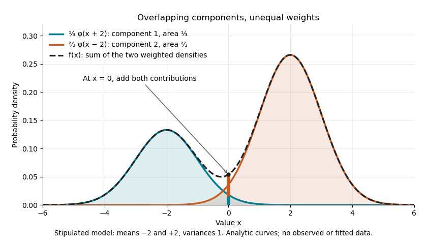
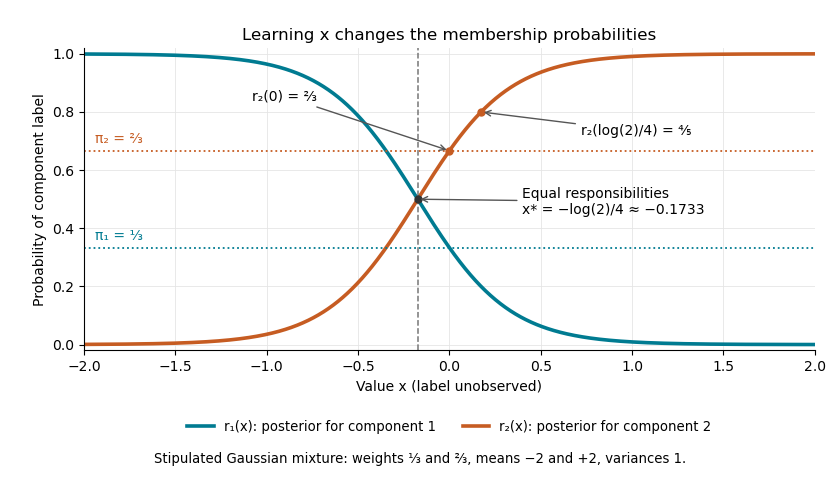
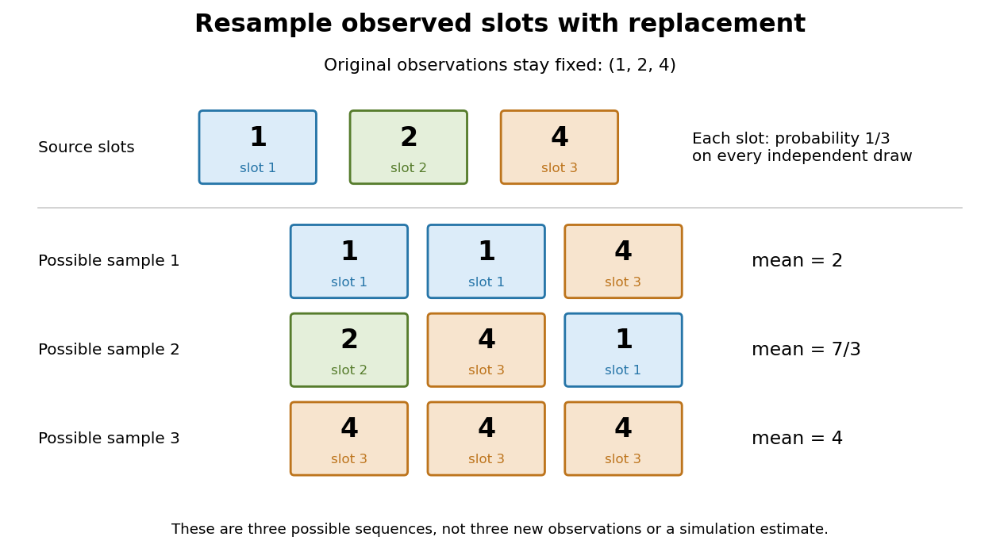

# Statistical modelling

↑ **Parent:** [Statistical model](statistical-model.md)

Statistical modelling constructs, fits, checks, and interprets a [statistical model](statistical-model.md) for observed data.

**Table of contents**

- [Data centering](#data-centering)
- [Regression analysis](#regression-analysis)
- [Mark and recapture](#mark-and-recapture)
  - [Capture-recapture model](#capture-recapture-model)
    - [Closed-population capture-recapture model](#closed-population-capture-recapture-model)
      - [Lincoln-Petersen estimator](#lincoln-petersen-estimator)
      - [Chapman estimator](#chapman-estimator)
    - [Missing-count EM for capture-recapture](#missing-count-em-for-capture-recapture)
- [Nonlinear regression](#nonlinear-regression)
- [Outlier](#outlier)
- [Regression to the mean](#regression-to-the-mean)
- [Response variable](#response-variable)
- [Scientific control](#scientific-control)
- [Design of experiments](design-of-experiments.md)
  - [Positive control](design-of-experiments.md#positive-control)
  - [Negative control](design-of-experiments.md#negative-control)
    - [Vehicle control](design-of-experiments.md#vehicle-control)
  - [Pair feeding](design-of-experiments.md#pair-feeding)
  - [Blinding](design-of-experiments.md#blinding)
  - [Sham treatment](design-of-experiments.md#sham-treatment)
  - [Construct validity](design-of-experiments.md#construct-validity)
  - [Ecological validity](design-of-experiments.md#ecological-validity)
  - [Before-after control-impact design](design-of-experiments.md#before-after-control-impact-design)
  - [Batch effect](design-of-experiments.md#batch-effect)
  - [Cross-fostering](design-of-experiments.md#cross-fostering)
  - [Optimal experimental design](design-of-experiments.md#optimal-experimental-design)
    - [General equivalence theorem for optimal design](design-of-experiments.md#general-equivalence-theorem-for-optimal-design)
    - [G-optimal design](design-of-experiments.md#g-optimal-design)
    - [D-optimal design](design-of-experiments.md#d-optimal-design)
    - [Approximate experimental design](design-of-experiments.md#approximate-experimental-design)
      - [Information matrix of an experimental design](design-of-experiments.md#information-matrix-of-an-experimental-design)
        - [Design sensitivity function](design-of-experiments.md#design-sensitivity-function)
  - [Latin square](design-of-experiments.md#latin-square)
    - [Analysis of variance for a Latin square](design-of-experiments.md#analysis-of-variance-for-a-latin-square)
    - [Mutually orthogonal Latin squares](design-of-experiments.md#mutually-orthogonal-latin-squares)
      - [Graeco-Latin square](design-of-experiments.md#graeco-latin-square)
  - [Contrast (statistics)](design-of-experiments.md#contrast-statistics)
  - [Response surface methodology](design-of-experiments.md#response-surface-methodology)
    - [Center-point curvature contrast](design-of-experiments.md#center-point-curvature-contrast)
    - [Steepest ascent in response surface methodology](design-of-experiments.md#steepest-ascent-in-response-surface-methodology)
    - [Coded experimental variable](design-of-experiments.md#coded-experimental-variable)
    - [Rotatable design](design-of-experiments.md#rotatable-design)
    - [Central composite design](design-of-experiments.md#central-composite-design)
  - [Split-plot design](design-of-experiments.md#split-plot-design)
  - [Factorial design](design-of-experiments.md#factorial-design)
    - [Main effect](design-of-experiments.md#main-effect)
    - [Factorial contrast](design-of-experiments.md#factorial-contrast)
    - [Fractional factorial design](design-of-experiments.md#fractional-factorial-design)
      - [Resolution of a fractional factorial design](design-of-experiments.md#resolution-of-a-fractional-factorial-design)
      - [Defining contrast subgroup](design-of-experiments.md#defining-contrast-subgroup)
        - [Aliasing in a fractional factorial design](design-of-experiments.md#aliasing-in-a-fractional-factorial-design)
  - [Crossover design](design-of-experiments.md#crossover-design)
    - [Carryover effect](design-of-experiments.md#carryover-effect)
  - [Completely randomized design](design-of-experiments.md#completely-randomized-design)
  - [Blocks in experimental design](design-of-experiments.md#blocks-in-experimental-design)
    - [Estimability from within-block differences](design-of-experiments.md#estimability-from-within-block-differences)
    - [Block confounding in a factorial design](design-of-experiments.md#block-confounding-in-a-factorial-design)
    - [Block design](design-of-experiments.md#block-design)
      - [Balanced incomplete block design](design-of-experiments.md#balanced-incomplete-block-design)
        - [Symmetric balanced incomplete block design](design-of-experiments.md#symmetric-balanced-incomplete-block-design)
          - [Even-order symmetric design square obstruction](design-of-experiments.md#even-order-symmetric-design-square-obstruction)
        - [Fisher's inequality for block designs](design-of-experiments.md#fisher-s-inequality-for-block-designs)
      - [Row-column design](design-of-experiments.md#row-column-design)
      - [Randomized complete block design](design-of-experiments.md#randomized-complete-block-design)
      - [Orthogonal block design](design-of-experiments.md#orthogonal-block-design)
  - [Replication in experimental design](design-of-experiments.md#replication-in-experimental-design)
    - [Replicate](design-of-experiments.md#replicate)
    - [Nested measurements](design-of-experiments.md#nested-measurements)
      - [Variance of nested measurements](design-of-experiments.md#variance-of-nested-measurements)
    - [Biological replicate](design-of-experiments.md#biological-replicate)
      - [Between-replicate variation](design-of-experiments.md#between-replicate-variation)
    - [Technical replicate](design-of-experiments.md#technical-replicate)
  - [Experimental unit](design-of-experiments.md#experimental-unit)
    - [Observational unit](design-of-experiments.md#observational-unit)
- [Fractional polynomial](#fractional-polynomial)
- [Restricted cubic spline](#restricted-cubic-spline)
- [Quantile regression](#quantile-regression)
  - [Conditional quantile identification](#conditional-quantile-identification)
  - [Check loss](#check-loss)
    - [Population quantiles minimize check loss](#population-quantiles-minimize-check-loss)
- [Observed heterogeneity](#observed-heterogeneity)
- [Pairwise comparison model](#pairwise-comparison-model)
  - [Bradley-Terry model](#bradley-terry-model)
    - [Bradley-Terry score equation](#bradley-terry-score-equation)
      - [Bradley-Terry maximum-likelihood estimate on a comparison tree](#bradley-terry-maximum-likelihood-estimate-on-a-comparison-tree)
        - [Bradley-Terry maximum-likelihood estimate on a path](#bradley-terry-maximum-likelihood-estimate-on-a-path)
        - [Edge log-ratios in a Bradley-Terry comparison tree](#edge-log-ratios-in-a-bradley-terry-comparison-tree)
      - [Three-player Bradley-Terry comparison cycle](#three-player-bradley-terry-comparison-cycle)
      - [Bradley-Terry likelihood Hessian](#bradley-terry-likelihood-hessian)
- [Fixed effect](#fixed-effect)
- [Geostatistics](#geostatistics)
  - [Kriging](#kriging)
    - [Universal kriging](#universal-kriging)
    - [Ordinary kriging](#ordinary-kriging)
    - [Simple kriging](#simple-kriging)
  - [Covariogram](#covariogram)
  - [Intrinsically stationary random field](#intrinsically-stationary-random-field)
    - [Semivariogram](#semivariogram)
      - [Empirical semivariogram](#empirical-semivariogram)
      - [Range of a semivariogram](#range-of-a-semivariogram)
        - [Practical range](#practical-range)
      - [Sill of a semivariogram](#sill-of-a-semivariogram)
      - [Nugget effect](#nugget-effect)
      - [A semivariogram does not determine stationarity](#a-semivariogram-does-not-determine-stationarity)
      - [Gaussian semivariogram](#gaussian-semivariogram)
- [Saturated statistical model](#saturated-statistical-model)
  - [Bernoulli saturated log-likelihood](#bernoulli-saturated-log-likelihood)
- [Hurdle model](#hurdle-model)
- [Zero inflation](#zero-inflation)
  - [Count-mixture structural zero](#count-mixture-structural-zero)
  - [Zero-inflated negative binomial model](#zero-inflated-negative-binomial-model)
    - [Shared zero-inflated Gamma-Poisson count model](#shared-zero-inflated-gamma-poisson-count-model)
      - [Mean-ratio preservation under a multiplicative random effect](#mean-ratio-preservation-under-a-multiplicative-random-effect)
    - [EM for zero-inflated negative binomial regression](#em-for-zero-inflated-negative-binomial-regression)
- [Estimator](#estimator)
  - [Method of moments (statistics)](#method-of-moments-statistics)
  - [U-statistic](#u-statistic)
    - [Influence function of a U-statistic](#influence-function-of-a-u-statistic)
    - [Kernel of a U-statistic](#kernel-of-a-u-statistic)
    - [Variance as a U-statistic](#variance-as-a-u-statistic)
    - [Symmetrization of a U-statistic kernel](#symmetrization-of-a-u-statistic-kernel)
    - [U-statistic central limit theorem](#u-statistic-central-limit-theorem)
      - [Hoeffding projection](#hoeffding-projection)
- [Categorical variable](#categorical-variable)
  - [Regression factor](#regression-factor)
  - [Ordinal categorical variable](#ordinal-categorical-variable)
  - [Indicator variable](#indicator-variable)
- [Latent variable](latent-variable.md)
  - [Unobserved heterogeneity](latent-variable.md#unobserved-heterogeneity)
  - [Factor analysis](latent-variable.md#factor-analysis)
    - [Latent factor](latent-variable.md#latent-factor)
    - [Orthogonal factor model](latent-variable.md#orthogonal-factor-model)
      - [Factor rotation](latent-variable.md#factor-rotation)
        - [Varimax rotation](latent-variable.md#varimax-rotation)
      - [Communality](latent-variable.md#communality)
      - [Factor loading](latent-variable.md#factor-loading)
    - [EM update for a single-factor Gaussian model](latent-variable.md#em-update-for-a-single-factor-gaussian-model)
  - [Random effect](latent-variable.md#random-effect)
    - [Poisson-lognormal random-effect model](latent-variable.md#poisson-lognormal-random-effect-model)
    - [Crossed random effects](latent-variable.md#crossed-random-effects)
    - [Random slope](latent-variable.md#random-slope)
      - [Between-person slope quantile](latent-variable.md#between-person-slope-quantile)
      - [Random-slope linear mixed model](latent-variable.md#random-slope-linear-mixed-model)
  - [Expectation-maximization algorithm](latent-variable.md#expectation-maximization-algorithm)
    - [EM expectation step](latent-variable.md#em-expectation-step)
    - [EM maximization step](latent-variable.md#em-maximization-step)
    - [Known-variance Gaussian mixture EM example](latent-variable.md#known-variance-gaussian-mixture-em-example)
      - [Identical-mean EM trap](latent-variable.md#identical-mean-em-trap)
    - [Ordered-rate exponential M-step](latent-variable.md#ordered-rate-exponential-m-step)
    - [EM for merged multinomial cells](latent-variable.md#em-for-merged-multinomial-cells)
    - [EM for an independent missing normal coordinate](latent-variable.md#em-for-an-independent-missing-normal-coordinate)
    - [EM transition-count update on a tree](latent-variable.md#em-transition-count-update-on-a-tree)
    - [EM for a missing observation in a Gaussian AR1 process](latent-variable.md#em-for-a-missing-observation-in-a-gaussian-ar1-process)
    - [EM likelihood monotonicity](latent-variable.md#em-likelihood-monotonicity)
- [Functional data analysis](#functional-data-analysis)
  - [Functional time warping](#functional-time-warping)
    - [Square-root velocity function](#square-root-velocity-function)
  - [Functional principal component analysis](#functional-principal-component-analysis)
    - [Principal component function](#principal-component-function)
    - [Functional principal component score](#functional-principal-component-score)
    - [Karhunen–Loève expansion](#karhunen-loeve-expansion)
      - [Brownian half-integer sine expansion](#brownian-half-integer-sine-expansion)
  - [Functional mean test](#functional-mean-test)
    - [FPCA mean test](#fpca-mean-test)
      - [Two-sample FPCA mean statistic](#two-sample-fpca-mean-statistic)
  - [Covariance-operator distance](#covariance-operator-distance)
    - [Hilbert-Schmidt distance between covariance operators](#hilbert-schmidt-distance-between-covariance-operators)
    - [Square-root distance between covariance operators](#square-root-distance-between-covariance-operators)
      - [Square-root barycenter of covariance operators](#square-root-barycenter-of-covariance-operators)
    - [Procrustes distance between covariance operators](#procrustes-distance-between-covariance-operators)
  - [Functional linear model](#functional-linear-model)
    - [Scalar-on-function linear model](#scalar-on-function-linear-model)
      - [Roughness penalty matrix](#roughness-penalty-matrix)
    - [Function-on-function linear model](#function-on-function-linear-model)
      - [Cross-covariance operator](#cross-covariance-operator)
- [Goodness of fit](#goodness-of-fit)
  - [Reduced chi-squared](#reduced-chi-squared)
  - [Goodness-of-fit test](#goodness-of-fit-test)
- [Contingency table](#contingency-table)
  - [Two-by-two contingency table](#two-by-two-contingency-table)
- [Mixture model](#mixture-model)
  - [Threshold inference for a mixture proportion](#threshold-inference-for-a-mixture-proportion)
  - [Gaussian scale mixture](#gaussian-scale-mixture)
    - [Rayleigh-normal scale mixture](#rayleigh-normal-scale-mixture)
  - [Finite mixture model](#finite-mixture-model)
    - [Mixture component](#mixture-component)
    - [Mixture allocation indicator](#mixture-allocation-indicator)
    - [Two-Gaussian mixture example](#two-gaussian-mixture-example)
    - [Observed and latent mixture labels](#observed-and-latent-mixture-labels)
    - [Mixture identifiability](#mixture-identifiability)
    - [Label switching](#label-switching)
    - [Gaussian mixture Gibbs updates with independent priors](#gaussian-mixture-gibbs-updates-with-independent-priors)
    - [Mixture responsibility](#mixture-responsibility)
      - [Responsibility curve for a two-Gaussian mixture](#responsibility-curve-for-a-two-gaussian-mixture)
    - [Finite Gaussian mixture with a common variance](#finite-gaussian-mixture-with-a-common-variance)
      - [Mixture regression with shared slopes](#mixture-regression-with-shared-slopes)
      - [Residual mixture clustering](#residual-mixture-clustering)
        - [Two-stage residual mixture fitting](#two-stage-residual-mixture-fitting)
      - [EM for Gaussian mixtures with a common variance](#em-for-gaussian-mixtures-with-a-common-variance)
    - [Mixture weight](#mixture-weight)
  - [Dirichlet process mixture model](#dirichlet-process-mixture-model)
- [Latent-variable model](#latent-variable-model)
- [Statistical learning](statistical-learning.md)
  - [Feature interaction](statistical-learning.md#feature-interaction)
  - [Multilabel classification](statistical-learning.md#multilabel-classification)
  - [Multiclass classification](statistical-learning.md#multiclass-classification)
  - [One-hot encoding](statistical-learning.md#one-hot-encoding)
  - [scGen](statistical-learning.md#scgen)
  - [Supervised learning](statistical-learning.md#supervised-learning)
  - [Generalization in statistical learning](statistical-learning.md#generalization-in-statistical-learning)
  - [Unsupervised learning](statistical-learning.md#unsupervised-learning)
    - [Multidimensional scaling](statistical-learning.md#multidimensional-scaling)
      - [Classical multidimensional scaling](statistical-learning.md#classical-multidimensional-scaling)
        - [Euclidean distance matrix criterion](statistical-learning.md#euclidean-distance-matrix-criterion)
    - [Sparse coding](statistical-learning.md#sparse-coding)
    - [Hebbian learning](statistical-learning.md#hebbian-learning)
      - [Quartic norm stabilization of Hebbian learning](statistical-learning.md#quartic-norm-stabilization-of-hebbian-learning)
      - [Oja's rule](statistical-learning.md#oja-s-rule)
        - [Stability and normalization of averaged Oja learning](statistical-learning.md#stability-and-normalization-of-averaged-oja-learning)
  - [Cluster analysis](statistical-learning.md#cluster-analysis)
    - [Cluster in cluster analysis](statistical-learning.md#cluster-in-cluster-analysis)
    - [K-means clustering](statistical-learning.md#k-means-clustering)
      - [Nearest-centroid decision hyperplane](statistical-learning.md#nearest-centroid-decision-hyperplane)
      - [Centroid sum-of-squares identity](statistical-learning.md#centroid-sum-of-squares-identity)
    - [Jaccard index](statistical-learning.md#jaccard-index)
      - [Jaccard distance](statistical-learning.md#jaccard-distance)
    - [Dissimilarity matrix](statistical-learning.md#dissimilarity-matrix)
    - [Simple matching coefficient](statistical-learning.md#simple-matching-coefficient)
      - [Metric property of simple matching dissimilarity](statistical-learning.md#metric-property-of-simple-matching-dissimilarity)
    - [Agglomerative hierarchical clustering](statistical-learning.md#agglomerative-hierarchical-clustering)
      - [Ward minimum-variance clustering](statistical-learning.md#ward-minimum-variance-clustering)
      - [Average-linkage clustering](statistical-learning.md#average-linkage-clustering)
      - [Agglomerative clustering of nonmetric dissimilarities](statistical-learning.md#agglomerative-clustering-of-nonmetric-dissimilarities)
      - [Dendrogram](statistical-learning.md#dendrogram)
      - [Complete-linkage clustering](statistical-learning.md#complete-linkage-clustering)
      - [Single-linkage clustering](statistical-learning.md#single-linkage-clustering)
  - [Validation set](statistical-learning.md#validation-set)
    - [Test set](statistical-learning.md#test-set)
  - [Prediction error](statistical-learning.md#prediction-error)
    - [Test error](statistical-learning.md#test-error)
    - [Mean squared prediction error](statistical-learning.md#mean-squared-prediction-error)
  - [Training error](statistical-learning.md#training-error)
    - [Prediction optimism](statistical-learning.md#prediction-optimism)
      - [Covariance formula for prediction optimism](statistical-learning.md#covariance-formula-for-prediction-optimism)
  - [Data leakage](statistical-learning.md#data-leakage)
  - [Dataset shift](statistical-learning.md#dataset-shift)
  - [Regression function](statistical-learning.md#regression-function)
  - [Principal component analysis](statistical-learning.md#principal-component-analysis)
    - [Principal component regression](statistical-learning.md#principal-component-regression)
    - [Scree plot](statistical-learning.md#scree-plot)
    - [Principal component loading](statistical-learning.md#principal-component-loading)
    - [Principal component](statistical-learning.md#principal-component)
      - [Principal component score](statistical-learning.md#principal-component-score)
    - [Explained variance of a principal component](statistical-learning.md#explained-variance-of-a-principal-component)
    - [Principal component analysis on a correlation matrix](statistical-learning.md#principal-component-analysis-on-a-correlation-matrix)
    - [Population principal component](statistical-learning.md#population-principal-component)
    - [Sample principal component](statistical-learning.md#sample-principal-component)
      - [Normalized sample principal component](statistical-learning.md#normalized-sample-principal-component)
  - [Classification in statistical learning](statistical-learning.md#classification-in-statistical-learning)
    - [Classification accuracy](statistical-learning.md#classification-accuracy)
    - [Misclassification rate](statistical-learning.md#misclassification-rate)
    - [Classification tree](statistical-learning.md#classification-tree)
      - [Cost-complexity tree pruning](statistical-learning.md#cost-complexity-tree-pruning)
      - [Classification-tree deviance](statistical-learning.md#classification-tree-deviance)
    - [Binary classification](statistical-learning.md#binary-classification)
      - [Precision and recall](statistical-learning.md#precision-and-recall)
        - [Precision-recall curve](statistical-learning.md#precision-recall-curve)
        - [Recall (classification)](statistical-learning.md#recall-classification)
        - [Precision (classification)](statistical-learning.md#precision-classification)
      - [Receiver operating characteristic](statistical-learning.md#receiver-operating-characteristic)
        - [Area under the ROC curve](statistical-learning.md#area-under-the-roc-curve)
      - [Linear separability](statistical-learning.md#linear-separability)
      - [Diagnostic specificity](statistical-learning.md#diagnostic-specificity)
      - [Diagnostic sensitivity](statistical-learning.md#diagnostic-sensitivity)
      - [False positive rate](statistical-learning.md#false-positive-rate)
    - [Decision boundary](statistical-learning.md#decision-boundary)
      - [Bayes decision boundary](statistical-learning.md#bayes-decision-boundary)
    - [Majority vote](statistical-learning.md#majority-vote)
    - [Confusion matrix](statistical-learning.md#confusion-matrix)
    - [Classification and regression tree](statistical-learning.md#classification-and-regression-tree)
      - [Recursive partitioning](statistical-learning.md#recursive-partitioning)
        - [Surrogate split](statistical-learning.md#surrogate-split)
      - [Gini impurity](statistical-learning.md#gini-impurity)
      - [Random forest](statistical-learning.md#random-forest)
        - [Out-of-bag error](statistical-learning.md#out-of-bag-error)
    - [Conditional class probability](statistical-learning.md#conditional-class-probability)
    - [Risk consistency](statistical-learning.md#risk-consistency)
    - [K-nearest neighbors algorithm](statistical-learning.md#k-nearest-neighbors-algorithm)
      - [Bias and variance of a three-neighbour weighted smoother](statistical-learning.md#bias-and-variance-of-a-three-neighbour-weighted-smoother)
      - [One-nearest-neighbour classifier](statistical-learning.md#one-nearest-neighbour-classifier)
        - [One-nearest-neighbour asymptotic risk](statistical-learning.md#one-nearest-neighbour-asymptotic-risk)
          - [Bayes risk bound for one-nearest-neighbour classification](statistical-learning.md#bayes-risk-bound-for-one-nearest-neighbour-classification)
      - [Feature-measurable nearest-neighbour tie-breaking](statistical-learning.md#feature-measurable-nearest-neighbour-tie-breaking)
      - [L-nearest-neighbour classifier](statistical-learning.md#l-nearest-neighbour-classifier)
        - [One-nearest-neighbour classification](statistical-learning.md#one-nearest-neighbour-classification)
    - [Plug-in classifier excess-risk bound](statistical-learning.md#plug-in-classifier-excess-risk-bound)
    - [Support vector machine](statistical-learning.md#support-vector-machine)
      - [Kernel support vector machine](statistical-learning.md#kernel-support-vector-machine)
      - [Soft-margin support vector machine](statistical-learning.md#soft-margin-support-vector-machine)
        - [Kernel support-vector coefficient from hinge activity](statistical-learning.md#kernel-support-vector-coefficient-from-hinge-activity)
        - [Support-vector leave-one-out error bound](statistical-learning.md#support-vector-leave-one-out-error-bound)
        - [Dual support vectors and margin degeneracy](statistical-learning.md#dual-support-vectors-and-margin-degeneracy)
      - [Separating hyperplane](statistical-learning.md#separating-hyperplane)
      - [Slack variables of a support vector machine](statistical-learning.md#slack-variables-of-a-support-vector-machine)
      - [Support-vector-machine decision boundary](statistical-learning.md#support-vector-machine-decision-boundary)
      - [Support-vector-machine margin](statistical-learning.md#support-vector-machine-margin)
        - [Support-vector-machine margin boundaries](statistical-learning.md#support-vector-machine-margin-boundaries)
      - [Support vector](statistical-learning.md#support-vector)
    - [Perceptron](statistical-learning.md#perceptron)
  - [Cross-validation](statistical-learning.md#cross-validation)
    - [Nested cross-validation](statistical-learning.md#nested-cross-validation)
    - [Biased cross-validation for density bandwidth](statistical-learning.md#biased-cross-validation-for-density-bandwidth)
    - [Least-squares cross-validation for density bandwidth](statistical-learning.md#least-squares-cross-validation-for-density-bandwidth)
    - [Generalized cross-validation](statistical-learning.md#generalized-cross-validation)
    - [Leave-one-out cross-validation](statistical-learning.md#leave-one-out-cross-validation)
      - [Leave-one-out residual identity for a linear smoother](statistical-learning.md#leave-one-out-residual-identity-for-a-linear-smoother)
    - [K-fold cross-validation](statistical-learning.md#k-fold-cross-validation)
  - [Neural network](statistical-learning.md#neural-network)
    - [Neural network bias](statistical-learning.md#neural-network-bias)
    - [Weight sharing](statistical-learning.md#weight-sharing)
    - [Convolutional neural network](statistical-learning.md#convolutional-neural-network)
      - [Pooling layer](statistical-learning.md#pooling-layer)
    - [Binary threshold unit](statistical-learning.md#binary-threshold-unit)
    - [Activation function](statistical-learning.md#activation-function)
    - [Associative memory in neural networks](statistical-learning.md#associative-memory-in-neural-networks)
    - [Hopfield network](statistical-learning.md#hopfield-network)
      - [Asynchronous Hopfield energy descent](statistical-learning.md#asynchronous-hopfield-energy-descent)
      - [Hebbian memory weights for a Hopfield network](statistical-learning.md#hebbian-memory-weights-for-a-hopfield-network)
        - [Hopfield recall from a corrupted cue](statistical-learning.md#hopfield-recall-from-a-corrupted-cue)
    - [Boltzmann machine](statistical-learning.md#boltzmann-machine)
      - [Positive and negative phases of Boltzmann learning](statistical-learning.md#positive-and-negative-phases-of-boltzmann-learning)
        - [Visible unit](statistical-learning.md#visible-unit)
      - [Two-spin Boltzmann learning](statistical-learning.md#two-spin-boltzmann-learning)
      - [Boltzmann encoder demonstration](statistical-learning.md#boltzmann-encoder-demonstration)
    - [Feedforward neural network](statistical-learning.md#feedforward-neural-network)
      - [Multilayer perceptron](statistical-learning.md#multilayer-perceptron)
      - [Four-input parity network](statistical-learning.md#four-input-parity-network)
      - [Hidden unit](statistical-learning.md#hidden-unit)
      - [Backpropagation](statistical-learning.md#backpropagation)
        - [Squared-error backpropagation](statistical-learning.md#squared-error-backpropagation)
        - [Sigmoid-softmax network gradients](statistical-learning.md#sigmoid-softmax-network-gradients)
    - [Sigmoid function](statistical-learning.md#sigmoid-function)
      - [Logistic function](statistical-learning.md#logistic-function)
    - [Rectified linear unit](statistical-learning.md#rectified-linear-unit)
    - [Gaussian error linear unit](statistical-learning.md#gaussian-error-linear-unit)
    - [Softmax function](statistical-learning.md#softmax-function)
      - [Softmax non-identifiability](statistical-learning.md#softmax-non-identifiability)
      - [Categorical cross-entropy loss](statistical-learning.md#categorical-cross-entropy-loss)
  - [Overfitting](statistical-learning.md#overfitting)
    - [Underfitting](statistical-learning.md#underfitting)
  - [Regularization](statistical-learning.md#regularization)
    - [Penalized least squares](statistical-learning.md#penalized-least-squares)
      - [Penalized least-squares estimator](statistical-learning.md#penalized-least-squares-estimator)
        - [Basic inequality for a penalized least-squares estimator](statistical-learning.md#basic-inequality-for-a-penalized-least-squares-estimator)
    - [Roughness penalty](statistical-learning.md#roughness-penalty)
    - [Early stopping](statistical-learning.md#early-stopping)
- [Sampling distribution](#sampling-distribution)
- [Unbiased estimator](#unbiased-estimator)
  - [Unbiased endpoint estimator for a shifted exponential sample](#unbiased-endpoint-estimator-for-a-shifted-exponential-sample)
  - [Uniformly minimum-variance unbiased estimator](#uniformly-minimum-variance-unbiased-estimator)
  - [Conditionally unbiased estimator](#conditionally-unbiased-estimator)
    - [Uniform minimum variance conditionally unbiased estimator](#uniform-minimum-variance-conditionally-unbiased-estimator)
  - [Linear unbiased estimator](#linear-unbiased-estimator)
    - [Best linear unbiased estimator](#best-linear-unbiased-estimator)
    - [Correlated Gaussian common-mean estimator](#correlated-gaussian-common-mean-estimator)
    - [Inverse-variance weighted mean](#inverse-variance-weighted-mean)
      - [Inverse-variance weight](#inverse-variance-weight)
- [Bias of an estimator](#bias-of-an-estimator)
- [Variance of an estimator](#variance-of-an-estimator)
  - [Asymptotic variance](#asymptotic-variance)
  - [Bias-variance tradeoff](#bias-variance-tradeoff)
- [Homoskedasticity](#homoskedasticity)
- [Homoscedasticity and heteroscedasticity](#homoscedasticity-and-heteroscedasticity)
  - [Heteroscedastic](#heteroscedastic)
- [Logarithmic transformation](#logarithmic-transformation)
  - [Gaussian log-response model](#gaussian-log-response-model)
  - [Retransformation bias](#retransformation-bias)
- [Power transform](#power-transform)
  - [Box–Cox transformation](#box-cox-transformation)
    - [Bias correction after an inverse transformation](#bias-correction-after-an-inverse-transformation)
- [Residual degrees of freedom](#residual-degrees-of-freedom)
- [Model selection](#model-selection)
  - [Deviance information criterion](#deviance-information-criterion)
    - [Effective parameter count in DIC](#effective-parameter-count-in-dic)
      - [Quadratic posterior deviance moments](#quadratic-posterior-deviance-moments)
  - [Variable selection](#variable-selection)
  - [Nonregular mixture model selection](#nonregular-mixture-model-selection)
  - [Akaike information criterion](#akaike-information-criterion)
    - [Corrected Akaike information criterion](#corrected-akaike-information-criterion)
    - [Stepwise selection by the Akaike information criterion](#stepwise-selection-by-the-akaike-information-criterion)
      - [AIC deletion threshold in a normal linear model](#aic-deletion-threshold-in-a-normal-linear-model)
    - [Distribution of the Akaike information criterion in a normal linear model](#distribution-of-the-akaike-information-criterion-in-a-normal-linear-model)
    - [Mallows's Cp](#mallows-s-cp)
      - [Bias-variance decomposition for linear prediction](#bias-variance-decomposition-for-linear-prediction)
      - [Unbiased prediction-error identity for ordinary least squares](#unbiased-prediction-error-identity-for-ordinary-least-squares)
  - [Bayesian information criterion](#bayesian-information-criterion)
- [Shape parameter](#shape-parameter)
- [Precision parameter](#precision-parameter)
- [Exponential family](exponential-family.md)
  - [Curved exponential family](exponential-family.md#curved-exponential-family)
    - [Conditional scale density in a curved Gaussian family](exponential-family.md#conditional-scale-density-in-a-curved-gaussian-family)
  - [Minimal exponential family](exponential-family.md#minimal-exponential-family)
  - [Natural exponential family](exponential-family.md#natural-exponential-family)
    - [Convex support of an exponential family](exponential-family.md#convex-support-of-an-exponential-family)
    - [Regular natural exponential family](exponential-family.md#regular-natural-exponential-family)
    - [Full natural exponential family](exponential-family.md#full-natural-exponential-family)
      - [Maximum likelihood existence in a full regular natural exponential family](exponential-family.md#maximum-likelihood-existence-in-a-full-regular-natural-exponential-family)
  - [Normal natural-mean parameter ratio estimator](exponential-family.md#normal-natural-mean-parameter-ratio-estimator)
  - [Log-density domination in an exponential family](exponential-family.md#log-density-domination-in-an-exponential-family)
  - [Conjugate prior](exponential-family.md#conjugate-prior)
    - [Normal-gamma distribution](exponential-family.md#normal-gamma-distribution)
    - [Gamma rate gamma conjugacy](exponential-family.md#gamma-rate-gamma-conjugacy)
    - [Uniform-Pareto conjugacy](exponential-family.md#uniform-pareto-conjugacy)
      - [Uniform-Pareto model evidence](exponential-family.md#uniform-pareto-model-evidence)
    - [Gamma scale inverse-gamma conjugacy](exponential-family.md#gamma-scale-inverse-gamma-conjugacy)
      - [Exact Bühlmann credibility for gamma claims](exponential-family.md#exact-buhlmann-credibility-for-gamma-claims)
    - [Normal-inverse-gamma prior](exponential-family.md#normal-inverse-gamma-prior)
    - [Natural conjugate prior](exponential-family.md#natural-conjugate-prior)
      - [Natural conjugate credibility identity](exponential-family.md#natural-conjugate-credibility-identity)
        - [Endpoint control for a Laplace-family conjugate posterior](exponential-family.md#endpoint-control-for-a-laplace-family-conjugate-posterior)
  - [Natural parameter of an exponential family](exponential-family.md#natural-parameter-of-an-exponential-family)
    - [Natural parameter space](exponential-family.md#natural-parameter-space)
  - [Cumulant function of an exponential family](exponential-family.md#cumulant-function-of-an-exponential-family)
    - [Exponential-family derivative identities](exponential-family.md#exponential-family-derivative-identities)
    - [Mean parameter of an exponential family](exponential-family.md#mean-parameter-of-an-exponential-family)
      - [Interior moment matching in a finite exponential family](exponential-family.md#interior-moment-matching-in-a-finite-exponential-family)
  - [Inverse Gaussian distribution](exponential-family.md#inverse-gaussian-distribution)
    - [Inverse Gaussian shape estimation and nuisance orthogonality](exponential-family.md#inverse-gaussian-shape-estimation-and-nuisance-orthogonality)
    - [Inverse Gaussian sum closure](exponential-family.md#inverse-gaussian-sum-closure)
      - [Exact saddlepoint density of an inverse Gaussian sum](exponential-family.md#exact-saddlepoint-density-of-an-inverse-gaussian-sum)
    - [Chi-squared transform of an inverse Gaussian variable](exponential-family.md#chi-squared-transform-of-an-inverse-gaussian-variable)
    - [Reciprocal-root inverse Gaussian sampler](exponential-family.md#reciprocal-root-inverse-gaussian-sampler)
      - [Stable root evaluation for inverse Gaussian sampling](exponential-family.md#stable-root-evaluation-for-inverse-gaussian-sampling)
  - [Exponential-family deviance](exponential-family.md#exponential-family-deviance)
    - [Scaled deviance](exponential-family.md#scaled-deviance)
  - [Negative binomial exponential family](exponential-family.md#negative-binomial-exponential-family)
  - [Exponential dispersion model](exponential-family.md#exponential-dispersion-model)
    - [Exponential dispersion family of order one](exponential-family.md#exponential-dispersion-family-of-order-one)
    - [Dispersion parameter](exponential-family.md#dispersion-parameter)
      - [Underdispersion](exponential-family.md#underdispersion)
      - [Overdispersion](exponential-family.md#overdispersion)
    - [Variance function](exponential-family.md#variance-function)
- [Generalized linear model](generalized-linear-model.md)
  - [Gamma regression with canonical link](generalized-linear-model.md#gamma-regression-with-canonical-link)
  - [Generalized linear model offset](generalized-linear-model.md#generalized-linear-model-offset)
  - [Deviance goodness-of-fit test](generalized-linear-model.md#deviance-goodness-of-fit-test)
    - [Individual Bernoulli deviance need not have a chi-squared calibration](generalized-linear-model.md#individual-bernoulli-deviance-need-not-have-a-chi-squared-calibration)
  - [Deviance residual](generalized-linear-model.md#deviance-residual)
  - [Generalized additive model](generalized-linear-model.md#generalized-additive-model)
    - [Additive regression model](generalized-linear-model.md#additive-regression-model)
      - [Identifiability of additive regression components](generalized-linear-model.md#identifiability-of-additive-regression-components)
        - [Concurvity](generalized-linear-model.md#concurvity)
    - [Backfitting algorithm](generalized-linear-model.md#backfitting-algorithm)
      - [Linear backfitting equations](generalized-linear-model.md#linear-backfitting-equations)
    - [Generalized additive mixed model](generalized-linear-model.md#generalized-additive-mixed-model)
  - [Quasi-likelihood](generalized-linear-model.md#quasi-likelihood)
    - [Quasibinomial regression](generalized-linear-model.md#quasibinomial-regression)
  - [Linear predictor](generalized-linear-model.md#linear-predictor)
  - [Link function](generalized-linear-model.md#link-function)
    - [Complementary log-log link](generalized-linear-model.md#complementary-log-log-link)
    - [Identity link](generalized-linear-model.md#identity-link)
    - [Logit](generalized-linear-model.md#logit)
    - [Logarithmic link function](generalized-linear-model.md#logarithmic-link-function)
  - [Binomial regression](generalized-linear-model.md#binomial-regression)
    - [Binomial deviance](generalized-linear-model.md#binomial-deviance)
  - [Pearson dispersion estimator](generalized-linear-model.md#pearson-dispersion-estimator)
    - [Pearson residual](generalized-linear-model.md#pearson-residual)
    - [Pearson chi-squared statistic](generalized-linear-model.md#pearson-chi-squared-statistic)
  - [Canonical link function](generalized-linear-model.md#canonical-link-function)
    - [Poisson canonical link](generalized-linear-model.md#poisson-canonical-link)
  - [Poisson regression](generalized-linear-model.md#poisson-regression)
    - [Profile likelihood for a common Poisson rate ratio with unequal exposures](generalized-linear-model.md#profile-likelihood-for-a-common-poisson-rate-ratio-with-unequal-exposures)
    - [Concavity of the Poisson regression likelihood](generalized-linear-model.md#concavity-of-the-poisson-regression-likelihood)
    - [Poisson slope information after eliminating an intercept](generalized-linear-model.md#poisson-slope-information-after-eliminating-an-intercept)
    - [Poisson regression margin-matching score equations](generalized-linear-model.md#poisson-regression-margin-matching-score-equations)
    - [Two-group Poisson ratio conditional likelihood](generalized-linear-model.md#two-group-poisson-ratio-conditional-likelihood)
      - [Paired Poisson conditional likelihood](generalized-linear-model.md#paired-poisson-conditional-likelihood)
        - [Conditional cure-weight equations for paired Poisson counts](generalized-linear-model.md#conditional-cure-weight-equations-for-paired-poisson-counts)
    - [Common versus factor-specific slopes in Poisson regression](generalized-linear-model.md#common-versus-factor-specific-slopes-in-poisson-regression)
    - [Poisson working models for averaged counts](generalized-linear-model.md#poisson-working-models-for-averaged-counts)
    - [Poisson log-rate ratio](generalized-linear-model.md#poisson-log-rate-ratio)
    - [Poisson mean saturation at three distinct times](generalized-linear-model.md#poisson-mean-saturation-at-three-distinct-times)
    - [Pooling selected slopes in a Poisson regression](generalized-linear-model.md#pooling-selected-slopes-in-a-poisson-regression)
    - [Treatment interaction contrast in a Poisson regression](generalized-linear-model.md#treatment-interaction-contrast-in-a-poisson-regression)
    - [Poisson deviance](generalized-linear-model.md#poisson-deviance)
      - [Quadratic Pearson approximation to the Poisson deviance](generalized-linear-model.md#quadratic-pearson-approximation-to-the-poisson-deviance)
      - [Poisson deviance simplifies when an intercept is fitted](generalized-linear-model.md#poisson-deviance-simplifies-when-an-intercept-is-fitted)
  - [Gamma regression with logarithmic link](generalized-linear-model.md#gamma-regression-with-logarithmic-link)
  - [Quasi-Poisson regression](generalized-linear-model.md#quasi-poisson-regression)
    - [Poisson score linearization under proportional variance](generalized-linear-model.md#poisson-score-linearization-under-proportional-variance)
    - [Quasi-score equation](generalized-linear-model.md#quasi-score-equation)
  - [Negative binomial regression](generalized-linear-model.md#negative-binomial-regression)
    - [Fixed-size negative binomial generalized linear model](generalized-linear-model.md#fixed-size-negative-binomial-generalized-linear-model)
      - [Negative binomial deviance](generalized-linear-model.md#negative-binomial-deviance)
  - [Poisson exposure model](generalized-linear-model.md#poisson-exposure-model)
    - [Exposure time for a Poisson rate at fixed fractional precision](generalized-linear-model.md#exposure-time-for-a-poisson-rate-at-fixed-fractional-precision)
    - [Rate ratio](generalized-linear-model.md#rate-ratio)
    - [Finite-exposure Poisson inconsistency](generalized-linear-model.md#finite-exposure-poisson-inconsistency)
    - [Estimators for a Poisson exposure model](generalized-linear-model.md#estimators-for-a-poisson-exposure-model)
      - [Variance comparison for Poisson exposure estimators](generalized-linear-model.md#variance-comparison-for-poisson-exposure-estimators)
    - [Normal-approximation tests for a Poisson exposure model](generalized-linear-model.md#normal-approximation-tests-for-a-poisson-exposure-model)
  - [Logistic regression](generalized-linear-model.md#logistic-regression)
    - [Proportional-odds model](generalized-linear-model.md#proportional-odds-model)
    - [Separation in logistic regression](generalized-linear-model.md#separation-in-logistic-regression)
    - [Finite maximum-likelihood estimate in a one-parameter logistic model](generalized-linear-model.md#finite-maximum-likelihood-estimate-in-a-one-parameter-logistic-model)
    - [Conditional logistic model for longitudinal binary data](generalized-linear-model.md#conditional-logistic-model-for-longitudinal-binary-data)
      - [Cumulative-response logistic model](generalized-linear-model.md#cumulative-response-logistic-model)
      - [True state dependence](generalized-linear-model.md#true-state-dependence)
    - [Multinomial logistic regression](generalized-linear-model.md#multinomial-logistic-regression)
      - [Continuation-ratio logits](generalized-linear-model.md#continuation-ratio-logits)
      - [Conditional multinomial sufficient statistics](generalized-linear-model.md#conditional-multinomial-sufficient-statistics)
    - [Logistic-normal regression with autoregressive random effects](generalized-linear-model.md#logistic-normal-regression-with-autoregressive-random-effects)
    - [Logistic model](generalized-linear-model.md#logistic-model)
      - [Log odds](generalized-linear-model.md#log-odds)
    - [Separation (statistics)](generalized-linear-model.md#separation-statistics)
      - [Quasi-complete separation](generalized-linear-model.md#quasi-complete-separation)
      - [Complete separation](generalized-linear-model.md#complete-separation)
    - [Bernoulli logistic-regression model](generalized-linear-model.md#bernoulli-logistic-regression-model)
      - [Fitted-mean balance for logistic regression with an intercept](generalized-linear-model.md#fitted-mean-balance-for-logistic-regression-with-an-intercept)
    - [Logistic loss](generalized-linear-model.md#logistic-loss)
      - [Positive semidefinite quadratic-form classifier](generalized-linear-model.md#positive-semidefinite-quadratic-form-classifier)
    - [L1-penalized logistic regression](generalized-linear-model.md#l1-penalized-logistic-regression)
    - [Grouped-binomial logistic regression](generalized-linear-model.md#grouped-binomial-logistic-regression)
      - [Baseline logit estimator in a group-factor binomial model](generalized-linear-model.md#baseline-logit-estimator-in-a-group-factor-binomial-model)
      - [Denominators in grouped birth-outcome models](generalized-linear-model.md#denominators-in-grouped-birth-outcome-models)
    - [Reference level in a regression factor](generalized-linear-model.md#reference-level-in-a-regression-factor)
    - [Stochastic block model](generalized-linear-model.md#stochastic-block-model)
      - [Spectral norm bound for a centered Bernoulli adjacency matrix](generalized-linear-model.md#spectral-norm-bound-for-a-centered-bernoulli-adjacency-matrix)
      - [Logistic stochastic block model](generalized-linear-model.md#logistic-stochastic-block-model)
        - [Additive class-effect logistic network model](generalized-linear-model.md#additive-class-effect-logistic-network-model)
          - [Degree-sum sufficient statistic for an additive logistic network model](generalized-linear-model.md#degree-sum-sufficient-statistic-for-an-additive-logistic-network-model)
  - [Probit model](generalized-linear-model.md#probit-model)
    - [Latent-normal Gibbs sampler for probit regression](generalized-linear-model.md#latent-normal-gibbs-sampler-for-probit-regression)
    - [Threshold observation of a lognormal regression](generalized-linear-model.md#threshold-observation-of-a-lognormal-regression)
    - [Probit posterior score](generalized-linear-model.md#probit-posterior-score)
  - [Iteratively reweighted least squares](generalized-linear-model.md#iteratively-reweighted-least-squares)
  - [Generalized linear mixed model](generalized-linear-model.md#generalized-linear-mixed-model)
    - [Logistic random-intercept model for repeated binary outcomes](generalized-linear-model.md#logistic-random-intercept-model-for-repeated-binary-outcomes)
      - [Random-intercept attenuation of marginal logistic slopes](generalized-linear-model.md#random-intercept-attenuation-of-marginal-logistic-slopes)
    - [Gaussian linear mixed model](generalized-linear-model.md#gaussian-linear-mixed-model)
      - [Correlated random-intercept and random-slope model](generalized-linear-model.md#correlated-random-intercept-and-random-slope-model)
      - [Variance component](generalized-linear-model.md#variance-component)
        - [Method-of-moments variance component estimate](generalized-linear-model.md#method-of-moments-variance-component-estimate)
      - [Best linear unbiased prediction](generalized-linear-model.md#best-linear-unbiased-prediction)
      - [Conditional mode of Gaussian random effects](generalized-linear-model.md#conditional-mode-of-gaussian-random-effects)
      - [Continuous-time autoregressive residual correlation](generalized-linear-model.md#continuous-time-autoregressive-residual-correlation)
      - [Independent random-intercept and random-slope model](generalized-linear-model.md#independent-random-intercept-and-random-slope-model)
    - [Poisson generalized linear mixed model](generalized-linear-model.md#poisson-generalized-linear-mixed-model)
      - [Gamma random-intercept Poisson model](generalized-linear-model.md#gamma-random-intercept-poisson-model)
        - [Scale identifiability in a gamma random-intercept Poisson model](generalized-linear-model.md#scale-identifiability-in-a-gamma-random-intercept-poisson-model)
      - [Marginal mean of a Poisson random-slope model](generalized-linear-model.md#marginal-mean-of-a-poisson-random-slope-model)
    - [Random intercept](generalized-linear-model.md#random-intercept)
      - [Marginal and conditional slopes agree for an independent log-link random intercept](generalized-linear-model.md#marginal-and-conditional-slopes-agree-for-an-independent-log-link-random-intercept)
      - [Random-intercept linear mixed model](generalized-linear-model.md#random-intercept-linear-mixed-model)
- [Clustered data](#clustered-data)
  - [Pseudoreplication](#pseudoreplication)
- [Independent Poisson conditioning](#independent-poisson-conditioning)
- [Normal linear model](normal-linear-model.md)
  - [Variance of a fitted regression mean](normal-linear-model.md#variance-of-a-fitted-regression-mean)
  - [Analysis of covariance](normal-linear-model.md#analysis-of-covariance)
  - [Normal linear model maximum-likelihood sampling distributions](normal-linear-model.md#normal-linear-model-maximum-likelihood-sampling-distributions)
  - [Lack of fit](normal-linear-model.md#lack-of-fit)
    - [Lack-of-fit F-test](normal-linear-model.md#lack-of-fit-f-test)
  - [Pure error](normal-linear-model.md#pure-error)
  - [Two-factor normal linear model](normal-linear-model.md#two-factor-normal-linear-model)
    - [Factor-level pooling test](normal-linear-model.md#factor-level-pooling-test)
  - [Joint distribution of least-squares and variance estimators](normal-linear-model.md#joint-distribution-of-least-squares-and-variance-estimators)
  - [Restricted maximum likelihood](normal-linear-model.md#restricted-maximum-likelihood)
    - [Restricted likelihood from orthogonal error contrasts](normal-linear-model.md#restricted-likelihood-from-orthogonal-error-contrasts)
  - [Gaussian conjugacy for a normal linear model](normal-linear-model.md#gaussian-conjugacy-for-a-normal-linear-model)
    - [Gaussian conjugacy for an initialized AR(2) regression](normal-linear-model.md#gaussian-conjugacy-for-an-initialized-ar-2-regression)
    - [Normal-gamma posterior with a flat prior](normal-linear-model.md#normal-gamma-posterior-with-a-flat-prior)
    - [Gaussian posterior in the zero-noise limit](normal-linear-model.md#gaussian-posterior-in-the-zero-noise-limit)
    - [Gaussian likelihood](normal-linear-model.md#gaussian-likelihood)
  - [Cochran's theorem](normal-linear-model.md#cochran-s-theorem)
    - [Rank-sum form of Cochran's theorem](normal-linear-model.md#rank-sum-form-of-cochran-s-theorem)
  - [Linear regression](linear-regression.md)
    - [Log-linear exponential-decay fit](linear-regression.md#log-linear-exponential-decay-fit)
    - [Multiple linear regression](linear-regression.md#multiple-linear-regression)
    - [Normal equations for linear least squares](linear-regression.md#normal-equations-for-linear-least-squares)
    - [Omitted-variable bias](linear-regression.md#omitted-variable-bias)
    - [Predictor centering](linear-regression.md#predictor-centering)
    - [Regression diagnostics](linear-regression.md#regression-diagnostics)
      - [Influential observation](linear-regression.md#influential-observation)
      - [Regression outlier](linear-regression.md#regression-outlier)
    - [Least angle regression](linear-regression.md#least-angle-regression)
      - [Equiangular direction in least angle regression](linear-regression.md#equiangular-direction-in-least-angle-regression)
      - [Sign compatibility of LAR and Lasso](linear-regression.md#sign-compatibility-of-lar-and-lasso)
      - [LAR active correlation invariant](linear-regression.md#lar-active-correlation-invariant)
      - [Entry knot in least angle regression](linear-regression.md#entry-knot-in-least-angle-regression)
    - [Reciprocal-predictor regression](linear-regression.md#reciprocal-predictor-regression)
    - [Regression intercept](linear-regression.md#regression-intercept)
      - [Student t test for a simple-regression intercept](linear-regression.md#student-t-test-for-a-simple-regression-intercept)
    - [Polynomial regression](linear-regression.md#polynomial-regression)
      - [Independent normal and inverse-gamma regression priors](linear-regression.md#independent-normal-and-inverse-gamma-regression-priors)
      - [Quadratic regression](linear-regression.md#quadratic-regression)
    - [Coefficient of determination](linear-regression.md#coefficient-of-determination)
      - [Adjusted coefficient of determination](linear-regression.md#adjusted-coefficient-of-determination)
    - [Residual-versus-fitted plot](linear-regression.md#residual-versus-fitted-plot)
      - [Scale-location plot](linear-regression.md#scale-location-plot)
    - [Analysis of variance](linear-regression.md#analysis-of-variance)
      - [Multivariate analysis of variance](linear-regression.md#multivariate-analysis-of-variance)
        - [Within-group and between-group scatter decomposition](linear-regression.md#within-group-and-between-group-scatter-decomposition)
        - [Wilks lambda statistic](linear-regression.md#wilks-lambda-statistic)
      - [Two-way analysis of variance](linear-regression.md#two-way-analysis-of-variance)
        - [Missing cells can destroy factor orthogonality in two-way ANOVA](linear-regression.md#missing-cells-can-destroy-factor-orthogonality-in-two-way-anova)
        - [Identifiability of an incomplete two-factor additive design](linear-regression.md#identifiability-of-an-incomplete-two-factor-additive-design)
        - [Saturation of an unreplicated two-factor regression](linear-regression.md#saturation-of-an-unreplicated-two-factor-regression)
      - [Sequential sum of squares](linear-regression.md#sequential-sum-of-squares)
      - [Sum of squares in ANOVA](linear-regression.md#sum-of-squares-in-anova)
        - [Mean square in ANOVA](linear-regression.md#mean-square-in-anova)
      - [ANOVA stratum](linear-regression.md#anova-stratum)
        - [Within-block ANOVA stratum](linear-regression.md#within-block-anova-stratum)
      - [Balanced factorial orthogonality](linear-regression.md#balanced-factorial-orthogonality)
    - [Frisch–Waugh–Lovell theorem](linear-regression.md#frisch-waugh-lovell-theorem)
    - [Simple linear regression](linear-regression.md#simple-linear-regression)
      - [Centred simple linear regression](linear-regression.md#centred-simple-linear-regression)
    - [Residual sum of squares](linear-regression.md#residual-sum-of-squares)
    - [Ridge regression](linear-regression.md#ridge-regression)
      - [Gaussian posterior representation of ridge regression](linear-regression.md#gaussian-posterior-representation-of-ridge-regression)
      - [Unbounded directional risk of fixed ridge shrinkage](linear-regression.md#unbounded-directional-risk-of-fixed-ridge-shrinkage)
      - [Uniform directional risk improvement by ridge regression](linear-regression.md#uniform-directional-risk-improvement-by-ridge-regression)
      - [Unpenalized intercept in ridge regression](linear-regression.md#unpenalized-intercept-in-ridge-regression)
      - [Covariance and bias of a ridge regression estimator](linear-regression.md#covariance-and-bias-of-a-ridge-regression-estimator)
      - [Closed-form ridge regression estimator](linear-regression.md#closed-form-ridge-regression-estimator)
        - [Vanishing-penalty ridge limit](linear-regression.md#vanishing-penalty-ridge-limit)
        - [Primal-dual identity for ridge regression](linear-regression.md#primal-dual-identity-for-ridge-regression)
        - [Principal-component shrinkage by ridge regression](linear-regression.md#principal-component-shrinkage-by-ridge-regression)
    - [Fitted values](linear-regression.md#fitted-values)
      - [Linear smoother](linear-regression.md#linear-smoother)
        - [Effective degrees of freedom](linear-regression.md#effective-degrees-of-freedom)
    - [Design matrix](linear-regression.md#design-matrix)
      - [Confounding of nested fixed factors](linear-regression.md#confounding-of-nested-fixed-factors)
    - [Regression coefficient](linear-regression.md#regression-coefficient)
    - [Attenuation bias from classical measurement error](linear-regression.md#attenuation-bias-from-classical-measurement-error)
  - [R linear-model formula](normal-linear-model.md#r-linear-model-formula)
    - [Treatment coding](normal-linear-model.md#treatment-coding)
    - [Degrees of freedom of a factor predictor](normal-linear-model.md#degrees-of-freedom-of-a-factor-predictor)
  - [Hat matrix](normal-linear-model.md#hat-matrix)
    - [Fitted-residual orthogonality](normal-linear-model.md#fitted-residual-orthogonality)
  - [Normal linear-model confidence ellipsoid](normal-linear-model.md#normal-linear-model-confidence-ellipsoid)
    - [Cook's distance](normal-linear-model.md#cook-s-distance)
  - [Multicollinearity](normal-linear-model.md#multicollinearity)
    - [Variance inflation factor](normal-linear-model.md#variance-inflation-factor)
    - [Two-predictor variance inflation](normal-linear-model.md#two-predictor-variance-inflation)
  - [Ordinary least squares](normal-linear-model.md#ordinary-least-squares)
    - [Residual estimate of Gaussian noise variance](normal-linear-model.md#residual-estimate-of-gaussian-noise-variance)
      - [Residual standard error](normal-linear-model.md#residual-standard-error)
    - [Partial regression](normal-linear-model.md#partial-regression)
    - [Rank-deficient ordinary least squares](normal-linear-model.md#rank-deficient-ordinary-least-squares)
      - [Nonidentifiability prevents unbiased coefficient estimation](normal-linear-model.md#nonidentifiability-prevents-unbiased-coefficient-estimation)
    - [Linear regression through the origin](normal-linear-model.md#linear-regression-through-the-origin)
      - [Residual estimate of slope uncertainty through the origin](normal-linear-model.md#residual-estimate-of-slope-uncertainty-through-the-origin)
      - [Student t test for regression through the origin](normal-linear-model.md#student-t-test-for-regression-through-the-origin)
    - [Ordinary least squares estimators](normal-linear-model.md#ordinary-least-squares-estimators)
      - [Residual sum of squares in simple linear regression](normal-linear-model.md#residual-sum-of-squares-in-simple-linear-regression)
  - [Gauss-Markov theorem](normal-linear-model.md#gauss-markov-theorem)
  - [Weighted least squares](normal-linear-model.md#weighted-least-squares)
    - [Gamma-ray energy-network fit](normal-linear-model.md#gamma-ray-energy-network-fit)
    - [Additional measurements decrease known-error covariance](normal-linear-model.md#additional-measurements-decrease-known-error-covariance)
    - [Fixed-phase sinusoidal least squares](normal-linear-model.md#fixed-phase-sinusoidal-least-squares)
    - [Variable projection](normal-linear-model.md#variable-projection)
    - [Generalized least squares](normal-linear-model.md#generalized-least-squares)
      - [Whitening transformation](normal-linear-model.md#whitening-transformation)
  - [Normal equation](normal-linear-model.md#normal-equation)
  - [Consistency of least squares](normal-linear-model.md#consistency-of-least-squares)
  - [One-way normal linear model](normal-linear-model.md#one-way-normal-linear-model)
    - [Cell-means parametrization](normal-linear-model.md#cell-means-parametrization)
      - [Equal-cell replication variance formula](normal-linear-model.md#equal-cell-replication-variance-formula)
      - [Linear contrast of cell means](normal-linear-model.md#linear-contrast-of-cell-means)
        - [Treatment contrast](normal-linear-model.md#treatment-contrast)
          - [Orthogonal polynomial contrast](normal-linear-model.md#orthogonal-polynomial-contrast)
          - [Variance of a treatment contrast](normal-linear-model.md#variance-of-a-treatment-contrast)
          - [Interaction contrast](normal-linear-model.md#interaction-contrast)
            - [Logistic interaction as a ratio of odds ratios](normal-linear-model.md#logistic-interaction-as-a-ratio-of-odds-ratios)
    - [Full-dominance mean constraint](normal-linear-model.md#full-dominance-mean-constraint)
    - [Additive allele-count model](normal-linear-model.md#additive-allele-count-model)
- [Regression leverage](#regression-leverage)
- [Risk ratio](#risk-ratio)
  - [Relative risk from group compositions](#relative-risk-from-group-compositions)
    - [Relative risk bounds from rounded group compositions](#relative-risk-bounds-from-rounded-group-compositions)
  - [Log risk ratio](#log-risk-ratio)
  - [Drug efficacy as a risk reduction](#drug-efficacy-as-a-risk-reduction)
- [Odds ratio](#odds-ratio)
  - [Noncollapsibility of the odds ratio](#noncollapsibility-of-the-odds-ratio)
  - [Log odds ratio](#log-odds-ratio)
    - [Log odds ratio variance from a two-by-two table](#log-odds-ratio-variance-from-a-two-by-two-table)
- [Log-linear model](#log-linear-model)
  - [Poisson surrogate for a conditional multinomial model](#poisson-surrogate-for-a-conditional-multinomial-model)
  - [Stratified two-by-two conditional independence model](#stratified-two-by-two-conditional-independence-model)
  - [Gaussian-prior Poisson log-effect conditional](#gaussian-prior-poisson-log-effect-conditional)
  - [Independence log-linear model for a two-way contingency table](#independence-log-linear-model-for-a-two-way-contingency-table)
  - [Saturated log-linear model](#saturated-log-linear-model)
  - [Equal-efficacy Poisson log-linear model](#equal-efficacy-poisson-log-linear-model)
- [Maximum likelihood estimation](maximum-likelihood-estimation.md)
  - [Normal likelihood with variance equal to squared mean](maximum-likelihood-estimation.md#normal-likelihood-with-variance-equal-to-squared-mean)
  - [Singular covariance and nonexistence of a Gaussian maximum likelihood estimate](maximum-likelihood-estimation.md#singular-covariance-and-nonexistence-of-a-gaussian-maximum-likelihood-estimate)
  - [Compact-parameter consistency of maximum likelihood](maximum-likelihood-estimation.md#compact-parameter-consistency-of-maximum-likelihood)
  - [Shifted exponential maximum likelihood](maximum-likelihood-estimation.md#shifted-exponential-maximum-likelihood)
    - [Exact endpoint limit for a shifted exponential distribution](maximum-likelihood-estimation.md#exact-endpoint-limit-for-a-shifted-exponential-distribution)
  - [Maximum-likelihood estimator](maximum-likelihood-estimation.md#maximum-likelihood-estimator)
    - [Likelihood supremum at an excluded boundary](maximum-likelihood-estimation.md#likelihood-supremum-at-an-excluded-boundary)
    - [Uniform endpoint maximum-likelihood estimator](maximum-likelihood-estimation.md#uniform-endpoint-maximum-likelihood-estimator)
    - [Neyman-Scott incidental parameter problem](maximum-likelihood-estimation.md#neyman-scott-incidental-parameter-problem)
    - [Endpoint maximum likelihood for a singular location density](maximum-likelihood-estimation.md#endpoint-maximum-likelihood-for-a-singular-location-density)
    - [Exponential-rate maximum-likelihood estimator](maximum-likelihood-estimation.md#exponential-rate-maximum-likelihood-estimator)
    - [Maximum-likelihood fitted value](maximum-likelihood-estimation.md#maximum-likelihood-fitted-value)
      - [Maximum-likelihood fitted probability](maximum-likelihood-estimation.md#maximum-likelihood-fitted-probability)
    - [Normal mean and variance maximum-likelihood estimators](maximum-likelihood-estimation.md#normal-mean-and-variance-maximum-likelihood-estimators)
    - [Invariance property of maximum likelihood estimation](maximum-likelihood-estimation.md#invariance-property-of-maximum-likelihood-estimation)
    - [Likelihood function](maximum-likelihood-estimation.md#likelihood-function)
      - [Log-likelihood](maximum-likelihood-estimation.md#log-likelihood)
      - [Marginal likelihood from a nuisance-free statistic](maximum-likelihood-estimation.md#marginal-likelihood-from-a-nuisance-free-statistic)
      - [Conditional likelihood](maximum-likelihood-estimation.md#conditional-likelihood)
        - [Saddlepoint conditional likelihood adjustment](maximum-likelihood-estimation.md#saddlepoint-conditional-likelihood-adjustment)
      - [Observed-data likelihood](maximum-likelihood-estimation.md#observed-data-likelihood)
      - [Bayesian deviance](maximum-likelihood-estimation.md#bayesian-deviance)
      - [Conditional maximum likelihood](maximum-likelihood-estimation.md#conditional-maximum-likelihood)
      - [Profile likelihood](maximum-likelihood-estimation.md#profile-likelihood)
        - [Modified profile likelihood](maximum-likelihood-estimation.md#modified-profile-likelihood)
          - [Modified profile likelihood for inverse Gaussian shape](maximum-likelihood-estimation.md#modified-profile-likelihood-for-inverse-gaussian-shape)
          - [Modified profile likelihood for exponential regression](maximum-likelihood-estimation.md#modified-profile-likelihood-for-exponential-regression)
        - [Gamma-ratio marginal and profile likelihood identity](maximum-likelihood-estimation.md#gamma-ratio-marginal-and-profile-likelihood-identity)
        - [Profile log-likelihood](maximum-likelihood-estimation.md#profile-log-likelihood)
    - [Binomial proportion maximum-likelihood estimator](maximum-likelihood-estimation.md#binomial-proportion-maximum-likelihood-estimator)
    - [Exponential distribution rate estimator](maximum-likelihood-estimation.md#exponential-distribution-rate-estimator)
    - [Asymptotic normality of a maximum likelihood estimator](maximum-likelihood-estimation.md#asymptotic-normality-of-a-maximum-likelihood-estimator)
- [Logistic distribution](#logistic-distribution)
  - [Location-scale form of the logistic distribution](#location-scale-form-of-the-logistic-distribution)
- [Gaussian conditional expectation](#gaussian-conditional-expectation)
- [Linear discriminant analysis](#linear-discriminant-analysis)
  - [Canonical discriminant directions](#canonical-discriminant-directions)
  - [Kernel linear discriminant analysis](#kernel-linear-discriminant-analysis)
- [Quadratic discriminant analysis](#quadratic-discriminant-analysis)
- [Bootstrapping (statistics)](#bootstrapping-statistics)
  - [Exact bootstrap distribution for three observations](#exact-bootstrap-distribution-for-three-observations)
  - [Bootstrap publication history](#bootstrap-publication-history)
  - [Bootstrap failure for a uniform endpoint](#bootstrap-failure-for-a-uniform-endpoint)
  - [Bootstrap standard error](#bootstrap-standard-error)
  - [Bootstrap confidence interval](#bootstrap-confidence-interval)
    - [Bootstrap inference for a product of regression coefficients](#bootstrap-inference-for-a-product-of-regression-coefficients)
    - [Bootstrap-t confidence interval](#bootstrap-t-confidence-interval)
    - [Percentile bootstrap confidence interval](#percentile-bootstrap-confidence-interval)
    - [Basic bootstrap confidence interval](#basic-bootstrap-confidence-interval)
  - [Bootstrap consistency theorem for the sample mean](#bootstrap-consistency-theorem-for-the-sample-mean)
  - [Bootstrap sample](#bootstrap-sample)
    - [Wild bootstrap](#wild-bootstrap)
    - [Paired bootstrap](#paired-bootstrap)
    - [Conditional bootstrap variance of a sample mean](#conditional-bootstrap-variance-of-a-sample-mean)
    - [Bootstrap count vectors](#bootstrap-count-vectors)
  - [Parametric bootstrap](#parametric-bootstrap)
- [Risk function](#risk-function)
  - [Mean squared error](#mean-squared-error)
    - [Asymptotic mean squared error](#asymptotic-mean-squared-error)
    - [Shrinking a sample mean with variance proportional to mean squared](#shrinking-a-sample-mean-with-variance-proportional-to-mean-squared)
    - [Integrated mean squared error](#integrated-mean-squared-error)
      - [Asymptotic mean integrated squared error](#asymptotic-mean-integrated-squared-error)
    - [Bias-variance decomposition of mean squared error](#bias-variance-decomposition-of-mean-squared-error)
    - [Affine shrinkage estimator for a binomial proportion](#affine-shrinkage-estimator-for-a-binomial-proportion)
  - [Admissible decision rule](#admissible-decision-rule)
    - [Admissible estimator](#admissible-estimator)
      - [James–Stein estimator](#james-stein-estimator)
        - [James–Stein shrinkage toward the sample mean](#james-stein-shrinkage-toward-the-sample-mean)
        - [Identical worst-case risk under strict James-Stein domination](#identical-worst-case-risk-under-strict-james-stein-domination)
  - [Minimax estimator](#minimax-estimator)
    - [Constant-risk binomial proportion estimator](#constant-risk-binomial-proportion-estimator)
    - [Minimax risk](#minimax-risk)
      - [Pointwise versus uniform risk distinction](#pointwise-versus-uniform-risk-distinction)
    - [Minimaxity of the usual multivariate normal mean estimator](#minimaxity-of-the-usual-multivariate-normal-mean-estimator)
- [Cramér-Rao bound](#cramer-rao-bound)
  - [Efficient estimator](#efficient-estimator)
  - [Van Trees inequality](#van-trees-inequality)
- [Informant function](#informant-function)
  - [Gaussian regression score](#gaussian-regression-score)
  - [Score equation](#score-equation)
  - [Mean-zero score identity](#mean-zero-score-identity)
  - [Fisher information matrix](#fisher-information-matrix)
    - [Orthogonal statistical parameters](#orthogonal-statistical-parameters)
      - [Score factorization implies parameter orthogonality](#score-factorization-implies-parameter-orthogonality)
      - [Orthogonal coefficient blocks in a centered normal linear model](#orthogonal-coefficient-blocks-in-a-centered-normal-linear-model)
      - [Cox-Reid adjusted profile likelihood](#cox-reid-adjusted-profile-likelihood)
      - [Local orthogonal nuisance reparametrization](#local-orthogonal-nuisance-reparametrization)
      - [Negative binomial mean-size parameter orthogonality](#negative-binomial-mean-size-parameter-orthogonality)
      - [Interest-respecting reparametrization](#interest-respecting-reparametrization)
        - [Orthogonalization equation for two statistical parameters](#orthogonalization-equation-for-two-statistical-parameters)
    - [Jeffreys prior](#jeffreys-prior)
      - [Proper gamma approximation to a Poisson Jeffreys prior](#proper-gamma-approximation-to-a-poisson-jeffreys-prior)
      - [Jeffreys prior for a scale parameter](#jeffreys-prior-for-a-scale-parameter)
      - [Jeffreys prior for an additive variance component](#jeffreys-prior-for-an-additive-variance-component)
    - [Fisher information of a multivariate normal location model](#fisher-information-of-a-multivariate-normal-location-model)
    - [Empirical score outer-product information](#empirical-score-outer-product-information)
    - [Observed Fisher information](#observed-fisher-information)
    - [Tensorization of Fisher information](#tensorization-of-fisher-information)
    - [Fisher information in a stationary Gaussian autoregressive location model](#fisher-information-in-a-stationary-gaussian-autoregressive-location-model)
    - [Scoring algorithm](#scoring-algorithm)
      - [Binomial-proportion Fisher scoring](#binomial-proportion-fisher-scoring)
    - [Information identity](#information-identity)
    - [Normal location-scale score](#normal-location-scale-score)
    - [Local asymptotic normality](#local-asymptotic-normality)
      - [Contiguity under locally asymptotically normal alternatives](#contiguity-under-locally-asymptotically-normal-alternatives)
      - [Gaussian shift model](#gaussian-shift-model)
- [Statistical hypothesis test](statistical-hypothesis-test.md)
  - [False alarm rate](statistical-hypothesis-test.md#false-alarm-rate)
  - [Statistical hypothesis](statistical-hypothesis-test.md#statistical-hypothesis)
  - [Sequential probability ratio test](statistical-hypothesis-test.md#sequential-probability-ratio-test)
  - [Statistical significance](statistical-hypothesis-test.md#statistical-significance)
    - [Poisson tail discovery probability](statistical-hypothesis-test.md#poisson-tail-discovery-probability)
    - [Look-elsewhere effect](statistical-hypothesis-test.md#look-elsewhere-effect)
  - [Two-sided hypothesis test](statistical-hypothesis-test.md#two-sided-hypothesis-test)
  - [One-sided hypothesis test](statistical-hypothesis-test.md#one-sided-hypothesis-test)
  - [Alternative hypothesis](statistical-hypothesis-test.md#alternative-hypothesis)
  - [Hotelling's T-squared statistic](statistical-hypothesis-test.md#hotelling-s-t-squared-statistic)
    - [Affine invariance of Hotelling's statistic](statistical-hypothesis-test.md#affine-invariance-of-hotelling-s-statistic)
    - [Hotelling test of linear hypotheses](statistical-hypothesis-test.md#hotelling-test-of-linear-hypotheses)
      - [Second-difference test of a linear mean profile](statistical-hypothesis-test.md#second-difference-test-of-a-linear-mean-profile)
  - [Rejection region](statistical-hypothesis-test.md#rejection-region)
  - [McNemar's test](statistical-hypothesis-test.md#mcnemar-s-test)
    - [Equality criterion for paired and unpaired allele tests](statistical-hypothesis-test.md#equality-criterion-for-paired-and-unpaired-allele-tests)
    - [Paired binary sample size calculation](statistical-hypothesis-test.md#paired-binary-sample-size-calculation)
  - [Significant and nonsignificant results need not differ significantly](statistical-hypothesis-test.md#significant-and-nonsignificant-results-need-not-differ-significantly)
  - [Monte Carlo test](statistical-hypothesis-test.md#monte-carlo-test)
  - [Predictive discrepancy statistic](statistical-hypothesis-test.md#predictive-discrepancy-statistic)
  - [Scan statistic](statistical-hypothesis-test.md#scan-statistic)
    - [Cyclic interval overlap bound](statistical-hypothesis-test.md#cyclic-interval-overlap-bound)
    - [Quadratic scan statistic](statistical-hypothesis-test.md#quadratic-scan-statistic)
  - [Least-favourable null configuration](statistical-hypothesis-test.md#least-favourable-null-configuration)
  - [Pearson chi-squared test of homogeneity](statistical-hypothesis-test.md#pearson-chi-squared-test-of-homogeneity)
    - [Empty groups in a binomial homogeneity test](statistical-hypothesis-test.md#empty-groups-in-a-binomial-homogeneity-test)
    - [Pearson chi-squared statistic for contingency tables](statistical-hypothesis-test.md#pearson-chi-squared-statistic-for-contingency-tables)
      - [Yates's correction for continuity](statistical-hypothesis-test.md#yates-s-correction-for-continuity)
  - [Statistical test](statistical-hypothesis-test.md#statistical-test)
    - [Most powerful test](statistical-hypothesis-test.md#most-powerful-test)
  - [Test statistic](statistical-hypothesis-test.md#test-statistic)
  - [Student's t-test](statistical-hypothesis-test.md#student-s-t-test)
    - [Welch's t-test](statistical-hypothesis-test.md#welch-s-t-test)
    - [Exact pooled two-sample t statistic](statistical-hypothesis-test.md#exact-pooled-two-sample-t-statistic)
    - [Normal-mean likelihood ratio with unknown variance](statistical-hypothesis-test.md#normal-mean-likelihood-ratio-with-unknown-variance)
    - [Regression coefficient test power ignores nuisance coefficients](statistical-hypothesis-test.md#regression-coefficient-test-power-ignores-nuisance-coefficients)
  - [Fixed alternative](statistical-hypothesis-test.md#fixed-alternative)
  - [Local alternative](statistical-hypothesis-test.md#local-alternative)
  - [Randomization test](statistical-hypothesis-test.md#randomization-test)
    - [Conditional randomization test](statistical-hypothesis-test.md#conditional-randomization-test)
    - [Permutation test](statistical-hypothesis-test.md#permutation-test)
    - [Sign-flip randomization test](statistical-hypothesis-test.md#sign-flip-randomization-test)
  - [Null hypothesis](statistical-hypothesis-test.md#null-hypothesis)
  - [Simple hypothesis](statistical-hypothesis-test.md#simple-hypothesis)
  - [Size of a statistical test](statistical-hypothesis-test.md#size-of-a-statistical-test)
  - [Significance level](statistical-hypothesis-test.md#significance-level)
  - [P-value](statistical-hypothesis-test.md#p-value)
    - [Super-uniform random variable](statistical-hypothesis-test.md#super-uniform-random-variable)
  - [Fisher's exact test](statistical-hypothesis-test.md#fisher-s-exact-test)
    - [Exact power of Fisher's exact test](statistical-hypothesis-test.md#exact-power-of-fisher-s-exact-test)
  - [Maximin test](statistical-hypothesis-test.md#maximin-test)
  - [Multiple hypothesis testing](statistical-hypothesis-test.md#multiple-hypothesis-testing)
    - [Intersection hypothesis](statistical-hypothesis-test.md#intersection-hypothesis)
      - [Closure of a family of statistical hypotheses](statistical-hypothesis-test.md#closure-of-a-family-of-statistical-hypotheses)
    - [Hochberg procedure](statistical-hypothesis-test.md#hochberg-procedure)
    - [Simes inequality](statistical-hypothesis-test.md#simes-inequality)
      - [Simes test](statistical-hypothesis-test.md#simes-test)
    - [Weighted interval testing for a piecewise-constant mean](statistical-hypothesis-test.md#weighted-interval-testing-for-a-piecewise-constant-mean)
    - [Intersection-union test](statistical-hypothesis-test.md#intersection-union-test)
    - [Bonferroni correction](statistical-hypothesis-test.md#bonferroni-correction)
      - [Weighted Bonferroni correction](statistical-hypothesis-test.md#weighted-bonferroni-correction)
        - [Weighted Holm step-down procedure](statistical-hypothesis-test.md#weighted-holm-step-down-procedure)
      - [Holm–Bonferroni method](statistical-hypothesis-test.md#holm-bonferroni-method)
        - [First true null argument for Holm control](statistical-hypothesis-test.md#first-true-null-argument-for-holm-control)
    - [Benjamini-Hochberg procedure](statistical-hypothesis-test.md#benjamini-hochberg-procedure)
      - [Benjamini-Hochberg leave-one-out identity](statistical-hypothesis-test.md#benjamini-hochberg-leave-one-out-identity)
        - [Benjamini-Hochberg leave-two-out identity](statistical-hypothesis-test.md#benjamini-hochberg-leave-two-out-identity)
          - [Second moment of the Benjamini-Hochberg false discovery proportion](statistical-hypothesis-test.md#second-moment-of-the-benjamini-hochberg-false-discovery-proportion)
        - [Exact false discovery rate under independent null p-values](statistical-hypothesis-test.md#exact-false-discovery-rate-under-independent-null-p-values)
    - [False discovery rate](statistical-hypothesis-test.md#false-discovery-rate)
      - [False discovery proportion](statistical-hypothesis-test.md#false-discovery-proportion)
    - [Familywise error rate](statistical-hypothesis-test.md#familywise-error-rate)
      - [Familywise error control for a laminar hypothesis family](statistical-hypothesis-test.md#familywise-error-control-for-a-laminar-hypothesis-family)
    - [Closed testing procedure](statistical-hypothesis-test.md#closed-testing-procedure)
      - [Closed-testing control of the familywise error rate](statistical-hypothesis-test.md#closed-testing-control-of-the-familywise-error-rate)
  - [Joint hypothesis test](statistical-hypothesis-test.md#joint-hypothesis-test)
  - [Power function of a statistical test](statistical-hypothesis-test.md#power-function-of-a-statistical-test)
  - [Uniformly most powerful test](statistical-hypothesis-test.md#uniformly-most-powerful-test)
    - [Crossing-power obstruction to a uniformly most powerful test](statistical-hypothesis-test.md#crossing-power-obstruction-to-a-uniformly-most-powerful-test)
  - [Pearson's chi-squared test](statistical-hypothesis-test.md#pearson-s-chi-squared-test)
    - [Pearson chi-squared goodness-of-fit test](statistical-hypothesis-test.md#pearson-chi-squared-goodness-of-fit-test)
      - [Binomial goodness-of-fit with an estimated parameter](statistical-hypothesis-test.md#binomial-goodness-of-fit-with-an-estimated-parameter)
      - [Pearson chi-squared test of independence](statistical-hypothesis-test.md#pearson-chi-squared-test-of-independence)
  - [Likelihood-ratio test of independence in a contingency table](statistical-hypothesis-test.md#likelihood-ratio-test-of-independence-in-a-contingency-table)
    - [Aggregation can change a contingency-table independence test](statistical-hypothesis-test.md#aggregation-can-change-a-contingency-table-independence-test)
  - [Linear-by-linear association test](statistical-hypothesis-test.md#linear-by-linear-association-test)
  - [Wald test](statistical-hypothesis-test.md#wald-test)
    - [Signed normal Wald statistic](statistical-hypothesis-test.md#signed-normal-wald-statistic)
    - [Wald statistics with a shared control](statistical-hypothesis-test.md#wald-statistics-with-a-shared-control)
    - [Multivariate Wald statistic](statistical-hypothesis-test.md#multivariate-wald-statistic)
      - [Wald statistic for linear restrictions](statistical-hypothesis-test.md#wald-statistic-for-linear-restrictions)
    - [Wald and likelihood-ratio asymptotic equivalence](statistical-hypothesis-test.md#wald-and-likelihood-ratio-asymptotic-equivalence)
    - [Two-sided Gaussian p-value](statistical-hypothesis-test.md#two-sided-gaussian-p-value)
  - [Likelihood-ratio test](statistical-hypothesis-test.md#likelihood-ratio-test)
    - [Gaussian covariance diagonality likelihood-ratio test](statistical-hypothesis-test.md#gaussian-covariance-diagonality-likelihood-ratio-test)
    - [Gaussian diagonal-covariance likelihood-ratio test](statistical-hypothesis-test.md#gaussian-diagonal-covariance-likelihood-ratio-test)
    - [One-sided likelihood-ratio test for two normal variances](statistical-hypothesis-test.md#one-sided-likelihood-ratio-test-for-two-normal-variances)
    - [Boundary likelihood-ratio test for two Gaussian means](statistical-hypothesis-test.md#boundary-likelihood-ratio-test-for-two-gaussian-means)
    - [Single-parameter boundary likelihood-ratio test](statistical-hypothesis-test.md#single-parameter-boundary-likelihood-ratio-test)
    - [Variance-component likelihood-ratio test at a boundary](statistical-hypothesis-test.md#variance-component-likelihood-ratio-test-at-a-boundary)
      - [Location-scale invariant simulation test for a Gaussian variance component](statistical-hypothesis-test.md#location-scale-invariant-simulation-test-for-a-gaussian-variance-component)
    - [Likelihood ratio](statistical-hypothesis-test.md#likelihood-ratio)
      - [Log-likelihood ratio](statistical-hypothesis-test.md#log-likelihood-ratio)
    - [Likelihood-ratio test statistic](statistical-hypothesis-test.md#likelihood-ratio-test-statistic)
      - [Bartlett correction](statistical-hypothesis-test.md#bartlett-correction)
        - [Bartlett-corrected likelihood-ratio statistic](statistical-hypothesis-test.md#bartlett-corrected-likelihood-ratio-statistic)
        - [Bartlett correction coefficient](statistical-hypothesis-test.md#bartlett-correction-coefficient)
          - [Bartlett correction for a normal variance with unknown mean](statistical-hypothesis-test.md#bartlett-correction-for-a-normal-variance-with-unknown-mean)
    - [Generalized likelihood-ratio test](statistical-hypothesis-test.md#generalized-likelihood-ratio-test)
      - [Likelihood-ratio test of area-proportional Poisson means](statistical-hypothesis-test.md#likelihood-ratio-test-of-area-proportional-poisson-means)
      - [Analysis of deviance for nested generalized linear models](statistical-hypothesis-test.md#analysis-of-deviance-for-nested-generalized-linear-models)
        - [Residual deviance](statistical-hypothesis-test.md#residual-deviance)
          - [Null deviance](statistical-hypothesis-test.md#null-deviance)
      - [Likelihood-ratio test for equality of two normal means](statistical-hypothesis-test.md#likelihood-ratio-test-for-equality-of-two-normal-means)
      - [Nested likelihood-ratio rejection regions](statistical-hypothesis-test.md#nested-likelihood-ratio-rejection-regions)
  - [Score test](statistical-hypothesis-test.md#score-test)
    - [Restricted maximum-likelihood estimator](statistical-hypothesis-test.md#restricted-maximum-likelihood-estimator)
    - [Score test under a simple null](statistical-hypothesis-test.md#score-test-under-a-simple-null)
      - [Quadratic form of a standard normal vector](statistical-hypothesis-test.md#quadratic-form-of-a-standard-normal-vector)
    - [Residual sum of squares in a normal sample](statistical-hypothesis-test.md#residual-sum-of-squares-in-a-normal-sample)
      - [Chi-square central limit theorem](statistical-hypothesis-test.md#chi-square-central-limit-theorem)
  - [Neyman-Pearson lemma](statistical-hypothesis-test.md#neyman-pearson-lemma)
    - [Most powerful test for a Laplace location shift](statistical-hypothesis-test.md#most-powerful-test-for-a-laplace-location-shift)
    - [Minimum sum of errors in a simple hypothesis test](statistical-hypothesis-test.md#minimum-sum-of-errors-in-a-simple-hypothesis-test)
    - [Exponential-rate likelihood-ratio test](statistical-hypothesis-test.md#exponential-rate-likelihood-ratio-test)
    - [Uniformly most powerful test for an exponential rate](statistical-hypothesis-test.md#uniformly-most-powerful-test-for-an-exponential-rate)
    - [Monotone likelihood ratio](statistical-hypothesis-test.md#monotone-likelihood-ratio)
      - [Posterior odds are monotone under a monotone likelihood ratio](statistical-hypothesis-test.md#posterior-odds-are-monotone-under-a-monotone-likelihood-ratio)
      - [Monotone test](statistical-hypothesis-test.md#monotone-test)
      - [Karlin-Rubin theorem](statistical-hypothesis-test.md#karlin-rubin-theorem)
        - [Uniformly most powerful upper-tail test for a logistic location](statistical-hypothesis-test.md#uniformly-most-powerful-upper-tail-test-for-a-logistic-location)
- [Grouped exponential observation](#grouped-exponential-observation)
  - [Asymptotic information loss from grouping](#asymptotic-information-loss-from-grouping)

## Data centering

↑ **Parent:** [Statistical modelling](statistical-modelling.md)

[Data centering](#data-centering) subtracts the [sample mean](variance.md#sample-mean) from every observation, separately for each coordinate of multivariate data. The resulting coordinate [sample means](variance.md#sample-mean) are zero.

## Regression analysis

↑ **Parent:** [Statistical modelling](statistical-modelling.md)  
ⓦ [Wiki](https://en.wikipedia.org/wiki/Regression_analysis)

Regression analysis studies how a [response variable](#response-variable) depends on explanatory variables through a [regression model](statistical-model.md#regression-model). It estimates that dependence and assesses uncertainty in fitted [regression coefficients](linear-regression.md#regression-coefficient), predictions and model comparisons. [Linear regression](linear-regression.md) is one important case.

## Mark and recapture

↑ **Parent:** [Statistical modelling](statistical-modelling.md)  
ⓦ [Wiki](https://en.wikipedia.org/wiki/Mark_and_recapture)

[Mark and recapture](#mark-and-recapture) estimates the [cardinality](cardinal-number.md#cardinality) of a [finite set](set.md#finite-set) of individuals when counting everybody is impractical. The useful information is the overlap between observations: with fixed [sample sizes](probability-and-statistics.md#sample-size), finding many of the same individuals again suggests a smaller population, while finding few suggests a larger one. More elaborate [capture-recapture models](#capture-recapture-model) also estimate survival and changing [probabilities](probability-theory.md#probability) of detection.

In a [closed-population capture-recapture model](#closed-population-capture-recapture-model), let $N$ be the unknown population [cardinality](cardinal-number.md#cardinality). Capture $M$ distinct individuals, mark them, release them all, and allow them to mix with the rest. Next take a second sample of $C$ distinct individuals using [sampling without replacement](statistical-inference.md#sampling-without-replacement), and count the $R$ individuals carrying a mark. The observed marked fraction $R/C$ estimates the population's marked fraction $M/N$, giving the [Lincoln-Petersen estimator](#lincoln-petersen-estimator)

$$
\frac RC\approx\frac MN,
\qquad \widehat N_{\mathrm{LP}}=\frac{MC}{R}\quad(R>0).
$$

Release happens between the two samples; [sampling without replacement](statistical-inference.md#sampling-without-replacement) means that an individual is counted at most once within the second sample. See [Richard J. Barker, Open Population Mark-Recapture Models, §1.1.1](https://www.maths.otago.ac.nz/~rbarker/Thesis/thesis.pdf).

For a constructed teaching example, mark $M=20$ individuals and later capture $C=25$, including $R=5$ marked individuals. One fifth of the second sample is marked, suggesting that the twenty marked individuals are one fifth of the population:

$$
\widehat N_{\mathrm{LP}}=\frac{20\cdot25}{5}=100.
$$

Let $A$ and $B$ be the [sets](set.md) of individuals in the first and second samples. Their [intersection](set.md#set-intersection) has [cardinality](cardinal-number.md#cardinality) five. By the [inclusion-exclusion principle](combinatorics.md#inclusion-exclusion-principle), the [set union](set.md#set-union) contains

$$
|A\cup B|=|A|+|B|-|A\cap B|=20+25-5=40.
$$

Thus $N\geq40$ is an observed lower bound, whereas $100$ is the output of an [estimator](#estimator) based on the [capture-recapture model](#capture-recapture-model). These are toy counts, not measurements from a medical or ecological study.

**[Figure 1](#image-forty-distinct-observed-individuals-fifteen-in-the-first-sample-only-five-shared-and-twenty-in-the-second-sample-only). Forty distinct observed individuals: fifteen in the first sample only, five shared, and twenty in the second sample only**.

The diagram shows only observed individuals. It does not draw an assumed population of one hundred. The [capture-recapture model](#capture-recapture-model) uses the overlap to infer how many individuals may have escaped both samples; its [likelihood function](maximum-likelihood-estimation.md#likelihood-function) shows why one [estimator](#estimator) output cannot describe all that uncertainty.

### Capture-recapture model

↑ **Parent:** [Mark and recapture](#mark-and-recapture)

A [capture-recapture model](#capture-recapture-model) is a [statistical model](statistical-model.md) for repeated observations of identifiable individuals, including those missed on some occasions. A [closed-population capture-recapture model](#closed-population-capture-recapture-model) estimates a fixed population [cardinality](cardinal-number.md#cardinality); models allowing individuals to enter or leave can instead describe survival and recruitment. The sampling assumptions determine which [likelihood function](maximum-likelihood-estimation.md#likelihood-function) is appropriate.

For the two-sample [closed-population capture-recapture model](#closed-population-capture-recapture-model), condition on the [sample sizes](probability-and-statistics.md#sample-size) $M$ and $C$. If the second sample selects $C$ distinct individuals from $N$ by [simple random sampling](statistical-inference.md#simple-random-sampling), then the overlap $R$ has the [hypergeometric distribution](discrete-probability-distribution.md#hypergeometric-distribution):

$$
\mathbb P(R=r\mid N,M,C)
=\frac{\binom Mr\binom{N-M}{C-r}}{\binom NC},
\qquad \max(0,M+C-N)\leq r\leq\min(M,C).
$$

Here $r$ is an [integer](integer.md) and the [probability mass function](probability-distribution.md#probability-mass-function) is zero outside these bounds. The [binomial coefficients](binomial-coefficient.md) count choices of $r$ marked and $C-r$ unmarked individuals, divided by all equally likely size-$C$ [subsets](set.md#subset). The [hypergeometric distribution](discrete-probability-distribution.md#hypergeometric-distribution) has [expected value](expected-value.md)

$$
\mathbb E[R\mid N,M,C]=\frac{MC}{N}.
$$

Equating the observed overlap with this [expected value](expected-value.md) gives the [Lincoln-Petersen estimator](#lincoln-petersen-estimator). The underlying [sampling without replacement](statistical-inference.md#sampling-without-replacement), [probability mass function](probability-distribution.md#probability-mass-function), and [expected value](expected-value.md) are developed in [Raymond P. Guiteras, MIT 14.30 hypergeometric distribution handout, §§1–4 and 8](https://web.mit.edu/14.380/www/handouts/hypergeometric.pdf).

For the toy counts $M=20$, $C=25$, and $R=5$, hold the observations fixed and vary the unknown [integer](integer.md) $N$. The [likelihood function](maximum-likelihood-estimation.md#likelihood-function) is

$$
L(N)=\frac{\binom{20}{5}\binom{N-20}{20}}{\binom N{25}},
\qquad N=40,41,42,\ldots.
$$

Values below forty cannot contain the observed [set union](set.md#set-union). Exact comparison of consecutive [likelihoods](maximum-likelihood-estimation.md#likelihood-function) gives two tied [maximum-likelihood estimates](maximum-likelihood-estimation.md#maximum-likelihood-estimator), $N=99$ and $N=100$. The [Lincoln-Petersen estimator](#lincoln-petersen-estimator) returns $100$; the [Chapman estimator](#chapman-estimator) returns $90$ and is a different rule for [estimation](statistical-inference.md#statistical-estimation).

**[Figure 2](#image-relative-likelihood-for-the-toy-overlap-integer-maxima-at-99-and-100-ratio-estimate-100-and-chapman-estimate-90). Relative likelihood for the toy overlap: integer maxima at 99 and 100, ratio estimate 100, and Chapman estimate 90**.

The vertical scale is $L(N)/\max_{n\geq40}L(n)$. This relative [likelihood](maximum-likelihood-estimation.md#likelihood-function) compares how well candidate [statistical parameters](statistical-model.md#statistical-parameter) explain the same observations; it is not a [posterior probability](bayesian-statistics.md#posterior-probability). The displayed range $40\leq N\leq300$ is only a plotting window. The [likelihood function](maximum-likelihood-estimation.md#likelihood-function) remains positive for every [integer](integer.md) $N\geq40$ and tends to zero as $N$ increases, so the curve has a continuing right tail. The data do not justify truncating [statistical inference](statistical-inference.md) at three hundred. The conditional [hypergeometric distribution](discrete-probability-distribution.md#hypergeometric-distribution) formulation also appears in [Louis-Paul Rivest and Mamadou Yauck, Small Sample Estimators for Two-way Capture Recapture Experiments, §3, equation (5)](https://arxiv.org/html/2307.11705v1#S3).

Zero recaptures require care. With $R=0$ and positive $M,C$, the [Lincoln-Petersen estimator](#lincoln-petersen-estimator) has no finite ratio, but the [capture-recapture model](#capture-recapture-model) still gives a valid [likelihood function](maximum-likelihood-estimation.md#likelihood-function):

$$
L_0(N)=\frac{\binom{N-M}{C}}{\binom NC},
\qquad N\geq M+C.
$$

This [likelihood function](maximum-likelihood-estimation.md#likelihood-function) increases toward one as $N$ grows, so there is no finite [maximum-likelihood estimate](maximum-likelihood-estimation.md#maximum-likelihood-estimator). For the same [sample sizes](probability-and-statistics.md#sample-size) twenty and twenty-five with zero overlap, forty-five distinct individuals would be observed. Lack of overlap supplies a lower bound but very weak information about large population [cardinalities](cardinal-number.md#cardinality).

In more elaborate [capture-recapture models](#capture-recapture-model), a first-recapture array $m_{ij}$ counts individuals released at occasion $i$ and next observed at $j$. A [probability](probability-theory.md#probability) of survival $\phi_j$ and a [probability](probability-theory.md#probability) of detection $P_{j+1}$ contribute a no-observation continuation factor $\phi_j(1-P_{j+1})$. The resulting [likelihood function](maximum-likelihood-estimation.md#likelihood-function) depends on both survival and detection; these [probabilities](probability-theory.md#probability) need not be separately identifiable at the last observation interval. [Missing-count EM for capture-recapture](#missing-count-em-for-capture-recapture) describes one way to fit such a model, and [identifiability](statistical-model.md#identifiability) remains a separate issue from computing an [estimator](#estimator) output.

#### Closed-population capture-recapture model

↑ **Parent:** [Capture-recapture model](#capture-recapture-model)

A [closed-population capture-recapture model](#closed-population-capture-recapture-model) assumes the same individuals remain throughout the observations: no births, deaths, immigration, or emigration. Its elementary two-sample version additionally requires retained, correctly recognized marks and a second sample chosen by [simple random sampling](statistical-inference.md#simple-random-sampling) independently of first-sample membership. Mixing and unchanged capture behavior help make this plausible. Equal individual capture [probabilities](probability-theory.md#probability) alone do not guarantee that every size-$C$ [subset](set.md#subset) is equally likely; that stronger sampling assumption gives the [hypergeometric distribution](discrete-probability-distribution.md#hypergeometric-distribution). See [Barker, §§1.1.1 and 1.1.3: closure, marks, and catchability assumptions](https://www.maths.otago.ac.nz/~rbarker/Thesis/thesis.pdf).

Unequal catchability, mark loss, and population change can invalidate this [capture-recapture model](#capture-recapture-model). For example, if especially catchable individuals appear repeatedly, overlap can be inflated and the [Lincoln-Petersen estimator](#lincoln-petersen-estimator) can underestimate population [cardinality](cardinal-number.md#cardinality). Lost marks can decrease recorded overlap and increase the same [ratio estimator](statistical-inference.md#ratio-estimator), all else equal. Two samples alone cannot establish that the sampling assumptions hold.

##### Lincoln-Petersen estimator

↑ **Parent:** [Closed-population capture-recapture model](#closed-population-capture-recapture-model)

The [Lincoln-Petersen estimator](#lincoln-petersen-estimator) is the [ratio estimator](statistical-inference.md#ratio-estimator) obtained by matching the observed overlap to its [hypergeometric](discrete-probability-distribution.md#hypergeometric-distribution) [expected value](expected-value.md). It is defined when $R>0$. To distinguish that ratio from the exact [integer](integer.md) maximization, consecutive positive [likelihoods](maximum-likelihood-estimation.md#likelihood-function) satisfy

$$
\frac{L(N+1)}{L(N)}
=\frac{(N+1-M)(N+1-C)}{(N+1)(N+1-M-C+R)}.
$$

This comparison is valid for $N\geq M+C-R$. For the toy counts, the numerator minus the denominator is $500-5(N+1)$. Thus the [likelihood function](maximum-likelihood-estimation.md#likelihood-function) increases up to ninety-nine, ties at ninety-nine and one hundred, then decreases for every larger [integer](integer.md). This independently establishes the global [maximum-likelihood estimates](maximum-likelihood-estimation.md#maximum-likelihood-estimator), beyond the plotting window. The adjacent-ratio method is given in [Guiteras, §8](https://web.mit.edu/14.380/www/handouts/hypergeometric.pdf).

##### Chapman estimator

↑ **Parent:** [Closed-population capture-recapture model](#closed-population-capture-recapture-model)

The [Chapman estimator](#chapman-estimator) is a correction intended to reduce the small-sample [bias](#bias-of-an-estimator) of the [Lincoln-Petersen estimator](#lincoln-petersen-estimator). Under the fixed-size [hypergeometric](discrete-probability-distribution.md#hypergeometric-distribution) sampling assumptions it is exactly an [unbiased estimator](#unbiased-estimator) when $M+C\geq N$; it can have nonzero [bias](#bias-of-an-estimator) otherwise. This qualification and the formula are stated in [Barker, §1.1.1, equation (1.3), citing Chapman's work through Seber](https://www.maths.otago.ac.nz/~rbarker/Thesis/thesis.pdf). For the toy observations,

$$
\widehat N_{\mathrm{Ch}}=\frac{(20+1)(25+1)}{5+1}-1
=\frac{546}{6}-1=90.
$$

It is an alternative [estimator](#estimator), not a [maximum-likelihood estimate](maximum-likelihood-estimation.md#maximum-likelihood-estimator) for this [capture-recapture model](#capture-recapture-model). The [Chapman estimator](#chapman-estimator) remains finite when $R=0$, but a finite output does not supply the missing overlap information or repair unequal catchability, lost marks, or population change.

#### Missing-count EM for capture-recapture

↑ **Parent:** [Capture-recapture model](#capture-recapture-model)

Let $N_i=R_i-\sum_{s=i+1}^Jm_{is}$ count individuals never recaptured after release $i$. Partition them into death-interval counts $n_{ij}$ and terminal survivors $n_{iJ}$. Their unnormalized weights are $w_{ij}=(1-\phi_j)\prod_{\ell=i}^{j-1}\phi_\ell(1-P_{\ell+1})$ for $j<J$, and $w_{iJ}=\prod_{\ell=i}^{J-1}\phi_\ell(1-P_{\ell+1})$. Conditional counts are [multinomial](discrete-probability-distribution.md#multinomial-distribution) with normalizer $C_i=\sum_{j=i}^Jw_{ij}$. The [EM algorithm](latent-variable.md#expectation-maximization-algorithm) replaces all missing counts by the displayed conditional expectations, then maximizes the resulting complete-data log likelihood. Survival and detection updates are expected successes divided by expected opportunities. A flat observed-likelihood ridge remains nonidentifiable even if each conditional complete-data maximization is explicit.

## Nonlinear regression

↑ **Parent:** [Statistical modelling](statistical-modelling.md)  
ⓦ [Wiki](https://en.wikipedia.org/wiki/Nonlinear_regression)

Nonlinear regression fits a conditional mean whose dependence on its parameters is nonlinear. In a [normal distribution](probability-distribution.md#normal-distribution) observation model, the likelihood is based on residuals $y_i-m(x_i,\theta)$. Nonlinearity can create parameter trade-offs, asymmetric uncertainty and several posterior regions, so [prior predictive checks](bayesian-statistics.md#prior-predictive-check) and [Markov chain Monte Carlo convergence diagnostics](bayesian-statistics.md#markov-chain-monte-carlo-convergence-diagnostics) can be especially useful.

## Outlier

↑ **Parent:** [Statistical modelling](statistical-modelling.md)  
ⓦ [Wiki](https://en.wikipedia.org/wiki/Outlier)

An outlier is an observation unusually far from the behavior expected under a statistical model. A large [regression residual](probability-and-statistics.md#regression-residual) can identify a candidate, but data validation, [regression leverage](#regression-leverage), and the possibility of model misspecification should be examined before excluding it. An outlier need not be an [influential observation](linear-regression.md#influential-observation).

## Regression to the mean

↑ **Parent:** [Statistical modelling](statistical-modelling.md)  
ⓦ [Wiki](https://en.wikipedia.org/wiki/Regression_to_the_mean)

An unusually extreme noisy observation tends to be followed by a less extreme observation even without intervention. Selecting locations for an intervention because they had high prior event counts can therefore bias a simple before-and-after comparison toward an apparent reduction. The effect follows from conditioning on an extreme value with a transient random component, rather than from a causal treatment effect.

## Response variable

↑ **Parent:** [Statistical modelling](statistical-modelling.md)

A [response variable](#response-variable) is the outcome whose variation is described by a statistical model or whose change is compared across [treatments](causal-inference.md#treatment). Its unit, measurement procedure and observation time must be specified. An outcome consisting of a feature count is one response per sketch, not one independent experimental response per feature.

## Scientific control

↑ **Parent:** [Statistical modelling](statistical-modelling.md)  
ⓦ [Wiki](https://en.wikipedia.org/wiki/Scientific_control)

A scientific control supplies a comparison or procedure that distinguishes an intended effect from other influences on an experiment or observational measurement. Negative controls should show no target effect; positive controls should show a known effect. A [negative control outcome](causal-inference.md#negative-control-outcome) applies this logic to an outcome that the exposure cannot causally affect.

## Design of experiments

↑ **Parent:** [Statistical modelling](statistical-modelling.md)

[This section is present in another page, follow this link to view it.](design-of-experiments.md)

## Fractional polynomial

↑ **Parent:** [Statistical modelling](statistical-modelling.md)

A [fractional polynomial](#fractional-polynomial) uses selected real powers of a positive covariate to model a smooth regression effect. Power zero denotes a logarithm, and a repeated power can generate a term $x^p\log x$. Such terms permit a wider family than ordinary integer-power polynomials, but their selection adds modeling uncertainty and requires validation.

## Restricted cubic spline

↑ **Parent:** [Statistical modelling](statistical-modelling.md)

A [restricted cubic spline](#restricted-cubic-spline) represents a smooth covariate effect by joined cubic pieces, with linear tails beyond the boundary knots. It allows nonlinear regression effects while controlling extrapolation. In a [Cox proportional-hazards model](survival-analysis.md#cox-proportional-hazards-model), test the nonlinear basis coefficients jointly and report the fitted log-hazard or hazard-ratio curve with uncertainty.

## Quantile regression

↑ **Parent:** [Statistical modelling](statistical-modelling.md)  
ⓦ [Wiki](https://en.wikipedia.org/wiki/Quantile_regression)

[Quantile regression](#quantile-regression) models a conditional [quantile](probability-distribution.md#quantile-function) of a response, rather than its conditional mean. Fitting by the [check loss](#check-loss) uses an asymmetric absolute-error penalty, so different values of $\tau$ describe different parts of the response distribution. Nonlinear models may use any identifiable continuous regression function, not only a linear predictor.

### Conditional quantile identification

↑ **Parent:** [Quantile regression](#quantile-regression)

If the conditional error [distribution function](probability-distribution.md#cumulative-distribution-function) is continuous and strictly increasing with $\tau$-[quantile](probability-distribution.md#quantile-function) zero, the conditional expected [check loss](#check-loss) is uniquely minimized at zero fitted displacement. If every incorrect parameter differs from the true regression function on an event of positive probability, averaging these nonnegative conditional risk differences gives strict [identifiability](statistical-model.md#identifiability) of the true parameter. Integrable errors and bounded regression functions supply finite risks.

### Check loss

↑ **Parent:** [Quantile regression](#quantile-regression)

The [check loss](#check-loss) weights positive errors by $\tau$ and negative errors by $1-\tau$. It is convex, continuous and Lipschitz with constant $\max(\tau,1-\tau)$. At $\tau=1/2$ it is half the absolute error. Its expected value elicits a [quantile](probability-distribution.md#quantile-function): asymmetry determines which probability level the fitted location targets.

#### Population quantiles minimize check loss

↑ **Parent:** [Check loss](#check-loss)

For an integrable response with continuous strictly increasing [distribution function](probability-distribution.md#cumulative-distribution-function) $F$, the [population risk](foundations-of-mathematics.md#population-risk) for the [check loss](#check-loss) has derivative $F(q)-\tau$. Bounded difference quotients justify differentiation by [dominated convergence](measure-theory.md#dominated-convergence-theorem). Integrating the derivative between the unique [quantile](probability-distribution.md#quantile-function) and another location proves strict optimality. This proves [identifiability](statistical-model.md#identifiability) without requiring a positive density.

## Observed heterogeneity

↑ **Parent:** [Statistical modelling](statistical-modelling.md)

Outcome propensities can vary between individuals because of their measured [covariates](statistical-model.md#covariate). A [linear regression](linear-regression.md) can describe this variation by allowing its conditional mean to depend on those predictors.

## Pairwise comparison model

↑ **Parent:** [Statistical modelling](statistical-modelling.md)

A pairwise comparison model specifies the [probability](probability-theory.md#probability) that one alternative beats another. Outcomes can be used to infer latent abilities through [maximum likelihood estimation](maximum-likelihood-estimation.md) or another statistical method.

### Bradley-Terry model

↑ **Parent:** [Pairwise comparison model](#pairwise-comparison-model)  
ⓦ [Wiki](https://en.wikipedia.org/wiki/Bradley–Terry_model)

The Bradley-Terry model assigns positive abilities $\theta_i$ and the displayed pairwise winning probabilities. Multiplying all abilities by the same positive scalar leaves the probabilities unchanged, so [identifiability](statistical-model.md#identifiability) requires a normalization. In log abilities $\beta_i=\log\theta_i$, the model has comparison probabilities obtained from the [logistic function](statistical-learning.md#logistic-function). Either parametrization induces the same ordering of players.

#### Bradley-Terry score equation

↑ **Parent:** [Bradley-Terry model](#bradley-terry-model)

Let $W_i$ count observed wins and $n_{ij}$ count comparisons of players $i,j$. Differentiating the [log-likelihood](maximum-likelihood-estimation.md#log-likelihood) with respect to $\log\theta_i$ gives observed wins minus model-expected wins. Vanishing derivatives therefore give the displayed equations. One equation is redundant because abilities are identifiable only up to common scaling.

##### Bradley-Terry maximum-likelihood estimate on a comparison tree

↑ **Parent:** [Bradley-Terry score equation](#bradley-terry-score-equation)

For a connected [tree](tree-graph-theory.md) of comparisons with every observed win fraction strictly between zero and one, the [Bradley-Terry model](#bradley-terry-model) can fit every empirical edge probability exactly. Fix one positive strength to remove scaling ambiguity, then propagate strength ratios $p/(1-p)$ along tree edges. Edge log-ratios are independent real coordinates and each binomial [log-likelihood](maximum-likelihood-estimation.md#log-likelihood) term is strictly concave, proving existence and uniqueness of the normalized estimate. Cycles would impose extra compatibility relations.

###### Bradley-Terry maximum-likelihood estimate on a path

↑ **Parent:** [Bradley-Terry maximum-likelihood estimate on a comparison tree](#bradley-terry-maximum-likelihood-estimate-on-a-comparison-tree)

For observed neighbor win fractions $p_0,\ldots,p_{n-1}\in(0,1)$ on the [path graph](graph-theory.md#path-graph) $0,1,\ldots,n$, the normalized [Bradley-Terry model](#bradley-terry-model) estimate with $\widehat\theta_n=1$ is $\widehat\theta_i=\prod_{k=i}^{n-1}p_k/(1-p_k)$. This is backward propagation of empirical odds along the path. Every edge proportion is fitted exactly, and strict concavity in edge log-ratios proves that this is the unique global maximum.

###### Edge log-ratios in a Bradley-Terry comparison tree

↑ **Parent:** [Bradley-Terry maximum-likelihood estimate on a comparison tree](#bradley-terry-maximum-likelihood-estimate-on-a-comparison-tree)

Orient the edges of a comparison [tree](tree-graph-theory.md) and set $\eta_{ij}=\log\theta_i-\log\theta_j$. After anchoring one vertex strength, these edge quantities are unconstrained coordinates. The [Bradley-Terry model](#bradley-terry-model) probability is the [logistic function](statistical-learning.md#logistic-function) of $\eta_{ij}$, and its binomial [log-likelihood](maximum-likelihood-estimation.md#log-likelihood) contribution is $m[p\eta_{ij}-\log(1+e^{\eta_{ij}})]$. Differentiating gives the fitted odds $p/(1-p)$.

##### Three-player Bradley-Terry comparison cycle

↑ **Parent:** [Bradley-Terry score equation](#bradley-terry-score-equation)

For one win of player 1 over 2, one win of 3 over 1, and $k\geq1$ wins of 2 over 3, the [Bradley-Terry score equations](#bradley-terry-score-equation) force abilities proportional to $(r,1,r^2)$, where $r>0$ satisfies the displayed equation. Its left side is strictly increasing on $r>0$. For $k=1$, $r=1$ and all three estimates tie. For $k>1$, $r<1$, giving the ranking $2>1>3$.

##### Bradley-Terry likelihood Hessian

↑ **Parent:** [Bradley-Terry score equation](#bradley-terry-score-equation)

In log abilities, the negative [Hessian matrix](multivariable-calculus.md#hessian-matrix) is a weighted [graph Laplacian](graph-theory.md#laplacian-matrix) of the comparison graph. If that comparison graph is a [connected graph](graph.md#connected-graph) and the abilities are finite, the quadratic form vanishes only for constant vectors. Thus the [log-likelihood](maximum-likelihood-estimation.md#log-likelihood) is strictly concave after fixing the common additive constant. If the directed graph of observed wins is a [strongly connected directed graph](graph-theory.md#strong-connectivity), letting contrasts diverge forces at least one observed-win probability to zero, so the log-likelihood tends to negative infinity. A finite maximizer exists and is unique up to common scaling of abilities.

## Fixed effect

↑ **Parent:** [Statistical modelling](statistical-modelling.md)

A fixed effect represents an unknown nonrandom coefficient in the specified mean model. In a [Gaussian linear mixed model](generalized-linear-model.md#gaussian-linear-mixed-model), $X\beta$ is the population mean, while [random effects](latent-variable.md#random-effect) are latent draws from a distribution whose parameters are estimated. Treating a group coefficient as fixed or random concerns the modelling and inferential target, not whether its estimate changes across samples.

## Geostatistics

↑ **Parent:** [Statistical modelling](statistical-modelling.md)  
ⓦ [Wiki](https://en.wikipedia.org/wiki/Geostatistics)

[Geostatistics](#geostatistics) models spatial dependence for estimation and prediction. A mean or drift describes systematic variation, while a [covariogram](#covariogram) or [semivariogram](#semivariogram) describes residual dependence. [Kriging](#kriging) combines the two for spatial prediction.

### Kriging

↑ **Parent:** [Geostatistics](#geostatistics)  
ⓦ [Wiki](https://en.wikipedia.org/wiki/Kriging)

[Kriging](#kriging) predicts an unobserved value of a spatial [random field](stochastic-process.md#random-field) by combining observations according to their [covariances](variance.md#covariance). [Nearest-neighbor interpolation](computer-science.md#nearest-neighbor-interpolation) uses the closest sample; [kriging](#kriging) also asks how strongly each sample is related to the target and how much information the samples share with one another. Two nearby, highly correlated samples need not provide twice the information of one. The different forms of [kriging](#kriging) depend on whether the [mean](expected-value.md) is known, an unknown constant, or an unknown [regression](#regression-analysis) drift.

Write $Z=(Z(s_1),\ldots,Z(s_n))^T$ for the observation [random vector](random-variable.md#random-vector), $z$ for its realized values, and $Z_0=Z(s_0)$ for the prediction target. Assume finite [second moments](expected-value.md#second-moment), and define

$$
\Sigma_{ij}=\operatorname{Cov}(Z(s_i),Z(s_j)),\qquad
c_i=\operatorname{Cov}(Z(s_i),Z_0),\qquad
v_0=\operatorname{Var}(Z_0).
$$

Here $\Sigma$ is the observation [covariance matrix](variance.md#covariance-matrix), assumed to be a [positive-definite matrix](quadratic-form.md#positive-definite-matrix) in the formulas below. A [covariance function](stochastic-process.md#covariance-function) supplies its entries and the target [covariance](variance.md#covariance) vector $c$. For a second-order stationary [random field](stochastic-process.md#random-field), the [covariogram](#covariogram) $C(h)$ depends on displacement, and the [semivariogram](#semivariogram) satisfies $\gamma(h)=C(0)-C(h)$. The [intrinsically stationary random field](#intrinsically-stationary-random-field) formulation permits [kriging](#kriging) using a [semivariogram](#semivariogram) even when a stationary [covariogram](#covariogram) is unavailable; the finite [covariance](variance.md#covariance) formulation below is a convenient important case.

For a [linear combination](vector-space.md#linear-combination) $w^TZ$ predicting $Z_0$ with zero [bias](#bias-of-an-estimator), the error [variance](variance.md) equals its [mean squared error](#mean-squared-error):

$$
Q(w)=\mathbb E[(w^TZ-Z_0)^2]
=v_0-2w^Tc+w^T\Sigma w.
$$

[Ordinary kriging](#ordinary-kriging) and [universal kriging](#universal-kriging) minimize this [quadratic form](quadratic-form.md) subject to their [mean](expected-value.md) constraints. Their optimality is among the specified linear predictors with zero [bias](#bias-of-an-estimator) under the chosen [statistical model](statistical-model.md); [covariance](variance.md#covariance) information alone does not establish optimality among arbitrary nonlinear predictors. The [Gaussian random field](gaussian-process.md#gaussian-random-field) interpretation supplies additional conclusions in [simple kriging](#simple-kriging).

The reported error [variance](variance.md) assumes a chosen [covariance function](stochastic-process.md#covariance-function), its [statistical parameters](statistical-model.md#statistical-parameter), observation locations, and a [mean](expected-value.md) structure. It omits uncertainty in fitted [covariance](variance.md#covariance) parameters and does not validate the trend. A repeated-sampling [mean squared error](#mean-squared-error) need not equal the error [variance](variance.md) conditional on each realized data vector.[chapter 2, equations (2.23)–(2.24), and §2.3 on covariance parameters](mathematics-bibliography.md#gaussian-processes-for-machine-learning-by-carl-edward-rasmussen-and-christopher-k-i-williams)

In 1963, [Georges Matheron](mathematics.md#georges-matheron) presented [kriging](#kriging) for estimating average ore grades in mining panels from weighted samples taken inside and outside a panel. This setting in [geostatistics](#geostatistics) explains why prediction targets can be averages over regions as well as values at points.[Matheron, Principles of geostatistics, 1963, p. 1246 introduction and pp. 1259–1261, Kriging](mathematics-bibliography.md#principles-of-geostatistics-by-georges-matheron)

#### Universal kriging

↑ **Parent:** [Kriging](#kriging)

[Universal kriging](#universal-kriging) allows an unknown [regression](#regression-analysis) drift:

$$
\mathbb E[Z]=X\beta,\qquad \mathbb E[Z_0]=x_0^T\beta.
$$

The [design matrix](linear-regression.md#design-matrix) $X$ has full column rank, its entries and $x_0$ are known, and the [regression coefficients](linear-regression.md#regression-coefficient) $\beta$ are unknown. For example, rows $(1,s_i)$ and target row $(1,s_0)$ allow a linear spatial trend. Requiring $w^TZ$ to have zero [bias](#bias-of-an-estimator) for every $\beta$ gives $X^Tw=x_0$. With known [positive-definite matrix](quadratic-form.md#positive-definite-matrix) observation [covariance matrix](variance.md#covariance-matrix) $\Sigma$, the minimizing weights solve

$$
\begin{pmatrix}\Sigma&X\\X^T&0\end{pmatrix}
\begin{pmatrix}w\\\eta\end{pmatrix}
=\begin{pmatrix}c\\x_0\end{pmatrix},
$$

where $\eta$ is a vector of [Lagrange multipliers](mathematical-optimization.md#lagrange-multiplier). Equivalently, the [generalized least squares](normal-linear-model.md#generalized-least-squares) estimate and prediction are

$$
\widehat\beta=(X^T\Sigma^{-1}X)^{-1}X^T\Sigma^{-1}z,
\qquad
\widehat Z_0=x_0^T\widehat\beta+c^T\Sigma^{-1}(z-X\widehat\beta).
$$

The first term is the estimated trend alone; the second predicts the correlated [regression residuals](probability-and-statistics.md#regression-residual). With $q=x_0-X^T\Sigma^{-1}c$, the error [variance](variance.md) is

$$
s_{\mathrm{UK}}^2=v_0-c^T\Sigma^{-1}c
+q^T(X^T\Sigma^{-1}X)^{-1}q.
$$

The last, nonnegative term accounts for estimating the specified drift coefficients. Merely inserting a fitted drift into [simple kriging](#simple-kriging) and keeping its known-[mean](expected-value.md) error [variance](variance.md) would omit this term. For a [Gaussian random field](gaussian-process.md#gaussian-random-field), the same expressions arise by integrating over drift coefficients in a diffuse [prior distribution](bayesian-statistics.md#prior-probability) limit; this is an additional inferential interpretation, not an assumption required by the linear optimization.[§2.7, pp. 27–28, equations (2.38)–(2.42)](mathematics-bibliography.md#gaussian-processes-for-machine-learning-by-carl-edward-rasmussen-and-christopher-k-i-williams)

#### Ordinary kriging

↑ **Parent:** [Kriging](#kriging)

[Ordinary kriging](#ordinary-kriging) assumes $\mathbb E[Z(s)]=\mu$ for an unknown constant $\mu$. A predictor $w^TZ$ has zero [bias](#bias-of-an-estimator) for every $\mu$ precisely when $\mathbf1^Tw=1$, where $\mathbf1$ is the all-ones vector. [Ordinary kriging](#ordinary-kriging) minimizes the error [variance](variance.md) $Q(w)$ subject to this constraint, giving the [best linear unbiased predictor](generalized-linear-model.md#best-linear-unbiased-prediction). Its explicit system is

$$
\begin{pmatrix}
\Sigma&\mathbf1\\
\mathbf1^T&0
\end{pmatrix}
\begin{pmatrix}w\\\eta\end{pmatrix}
=\begin{pmatrix}c\\1\end{pmatrix},
\qquad
\widehat Z_0=w^Tz,
\qquad
s_{\mathrm{OK}}^2=v_0-w^Tc-\eta.
$$

The sign of the last term follows from the displayed convention $\Sigma w+\eta\mathbf1=c$. To derive the system, differentiate $Q(w)+2\eta(\mathbf1^Tw-1)$. To prove the minimum, let $w_*$ solve it and let $w=w_*+d$ be another feasible choice. Then $\mathbf1^Td=0$, so

$$
Q(w)-Q(w_*)=d^T\Sigma d\geq0.
$$

A [positive-definite matrix](quadratic-form.md#positive-definite-matrix) $\Sigma$ makes equality possible only for $d=0$. This argument uses [second moments](expected-value.md#second-moment), not a [normal distribution](probability-distribution.md#normal-distribution) assumption. [Ordinary kriging](#ordinary-kriging) is the special case of [universal kriging](#universal-kriging) with $X=\mathbf1$ and $x_0=1$.

For an original one-dimensional teaching example, observe $z=(1,3,2)^T$ at $s=(0,1,3)$, and predict at $s_0=2$. Choose unit marginal [variance](variance.md), exact observations without measurement noise, an unknown constant [mean](expected-value.md), and the [exponential covariance function](gaussian-process.md#exponential-covariance-function)

$$
C(h)=2^{-|h|}=e^{-(\log2)|h|}.
$$

The [exponential covariance function](gaussian-process.md#exponential-covariance-function) corresponds to a stationary [Ornstein-Uhlenbeck process](gaussian-process.md#ornstein-uhlenbeck-process), so it gives a valid [covariance](variance.md#covariance) model. Its [semivariogram](#semivariogram) is $1-2^{-|h|}$. The resulting [matrix](vector-space.md#matrix) and vector are

$$
\Sigma=\begin{pmatrix}1&1/2&1/8\\1/2&1&1/4\\1/8&1/4&1\end{pmatrix},
\qquad c=\begin{pmatrix}1/4\\1/2\\1/2\end{pmatrix},\qquad v_0=1.
$$

Solving the displayed system gives

$$
w=\frac1{29}\begin{pmatrix}2\\13\\14\end{pmatrix},\quad
\eta=-\frac3{29},\quad
\widehat Z_0=\frac{69}{29}\approx2.3793,\quad
s_{\mathrm{OK}}^2=\frac{18}{29}\approx0.6207.
$$

These values can be checked directly: the weights sum to one and $\Sigma w=(41/116,35/58,35/58)^T=c+(3/29)\mathbf1$. Substitution into $Q(w)$ gives $18/29$. [Nearest-neighbor interpolation](computer-science.md#nearest-neighbor-interpolation) must choose between the two equally close samples at one and three, returning either three or two; their error [variances](variance.md) under this model are both $1+1-2(1/2)=1$. Thus the benefit is quantified under the chosen model, without knowing the unobserved target value.

**[Figure 3](#image-ordinary-kriging-combines-three-samples-and-reports-uncertainty-under-a-fixed-exponential-covariance-model). Ordinary kriging combines three samples and reports uncertainty under a fixed exponential covariance model**.

The upper panel applies the same [ordinary kriging](#ordinary-kriging) calculation at each target location. The lower panel shows the square root of its error [variance](variance.md), in the units of the observations. It is zero at the exact observation locations and rises between and beyond them. No [confidence interval](statistical-inference.md#confidence-interval) is inferred from a [variance](variance.md) alone; a [probability distribution](probability-distribution.md) assumption is needed to attach a coverage level.

The weights are not required to be positive. Keep the same observations and target, but replace the [covariogram](#covariogram) by the smoother [Gaussian kernel](positive-semidefinite-kernel.md#gaussian-kernel) $C(h)=2^{-h^2}$. Then

$$
w=\frac1{4199}\begin{pmatrix}-736\\2663\\2272\end{pmatrix},\qquad
\widehat Z_0=\frac{11797}{4199}\approx2.8095,\qquad
s_{\mathrm{OK}}^2=\frac{2115}{4199}\approx0.5037.
$$

The negative coefficient compensates for dependence between samples; the constraint eliminating [bias](#bias-of-an-estimator) still holds. [Kriging](#kriging) is not generally a [convex combination](convex-set.md#convex-combination), and its prediction need not stay between the observed values. A smaller model-based error [variance](variance.md) does not establish that one [covariance function](stochastic-process.md#covariance-function) is better supported by these three observations.

**[Figure 4](#image-changing-the-covariance-model-changes-the-ordinary-kriging-weights-and-can-make-a-weight-negative). Changing the covariance model changes the ordinary kriging weights and can make a weight negative**.

#### Simple kriging

↑ **Parent:** [Kriging](#kriging)

[Simple kriging](#simple-kriging) assumes a known [mean](expected-value.md) function. If $m=(m(s_1),\ldots,m(s_n))^T$ and $m_0=m(s_0)$ are known, center the observations, predict the residual, and add back the target [mean](expected-value.md):

$$
\widehat Z_0=m_0+c^T\Sigma^{-1}(z-m),\qquad
s_{\mathrm{SK}}^2=v_0-c^T\Sigma^{-1}c.
$$

For known zero [mean](expected-value.md), these reduce to $c^T\Sigma^{-1}z$ and $v_0-c^T\Sigma^{-1}c$. Completing the [covariance](variance.md#covariance) [quadratic form](quadratic-form.md) gives

$$
v_0-2w^Tc+w^T\Sigma w
=s_{\mathrm{SK}}^2+(w-\Sigma^{-1}c)^T\Sigma(w-\Sigma^{-1}c),
$$

which proves minimum error [variance](variance.md) among predictors of the form $m_0+w^T(Z-m)$. No sum-to-one constraint is needed: the known [mean](expected-value.md) already supplies the offset. In the exponential example from [ordinary kriging](#ordinary-kriging), imposing known zero [mean](expected-value.md) gives weights $(0,2/5,2/5)^T$, prediction $2$, and error [variance](variance.md) $3/5$. The smaller error [variance](variance.md) uses additional knowledge of the [mean](expected-value.md); it is not a free improvement when the [mean](expected-value.md) is unknown.

If $(Z_0,Z)$ has a joint [multivariate normal distribution](probability-and-statistics.md#multivariate-normal-distribution), the displayed prediction is exactly $\mathbb E[Z_0\mid Z=z]$, and $s_{\mathrm{SK}}^2$ is its conditional [variance](variance.md). A [conditional expectation](measure-theory.md#conditional-expectation) minimizes [mean squared error](#mean-squared-error) among all square-integrable functions of the observations. Without a joint [multivariate normal distribution](probability-and-statistics.md#multivariate-normal-distribution), [simple kriging](#simple-kriging) remains the best predictor in the specified affine class, but the [conditional expectation](measure-theory.md#conditional-expectation) may be nonlinear and its conditional [variance](variance.md) may depend on $z$. Thus [Gaussian process regression](gaussian-process.md#gaussian-process-regression) and the second-moment [kriging](#kriging) construction agree under these assumptions, while having different starting points.[chapter 2, equations (2.23)–(2.24) and (2.38)](mathematics-bibliography.md#gaussian-processes-for-machine-learning-by-carl-edward-rasmussen-and-christopher-k-i-williams)

### Covariogram

↑ **Parent:** [Geostatistics](#geostatistics)

The [covariogram](#covariogram) is the displacement-dependent [covariance](variance.md#covariance) $C(h)=\operatorname{Cov}[Z(s+h),Z(s)]$ of a second-order stationary field. It is an even [positive-definite kernel](positive-semidefinite-kernel.md). A [semivariogram](#semivariogram) determines differences $C(0)-C(h)$, but not an arbitrary constant [covariance](variance.md#covariance) component.

### Intrinsically stationary random field

↑ **Parent:** [Geostatistics](#geostatistics)

An intrinsically stationary random field has constant mean and finite increment [variances](variance.md) depending only on displacement. Its [semivariogram](#semivariogram) is $\gamma(h)=\tfrac12\operatorname{Var}[Z(s+h)-Z(s)]$. Second-order stationarity implies this property, but the converse can fail: subtracting the value at a fixed origin from a stationary field preserves increments and makes marginal [variance](variance.md) vary with location.

#### Semivariogram

↑ **Parent:** [Intrinsically stationary random field](#intrinsically-stationary-random-field)

For an [intrinsically stationary random field](#intrinsically-stationary-random-field), the [semivariogram](#semivariogram) is $\gamma(h)=\tfrac12\operatorname{Var}[Z(s+h)-Z(s)]$. It is even and vanishes at zero. With constant mean, a second-order stationary field has $\gamma(h)=C(0)-C(h)$. An isotropic model writes it as a function of nonnegative distance.

##### Empirical semivariogram

↑ **Parent:** [Semivariogram](#semivariogram)

For a distance bin $B$, the [empirical semivariogram](#empirical-semivariogram) is $\widehat\gamma(B)=(2|B|)^{-1}\sum_{(i,j)\in B}(z_i-z_j)^2$. A nonconstant drift adds half its squared pairwise differences to the expected raw [semivariogram](#semivariogram). Residual [semivariograms](#semivariogram) estimate spatial dependence after adjusting for the drift.

##### Range of a semivariogram

↑ **Parent:** [Semivariogram](#semivariogram)

The exact range is a separation beyond which the [semivariogram](#semivariogram) reaches its sill. A [Gaussian semivariogram](#gaussian-semivariogram) with nonzero structured [variance](variance.md) approaches its sill asymptotically and therefore has infinite exact range. Software range parameters may instead specify a scale.

###### Practical range

↑ **Parent:** [Range of a semivariogram](#range-of-a-semivariogram)

A practical range specifies a distance at which a chosen fraction of the structured sill is reached. For the [Gaussian semivariogram](#gaussian-semivariogram) $\sigma^2(1-e^{-(h/a)^2})$, the 95-percent practical range is $a\sqrt{\log20}$, obtained by solving $e^{-(h/a)^2}=0.05$.

##### Sill of a semivariogram

↑ **Parent:** [Semivariogram](#semivariogram)

The sill is the large-distance level of a [semivariogram](#semivariogram) when that limit exists. For [covariance](variance.md#covariance) tending to zero, the sill is the total marginal [variance](variance.md); a nugget plus a structured component has total sill $\tau^2+\sigma^2$. A nonzero constant [covariance](variance.md#covariance) component is invisible to the [semivariogram](#semivariogram).

##### Nugget effect

↑ **Parent:** [Semivariogram](#semivariogram)

The nugget is the discontinuity of a distance [semivariogram](#semivariogram) at zero. Independent location-specific noise of [variance](variance.md) $\tau^2$ contributes [covariance](variance.md#covariance) $\tau^2$ at zero displacement and zero [covariance](variance.md#covariance) at nonzero displacement, so its [semivariogram](#semivariogram) is $\tau^2\mathbf1_{\{h\ne0\}}$.

##### A semivariogram does not determine stationarity

↑ **Parent:** [Semivariogram](#semivariogram)

If $W(s)$ is stationary, then $Z(s)=W(s)-W(0)$ has exactly the same increments and [semivariogram](#semivariogram), but $\operatorname{Var}Z(s)=2\gamma_W(s)$ is generally nonconstant. Thus existence of a stationary [covariance](variance.md#covariance) model for a [semivariogram](#semivariogram) does not imply stationarity of every process with that [semivariogram](#semivariogram). Adding an independent random constant also leaves the [semivariogram](#semivariogram) unchanged while changing the [covariogram](#covariogram).

##### Gaussian semivariogram

↑ **Parent:** [Semivariogram](#semivariogram)

For $\phi>0$ and nonnegative [variances](variance.md), $\gamma(h)=\tau^2\mathbf1_{\{h\ne0\}}+\sigma^2(1-e^{-\phi^2\|h\|^2})$ admits [covariance](variance.md#covariance) $C(h)=\sigma^2e^{-\phi^2\|h\|^2}+\tau^2\mathbf1_{\{h=0\}}$. The [Gaussian kernel](positive-semidefinite-kernel.md#gaussian-kernel) is positive definite because it is the [Fourier transform](fourier-transform.md) of the density of a [Gaussian distribution](probability-distribution.md#normal-distribution). Adding independent [white noise](time-series.md#white-noise) supplies the [nugget effect](#nugget-effect). Its scale is $a=1/\phi$. For $\sigma^2>0$, its exact [range of a semivariogram](#range-of-a-semivariogram) is infinite. If $\sigma^2=0$, it is a pure [nugget effect](#nugget-effect) with no nontrivial structured range.

## Saturated statistical model

↑ **Parent:** [Statistical modelling](statistical-modelling.md)

A saturated model has enough independently varying mean parameters to match every observed response or response cell. In individual [Bernoulli distribution](discrete-probability-distribution.md#bernoulli-distribution) data its fitted probabilities are $p_i=y_i$, and its maximum [log-likelihood](maximum-likelihood-estimation.md#log-likelihood) is zero under $0\log0=0$. It defines the reference in a [binomial deviance](generalized-linear-model.md#binomial-deviance).

### Bernoulli saturated log-likelihood

↑ **Parent:** [Saturated statistical model](#saturated-statistical-model)

For individual [Bernoulli](discrete-probability-distribution.md#bernoulli-distribution) observations, the [statistical saturated model](#saturated-statistical-model) assigns one independent probability to each response. Each [likelihood](maximum-likelihood-estimation.md#likelihood-function) factor is at most one and is exactly one at $\pi_i=y_i$. Hence the maximum [log-likelihood](maximum-likelihood-estimation.md#log-likelihood) is zero, with $0\log0=0$. This boundary maximum is attained when probabilities zero and one are allowed; restricting them to the open interval gives the same supremum.

## Hurdle model

↑ **Parent:** [Statistical modelling](statistical-modelling.md)  
ⓦ [Wiki](https://en.wikipedia.org/wiki/Hurdle_model)

A hurdle model separately models whether a count is zero and, conditional on being positive, uses a zero-truncated count distribution. Unlike [zero inflation](#zero-inflation), the positive-count component cannot generate zeros.

## Zero inflation

↑ **Parent:** [Statistical modelling](statistical-modelling.md)

[Zero inflation](#zero-inflation) augments a count distribution with an additional mass at zero. An observed zero can arise either from the structural-zero component or from the ordinary count component; the latent source is not observed.

### Count-mixture structural zero

↑ **Parent:** [Zero inflation](#zero-inflation)

A [structural-zero component](#count-mixture-structural-zero) in a count mixture produces a count identically equal to zero. If its mixture weight is $\pi$ and the ordinary component also assigns mass $p_0$ to zero, the observed zero probability is $\pi+(1-\pi)p_0$. Thus an observed zero does not reveal the latent component membership. A shared component for a repeated count profile makes the whole profile zero and induces dependence between its components.

### Zero-inflated negative binomial model

↑ **Parent:** [Zero inflation](#zero-inflation)

With structural-zero probability $\pi$, size $r>0$ and count mean $\lambda$, the model assigns $\pi+(1-\pi)(r/(r+\lambda))^r$ to zero and $(1-\pi)f_{\rm NB}(y;r,\lambda)$ to positive counts. Its [expectation](expected-value.md) is $(1-\pi)\lambda$ and its [variance](variance.md) is $(1-\pi)(\lambda+\lambda^2/r)+\pi(1-\pi)\lambda^2$, by the [law of total variance](probability-theory.md#law-of-total-variance). A [logarithmic link function](generalized-linear-model.md#logarithmic-link-function) can relate the count-component mean to predictors.

#### Shared zero-inflated Gamma-Poisson count model

↑ **Parent:** [Zero-inflated negative binomial model](#zero-inflated-negative-binomial-model)

Let $B=0$ with probability $\pi$, and otherwise let $B$ have a [Gamma distribution](continuous-probability-distribution.md#gamma-distribution) with mean one and [variance](variance.md) $\tau$. Given $B$, counts $Y_j$ are [conditionally independent](random-variable.md#conditional-independence) [Poisson random variables](discrete-probability-distribution.md#poisson-distribution) with means $B\mu_j$. For $q=1-\pi$, the [law of total variance](probability-theory.md#law-of-total-variance) and [law of total covariance](variance.md#law-of-total-covariance) give

$$
\mathbb EY_j=q\mu_j,\qquad\operatorname{Cov}(Y)=\operatorname{diag}(q\mu)+q(\tau+\pi)\mu\mu^T.
$$

Each component has a [zero-inflated negative binomial distribution](#zero-inflated-negative-binomial-model), but the components are not independent after marginalizing $B$. The zero component is shared by the whole profile. At $\tau=0$, interpret the positive Gamma component as a [point mass](classical-mechanics.md#point-mass) at one.

##### Mean-ratio preservation under a multiplicative random effect

↑ **Parent:** [Shared zero-inflated Gamma-Poisson count model](#shared-zero-inflated-gamma-poisson-count-model)

If $\mathbb E(Y_j\mid B,x)=B\exp(\beta_0+\beta^Tx+\alpha_j)$ and the distribution of $B$ is the same at each observation time with finite positive mean, integrating out $B$ adds $\log\mathbb EB$ to the marginal log-mean intercept. The conditional positive-$B$ mean ratio and the marginal mean ratio both equal $e^{\alpha_j-\alpha_k}$. This is a property of the multiplicative [logarithmic link function](generalized-linear-model.md#logarithmic-link-function); it need not hold for nonlinear links such as the [logit link](generalized-linear-model.md#logit).

#### EM for zero-inflated negative binomial regression

↑ **Parent:** [Zero-inflated negative binomial model](#zero-inflated-negative-binomial-model)

For known size $r$ and $\lambda_i=e^{x_i^T\beta}$, the [expectation-maximization algorithm](latent-variable.md#expectation-maximization-algorithm) gives structural-zero responsibility $t_i=0$ for positive counts and $t_i=\pi/[\pi+(1-\pi)(r/(r+\lambda_i))^r]$ for zero counts. This is [Bayes' theorem](probability-theory.md#bayes-theorem). Maximizing the expected complete-data [log-likelihood](maximum-likelihood-estimation.md#log-likelihood) gives $\pi_{\rm new}=n^{-1}\sum_i t_i$ and a weighted [negative binomial regression](generalized-linear-model.md#negative-binomial-regression) with weights $1-t_i$. The objective separates into a Bernoulli mixing term and a weighted count term, which proves the update.

## Estimator

↑ **Parent:** [Statistical modelling](statistical-modelling.md)

An estimator is a function of observed data used to estimate a parameter or a specified function of parameters. Its definition cannot involve the unknown parameter. Its [bias](#bias-of-an-estimator), [variance](variance.md), and expected loss describe its performance under repeated sampling.

### Method of moments (statistics)

↑ **Parent:** [Estimator](#estimator)

A method-of-moments [estimator](#estimator) equates selected theoretical [moments](expected-value.md#moment) $m_j(\theta)$ to corresponding empirical moment estimates and solves for the parameter. For a distribution with mean $\mu$ and variance $\sigma^2$, the first two raw moment equations give $\widehat\mu=\overline X$ and $\widehat{\sigma^2}=n^{-1}\sum_iX_i^2-\overline X^2$. Existence, uniqueness and consistency require appropriate identifiability and moment assumptions; unbiased empirical moments do not make nonlinear parameter estimates unbiased. This statistical estimation procedure differs from the [method of moments in probability](convergence-of-random-variables.md#method-of-moments-probability-theory) for proving convergence in distribution.

### U-statistic

↑ **Parent:** [Estimator](#estimator)

A [U-statistic](#u-statistic) averages a symmetric function of $m$ distinct sample observations over all unordered $m$-tuples. For [independent and identically distributed](random-variable.md#independent-and-identically-distributed-random-variables) observations it is an [unbiased estimator](#unbiased-estimator) of $\mathbb E H(X_1,\ldots,X_m)$. Omitting repeated indices can remove diagonal contributions in quadratic plug-in [estimators](#estimator).

#### Influence function of a U-statistic

↑ **Parent:** [U-statistic](#u-statistic)

For a symmetric degree-$m$ [U-statistic kernel](#kernel-of-a-u-statistic), the population functional is $T(F)=\int h\,dF^m$. Contaminating each of the $m$ identical distribution arguments and differentiating gives the displayed [influence function](robust-statistics.md#influence-function). It equals $m$ times the first [Hoeffding projection](#hoeffding-projection) and gives leading [asymptotic variance](#asymptotic-variance) $m^2\operatorname{Var}(h_1(X))/n$. If that projection vanishes, the usual root-$n$ normal limit degenerates and higher-order projections determine the limiting law.

#### Kernel of a U-statistic

↑ **Parent:** [U-statistic](#u-statistic)

A U-statistic kernel is an integrable function of a fixed number r of observations whose expectation is the parameter functional to be estimated. [Exchangeability](probability-distribution.md#exchangeable-random-variables) permits symmetrization without changing that expectation. This is a function of r sample values, rather than the one-displacement [kernel for density estimation](nonparametric-statistics.md#kernel-for-density-estimation).

#### Variance as a U-statistic

↑ **Parent:** [U-statistic](#u-statistic)

The symmetric kernel $h(x,y)=(x-y)^2/2$ has expectation equal to the population variance for independent identically distributed observations with finite second moment. Its [U-statistic](#u-statistic) reduces to the displayed unbiased [sample variance](statistical-inference.md#sample-variance), using $\sum_{i<j}(X_i-X_j)^2=n\sum_i(X_i-\overline X)^2$.

#### Symmetrization of a U-statistic kernel

↑ **Parent:** [U-statistic](#u-statistic)

Exchangeability of an independent identically distributed sample makes every permuted kernel have the same expectation. Averaging over permutations therefore leaves the target functional unchanged and gives a symmetric kernel. The [U-statistic](#u-statistic) then averages this kernel over the unordered r-element sample subsets.

#### U-statistic central limit theorem

↑ **Parent:** [U-statistic](#u-statistic)

For an iid sample and symmetric square-integrable kernel $h$ of fixed order $m$, put $\eta=\mathbb Eh(X_1,\ldots,X_m)$ and $h_1(x)=\mathbb E[h(x,X_2,\ldots,X_m)]-\eta$. If $\zeta_1=\operatorname{Var}(h_1(X_1))>0$, the displayed limit holds. The first [Hoeffding projection](#hoeffding-projection) is $(m/n)\sum_ih_1(X_i)$; its orthogonal remainder is $O_{L^2}(n^{-1})$, giving the limit by the ordinary [central limit theorem](convergence-of-random-variables.md#central-limit-theorem). Degenerate kernels require a different limiting theory.

##### Hoeffding projection

↑ **Parent:** [U-statistic central limit theorem](#u-statistic-central-limit-theorem)

The displayed sum is the first-order projection of a centred [U-statistic](#u-statistic) onto sums of functions of individual observations. Its summands are [independent](random-variable.md#independent-random-variables) and have mean zero. Subtracting it leaves a remainder with conditional [expectation](expected-value.md) zero in each individual observation, a useful decomposition for [variance](variance.md) and normal-limit calculations.

## Categorical variable

↑ **Parent:** [Statistical modelling](statistical-modelling.md)  
ⓦ [Wiki](https://en.wikipedia.org/wiki/Categorical_variable)

A categorical variable takes values in a finite or countable set of labels. A regression model usually represents an unordered categorical predictor by [indicator variables](#indicator-variable) relative to a [reference level in a regression factor](generalized-linear-model.md#reference-level-in-a-regression-factor).

### Regression factor

↑ **Parent:** [Categorical variable](#categorical-variable)

A [regression factor](#regression-factor) is a [categorical variable](#categorical-variable) encoded by indicator columns or [treatment contrasts](normal-linear-model.md#treatment-contrast) in a [statistical model](statistical-model.md). A factor with $k$ observed levels normally contributes $k-1$ [statistical degrees of freedom](statistical-inference.md#statistical-degrees-of-freedom) when an intercept is present. The [reference level in a regression factor](generalized-linear-model.md#reference-level-in-a-regression-factor) has coefficient zero under [treatment contrasts](normal-linear-model.md#treatment-contrast). Coding a year as a factor permits arbitrary year effects rather than imposing a linear trend.

### Ordinal categorical variable

↑ **Parent:** [Categorical variable](#categorical-variable)

An ordinal categorical variable has categories with a meaningful order. Replacing its levels by numerical scores imposes a quantitative spacing and can replace several unrelated level effects by one [regression coefficient](linear-regression.md#regression-coefficient) when a linear trend is scientifically reasonable.

### Indicator variable

↑ **Parent:** [Categorical variable](#categorical-variable)  
ⓦ [Wiki](https://en.wikipedia.org/wiki/Indicator_variable)

An indicator variable of an event $A$ is one on $A$ and zero outside $A$. Indicator columns encode categorical levels in a [design matrix](linear-regression.md#design-matrix).

## Latent variable

↑ **Parent:** [Statistical modelling](statistical-modelling.md)

[This section is present in another page, follow this link to view it.](latent-variable.md)

## Functional data analysis

↑ **Parent:** [Statistical modelling](statistical-modelling.md)  
ⓦ [Wiki](https://en.wikipedia.org/wiki/Functional_data_analysis)

Functional data analysis treats each observation as a function or another infinite-dimensional object. Means, [covariance operators](random-variable.md#covariance-operator), spectral coordinates, and regression operators replace their finite-dimensional vector and matrix counterparts.

### Functional time warping

↑ **Parent:** [Functional data analysis](#functional-data-analysis)

Functional time warping represents phase variation by composing a function with an increasing endpoint-preserving diffeomorphism of its domain. Registration seeks to separate this phase variation from amplitude variation in the observed functions.

#### Square-root velocity function

↑ **Parent:** [Functional time warping](#functional-time-warping)

For an absolutely continuous real function $f$, its square-root velocity function is $Q(f)=f'/\sqrt{|f'|}$ where $f'\ne0$, with value zero where $f'=0$. Under an increasing reparameterization $\gamma$, it transforms as $Q(f\circ\gamma)=(Q(f)\circ\gamma)\sqrt{\gamma'}$.

### Functional principal component analysis

↑ **Parent:** [Functional data analysis](#functional-data-analysis)

Functional principal component analysis diagonalizes a compact [covariance operator](random-variable.md#covariance-operator). Its eigenfunctions are principal component functions, and projecting a centered observation onto them gives uncorrelated functional principal component scores.

#### Principal component function

↑ **Parent:** [Functional principal component analysis](#functional-principal-component-analysis)

A principal component function is a normalized [eigenfunction](linear-operator-theory.md#eigenfunction) $\phi_k$ of a [covariance operator](random-variable.md#covariance-operator), ordered by decreasing eigenvalue $\lambda_k$.

#### Functional principal component score

↑ **Parent:** [Functional principal component analysis](#functional-principal-component-analysis)

The functional principal component score of a centered function $X$ along $\phi_k$ is $\xi_k=\langle X,\phi_k\rangle$. Its variance is the corresponding covariance eigenvalue $\lambda_k$.

<h4 id="karhunen-loeve-expansion">Karhunen–Loève expansion</h4>

↑ **Parent:** [Functional principal component analysis](#functional-principal-component-analysis)  
ⓦ [Wiki](https://en.wikipedia.org/wiki/Karhunen–Loève_expansion)

The Karhunen–Loève expansion writes a centered square-integrable random function as $X=\sum_k\xi_k\phi_k$ in mean square, where the $\phi_k$ are [principal component functions](#principal-component-function) and the uncorrelated scores satisfy $\mathbb E\xi_k^2=\lambda_k$.

##### Brownian half-integer sine expansion

↑ **Parent:** [Karhunen–Loève expansion](#karhunen-loeve-expansion)

The functions $h_n(t)=\sqrt2\sin((n-1/2)\pi t)$ give the Brownian covariance eigenbasis on $[0,1]$, with eigenvalues $\lambda_n=((n-1/2)\pi)^{-2}$. Integrating by parts against $g_n=\sqrt2\cos((n-1/2)\pi t)$ gives independent coefficients $\xi_n=\int g_n\,dW$. Pathwise L2 completeness yields $W=\sum_n\sqrt{\lambda_n}\xi_nh_n$ in L2 and the squared-norm series.

### Functional mean test

↑ **Parent:** [Functional data analysis](#functional-data-analysis)

A functional mean test tests whether the mean of a [Hilbert-space-valued random variable](random-variable.md#hilbert-space-valued-random-variable) is zero. The squared-norm statistic $n\lVert\overline X\rVert^2$ has a weighted chi-squared limit under the null, while an FPCA test standardizes and truncates the coordinates.

#### FPCA mean test

↑ **Parent:** [Functional mean test](#functional-mean-test)

For covariance eigenpairs $(\lambda_k,\phi_k)$, the $K$-coordinate FPCA mean statistic is $n\sum_{k=1}^K\langle\overline X,\phi_k\rangle^2/\lambda_k$. Under a zero-mean null and standard estimation conditions, its plug-in version converges to a [chi-squared distribution](probability-distribution.md#chi-squared-distribution) with $K$ degrees of freedom.

##### Two-sample FPCA mean statistic

↑ **Parent:** [FPCA mean test](#fpca-mean-test)

For two independent samples of size $n$ with a common covariance eigenbasis, the two-sample FPCA mean statistic is

$$
\frac n2\sum_{j=1}^K\frac{\langle\overline X-\overline Y,\widehat\phi_j\rangle^2}{\widehat\lambda_j}.
$$

Under equality of means and consistent pooled eigencomponent estimates, it converges to a chi-squared distribution with $K$ degrees of freedom.

### Covariance-operator distance

↑ **Parent:** [Functional data analysis](#functional-data-analysis)

A covariance-operator distance compares positive trace-class operators while respecting either their linear embedding in operator space or a chosen factorization geometry.

#### Hilbert-Schmidt distance between covariance operators

↑ **Parent:** [Covariance-operator distance](#covariance-operator-distance)

The linear distance between covariance operators is $d_L(C_1,C_2)=\lVert C_1-C_2\rVert_{\mathrm{HS}}$.

#### Square-root distance between covariance operators

↑ **Parent:** [Covariance-operator distance](#covariance-operator-distance)

The square-root distance is $d_R(C_1,C_2)=\lVert C_1^{1/2}-C_2^{1/2}\rVert_{\mathrm{HS}}$.

##### Square-root barycenter of covariance operators

↑ **Parent:** [Square-root distance between covariance operators](#square-root-distance-between-covariance-operators)

For covariance operators $C_1,\ldots,C_n$, their Fréchet mean under the square-root distance is

$$
\overline C_R=\left(\frac1n\sum_{i=1}^nC_i^{1/2}\right)^2.
$$

This follows because taking positive square roots embeds the operators into the Hilbert space of self-adjoint Hilbert-Schmidt operators.

#### Procrustes distance between covariance operators

↑ **Parent:** [Covariance-operator distance](#covariance-operator-distance)

For factorizations $C_i=L_iL_i^*$, the Procrustes distance is $d_P(C_1,C_2)=\inf_R\lVert L_1-L_2R\rVert_{\mathrm{HS}}$, where $R$ ranges over unitary operators on the factor space. Equivalently,

$$
d_P(C_1,C_2)^2=\operatorname{tr}C_1+\operatorname{tr}C_2-2\operatorname{tr}\!\left((C_1^{1/2}C_2C_1^{1/2})^{1/2}\right).
$$

### Functional linear model

↑ **Parent:** [Functional data analysis](#functional-data-analysis)

A functional linear model relates functional or scalar responses to functional predictors through a linear operator.

#### Scalar-on-function linear model

↑ **Parent:** [Functional linear model](#functional-linear-model)

A scalar-on-function linear model has $Y=\alpha+\langle X,\beta\rangle+\varepsilon$, where the response is scalar and the predictor and slope are functions. Basis truncation turns it into a finite-dimensional linear regression.

##### Roughness penalty matrix

↑ **Parent:** [Scalar-on-function linear model](#scalar-on-function-linear-model)

For basis functions $B_1,\ldots,B_K$, the second-derivative roughness penalty has matrix entries $\Omega_{jk}=\int B_j''(t)B_k''(t)\,dt$. It is positive semidefinite and satisfies $c^{\mathsf T}\Omega c=\lVert(\sum_kc_kB_k)''\rVert_2^2$.

#### Function-on-function linear model

↑ **Parent:** [Functional linear model](#functional-linear-model)

A function-on-function linear model has $Y(t)=\int\beta(t,s)X(s)ds+\varepsilon(t)$. If the centered error is independent of $X$, then $\mathbb E[Y\mid X]$ is the regression operator applied to $X$.

##### Cross-covariance operator

↑ **Parent:** [Function-on-function linear model](#function-on-function-linear-model)

For centered Hilbert-space random variables $X$ and $Y$, the cross-covariance operator is $C_{YX}h=\mathbb E[\langle X,h\rangle Y]$. In the functional linear model $Y=BX+\varepsilon$ with independent centered error, $C_{YX}=BC_X$.

## Goodness of fit

↑ **Parent:** [Statistical modelling](statistical-modelling.md)  
ⓦ [Wiki](https://en.wikipedia.org/wiki/Goodness_of_fit)

Goodness of fit describes how closely a fitted statistical model agrees with the observed data in aspects relevant to the model assumptions.

### Reduced chi-squared

↑ **Parent:** [Goodness of fit](#goodness-of-fit)

The [reduced chi-squared](#reduced-chi-squared) divides a weighted squared-residual statistic by its [degrees of freedom](classical-mechanics.md#degree-of-freedom). For an identifiable Gaussian linear model with $N$ independent observations, known correct errors and $p$ fitted coefficients, $\nu=N-p$ and its expectation is one. An observed value close to one is compatible with the model but does not prove it. Unknown [systematic errors](physics.md#systematic-error), dependent residuals or fitted [noise](electrical-engineering.md#noise-signal-processing) scales change this interpretation.

### Goodness-of-fit test

↑ **Parent:** [Goodness of fit](#goodness-of-fit)

A goodness-of-fit test compares a discrepancy statistic with its distribution under a fitted null model. A small p-value indicates that the observed discrepancy would be unusual if that model were correct.

## Contingency table

↑ **Parent:** [Statistical modelling](statistical-modelling.md)  
ⓦ [Wiki](https://en.wikipedia.org/wiki/Contingency_table)

A contingency table records counts classified by combinations of categorical variables.

### Two-by-two contingency table

↑ **Parent:** [Contingency table](#contingency-table)

A two-by-two contingency table cross-classifies observations by two binary variables, producing four cell counts and two pairs of marginal totals.

## Mixture model

↑ **Parent:** [Statistical modelling](statistical-modelling.md)  
ⓦ [Wiki](https://en.wikipedia.org/wiki/Mixture_model)

A mixture model represents a population [probability distribution](probability-distribution.md) by choosing one [mixture component](#mixture-component) at random and then drawing from its [probability distribution](probability-distribution.md). For a [finite mixture model](#finite-mixture-model) whose [mixture components](#mixture-component) have [probability density functions](continuous-probability-distribution.md#probability-density-function) $f_j$, the resulting [mixture distribution](probability-distribution.md#mixture-distribution) has [probability density function](continuous-probability-distribution.md#probability-density-function)

$$
f(x)=\sum_{j=1}^K\pi_jf_j(x),\qquad \pi_j\geq0,\qquad \sum_{j=1}^K\pi_j=1.
$$

The [mixture weights](#mixture-weight) ensure $f\geq0$ and $\int f(x)\,dx=\sum_j\pi_j=1$. For [discrete random variables](random-variable.md#discrete-random-variable) the same formula uses [probability mass functions](probability-distribution.md#probability-mass-function); without either kind of density, write $\mathbb P(X\in A)=\sum_j\pi_jP_j(A)$ for [component distributions](#mixture-component) $P_j$. A zero [mixture weight](#mixture-weight) makes that [mixture component](#mixture-component) inactive.[Finite Mixtures, sections Latent discrete parameterization and Summing out the responsibility parameter: nonnegative normalized weights, categorical labels, and the sum of weighted normal densities](mathematics-bibliography.md#stan-user-s-guide-by-stan-development-team/finite-mixtures)

The [mixture components](#mixture-component) need not occupy disjoint bins of $x$. Two [normal distributions](probability-distribution.md#normal-distribution) both have positive [probability density functions](continuous-probability-distribution.md#probability-density-function) everywhere, so the same value can plausibly come from either [mixture component](#mixture-component). The [Two-Gaussian mixture example](#two-gaussian-mixture-example) makes this overlap visible, and its [mixture responsibilities](#mixture-responsibility) quantify the remaining uncertainty about the [latent variable](latent-variable.md). This is useful when a single [normal distribution](probability-distribution.md#normal-distribution) cannot represent the population's shape, but a fitted [mixture model](#mixture-model) alone does not establish that its [mixture components](#mixture-component) are real biological or social groups.

### Threshold inference for a mixture proportion

↑ **Parent:** [Mixture model](#mixture-model)

For a two-component [mixture model](#mixture-model) with known component tail probabilities $p_0,p_1$ above a threshold, the overall probability is $p(q)=(1-q)p_0+qp_1$. An empirical exceedance fraction $\widehat p$ gives the displayed method-of-moments estimate when $p_1\ne p_0$. Under independent observations, the exceedance count has a [binomial distribution](discrete-probability-distribution.md#binomial-distribution), and its constrained [maximum-likelihood estimate](maximum-likelihood-estimation.md#maximum-likelihood-estimator) is the same expression clipped to $[0,1]$. Equal component tail probabilities make this summary uninformative about $q$.

### Gaussian scale mixture

↑ **Parent:** [Mixture model](#mixture-model)

A Gaussian scale mixture is a [random variable](random-variable.md) $X=RZ$, where $Z$ has a [standard normal distribution](probability-distribution.md#standard-normal-distribution) and is independent of a positive random scale $R$. Its [probability density function](continuous-probability-distribution.md#probability-density-function) is the average of the conditional normal densities. Random scales can produce larger [kurtosis](probability-distribution.md#kurtosis) than a single normal law.

#### Rayleigh-normal scale mixture

↑ **Parent:** [Gaussian scale mixture](#gaussian-scale-mixture)

An independent unit-scale [Rayleigh distribution](continuous-probability-distribution.md#rayleigh-distribution) variable $R$ and [standard normal distribution](probability-distribution.md#standard-normal-distribution) variable $Z$ give $RZ$ with [Laplace distribution](continuous-probability-distribution.md#laplace-distribution) of density $e^{-|x|}/2$. Indeed its [characteristic function](characteristic-function.md) is $\mathbb E e^{-t^2R^2/2}=1/(1+t^2)$.

### Finite mixture model

↑ **Parent:** [Mixture model](#mixture-model)

A finite mixture model draws each observation from one of finitely many component distributions according to a categorical latent label.

#### Mixture component

↑ **Parent:** [Finite mixture model](#finite-mixture-model)

A [mixture component](#mixture-component) is the [conditional distribution](probability-theory.md#conditional-distribution) of $X$ given a component label $Z=j$. Its [probability density function](continuous-probability-distribution.md#probability-density-function) $f_j$ integrates to one; its weighted contribution $\pi_jf_j$ to the [mixture distribution](probability-distribution.md#mixture-distribution) integrates to the [mixture weight](#mixture-weight) $\pi_j$. Thus a [mixture component](#mixture-component) is a distribution, rather than a region assigned to it by a clustering rule.

#### Mixture allocation indicator

↑ **Parent:** [Finite mixture model](#finite-mixture-model)

Generate a [finite mixture model](#finite-mixture-model) by drawing a [categorical variable](#categorical-variable) $Z$ with $\mathbb P(Z=j)=\pi_j$, then drawing $X$ from the [mixture component](#mixture-component) $P_j$. The [indicator random variables](expected-value.md#indicator-random-variable) $I_j=\mathbf1_{\{Z=j\}}$ satisfy $\sum_jI_j=1$: exactly one [mixture component](#mixture-component) generates each draw. The [joint probability distribution](probability-distribution.md#joint-probability-distribution) obeys $\mathbb P(Z=j,X\in A)=\pi_jP_j(A)$, and the [law of total probability](probability-space.md#law-of-total-probability) gives the [mixture distribution](probability-distribution.md#mixture-distribution) after summing out $Z$.[§21.1.3, printed p. 443, equations (21.2)-(21.3), and §21.1.7, p. 446: choose a label, then sample its component](mathematics-bibliography.md#advanced-data-analysis-from-an-elementary-point-of-view-2015-draft-by-cosma-rohilla-shalizi/mixture-models)

For independent draws from this [statistical model](statistical-model.md), draw a fresh $Z_i$ for each $X_i$. Drawing one shared [latent variable](latent-variable.md) $Z$ for an entire collection is a different [joint probability distribution](probability-distribution.md#joint-probability-distribution): its individual [marginal distributions](probability-distribution.md#marginal-distribution) can match the same [mixture distribution](probability-distribution.md#mixture-distribution) while its observations are dependent.

#### Two-Gaussian mixture example

↑ **Parent:** [Finite mixture model](#finite-mixture-model)

Stipulate an original [Gaussian mixture distribution](probability-distribution.md#gaussian-mixture-distribution) with [mixture weights](#mixture-weight) $\pi_1=1/3$, $\pi_2=2/3$, component [means](expected-value.md) $\mu_1=-2$, $\mu_2=2$, and component [variances](variance.md) both equal to one. These are chosen [statistical parameters](statistical-model.md#statistical-parameter), with no observed sample or fitting. If $\phi(t)=(2\pi)^{-1/2}e^{-t^2/2}$ is the [standard normal distribution](probability-distribution.md#standard-normal-distribution) [probability density function](continuous-probability-distribution.md#probability-density-function), then

$$
f(x)=\frac13\phi(x+2)+\frac23\phi(x-2).
$$

In the figure, the two colored curves are weighted [probability density functions](continuous-probability-distribution.md#probability-density-function), with areas $1/3$ and $2/3$. Adding their heights at every $x$ gives the black curve. Neither colored curve stops at a dividing line.

**[Figure 5](#image-stipulated-two-gaussian-mixture-weighted-component-densities-and-their-sum). Stipulated two-Gaussian mixture: weighted component densities and their sum**. Original analytic curves for component means $-2$ and $2$, component variances one, and mixture weights $1/3$ and $2/3$. No observed points, histogram, or fitted parameters are used.

The [law of total expectation](measure-theory.md#law-of-total-expectation) and [law of total variance](probability-theory.md#law-of-total-variance) give the total [mean](expected-value.md) and [variance](variance.md):

$$
\mathbb E[X]=\frac13(-2)+\frac23(2)=\frac23,
\qquad
\operatorname{Var}(X)=\underbrace{1}_{\mathbb E[\operatorname{Var}(X\mid Z)]}+\underbrace{\frac13\left(-2-\frac23\right)^2+\frac23\left(2-\frac23\right)^2}_{\operatorname{Var}(\mathbb E[X\mid Z])=32/9}=\frac{41}{9}.
$$

All of the extra [variance](variance.md) $32/9$ comes from variation between component [means](expected-value.md). Equivalently, the second [moment](expected-value.md#moment) is $\mathbb E[X^2]=1+4=5$, so the [variance](variance.md) is $5-(2/3)^2$.

A [mixture distribution](probability-distribution.md#mixture-distribution) is different from a deterministic [linear combination](vector-space.md#linear-combination) of [random variables](random-variable.md). If independent $Y_1\sim N(-2,1)$ and $Y_2\sim N(2,1)$ are drawn and $W=Y_1/3+2Y_2/3$, then $W$ has a [normal distribution](probability-distribution.md#normal-distribution) with the same [mean](expected-value.md) $2/3$ but [variance](variance.md) $1/9+4/9=5/9$, rather than $41/9$. Every draw of $W$ uses both [random variables](random-variable.md). A draw from the [mixture distribution](probability-distribution.md#mixture-distribution) instead uses $X=I_1Y_1+I_2Y_2$, where the [mixture allocation indicators](#mixture-allocation-indicator) are independent of $(Y_1,Y_2)$ and select exactly one of them. The expression for $f$ adds densities, not simultaneous random outcomes.

#### Observed and latent mixture labels

↑ **Parent:** [Finite mixture model](#finite-mixture-model)

In a [finite mixture model](#finite-mixture-model) with hidden membership, the component label $Z_i$ is a [latent variable](latent-variable.md) and $x_i$ is observed. If an actual recorded label $z_i$ specifies which [mixture component](#mixture-component) generated $x_i$, then $(x_i,z_i)$ is observed and its [likelihood](maximum-likelihood-estimation.md#likelihood-function) contribution is $\pi_{z_i}f_{z_i}(x_i)$. With the label hidden, the observed [likelihood](maximum-likelihood-estimation.md#likelihood-function) contribution is the sum $\sum_j\pi_jf_j(x_i)$. A hard assignment chosen from [mixture responsibilities](#mixture-responsibility) is an inference under the [statistical model](statistical-model.md), not an additional recorded label.

#### Mixture identifiability

↑ **Parent:** [Finite mixture model](#finite-mixture-model)

Simultaneously applying a [permutation](combinatorics.md#permutation) to the [mixture weights](#mixture-weight) and [mixture components](#mixture-component) leaves $f$ unchanged. Thus [identifiability](statistical-model.md#identifiability) of named components requires a convention, such as ordering distinct component [means](expected-value.md); [label switching](#label-switching) describes the associated inferential issue.[§21.1.5, printed pp. 444-445: observational equivalence and label degeneracy](mathematics-bibliography.md#advanced-data-analysis-from-an-elementary-point-of-view-2015-draft-by-cosma-rohilla-shalizi/mixture-models)

Even after choosing label names, identical [mixture components](#mixture-component) reveal only their combined [mixture weight](#mixture-weight), and an inactive [mixture component](#mixture-component) has undetermined [statistical parameters](statistical-model.md#statistical-parameter). Adding [mixture components](#mixture-component) increases flexibility but can cause [overfitting](statistical-learning.md#overfitting); judge predictions using [cross-validation](statistical-learning.md#cross-validation), rather than interpreting every fitted component as a discovered population.[§21.1.6, printed pp. 445-446: probabilistic clustering and evaluation on future data](mathematics-bibliography.md#advanced-data-analysis-from-an-elementary-point-of-view-2015-draft-by-cosma-rohilla-shalizi/mixture-models)

#### Label switching

↑ **Parent:** [Finite mixture model](#finite-mixture-model)

If component priors are exchangeable, permuting component labels leaves the mixture [likelihood](maximum-likelihood-estimation.md#likelihood-function) and [posterior distribution](bayesian-statistics.md#bayesian-posterior) unchanged. A sampling chain can visit these equivalent modes, making naive component-by-component averages misleading. Predictive densities and other permutation-invariant summaries avoid the issue; component-specific interpretation requires an explicit identification or relabelling rule. Nonexchangeable weight priors can break exact symmetry but do not remove every multimodality problem.

#### Gaussian mixture Gibbs updates with independent priors

↑ **Parent:** [Finite mixture model](#finite-mixture-model)

In a finite [normal distribution](probability-distribution.md#normal-distribution) mixture with allocation labels $z_j$, independently assign $\mu_i\sim N(m_0,\tau^2)$, $v_i\sim\operatorname{InvGamma}(\alpha,\beta)$ and weights a [Dirichlet distribution](continuous-probability-distribution.md#dirichlet-distribution). Let $n_i$ count allocations to component $i$ and $s_i$ sum their observations. The conditional mean precision is $V_i^{-1}=\tau^{-2}+n_i/v_i$, giving $\mu_i\mid\cdots\sim N(V_i(m_0/\tau^2+s_i/v_i),V_i)$. The conditional variance is the displayed [inverse-gamma distribution](continuous-probability-distribution.md#inverse-gamma-distribution); weights have Dirichlet parameters increased by allocation counts. Allocation probabilities are proportional to $\omega_i\varphi(x_j;\mu_i,v_i)$. Independence of the mean prior from $v_i$ is important: its density does not add an extra inverse-gamma shape term.

#### Mixture responsibility

↑ **Parent:** [Finite mixture model](#finite-mixture-model)

A mixture responsibility is the posterior probability of a component label given an observation and current parameters: $\tau_{ij}=\pi_jf_j(y_i)/(\sum_l\pi_lf_l(y_i))$. Each observation's responsibilities sum to one. The [expectation-maximization algorithm](latent-variable.md#expectation-maximization-algorithm) uses these soft assignments rather than fixed hard cluster labels.

##### Responsibility curve for a two-Gaussian mixture

↑ **Parent:** [Mixture responsibility](#mixture-responsibility)

For fixed [statistical parameters](statistical-model.md#statistical-parameter) $\theta$ and $f(x)>0$, [Bayes' theorem](probability-theory.md#bayes-theorem) gives the [mixture responsibility](#mixture-responsibility)

$$
r_j(x;\theta)=\mathbb P_\theta(Z=j\mid X=x)=\frac{\pi_jf_j(x)}{f(x)}=\mathbb E_\theta[I_j\mid X=x].
$$

It is the [conditional expectation](measure-theory.md#conditional-expectation) of the [mixture allocation indicator](#mixture-allocation-indicator). This [posterior probability](bayesian-statistics.md#posterior-probability) concerns the hidden label, with $\theta$ held fixed; it does not require a [prior distribution](bayesian-statistics.md#prior-probability) over $\theta$. For a continuous $X$, use the density ratio to define this [conditional distribution](probability-theory.md#conditional-distribution), rather than dividing probabilities of the zero-probability event $X=x$.[Finite Mixtures, section Recovering posterior mixture proportions: Bayes formula for label probabilities conditional on the observation, component parameters, and mixing weights](mathematics-bibliography.md#stan-user-s-guide-by-stan-development-team/finite-mixtures)

For the [Two-Gaussian mixture example](#two-gaussian-mixture-example), the component density ratio is $\phi(x-2)/\phi(x+2)=e^{4x}$, so the [posterior probability](bayesian-statistics.md#posterior-probability) ratio and the [mixture responsibilities](#mixture-responsibility) are

$$
\frac{r_2(x)}{r_1(x)}=2e^{4x},\qquad r_2(x)=\frac{2e^{4x}}{1+2e^{4x}},\qquad r_1(x)=\frac{1}{1+2e^{4x}}.
$$

At $x=0$ the two unweighted component densities are equal, so the [mixture responsibilities](#mixture-responsibility) equal the [mixture weights](#mixture-weight): $r_1(0)=1/3$, $r_2(0)=2/3$. At $x=(\log2)/4$, the second component density is twice the first and its [mixture responsibility](#mixture-responsibility) is $4/5$. Equal [mixture responsibilities](#mixture-responsibility) instead occur at $x_*=-(\log2)/4\approx-0.1733$: the more frequent second [mixture component](#mixture-component) is favored even slightly to the left of the midpoint.

**[Figure 6](#image-posterior-responsibilities-change-with-x-while-the-stipulated-mixture-weights-stay-fixed). Posterior responsibilities change with x while the stipulated mixture weights stay fixed**. Original analytic responsibilities for the same two-Gaussian mixture, with prior label probabilities shown as dotted horizontal lines. Both responsibilities remain strictly between zero and one at every finite x; the vertical marker denotes equal posterior probabilities, not disjoint component supports.

The [mixture weights](#mixture-weight) describe membership before learning $x$; [mixture responsibilities](#mixture-responsibility) describe membership after learning $x$. The [law of total expectation](measure-theory.md#law-of-total-expectation) gives $\mathbb E[r_j(X;\theta)]=\pi_j$ under this [statistical model](statistical-model.md), although $r_j(x;\theta)$ varies across individual values. In fitting by the [expectation-maximization algorithm](latent-variable.md#expectation-maximization-algorithm), evaluate [mixture responsibilities](#mixture-responsibility) at the current [statistical parameters](statistical-model.md#statistical-parameter) and recompute them after an update.

#### Finite Gaussian mixture with a common variance

↑ **Parent:** [Finite mixture model](#finite-mixture-model)

A finite Gaussian mixture with a common variance has density $f(y)=\sum_{j=1}^k\pi_j\phi(y;\mu_j,\sigma^2)$, with positive common variance and weights summing to one. The means locate its latent components, which need not correspond to distinct modes. It has $2k$ free parameters: $k-1$ weights, $k$ means and one variance. [EM for Gaussian mixtures with a common variance](#em-for-gaussian-mixtures-with-a-common-variance) supplies iterative likelihood updates.

##### Mixture regression with shared slopes

↑ **Parent:** [Finite Gaussian mixture with a common variance](#finite-gaussian-mixture-with-a-common-variance)

A mixture regression with shared slopes models $Y_i\mid Z_i=j,x_i\sim N(\alpha_j+x_i^T\beta,\sigma^2)$ with common slopes and component-specific intercepts. It jointly estimates mean adjustment and latent groups, rather than fitting a mixture to fixed residuals. If both a global intercept and component offsets are included, an identifying constraint is required. Constant weights assume latent membership proportions do not depend on the covariates.

##### Residual mixture clustering

↑ **Parent:** [Finite Gaussian mixture with a common variance](#finite-gaussian-mixture-with-a-common-variance)

Residual mixture clustering first removes a fitted covariate-dependent mean and then explores latent groups in the [regression residuals](probability-and-statistics.md#regression-residual). It seeks differences relative to the adjustment rather than raw-response differences. [Mixture responsibilities](#mixture-responsibility) express uncertain membership. The fitted mixture alone does not establish distinct real-world populations, and [two-stage residual mixture fitting](#two-stage-residual-mixture-fitting) ignores some adjustment uncertainty.

###### Two-stage residual mixture fitting

↑ **Parent:** [Residual mixture clustering](#residual-mixture-clustering)

Fitting a [mixture model](#mixture-model) to [regression residuals](probability-and-statistics.md#regression-residual) treats the fitted mean adjustment as fixed. Even with independent homoscedastic errors, ordinary least-squares residuals have [covariance matrix](variance.md#covariance-matrix) $\sigma^2(I-H)$ and satisfy fitted linear constraints, so they are not exactly independent observations. A joint [mixture regression with shared slopes](#mixture-regression-with-shared-slopes) or a bootstrap of the whole fitting process better accounts for the first-stage estimation uncertainty.

##### EM for Gaussian mixtures with a common variance

↑ **Parent:** [Finite Gaussian mixture with a common variance](#finite-gaussian-mixture-with-a-common-variance)

The E-step computes [mixture responsibilities](#mixture-responsibility) $\tau_{ij}$ from the old parameters. Put $N_j=\sum_i\tau_{ij}$. The M-step updates $\pi_j=N_j/n$, $\mu_j=\sum_i\tau_{ij}y_i/N_j$ and $\sigma^2=\sum_{i,j}\tau_{ij}(y_i-\mu_j^{\mathrm{new}})^2/n$. The variance uses new means and old responsibilities. [EM likelihood monotonicity](latent-variable.md#em-likelihood-monotonicity) guarantees nondecrease of the observed likelihood, not a global optimum.

#### Mixture weight

↑ **Parent:** [Finite mixture model](#finite-mixture-model)

A mixture weight is the probability assigned to one component of a mixture model; all mixture weights are nonnegative and sum to one.

### Dirichlet process mixture model

↑ **Parent:** [Mixture model](#mixture-model)

A Dirichlet process mixture model uses a [Dirichlet process](bayesian-statistics.md#dirichlet-process) as a random mixing distribution, allowing the number of occupied mixture components to be inferred from the data.

## Latent-variable model

↑ **Parent:** [Statistical modelling](statistical-modelling.md)  
ⓦ [Wiki](https://en.wikipedia.org/wiki/Latent-variable_model)

A latent-variable model represents observed data through unobserved random quantities whose marginalization induces the observed distribution.

## Statistical learning

↑ **Parent:** [Statistical modelling](statistical-modelling.md)

[This section is present in another page, follow this link to view it.](statistical-learning.md)

## Sampling distribution

↑ **Parent:** [Statistical modelling](statistical-modelling.md)  
ⓦ [Wiki](https://en.wikipedia.org/wiki/Sampling_distribution)

The sampling distribution of a statistic is its probability distribution under repeated samples from a specified data-generating model.

## Unbiased estimator

↑ **Parent:** [Statistical modelling](statistical-modelling.md)

An estimator $T$ of a parameter $\theta$ is unbiased when $\mathbb E_\theta T=\theta$ for every parameter value in the model.

### Unbiased endpoint estimator for a shifted exponential sample

↑ **Parent:** [Unbiased estimator](#unbiased-estimator)

For independent $X_i=\theta+Y_i$ with $Y_i$ exponentially distributed at known rate $\lambda$, the joint [likelihood](maximum-likelihood-estimation.md#likelihood-function) factors through the sample minimum $X_{(1)}$. Its excess over the endpoint is exponential with rate $n\lambda$, because $\mathbb P(\min Y_i>t)=e^{-n\lambda t}$. Thus the displayed estimator is an [unbiased estimator](#unbiased-estimator), with [variance](variance.md) $(n\lambda)^{-2}$. Even if $\theta\ge0$, the estimator can be negative; truncation at zero introduces bias.

### Uniformly minimum-variance unbiased estimator

↑ **Parent:** [Unbiased estimator](#unbiased-estimator)

An [unbiased estimator](#unbiased-estimator) $T$ is uniformly minimum-variance unbiased if its [variance](variance.md) is no larger than that of every other [unbiased estimator](#unbiased-estimator) of the same parameter, for every parameter value. The [Lehmann–Scheffé theorem](probability-and-statistics.md#lehmann-scheffe-theorem) gives such an estimator whenever an unbiased function of a [complete sufficient statistic](probability-and-statistics.md#complete-sufficient-statistic) exists. Attaining the [Cramér-Rao bound](#cramer-rao-bound) is sufficient for this property under its hypotheses, but is not necessary: for $T\sim\Gamma(n,\lambda)$ with $n>2$, $(n-1)/T$ is unbiased and has [variance](variance.md) $\lambda^2/(n-2)$, while the information bound is $\lambda^2/n$. Completeness follows from uniqueness of the [Laplace transform](integral-transform.md#laplace-transform) of $h(t)t^{n-1}$, so the estimator is still uniformly optimal among [unbiased estimators](#unbiased-estimator).

### Conditionally unbiased estimator

↑ **Parent:** [Unbiased estimator](#unbiased-estimator)

An estimator is conditionally unbiased for a parameter if its [expectation](expected-value.md), conditional on the specified observation or selection event, equals that parameter. Unconditional unbiasedness does not imply this property after selection. Independent new-stage data and the [Rao-Blackwell theorem](probability-and-statistics.md#rao-blackwell-theorem) can provide useful constructions.

#### Uniform minimum variance conditionally unbiased estimator

↑ **Parent:** [Conditionally unbiased estimator](#conditionally-unbiased-estimator)

A UMVCUE has minimum conditional [variance](variance.md) among all [estimators](#estimator) unbiased in the selected experiment for every parameter. For independent Gaussian stage estimates $A,V$ with information $I_1,J$, continuation $A\geq c$, total information $I_2=I_1+J$ and pooled estimate $T$, [Rao-Blackwellization](probability-and-statistics.md#rao-blackwellization) of the fresh estimate gives $T-(I_1s/J)\phi((T-c)/s)/\Phi((T-c)/s)$, where $s^2=1/I_1-1/I_2$. The conditional family has [complete sufficient statistic](probability-and-statistics.md#complete-sufficient-statistic) $T$, so the [Lehmann–Scheffé theorem](probability-and-statistics.md#lehmann-scheffe-theorem) establishes the optimum. A conditional-[likelihood](maximum-likelihood-estimation.md#likelihood-function) bias correction does not automatically have this unbiasedness property.

### Linear unbiased estimator

↑ **Parent:** [Unbiased estimator](#unbiased-estimator)

In a linear model $Y=X\beta+\varepsilon$, a linear estimator has the form $AY$. It is unbiased for $C\beta$ exactly when $AX=C$. A best linear unbiased estimator minimizes its covariance, or its variance for a scalar target, among all estimators satisfying this constraint.

#### Best linear unbiased estimator

↑ **Parent:** [Linear unbiased estimator](#linear-unbiased-estimator)

A best linear unbiased estimator minimizes [covariance](variance.md#covariance) among linear estimators unbiased for the same target. In $Y=X\beta+\varepsilon$, assume $\mathbb E\varepsilon=0$, $X$ is a full-column-rank [design matrix](linear-regression.md#design-matrix) and the known [covariance matrix](variance.md#covariance-matrix) $\Sigma$ is a [positive-definite matrix](quadratic-form.md#positive-definite-matrix). The [best linear unbiased estimator](#best-linear-unbiased-estimator) of the coefficient vector is $(X^T\Sigma^{-1}X)^{-1}X^T\Sigma^{-1}Y$. A spatial trend estimate excludes the correlated residual prediction included in [universal kriging](#universal-kriging).

#### Correlated Gaussian common-mean estimator

↑ **Parent:** [Linear unbiased estimator](#linear-unbiased-estimator)

For $X\sim N(\mu\mathbf1,C)$ with a known [positive-definite matrix](quadratic-form.md#positive-definite-matrix) $C$, the [maximum-likelihood estimator](maximum-likelihood-estimation.md#maximum-likelihood-estimator) of $\mu$ is $\widehat\mu=(\mathbf1^TC^{-1}X)/(\mathbf1^TC^{-1}\mathbf1)$. It is unbiased with variance $(\mathbf1^TC^{-1}\mathbf1)^{-1}$, attaining the [Cramér-Rao bound](#cramer-rao-bound). It is also the best [linear unbiased estimator](#linear-unbiased-estimator). Pairwise admissible [correlation coefficients](variance.md#pearson-correlation-coefficient) alone do not ensure that $C$ is a valid [covariance matrix](variance.md#covariance-matrix); the entire matrix must be symmetric and a [positive semidefinite matrix](quadratic-form.md#positive-semidefinite-matrix). Inverse-based formulas require positive definiteness.

#### Inverse-variance weighted mean

↑ **Parent:** [Linear unbiased estimator](#linear-unbiased-estimator)

For independent [unbiased estimators](#unbiased-estimator) $X_i$ of a common mean with known positive [variances](variance.md) $v_i$, the [linear unbiased estimator](#linear-unbiased-estimator) with smallest variance has weights $w_i=v_i^{-1}/\sum_jv_j^{-1}$ and variance $(\sum_jv_j^{-1})^{-1}$. Unbiasedness requires $\sum_iw_i=1$. Minimizing $\sum_iv_iw_i^2$ by a [Lagrange multiplier](mathematical-optimization.md#lagrange-multiplier) gives the weights, and the strictly positive diagonal [Hessian matrix](multivariable-calculus.md#hessian-matrix) proves a unique global minimum. This conclusion requires no normality assumption.

##### Inverse-variance weight

↑ **Parent:** [Inverse-variance weighted mean](#inverse-variance-weighted-mean)

A weight $w_i=1/v_i$ gives more weight to a more precise estimate. In [random-effects meta-analysis](statistical-inference.md#random-effects-meta-analysis) the [variance](variance.md) of the corresponding [marginal distribution](probability-distribution.md#marginal-distribution) is $v_i+\tau^2$, giving weight $(v_i+\tau^2)^{-1}$. A percentage weight divides the individual weight by the sum of all weights.

## Bias of an estimator

↑ **Parent:** [Statistical modelling](statistical-modelling.md)  
ⓦ [Wiki](https://en.wikipedia.org/wiki/Bias_of_an_estimator)

The bias of an estimator is

$$
\operatorname{Bias}_\theta(\widehat\theta)
=\mathbb E_\theta\widehat\theta-\theta.
$$

## Variance of an estimator

↑ **Parent:** [Statistical modelling](statistical-modelling.md)

The variance of an estimator is the [variance](variance.md) of its sampling distribution under the parameter value $\theta$.

### Asymptotic variance

↑ **Parent:** [Variance of an estimator](#variance-of-an-estimator)

The asymptotic variance is the variance appearing in the limiting distribution of a suitably rescaled estimator, commonly $\sqrt n(\widehat\theta_n-\theta)$.

### Bias-variance tradeoff

↑ **Parent:** [Variance of an estimator](#variance-of-an-estimator)  
ⓦ [Wiki](https://en.wikipedia.org/wiki/Bias-variance_tradeoff)

The bias-variance tradeoff describes how increasing model flexibility commonly decreases systematic approximation bias while increasing sampling variance, or conversely how stronger smoothing decreases variance while increasing bias.

## Homoskedasticity

↑ **Parent:** [Statistical modelling](statistical-modelling.md)

Observations or errors are homoskedastic when they all have the same variance.

## Homoscedasticity and heteroscedasticity

↑ **Parent:** [Statistical modelling](statistical-modelling.md)  
ⓦ [Wiki](https://en.wikipedia.org/wiki/Homoscedasticity_and_heteroscedasticity)

These describe constancy or variation of conditional error [variance](variance.md) across observations. A homoscedastic [regression model](statistical-model.md#regression-model) has $\operatorname{Var}(\varepsilon_i\mid X)=\sigma^2$; a heteroscedastic model allows this variance to depend on the observation or its covariates.

### Heteroscedastic

↑ **Parent:** [Homoscedasticity and heteroscedasticity](#homoscedasticity-and-heteroscedasticity)

Observations or errors are heteroscedastic when their variances are not all equal.

A model is heteroscedastic if its conditional error [variance](variance.md) is not constant across observations; this is the variable-variance case of [homoscedasticity and heteroscedasticity](#homoscedasticity-and-heteroscedasticity).

## Logarithmic transformation

↑ **Parent:** [Statistical modelling](statistical-modelling.md)

A logarithmic transformation replaces a positive response $Y$ by $\log Y$, often converting multiplicative effects into additive effects and stabilizing relative rather than absolute variation.

### Gaussian log-response model

↑ **Parent:** [Logarithmic transformation](#logarithmic-transformation)

For a positive response, the model $\log Y=\eta+\varepsilon$ with $\varepsilon\sim N(0,\sigma^2)$ gives conditional [median](probability-distribution.md#median) $e^\eta$ and conditional mean $e^{\eta+\sigma^2/2}$. The latter follows from the [moment-generating function](probability-distribution.md#moment-generating-function) of a [normal distribution](probability-distribution.md#normal-distribution). Additive [factor](#regression-factor) effects in $\eta$ become multiplicative effects on these response summaries. Its constant log-scale [variance](variance.md) corresponds to original-scale [variance](variance.md) proportional to the square of the mean; direct exponentiation of fitted log means incurs [retransformation bias](#retransformation-bias).

### Retransformation bias

↑ **Parent:** [Logarithmic transformation](#logarithmic-transformation)

In general, $\mathbb E[Y\mid X]$ is not obtained by exponentiating $\mathbb E[\log Y\mid X]$. For log-normal errors of variance $\sigma^2$, the correction factor is $e^{\sigma^2/2}$.

## Power transform

↑ **Parent:** [Statistical modelling](statistical-modelling.md)  
ⓦ [Wiki](https://en.wikipedia.org/wiki/Power_transform)

A power transformation replaces positive data by a member of a parameterized family of powers, commonly to improve the fit of a [normal linear model](normal-linear-model.md).

<h3 id="box-cox-transformation">Box–Cox transformation</h3>

↑ **Parent:** [Power transform](#power-transform)

For $y>0$, the Box–Cox transformation is

$$
T_\lambda(y)=
\begin{cases}
(y^\lambda-1)/\lambda,&\lambda\ne0,\\
\log y,&\lambda=0.
\end{cases}
$$

The value of $\lambda$ can be selected by maximizing its [profile likelihood](maximum-likelihood-estimation.md#profile-likelihood); $\lambda=1$ corresponds to an affine transformation of the original response, while $\lambda=0$ gives a [logarithmic transformation](#logarithmic-transformation).

#### Bias correction after an inverse transformation

↑ **Parent:** [Box–Cox transformation](#box-cox-transformation)

A transformed-response regression estimates the conditional mean $m$ on the transformed scale. Inverting that mean does not generally estimate the original-scale mean, because nonlinear transformations do not commute with [expected values](expected-value.md). For a smooth inverse $g$ and centered transformed error of variance $\sigma^2$, a second-order [Taylor expansion](calculus.md#taylor-expansion) gives the displayed local correction. For $g(z)=z^q$ at positive $m$, it is $m^q+\tfrac12q(q-1)m^{q-2}\sigma^2$. The variance is the response's residual variance, not the sampling variance of the estimated mean. This approximation requires errors small enough that the inverse is meaningful over the relevant range; it is not an exact moment formula for arbitrary transformed noise.

## Residual degrees of freedom

↑ **Parent:** [Statistical modelling](statistical-modelling.md)

Residual degrees of freedom count observations minus independently fitted mean parameters in a full-rank linear or generalized linear model.

## Model selection

↑ **Parent:** [Statistical modelling](statistical-modelling.md)  
ⓦ [Wiki](https://en.wikipedia.org/wiki/Model_selection)

Model selection compares candidate statistical models and chooses one according to a criterion balancing fit, predictive performance and complexity.

### Deviance information criterion

↑ **Parent:** [Model selection](#model-selection)

For [Bayesian deviance](maximum-likelihood-estimation.md#bayesian-deviance) $D(\theta)=-2\log L(\theta)$ under a common likelihood convention, define $\overline D=\mathbb E[D(\theta)\mid y]$ and $p_D=\overline D-D(\mathbb E[\theta\mid y])$. Then $\operatorname{DIC}=\overline D+p_D$ trades average fit against effective complexity. Lower values suggest better penalized predictive fit in comparable models; differences are not [Bayes factors](bayesian-statistics.md#bayes-factor) or model [posterior probabilities](bayesian-statistics.md#posterior-probability). The choice of stochastic parameters and latent-variable representation matters, especially in a [hierarchical Bayesian model](bayesian-statistics.md#hierarchical-bayesian-model).

#### Effective parameter count in DIC

↑ **Parent:** [Deviance information criterion](#deviance-information-criterion)

The [DIC](#deviance-information-criterion) effective parameter count compares mean [Bayesian deviance](maximum-likelihood-estimation.md#bayesian-deviance) with deviance at the [posterior mean](bayesian-statistics.md#posterior-mean). It need not be an integer or equal the number of coefficients. Interpretation depends on the parameterization and the chosen observational likelihood; nuisance intercepts count when they appear in that likelihood.

##### Quadratic posterior deviance moments

↑ **Parent:** [Effective parameter count in DIC](#effective-parameter-count-in-dic)

Suppose the [Bayesian deviance](maximum-likelihood-estimation.md#bayesian-deviance) is locally $D(\theta)=D(\widehat\theta)+(\theta-\widehat\theta)^TJ(\theta-\widehat\theta)$ with positive-definite $J$, and the posterior is normal with mean $m$ and covariance $\Sigma$. Writing $b=m-\widehat\theta$, expectation and variance of the [quadratic form](quadratic-form.md) give

$$
\mathbb E[D(\theta)\mid y]=D(\widehat\theta)+b^TJb+\operatorname{tr}(J\Sigma),
$$

$$
\operatorname{Var}[D(\theta)\mid y]=2\operatorname{tr}\{(J\Sigma)^2\}+4b^TJ\Sigma Jb.
$$

Consequently the usual [effective parameter count in DIC](#effective-parameter-count-in-dic) is $p_D=\operatorname{tr}(J\Sigma)$, whereas half the deviance variance is $\operatorname{tr}\{(J\Sigma)^2\}+2b^TJ\Sigma Jb$. A locally flat prior gives $m=\widehat\theta$ and $\Sigma=J^{-1}$, so both counts equal the parameter dimension. Informative priors generally destroy their equality. The expectation formula requires only the first two moments; normality is used for the variance formula.

### Variable selection

↑ **Parent:** [Model selection](#model-selection)

Variable selection chooses which predictor variables enter a statistical model. The [Lasso](lasso.md) produces exact zero slopes along its [Lasso regularization path](lasso.md#lasso-regularization-path); [ridge regression](linear-regression.md#ridge-regression) generally shrinks without excluding variables. Selection for prediction should use predictive [cross-validation](statistical-learning.md#cross-validation) or another stated criterion, rather than equating a coefficient p-value with practical usefulness.

### Nonregular mixture model selection

↑ **Parent:** [Model selection](#model-selection)

Testing the number of components in a [finite mixture model](#finite-mixture-model) is nonregular: absent components have zero weights on the parameter boundary and their means or other parameters are unidentified. The usual chi-squared limit for a [likelihood-ratio test](statistical-hypothesis-test.md#likelihood-ratio-test) therefore need not apply. Information criteria are useful working comparisons, while parametric bootstrap and predictive [cross-validation](statistical-learning.md#cross-validation) can provide more appropriate evidence. Neither a mixture fit nor a selected component count proves genuine latent populations.

### Akaike information criterion

↑ **Parent:** [Model selection](#model-selection)  
ⓦ [Wiki](https://en.wikipedia.org/wiki/Akaike_information_criterion)

For a model with $k$ fitted parameters and maximized likelihood $L(\widehat\theta)$, the Akaike information criterion is

$$
\operatorname{AIC}=-2\log L(\widehat\theta)+2k.
$$

#### Corrected Akaike information criterion

↑ **Parent:** [Akaike information criterion](#akaike-information-criterion)

The [corrected Akaike information criterion](#corrected-akaike-information-criterion) adds a finite-sample penalty to the [Akaike information criterion](#akaike-information-criterion), where $k$ counts fitted parameters and $n>k+1$. The displayed correction is commonly used for small samples; its exact unbiasedness depends on the model family.

#### Stepwise selection by the Akaike information criterion

↑ **Parent:** [Akaike information criterion](#akaike-information-criterion)

Starting from a fitted model, compare admissible single-term additions and deletions within specified lower and upper scopes, retaining hierarchical lower-order terms when an interaction requires them. Select a change reducing the [Akaike information criterion](#akaike-information-criterion) and repeat until no admissible change improves it. For a Gaussian [normal linear model](normal-linear-model.md) with $N$ observations and $k$ fitted mean coefficients, the criterion used by R's linear-model stepwise search is $N\log(\operatorname{RSS}/N)+2k$, up to constants common to the models. The search is greedy and need not find the best model in the whole scope. Ordinary coefficient tests in the selected model do not account for this [model selection](#model-selection). The software arguments are documented in [the MASS documentation](https://stat.ethz.ch/R-manual/R-devel/library/MASS/html/stepAIC.html).

##### AIC deletion threshold in a normal linear model

↑ **Parent:** [Stepwise selection by the Akaike information criterion](#stepwise-selection-by-the-akaike-information-criterion)

Deleting $q$ fitted mean parameters improves the [Akaike information criterion](#akaike-information-criterion) exactly when the displayed condition holds, since the criterion difference is $n\log(\operatorname{RSS}_{\mathrm{reduced}}/\operatorname{RSS}_{\mathrm{full}})-2q$. For one parameter, the equivalent [partial F-test](probability-and-statistics.md#partial-f-test-for-nested-linear-models) statistic is below $(n-p)(e^{2/n}-1)$, where $p$ is the full mean-model dimension. This is not the usual fixed-level significance-test cutoff. Fits must use the same observations and response transformation.

#### Distribution of the Akaike information criterion in a normal linear model

↑ **Parent:** [Akaike information criterion](#akaike-information-criterion)

For a full-rank $n\times p$ [normal linear model](normal-linear-model.md) with error variance $\sigma^2$, the maximum-likelihood residual variance satisfies

$$
\widehat\sigma^2\overset d=\frac{\sigma^2}{n}\chi^2_{n-p}.
$$

Consequently

$$
\operatorname{AIC}\overset d=
n\log(\chi^2_{n-p})+n\bigl(\log(2\pi\sigma^2/n)+1\bigr)+2(p+1).
$$

<h4 id="mallows-s-cp">Mallows's Cp</h4>

↑ **Parent:** [Akaike information criterion](#akaike-information-criterion)  
ⓦ [Wiki](https://en.wikipedia.org/wiki/Mallows's_Cp)

For a normal linear model with known error variance $\sigma^2$, the scaled Akaike criterion differs by a model-independent constant from

$$
C_p=\|Y-\widehat\mu\|^2+2p\sigma^2.
$$

##### Bias-variance decomposition for linear prediction

↑ **Parent:** [Mallows's Cp](#mallows-s-cp)

If $Y,Y^*$ are independent $N(\mu,\sigma^2I_n)$ vectors and $H$ is a rank-$p$ orthogonal projection, then

$$
\mathbb E\|HY-Y^*\|^2
=\|(I-H)\mu\|^2+(n+p)\sigma^2.
$$

The first term is squared approximation bias, while $p\sigma^2$ is fitted-model variance and $n\sigma^2$ is irreducible new-response noise.

##### Unbiased prediction-error identity for ordinary least squares

↑ **Parent:** [Mallows's Cp](#mallows-s-cp)

If $H$ is the rank-$p$ orthogonal projection onto a normal linear model's column space, then

$$
\mathbb E\|(I-H)Y\|^2
=\|(I-H)\mu\|^2+(n-p)\sigma^2.
$$

Adding $2p\sigma^2$ gives $\|(I-H)\mu\|^2+(n+p)\sigma^2$, so Mallows' $C_p$ is unbiased for independent-copy prediction error even when the projection model is misspecified.

### Bayesian information criterion

↑ **Parent:** [Model selection](#model-selection)  
ⓦ [Wiki](https://en.wikipedia.org/wiki/Bayesian_information_criterion)

For a model with $k$ fitted parameters, $n$ observations and maximized likelihood $L(\widehat\theta)$, the Bayesian information criterion is

$$
\operatorname{BIC}=-2\log L(\widehat\theta)+k\log n.
$$

## Shape parameter

↑ **Parent:** [Statistical modelling](statistical-modelling.md)  
ⓦ [Wiki](https://en.wikipedia.org/wiki/Shape_parameter)

A shape parameter changes the form of a [probability distribution](probability-distribution.md) without merely translating it or rescaling its [random variable](random-variable.md).

## Precision parameter

↑ **Parent:** [Statistical modelling](statistical-modelling.md)

A precision parameter is the reciprocal of a variance parameter. Larger precision means less conditional dispersion.

## Exponential family

↑ **Parent:** [Statistical modelling](statistical-modelling.md)

[This section is present in another page, follow this link to view it.](exponential-family.md)

## Generalized linear model

↑ **Parent:** [Statistical modelling](statistical-modelling.md)

[This section is present in another page, follow this link to view it.](generalized-linear-model.md)

## Clustered data

↑ **Parent:** [Statistical modelling](statistical-modelling.md)  
ⓦ [Wiki](https://en.wikipedia.org/wiki/Clustered_data)

Clustered data are grouped observations for which measurements in the same group may be dependent, as with repeated measurements on one subject.

### Pseudoreplication

↑ **Parent:** [Clustered data](#clustered-data)  
ⓦ [Wiki](https://en.wikipedia.org/wiki/Pseudoreplication)

[Pseudoreplication](#pseudoreplication) treats dependent measurements from the same [experimental unit](design-of-experiments.md#experimental-unit) as if they were independent [treatment](causal-inference.md#treatment) [replicates](design-of-experiments.md#replicate). It exaggerates the effective [sample size](probability-and-statistics.md#sample-size) and commonly makes [standard errors](statistical-inference.md#standard-error) too small. In the pot example of [replication in experimental design](design-of-experiments.md#replication-in-experimental-design), counting twelve [leaves](organism.md#leaf) per group as twelve independent [treatment](causal-inference.md#treatment) [replicates](design-of-experiments.md#replicate) ignores the four containing pots. The [variance of nested measurements](design-of-experiments.md#variance-of-nested-measurements) quantifies the resulting understatement of uncertainty. [Nested measurements](design-of-experiments.md#nested-measurements) themselves are useful; [pseudoreplication](#pseudoreplication) is the error of using them as independent [replicates](design-of-experiments.md#replicate) for the wrong level of inference.[Pseudoreplication and the Design of Ecological Field Experiments, p. 190, definition, and p. 201, “Multiple samples per experimental unit”](mathematics-bibliography.md#pseudoreplication-and-the-design-of-ecological-field-experiments-by-stuart-h-hurlbert)

## Independent Poisson conditioning

↑ **Parent:** [Statistical modelling](statistical-modelling.md)

Independent Poisson variables conditioned on their sum are multinomial, with cell probabilities proportional to their rates.

## Normal linear model

↑ **Parent:** [Statistical modelling](statistical-modelling.md)

[This section is present in another page, follow this link to view it.](normal-linear-model.md)

## Regression leverage

↑ **Parent:** [Statistical modelling](statistical-modelling.md)

For $H=X(X^TX)^{-1}X^T$, leverage is $h_{ii}$ and residual variance is $\sigma^2(1-h_{ii})$.

## Risk ratio

↑ **Parent:** [Statistical modelling](statistical-modelling.md)

The risk ratio compares event probabilities in two groups:

$$
\operatorname{RR}=\frac{P(\text{event}\mid\text{exposed})}
{P(\text{event}\mid\text{reference})}.
$$

### Relative risk from group compositions

↑ **Parent:** [Risk ratio](#risk-ratio)

Let $G$ be the [event](probability-space.md#event) of membership in the first of two groups and $A$ the [event](probability-space.md#event) of selection. Write $p=P(G)$, $a=P(G\mid A)$ and $q=P(A)>0$, with $0<p,a<1$. [Bayes' theorem](probability-theory.md#bayes-theorem) gives the [conditional probabilities](probability-theory.md#conditional-probability) $r_1=P(A\mid G)=aq/p$ and $r_0=P(A\mid G^c)=(1-a)q/(1-p)$. Their [risk ratio](#risk-ratio) is the displayed expression: the unknown overall selection [probability](probability-theory.md#probability) cancels. Equivalently, it is the ratio of the group-membership [odds](probability-theory.md#odds) after selection to those before selection.

When both selection [probabilities](probability-theory.md#probability) lie strictly between zero and one, the selection [odds ratio](#odds-ratio) is $[r_1/(1-r_1)]/[r_0/(1-r_0)]$ and generally depends on $q$. Thus compositions alone do not identify that [odds ratio](#odds-ratio) or provide sample sizes for a [standard error](statistical-inference.md#standard-error). When $a<p$, the first group's observed selection rate is lower; this comparison alone does not establish a [causal effect](causal-inference.md#causal-effect) of group membership.

#### Relative risk bounds from rounded group compositions

↑ **Parent:** [Relative risk from group compositions](#relative-risk-from-group-compositions)

Suppose $0<p_L\leq p\leq p_U<1$ and $0<a_L\leq a\leq a_U<1$. The formula for [relative risk from group compositions](#relative-risk-from-group-compositions) increases with $a$ and decreases with $p$, since $a/(1-a)$ increases and $(1-p)/p$ decreases. This [monotonicity](calculus.md#monotonic-function) proves the displayed bounds. If percentages are rounded to the nearest whole percentage point, each corresponding proportion lies within $0.005$ of its displayed value. These bounds describe rounding uncertainty; they are not a [confidence interval](statistical-inference.md#confidence-interval) for sampling uncertainty.

### Log risk ratio

↑ **Parent:** [Risk ratio](#risk-ratio)

The logarithm of a [risk ratio](#risk-ratio) is zero at equal risks, negative when the first risk is smaller, and positive when it is larger. For independent binomial event counts $d_1,d_0$ from samples $n_1,n_0$, its usual delta-method [variance](variance.md) estimate is $1/d_1-1/n_1+1/d_0-1/n_0$. This approximation requires nonzero counts; zero-event arms need another procedure. Log estimates are convenient for inverse-[variance](variance.md) [meta-analysis](statistical-inference.md#meta-analysis), and exponentiation returns to the risk-ratio scale.

### Drug efficacy as a risk reduction

↑ **Parent:** [Risk ratio](#risk-ratio)

When worsening is the adverse event, drug efficacy relative to a control group is

$$
1-\frac{P(\text{worse}\mid\text{treatment})}
{P(\text{worse}\mid\text{control})}
=1-\operatorname{RR}.
$$

## Odds ratio

↑ **Parent:** [Statistical modelling](statistical-modelling.md)  
ⓦ [Wiki](https://en.wikipedia.org/wiki/Odds_ratio)

The odds ratio is the ratio of two event odds. For rare events it is close to the corresponding [risk ratio](#risk-ratio), because $p/(1-p)\simeq p$ when $p$ is small.

### Noncollapsibility of the odds ratio

↑ **Parent:** [Odds ratio](#odds-ratio)

A conditional [odds ratio](#odds-ratio) can differ from the marginal [odds ratio](#odds-ratio) after averaging over a predictor, even without [confounding](causal-inference.md#confounding). If conditional risks are $p_a(x)$, averaging gives $\bar p_a=\int p_a(x)dF(x)$, and odds of $\bar p_a$ are generally not averages of the conditional odds. Consequently a common conditional odds multiplier need not equal the marginal odds multiplier. However, if both groups use the same distribution $F$ and $p_1(x)>p_0(x)$ everywhere, then $\bar p_1>\bar p_0$ and the marginal odds ratio is still above one. Noncollapsibility alone cannot reverse a uniformly signed effect under an identical background distribution.

### Log odds ratio

↑ **Parent:** [Odds ratio](#odds-ratio)

The log odds ratio is the [natural logarithm](calculus.md#natural-logarithm) of an [odds ratio](#odds-ratio). For two [independent](random-variable.md#independent-random-variables) binomial groups with positive event and non-event counts $(a,b)$ and $(c,d)$, its estimate is $\log(ad/(bc))$, with first-order [variance](variance.md) $1/a+1/b+1/c+1/d$ by the [delta method](statistical-inference.md#delta-method). Zero cells need a method that handles boundary data; the displayed normal approximation is not valid there.

#### Log odds ratio variance from a two-by-two table

↑ **Parent:** [Log odds ratio](#log-odds-ratio)

For two independent [binomial distributions](discrete-probability-distribution.md#binomial-distribution) with event and nonevent counts $a,b$ and $c,d$, the [odds ratio](#odds-ratio) is $ad/(bc)$. The [delta method](statistical-inference.md#delta-method) applied to $\log(p/(1-p))$, whose derivative is $1/[p(1-p)]$, gives a group variance $1/[Np(1-p)]$. Substitution of the fitted proportion gives $1/a+1/b$ in the first group and $1/c+1/d$ in the second. Their independence gives the displayed sum. A [normal approximation](convergence-of-random-variables.md#normal-approximation) then gives a [confidence interval](statistical-inference.md#confidence-interval) on the [log odds ratio](#log-odds-ratio) scale; exponentiation produces an odds-ratio interval. Zero cells require another approximation or model.

## Log-linear model

↑ **Parent:** [Statistical modelling](statistical-modelling.md)

Additive main effects encode mutual independence in contingency-table Poisson models. An interaction permits association of its factors.

### Poisson surrogate for a conditional multinomial model

↑ **Parent:** [Log-linear model](#log-linear-model)

Independent [Poisson distributions](discrete-probability-distribution.md#poisson-distribution) with a separate nuisance intercept in every stratum become [multinomial distributions](discrete-probability-distribution.md#multinomial-distribution) after conditioning on their totals. Profiling the intercept gives $e^{\widehat\gamma_s}=N_s/\sum_l e^{x_s^T\beta_l}$. Substitution produces the same parameter-dependent [log-likelihood](maximum-likelihood-estimation.md#log-likelihood) as the conditional multinomial model. Both approaches fit $\widehat\mu_{sl}=N_s\widehat p_{sl}$. This exact equivalence differs from approximating a single binomial event count by a rare-event [Poisson distribution](discrete-probability-distribution.md#poisson-distribution).

### Stratified two-by-two conditional independence model

↑ **Parent:** [Log-linear model](#log-linear-model)

For independent Poisson cell counts in stratified two-by-two [contingency tables](#contingency-table), the model $\log\mu_{abj}=\gamma_j+\alpha_{aj}+\beta_{bj}$ allows both margins to vary by stratum but excludes within-stratum association. Its fitted means are the displayed products of margins, because the [Poisson regression](generalized-linear-model.md#poisson-regression) score equations match those margins. Every stratum's [odds ratio](#odds-ratio) is one. With positive nondegenerate margins, $J$ strata give $3J$ parameters and $J$ residual degrees of freedom. A common association adds one parameter; stratum-specific associations saturate the tables.

### Gaussian-prior Poisson log-effect conditional

↑ **Parent:** [Log-linear model](#log-linear-model)

For $c>0$ and a centered [normal distribution](probability-distribution.md#normal-distribution) prior, this conditional [log-posterior](bayesian-statistics.md#log-posterior) has second [derivative](calculus.md#derivative) $-ce^\alpha-s^{-2}<0$. It is strictly [concave](real-analysis.md#concave-function) but does not belong to a [normal distribution](probability-distribution.md#normal-distribution) or [gamma distribution](continuous-probability-distribution.md#gamma-distribution) family. A [random-walk Metropolis algorithm](bayesian-statistics.md#random-walk-metropolis-algorithm), or a locally scaled proposal around its unique mode with the full proposal correction, can update it. Gaussian conjugacy is unavailable because the [Poisson distribution](discrete-probability-distribution.md#poisson-distribution) [likelihood](maximum-likelihood-estimation.md#likelihood-function) contains an exponential rate.

### Independence log-linear model for a two-way contingency table

↑ **Parent:** [Log-linear model](#log-linear-model)

For cell counts $Y_{ij}$ in a two-way [contingency table](#contingency-table), the independence model is

$$
Y_{ij}\sim\operatorname{Pois}(\mu_{ij}),
\qquad
\log\mu_{ij}=\lambda+\lambda_i^{(1)}+\lambda_j^{(2)}.
$$

The absence of an interaction makes $\mu_{ij}$ factor as a row effect times a column effect. Its [maximum-likelihood fitted values](maximum-likelihood-estimation.md#maximum-likelihood-fitted-value) are

$$
\widehat\mu_{ij}=\frac{y_{i+}y_{+j}}{y_{++}}.
$$

### Saturated log-linear model

↑ **Parent:** [Log-linear model](#log-linear-model)

A saturated log-linear model has enough parameters to reproduce every observed contingency-table cell count and therefore has zero residual deviance.

### Equal-efficacy Poisson log-linear model

↑ **Parent:** [Log-linear model](#log-linear-model)

For treatment groups Control, LD, and SD and binary outcomes, equal LD and SD efficacy can be imposed while retaining separate group totals by using separate treatment main effects but one shared treated-versus-control interaction with outcome. Comparing this five-parameter model with the saturated six-parameter model gives a one-degree-of-freedom [analysis of deviance for nested generalized linear models](statistical-hypothesis-test.md#analysis-of-deviance-for-nested-generalized-linear-models).

## Maximum likelihood estimation

↑ **Parent:** [Statistical modelling](statistical-modelling.md)

[This section is present in another page, follow this link to view it.](maximum-likelihood-estimation.md)

## Logistic distribution

↑ **Parent:** [Statistical modelling](statistical-modelling.md)  
ⓦ [Wiki](https://en.wikipedia.org/wiki/Logistic_distribution)

The logistic location family has density and distribution function

$$
f(x\mid\theta)=\frac{e^{x-\theta}}{(1+e^{x-\theta})^2},
\qquad
F_\theta(x)=\frac{e^{x-\theta}}{1+e^{x-\theta}}.
$$

### Location-scale form of the logistic distribution

↑ **Parent:** [Logistic distribution](#logistic-distribution)

For a real location parameter $\mu$ and positive scale parameter $s$, the [logistic distribution](#logistic-distribution) has [probability density function](continuous-probability-distribution.md#probability-density-function) and [cumulative distribution function](probability-distribution.md#cumulative-distribution-function)

$$
f(x)=\frac1{4s}\operatorname{sech}^2\!\left(\frac{x-\mu}{2s}\right),\qquad
F(x)=\frac12\left[1+\tanh\!\left(\frac{x-\mu}{2s}\right)\right].
$$

Differentiating $F$ recovers $f$, and its limits at infinity show [normalization of a probability distribution](probability-distribution.md#normalization-of-a-probability-distribution). The density is symmetric about $\mu$ with exponentially decaying tails, so its [expected value](expected-value.md) exists and equals $\mu$. Allowing $s<0$ in the displayed expression makes $f$ negative and its integral $-1$; a signed scale must instead be replaced by $|s|$ in the prefactor to define the same valid density.

## Gaussian conditional expectation

↑ **Parent:** [Statistical modelling](statistical-modelling.md)

For jointly Gaussian $(S,Y)$ with $\operatorname{cov}(S)=V$,

$$
\mathbb E[Y\mid S]=\mathbb EY+\operatorname{cov}(Y,S)V^{-1}(S-\mathbb ES).
$$

## Linear discriminant analysis

↑ **Parent:** [Statistical modelling](statistical-modelling.md)  
ⓦ [Wiki](https://en.wikipedia.org/wiki/Linear_discriminant_analysis)

LDA assumes class-conditional Gaussian distributions with a shared covariance matrix, producing affine log odds.

### Canonical discriminant directions

↑ **Parent:** [Linear discriminant analysis](#linear-discriminant-analysis)

For positive-definite within-group scatter $W$ and between-group scatter $B$, directions maximizing $a^TBa/(a^TWa)$ solve the displayed [generalized eigenvalue problem](linear-operator-theory.md#generalized-eigenvalue-problem). Put $u=W^{1/2}a$; the quotient becomes the [Rayleigh quotient](linear-operator-theory.md#rayleigh-quotient) of $W^{-1/2}BW^{-1/2}$. Its ordered orthonormal [eigenvectors](linear-operator-theory.md#eigenvector) give directions orthogonal in the $W$ inner product. There are at most $g-1$ nonzero directions, where $g$ is the number of groups. These directions summarize separation for [linear discriminant analysis](#linear-discriminant-analysis).

### Kernel linear discriminant analysis

↑ **Parent:** [Linear discriminant analysis](#linear-discriminant-analysis)

Kernel linear discriminant analysis performs regularized [linear discriminant analysis](#linear-discriminant-analysis) in a [Reproducing kernel Hilbert space](positive-semidefinite-kernel.md#reproducing-kernel-hilbert-space), using kernel evaluations to obtain nonlinear decision boundaries in the original input space.

## Quadratic discriminant analysis

↑ **Parent:** [Statistical modelling](statistical-modelling.md)  
ⓦ [Wiki](https://en.wikipedia.org/wiki/Quadratic_discriminant_analysis)

Quadratic discriminant analysis uses class-conditional [Gaussian distributions](probability-and-statistics.md#multivariate-normal-distribution) with class-dependent covariance matrices. Their log density ratio is a quadratic polynomial in the observation.

## Bootstrapping (statistics)

↑ **Parent:** [Statistical modelling](statistical-modelling.md)  
ⓦ [Wiki](https://en.wikipedia.org/wiki/Bootstrapping_(statistics))

The [bootstrap](#bootstrapping-statistics) approximates a [sampling distribution](#sampling-distribution) by repeatedly [sampling with replacement](statistical-inference.md#sampling-with-replacement) from the [empirical measure](probability-space.md#empirical-measure) of the observed data. In the ordinary nonparametric version, observations are assumed [independent and identically distributed](random-variable.md#independent-and-identically-distributed-random-variables); a [bootstrap sample](#bootstrap-sample) has the same size as the original [statistical sample](statistical-inference.md#statistical-sample). A [statistic](statistical-inference.md#statistic), such as a [sample mean](variance.md#sample-mean) or [sample median](probability-distribution.md#sample-median), is recomputed on each resample. Its variation across resamples estimates how the original [statistic](statistical-inference.md#statistic) would vary across repeated sampling from the unknown [probability distribution](probability-distribution.md).[UW STAT 535: Statistical Machine Learning, Autumn 2026; The Bootstrap, resampling procedure; High level idea of how bootstrap works, conditional empirical sampling law](mathematics-bibliography.md#uw-stat-535-statistical-machine-learning-autumn-2026/lecture-12-the-bootstrap)

The key distinction is between the observed [statistical sample](statistical-inference.md#statistical-sample) and its still-unknown source [probability distribution](probability-distribution.md). Condition on the observed values $x_1,\ldots,x_n$ and form the [empirical measure](probability-space.md#empirical-measure)

$$
\widehat P_n=\frac1n\sum_{i=1}^n\delta_{x_i}.
$$

Here $\delta_{x_i}$ is a [Dirac measure](measure.md#dirac-measure). Draw [independent](random-variable.md#independent-random-variables) indices $I_1,\ldots,I_n$ from the [uniform distribution on a finite set](discrete-probability-distribution.md#discrete-uniform-distribution) $\{1,\ldots,n\}$ and set $X_j^*=x_{I_j}$. Each observed slot has [probability](probability-theory.md#probability) $1/n$ on every draw. If equal values occupy several slots, their total [probability](probability-theory.md#probability) is the sum of those slot [probabilities](probability-theory.md#probability); distinct observed values need not be equally likely. A star denotes this conditional resampling experiment. There are $n^n$ equally likely ordered index sequences, although [bootstrap count vectors](#bootstrap-count-vectors) and [statistics](statistical-inference.md#statistic) can combine many such sequences.

**[Figure 7](#image-sampling-with-replacement-reuses-observed-slots-while-keeping-the-original-data-fixed). Sampling with replacement reuses observed slots while keeping the original data fixed**. Original schematic for observations $(1,2,4)$. Three possible ordered [bootstrap samples](#bootstrap-sample) have different [sample means](variance.md#sample-mean). Their colors identify source slots; none of these samples is new evidence about the unknown [probability distribution](probability-distribution.md).

A complicated [sampling distribution](#sampling-distribution) need not stop [statistical inference](statistical-inference.md) when recomputing the [statistic](statistical-inference.md#statistic) is easy. The [bootstrap](#bootstrapping-statistics) reuses that calculation on simulated datasets. The [plug-in estimator](statistical-inference.md#plug-in-estimator) principle replaces the unknown [probability measure](probability-space.md#probability-measure) by $\widehat P_n$ in the whole repeated-sampling experiment. Whether that substitution approximates the target [sampling distribution](#sampling-distribution) needs an appropriate [bootstrap consistency theorem for the sample mean](#bootstrap-consistency-theorem-for-the-sample-mean) or a result for the particular [statistic](statistical-inference.md#statistic). A larger number of resamples reduces [Monte Carlo error](monte-carlo-method.md#monte-carlo-error); it cannot repair the [bootstrap failure for a uniform endpoint](#bootstrap-failure-for-a-uniform-endpoint), an unrepresentative [statistical sample](statistical-inference.md#statistical-sample) or ignored [statistical dependence](random-variable.md#statistical-dependence).[UW STAT 535: Statistical Machine Learning, Autumn 2026; High level idea of how bootstrap works; Bootstrap and Statistical Functionals, conditional variance and bootstrap variance consistency; Failure of the bootstrap, uniform-endpoint counterexample](mathematics-bibliography.md#uw-stat-535-statistical-machine-learning-autumn-2026/lecture-12-the-bootstrap)

### Exact bootstrap distribution for three observations

↑ **Parent:** [Bootstrapping (statistics)](#bootstrapping-statistics)

Take the original observations $(1,2,4)$, with [sample mean](variance.md#sample-mean) $\overline x=7/3$. All $3^3=27$ ordered [bootstrap samples](#bootstrap-sample) have [probability](probability-theory.md#probability) $1/27$. The [bootstrap sample](#bootstrap-sample) $(1,1,4)$ has [sample mean](variance.md#sample-mean) $2$; $(2,4,1)$ has [sample mean](variance.md#sample-mean) $7/3$; $(4,4,4)$ has [sample mean](variance.md#sample-mean) $4$. These are illustrative possibilities, not three simulated measurements used to estimate the distribution.

For [bootstrap count vectors](#bootstrap-count-vectors) $(N_1,N_2,N_3)$, $N_i$ records the number of copies of observed slot $i$. Their [multinomial distribution](discrete-probability-distribution.md#multinomial-distribution) is

$$
\mathbb P_*\bigl((N_1,N_2,N_3)=(a,b,c)\bigr)
=\frac{3!}{a!\,b!\,c!}\frac1{27},
\qquad a+b+c=3,
$$

and $\overline X^*=(N_1+2N_2+4N_3)/3$. Thus the unordered counts $(3,0,0)$ have [probability](probability-theory.md#probability) $1/27$, whereas $(1,1,1)$ have [probability](probability-theory.md#probability) $6/27$. [Stars and bars](combinatorics.md#stars-and-bars-combinatorics) gives ten count vectors, but assigning each [probability](probability-theory.md#probability) $1/10$ would be wrong. Two different count vectors, $(2,0,1)$ and $(0,3,0)$, both give [sample mean](variance.md#sample-mean) $2$; combining their [probabilities](probability-theory.md#probability) gives $4/27$.

**[Figure 8](#image-exact-conditional-sampling-distribution-of-the-sample-mean-from-observations-1-2-4). Exact conditional sampling distribution of the sample mean from observations $(1,2,4)$**. All 27 ordered [bootstrap samples](#bootstrap-sample) are enumerated. Bar labels give their counts out of 27, not empirical frequencies from a random simulation. The dashed line marks $\overline x=7/3$; the gaps reflect this discrete three-point [empirical measure](probability-space.md#empirical-measure).

The [conditional bootstrap variance of a sample mean](#conditional-bootstrap-variance-of-a-sample-mean) gives a compact check on the enumeration. Each resampled draw has [expected value](expected-value.md) $7/3$ and [variance](variance.md)

$$
\frac13\left[\left(1-\frac73\right)^2+\left(2-\frac73\right)^2+\left(4-\frac73\right)^2\right]=\frac{14}{9}.
$$

Averaging three [independent](random-variable.md#independent-random-variables) draws divides that [variance](variance.md) by three:

$$
\boxed{\mathbb E_*[\overline X^*]=\frac73,\qquad
\operatorname{Var}_*(\overline X^*)=\frac{14}{27}.}
$$

The exact conditional [bootstrap standard error](#bootstrap-standard-error) is $\sqrt{14/27}\simeq0.720$. The original [sample variance](statistical-inference.md#sample-variance) with denominator $n-1$ is $7/3$, so its usual estimated [standard error](statistical-inference.md#standard-error) for the [sample mean](variance.md#sample-mean) is $\sqrt{7/9}\simeq0.882$. Their squared ratio is $(n-1)/n=2/3$ here; the difference follows from the [empirical measure](probability-space.md#empirical-measure)'s denominator $n$, not a numerical simulation error. Neither number is the known true sampling [standard error](statistical-inference.md#standard-error) of the unknown source [probability distribution](probability-distribution.md).

### Bootstrap publication history

↑ **Parent:** [Bootstrapping (statistics)](#bootstrapping-statistics)

[Bootstrap Methods: Another Look at the Jackknife by Bradley Efron, 1979 journal article](mathematics-bibliography.md#bootstrap-methods-another-look-at-the-jackknife-by-bradley-efron-1979-journal-article) appeared in The Annals of Statistics 7(1), pp. 1–26, in January 1979. The original article's bibliographic cover identifies the author, journal, date and pages.[Bibliographic cover: B. Efron, The Annals of Statistics 7(1), January 1979, pp. 1–26](mathematics-bibliography.md#bootstrap-methods-another-look-at-the-jackknife-by-bradley-efron-1979-journal-article) Stanford's earlier technical report BIO 32, also by [Bradley Efron](probability-and-statistics.md#bradley-efron) and with the same title, is dated July 1977; that report date is distinct from the journal publication date.[Stanford catalogue: author B. Efron; report BIO 32; report date July 1977](mathematics-bibliography.md#bootstrap-methods-another-look-at-the-jackknife-by-bradley-efron-bio-32-technical-report)

### Bootstrap failure for a uniform endpoint

↑ **Parent:** [Bootstrapping (statistics)](#bootstrapping-statistics)

For a continuous [uniform distribution](continuous-probability-distribution.md#continuous-uniform-distribution) on $[0,\theta]$, the scaled maximum gap $n(\theta-X_{(n)})/\theta$ tends to a unit-rate [exponential distribution](continuous-probability-distribution.md#exponential-distribution). An ordinary [bootstrap sample](#bootstrap-sample) includes the unique observed maximum with probability $1-(1-1/n)^n\to1-e^{-1}$. The bootstrap maximum gap therefore retains an atom at zero, whereas the target limit is continuous. This proves failure of the ordinary empirical bootstrap for this endpoint functional; consistency of the endpoint estimate alone does not justify resampling its extreme-value limit.

### Bootstrap standard error

↑ **Parent:** [Bootstrapping (statistics)](#bootstrapping-statistics)

Replace the unknown sampling distribution by the [empirical distribution](information-theory.md#type-information-theory), generate independent [bootstrap samples](#bootstrap-sample), and recompute the statistic. The sample standard deviation of those recomputed values estimates the conditional bootstrap standard deviation, which approximates the statistic's sampling [standard error](statistical-inference.md#standard-error) when the bootstrap is consistent. It is different from the Monte Carlo standard error of the estimated bootstrap mean.

### Bootstrap confidence interval

↑ **Parent:** [Bootstrapping (statistics)](#bootstrapping-statistics)

A bootstrap confidence interval uses the conditional resampling distribution of an estimator to choose its endpoints. Basic intervals invert bootstrap error quantiles; percentile intervals use quantiles of the resampled estimates themselves. Their asymptotic coverage requires conditions appropriate to the statistic and interval construction.

#### Bootstrap inference for a product of regression coefficients

↑ **Parent:** [Bootstrap confidence interval](#bootstrap-confidence-interval)

For $\theta=\beta_1\beta_2$, use $\widehat\theta=\widehat\beta_1\widehat\beta_2$. Under regular regression assumptions, the [delta method](statistical-inference.md#delta-method) gives [standard error](statistical-inference.md#standard-error) $\widehat s=(d^\top\widehat Vd)^{1/2}$, where $d=(\widehat\beta_2,\widehat\beta_1)^\top$ and $\widehat V$ estimates the [covariance](variance.md#covariance) of the regression estimate. Resample the observational units, refit, and compute both $\widehat\theta^*$ and $\widehat s^*$. A [percentile bootstrap confidence interval](#percentile-bootstrap-confidence-interval) uses the .025 and .975 [quantiles](probability-distribution.md#quantile-function) of $\widehat\theta^*$. A [bootstrap-t confidence interval](#bootstrap-t-confidence-interval) uses [quantiles](probability-distribution.md#quantile-function) of $(\widehat\theta^*-\widehat\theta)/\widehat s^*$ and reverses them when solving for $\theta$. If both true coefficients vanish, the first derivative is zero and the standard first-order justification is unavailable; product-specific nonregular inference is then needed.

#### Bootstrap-t confidence interval

↑ **Parent:** [Bootstrap confidence interval](#bootstrap-confidence-interval)

For each [bootstrap sample](#bootstrap-sample), form $T^*=(\widehat\theta^*-\widehat\theta)/\widehat s^*$, using that sample's estimated [standard error](statistical-inference.md#standard-error), possibly from a nested bootstrap. If $q_p$ are conditional quantiles of $T^*$ and $\widehat s$ is the original estimated standard error, invert the studentized inequalities to obtain the displayed interval. The quantile order is reversed by subtraction. Its coverage is approximate and requires a nondegenerate statistic and suitable bootstrap regularity.

#### Percentile bootstrap confidence interval

↑ **Parent:** [Bootstrap confidence interval](#bootstrap-confidence-interval)

A [percentile bootstrap confidence interval](#percentile-bootstrap-confidence-interval) takes the lower and upper chosen [quantiles](probability-distribution.md#quantile-function) of the conditional [bootstrap](#bootstrapping-statistics) distribution of the [estimator](#estimator) itself. With $B$ simulated estimates, ranks near $(B+1)\alpha/2$ and $(B+1)(1-\alpha/2)$ provide an approximate central $1-\alpha$ [confidence interval](statistical-inference.md#confidence-interval). Unlike a [basic bootstrap confidence interval](#basic-bootstrap-confidence-interval), the endpoints are not reflected about the observed estimate. Coverage requires suitable regularity and accurate [bootstrap](#bootstrapping-statistics) approximation; the ranks do not establish exact finite-sample coverage.

#### Basic bootstrap confidence interval

↑ **Parent:** [Bootstrap confidence interval](#bootstrap-confidence-interval)

A basic bootstrap interval reflects quantiles of the bootstrap estimation error about the observed estimate. For the sample mean it uses $[\bar X-q_{1-\alpha/2}/\sqrt n,\bar X-q_{\alpha/2}/\sqrt n]$, where $q$ is a conditional quantile of $\sqrt n(\bar X^b-\bar X)$.

### Bootstrap consistency theorem for the sample mean

↑ **Parent:** [Bootstrapping (statistics)](#bootstrapping-statistics)

For iid observations with finite positive variance, the conditional distribution of $\sqrt n(\bar X^b-\bar X)$ tends to the same normal limit as $\sqrt n(\bar X-\mu)$. Continuity of this limit gives uniform convergence of distribution functions and consistency of interior quantiles.

### Bootstrap sample

↑ **Parent:** [Bootstrapping (statistics)](#bootstrapping-statistics)

A [bootstrap sample](#bootstrap-sample) of size $n$ is drawn by [sampling with replacement](statistical-inference.md#sampling-with-replacement) from the $n$ observed data slots. Some observations occur repeatedly. For a given slot, every draw misses it with [probability](probability-theory.md#probability) $1-1/n$, so its omission [probability](probability-theory.md#probability) after $n$ [independent](random-variable.md#independent-random-variables) draws is

$$
\mathbb P_*(N_i=0)=\left(1-\frac1n\right)^n\longrightarrow e^{-1}.
$$

By [linearity of expectation](expected-value.md#linearity-of-expectation), the expected number of omitted slots is $n(1-1/n)^n$, whether or not their omission events are [independent](random-variable.md#independent-random-variables). For the three-observation [exact bootstrap distribution for three observations](#exact-bootstrap-distribution-for-three-observations), an individual slot is omitted with [probability](probability-theory.md#probability) $8/27$ and the expected number of omitted slots is $8/9$. This finite-sample calculation explains both repeated values and incomplete coverage; $e^{-1}$ is a limiting expected proportion, not an exact fraction in every resample.

#### Wild bootstrap

↑ **Parent:** [Bootstrap sample](#bootstrap-sample)

For [independent](random-variable.md#independent-random-variables) mean-zero errors in a fixed-design regression, form $y_i^*=x_i^\top\widehat\beta+\widehat e_i W_i$, where the [independent](random-variable.md#independent-random-variables) multipliers have [mean](expected-value.md) zero and [variance](variance.md) one, and refit. Rademacher multipliers taking the values $-1$ and $1$ with equal [probability](probability-theory.md#probability) are a simple choice. Conditional on the data, the [bootstrap](#bootstrapping-statistics) errors have [mean](expected-value.md) zero and preserve observation-specific residual [variances](variance.md), supporting [heteroscedasticity](#heteroscedastic) rather than imposing a common residual distribution. Appropriate leverage corrections and regularity assumptions are required for accurate studentized inference.

#### Paired bootstrap

↑ **Parent:** [Bootstrap sample](#bootstrap-sample)

For independent identically distributed pairs $(X_i,Y_i)$, resample whole pairs using the same index for both coordinates. This preserves the empirical within-pair dependence needed to estimate a [correlation coefficient](variance.md#pearson-correlation-coefficient) or another joint statistic. Independently resampling the two margins destroys that dependence and estimates a different sampling law.

#### Conditional bootstrap variance of a sample mean

↑ **Parent:** [Bootstrap sample](#bootstrap-sample)

Conditionally on the observed values, bootstrap draws are iid from their [empirical distribution](information-theory.md#type-information-theory). Each draw has [variance](variance.md) $n^{-1}\sum_i(a_i-\overline a)^2$, so averaging $n$ independent draws gives the displayed [variance](variance.md). The [variance](variance.md) across $B$ independent replicate means, using denominator $B-1$, is unbiased for this conditional quantity. Its expectation over the original iid data is $(n-1)\operatorname{Var}(a_1)/n^2$, which is slightly smaller than the actual sampling [variance](variance.md) $\operatorname{Var}(a_1)/n$.

#### Bootstrap count vectors

↑ **Parent:** [Bootstrap sample](#bootstrap-sample)

An unordered nonparametric [bootstrap sample](#bootstrap-sample) from $n$ distinct observations is specified by its $n$ nonnegative multiplicities. [Stars and bars](combinatorics.md#stars-and-bars-combinatorics) gives $\binom{2n-1}{n}$ such vectors. They are not equiprobable: a vector has [probability](probability-theory.md#probability) $n!/(n^n\prod_iN_i!)$, because this counts its ordered sequences of sampled indices.

### Parametric bootstrap

↑ **Parent:** [Bootstrapping (statistics)](#bootstrapping-statistics)

A parametric bootstrap simulates repeated datasets from a fitted parametric model and refits the procedure to each dataset. The resulting empirical distribution approximates the sampling distribution under that fitted model.

## Risk function

↑ **Parent:** [Statistical modelling](statistical-modelling.md)  
ⓦ [Wiki](https://en.wikipedia.org/wiki/Risk_function)

The risk of an estimator is its expected loss as a function of the unknown parameter. Under quadratic loss,

$$
R(\theta,\delta)=\mathbb E_\theta[(\delta-\theta)^2]
=\operatorname{Var}_\theta(\delta)
+(\mathbb E_\theta\delta-\theta)^2.
$$

### Mean squared error

↑ **Parent:** [Risk function](#risk-function)  
ⓦ [Wiki](https://en.wikipedia.org/wiki/Mean_squared_error)

The mean squared error of an estimator $\widehat\theta$ is

$$
\operatorname{MSE}_\theta(\widehat\theta)
=\mathbb E_\theta[(\widehat\theta-\theta)^2].
$$

#### Asymptotic mean squared error

↑ **Parent:** [Mean squared error](#mean-squared-error)

The [asymptotic mean squared error](#asymptotic-mean-squared-error) is the leading large-sample approximation to the sum of [variance](variance.md) and squared [bias of an estimator](#bias-of-an-estimator). Minimizing it balances stochastic variation against systematic error; the resulting choice must still satisfy the assumptions used in the approximation.

#### Shrinking a sample mean with variance proportional to mean squared

↑ **Parent:** [Mean squared error](#mean-squared-error)

If independent observations have mean $\theta$ and variance $\theta^2$, the scaled [sample mean](variance.md#sample-mean) has

$$
\operatorname{MSE}(k\bar X)=\theta^2[(k-1)^2+k^2/n].
$$

For $\theta\ne0$, it improves on the unbiased sample mean precisely when $(n-1)/(n+1)<k<1$. The optimal scale is $k=n/(n+1)$ and its risk is $\theta^2/(n+1)$. At $\theta=0$ all risks vanish and strict improvement is impossible.

#### Integrated mean squared error

↑ **Parent:** [Mean squared error](#mean-squared-error)

The [integrated mean squared error](#integrated-mean-squared-error) is $\mathbb E\int_D(\widehat m(x)-m(x))^2\,dx$ over a specified domain $D$. The [Tonelli theorem](measure-theory.md#tonelli-theorem) permits integration of the pointwise [bias-variance decomposition of mean squared error](#bias-variance-decomposition-of-mean-squared-error).

##### Asymptotic mean integrated squared error

↑ **Parent:** [Integrated mean squared error](#integrated-mean-squared-error)

For a second-order [kernel density estimator](nonparametric-statistics.md#kernel-density-estimation), write $R(q)=\int q^2$ and $\mu_2(K)=\int u^2K(u)\,du$. Under the usual smoothness and shrinking-bandwidth assumptions, the leading [mean integrated squared error](#integrated-mean-squared-error) is the displayed sum of integrated [variance](variance.md) and squared [bias of an estimator](#bias-of-an-estimator). Its minimizer is $h=[R(K)/(n\mu_2(K)^2R(f''))]^{1/5}$, giving order $n^{-4/5}$. An added $O(n^{-1})$ integrated covariance term is lower order at this bandwidth and does not change its leading constant.

#### Bias-variance decomposition of mean squared error

↑ **Parent:** [Mean squared error](#mean-squared-error)

Every estimator with finite second moment satisfies

$$
\operatorname{MSE}_\theta(\widehat\theta)
=\operatorname{Var}_\theta(\widehat\theta)
+\operatorname{Bias}_\theta(\widehat\theta)^2.
$$

#### Affine shrinkage estimator for a binomial proportion

↑ **Parent:** [Mean squared error](#mean-squared-error)

For $X\sim\operatorname{Bin}(n,\theta)$ and

$$
\widetilde\theta=wX/n+(1-w)\theta_0,
$$

the mean squared error is

$$
\frac{w^2}{n}\theta(1-\theta)
+(1-w)^2(\theta-\theta_0)^2.
$$

When $\theta_0=1/2$, its maximal risk is at $\theta=1/2$ or at an endpoint of $[0,1]$.

### Admissible decision rule

↑ **Parent:** [Risk function](#risk-function)  
ⓦ [Wiki](https://en.wikipedia.org/wiki/Admissible_decision_rule)

A [decision rule](statistical-inference.md#decision-rule) is admissible if no other rule has [risk function](#risk-function) no greater at every parameter and strictly smaller at one parameter. Parameter estimation is one decision problem; its admissible rules are [admissible estimators](#admissible-estimator).

#### Admissible estimator

↑ **Parent:** [Admissible decision rule](#admissible-decision-rule)

An estimator is admissible when no other estimator has risk no larger at every parameter value and strictly smaller at at least one value.

<h5 id="james-stein-estimator">James–Stein estimator</h5>

↑ **Parent:** [Admissible estimator](#admissible-estimator)  
ⓦ [Wiki](https://en.wikipedia.org/wiki/James–Stein_estimator)

For one observation $X\sim N_p(\theta,I_p)$ with $p\geq3$, the James–Stein estimator is

$$
\delta_{\rm JS}(X)=
\left(1-\frac{p-2}{\lVert X\rVert^2}\right)X.
$$

Under [quadratic loss](statistical-inference.md#squared-error-loss), Stein's risk identity gives

$$
R(\theta,\delta_{\rm JS})
=p-(p-2)^2\mathbb E_\theta\frac1{\lVert X\rVert^2}<p,
$$

so it dominates the usual estimator $X$.

<h6 id="james-stein-shrinkage-toward-the-sample-mean">James–Stein shrinkage toward the sample mean</h6>

↑ **Parent:** [James–Stein estimator](#james-stein-estimator)

For $X\sim N_p(\theta,I)$ and $p\geq4$, this estimator preserves the [sample mean](variance.md#sample-mean) and applies James–Stein shrinkage in its orthogonal $(p-1)$-dimensional contrast subspace. Its risk under [quadratic loss](statistical-inference.md#squared-error-loss) is $p-(p-3)^2\mathbb E_\theta\|X-\bar X1_p\|^{-2}$. The noncentrality is $\|\theta-\bar\theta1_p\|^2$, so the [reciprocal moment of a noncentral chi-squared variable](probability-distribution.md#reciprocal-moment-of-a-noncentral-chi-squared-variable) makes the risk minimal exactly when all true components coincide; the minimum is $3$. A negative realized shrinkage factor reverses contrast signs, and its magnitude can exceed one for sufficiently small contrast [norm](normed-vector-space.md#norm).

###### Identical worst-case risk under strict James-Stein domination

↑ **Parent:** [James–Stein estimator](#james-stein-estimator)

The James-Stein risk is strictly below the dimension at every finite parameter, but its improvement tends to zero as the mean norm tends to infinity. Strict pointwise domination therefore leaves the supremum risk unchanged.

### Minimax estimator

↑ **Parent:** [Risk function](#risk-function)  
ⓦ [Wiki](https://en.wikipedia.org/wiki/Minimax_estimator)

A minimax estimator minimizes the supremum of its risk over the parameter space.

#### Constant-risk binomial proportion estimator

↑ **Parent:** [Minimax estimator](#minimax-estimator)

For $X\sim\operatorname{Bin}(n,\theta)$, the [posterior mean](bayesian-statistics.md#posterior-mean) under $\operatorname{Beta}(\sqrt n/2,\sqrt n/2)$ has constant squared-error risk $1/[4(\sqrt n+1)^2]$. Its unique Bayes property and constant risk make it the unique [minimax estimator](#minimax-estimator).

#### Minimax risk

↑ **Parent:** [Minimax estimator](#minimax-estimator)

The [minimax risk](#minimax-risk) is the infimum over estimators of the supremum of their [risk functions](#risk-function) over a parameter class. An upper bound supplies an estimator; a lower bound applies to every estimator, often using the [Le Cam two-point lemma](statistical-inference.md#le-cam-two-point-lemma).

##### Pointwise versus uniform risk distinction

↑ **Parent:** [Minimax risk](#minimax-risk)

A [risk function](#risk-function) can decay rapidly for each fixed [regression function](statistical-learning.md#regression-function) while its [supremum](real-analysis.md#supremum) over a function class decays more slowly or fails to decay. Bounds depending on each function's local [differentiability](analysis.md#differentiability) remainder need not be uniform. In [fixed-design nonparametric regression](nonparametric-statistics.md#fixed-design-nonparametric-regression), a class with no common smoothness bound permits [smooth bump functions](partial-differential-equation.md#smooth-bump-function) whose supports shrink between design points. Such sequences obstruct uniform estimation without contradicting fixed-function [mean squared error](#mean-squared-error) bounds.

#### Minimaxity of the usual multivariate normal mean estimator

↑ **Parent:** [Minimax estimator](#minimax-estimator)

For $X\sim N_p(\theta,I_p)$ under [quadratic loss](statistical-inference.md#squared-error-loss), the estimator $\delta_0(X)=X$ has constant risk $p$ and is minimax. Gaussian priors $N_p(0,c^2I_p)$ have Bayes risks $pc^2/(1+c^2)$, which tend to $p$ and therefore give the matching minimax lower bound.

<h2 id="cramer-rao-bound">Cramér-Rao bound</h2>

↑ **Parent:** [Statistical modelling](statistical-modelling.md)  
ⓦ [Wiki](https://en.wikipedia.org/wiki/Cramér–Rao_bound)

For a regular scalar model with [score function](#informant-function) $S_\theta$ and [Fisher information](#fisher-information-matrix) $I(\theta)=\mathbb E_\theta S_\theta^2$, an estimator $T$ with mean $\psi(\theta)$ satisfies

$$
\operatorname{Var}_\theta(T)
\ge\frac{\psi'(\theta)^2}{I(\theta)}.
$$

Indeed, differentiating $\mathbb E_\theta T=\psi(\theta)$ gives $\operatorname{Cov}_\theta(T,S_\theta)=\psi'(\theta)$, and the [Cauchy-Schwarz inequality](probability-and-statistics.md#cauchy-schwarz-inequality) gives the bound.

### Efficient estimator

↑ **Parent:** [Cramér-Rao bound](#cramer-rao-bound)  
ⓦ [Wiki](https://en.wikipedia.org/wiki/Efficient_estimator)

An efficient estimator attains the relevant lower bound on estimator variance, such as the [Cramér-Rao bound](#cramer-rao-bound) in a regular parametric model.

### Van Trees inequality

↑ **Parent:** [Cramér-Rao bound](#cramer-rao-bound)  
ⓦ [Wiki](https://en.wikipedia.org/wiki/Van_Trees_inequality)

The van Trees inequality is a Bayesian Cramer--Rao bound. For scalar likelihood information $I(\theta)$ and a differentiable prior density $\pi$ vanishing at its boundary,

$$
\int\mathbb E_\theta(\delta-\theta)^2\pi(\theta)\,d\theta
\ge
\frac1{\int I(\theta)\pi(\theta)\,d\theta
+\int(\pi'(\theta))^2/\pi(\theta)\,d\theta}.
$$

It follows by integration by parts and the Cauchy--Schwarz inequality applied to the joint likelihood-prior score.

## Informant function

↑ **Parent:** [Statistical modelling](statistical-modelling.md)  
ⓦ [Wiki](https://en.wikipedia.org/wiki/Informant_function)

The score is the gradient of the log-likelihood, $S_n(\theta)=\nabla_\theta\ell_n(\theta)$.

### Gaussian regression score

↑ **Parent:** [Informant function](#informant-function)

For a [regression function](statistical-learning.md#regression-function) $g_\theta$, let $h_\theta=\partial_\theta g_\theta$. With [independent](random-variable.md#independent-random-variables) centered [normal distribution](probability-distribution.md#normal-distribution) error of known [variance](variance.md) $\sigma^2$, the parametric [score function](#informant-function) is $h_\theta(X)\varepsilon/\sigma^2$. It has zero [conditional expectation](measure-theory.md#conditional-expectation) given the [covariate](statistical-model.md#covariate), so unknown covariate-density nuisance directions do not remove any of its [Fisher information](#fisher-information-matrix).

### Score equation

↑ **Parent:** [Informant function](#informant-function)

A score equation sets the [score function](#informant-function) equal to zero. Its solutions are stationary points of the [log-likelihood](maximum-likelihood-estimation.md#log-likelihood), and a negative-definite likelihood Hessian identifies an interior local maximum.

### Mean-zero score identity

↑ **Parent:** [Informant function](#informant-function)

Under regularity permitting differentiation under the integral, $\mathbb E_\theta S_1(\theta)=\nabla_\theta\int f(x,\theta)dx=0$.

### Fisher information matrix

↑ **Parent:** [Informant function](#informant-function)

The Fisher information is $I_n(\theta)=\mathbb E[S_nS_n^T]$ and equals $nI_1(\theta)$ for an independent identically distributed sample.

#### Orthogonal statistical parameters

↑ **Parent:** [Fisher information matrix](#fisher-information-matrix)

Two [statistical parameters](statistical-model.md#statistical-parameter) are orthogonal when their cross term in the expected [Fisher information matrix](#fisher-information-matrix) vanishes. This is pointwise orthogonality at a specified parameter value, or global orthogonality when it holds throughout the parameter domain. It gives a zero cross covariance in the regular first-order asymptotic distribution of efficient estimators, rather than asserting exact finite-sample independence.

##### Score factorization implies parameter orthogonality

↑ **Parent:** [Orthogonal statistical parameters](#orthogonal-statistical-parameters)

In a regular common-support [statistical model](statistical-model.md) with [probability density function](continuous-probability-distribution.md#probability-density-function) $a(\lambda,y)e^{\lambda t(y;\psi)}$, the [score function](#informant-function) in $\psi$ is $\lambda t_\psi$. Its zero [expectation](expected-value.md) gives $\mathbb E t_\psi=0$ for $\lambda\ne0$. The mixed [log-likelihood](maximum-likelihood-estimation.md#log-likelihood) derivative is $t_\psi$, so the cross [Fisher information matrix](#fisher-information-matrix) block vanishes. At zero the same conclusion follows by continuity when the regular derivatives extend there. This proves [parameter orthogonality](#orthogonal-statistical-parameters); it does not establish exact independence of fitted parameters.

##### Orthogonal coefficient blocks in a centered normal linear model

↑ **Parent:** [Orthogonal statistical parameters](#orthogonal-statistical-parameters)

In a [normal linear model](normal-linear-model.md) whose predictor columns are orthogonal to the intercept, two coefficient blocks are [orthogonal statistical parameters](#orthogonal-statistical-parameters) precisely when the cross-block [Fisher information](#fisher-information-matrix) is zero, equivalently the displayed design cross-product vanishes. Then $X^{\mathsf T}X$ is block diagonal, so the corresponding [least-squares estimators](normal-linear-model.md#ordinary-least-squares-estimators) have zero [covariance](variance.md#covariance) and, being jointly Gaussian, are [independent](random-variable.md#independent-random-variables). Their fitted subspaces are orthogonal and their extra sums of squares do not depend on which block is added first.

##### Cox-Reid adjusted profile likelihood

↑ **Parent:** [Orthogonal statistical parameters](#orthogonal-statistical-parameters)

For a regular interest/nuisance parameterization with [parameter orthogonality](#orthogonal-statistical-parameters), this nuisance-information adjustment approximates a conditional likelihood construction and reduces first-order nuisance effects. It is related to [modified profile likelihood](maximum-likelihood-estimation.md#modified-profile-likelihood) but is not a universal substitute for its sample-coordinate Jacobian. When the constrained and full nuisance fits coincide in the relevant ancillary coordinates, that Jacobian is one and the two expressions agree. For normal variance with unknown mean, it replaces the profile's $n$ by the residual $n-1$ in the logarithmic variance term.

##### Local orthogonal nuisance reparametrization

↑ **Parent:** [Orthogonal statistical parameters](#orthogonal-statistical-parameters)

For scalar interest parameter $\psi$, choose new nuisance coordinates $\eta$ and keep $\psi$ fixed. The transformed interest [score function](#informant-function) is $U_\psi+U_\lambda^\top\partial_\psi\lambda$, so the displayed differential equation makes its [Fisher information](#fisher-information-matrix) cross-block with the nuisance score zero. Under smoothness and nonsingularity it has a local solution from initial coordinates on a fixed interest slice. Orthogonality is local expected-information decoupling; it implies first-order asymptotic independence of fitted blocks, not exact independence or nuisance-free conditional inference.

##### Negative binomial mean-size parameter orthogonality

↑ **Parent:** [Orthogonal statistical parameters](#orthogonal-statistical-parameters)

For the [negative binomial distribution](discrete-probability-distribution.md#negative-binomial-distribution) with [mean](expected-value.md) $\mu>0$ and size $\theta>0$, the one-observation [score function](#informant-function) in the mean is $u_\mu=\theta(y-\mu)/[\mu(\mu+\theta)]$. Its size derivative is $(y-\mu)/(\mu+\theta)^2$, whose [expectation](expected-value.md) is zero. Thus the expected [Fisher information matrix](#fisher-information-matrix) is diagonal in $(\mu,\theta)$. Regular interior [maximum-likelihood estimators](maximum-likelihood-estimation.md#maximum-likelihood-estimator) have zero asymptotic cross covariance, without necessarily being independent in finite samples.

##### Interest-respecting reparametrization

↑ **Parent:** [Orthogonal statistical parameters](#orthogonal-statistical-parameters)

An interest-respecting reparametrization preserves the parameter of interest, or changes it only by a one-to-one function of itself. The [nuisance parameter](statistical-model.md#nuisance-parameter) may depend on both old parameters, provided the complete transformation is smoothly invertible. Thus the level sets representing the inferential target are unchanged. Orthogonality can be sought by choosing the new nuisance coordinate along solutions of the [orthogonalization equation for two statistical parameters](#orthogonalization-equation-for-two-statistical-parameters).

###### Orthogonalization equation for two statistical parameters

↑ **Parent:** [Interest-respecting reparametrization](#interest-respecting-reparametrization)

Write the old [nuisance parameter](statistical-model.md#nuisance-parameter) as $\lambda=g(\psi,\eta)$ with $g_\eta\ne0$. The transformed [score functions](#informant-function) are $u_\psi^{\rm new}=u_\psi+g_\psi u_\lambda$ and $u_\eta=g_\eta u_\lambda$. Their expected cross product is $g_\eta(I_{\psi\lambda}+g_\psi I_{\lambda\lambda})$. Setting it to zero gives the displayed [ordinary differential equation](differential-equation.md#ordinary-differential-equation) along fixed-$\eta$ curves, assuming positive nuisance [Fisher information](#fisher-information-matrix). Smooth solutions with distinct initial conditions give a local interest-respecting orthogonal coordinate system.

#### Jeffreys prior

↑ **Parent:** [Fisher information matrix](#fisher-information-matrix)

The Jeffreys prior uses the square root of the determinant of the [Fisher information matrix](#fisher-information-matrix) as a parameter-density kernel. It is invariant under smooth one-to-one reparameterization, since the information and density Jacobians transform compatibly. It may be an [improper prior](bayesian-statistics.md#improper-prior); invariance does not guarantee [posterior propriety](bayesian-statistics.md#posterior-propriety). With nuisance parameters, a scalar conditional Jeffreys prior and the joint Jeffreys prior need not coincide.

##### Proper gamma approximation to a Poisson Jeffreys prior

↑ **Parent:** [Jeffreys prior](#jeffreys-prior)

A [Poisson distribution](discrete-probability-distribution.md#poisson-distribution) with mean $E\lambda$ and positive known exposure has [Fisher information](#fisher-information-matrix) $E/\lambda$, so its [Jeffreys prior](#jeffreys-prior) kernel is $\lambda^{-1/2}$. The proper shape-rate [gamma distribution](continuous-probability-distribution.md#gamma-distribution) $\operatorname{Gamma}(1/2,\varepsilon)$ has kernel $\lambda^{-1/2}e^{-\varepsilon\lambda}$, approximating the improper kernel where $\varepsilon\lambda$ is small. Its posterior is $\operatorname{Gamma}(y+1/2,E+\varepsilon)$, converging to $\operatorname{Gamma}(y+1/2,E)$. There is no normalized Jeffreys prior to which the proper priors converge weakly; this is kernel approximation and posterior convergence.

##### Jeffreys prior for a scale parameter

↑ **Parent:** [Jeffreys prior](#jeffreys-prior)

For a differentiable [scale family](statistical-model.md#scale-family) with finite positive [Fisher information](#fisher-information-matrix), the score is $-[1+u(\log f)'(u)]/\sigma$. Its squared expectation is a constant times $\sigma^{-2}$, yielding the displayed [Jeffreys prior](#jeffreys-prior). This is an [improper prior](bayesian-statistics.md#improper-prior) on the entire positive half-line.

##### Jeffreys prior for an additive variance component

↑ **Parent:** [Jeffreys prior](#jeffreys-prior)

For independent normal observations with fixed means and variances $v+r_s$, where $v\ge0$ is unknown and all known $r_s>0$, the scalar [Fisher information](#fisher-information-matrix) for $v$ is $I_{vv}=\frac12\sum_s(v+r_s)^{-2}$. Thus its scalar [Jeffreys prior](#jeffreys-prior) is finite at zero and behaves like $1/v$ at infinity. Unlike a log-flat prior $1/v$, it avoids a divergent integral at the zero-variance boundary. After [flat-prior elimination of a Gaussian common mean](bayesian-statistics.md#flat-prior-elimination-of-a-gaussian-common-mean), the integrated likelihood is bounded by a constant times $v^{-(N-1)/2}$, so this prior yields a proper posterior for $N>1$ and a proper prior on any remaining mean-shape parameters. In the homoscedastic case it reduces to $1/(v+r)$, which is log-flat for the total variance rather than for the latent variance alone.

#### Fisher information of a multivariate normal location model

↑ **Parent:** [Fisher information matrix](#fisher-information-matrix)

For $X\sim N_p(\theta,\Sigma)$ with known nonsingular covariance matrix, the [score function](#informant-function) is $\Sigma^{-1}(X-\theta)$ and the per-observation [Fisher information matrix](#fisher-information-matrix) is $\Sigma^{-1}$. In particular, covariance $I_p$ gives information $I_p$.

#### Empirical score outer-product information

↑ **Parent:** [Fisher information matrix](#fisher-information-matrix)

The empirical score outer-product matrix is

$$
i_n(\theta)=\frac1n\sum_{j=1}^n
\nabla_\theta\log f(X_j,\theta)
\nabla_\theta\log f(X_j,\theta)^T.
$$

Under regularity and consistency of $\widehat\theta$, $i_n(\widehat\theta)$ converges in probability to the [Fisher information matrix](#fisher-information-matrix). This convention differs from the negative-Hessian convention for [Observed Fisher information](#observed-fisher-information).

#### Observed Fisher information

↑ **Parent:** [Fisher information matrix](#fisher-information-matrix)

The observed Fisher information is the negative Hessian of the realized [log-likelihood](maximum-likelihood-estimation.md#log-likelihood). Its expectation, under standard regularity conditions, is the [Fisher information matrix](#fisher-information-matrix).

#### Tensorization of Fisher information

↑ **Parent:** [Fisher information matrix](#fisher-information-matrix)

Fisher information tensorizes when the information in an $n$-observation model is the sum of the information contributions from its observations. For identically distributed observations this means

$$
I_n(\theta)=nI_1(\theta).
$$

Independence and the [mean-zero score identity](#mean-zero-score-identity) make the cross terms vanish.

#### Fisher information in a stationary Gaussian autoregressive location model

↑ **Parent:** [Fisher information matrix](#fisher-information-matrix)

For

$$
X_1=\theta+\varepsilon_1,\qquad
X_i=\theta(1-\sqrt\gamma)+\sqrt\gamma X_{i-1}
+\sqrt{1-\gamma}\,\varepsilon_i,
$$

where the $\varepsilon_i$ are independent $N(0,1)$ and $0\leq\gamma<1$,

$$
I_n(\theta)
=1+(n-1)\frac{1-\sqrt\gamma}{1+\sqrt\gamma}.
$$

The information tensorizes exactly when $\gamma=0$.

#### Scoring algorithm

↑ **Parent:** [Fisher information matrix](#fisher-information-matrix)  
ⓦ [Wiki](https://en.wikipedia.org/wiki/Scoring_algorithm)

Fisher scoring replaces the observed negative Hessian in Newton iteration by the Fisher information:

$$
\theta^{(r+1)}=\theta^{(r)}+I(\theta^{(r)})^{-1}S(\theta^{(r)}).
$$

##### Binomial-proportion Fisher scoring

↑ **Parent:** [Scoring algorithm](#scoring-algorithm)

For $Y=n^{-1}\operatorname{Bin}(n,p)$, the score and information are

$$
S(p)=\frac{n(Y-p)}{p(1-p)},
\qquad I(p)=\frac n{p(1-p)}.
$$

Consequently one Fisher-scoring step sends every interior starting value directly to the MLE $\widehat p=Y$.

#### Information identity

↑ **Parent:** [Fisher information matrix](#fisher-information-matrix)

Under standard regularity conditions, $I_n(\theta)=-\mathbb E_\theta[\nabla_\theta^2\ell_n(\theta)]$.

#### Normal location-scale score

↑ **Parent:** [Fisher information matrix](#fisher-information-matrix)

For $N(\mu,v)$, the one-observation score is $((x-\mu)/v,-1/(2v)+(x-\mu)^2/(2v^2))$ and the information matrix is $\operatorname{diag}(v^{-1},(2v^2)^{-1})$.

#### Local asymptotic normality

↑ **Parent:** [Fisher information matrix](#fisher-information-matrix)  
ⓦ [Wiki](https://en.wikipedia.org/wiki/Local_asymptotic_normality)

A regular statistical model is locally asymptotically normal at $\theta_0$ when its log-likelihood ratio under local shifts $\theta_0+h/\sqrt n$ has the expansion

$$
h^T\Delta_n-\frac12h^TI(\theta_0)h+o_p(1),
\qquad
\Delta_n\xrightarrow dN(0,I(\theta_0)).
$$

##### Contiguity under locally asymptotically normal alternatives

↑ **Parent:** [Local asymptotic normality](#local-asymptotic-normality)

Under [local asymptotic normality](#local-asymptotic-normality), a fixed $h/\sqrt n$ shift has a [likelihood ratio](statistical-hypothesis-test.md#likelihood-ratio) limit $\exp(W-v/2)$ with $W\sim N(0,v)$. This is positive with mean one. [Le Cam first lemma](convergence-of-random-variables.md#le-cam-s-first-lemma) gives [mutual contiguity](convergence-of-random-variables.md#mutual-contiguity) of the product laws, so [consistency](statistical-inference.md#consistency-statistics) at the central parameter transfers to these local alternatives.

##### Gaussian shift model

↑ **Parent:** [Local asymptotic normality](#local-asymptotic-normality)

A Gaussian shift model observes $X\sim N(h,\Sigma)$ with the shift $h$ as parameter. It is the limiting experiment of a locally asymptotically normal model when $\Sigma=I(\theta_0)^{-1}$.

## Statistical hypothesis test

↑ **Parent:** [Statistical modelling](statistical-modelling.md)

[This section is present in another page, follow this link to view it.](statistical-hypothesis-test.md)

## Grouped exponential observation

↑ **Parent:** [Statistical modelling](statistical-modelling.md)

Flooring an exponential variable of rate $\theta$ produces a geometric variable on the nonnegative integers with success probability $1-e^{-\theta}$.

### Asymptotic information loss from grouping

↑ **Parent:** [Grouped exponential observation](#grouped-exponential-observation)

Coarsening continuous observations changes the delta-method variance; for floored exponential data the rate estimator has limiting variance $(e^\theta-1)^2/e^\theta$.

## ↑ Ancestors (5)

1. [Statistical model](statistical-model.md)
2. [Probability and statistics](probability-and-statistics.md)
3. [Area of mathematics](mathematics.md#area-of-mathematics)
4. [Mathematics](mathematics.md)
5. [Codex Wiki](README.md)

## ← Incoming links (2)

- [Conditional independence](random-variable.md#conditional-independence)
- [Random effect](latent-variable.md#random-effect)
