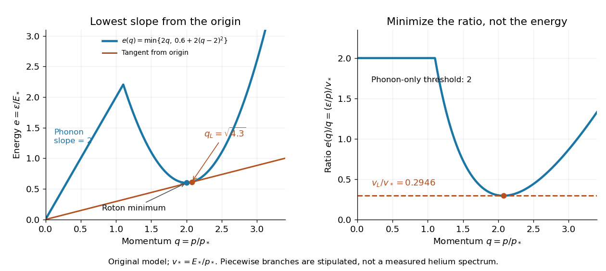
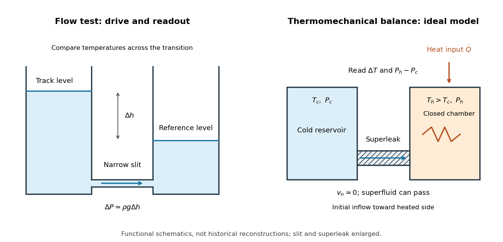
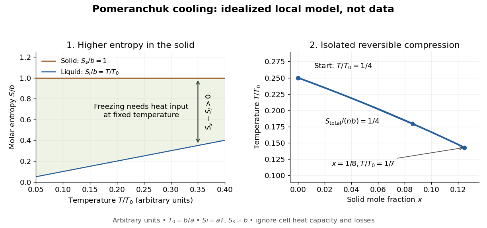
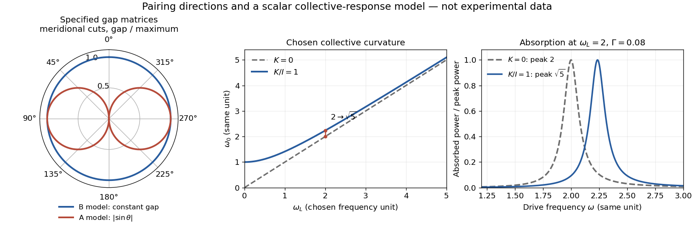

# Statistical physics

↑ **Parent:** [Branches of physics](physics.md#branches-of-physics)  
ⓦ [Wiki](https://en.wikipedia.org/wiki/Statistical_physics)

[Statistical physics](statistical-physics.md) explains collective behavior using [probability distributions](probability-distribution.md) over microscopic possibilities. Its central surprise is that incomplete microscopic knowledge can still produce precise predictions for [internal energy](internal-energy.md), [entropy](entropy.md) and [heat capacity](heat.md#heat-capacity). The bridge is [statistical mechanics](#statistical-mechanics): specify the available [microstates](#microstate), assign their [probabilities](probability-theory.md#probability), then compute the [expected values](expected-value.md) of measured quantities.

A [two-level system](canonical-ensemble.md#two-level-system) already displays the idea. Warming it makes its higher [energy](energy.md) more likely; its [heat capacity](heat.md#heat-capacity) first rises, then falls as the two [probabilities](probability-theory.md#probability) approach equality. With two distinguishable units, merely counting [microstates](#microstate) explains why the middle [energy](energy.md) has twice the [state degeneracy](#state-degeneracy). These small examples expose the machinery before the much larger sums needed for a [photon gas](#photon-gas) or an [Ising model](spin-model.md#ising-model).

The appeal is economical: the same microscopic [energies](energy.md) and [probabilities](probability-theory.md#probability) explain both an average reading and its [variance](variance.md). A measurement's spread therefore becomes useful physical information rather than an inconvenience to discard.

**Table of contents**

- [Isothermal-isobaric ensemble](#isothermal-isobaric-ensemble)
  - [Enthalpy fluctuation formula](#enthalpy-fluctuation-formula)
  - [Isothermal-isobaric partition function](#isothermal-isobaric-partition-function)
    - [Finite-size normalization of the isothermal-isobaric ensemble](#finite-size-normalization-of-the-isothermal-isobaric-ensemble)
- [Lattice gas](#lattice-gas)
  - [Canonical lattice-gas partition function](#canonical-lattice-gas-partition-function)
- [Hard sphere](#hard-sphere)
  - [Hard disc](#hard-disc)
    - [Hard-disc cage approximation](#hard-disc-cage-approximation)
    - [Hard-disc excluded-area approximation](#hard-disc-excluded-area-approximation)
  - [Entropy-driven hard-sphere crystallization](#entropy-driven-hard-sphere-crystallization)
- [Linear response theory](#linear-response-theory)
  - [Random phase approximation](#random-phase-approximation)
  - [Zero-frequency cancellation of a causal response kernel](#zero-frequency-cancellation-of-a-causal-response-kernel)
  - [Kramers-Kronig relations](#kramers-kronig-relations)
  - [Onsager reciprocal relation](#onsager-reciprocal-relation)
- [Thermal activation](#thermal-activation)
  - [Heat-capacity activation estimate](#heat-capacity-activation-estimate)
- [Energy landscape](#energy-landscape)
  - [Free-energy landscape](#free-energy-landscape)
  - [Disconnectivity graph](#disconnectivity-graph)
  - [Energy barrier](#energy-barrier)
- [Non-Fermi liquid](#non-fermi-liquid)
  - [Luttinger liquid](#luttinger-liquid)
    - [Spin-charge separation](#spin-charge-separation)
- [Mean-field theory](#mean-field-theory)
  - [Hartree-Fock-Bogoliubov theory](#hartree-fock-bogoliubov-theory)
  - [Weiss molecular field](#weiss-molecular-field)
    - [Mean-field onset of two-state ferromagnetism](#mean-field-onset-of-two-state-ferromagnetism)
- [Thermal fluctuation](#thermal-fluctuation)
  - [Volume fluctuations of a closed gas bubble](#volume-fluctuations-of-a-closed-gas-bubble)
- [Photon gas](#photon-gas)
  - [One-dimensional photon-gas thermodynamics](#one-dimensional-photon-gas-thermodynamics)
  - [Reversible isothermal expansion of a photon gas](#reversible-isothermal-expansion-of-a-photon-gas)
  - [Entropy density of a photon gas](#entropy-density-of-a-photon-gas)
- [Statistical mechanics](#statistical-mechanics)
  - [Fluctuation-induced force](#fluctuation-induced-force)
    - [Boundary-condition dependence of a fluctuation force](#boundary-condition-dependence-of-a-fluctuation-force)
    - [Critical Casimir force](#critical-casimir-force)
    - [Casimir force](#casimir-force)
  - [Classical statistical mechanics](#classical-statistical-mechanics)
  - [Quantum statistical mechanics](#quantum-statistical-mechanics)
- [Ergodic hypothesis](#ergodic-hypothesis)
- [Latent heat of fusion](#latent-heat-of-fusion)
  - [Ice-melting calorimetry](#ice-melting-calorimetry)
    - [Wet-ice bias in fusion calorimetry](#wet-ice-bias-in-fusion-calorimetry)
- [Quantum fluid](#quantum-fluid)
- [Superfluidity](#superfluidity)
  - [Bosonic Josephson junction](#bosonic-josephson-junction)
    - [Albiez double-well Josephson experiment](#albiez-double-well-josephson-experiment)
  - [Moving-obstacle test of atomic superfluidity](#moving-obstacle-test-of-atomic-superfluidity)
  - [Lambda point](#lambda-point)
  - [Superfluid number density](#superfluid-number-density)
    - [Superfluid fraction](#superfluid-fraction)
  - [Superfluid](#superfluid)
    - [Normal component of a superfluid](#normal-component-of-a-superfluid)
      - [Two-fluid model of superfluidity](#two-fluid-model-of-superfluidity)
        - [Andronikashvili experiment](#andronikashvili-experiment)
        - [Second sound](#second-sound)
        - [Thermomechanical effect](#thermomechanical-effect)
          - [Superleak](#superleak)
    - [Superfluid velocity](#superfluid-velocity)
      - [Current bottleneck in an inhomogeneous condensate](#current-bottleneck-in-an-inhomogeneous-condensate)
        - [Local sound-speed estimate for ring-flow stability](#local-sound-speed-estimate-for-ring-flow-stability)
    - [Superfluid order-parameter effective theory](#superfluid-order-parameter-effective-theory)
      - [Density-phase conjugacy](#density-phase-conjugacy)
      - [Number-phase conjugacy](#number-phase-conjugacy)
      - [Thermal phase fluctuation](#thermal-phase-fluctuation)
    - [Landau criterion](#landau-criterion)
      - [Local sound-speed criterion for circular condensate stirring](#local-sound-speed-criterion-for-circular-condensate-stirring)
        - [Loss-driven onset of condensate stirring](#loss-driven-onset-of-condensate-stirring)
      - [Landau critical velocity](#landau-critical-velocity)
      - [Bogoliubov sound speed and Landau bound](#bogoliubov-sound-speed-and-landau-bound)
      - [Critical velocity of a homogeneous condensate](#critical-velocity-of-a-homogeneous-condensate)
      - [Roton](#roton)
  - [Helium slit-flow experiment](#helium-slit-flow-experiment)
  - [Helium-3 superfluidity](#helium-3-superfluidity)
    - [Helium-3 superfluid discovery experiment](#helium-3-superfluid-discovery-experiment)
    - [Pomeranchuk cooling](#pomeranchuk-cooling)
      - [Pomeranchuk entropy-balance model](#pomeranchuk-entropy-balance-model)
    - [Spin-triplet p-wave pairing](#spin-triplet-p-wave-pairing)
      - [Helium-3 pair order parameter](#helium-3-pair-order-parameter)
        - [Helium-3 A phase](#helium-3-a-phase)
        - [Helium-3 B phase](#helium-3-b-phase)
    - [Nuclear magnetic resonance fingerprint of superfluid helium-3](#nuclear-magnetic-resonance-fingerprint-of-superfluid-helium-3)
      - [Collective-curvature resonance model](#collective-curvature-resonance-model)
- [Superconductivity](superconductivity.md)
  - [Unconventional superconductivity](superconductivity.md#unconventional-superconductivity)
    - [D-wave superconductivity](superconductivity.md#d-wave-superconductivity)
      - [Nodal quasiparticle power laws](superconductivity.md#nodal-quasiparticle-power-laws)
        - [Disorder qualification of nodal power laws](superconductivity.md#disorder-qualification-of-nodal-power-laws)
      - [Volovik effect](superconductivity.md#volovik-effect)
      - [Nodal quasiparticle density of states in a two-dimensional d-wave superconductor](superconductivity.md#nodal-quasiparticle-density-of-states-in-a-two-dimensional-d-wave-superconductor)
      - [D-wave superconductor](superconductivity.md#d-wave-superconductor)
      - [D-wave bond order](superconductivity.md#d-wave-bond-order)
    - [Unconventional superconductor](superconductivity.md#unconventional-superconductor)
  - [Superconducting magnet](superconductivity.md#superconducting-magnet)
    - [Superconducting quench](superconductivity.md#superconducting-quench)
  - [Condensation energy of a superconductor](superconductivity.md#condensation-energy-of-a-superconductor)
  - [Anderson-Higgs mechanism in a superconductor](superconductivity.md#anderson-higgs-mechanism-in-a-superconductor)
    - [Superconducting phase-density action](superconductivity.md#superconducting-phase-density-action)
  - [Superconducting material](superconductivity.md#superconducting-material)
    - [Niobium-tin](superconductivity.md#niobium-tin)
    - [Niobium-titanium](superconductivity.md#niobium-titanium)
  - [Superconducting device](superconductivity.md#superconducting-device)
  - [Persistent current (superconductivity)](superconductivity.md#persistent-current-superconductivity)
  - [Persistent current in a superconducting loop experiment](superconductivity.md#persistent-current-in-a-superconducting-loop-experiment)
    - [Resistance upper bound from persistent-current decay](superconductivity.md#resistance-upper-bound-from-persistent-current-decay)
  - [Superconducting critical current](superconductivity.md#superconducting-critical-current)
    - [Superconducting critical current density](superconductivity.md#superconducting-critical-current-density)
      - [Superconducting critical surface](superconductivity.md#superconducting-critical-surface)
  - [Type-I superconductor](superconductivity.md#type-i-superconductor)
  - [Type-II superconductor](superconductivity.md#type-ii-superconductor)
    - [Superconducting mixed state](superconductivity.md#superconducting-mixed-state)
      - [Abrikosov vortex](superconductivity.md#abrikosov-vortex)
        - [Abrikosov vortex lattice](superconductivity.md#abrikosov-vortex-lattice)
          - [Flux-lattice spacing](superconductivity.md#flux-lattice-spacing)
          - [Abrikosov parameter](superconductivity.md#abrikosov-parameter)
          - [Magnetic decoration of superconducting vortices](superconductivity.md#magnetic-decoration-of-superconducting-vortices)
      - [Flux pinning](superconductivity.md#flux-pinning)
        - [Flux creep](superconductivity.md#flux-creep)
        - [Vortex depinning](superconductivity.md#vortex-depinning)
  - [Superconducting transition temperature](superconductivity.md#superconducting-transition-temperature)
    - [Pair formation and phase ordering](superconductivity.md#pair-formation-and-phase-ordering)
  - [Resistance-versus-temperature experiment for superconductivity](superconductivity.md#resistance-versus-temperature-experiment-for-superconductivity)
    - [Four-terminal sensing](superconductivity.md#four-terminal-sensing)
  - [Field-cooled Meissner experiment](superconductivity.md#field-cooled-meissner-experiment)
  - [Ginzburg-Landau theory of superconductivity](superconductivity.md#ginzburg-landau-theory-of-superconductivity)
    - [Time-dependent Ginzburg-Landau equation](superconductivity.md#time-dependent-ginzburg-landau-equation)
    - [Microscopic derivation of Ginzburg-Landau theory](superconductivity.md#microscopic-derivation-of-ginzburg-landau-theory)
      - [Pair-field effective action of a superconductor](superconductivity.md#pair-field-effective-action-of-a-superconductor)
      - [Microscopic Ginzburg-Landau coefficients from BCS theory](superconductivity.md#microscopic-ginzburg-landau-coefficients-from-bcs-theory)
    - [Superconducting coherence length](superconductivity.md#superconducting-coherence-length)
    - [Ginzburg-Landau parameter](superconductivity.md#ginzburg-landau-parameter)
    - [Lower critical magnetic field](superconductivity.md#lower-critical-magnetic-field)
    - [Upper critical magnetic field](superconductivity.md#upper-critical-magnetic-field)
  - [Gauge-coupling sign in Ginzburg-Landau superconductivity](superconductivity.md#gauge-coupling-sign-in-ginzburg-landau-superconductivity)
    - [Gauge-invariant condensate momentum](superconductivity.md#gauge-invariant-condensate-momentum)
  - [Josephson junction](superconductivity.md#josephson-junction)
    - [Superconducting weak link](superconductivity.md#superconducting-weak-link)
      - [Current-phase relation of a superconducting weak link](superconductivity.md#current-phase-relation-of-a-superconducting-weak-link)
    - [Josephson effect](superconductivity.md#josephson-effect)
      - [SQUID](superconductivity.md#squid)
        - [RF SQUID](superconductivity.md#rf-squid)
        - [DC SQUID](superconductivity.md#dc-squid)
          - [Jaklevic Josephson interference experiment](superconductivity.md#jaklevic-josephson-interference-experiment)
      - [Gauge-invariant Josephson phase](superconductivity.md#gauge-invariant-josephson-phase)
      - [Josephson coupling energy](superconductivity.md#josephson-coupling-energy)
      - [DC Josephson effect](superconductivity.md#dc-josephson-effect)
      - [AC Josephson effect](superconductivity.md#ac-josephson-effect)
    - [Current-biased Josephson phase dynamics](superconductivity.md#current-biased-josephson-phase-dynamics)
      - [Tilted Josephson washboard potential](superconductivity.md#tilted-josephson-washboard-potential)
      - [Quantized phase levels in a Josephson junction](superconductivity.md#quantized-phase-levels-in-a-josephson-junction)
      - [Quantum escape of a current-biased Josephson junction](superconductivity.md#quantum-escape-of-a-current-biased-josephson-junction)
      - [Martinis-Devoret-Clarke circuit experiments](superconductivity.md#martinis-devoret-clarke-circuit-experiments)
        - [Switching-current distribution of a Josephson junction](superconductivity.md#switching-current-distribution-of-a-josephson-junction)
  - [Single-electron superconducting tunneling](superconductivity.md#single-electron-superconducting-tunneling)
    - [Giaever gap experiment](superconductivity.md#giaever-gap-experiment)
  - [Superconductor](superconductivity.md#superconductor)
    - [S-wave superconductor](superconductivity.md#s-wave-superconductor)
  - [High-temperature superconductivity](superconductivity.md#high-temperature-superconductivity)
    - [Cuprate superconductor](superconductivity.md#cuprate-superconductor)
      - [Cuprate pseudogap](superconductivity.md#cuprate-pseudogap)
      - [Formal hole count in a cuprate](superconductivity.md#formal-hole-count-in-a-cuprate)
    - [Bednorz-Müller experiment](superconductivity.md#bednorz-muller-experiment)
    - [Transport and magnetic tests of superconducting ceramics](superconductivity.md#transport-and-magnetic-tests-of-superconducting-ceramics)
      - [Parallel-path model of a superconducting ceramic](superconductivity.md#parallel-path-model-of-a-superconducting-ceramic)
- [Kinetic theory](kinetic-theory.md)
  - [Compression work from molecular impacts](kinetic-theory.md#compression-work-from-molecular-impacts)
    - [First-order collision-flux approximation for a slow piston](kinetic-theory.md#first-order-collision-flux-approximation-for-a-slow-piston)
  - [Angularly resolved molecular arrival flux](kinetic-theory.md#angularly-resolved-molecular-arrival-flux)
  - [Gas impingement flux](kinetic-theory.md#gas-impingement-flux)
  - [Kinetic estimates of gas transport coefficients](kinetic-theory.md#kinetic-estimates-of-gas-transport-coefficients)
  - [Thermal motion](kinetic-theory.md#thermal-motion)
  - [Speed distribution](kinetic-theory.md#speed-distribution)
  - [Boltzmann-Grad limit](kinetic-theory.md#boltzmann-grad-limit)
  - [Knudsen number](kinetic-theory.md#knudsen-number)
    - [Rarefied gas flow approximations](kinetic-theory.md#rarefied-gas-flow-approximations)
      - [Knudsen layer](kinetic-theory.md#knudsen-layer)
      - [Free molecular flow](kinetic-theory.md#free-molecular-flow)
  - [Effusion](kinetic-theory.md#effusion)
    - [Effusive molecular energy flux](kinetic-theory.md#effusive-molecular-energy-flux)
    - [Planar effusion flux](kinetic-theory.md#planar-effusion-flux)
    - [Collisionless effusion](kinetic-theory.md#collisionless-effusion)
    - [Effusive cooling](kinetic-theory.md#effusive-cooling)
    - [Two-vessel effusive mixing](kinetic-theory.md#two-vessel-effusive-mixing)
  - [Thermal transpiration](kinetic-theory.md#thermal-transpiration)
    - [Closed-vessel thermal transpiration](kinetic-theory.md#closed-vessel-thermal-transpiration)
    - [Thermal transpiration experiment with a glass microtube](kinetic-theory.md#thermal-transpiration-experiment-with-a-glass-microtube)
      - [Capacitance diaphragm gauge](kinetic-theory.md#capacitance-diaphragm-gauge)
  - [Molecular chaos for the Boltzmann equation](kinetic-theory.md#molecular-chaos-for-the-boltzmann-equation)
  - [Unordered-pair collision rate](kinetic-theory.md#unordered-pair-collision-rate)
  - [Kac model](kinetic-theory.md#kac-model)
    - [Relative entropy in Kac's model](kinetic-theory.md#relative-entropy-in-kac-s-model)
      - [Kac entropy production](kinetic-theory.md#kac-entropy-production)
    - [Kac chaos](kinetic-theory.md#kac-chaos)
    - [Kac master equation](kinetic-theory.md#kac-master-equation)
      - [Kac marginal evolution equation](kinetic-theory.md#kac-marginal-evolution-equation)
    - [Kac collision operator](kinetic-theory.md#kac-collision-operator)
      - [Dirichlet form of the Kac collision operator](kinetic-theory.md#dirichlet-form-of-the-kac-collision-operator)
        - [Radial kernel of the Kac collision operator](kinetic-theory.md#radial-kernel-of-the-kac-collision-operator)
  - [Free-transport phase mixing](kinetic-theory.md#free-transport-phase-mixing)
    - [Uniform phase-mixing bound from velocity derivatives](kinetic-theory.md#uniform-phase-mixing-bound-from-velocity-derivatives)
  - [Mean velocity of a kinetic distribution](kinetic-theory.md#mean-velocity-of-a-kinetic-distribution)
  - [Hamiltonian Liouville equation](kinetic-theory.md#hamiltonian-liouville-equation)
    - [Hyperbolic characteristic flow for an inverted oscillator](kinetic-theory.md#hyperbolic-characteristic-flow-for-an-inverted-oscillator)
    - [Invariant-source secular growth in Hamiltonian transport](kinetic-theory.md#invariant-source-secular-growth-in-hamiltonian-transport)
    - [Finite-time Lp bound for Hamiltonian transport](kinetic-theory.md#finite-time-lp-bound-for-hamiltonian-transport)
      - [Spatially nonintegrable forcing in transport](kinetic-theory.md#spatially-nonintegrable-forcing-in-transport)
    - [Duhamel formula for Hamiltonian transport](kinetic-theory.md#duhamel-formula-for-hamiltonian-transport)
  - [Vlasov equation](kinetic-theory.md#vlasov-equation)
- [Statistical Hamiltonian](#statistical-hamiltonian)
- [Coarse-grained variable](#coarse-grained-variable)
- [Statistical field theory](#statistical-field-theory)
- [Thermodynamic limit](#thermodynamic-limit)
  - [Relative fluctuations of an extensive observable](#relative-fluctuations-of-an-extensive-observable)
  - [Finite-system analyticity](#finite-system-analyticity)
  - [Symmetry-breaking order of limits](#symmetry-breaking-order-of-limits)
  - [Finite-size rounding](#finite-size-rounding)
  - [Surface correction to thermodynamic free energy](#surface-correction-to-thermodynamic-free-energy)
  - [Carbon-dioxide viewing-cell phase-transition experiment](#carbon-dioxide-viewing-cell-phase-transition-experiment)
  - [Critical opalescence](#critical-opalescence)
  - [Stable pair potential](#stable-pair-potential)
  - [Tempered pair potential](#tempered-pair-potential)
- [Virial expansion](#virial-expansion)
  - [Virial coefficients of the van der Waals gas](#virial-coefficients-of-the-van-der-waals-gas)
  - [Boyle temperature](#boyle-temperature)
  - [Second virial coefficient](#second-virial-coefficient)
    - [Soft-core high-temperature second virial coefficient](#soft-core-high-temperature-second-virial-coefficient)
    - [Density versus molar second virial convention](#density-versus-molar-second-virial-convention)
    - [Exchange contribution to the second virial coefficient](#exchange-contribution-to-the-second-virial-coefficient)
    - [Second virial coefficient of a bounded cubic repulsion](#second-virial-coefficient-of-a-bounded-cubic-repulsion)
  - [Cluster expansion](#cluster-expansion)
- [Pair potential](#pair-potential)
  - [Mayer f-function](#mayer-f-function)
  - [Hard-sphere gas](#hard-sphere-gas)
    - [Excluded volume](#excluded-volume)
      - [Excluded-volume ideal gas](#excluded-volume-ideal-gas)
- [Free-energy density](#free-energy-density)
- [Spin model](spin-model.md)
  - [Spin configuration](spin-model.md#spin-configuration)
  - [Spin glass](spin-model.md#spin-glass)
    - [Frustrated Ising triangle](spin-model.md#frustrated-ising-triangle)
    - [Edwards-Anderson model](spin-model.md#edwards-anderson-model)
    - [Edwards-Anderson order parameter](spin-model.md#edwards-anderson-order-parameter)
    - [Spin overlap](spin-model.md#spin-overlap)
    - [Replica symmetry breaking](spin-model.md#replica-symmetry-breaking)
    - [Sherrington-Kirkpatrick model](spin-model.md#sherrington-kirkpatrick-model)
    - [Gold-iron alloy susceptibility experiment](spin-model.md#gold-iron-alloy-susceptibility-experiment)
    - [Origin of the replica approach to spin glasses](spin-model.md#origin-of-the-replica-approach-to-spin-glasses)
  - [Annealed disorder](spin-model.md#annealed-disorder)
  - [Quenched disorder](spin-model.md#quenched-disorder)
    - [Two-spin quenched and annealed free energies](spin-model.md#two-spin-quenched-and-annealed-free-energies)
    - [Replica trick](spin-model.md#replica-trick)
  - [Potts model](spin-model.md#potts-model)
  - [Blume–Emery–Griffiths model](spin-model.md#blume-emery-griffiths-model)
  - [Transfer matrix for a classical spin chain](spin-model.md#transfer-matrix-for-a-classical-spin-chain)
    - [Classical Ising chain as a quantum particle](spin-model.md#classical-ising-chain-as-a-quantum-particle)
      - [Auxiliary-field transfer operator for an Ising chain](spin-model.md#auxiliary-field-transfer-operator-for-an-ising-chain)
      - [Double-well threshold of an auxiliary Ising potential](spin-model.md#double-well-threshold-of-an-auxiliary-ising-potential)
  - [Spin magnetization](spin-model.md#spin-magnetization)
  - [Spin inversion symmetry](spin-model.md#spin-inversion-symmetry)
  - [Ising model](spin-model.md#ising-model)
    - [Ising-chain domain-wall energy convention](spin-model.md#ising-chain-domain-wall-energy-convention)
    - [Four-spin Ising ring](spin-model.md#four-spin-ising-ring)
      - [Ising ring bond correlation](spin-model.md#ising-ring-bond-correlation)
      - [Ising ring magnetization fluctuations](spin-model.md#ising-ring-magnetization-fluctuations)
    - [Exponentially coupled Ising inverse kernel](spin-model.md#exponentially-coupled-ising-inverse-kernel)
      - [Open-chain endpoint corrections for an exponential Ising kernel](spin-model.md#open-chain-endpoint-corrections-for-an-exponential-ising-kernel)
    - [Ising boundary condition](spin-model.md#ising-boundary-condition)
      - [Extremal infinite-volume Ising measures](spin-model.md#extremal-infinite-volume-ising-measures)
    - [Antiferromagnetic Ising model](spin-model.md#antiferromagnetic-ising-model)
      - [Two-sublattice Ising mean-field approximation](spin-model.md#two-sublattice-ising-mean-field-approximation)
        - [Uniform response of a two-sublattice Ising antiferromagnet](spin-model.md#uniform-response-of-a-two-sublattice-ising-antiferromagnet)
        - [Two-sublattice Ising variational free energy](spin-model.md#two-sublattice-ising-variational-free-energy)
    - [Ferromagnetic Ising lattice inequality](spin-model.md#ferromagnetic-ising-lattice-inequality)
    - [Ising spin variable](spin-model.md#ising-spin-variable)
    - [Mean-field theory of the Ising model](spin-model.md#mean-field-theory-of-the-ising-model)
      - [Mean-field Ising critical bifurcation](spin-model.md#mean-field-ising-critical-bifurcation)
      - [Bragg-Williams free energy of the Ising model](spin-model.md#bragg-williams-free-energy-of-the-ising-model)
      - [Ising auxiliary mean-field free energy](spin-model.md#ising-auxiliary-mean-field-free-energy)
    - [Curie–Weiss model](spin-model.md#curie-weiss-model)
    - [Transfer matrix for the one-dimensional Ising model](spin-model.md#transfer-matrix-for-the-one-dimensional-ising-model)
      - [Analyticity of the one-dimensional Ising free energy](spin-model.md#analyticity-of-the-one-dimensional-ising-free-energy)
      - [Ising-chain magnetization with spin-half normalization](spin-model.md#ising-chain-magnetization-with-spin-half-normalization)
    - [Blume–Capel model](spin-model.md#blume-capel-model)
      - [Blume-Capel mean-field transition at zero single-ion anisotropy](spin-model.md#blume-capel-mean-field-transition-at-zero-single-ion-anisotropy)
      - [Blume–Capel mean-field tricritical parameters](spin-model.md#blume-capel-mean-field-tricritical-parameters)
    - [Glauber dynamics](spin-model.md#glauber-dynamics)
    - [Free boundary condition](spin-model.md#free-boundary-condition)
    - [Plus boundary condition](spin-model.md#plus-boundary-condition)
    - [Peierls contour](spin-model.md#peierls-contour)
    - [One-dimensional Ising correlation function](spin-model.md#one-dimensional-ising-correlation-function)
    - [Spontaneous magnetization](spin-model.md#spontaneous-magnetization)
    - [Random-bond Ising model](spin-model.md#random-bond-ising-model)
    - [Transverse-field Ising model](spin-model.md#transverse-field-ising-model)
      - [Ising-chain quantum critical point](spin-model.md#ising-chain-quantum-critical-point)
      - [Ising-chain Bogoliubov diagonalization](spin-model.md#ising-chain-bogoliubov-diagonalization)
        - [Ising-chain ground-state energy](spin-model.md#ising-chain-ground-state-energy)
          - [Ising-chain field derivative and transverse polarization](spin-model.md#ising-chain-field-derivative-and-transverse-polarization)
            - [Critical transverse polarization of an Ising chain](spin-model.md#critical-transverse-polarization-of-an-ising-chain)
        - [Ising-chain quasiparticle dispersion](spin-model.md#ising-chain-quasiparticle-dispersion)
          - [Finite-ring parity qualification of an Ising quasiparticle gap](spin-model.md#finite-ring-parity-qualification-of-an-ising-quasiparticle-gap)
- [Clock model](#clock-model)
  - [Four-state clock model](#four-state-clock-model)
- [Classical O(n) lattice model](#classical-o-n-lattice-model)
  - [XY model](#xy-model)
    - [Villain model](#villain-model)
      - [Vortex Coulomb gas](#vortex-coulomb-gas)
        - [Vortex fugacity](#vortex-fugacity)
        - [Harmonic-sector factor in periodic Villain duality](#harmonic-sector-factor-in-periodic-villain-duality)
        - [Vortex charge neutrality](#vortex-charge-neutrality)
      - [Integer-current representation of the Villain model](#integer-current-representation-of-the-villain-model)
        - [Dual integer-height representation of the planar Villain model](#dual-integer-height-representation-of-the-planar-villain-model)
  - [Ginibre inequality](#ginibre-inequality)
  - [Reflection positivity](#reflection-positivity)
    - [Gaussian domination](#gaussian-domination)
      - [Infrared bound](#infrared-bound)
- [Phi-four lattice model](#phi-four-lattice-model)
  - [Random-walk representation of a lattice-field covariance](#random-walk-representation-of-a-lattice-field-covariance)
- [Boltzmann equation](boltzmann-equation.md)
  - [Renormalized Boltzmann solution](boltzmann-equation.md#renormalized-boltzmann-solution)
  - [Hydrodynamic limit of the Boltzmann equation](boltzmann-equation.md#hydrodynamic-limit-of-the-boltzmann-equation)
  - [Spatially homogeneous Boltzmann equation](boltzmann-equation.md#spatially-homogeneous-boltzmann-equation)
  - [Nonlinear Boltzmann collision operator](boltzmann-equation.md#nonlinear-boltzmann-collision-operator)
    - [Dissipation form of the linearized Boltzmann operator](boltzmann-equation.md#dissipation-form-of-the-linearized-boltzmann-operator)
    - [Grad angular cutoff](boltzmann-equation.md#grad-angular-cutoff)
    - [Weak Boltzmann collision identity](boltzmann-equation.md#weak-boltzmann-collision-identity)
  - [Local Maxwellian](boltzmann-equation.md#local-maxwellian)
    - [Expanding Gaussian solution of the Boltzmann equation](boltzmann-equation.md#expanding-gaussian-solution-of-the-boltzmann-equation)
  - [Boltzmann H functional](boltzmann-equation.md#boltzmann-h-functional)
    - [Boltzmann entropy dissipation](boltzmann-equation.md#boltzmann-entropy-dissipation)
    - [H-theorem](boltzmann-equation.md#h-theorem)
  - [Maxwell molecule collision operator](boltzmann-equation.md#maxwell-molecule-collision-operator)
    - [Collision invariant](boltzmann-equation.md#collision-invariant)
    - [Bobylev identity](boltzmann-equation.md#bobylev-identity)
      - [Fourier distance of order two](boltzmann-equation.md#fourier-distance-of-order-two)
        - [Fourier nonexpansion for Maxwell molecules](boltzmann-equation.md#fourier-nonexpansion-for-maxwell-molecules)
    - [Angular exchange for elastic collisions](boltzmann-equation.md#angular-exchange-for-elastic-collisions)
  - [Linear Boltzmann equation](boltzmann-equation.md#linear-boltzmann-equation)
    - [Order preservation for the linear Boltzmann equation](boltzmann-equation.md#order-preservation-for-the-linear-boltzmann-equation)
    - [Normalized velocity-reset collision operator](boltzmann-equation.md#normalized-velocity-reset-collision-operator)
      - [Weighted Hilbert structure of velocity-reset relaxation](boltzmann-equation.md#weighted-hilbert-structure-of-velocity-reset-relaxation)
        - [Exact spectral gap of normalized velocity relaxation](boltzmann-equation.md#exact-spectral-gap-of-normalized-velocity-relaxation)
      - [Integrable Volterra solution for normalized velocity relaxation](boltzmann-equation.md#integrable-volterra-solution-for-normalized-velocity-relaxation)
      - [Normalized velocity-reset projection](boltzmann-equation.md#normalized-velocity-reset-projection)
    - [Volterra series for the linear Boltzmann equation](boltzmann-equation.md#volterra-series-for-the-linear-boltzmann-equation)
    - [Boltzmann Volterra operator](boltzmann-equation.md#boltzmann-volterra-operator)
    - [Damped free-transport evolution](boltzmann-equation.md#damped-free-transport-evolution)
    - [Linear Boltzmann collision operator](boltzmann-equation.md#linear-boltzmann-collision-operator)
      - [Rank-one gain on bounded continuous functions](boltzmann-equation.md#rank-one-gain-on-bounded-continuous-functions)
  - [Relativistic kinetic theory](boltzmann-equation.md#relativistic-kinetic-theory)
    - [One-particle distribution function](boltzmann-equation.md#one-particle-distribution-function)
      - [Photon energy density](boltzmann-equation.md#photon-energy-density)
    - [Kinetic stress-energy tensor](boltzmann-equation.md#kinetic-stress-energy-tensor)
  - [Boltzmann hierarchy](boltzmann-equation.md#boltzmann-hierarchy)
- [One-dimensional freely jointed chain](#one-dimensional-freely-jointed-chain)
  - [Fixed-tension partition function of a one-dimensional chain](#fixed-tension-partition-function-of-a-one-dimensional-chain)
    - [Entropic Hooke law for a one-dimensional chain](#entropic-hooke-law-for-a-one-dimensional-chain)
- [State degeneracy](#state-degeneracy)
  - [Spin degeneracy](#spin-degeneracy)
  - [Degeneracy factor](#degeneracy-factor)
  - [Microstate](#microstate)
  - [Macrostate](#macrostate)
- [Quantum ideal-gas statistics](quantum-ideal-gas-statistics.md)
  - [Heat capacity for a two-dimensional linear fermion dispersion](quantum-ideal-gas-statistics.md#heat-capacity-for-a-two-dimensional-linear-fermion-dispersion)
  - [Maxwell–Boltzmann statistics](quantum-ideal-gas-statistics.md#maxwell-boltzmann-statistics)
    - [Nonrelativistic Maxwell--Boltzmann number density](quantum-ideal-gas-statistics.md#nonrelativistic-maxwell-boltzmann-number-density)
  - [Fermi level](quantum-ideal-gas-statistics.md#fermi-level)
  - [Maxwell-Boltzmann distribution](quantum-ideal-gas-statistics.md#maxwell-boltzmann-distribution)
    - [Wall-impact speed distribution](quantum-ideal-gas-statistics.md#wall-impact-speed-distribution)
    - [Maxwell-Boltzmann velocity distribution](quantum-ideal-gas-statistics.md#maxwell-boltzmann-velocity-distribution)
      - [Maxwell speed distribution](quantum-ideal-gas-statistics.md#maxwell-speed-distribution)
        - [Most probable speed in the Maxwell distribution](quantum-ideal-gas-statistics.md#most-probable-speed-in-the-maxwell-distribution)
      - [Doppler broadening](quantum-ideal-gas-statistics.md#doppler-broadening)
        - [Doppler resolution of a Zeeman pattern](quantum-ideal-gas-statistics.md#doppler-resolution-of-a-zeeman-pattern)
        - [Thermal Doppler broadening](quantum-ideal-gas-statistics.md#thermal-doppler-broadening)
          - [Thermal cutoff of Lyman-alpha line widths](quantum-ideal-gas-statistics.md#thermal-cutoff-of-lyman-alpha-line-widths)
  - [Density of states](quantum-ideal-gas-statistics.md#density-of-states)
    - [Anisotropic ideal-gas density of states](quantum-ideal-gas-statistics.md#anisotropic-ideal-gas-density-of-states)
    - [Single-polarization two-dimensional photon density of states](quantum-ideal-gas-statistics.md#single-polarization-two-dimensional-photon-density-of-states)
    - [Semiclassical density of states in a central potential](quantum-ideal-gas-statistics.md#semiclassical-density-of-states-in-a-central-potential)
    - [Spinless cubic-box wave-vector counting](quantum-ideal-gas-statistics.md#spinless-cubic-box-wave-vector-counting)
    - [Phonon density of states](quantum-ideal-gas-statistics.md#phonon-density-of-states)
      - [Density of states of a monatomic harmonic chain](quantum-ideal-gas-statistics.md#density-of-states-of-a-monatomic-harmonic-chain)
      - [One-dimensional acoustic phonon heat capacity](quantum-ideal-gas-statistics.md#one-dimensional-acoustic-phonon-heat-capacity)
    - [Van Hove singularity](quantum-ideal-gas-statistics.md#van-hove-singularity)
      - [Logarithmic two-dimensional saddle joint density of states](quantum-ideal-gas-statistics.md#logarithmic-two-dimensional-saddle-joint-density-of-states)
        - [Spin and branch counting in saddle-point optical spectra](quantum-ideal-gas-statistics.md#spin-and-branch-counting-in-saddle-point-optical-spectra)
      - [One-dimensional van Hove singularity](quantum-ideal-gas-statistics.md#one-dimensional-van-hove-singularity)
    - [Density of occupied states](quantum-ideal-gas-statistics.md#density-of-occupied-states)
    - [Positive-energy quasiparticle density from a folded spectrum](quantum-ideal-gas-statistics.md#positive-energy-quasiparticle-density-from-a-folded-spectrum)
    - [Joint density of states](quantum-ideal-gas-statistics.md#joint-density-of-states)
      - [Saddle-point optical transition contour](quantum-ideal-gas-statistics.md#saddle-point-optical-transition-contour)
        - [Square-zone cutoff of a saddle contour](quantum-ideal-gas-statistics.md#square-zone-cutoff-of-a-saddle-contour)
      - [Dimensional interband threshold shapes](quantum-ideal-gas-statistics.md#dimensional-interband-threshold-shapes)
      - [Level-set representation of the joint density of states](quantum-ideal-gas-statistics.md#level-set-representation-of-the-joint-density-of-states)
      - [Two-dimensional joint density of states](quantum-ideal-gas-statistics.md#two-dimensional-joint-density-of-states)
    - [One-dimensional free-electron density of states](quantum-ideal-gas-statistics.md#one-dimensional-free-electron-density-of-states)
    - [Local density of states](quantum-ideal-gas-statistics.md#local-density-of-states)
    - [Spin-summed density of states](quantum-ideal-gas-statistics.md#spin-summed-density-of-states)
    - [Single-spin density of states](quantum-ideal-gas-statistics.md#single-spin-density-of-states)
  - [Fermi-Dirac distribution](quantum-ideal-gas-statistics.md#fermi-dirac-distribution)
    - [Fermi window](quantum-ideal-gas-statistics.md#fermi-window)
      - [Thermal damping of a sinusoidal density of states](quantum-ideal-gas-statistics.md#thermal-damping-of-a-sinusoidal-density-of-states)
        - [Oscillatory thermal-change amplitude ratio](quantum-ideal-gas-statistics.md#oscillatory-thermal-change-amplitude-ratio)
    - [Boltzmann approximation](quantum-ideal-gas-statistics.md#boltzmann-approximation)
    - [Sommerfeld expansion](quantum-ideal-gas-statistics.md#sommerfeld-expansion)
      - [Fixed-chemical-potential Sommerfeld density increase](quantum-ideal-gas-statistics.md#fixed-chemical-potential-sommerfeld-density-increase)
        - [Monotonic density at fixed chemical potential in a square-root density of states](quantum-ideal-gas-statistics.md#monotonic-density-at-fixed-chemical-potential-in-a-square-root-density-of-states)
    - [Electron-positron thermal pair abundance](quantum-ideal-gas-statistics.md#electron-positron-thermal-pair-abundance)
    - [Fermion-to-boson thermal integral ratio](quantum-ideal-gas-statistics.md#fermion-to-boson-thermal-integral-ratio)
    - [Fermi gas](quantum-ideal-gas-statistics.md#fermi-gas)
      - [Low-temperature heat capacity of a three-dimensional Fermi gas](quantum-ideal-gas-statistics.md#low-temperature-heat-capacity-of-a-three-dimensional-fermi-gas)
      - [Nuclear Fermi gas model](quantum-ideal-gas-statistics.md#nuclear-fermi-gas-model)
        - [Fermi motion](quantum-ideal-gas-statistics.md#fermi-motion)
      - [Two-dimensional electron gas](quantum-ideal-gas-statistics.md#two-dimensional-electron-gas)
        - [Top-gate density tuning](quantum-ideal-gas-statistics.md#top-gate-density-tuning)
        - [Transverse magnetic focusing](quantum-ideal-gas-statistics.md#transverse-magnetic-focusing)
          - [Ballistic focusing mobility criterion](quantum-ideal-gas-statistics.md#ballistic-focusing-mobility-criterion)
        - [Quantum point contact](quantum-ideal-gas-statistics.md#quantum-point-contact)
          - [Parallel-field splitting of quantum-point-contact steps](quantum-ideal-gas-statistics.md#parallel-field-splitting-of-quantum-point-contact-steps)
          - [Nonlinear conductance of a quantum point contact](quantum-ideal-gas-statistics.md#nonlinear-conductance-of-a-quantum-point-contact)
            - [Bias spectroscopy of one-dimensional subbands](quantum-ideal-gas-statistics.md#bias-spectroscopy-of-one-dimensional-subbands)
            - [Voltage partition in a ballistic constriction](quantum-ideal-gas-statistics.md#voltage-partition-in-a-ballistic-constriction)
            - [Half-integer channel plateaus from a symmetric bias window](quantum-ideal-gas-statistics.md#half-integer-channel-plateaus-from-a-symmetric-bias-window)
          - [Saddle-point model of a quantum point contact](quantum-ideal-gas-statistics.md#saddle-point-model-of-a-quantum-point-contact)
          - [Adiabatic electron collimation](quantum-ideal-gas-statistics.md#adiabatic-electron-collimation)
          - [Collinear quantum point contacts](quantum-ideal-gas-statistics.md#collinear-quantum-point-contacts)
          - [Split gate](quantum-ideal-gas-statistics.md#split-gate)
      - [Degenerate electron gas](quantum-ideal-gas-statistics.md#degenerate-electron-gas)
      - [Finite-temperature electron equation of state](quantum-ideal-gas-statistics.md#finite-temperature-electron-equation-of-state)
      - [Adiabatic scaling of a Fermi gas with power-law density of states](quantum-ideal-gas-statistics.md#adiabatic-scaling-of-a-fermi-gas-with-power-law-density-of-states)
      - [Strict monotonicity of Fermi gas entropy per particle](quantum-ideal-gas-statistics.md#strict-monotonicity-of-fermi-gas-entropy-per-particle)
      - [Fermi energy](quantum-ideal-gas-statistics.md#fermi-energy)
        - [Fermi temperature](quantum-ideal-gas-statistics.md#fermi-temperature)
        - [Fermi energy of a model electron gas](quantum-ideal-gas-statistics.md#fermi-energy-of-a-model-electron-gas)
        - [Electron Fermi temperature](quantum-ideal-gas-statistics.md#electron-fermi-temperature)
        - [Fermi momentum](quantum-ideal-gas-statistics.md#fermi-momentum)
          - [Fermi velocity](quantum-ideal-gas-statistics.md#fermi-velocity)
          - [Fermi wavevector](quantum-ideal-gas-statistics.md#fermi-wavevector)
            - [Fermi wavelength](quantum-ideal-gas-statistics.md#fermi-wavelength)
        - [Fermi sea](quantum-ideal-gas-statistics.md#fermi-sea)
          - [Three-dimensional free-electron density of states](quantum-ideal-gas-statistics.md#three-dimensional-free-electron-density-of-states)
        - [Observation of Fermi pressure in trapped lithium](quantum-ideal-gas-statistics.md#observation-of-fermi-pressure-in-trapped-lithium)
      - [Ultrarelativistic ideal Fermi gas](quantum-ideal-gas-statistics.md#ultrarelativistic-ideal-fermi-gas)
      - [Degeneracy pressure](quantum-ideal-gas-statistics.md#degeneracy-pressure)
        - [Electron degeneracy pressure](quantum-ideal-gas-statistics.md#electron-degeneracy-pressure)
          - [Ideal Fermi gas bulk modulus](quantum-ideal-gas-statistics.md#ideal-fermi-gas-bulk-modulus)
          - [Degeneracy-pressure bulk modulus](quantum-ideal-gas-statistics.md#degeneracy-pressure-bulk-modulus)
          - [Nonrelativistic electron-degeneracy pressure in a hydrogen-helium mixture](quantum-ideal-gas-statistics.md#nonrelativistic-electron-degeneracy-pressure-in-a-hydrogen-helium-mixture)
          - [Electron relativistic density threshold](quantum-ideal-gas-statistics.md#electron-relativistic-density-threshold)
          - [Equation of state of a cold electron gas](quantum-ideal-gas-statistics.md#equation-of-state-of-a-cold-electron-gas)
      - [Pauli paramagnetism](quantum-ideal-gas-statistics.md#pauli-paramagnetism)
        - [Fixed-number low-temperature Pauli susceptibility](quantum-ideal-gas-statistics.md#fixed-number-low-temperature-pauli-susceptibility)
        - [Pauli moment of a massless electron gas](quantum-ideal-gas-statistics.md#pauli-moment-of-a-massless-electron-gas)
      - [Two-dimensional free-electron density of states](quantum-ideal-gas-statistics.md#two-dimensional-free-electron-density-of-states)
        - [Chemical potential of a two-dimensional ideal Fermi gas](quantum-ideal-gas-statistics.md#chemical-potential-of-a-two-dimensional-ideal-fermi-gas)
        - [Spin normalization in two-dimensional free-electron state counting](quantum-ideal-gas-statistics.md#spin-normalization-in-two-dimensional-free-electron-state-counting)
        - [Mean energy of a two-dimensional Fermi gas](quantum-ideal-gas-statistics.md#mean-energy-of-a-two-dimensional-fermi-gas)
        - [Low-temperature particle-number cancellation for constant density of states](quantum-ideal-gas-statistics.md#low-temperature-particle-number-cancellation-for-constant-density-of-states)
          - [Quadratic low-temperature energy correction for constant density of states](quantum-ideal-gas-statistics.md#quadratic-low-temperature-energy-correction-for-constant-density-of-states)
            - [Linear low-temperature heat capacity of a two-dimensional Fermi gas](quantum-ideal-gas-statistics.md#linear-low-temperature-heat-capacity-of-a-two-dimensional-fermi-gas)
      - [Degeneracy pressure of a two-dimensional Fermi gas](quantum-ideal-gas-statistics.md#degeneracy-pressure-of-a-two-dimensional-fermi-gas)
  - [Classical limit of Bose--Einstein and Fermi--Dirac statistics](quantum-ideal-gas-statistics.md#classical-limit-of-bose-einstein-and-fermi-dirac-statistics)
  - [Bose-Einstein statistics](quantum-ideal-gas-statistics.md#bose-einstein-statistics)
    - [Bose gas](quantum-ideal-gas-statistics.md#bose-gas)
    - [Bose-Einstein distribution](quantum-ideal-gas-statistics.md#bose-einstein-distribution)
      - [Low-temperature energy of gapless bosonic excitations](quantum-ideal-gas-statistics.md#low-temperature-energy-of-gapless-bosonic-excitations)
        - [Quadratic-boson heat-capacity coefficient](quantum-ideal-gas-statistics.md#quadratic-boson-heat-capacity-coefficient)
      - [Mean photon energy](quantum-ideal-gas-statistics.md#mean-photon-energy)
      - [Bose-Einstein condensation](quantum-ideal-gas-statistics.md#bose-einstein-condensation)
        - [Bose condensation temperature from a fermionic density scale](quantum-ideal-gas-statistics.md#bose-condensation-temperature-from-a-fermionic-density-scale)
        - [Bose-Einstein condensation temperature for an anisotropic effective mass](quantum-ideal-gas-statistics.md#bose-einstein-condensation-temperature-for-an-anisotropic-effective-mass)
        - [Random-loss cooling of a Bose-Einstein condensate](quantum-ideal-gas-statistics.md#random-loss-cooling-of-a-bose-einstein-condensate)
        - [Saturation particle number for Bose-Einstein condensation](quantum-ideal-gas-statistics.md#saturation-particle-number-for-bose-einstein-condensation)
        - [Field-induced triplon condensation](quantum-ideal-gas-statistics.md#field-induced-triplon-condensation)
          - [Condensate density in a shifted-parabola triplon model](quantum-ideal-gas-statistics.md#condensate-density-in-a-shifted-parabola-triplon-model)
          - [Triplon condensation field scaling](quantum-ideal-gas-statistics.md#triplon-condensation-field-scaling)
        - [Homogeneous ideal Bose gas condensation](quantum-ideal-gas-statistics.md#homogeneous-ideal-bose-gas-condensation)
          - [Ideal Bose-gas heat capacity below condensation](quantum-ideal-gas-statistics.md#ideal-bose-gas-heat-capacity-below-condensation)
          - [Finite-box ground-energy convention in Bose condensation](quantum-ideal-gas-statistics.md#finite-box-ground-energy-convention-in-bose-condensation)
          - [Particle saturation in a homogeneous Bose gas](quantum-ideal-gas-statistics.md#particle-saturation-in-a-homogeneous-bose-gas)
        - [Dilute-gas Bose-Einstein condensation](quantum-ideal-gas-statistics.md#dilute-gas-bose-einstein-condensation)
          - [Phase-space density of an atomic gas](quantum-ideal-gas-statistics.md#phase-space-density-of-an-atomic-gas)
            - [Harmonic-trap phase-space density](quantum-ideal-gas-statistics.md#harmonic-trap-phase-space-density)
          - [Bose condensation in a three-dimensional harmonic trap](quantum-ideal-gas-statistics.md#bose-condensation-in-a-three-dimensional-harmonic-trap)
            - [Harmonic-trap critical-temperature prefactor](quantum-ideal-gas-statistics.md#harmonic-trap-critical-temperature-prefactor)
            - [Saturation of harmonic-trap excited states](quantum-ideal-gas-statistics.md#saturation-of-harmonic-trap-excited-states)
            - [Harmonic-trap chemical-potential pinning](quantum-ideal-gas-statistics.md#harmonic-trap-chemical-potential-pinning)
            - [Harmonic-trap energy-zero convention](quantum-ideal-gas-statistics.md#harmonic-trap-energy-zero-convention)
            - [Condensate fraction](quantum-ideal-gas-statistics.md#condensate-fraction)
          - [Synthetic bimodal profile of a Bose gas](quantum-ideal-gas-statistics.md#synthetic-bimodal-profile-of-a-bose-gas)
          - [Observation of Bose-Einstein condensation in rubidium in 1995](quantum-ideal-gas-statistics.md#observation-of-bose-einstein-condensation-in-rubidium-in-1995)
          - [Observation of Bose-Einstein condensation in sodium in 1995](quantum-ideal-gas-statistics.md#observation-of-bose-einstein-condensation-in-sodium-in-1995)
          - [Condensation, matter-wave coherence and superfluidity](quantum-ideal-gas-statistics.md#condensation-matter-wave-coherence-and-superfluidity)
        - [Bose condensation with power-law dispersion](quantum-ideal-gas-statistics.md#bose-condensation-with-power-law-dispersion)
        - [Bose-Einstein condensate](quantum-ideal-gas-statistics.md#bose-einstein-condensate)
          - [Condensate wavefunction](quantum-ideal-gas-statistics.md#condensate-wavefunction)
          - [Fixed-number two-mode condensate](quantum-ideal-gas-statistics.md#fixed-number-two-mode-condensate)
          - [Condensate density](quantum-ideal-gas-statistics.md#condensate-density)
          - [Uniform ring condensate](quantum-ideal-gas-statistics.md#uniform-ring-condensate)
            - [Step-potential equilibrium in a ring condensate](quantum-ideal-gas-statistics.md#step-potential-equilibrium-in-a-ring-condensate)
          - [Finite-size condensate chemical potential](quantum-ideal-gas-statistics.md#finite-size-condensate-chemical-potential)
          - [Condensate depletion](quantum-ideal-gas-statistics.md#condensate-depletion)
          - [Two-component Bose-Einstein condensate](quantum-ideal-gas-statistics.md#two-component-bose-einstein-condensate)
            - [Miscibility criterion for a two-component condensate](quantum-ideal-gas-statistics.md#miscibility-criterion-for-a-two-component-condensate)
        - [Weakly interacting Bose gas](quantum-ideal-gas-statistics.md#weakly-interacting-bose-gas)
          - [Dilute-gas Bogoliubov depletion fraction](quantum-ideal-gas-statistics.md#dilute-gas-bogoliubov-depletion-fraction)
          - [Bogoliubov theory](quantum-ideal-gas-statistics.md#bogoliubov-theory)
            - [Condensate fluctuation power counting](quantum-ideal-gas-statistics.md#condensate-fluctuation-power-counting)
              - [Infrared qualification of condensate fluctuation counting](quantum-ideal-gas-statistics.md#infrared-qualification-of-condensate-fluctuation-counting)
          - [Interaction-dominated ground state with nearly ideal condensation temperature](quantum-ideal-gas-statistics.md#interaction-dominated-ground-state-with-nearly-ideal-condensation-temperature)
          - [Phonon heat capacity of a dilute Bose gas](quantum-ideal-gas-statistics.md#phonon-heat-capacity-of-a-dilute-bose-gas)
          - [Contact-interaction Bose-gas field integral](quantum-ideal-gas-statistics.md#contact-interaction-bose-gas-field-integral)
            - [Renormalization of a three-dimensional dilute-gas contact coupling](quantum-ideal-gas-statistics.md#renormalization-of-a-three-dimensional-dilute-gas-contact-coupling)
          - [Quadratic condensate fluctuation Lagrangian](quantum-ideal-gas-statistics.md#quadratic-condensate-fluctuation-lagrangian)
          - [Grand-canonical Hamiltonian of a Bose field](quantum-ideal-gas-statistics.md#grand-canonical-hamiltonian-of-a-bose-field)
          - [Density-phase action of a Bose gas](quantum-ideal-gas-statistics.md#density-phase-action-of-a-bose-gas)
            - [Quadratic density-phase action](quantum-ideal-gas-statistics.md#quadratic-density-phase-action)
              - [Static density stiffness versus an excitation gap](quantum-ideal-gas-statistics.md#static-density-stiffness-versus-an-excitation-gap)
              - [Bose-gas phase-only action](quantum-ideal-gas-statistics.md#bose-gas-phase-only-action)
                - [Infrared phase fluctuations of a homogeneous Bose gas](quantum-ideal-gas-statistics.md#infrared-phase-fluctuations-of-a-homogeneous-bose-gas)
            - [Compact phase winding term](quantum-ideal-gas-statistics.md#compact-phase-winding-term)
          - [Particle-number phase symmetry](quantum-ideal-gas-statistics.md#particle-number-phase-symmetry)
          - [Quantum depletion of a Bose condensate](quantum-ideal-gas-statistics.md#quantum-depletion-of-a-bose-condensate)
          - [Bogoliubov quasiparticle dispersion](quantum-ideal-gas-statistics.md#bogoliubov-quasiparticle-dispersion)
            - [Bogoliubov mode](quantum-ideal-gas-statistics.md#bogoliubov-mode)
          - [Number-conserving Bogoliubov quadratic Hamiltonian](quantum-ideal-gas-statistics.md#number-conserving-bogoliubov-quadratic-hamiltonian)
        - [Exciton-polariton condensate](quantum-ideal-gas-statistics.md#exciton-polariton-condensate)
          - [Exciton condensation evidence and competing optical signatures](quantum-ideal-gas-statistics.md#exciton-condensation-evidence-and-competing-optical-signatures)
            - [Exciton thermalization versus recombination](quantum-ideal-gas-statistics.md#exciton-thermalization-versus-recombination)
          - [Cylindrical pump-loss balance](quantum-ideal-gas-statistics.md#cylindrical-pump-loss-balance)
          - [Uniform pumped polariton condensate](quantum-ideal-gas-statistics.md#uniform-pumped-polariton-condensate)
            - [Uniform-current pumped polariton condensate](quantum-ideal-gas-statistics.md#uniform-current-pumped-polariton-condensate)
          - [Reservoir reduction of a polariton condensate](quantum-ideal-gas-statistics.md#reservoir-reduction-of-a-polariton-condensate)
        - [Gross–Pitaevskii equation](quantum-ideal-gas-statistics.md#gross-pitaevskii-equation)
          - [Gaussian interaction energy of a trapped condensate](quantum-ideal-gas-statistics.md#gaussian-interaction-energy-of-a-trapped-condensate)
          - [Quantum pressure of a condensate](quantum-ideal-gas-statistics.md#quantum-pressure-of-a-condensate)
          - [Material-density damping of a Gross–Pitaevskii condensate](quantum-ideal-gas-statistics.md#material-density-damping-of-a-gross-pitaevskii-condensate)
            - [Plane-wave dispersion of a material-density-damped condensate](quantum-ideal-gas-statistics.md#plane-wave-dispersion-of-a-material-density-damped-condensate)
            - [Bulk-viscous limit of a material-density-damped condensate](quantum-ideal-gas-statistics.md#bulk-viscous-limit-of-a-material-density-damped-condensate)
          - [Effective two-dimensional contact coupling](quantum-ideal-gas-statistics.md#effective-two-dimensional-contact-coupling)
          - [Cubic-quintic Gross–Pitaevskii equation](quantum-ideal-gas-statistics.md#cubic-quintic-gross-pitaevskii-equation)
          - [Condensate number current](quantum-ideal-gas-statistics.md#condensate-number-current)
            - [Gain-loss Madelung equations](quantum-ideal-gas-statistics.md#gain-loss-madelung-equations)
          - [Thomas–Fermi approximation for a condensate](quantum-ideal-gas-statistics.md#thomas-fermi-approximation-for-a-condensate)
            - [Crossover from Gaussian to Thomas–Fermi condensate](quantum-ideal-gas-statistics.md#crossover-from-gaussian-to-thomas-fermi-condensate)
            - [Spherical Thomas–Fermi condensate](quantum-ideal-gas-statistics.md#spherical-thomas-fermi-condensate)
              - [Thomas–Fermi condensate edge rounding](quantum-ideal-gas-statistics.md#thomas-fermi-condensate-edge-rounding)
            - [Local-density sound speed of a condensate](quantum-ideal-gas-statistics.md#local-density-sound-speed-of-a-condensate)
            - [Thomas–Fermi profiles for unequal condensate trap curvatures](quantum-ideal-gas-statistics.md#thomas-fermi-profiles-for-unequal-condensate-trap-curvatures)
            - [Two-dimensional Thomas–Fermi condensate](quantum-ideal-gas-statistics.md#two-dimensional-thomas-fermi-condensate)
          - [Gross–Pitaevskii solitary wave](quantum-ideal-gas-statistics.md#gross-pitaevskii-solitary-wave)
            - [Longitudinal scaling identity for a condensate solitary wave](quantum-ideal-gas-statistics.md#longitudinal-scaling-identity-for-a-condensate-solitary-wave)
            - [Energy–momentum slope of a solitary wave](quantum-ideal-gas-statistics.md#energy-momentum-slope-of-a-solitary-wave)
            - [Renormalized momentum of a condensate](quantum-ideal-gas-statistics.md#renormalized-momentum-of-a-condensate)
          - [Healing length](quantum-ideal-gas-statistics.md#healing-length)
            - [Hard-wall condensate healing profile](quantum-ideal-gas-statistics.md#hard-wall-condensate-healing-profile)
        - [Critical temperature](quantum-ideal-gas-statistics.md#critical-temperature)
      - [Phonon](quantum-ideal-gas-statistics.md#phonon)
        - [Phonon polarization](quantum-ideal-gas-statistics.md#phonon-polarization)
        - [Optical phonon](quantum-ideal-gas-statistics.md#optical-phonon)
          - [Rattling mode](quantum-ideal-gas-statistics.md#rattling-mode)
        - [Acoustic phonon](quantum-ideal-gas-statistics.md#acoustic-phonon)
        - [Electron-phonon interaction](quantum-ideal-gas-statistics.md#electron-phonon-interaction)
          - [Phonon-mediated electron attraction](quantum-ideal-gas-statistics.md#phonon-mediated-electron-attraction)
          - [Fröhlich Hamiltonian](quantum-ideal-gas-statistics.md#frohlich-hamiltonian)
            - [Fröhlich canonical transformation](quantum-ideal-gas-statistics.md#frohlich-canonical-transformation)
          - [Kohn anomaly](quantum-ideal-gas-statistics.md#kohn-anomaly)
          - [Peierls transition](quantum-ideal-gas-statistics.md#peierls-transition)
            - [Inelastic neutron scattering of TTF-TCNQ](quantum-ideal-gas-statistics.md#inelastic-neutron-scattering-of-ttf-tcnq)
            - [Peierls distortion](quantum-ideal-gas-statistics.md#peierls-distortion)
              - [Dimerized tight-binding chain](quantum-ideal-gas-statistics.md#dimerized-tight-binding-chain)
                - [Logarithmic energy gain from a Peierls distortion](quantum-ideal-gas-statistics.md#logarithmic-energy-gain-from-a-peierls-distortion)
          - [Electron-phonon scattering](quantum-ideal-gas-statistics.md#electron-phonon-scattering)
            - [Electron-phonon Umklapp threshold](quantum-ideal-gas-statistics.md#electron-phonon-umklapp-threshold)
            - [Small-angle electron-phonon transport at low temperature](quantum-ideal-gas-statistics.md#small-angle-electron-phonon-transport-at-low-temperature)
        - [Phonon scattering](quantum-ideal-gas-statistics.md#phonon-scattering)
          - [Normal phonon collisions and heat-current relaxation](quantum-ideal-gas-statistics.md#normal-phonon-collisions-and-heat-current-relaxation)
          - [Phonon mean free path](quantum-ideal-gas-statistics.md#phonon-mean-free-path)
          - [Umklapp scattering](quantum-ideal-gas-statistics.md#umklapp-scattering)
        - [Debye–Waller factor](quantum-ideal-gas-statistics.md#debye-waller-factor)
        - [Periodic displacements in a harmonic chain](quantum-ideal-gas-statistics.md#periodic-displacements-in-a-harmonic-chain)
        - [Phonon dispersion relation](quantum-ideal-gas-statistics.md#phonon-dispersion-relation)
          - [Extended-zone representation of a phonon dispersion](quantum-ideal-gas-statistics.md#extended-zone-representation-of-a-phonon-dispersion)
          - [Diatomic-chain dispersion relation with equal springs](quantum-ideal-gas-statistics.md#diatomic-chain-dispersion-relation-with-equal-springs)
            - [Diatomic-chain zone-edge polarizations](quantum-ideal-gas-statistics.md#diatomic-chain-zone-edge-polarizations)
            - [Long-wavelength inference of diatomic-chain parameters](quantum-ideal-gas-statistics.md#long-wavelength-inference-of-diatomic-chain-parameters)
          - [Monatomic-chain dispersion relation](quantum-ideal-gas-statistics.md#monatomic-chain-dispersion-relation)
            - [Folded wave-number counting for a monatomic chain](quantum-ideal-gas-statistics.md#folded-wave-number-counting-for-a-monatomic-chain)
          - [Acoustic phonon branch](quantum-ideal-gas-statistics.md#acoustic-phonon-branch)
          - [Optical phonon branch](quantum-ideal-gas-statistics.md#optical-phonon-branch)
          - [Alternating-spring chain dispersion relation](quantum-ideal-gas-statistics.md#alternating-spring-chain-dispersion-relation)
            - [Strong-bond limit of the alternating-spring chain](quantum-ideal-gas-statistics.md#strong-bond-limit-of-the-alternating-spring-chain)
          - [Density of states for a two-dimensional power-law phonon dispersion](quantum-ideal-gas-statistics.md#density-of-states-for-a-two-dimensional-power-law-phonon-dispersion)
        - [Debye model](quantum-ideal-gas-statistics.md#debye-model)
          - [Debye sound speed](quantum-ideal-gas-statistics.md#debye-sound-speed)
          - [Mode count in the Debye model](quantum-ideal-gas-statistics.md#mode-count-in-the-debye-model)
          - [High-temperature phonon number in the Debye model](quantum-ideal-gas-statistics.md#high-temperature-phonon-number-in-the-debye-model)
          - [Debye heat capacity](quantum-ideal-gas-statistics.md#debye-heat-capacity)
            - [Electronic and lattice heat-capacity crossover in a monovalent metal](quantum-ideal-gas-statistics.md#electronic-and-lattice-heat-capacity-crossover-in-a-monovalent-metal)
            - [Surface-electron and bulk-phonon heat-capacity crossover](quantum-ideal-gas-statistics.md#surface-electron-and-bulk-phonon-heat-capacity-crossover)
          - [Debye wavevector](quantum-ideal-gas-statistics.md#debye-wavevector)
          - [Debye frequency](quantum-ideal-gas-statistics.md#debye-frequency)
            - [Debye temperature](quantum-ideal-gas-statistics.md#debye-temperature)
          - [Two-dimensional power-law Debye model](quantum-ideal-gas-statistics.md#two-dimensional-power-law-debye-model)
- [Magnetic susceptibility](#magnetic-susceptibility)
  - [Mean-field magnetic-susceptibility amplitude ratio](#mean-field-magnetic-susceptibility-amplitude-ratio)
  - [Curie constant](#curie-constant)
  - [Grand-canonical spin susceptibility of a half-filled single level](#grand-canonical-spin-susceptibility-of-a-half-filled-single-level)
  - [Cubic source coupling and third-order susceptibility](#cubic-source-coupling-and-third-order-susceptibility)
  - [Curie's law](#curie-s-law)
  - [Volume magnetic susceptibility](#volume-magnetic-susceptibility)
  - [Differential magnetic susceptibility](#differential-magnetic-susceptibility)
  - [Magnetic susceptibility tensor](#magnetic-susceptibility-tensor)
  - [Field conventions for magnetic susceptibility](#field-conventions-for-magnetic-susceptibility)
  - [Demagnetizing field](#demagnetizing-field)
    - [Magnetization of a permeable sphere](#magnetization-of-a-permeable-sphere)
    - [Uniformly magnetized ellipsoid](#uniformly-magnetized-ellipsoid)
    - [Demagnetizing factor](#demagnetizing-factor)
  - [Independent-moment magnetic response](#independent-moment-magnetic-response)
    - [Heat capacity of a classical magnetic dipole](#heat-capacity-of-a-classical-magnetic-dipole)
  - [Saturation magnetization](#saturation-magnetization)
  - [Gouy balance](#gouy-balance)
- [Planck's law](#planck-s-law)
  - [Frequency and wavelength peaks of Planck's law](#frequency-and-wavelength-peaks-of-planck-s-law)
  - [Planck photon distribution](#planck-photon-distribution)
    - [Temperature scaling of thermal photon number and energy densities](#temperature-scaling-of-thermal-photon-number-and-energy-densities)
      - [Photon number density](#photon-number-density)
        - [Photon number current](#photon-number-current)
  - [Black-body radiation](#black-body-radiation)
    - [Angular-frequency Planck energy density](#angular-frequency-planck-energy-density)
    - [Thermal radiation between parallel conducting plates](#thermal-radiation-between-parallel-conducting-plates)
    - [Radiation energy density](#radiation-energy-density)
    - [Dimensional crossover of thermal cavity radiation](#dimensional-crossover-of-thermal-cavity-radiation)
    - [Blackbody spectrum](#blackbody-spectrum)
    - [Electromagnetic mode density in a box](#electromagnetic-mode-density-in-a-box)
    - [Thermodynamic derivation of blackbody radiation pressure](#thermodynamic-derivation-of-blackbody-radiation-pressure)
- [Thermodynamics](thermodynamics.md)
  - [Dissipation](thermodynamics.md#dissipation)
  - [Pressure-temperature path-work identity](thermodynamics.md#pressure-temperature-path-work-identity)
  - [Thermal energy](thermodynamics.md#thermal-energy)
  - [Maxwell's demon](thermodynamics.md#maxwell-s-demon)
  - [State of matter](thermodynamics.md#state-of-matter)
    - [Solid](thermodynamics.md#solid)
      - [Crystal](thermodynamics.md#crystal)
        - [Crystal facet](thermodynamics.md#crystal-facet)
        - [Polycrystalline material](thermodynamics.md#polycrystalline-material)
          - [Grain in a polycrystal](thermodynamics.md#grain-in-a-polycrystal)
            - [Grain aspect ratio](thermodynamics.md#grain-aspect-ratio)
            - [Grain size](thermodynamics.md#grain-size)
        - [Crystal packing](thermodynamics.md#crystal-packing)
        - [Cocrystal](thermodynamics.md#cocrystal)
        - [Hexagonal close packing](thermodynamics.md#hexagonal-close-packing)
        - [Face-centered cubic](thermodynamics.md#face-centered-cubic)
        - [Wulff construction](thermodynamics.md#wulff-construction)
          - [Winterbottom construction](thermodynamics.md#winterbottom-construction)
        - [Single crystal](thermodynamics.md#single-crystal)
    - [Liquid](thermodynamics.md#liquid)
      - [Radial distribution function](thermodynamics.md#radial-distribution-function)
        - [Virial pressure from pair correlations](thermodynamics.md#virial-pressure-from-pair-correlations)
        - [Pair-correlation expression for internal energy](thermodynamics.md#pair-correlation-expression-for-internal-energy)
    - [Gas](thermodynamics.md#gas)
      - [Vapor](thermodynamics.md#vapor)
    - [Polymorphism (materials science)](thermodynamics.md#polymorphism-materials-science)
      - [Crystal polymorph](thermodynamics.md#crystal-polymorph)
  - [Thermodynamic system](thermodynamics.md#thermodynamic-system)
    - [Thermodynamic state](thermodynamics.md#thermodynamic-state)
    - [Thermodynamic process](thermodynamics.md#thermodynamic-process)
    - [Simple compressible system](thermodynamics.md#simple-compressible-system)
    - [Thermodynamic equilibrium](thermodynamics.md#thermodynamic-equilibrium)
      - [Phase equilibrium](thermodynamics.md#phase-equilibrium)
      - [Mechanical equilibrium](thermodynamics.md#mechanical-equilibrium)
        - [Pressure equilibrium](thermodynamics.md#pressure-equilibrium)
      - [Thermodynamic stability](thermodynamics.md#thermodynamic-stability)
        - [Mechanical stability](thermodynamics.md#mechanical-stability)
    - [Closed system](thermodynamics.md#closed-system)
    - [Isolated system](thermodynamics.md#isolated-system)
  - [Quasistatic process](thermodynamics.md#quasistatic-process)
  - [State function](thermodynamics.md#state-function)
    - [Two reversible ideal-gas paths between the same states](thermodynamics.md#two-reversible-ideal-gas-paths-between-the-same-states)
    - [Mechanical input and thermal storage in a calorimeter](thermodynamics.md#mechanical-input-and-thermal-storage-in-a-calorimeter)
  - [Heat engine](thermodynamics.md#heat-engine)
    - [Isobaric-isochoric-adiabatic heat engine](thermodynamics.md#isobaric-isochoric-adiabatic-heat-engine)
    - [Heat input to a cycle](thermodynamics.md#heat-input-to-a-cycle)
    - [Reversible heat engine](thermodynamics.md#reversible-heat-engine)
    - [Stirling engine](thermodynamics.md#stirling-engine)
      - [Prony brake](thermodynamics.md#prony-brake)
    - [Heat-engine calorimetry](thermodynamics.md#heat-engine-calorimetry)
  - [Calorimetry](calorimetry.md)
    - [Differential scanning calorimetry](calorimetry.md#differential-scanning-calorimetry)
    - [Mixing calorimetry](calorimetry.md#mixing-calorimetry)
    - [Calorimeter](calorimetry.md#calorimeter)
      - [Calorimeter calibration](calorimetry.md#calorimeter-calibration)
      - [Calorimeter heat-loss correction](calorimetry.md#calorimeter-heat-loss-correction)
  - [Caloric theory](thermodynamics.md#caloric-theory)
  - [Refrigerator](thermodynamics.md#refrigerator)
    - [Carnot refrigerator](thermodynamics.md#carnot-refrigerator)
    - [Vapor-compression refrigeration](thermodynamics.md#vapor-compression-refrigeration)
  - [Heat pump](thermodynamics.md#heat-pump)
    - [Seasonal source depth for a reversible heat pump](thermodynamics.md#seasonal-source-depth-for-a-reversible-heat-pump)
    - [Indoor-temperature limit of a Carnot heat pump](thermodynamics.md#indoor-temperature-limit-of-a-carnot-heat-pump)
    - [Coefficient of performance](thermodynamics.md#coefficient-of-performance)
    - [Heat-pump calorimetry](thermodynamics.md#heat-pump-calorimetry)
  - [Free expansion](thermodynamics.md#free-expansion)
    - [Cooling in free expansion of a van der Waals gas](thermodynamics.md#cooling-in-free-expansion-of-a-van-der-waals-gas)
    - [Joule's free-expansion experiment](thermodynamics.md#joule-s-free-expansion-experiment)
      - [Temperature sensitivity of a free-expansion experiment](thermodynamics.md#temperature-sensitivity-of-a-free-expansion-experiment)
    - [Entropy change in free expansion](thermodynamics.md#entropy-change-in-free-expansion)
  - [Thermodynamic phase](thermodynamics.md#thermodynamic-phase)
    - [Phase fraction](thermodynamics.md#phase-fraction)
  - [Laws of thermodynamics](thermodynamics.md#laws-of-thermodynamics)
    - [Zeroth law of thermodynamics](thermodynamics.md#zeroth-law-of-thermodynamics)
      - [Thermal contact](thermodynamics.md#thermal-contact)
        - [Diathermal wall](thermodynamics.md#diathermal-wall)
        - [Adiabatic wall](thermodynamics.md#adiabatic-wall)
      - [Empirical temperature](thermodynamics.md#empirical-temperature)
      - [Zeroth-law thermometer comparison](thermodynamics.md#zeroth-law-thermometer-comparison)
        - [Two-point thermometer calibration example](thermodynamics.md#two-point-thermometer-calibration-example)
        - [Reference-bath thermometer comparison](thermodynamics.md#reference-bath-thermometer-comparison)
  - [Compressibility](thermodynamics.md#compressibility)
    - [Density susceptibility](thermodynamics.md#density-susceptibility)
    - [Heat-capacity and compressibility ratio identity](thermodynamics.md#heat-capacity-and-compressibility-ratio-identity)
    - [Isothermal compressibility](thermodynamics.md#isothermal-compressibility)
      - [Critical-density compressibility of a cubic gas](thermodynamics.md#critical-density-compressibility-of-a-cubic-gas)
      - [Isothermal compressibility from chemical-potential response](thermodynamics.md#isothermal-compressibility-from-chemical-potential-response)
    - [Isentropic compressibility](thermodynamics.md#isentropic-compressibility)
  - [Maxwell relations](thermodynamics.md#maxwell-relations)
    - [Isentropic temperature-volume derivative](thermodynamics.md#isentropic-temperature-volume-derivative)
  - [Diffusion](thermodynamics.md#diffusion)
    - [Collective diffusion](thermodynamics.md#collective-diffusion)
    - [Self-diffusion](thermodynamics.md#self-diffusion)
    - [Diffusion-distance convention](thermodynamics.md#diffusion-distance-convention)
    - [Einstein diffusion relation](thermodynamics.md#einstein-diffusion-relation)
    - [Diffusion approximation](thermodynamics.md#diffusion-approximation)
      - [One-group neutron diffusion equation](thermodynamics.md#one-group-neutron-diffusion-equation)
        - [Geometric buckling](thermodynamics.md#geometric-buckling)
        - [Neutron diffusion coefficient](thermodynamics.md#neutron-diffusion-coefficient)
    - [Mass transport](thermodynamics.md#mass-transport)
    - [Tracer diffusion](thermodynamics.md#tracer-diffusion)
    - [Diffusion jump correlation factor](thermodynamics.md#diffusion-jump-correlation-factor)
    - [Direct interstitial diffusion](thermodynamics.md#direct-interstitial-diffusion)
    - [Vacancy diffusion](thermodynamics.md#vacancy-diffusion)
    - [Molecular diffusion](thermodynamics.md#molecular-diffusion)
    - [Rotational diffusion](thermodynamics.md#rotational-diffusion)
      - [Planar rotational diffusion](thermodynamics.md#planar-rotational-diffusion)
      - [Isotropic rotational diffusion in three dimensions](thermodynamics.md#isotropic-rotational-diffusion-in-three-dimensions)
      - [Rotational diffusion of a sphere](thermodynamics.md#rotational-diffusion-of-a-sphere)
      - [Ellipsoid rotational diffusion microscopy experiment](thermodynamics.md#ellipsoid-rotational-diffusion-microscopy-experiment)
    - [Translational diffusion](thermodynamics.md#translational-diffusion)
  - [Thermal expansion](thermodynamics.md#thermal-expansion)
    - [Thermal expansion tensor](thermodynamics.md#thermal-expansion-tensor)
      - [Anisotropic thermal expansion](thermodynamics.md#anisotropic-thermal-expansion)
    - [Coefficient of thermal expansion](thermodynamics.md#coefficient-of-thermal-expansion)
      - [Reference-volume thermal expansion coefficient](thermodynamics.md#reference-volume-thermal-expansion-coefficient)
    - [Linear thermal expansion coefficient](thermodynamics.md#linear-thermal-expansion-coefficient)
  - [Stochastic thermodynamics](stochastic-thermodynamics.md)
    - [Local detailed balance](stochastic-thermodynamics.md#local-detailed-balance)
      - [Microscopic reversibility](stochastic-thermodynamics.md#microscopic-reversibility)
    - [Entropy production](stochastic-thermodynamics.md#entropy-production)
      - [Entropy gain from impact and thermal equilibration](stochastic-thermodynamics.md#entropy-gain-from-impact-and-thermal-equilibration)
      - [Thermodynamic entropy flux](stochastic-thermodynamics.md#thermodynamic-entropy-flux)
      - [Fluctuation theorem](stochastic-thermodynamics.md#fluctuation-theorem)
        - [Finite trajectory entropy production](stochastic-thermodynamics.md#finite-trajectory-entropy-production)
          - [Integral fluctuation theorem](stochastic-thermodynamics.md#integral-fluctuation-theorem)
        - [Biased-step entropy production model](stochastic-thermodynamics.md#biased-step-entropy-production-model)
          - [Negative entropy production over finite durations](stochastic-thermodynamics.md#negative-entropy-production-over-finite-durations)
        - [Steady-state asymptotic fluctuation theorem](stochastic-thermodynamics.md#steady-state-asymptotic-fluctuation-theorem)
        - [Crooks fluctuation theorem](stochastic-thermodynamics.md#crooks-fluctuation-theorem)
          - [Jarzynski equality](stochastic-thermodynamics.md#jarzynski-equality)
        - [Dragged-bead fluctuation theorem experiment](stochastic-thermodynamics.md#dragged-bead-fluctuation-theorem-experiment)
    - [Fluctuation-dissipation relation for a Langevin particle](stochastic-thermodynamics.md#fluctuation-dissipation-relation-for-a-langevin-particle)
      - [Vector noise normalization in inertial Langevin dynamics](stochastic-thermodynamics.md#vector-noise-normalization-in-inertial-langevin-dynamics)
  - [Boltzmann constant](thermodynamics.md#boltzmann-constant)
  - [Boltzmann distribution](thermodynamics.md#boltzmann-distribution)
    - [Boltzmann distribution ratios and energy reference](thermodynamics.md#boltzmann-distribution-ratios-and-energy-reference)
    - [Boltzmann distribution and state degeneracy](thermodynamics.md#boltzmann-distribution-and-state-degeneracy)
    - [Boltzmann distribution in a four-state system](thermodynamics.md#boltzmann-distribution-in-a-four-state-system)
    - [Boltzmann distribution temperature limits in a finite system](thermodynamics.md#boltzmann-distribution-temperature-limits-in-a-finite-system)
  - [Statistical ensemble](thermodynamics.md#statistical-ensemble)
    - [Reservoir constraints of equilibrium ensembles](thermodynamics.md#reservoir-constraints-of-equilibrium-ensembles)
  - [Entropy](entropy.md)
    - [Translational entropy](entropy.md#translational-entropy)
    - [Reaction entropy](entropy.md#reaction-entropy)
    - [Standard molar entropy](entropy.md#standard-molar-entropy)
    - [Entropy generated by cooling a finite body in a reservoir](entropy.md#entropy-generated-by-cooling-a-finite-body-in-a-reservoir)
    - [Residual entropy](entropy.md#residual-entropy)
    - [Specific entropy](entropy.md#specific-entropy)
    - [Boltzmann's entropy formula](entropy.md#boltzmann-s-entropy-formula)
      - [Microstate multiplier from photon absorption](entropy.md#microstate-multiplier-from-photon-absorption)
      - [Configurational entropy](entropy.md#configurational-entropy)
        - [Equiatomic configurational entropy](entropy.md#equiatomic-configurational-entropy)
      - [Boltzmann entropy of a two-box occupancy](entropy.md#boltzmann-entropy-of-a-two-box-occupancy)
      - [Boltzmann entropy when a restriction is removed](entropy.md#boltzmann-entropy-when-a-restriction-is-removed)
      - [Additivity of Boltzmann entropy](entropy.md#additivity-of-boltzmann-entropy)
      - [Scope of Boltzmann's entropy formula](entropy.md#scope-of-boltzmann-s-entropy-formula)
    - [Entropy density](entropy.md#entropy-density)
      - [Comoving entropy](entropy.md#comoving-entropy)
      - [Entropy density at zero chemical potential](entropy.md#entropy-density-at-zero-chemical-potential)
        - [Nonrelativistic entropy at zero chemical potential](entropy.md#nonrelativistic-entropy-at-zero-chemical-potential)
  - [Heat](heat.md)
    - [Lumped thermal model](heat.md#lumped-thermal-model)
    - [Heat generation rate](heat.md#heat-generation-rate)
      - [Volumetric heat generation rate](heat.md#volumetric-heat-generation-rate)
    - [Sensible heat](heat.md#sensible-heat)
    - [Heat transfer](heat.md#heat-transfer)
      - [Thermal insulation](heat.md#thermal-insulation)
        - [Thermal shield](heat.md#thermal-shield)
      - [First-order thermal isolation](heat.md#first-order-thermal-isolation)
        - [Thermal time constant](heat.md#thermal-time-constant)
      - [Heat current](heat.md#heat-current)
        - [Heat-current relaxation time](heat.md#heat-current-relaxation-time)
      - [Heat sink](heat.md#heat-sink)
      - [Heat exchanger](heat.md#heat-exchanger)
        - [Counterflow heat exchanger](heat.md#counterflow-heat-exchanger)
      - [Nusselt number](heat.md#nusselt-number)
      - [Thermal inertia](heat.md#thermal-inertia)
      - [Radiative cooling](heat.md#radiative-cooling)
        - [Compton cooling by the cosmic microwave background](heat.md#compton-cooling-by-the-cosmic-microwave-background)
        - [Dust thermal emission](heat.md#dust-thermal-emission)
        - [Inverse Compton cooling](heat.md#inverse-compton-cooling)
        - [Astrophysical cooling function](heat.md#astrophysical-cooling-function)
          - [Electron-hydrogen normalization of the cooling function](heat.md#electron-hydrogen-normalization-of-the-cooling-function)
          - [Molecular line cooling](heat.md#molecular-line-cooling)
          - [Cooling suppression by photoionization](heat.md#cooling-suppression-by-photoionization)
          - [Optically thin gas cooling time](heat.md#optically-thin-gas-cooling-time)
            - [Cooling-to-free-fall equality curve](heat.md#cooling-to-free-fall-equality-curve)
          - [Primordial atomic cooling curve](heat.md#primordial-atomic-cooling-curve)
          - [Atomic line cooling](heat.md#atomic-line-cooling)
            - [Metal-line cooling](heat.md#metal-line-cooling)
    - [Heat flux density](heat.md#heat-flux-density)
    - [Thermal conduction](heat.md#thermal-conduction)
      - [Slab conduction with exponentially decaying heat generation](heat.md#slab-conduction-with-exponentially-decaying-heat-generation)
      - [Heat switch](heat.md#heat-switch)
      - [Thermal resistance](heat.md#thermal-resistance)
        - [Thermal conductance](heat.md#thermal-conductance)
      - [Temperature dipole around an insulating sphere](heat.md#temperature-dipole-around-an-insulating-sphere)
      - [Isobaric conductive cooling in mass coordinates](heat.md#isobaric-conductive-cooling-in-mass-coordinates)
        - [Error-function isobaric cooling front](heat.md#error-function-isobaric-cooling-front)
      - [Temperature gradient](heat.md#temperature-gradient)
      - [Fourier's law](heat.md#fourier-s-law)
        - [Thermal conductivity](heat.md#thermal-conductivity)
          - [Kinetic thermal-conductivity approximation](heat.md#kinetic-thermal-conductivity-approximation)
          - [Wiedemann-Franz law](heat.md#wiedemann-franz-law)
            - [Thermal and electrical relaxation times in metals](heat.md#thermal-and-electrical-relaxation-times-in-metals)
            - [Lorenz number](heat.md#lorenz-number)
          - [Thermal conductivity tensor](heat.md#thermal-conductivity-tensor)
      - [Thermal diffusivity](heat.md#thermal-diffusivity)
        - [Ångström periodic heating method](heat.md#angstrom-periodic-heating-method)
          - [Steady periodic thermal state](heat.md#steady-periodic-thermal-state)
          - [Thermal diffusion wave](heat.md#thermal-diffusion-wave)
            - [Thermal penetration depth](heat.md#thermal-penetration-depth)
          - [Ångström method with linear heat loss](heat.md#angstrom-method-with-linear-heat-loss)
          - [Ångström method worked example](heat.md#angstrom-method-worked-example)
          - [Finite-end correction for periodic rod heating](heat.md#finite-end-correction-for-periodic-rod-heating)
        - [Prandtl number](heat.md#prandtl-number)
        - [Thermal diffusion time](heat.md#thermal-diffusion-time)
          - [Thermal diffusion rate of a Fourier mode](heat.md#thermal-diffusion-rate-of-a-fourier-mode)
          - [Thermal diffusion length](heat.md#thermal-diffusion-length)
        - [Laser flash analysis](heat.md#laser-flash-analysis)
    - [Stefan–Boltzmann law](heat.md#stefan-boltzmann-law)
      - [Net radiative heat exchange](heat.md#net-radiative-heat-exchange)
        - [View factor](heat.md#view-factor)
      - [Stefan-Boltzmann constant](heat.md#stefan-boltzmann-constant)
      - [Emissivity](heat.md#emissivity)
        - [Total hemispherical emissivity](heat.md#total-hemispherical-emissivity)
        - [Spectral emissivity](heat.md#spectral-emissivity)
        - [Directional emissivity](heat.md#directional-emissivity)
        - [Grey body](heat.md#grey-body)
        - [Diffuse thermal emitter](heat.md#diffuse-thermal-emitter)
        - [Comparing surface emission at equal temperature](heat.md#comparing-surface-emission-at-equal-temperature)
      - [Radiative equilibrium](heat.md#radiative-equilibrium)
    - [Heat capacity](heat.md#heat-capacity)
      - [Heat capacity of a diatomic gas](heat.md#heat-capacity-of-a-diatomic-gas)
      - [Equilibrium heat capacity of interconverting states](heat.md#equilibrium-heat-capacity-of-interconverting-states)
      - [Low-temperature heat capacity measurement](heat.md#low-temperature-heat-capacity-measurement)
        - [Calorimeter addenda](heat.md#calorimeter-addenda)
      - [Debye T-cubed test](heat.md#debye-t-cubed-test)
      - [Electronic heat capacity](heat.md#electronic-heat-capacity)
        - [Constant-pressure gas versus electronic metal heat capacity](heat.md#constant-pressure-gas-versus-electronic-metal-heat-capacity)
          - [Lattice qualification of an electron-only heat-capacity ratio](heat.md#lattice-qualification-of-an-electron-only-heat-capacity-ratio)
        - [Electronic heat capacity coefficient](heat.md#electronic-heat-capacity-coefficient)
          - [Molar Fermi-liquid heat-capacity mass scaling](heat.md#molar-fermi-liquid-heat-capacity-mass-scaling)
          - [Fermi-edge heat-capacity counting](heat.md#fermi-edge-heat-capacity-counting)
        - [Thermal-shell estimate of electronic heat capacity](heat.md#thermal-shell-estimate-of-electronic-heat-capacity)
      - [Schottky anomaly](heat.md#schottky-anomaly)
        - [Schottky anomaly with unequal degeneracies](heat.md#schottky-anomaly-with-unequal-degeneracies)
      - [Molar heat capacity](heat.md#molar-heat-capacity)
      - [Heating curve](heat.md#heating-curve)
      - [Entropy from heat capacity](heat.md#entropy-from-heat-capacity)
      - [Entropy concavity and positive heat capacity](heat.md#entropy-concavity-and-positive-heat-capacity)
      - [Specific heat capacity](heat.md#specific-heat-capacity)
        - [Volumetric heat capacity](heat.md#volumetric-heat-capacity)
        - [Specific heat capacity at constant volume](heat.md#specific-heat-capacity-at-constant-volume)
        - [Specific heat capacity at constant pressure](heat.md#specific-heat-capacity-at-constant-pressure)
          - [Pure-radiation constant-pressure heat-capacity singularity](heat.md#pure-radiation-constant-pressure-heat-capacity-singularity)
      - [Heat capacity at constant volume](heat.md#heat-capacity-at-constant-volume)
        - [Temperature-linear pressure and volume-independent heat capacity](heat.md#temperature-linear-pressure-and-volume-independent-heat-capacity)
        - [Dulong-Petit law](heat.md#dulong-petit-law)
          - [Einstein solid](heat.md#einstein-solid)
      - [Heat capacity at constant area](heat.md#heat-capacity-at-constant-area)
      - [Electron heat capacity](heat.md#electron-heat-capacity)
  - [Second law of thermodynamics](second-law-of-thermodynamics.md)
    - [Entropy generation in finite-temperature heat transfer](second-law-of-thermodynamics.md#entropy-generation-in-finite-temperature-heat-transfer)
      - [Entropy generation by mixing equal thermal masses](second-law-of-thermodynamics.md#entropy-generation-by-mixing-equal-thermal-masses)
    - [Maximum work from two finite heat reservoirs](second-law-of-thermodynamics.md#maximum-work-from-two-finite-heat-reservoirs)
    - [Clausius inequality](second-law-of-thermodynamics.md#clausius-inequality)
    - [Reversible thermodynamic process](second-law-of-thermodynamics.md#reversible-thermodynamic-process)
    - [Clausius statement of the second law](second-law-of-thermodynamics.md#clausius-statement-of-the-second-law)
    - [Kelvin-Planck statement of the second law](second-law-of-thermodynamics.md#kelvin-planck-statement-of-the-second-law)
    - [Carnot's theorem](second-law-of-thermodynamics.md#carnot-s-theorem)
      - [Thermodynamic temperature](second-law-of-thermodynamics.md#thermodynamic-temperature)
      - [Carnot cycle](second-law-of-thermodynamics.md#carnot-cycle)
        - [Carnot efficiency](second-law-of-thermodynamics.md#carnot-efficiency)
        - [Isothermal process](second-law-of-thermodynamics.md#isothermal-process)
          - [Isotherm](second-law-of-thermodynamics.md#isotherm)
          - [Isothermal ideal-gas work](second-law-of-thermodynamics.md#isothermal-ideal-gas-work)
          - [Finite-rate isothermal piston model](second-law-of-thermodynamics.md#finite-rate-isothermal-piston-model)
          - [Boyle's law](second-law-of-thermodynamics.md#boyle-s-law)
            - [Absolute pressure in Boyle's law](second-law-of-thermodynamics.md#absolute-pressure-in-boyle-s-law)
            - [Linearized plot of Boyle's law](second-law-of-thermodynamics.md#linearized-plot-of-boyle-s-law)
            - [Gas-syringe measurement of Boyle's law](second-law-of-thermodynamics.md#gas-syringe-measurement-of-boyle-s-law)
              - [Gas-syringe dead-volume correction](second-law-of-thermodynamics.md#gas-syringe-dead-volume-correction)
          - [Isothermal compression](second-law-of-thermodynamics.md#isothermal-compression)
            - [Isothermal gas syringe experiment](second-law-of-thermodynamics.md#isothermal-gas-syringe-experiment)
              - [Gas syringe](second-law-of-thermodynamics.md#gas-syringe)
          - [Isothermal expansion](second-law-of-thermodynamics.md#isothermal-expansion)
  - [Temperature](temperature.md)
    - [Absolute zero](temperature.md#absolute-zero)
    - [Adiabatic demagnetization](temperature.md#adiabatic-demagnetization)
      - [Demagnetization with a linear-heat-capacity load](temperature.md#demagnetization-with-a-linear-heat-capacity-load)
      - [Magnetic-entropy demagnetization adiabat](temperature.md#magnetic-entropy-demagnetization-adiabat)
      - [Magnetic entropy](temperature.md#magnetic-entropy)
        - [Magnetic entropy deficit](temperature.md#magnetic-entropy-deficit)
        - [Entropy of a finite magnetic multiplet](temperature.md#entropy-of-a-finite-magnetic-multiplet)
        - [Two-level paramagnetic cooling model](temperature.md#two-level-paramagnetic-cooling-model)
          - [Constant-entropy magnetic cooling example](temperature.md#constant-entropy-magnetic-cooling-example)
      - [Giauque-MacDougall magnetic cooling experiment](temperature.md#giauque-macdougall-magnetic-cooling-experiment)
      - [Limits of adiabatic demagnetization](temperature.md#limits-of-adiabatic-demagnetization)
    - [International Temperature Scale of 1990](temperature.md#international-temperature-scale-of-1990)
    - [Thermometer](temperature.md#thermometer)
      - [Resistance thermometer](temperature.md#resistance-thermometer)
        - [Platinum resistance thermometer](temperature.md#platinum-resistance-thermometer)
          - [Standard platinum resistance thermometer](temperature.md#standard-platinum-resistance-thermometer)
          - [Industrial platinum resistance thermometer](temperature.md#industrial-platinum-resistance-thermometer)
            - [Pt100](temperature.md#pt100)
              - [Pt100 local linear model](temperature.md#pt100-local-linear-model)
          - [Platinum resistance thermometer comparison calibration](temperature.md#platinum-resistance-thermometer-comparison-calibration)
          - [Platinum resistance thermometer lead resistance error](temperature.md#platinum-resistance-thermometer-lead-resistance-error)
        - [Resistance thermometer self-heating](temperature.md#resistance-thermometer-self-heating)
        - [Resistance thermometer immersion test](temperature.md#resistance-thermometer-immersion-test)
        - [Thermistor](temperature.md#thermistor)
      - [Gas thermometer](temperature.md#gas-thermometer)
        - [Gas thermometer dead-space correction](temperature.md#gas-thermometer-dead-space-correction)
      - [Thermometer calibration](temperature.md#thermometer-calibration)
    - [Kelvin](temperature.md#kelvin)
    - [Degree Celsius](temperature.md#degree-celsius)
    - [Inverse temperature](temperature.md#inverse-temperature)
    - [Cryogenics](temperature.md#cryogenics)
      - [Thermal anchoring](temperature.md#thermal-anchoring)
      - [Cryostat](temperature.md#cryostat)
      - [Helium liquefaction](temperature.md#helium-liquefaction)
        - [Kamerlingh Onnes's 1908 helium liquefaction experiment](temperature.md#kamerlingh-onnes-s-1908-helium-liquefaction-experiment)
        - [Liquefaction enthalpy budget](temperature.md#liquefaction-enthalpy-budget)
          - [Liquefaction yield with separate warm-gas and liquid outlets](temperature.md#liquefaction-yield-with-separate-warm-gas-and-liquid-outlets)
      - [Thermal boundary resistance](temperature.md#thermal-boundary-resistance)
        - [Kapitza resistance](temperature.md#kapitza-resistance)
          - [Kapitza thermal boundary experiment](temperature.md#kapitza-thermal-boundary-experiment)
          - [Fourth-power thermal boundary model](temperature.md#fourth-power-thermal-boundary-model)
  - [Thermal equilibrium](thermal-equilibrium.md)
    - [Thermostat](thermal-equilibrium.md#thermostat)
    - [Thermal equilibration of two finite bodies](thermal-equilibrium.md#thermal-equilibration-of-two-finite-bodies)
    - [Tolman–Ehrenfest relation](thermal-equilibrium.md#tolman-ehrenfest-relation)
    - [Boltzmann suppression](thermal-equilibrium.md#boltzmann-suppression)
      - [Boltzmann suppression of a nonrelativistic relic](thermal-equilibrium.md#boltzmann-suppression-of-a-nonrelativistic-relic)
    - [Kinetic equilibrium](thermal-equilibrium.md#kinetic-equilibrium)
    - [Heat bath](thermal-equilibrium.md#heat-bath)
      - [Finite heat bath](thermal-equilibrium.md#finite-heat-bath)
        - [Heat bath relaxation with finite capacity](thermal-equilibrium.md#heat-bath-relaxation-with-finite-capacity)
      - [Regulated calibration bath](thermal-equilibrium.md#regulated-calibration-bath)
    - [Entropy maximization under thermal contact](thermal-equilibrium.md#entropy-maximization-under-thermal-contact)
  - [Third law of thermodynamics](thermodynamics.md#third-law-of-thermodynamics)
    - [Low-temperature Gibbs free-energy expansion](thermodynamics.md#low-temperature-gibbs-free-energy-expansion)
    - [Unattainability of absolute zero](thermodynamics.md#unattainability-of-absolute-zero)
  - [Pressure](pressure.md)
    - [Multi-anvil press](pressure.md#multi-anvil-press)
    - [Pressure sensor](pressure.md#pressure-sensor)
    - [Atmospheric pressure](pressure.md#atmospheric-pressure)
    - [Kinematic pressure](pressure.md#kinematic-pressure)
    - [Pressure tensor](pressure.md#pressure-tensor)
    - [Gas pressure](pressure.md#gas-pressure)
    - [Radiation pressure](pressure.md#radiation-pressure)
      - [Proper-time acceleration by reflected laser light](pressure.md#proper-time-acceleration-by-reflected-laser-light)
      - [Radiation pressure of a directed beam](pressure.md#radiation-pressure-of-a-directed-beam)
      - [Radiation pressure of an isotropic photon gas](pressure.md#radiation-pressure-of-an-isotropic-photon-gas)
      - [Radiation-pressure laser power measurement](pressure.md#radiation-pressure-laser-power-measurement)
    - [Equation of state](pressure.md#equation-of-state)
      - [Compressibility factor](pressure.md#compressibility-factor)
      - [Barotropic stellar equation of state](pressure.md#barotropic-stellar-equation-of-state)
      - [Clausius gas](pressure.md#clausius-gas)
      - [Van der Waals equation](pressure.md#van-der-waals-equation)
        - [Van der Waals gas](pressure.md#van-der-waals-gas)
          - [Isothermal free-energy change of a Van der Waals gas](pressure.md#isothermal-free-energy-change-of-a-van-der-waals-gas)
        - [Caloric closure of the van der Waals equation](pressure.md#caloric-closure-of-the-van-der-waals-equation)
        - [Internal energy of a van der Waals gas](pressure.md#internal-energy-of-a-van-der-waals-gas)
        - [Entropy excess of a van der Waals gas](pressure.md#entropy-excess-of-a-van-der-waals-gas)
        - [Van der Waals molar equation](pressure.md#van-der-waals-molar-equation)
          - [Molar Van der Waals worked example](pressure.md#molar-van-der-waals-worked-example)
        - [Van der Waals law of corresponding states](pressure.md#van-der-waals-law-of-corresponding-states)
        - [Van der Waals isotherm](pressure.md#van-der-waals-isotherm)
        - [Van der Waals critical point](pressure.md#van-der-waals-critical-point)
          - [Critical-isochore compressibility of a van der Waals gas](pressure.md#critical-isochore-compressibility-of-a-van-der-waals-gas)
        - [Van der Waals liquid-gas coexistence](pressure.md#van-der-waals-liquid-gas-coexistence)
          - [Low-temperature liquid volume of a van der Waals gas](pressure.md#low-temperature-liquid-volume-of-a-van-der-waals-gas)
        - [Andrews's carbon dioxide experiment](pressure.md#andrews-s-carbon-dioxide-experiment)
      - [Equation of state of an ideal ultrarelativistic gas](pressure.md#equation-of-state-of-an-ideal-ultrarelativistic-gas)
      - [Adiabatic equation of state](pressure.md#adiabatic-equation-of-state)
    - [Pressure measurement](pressure.md#pressure-measurement)
      - [High-pressure experimental metrology](pressure.md#high-pressure-experimental-metrology)
        - [Piston-cylinder pressure apparatus](pressure.md#piston-cylinder-pressure-apparatus)
          - [Bridgman unsupported-area seal](pressure.md#bridgman-unsupported-area-seal)
        - [Hydrostatic stress](pressure.md#hydrostatic-stress)
        - [Pressure calibration](pressure.md#pressure-calibration)
          - [Resistance pressure gauge](pressure.md#resistance-pressure-gauge)
        - [Diamond anvil cell](pressure.md#diamond-anvil-cell)
          - [Diamond anvil culet](pressure.md#diamond-anvil-culet)
          - [Ruby pressure scale](pressure.md#ruby-pressure-scale)
            - [Ruby R-line shift](pressure.md#ruby-r-line-shift)
            - [Ruby calibration against sodium chloride](pressure.md#ruby-calibration-against-sodium-chloride)
            - [Ruby pressure uncertainty worked example](pressure.md#ruby-pressure-uncertainty-worked-example)
            - [Nonhydrostatic stress in ruby pressure measurement](pressure.md#nonhydrostatic-stress-in-ruby-pressure-measurement)
  - [Volume (thermodynamics)](thermodynamics.md#volume-thermodynamics)
    - [Molar volume](thermodynamics.md#molar-volume)
    - [Volume per particle](thermodynamics.md#volume-per-particle)
    - [Specific volume](thermodynamics.md#specific-volume)
  - [Chemical potential](chemical-potential.md)
    - [Water activity](chemical-potential.md#water-activity)
    - [Standard chemical potential](chemical-potential.md#standard-chemical-potential)
    - [Grand-canonical chemical potential of a classical ideal gas](chemical-potential.md#grand-canonical-chemical-potential-of-a-classical-ideal-gas)
    - [Quasi-Fermi level](chemical-potential.md#quasi-fermi-level)
      - [Quasi-Fermi-level splitting](chemical-potential.md#quasi-fermi-level-splitting)
    - [Chemical potential equality for particle exchange](chemical-potential.md#chemical-potential-equality-for-particle-exchange)
      - [Open-system equilibrium contacts](chemical-potential.md#open-system-equilibrium-contacts)
      - [Chemical potential and Helmholtz free energy](chemical-potential.md#chemical-potential-and-helmholtz-free-energy)
    - [Chemical potential of an ideal gas](chemical-potential.md#chemical-potential-of-an-ideal-gas)
    - [Electrochemical potential](chemical-potential.md#electrochemical-potential)
      - [Electrochemical gradient](chemical-potential.md#electrochemical-gradient)
        - [Proton-motive force](chemical-potential.md#proton-motive-force)
    - [Chemical potential of a composition field](chemical-potential.md#chemical-potential-of-a-composition-field)
    - [Chemical equilibrium](chemical-potential.md#chemical-equilibrium)
      - [Number-based dissociation equilibrium ratio](chemical-potential.md#number-based-dissociation-equilibrium-ratio)
      - [Reaction formula-unit conservation](chemical-potential.md#reaction-formula-unit-conservation)
        - [Dissociation fraction versus conserved density](chemical-potential.md#dissociation-fraction-versus-conserved-density)
      - [Ionic product of water](chemical-potential.md#ionic-product-of-water)
      - [Dimerization](chemical-potential.md#dimerization)
      - [Ocean carbonate chemistry](chemical-potential.md#ocean-carbonate-chemistry)
        - [Carbonate compensation](chemical-potential.md#carbonate-compensation)
      - [Van't Hoff equation](chemical-potential.md#van-t-hoff-equation)
      - [Standard entropy of reaction](chemical-potential.md#standard-entropy-of-reaction)
      - [Gibbs energy of reaction](chemical-potential.md#gibbs-energy-of-reaction)
        - [Standard Gibbs energy of reaction](chemical-potential.md#standard-gibbs-energy-of-reaction)
      - [Chemical equilibrium of a classical spin gas](chemical-potential.md#chemical-equilibrium-of-a-classical-spin-gas)
      - [Chemical disequilibrium](chemical-potential.md#chemical-disequilibrium)
      - [Zero chemical potential from number-changing reactions](chemical-potential.md#zero-chemical-potential-from-number-changing-reactions)
      - [Chemical relaxation time](chemical-potential.md#chemical-relaxation-time)
      - [Equilibrium constant](chemical-potential.md#equilibrium-constant)
        - [Dimensionless concentration equilibrium constant](chemical-potential.md#dimensionless-concentration-equilibrium-constant)
        - [Association constant](chemical-potential.md#association-constant)
        - [Dissociation constant](chemical-potential.md#dissociation-constant)
      - [Standard state](chemical-potential.md#standard-state)
        - [Standard pressure](chemical-potential.md#standard-pressure)
        - [Standard concentration](chemical-potential.md#standard-concentration)
        - [Thermodynamic activity](chemical-potential.md#thermodynamic-activity)
          - [Chemical fugacity](chemical-potential.md#chemical-fugacity)
          - [Activity coefficient](chemical-potential.md#activity-coefficient)
      - [Reaction quotient](chemical-potential.md#reaction-quotient)
      - [Photon chemical potential](chemical-potential.md#photon-chemical-potential)
  - [Ideal gas](ideal-gas.md)
    - [Classical ideal-gas entropy limits](ideal-gas.md#classical-ideal-gas-entropy-limits)
    - [Isobaric ideal-gas internal-energy density](ideal-gas.md#isobaric-ideal-gas-internal-energy-density)
    - [Mean particle mass](ideal-gas.md#mean-particle-mass)
    - [Diatomic gas](ideal-gas.md#diatomic-gas)
    - [Specific gas constant](ideal-gas.md#specific-gas-constant)
    - [Two-dimensional ideal gas](ideal-gas.md#two-dimensional-ideal-gas)
    - [Classical grand potential in a harmonic trap](ideal-gas.md#classical-grand-potential-in-a-harmonic-trap)
    - [Partial pressure](ideal-gas.md#partial-pressure)
    - [Molar gas constant](ideal-gas.md#molar-gas-constant)
    - [Ideal gas law](ideal-gas.md#ideal-gas-law)
      - [Ideal gas pressure from wall collisions](ideal-gas.md#ideal-gas-pressure-from-wall-collisions)
    - [Monatomic gas](ideal-gas.md#monatomic-gas)
    - [Mean free path](ideal-gas.md#mean-free-path)
      - [Transport mean free path](ideal-gas.md#transport-mean-free-path)
      - [Mean free path through randomly oriented disc absorbers](ideal-gas.md#mean-free-path-through-randomly-oriented-disc-absorbers)
    - [Mean molecular weight](ideal-gas.md#mean-molecular-weight)
      - [Stellar gas constant](ideal-gas.md#stellar-gas-constant)
      - [Mean molecular weight per ion](ideal-gas.md#mean-molecular-weight-per-ion)
      - [Mean molecular weight per electron](ideal-gas.md#mean-molecular-weight-per-electron)
    - [Heat capacity ratio](ideal-gas.md#heat-capacity-ratio)
      - [Rüchardt experiment](ideal-gas.md#ruchardt-experiment)
      - [Clément-Desormes experiment](ideal-gas.md#clement-desormes-experiment)
    - [Nondegenerate gas](ideal-gas.md#nondegenerate-gas)
    - [Internal energy of an ideal gas](ideal-gas.md#internal-energy-of-an-ideal-gas)
    - [Mayer's relation](ideal-gas.md#mayer-s-relation)
  - [Internal energy](internal-energy.md)
    - [Thermodynamic internal pressure](internal-energy.md#thermodynamic-internal-pressure)
    - [Internal energy and system boundaries](internal-energy.md#internal-energy-and-system-boundaries)
    - [Internal energy at constant temperature](internal-energy.md#internal-energy-at-constant-temperature)
    - [Joule's paddle-wheel experiment](internal-energy.md#joule-s-paddle-wheel-experiment)
      - [Paddle-wheel calorimetry energy balance](internal-energy.md#paddle-wheel-calorimetry-energy-balance)
    - [Specific internal energy](internal-energy.md#specific-internal-energy)
  - [Thermodynamic potential](thermodynamic-potential.md)
    - [Natural variables of a thermodynamic potential](thermodynamic-potential.md#natural-variables-of-a-thermodynamic-potential)
    - [Exergy](thermodynamic-potential.md#exergy)
      - [Availability curvature and equilibrium fluctuations](thermodynamic-potential.md#availability-curvature-and-equilibrium-fluctuations)
        - [Volume fluctuations of a small fluid parcel](thermodynamic-potential.md#volume-fluctuations-of-a-small-fluid-parcel)
    - [Thermodynamic free energy](thermodynamic-potential.md#thermodynamic-free-energy)
      - [Free-energy functional](thermodynamic-potential.md#free-energy-functional)
      - [Helmholtz free energy](thermodynamic-potential.md#helmholtz-free-energy)
      - [Gibbs free energy](thermodynamic-potential.md#gibbs-free-energy)
        - [Single-component Gibbs Euler relation](thermodynamic-potential.md#single-component-gibbs-euler-relation)
        - [Fixed-particle-number Gibbs minimum](thermodynamic-potential.md#fixed-particle-number-gibbs-minimum)
        - [Gibbs–Helmholtz equation](thermodynamic-potential.md#gibbs-helmholtz-equation)
        - [Transfer Gibbs energy](thermodynamic-potential.md#transfer-gibbs-energy)
        - [Gibbs free-energy change for a pressure-linear gas correction](thermodynamic-potential.md#gibbs-free-energy-change-for-a-pressure-linear-gas-correction)
        - [Gibbs free energy of an ideal-gas mixture](thermodynamic-potential.md#gibbs-free-energy-of-an-ideal-gas-mixture)
        - [Gibbs free-energy Maxwell relation](thermodynamic-potential.md#gibbs-free-energy-maxwell-relation)
        - [Chemical-potential balance for a reaction](thermodynamic-potential.md#chemical-potential-balance-for-a-reaction)
          - [Thermochemical equilibrium](thermodynamic-potential.md#thermochemical-equilibrium)
            - [Constrained Gibbs minimization for chemical equilibrium](thermodynamic-potential.md#constrained-gibbs-minimization-for-chemical-equilibrium)
            - [Reverse reaction rate from equilibrium thermodynamics](thermodynamic-potential.md#reverse-reaction-rate-from-equilibrium-thermodynamics)
        - [Phase coexistence curve](thermodynamic-potential.md#phase-coexistence-curve)
          - [Kelvin equation](thermodynamic-potential.md#kelvin-equation)
            - [Capillary condensation](thermodynamic-potential.md#capillary-condensation)
          - [Triple point](thermodynamic-potential.md#triple-point)
            - [Triple-point cell](thermodynamic-potential.md#triple-point-cell)
          - [Vapor pressure](thermodynamic-potential.md#vapor-pressure)
          - [Maxwell construction](thermodynamic-potential.md#maxwell-construction)
            - [Maxwell construction in density coordinates](thermodynamic-potential.md#maxwell-construction-in-density-coordinates)
          - [Phase diagram](thermodynamic-potential.md#phase-diagram)
            - [Solvus](thermodynamic-potential.md#solvus)
            - [Lower critical solution temperature](thermodynamic-potential.md#lower-critical-solution-temperature)
            - [Upper critical solution temperature](thermodynamic-potential.md#upper-critical-solution-temperature)
            - [Phase rule](thermodynamic-potential.md#phase-rule)
            - [Solidus](thermodynamic-potential.md#solidus)
            - [Lever rule](thermodynamic-potential.md#lever-rule)
            - [Bicritical point](thermodynamic-potential.md#bicritical-point)
            - [Liquidus](thermodynamic-potential.md#liquidus)
              - [Freezing-point depression](thermodynamic-potential.md#freezing-point-depression)
            - [Eutectic system](thermodynamic-potential.md#eutectic-system)
              - [Eutectic solidification](thermodynamic-potential.md#eutectic-solidification)
              - [Eutectic point](thermodynamic-potential.md#eutectic-point)
              - [Eutectic microstructure](thermodynamic-potential.md#eutectic-microstructure)
                - [Eutectic constituent fraction](thermodynamic-potential.md#eutectic-constituent-fraction)
              - [Eutectic composition](thermodynamic-potential.md#eutectic-composition)
              - [Eutectic temperature](thermodynamic-potential.md#eutectic-temperature)
          - [First-order phase transition](thermodynamic-potential.md#first-order-phase-transition)
            - [Two-phase scalar coexistence endpoint conditions](thermodynamic-potential.md#two-phase-scalar-coexistence-endpoint-conditions)
            - [Spin-flop transition](thermodynamic-potential.md#spin-flop-transition)
            - [Classical nucleation theory](thermodynamic-potential.md#classical-nucleation-theory)
              - [Critical nucleus radius](thermodynamic-potential.md#critical-nucleus-radius)
              - [Nucleation barrier](thermodynamic-potential.md#nucleation-barrier)
              - [Disc-shaped nucleus](thermodynamic-potential.md#disc-shaped-nucleus)
              - [Critical nucleus](thermodynamic-potential.md#critical-nucleus)
              - [Arrhenius nucleation time](thermodynamic-potential.md#arrhenius-nucleation-time)
          - [Latent heat](thermodynamic-potential.md#latent-heat)
            - [Stefan number](thermodynamic-potential.md#stefan-number)
              - [Latent-to-sensible heat ratio](thermodynamic-potential.md#latent-to-sensible-heat-ratio)
            - [Clausius-Clapeyron relation](thermodynamic-potential.md#clausius-clapeyron-relation)
              - [Melting pressure inferred from flotation and latent heats](thermodynamic-potential.md#melting-pressure-inferred-from-flotation-and-latent-heats)
              - [Solid-phase Clapeyron slope from cell volumes](thermodynamic-potential.md#solid-phase-clapeyron-slope-from-cell-volumes)
              - [Ideal-vapor Clausius-Clapeyron approximation](thermodynamic-potential.md#ideal-vapor-clausius-clapeyron-approximation)
                - [Integrated Clausius-Clapeyron relation](thermodynamic-potential.md#integrated-clausius-clapeyron-relation)
                  - [Stipulated vapor-pressure calculation](thermodynamic-potential.md#stipulated-vapor-pressure-calculation)
                  - [Latent heat from a vapor-pressure slope](thermodynamic-potential.md#latent-heat-from-a-vapor-pressure-slope)
              - [Saturation-pressure equilibrium measurement](thermodynamic-potential.md#saturation-pressure-equilibrium-measurement)
              - [Common-pressure melting-point slope](thermodynamic-potential.md#common-pressure-melting-point-slope)
                - [Negative melting-point slope of water](thermodynamic-potential.md#negative-melting-point-slope-of-water)
  - [Real gas](thermodynamics.md#real-gas)
    - [Dieterici equation](thermodynamics.md#dieterici-equation)
  - [Intensive and extensive thermodynamic quantities](thermodynamics.md#intensive-and-extensive-thermodynamic-quantities)
    - [Extensive quantity](thermodynamics.md#extensive-quantity)
      - [Euler relation in thermodynamics](thermodynamics.md#euler-relation-in-thermodynamics)
    - [Intensive quantity](thermodynamics.md#intensive-quantity)
      - [Normalizing extensive quantities](thermodynamics.md#normalizing-extensive-quantities)
        - [Density of a composite system](thermodynamics.md#density-of-a-composite-system)
        - [Pycnometer density measurement](thermodynamics.md#pycnometer-density-measurement)
  - [Gibbs-Duhem equation](thermodynamics.md#gibbs-duhem-equation)
    - [Ideal binary Gibbs-Duhem cancellation](thermodynamics.md#ideal-binary-gibbs-duhem-cancellation)
    - [Binary activity-coefficient consistency](thermodynamics.md#binary-activity-coefficient-consistency)
    - [Mixture measurements and the Gibbs-Duhem constraint](thermodynamics.md#mixture-measurements-and-the-gibbs-duhem-constraint)
  - [Conjugate variables (thermodynamics)](thermodynamics.md#conjugate-variables-thermodynamics)
  - [Enthalpy](enthalpy.md)
    - [Stagnation enthalpy](enthalpy.md#stagnation-enthalpy)
    - [Enthalpy of mixing](enthalpy.md#enthalpy-of-mixing)
    - [Reaction enthalpy](enthalpy.md#reaction-enthalpy)
    - [Molar enthalpy](enthalpy.md#molar-enthalpy)
    - [Isenthalpic process](enthalpy.md#isenthalpic-process)
    - [Steady-flow energy balance](enthalpy.md#steady-flow-energy-balance)
    - [Joule-Thomson effect](enthalpy.md#joule-thomson-effect)
      - [Measuring the Joule-Thomson effect with a porous plug](enthalpy.md#measuring-the-joule-thomson-effect-with-a-porous-plug)
    - [Joule-Thomson coefficient](enthalpy.md#joule-thomson-coefficient)
      - [Joule-Thomson inversion curve](enthalpy.md#joule-thomson-inversion-curve)
        - [Joule-Thomson inversion temperature](enthalpy.md#joule-thomson-inversion-temperature)
      - [Van der Waals throttling model](enthalpy.md#van-der-waals-throttling-model)
      - [Virial criterion for Joule-Thomson cooling](enthalpy.md#virial-criterion-for-joule-thomson-cooling)
    - [Specific enthalpy](enthalpy.md#specific-enthalpy)
      - [Polytropic enthalpy](enthalpy.md#polytropic-enthalpy)
    - [Enthalpy Maxwell relation](enthalpy.md#enthalpy-maxwell-relation)
    - [Heat capacity at constant pressure](enthalpy.md#heat-capacity-at-constant-pressure)
      - [Difference between constant-pressure and constant-volume heat capacities](enthalpy.md#difference-between-constant-pressure-and-constant-volume-heat-capacities)
        - [Heat-capacity difference and mechanical stability](enthalpy.md#heat-capacity-difference-and-mechanical-stability)
        - [Volume derivative form of the heat-capacity difference](enthalpy.md#volume-derivative-form-of-the-heat-capacity-difference)
  - [First law of thermodynamics](first-law-of-thermodynamics.md)
    - [Heat-flow reversal along a thermodynamic path](first-law-of-thermodynamics.md#heat-flow-reversal-along-a-thermodynamic-path)
    - [Adiabatic process](first-law-of-thermodynamics.md#adiabatic-process)
      - [Adiabat](first-law-of-thermodynamics.md#adiabat)
      - [Adiabatic compression](first-law-of-thermodynamics.md#adiabatic-compression)
      - [Adiabatic expansion](first-law-of-thermodynamics.md#adiabatic-expansion)
      - [Isentropic process](first-law-of-thermodynamics.md#isentropic-process)
      - [Reversible ideal-gas adiabat](first-law-of-thermodynamics.md#reversible-ideal-gas-adiabat)
  - [Diatomic ideal-gas enthalpy](thermodynamics.md#diatomic-ideal-gas-enthalpy)
  - [Irreversible adiabatic piston compression](thermodynamics.md#irreversible-adiabatic-piston-compression)
  - [Constant-pressure heating of an ideal gas](thermodynamics.md#constant-pressure-heating-of-an-ideal-gas)
  - [Thermodynamic cycle](thermodynamics.md#thermodynamic-cycle)
    - [Atkinson cycle](thermodynamics.md#atkinson-cycle)
      - [Atkinson efficiency advantage from extended expansion](thermodynamics.md#atkinson-efficiency-advantage-from-extended-expansion)
    - [Brayton cycle](thermodynamics.md#brayton-cycle)
      - [Brayton-Carnot efficiency comparison](thermodynamics.md#brayton-carnot-efficiency-comparison)
    - [Thermal efficiency](thermodynamics.md#thermal-efficiency)
    - [Otto cycle](thermodynamics.md#otto-cycle)
    - [Diesel cycle](thermodynamics.md#diesel-cycle)
      - [Vanishing-cutoff limit of the Diesel cycle](thermodynamics.md#vanishing-cutoff-limit-of-the-diesel-cycle)
  - [Dilution refrigerator](thermodynamics.md#dilution-refrigerator)
- [Gibbs entropy](#gibbs-entropy)
  - [Maximum-entropy derivation of equilibrium ensembles](#maximum-entropy-derivation-of-equilibrium-ensembles)
- [Microcanonical ensemble](#microcanonical-ensemble)
  - [Microcanonical energy-shell entropy](#microcanonical-energy-shell-entropy)
- [Grand canonical ensemble](#grand-canonical-ensemble)
  - [Fugacity (statistical mechanics)](#fugacity-statistical-mechanics)
  - [Grand canonical partition function](#grand-canonical-partition-function)
    - [Grand-canonical single-level occupation variance](#grand-canonical-single-level-occupation-variance)
    - [Single-level grand partition function in the dilute limit](#single-level-grand-partition-function-in-the-dilute-limit)
  - [Grand potential](#grand-potential)
    - [Fermi-window convolution of the grand potential](#fermi-window-convolution-of-the-grand-potential)
    - [Grand-potential particle-number variance](#grand-potential-particle-number-variance)
- [Equivalence of statistical ensembles](#equivalence-of-statistical-ensembles)
- [Canonical ensemble](canonical-ensemble.md)
  - [Translational and two-level energy variance](canonical-ensemble.md#translational-and-two-level-energy-variance)
  - [Canonical entropy formula](canonical-ensemble.md#canonical-entropy-formula)
  - [Canonical energy variance](canonical-ensemble.md#canonical-energy-variance)
  - [Quantum Gibbs state](canonical-ensemble.md#quantum-gibbs-state)
  - [Noninteracting subsystems](canonical-ensemble.md#noninteracting-subsystems)
  - [Two-level system](canonical-ensemble.md#two-level-system)
    - [Equal-degeneracy two-level energy and heat capacity](canonical-ensemble.md#equal-degeneracy-two-level-energy-and-heat-capacity)
    - [Binomial entropy of independent two-level particles](canonical-ensemble.md#binomial-entropy-of-independent-two-level-particles)
    - [Additive-volume two-level system](canonical-ensemble.md#additive-volume-two-level-system)
    - [Saturation parameter](canonical-ensemble.md#saturation-parameter)
      - [Saturation intensity](canonical-ensemble.md#saturation-intensity)
  - [Canonical partition function](canonical-ensemble.md#canonical-partition-function)
    - [Gibbs paradox](canonical-ensemble.md#gibbs-paradox)
    - [Molecular partition function](canonical-ensemble.md#molecular-partition-function)
      - [Energy reference in molecular partition functions](canonical-ensemble.md#energy-reference-in-molecular-partition-functions)
      - [Molecular partition function density](canonical-ensemble.md#molecular-partition-function-density)
    - [Electronic partition function](canonical-ensemble.md#electronic-partition-function)
    - [Vibrational partition function](canonical-ensemble.md#vibrational-partition-function)
      - [Vibrational entropy](canonical-ensemble.md#vibrational-entropy)
    - [Rotational partition function](canonical-ensemble.md#rotational-partition-function)
      - [Rotational entropy](canonical-ensemble.md#rotational-entropy)
    - [Translational partition function](canonical-ensemble.md#translational-partition-function)
    - [Thermal trace](canonical-ensemble.md#thermal-trace)
      - [Parity-twisted oscillator thermal trace](canonical-ensemble.md#parity-twisted-oscillator-thermal-trace)
    - [Thermodynamic derivatives of the canonical partition function](canonical-ensemble.md#thermodynamic-derivatives-of-the-canonical-partition-function)
      - [Canonical energy fluctuation](canonical-ensemble.md#canonical-energy-fluctuation)
        - [Relative energy fluctuation of a monatomic ideal gas](canonical-ensemble.md#relative-energy-fluctuation-of-a-monatomic-ideal-gas)
    - [Particle in a finite two-dimensional harmonic trap](canonical-ensemble.md#particle-in-a-finite-two-dimensional-harmonic-trap)
      - [Hard-wall correction to harmonic equipartition](canonical-ensemble.md#hard-wall-correction-to-harmonic-equipartition)
    - [Classical ideal-gas partition function](canonical-ensemble.md#classical-ideal-gas-partition-function)
      - [Classical ideal gas in a spherical linear trap](canonical-ensemble.md#classical-ideal-gas-in-a-spherical-linear-trap)
        - [Quantum degeneracy threshold in a spherical linear trap](canonical-ensemble.md#quantum-degeneracy-threshold-in-a-spherical-linear-trap)
        - [Isentropic decompression of a spherical linear trap](canonical-ensemble.md#isentropic-decompression-of-a-spherical-linear-trap)
      - [Classical ideal gas in a homogeneous soft trap](canonical-ensemble.md#classical-ideal-gas-in-a-homogeneous-soft-trap)
      - [Thermal de Broglie wavelength](canonical-ensemble.md#thermal-de-broglie-wavelength)
        - [Degeneracy onset from thermal wavelength](canonical-ensemble.md#degeneracy-onset-from-thermal-wavelength)
        - [Quantum concentration](canonical-ensemble.md#quantum-concentration)
      - [Canonical partition function for an ultrarelativistic gas in a power-law trap](canonical-ensemble.md#canonical-partition-function-for-an-ultrarelativistic-gas-in-a-power-law-trap)
        - [Most likely radius in an isotropic power-law trap](canonical-ensemble.md#most-likely-radius-in-an-isotropic-power-law-trap)
      - [Sackur-Tetrode equation](canonical-ensemble.md#sackur-tetrode-equation)
  - [Independent spin-one-half two-level system](canonical-ensemble.md#independent-spin-one-half-two-level-system)
  - [Spin-1 paramagnet](canonical-ensemble.md#spin-1-paramagnet)
    - [Independent symmetric three-level system](canonical-ensemble.md#independent-symmetric-three-level-system)
      - [Magnetic moment from a Schottky heat-capacity tail](canonical-ensemble.md#magnetic-moment-from-a-schottky-heat-capacity-tail)
  - [Negative temperature](canonical-ensemble.md#negative-temperature)
    - [Magnetic-field reversal and negative temperature](canonical-ensemble.md#magnetic-field-reversal-and-negative-temperature)
    - [Heat flow from negative to positive temperature](canonical-ensemble.md#heat-flow-from-negative-to-positive-temperature)
  - [Equipartition theorem](canonical-ensemble.md#equipartition-theorem)
    - [Rotational equipartition in a rough-ball gas](canonical-ensemble.md#rotational-equipartition-in-a-rough-ball-gas)
      - [Effective mechanical temperature of released rough balls](canonical-ensemble.md#effective-mechanical-temperature-of-released-rough-balls)
    - [Equipartition for a homogeneous potential](canonical-ensemble.md#equipartition-for-a-homogeneous-potential)
  - [Nonrelativistic equilibrium number density](canonical-ensemble.md#nonrelativistic-equilibrium-number-density)
  - [Boltzmann factor](canonical-ensemble.md#boltzmann-factor)
- [Ideal-gas atmosphere in uniform gravity](#ideal-gas-atmosphere-in-uniform-gravity)
  - [Isothermal atmosphere](#isothermal-atmosphere)
  - [Barometric formula](#barometric-formula)
    - [Equilibrium height distribution in a uniform gravitational field](#equilibrium-height-distribution-in-a-uniform-gravitational-field)
    - [Scale height of an isothermal atmosphere](#scale-height-of-an-isothermal-atmosphere)
  - [Hydrostatic equilibrium](#hydrostatic-equilibrium)
    - [Isothermal sphere](#isothermal-sphere)
      - [Homologous isothermal mass-radius relation](#homologous-isothermal-mass-radius-relation)
      - [Vacuum boundary obstruction for an isothermal sphere](#vacuum-boundary-obstruction-for-an-isothermal-sphere)
      - [Pressure-confined isothermal sphere](#pressure-confined-isothermal-sphere)
        - [Virial pressure-radius curve with uniform-sphere binding energy](#virial-pressure-radius-curve-with-uniform-sphere-binding-energy)
          - [Critical mass from a virial pressure turning point](#critical-mass-from-a-virial-pressure-turning-point)
        - [Fixed-mass turning point of an isothermal sphere](#fixed-mass-turning-point-of-an-isothermal-sphere)
          - [Critical radius of a pressure-confined isothermal sphere](#critical-radius-of-a-pressure-confined-isothermal-sphere)
      - [Isothermal Lane-Emden equation](#isothermal-lane-emden-equation)
    - [Hydrostatic self-gravitating incompressible cylinder](#hydrostatic-self-gravitating-incompressible-cylinder)
    - [Scale height](#scale-height)
      - [Pressure scale height](#pressure-scale-height)
- [Ideal gas free energy](#ideal-gas-free-energy)
- [Critical phenomenon](critical-phenomenon.md)
  - [Universality of critical phenomena](critical-phenomenon.md#universality-of-critical-phenomena)
  - [Thermodynamic critical point](critical-phenomenon.md#thermodynamic-critical-point)
    - [Critical point of a cubic density equation of state](critical-phenomenon.md#critical-point-of-a-cubic-density-equation-of-state)
      - [Spinodal densities of a cubic gas](critical-phenomenon.md#spinodal-densities-of-a-cubic-gas)
    - [Critical concentration](critical-phenomenon.md#critical-concentration)
  - [Lifshitz point](critical-phenomenon.md#lifshitz-point)
    - [Uniaxial Lifshitz Gaussian renormalization](critical-phenomenon.md#uniaxial-lifshitz-gaussian-renormalization)
  - [Liquid-gas critical point](critical-phenomenon.md#liquid-gas-critical-point)
    - [Supercritical fluid](critical-phenomenon.md#supercritical-fluid)
  - [Quantum critical point](critical-phenomenon.md#quantum-critical-point)
    - [Quantum-critical regime](critical-phenomenon.md#quantum-critical-regime)
    - [Quantum critical scaling](critical-phenomenon.md#quantum-critical-scaling)
      - [Dynamical critical exponent](critical-phenomenon.md#dynamical-critical-exponent)
  - [Phase transition](critical-phenomenon.md#phase-transition)
    - [Crystallization](critical-phenomenon.md#crystallization)
    - [Reconstructive transformation](critical-phenomenon.md#reconstructive-transformation)
    - [Hexatic phase](critical-phenomenon.md#hexatic-phase)
    - [Displacive transformation](critical-phenomenon.md#displacive-transformation)
    - [Vitrification](critical-phenomenon.md#vitrification)
    - [Metal-insulator transition](critical-phenomenon.md#metal-insulator-transition)
      - [Mott criterion](critical-phenomenon.md#mott-criterion)
    - [Liquefaction of gases](critical-phenomenon.md#liquefaction-of-gases)
    - [Condensation](critical-phenomenon.md#condensation)
    - [Melting](critical-phenomenon.md#melting)
    - [Freezing](critical-phenomenon.md#freezing)
      - [Morphological instability of a solidification front](critical-phenomenon.md#morphological-instability-of-a-solidification-front)
    - [Quantum phase transition](critical-phenomenon.md#quantum-phase-transition)
    - [Sublimation](critical-phenomenon.md#sublimation)
      - [Sublimation-front capillary instability](critical-phenomenon.md#sublimation-front-capillary-instability)
      - [Radiatively heated sublimation profile](critical-phenomenon.md#radiatively-heated-sublimation-profile)
      - [Dust sublimation](critical-phenomenon.md#dust-sublimation)
        - [Blackbody dust sublimation radius](critical-phenomenon.md#blackbody-dust-sublimation-radius)
          - [Thermal stability of externally heated blackbody dust](critical-phenomenon.md#thermal-stability-of-externally-heated-blackbody-dust)
            - [Dust-destruction feedback at a sublimation front](critical-phenomenon.md#dust-destruction-feedback-at-a-sublimation-front)
    - [Phase coexistence](critical-phenomenon.md#phase-coexistence)
      - [Ehrenfest entropy-continuity relation](critical-phenomenon.md#ehrenfest-entropy-continuity-relation)
      - [Phase separation](critical-phenomenon.md#phase-separation)
        - [Microphase separation](critical-phenomenon.md#microphase-separation)
          - [Lamellar microphase](critical-phenomenon.md#lamellar-microphase)
          - [Hexagonal cylinder block-copolymer phase](critical-phenomenon.md#hexagonal-cylinder-block-copolymer-phase)
          - [Block-copolymer sphere phase](critical-phenomenon.md#block-copolymer-sphere-phase)
          - [Order-disorder transition in block copolymers](critical-phenomenon.md#order-disorder-transition-in-block-copolymers)
          - [Hexagonally perforated layer phase](critical-phenomenon.md#hexagonally-perforated-layer-phase)
          - [Double gyroid](critical-phenomenon.md#double-gyroid)
        - [Biomolecular phase separation](critical-phenomenon.md#biomolecular-phase-separation)
      - [Pure thermodynamic phase](critical-phenomenon.md#pure-thermodynamic-phase)
      - [Common-tangent construction for phase coexistence](critical-phenomenon.md#common-tangent-construction-for-phase-coexistence)
        - [Linear composition bias leaves coexistence compositions unchanged](critical-phenomenon.md#linear-composition-bias-leaves-coexistence-compositions-unchanged)
      - [Vapor-liquid equilibrium](critical-phenomenon.md#vapor-liquid-equilibrium)
    - [Continuous phase transition](critical-phenomenon.md#continuous-phase-transition)
    - [Vaporization](critical-phenomenon.md#vaporization)
      - [Enthalpy of vaporization](critical-phenomenon.md#enthalpy-of-vaporization)
      - [Evaporation](critical-phenomenon.md#evaporation)
        - [Coffee-ring effect](critical-phenomenon.md#coffee-ring-effect)
      - [Boiling](critical-phenomenon.md#boiling)
        - [Critical heat flux](critical-phenomenon.md#critical-heat-flux)
          - [Departure from nucleate boiling](critical-phenomenon.md#departure-from-nucleate-boiling)
            - [Departure from nucleate boiling ratio](critical-phenomenon.md#departure-from-nucleate-boiling-ratio)
              - [Minimum departure from nucleate boiling ratio](critical-phenomenon.md#minimum-departure-from-nucleate-boiling-ratio)
        - [Boiling chip](critical-phenomenon.md#boiling-chip)
  - [Critical exponent](critical-phenomenon.md#critical-exponent)
    - [Field crossover exponent](critical-phenomenon.md#field-crossover-exponent)
    - [Percolation critical exponents](critical-phenomenon.md#percolation-critical-exponents)
      - [Mean-field percolation exponents](critical-phenomenon.md#mean-field-percolation-exponents)
      - [Percolation cluster fractal dimension](critical-phenomenon.md#percolation-cluster-fractal-dimension)
      - [Percolation cluster-size tail exponent](critical-phenomenon.md#percolation-cluster-size-tail-exponent)
      - [Percolation order-parameter exponent](critical-phenomenon.md#percolation-order-parameter-exponent)
    - [Reduced temperature](critical-phenomenon.md#reduced-temperature)
    - [Heat-capacity critical exponent](critical-phenomenon.md#heat-capacity-critical-exponent)
    - [Order-parameter critical exponent](critical-phenomenon.md#order-parameter-critical-exponent)
    - [Magnetic-susceptibility critical exponent](critical-phenomenon.md#magnetic-susceptibility-critical-exponent)
    - [Critical-isotherm exponent](critical-phenomenon.md#critical-isotherm-exponent)
    - [Correlation-length critical exponent](critical-phenomenon.md#correlation-length-critical-exponent)
  - [Critical dimension (phase transition)](critical-phenomenon.md#critical-dimension-phase-transition)
  - [Lower critical dimension](critical-phenomenon.md#lower-critical-dimension)
    - [Berezinskii–Kosterlitz–Thouless transition](critical-phenomenon.md#berezinskii-kosterlitz-thouless-transition)
      - [Single-vortex energy-entropy balance](critical-phenomenon.md#single-vortex-energy-entropy-balance)
      - [Vortex-pair renormalization flow](critical-phenomenon.md#vortex-pair-renormalization-flow)
        - [Finite-scale vortex renormalization](critical-phenomenon.md#finite-scale-vortex-renormalization)
      - [Universal stiffness jump](critical-phenomenon.md#universal-stiffness-jump)
      - [Vortex-antivortex binding](critical-phenomenon.md#vortex-antivortex-binding)
      - [Quasi-long-range order](critical-phenomenon.md#quasi-long-range-order)
      - [Vortex-unbinding crossover in a trapped atomic gas](critical-phenomenon.md#vortex-unbinding-crossover-in-a-trapped-atomic-gas)
  - [Correlation function](critical-phenomenon.md#correlation-function)
    - [Four-point correlation function](critical-phenomenon.md#four-point-correlation-function)
    - [One-point correlation function](critical-phenomenon.md#one-point-correlation-function)
    - [Connected correlation function](critical-phenomenon.md#connected-correlation-function)
      - [Correlation-function susceptibility sum rule](critical-phenomenon.md#correlation-function-susceptibility-sum-rule)
        - [Spin-mixture contribution to zero-field susceptibility](critical-phenomenon.md#spin-mixture-contribution-to-zero-field-susceptibility)
      - [Inverse Hessian relation for a connected two-point function](critical-phenomenon.md#inverse-hessian-relation-for-a-connected-two-point-function)
      - [Amputated connected correlation function](critical-phenomenon.md#amputated-connected-correlation-function)
    - [Two-point correlation function](critical-phenomenon.md#two-point-correlation-function)
    - [Dynamic structure factor](critical-phenomenon.md#dynamic-structure-factor)
      - [Static structure factor](critical-phenomenon.md#static-structure-factor)
        - [Polymer scattering function](critical-phenomenon.md#polymer-scattering-function)
          - [Guinier expansion of a polymer scattering function](critical-phenomenon.md#guinier-expansion-of-a-polymer-scattering-function)
    - [Correlation length](critical-phenomenon.md#correlation-length)
      - [Correlation volume](critical-phenomenon.md#correlation-volume)
      - [Landau scalar correlation length](critical-phenomenon.md#landau-scalar-correlation-length)
  - [Order parameter](critical-phenomenon.md#order-parameter)
    - [Order-parameter phase](critical-phenomenon.md#order-parameter-phase)
    - [Off-diagonal long-range order](critical-phenomenon.md#off-diagonal-long-range-order)
    - [Field conjugate to an order parameter](critical-phenomenon.md#field-conjugate-to-an-order-parameter)
    - [Vector order parameter](critical-phenomenon.md#vector-order-parameter)
    - [Conserved order parameter](critical-phenomenon.md#conserved-order-parameter)
    - [Topological defect](critical-phenomenon.md#topological-defect)
      - [Homotopy classification of cosmological defects](critical-phenomenon.md#homotopy-classification-of-cosmological-defects)
      - [Cosmological texture](critical-phenomenon.md#cosmological-texture)
      - [Nematic hedgehog defect](critical-phenomenon.md#nematic-hedgehog-defect)
        - [Hyperbolic hedgehog defect](critical-phenomenon.md#hyperbolic-hedgehog-defect)
      - [Boojum](critical-phenomenon.md#boojum)
      - [Kibble mechanism](critical-phenomenon.md#kibble-mechanism)
      - [Domain wall](critical-phenomenon.md#domain-wall)
        - [Horizon-scaling domain wall network](critical-phenomenon.md#horizon-scaling-domain-wall-network)
        - [Scalar quartic domain wall](critical-phenomenon.md#scalar-quartic-domain-wall)
      - [Phase vortex](critical-phenomenon.md#phase-vortex)
        - [Compact phase sectors](critical-phenomenon.md#compact-phase-sectors)
        - [Quantum vortex](critical-phenomenon.md#quantum-vortex)
          - [Stirred-condensate vortex experiment](critical-phenomenon.md#stirred-condensate-vortex-experiment)
          - [Inverse-square tail of a Gross–Pitaevskii vortex](critical-phenomenon.md#inverse-square-tail-of-a-gross-pitaevskii-vortex)
          - [Matched vortex energy in a parabolic condensate](critical-phenomenon.md#matched-vortex-energy-in-a-parabolic-condensate)
          - [Cubic-quintic quantum vortex tail](critical-phenomenon.md#cubic-quintic-quantum-vortex-tail)
          - [Constant far-field phase excludes net vortex winding](critical-phenomenon.md#constant-far-field-phase-excludes-net-vortex-winding)
          - [Thermodynamic vortex-nucleation frequency](critical-phenomenon.md#thermodynamic-vortex-nucleation-frequency)
          - [Quantized circulation](critical-phenomenon.md#quantized-circulation)
            - [Phase winding of a condensate](critical-phenomenon.md#phase-winding-of-a-condensate)
              - [Superfluid phase slip](critical-phenomenon.md#superfluid-phase-slip)
    - [Quench (statistical physics)](critical-phenomenon.md#quench-statistical-physics)
    - [Liquid crystal](critical-phenomenon.md#liquid-crystal)
      - [Blue phase](critical-phenomenon.md#blue-phase)
      - [Columnar liquid crystal](critical-phenomenon.md#columnar-liquid-crystal)
      - [Isotropic phase](critical-phenomenon.md#isotropic-phase)
      - [Polar liquid crystal](critical-phenomenon.md#polar-liquid-crystal)
      - [Nematic liquid crystal](critical-phenomenon.md#nematic-liquid-crystal)
        - [Planar anchoring](critical-phenomenon.md#planar-anchoring)
        - [Homeotropic anchoring](critical-phenomenon.md#homeotropic-anchoring)
        - [Cholesteric liquid crystal](critical-phenomenon.md#cholesteric-liquid-crystal)
        - [Onsager excluded-volume mechanism](critical-phenomenon.md#onsager-excluded-volume-mechanism)
        - [Twisted nematic field effect](critical-phenomenon.md#twisted-nematic-field-effect)
          - [Adiabatic optical following in a twisted nematic](critical-phenomenon.md#adiabatic-optical-following-in-a-twisted-nematic)
        - [Fréedericksz transition](critical-phenomenon.md#freedericksz-transition)
          - [Quarter-turn nematic instability threshold](critical-phenomenon.md#quarter-turn-nematic-instability-threshold)
        - [Dielectric anisotropy of a nematic](critical-phenomenon.md#dielectric-anisotropy-of-a-nematic)
        - [Nematic director](critical-phenomenon.md#nematic-director)
          - [Independent head-tail reversal symmetry](critical-phenomenon.md#independent-head-tail-reversal-symmetry)
          - [Distortion free energy density](critical-phenomenon.md#distortion-free-energy-density)
            - [One-dimensional twisted nematic energy](critical-phenomenon.md#one-dimensional-twisted-nematic-energy)
            - [Nematic bend](critical-phenomenon.md#nematic-bend)
            - [Nematic twist](critical-phenomenon.md#nematic-twist)
            - [Nematic splay](critical-phenomenon.md#nematic-splay)
          - [Nematic disclination](critical-phenomenon.md#nematic-disclination)
            - [Saturn-ring defect](critical-phenomenon.md#saturn-ring-defect)
            - [Nematic defect-antidefect annihilation](critical-phenomenon.md#nematic-defect-antidefect-annihilation)
            - [Logarithmic energy of a planar nematic disclination](critical-phenomenon.md#logarithmic-energy-of-a-planar-nematic-disclination)
              - [Energetic fission of an integer nematic disclination](critical-phenomenon.md#energetic-fission-of-an-integer-nematic-disclination)
            - [Tangential integer nematic defect core](critical-phenomenon.md#tangential-integer-nematic-defect-core)
            - [Topological charge of a two-dimensional nematic disclination](critical-phenomenon.md#topological-charge-of-a-two-dimensional-nematic-disclination)
            - [Escape into the third dimension](critical-phenomenon.md#escape-into-the-third-dimension)
          - [One-elastic-constant nematic free energy](critical-phenomenon.md#one-elastic-constant-nematic-free-energy)
            - [Planar nematic divergence-elasticity identity](critical-phenomenon.md#planar-nematic-divergence-elasticity-identity)
        - [Nematic order parameter](critical-phenomenon.md#nematic-order-parameter)
          - [Small-angle width of nematic orientation](critical-phenomenon.md#small-angle-width-of-nematic-orientation)
          - [Effective orientation angle from nematic order](critical-phenomenon.md#effective-orientation-angle-from-nematic-order)
          - [Uniaxial nematic order](critical-phenomenon.md#uniaxial-nematic-order)
            - [Physical range of a uniaxial nematic order parameter](critical-phenomenon.md#physical-range-of-a-uniaxial-nematic-order-parameter)
          - [Rotational invariant of a symmetric traceless tensor](critical-phenomenon.md#rotational-invariant-of-a-symmetric-traceless-tensor)
          - [Landau-de Gennes free energy](critical-phenomenon.md#landau-de-gennes-free-energy)
            - [Electric-field coupling to nematic order](critical-phenomenon.md#electric-field-coupling-to-nematic-order)
              - [Field-induced critical endpoint of the isotropic-nematic transition](critical-phenomenon.md#field-induced-critical-endpoint-of-the-isotropic-nematic-transition)
      - [Director (liquid crystals)](critical-phenomenon.md#director-liquid-crystals)
    - [Nonconserved order-parameter dynamics](critical-phenomenon.md#nonconserved-order-parameter-dynamics)
      - [Gaussian Model A impulse response](critical-phenomenon.md#gaussian-model-a-impulse-response)
      - [Kinetic coefficient](critical-phenomenon.md#kinetic-coefficient)
      - [Onsager--Machlup path probability for Model A dynamics](critical-phenomenon.md#onsager-machlup-path-probability-for-model-a-dynamics)
      - [Onsager--Machlup path probability](critical-phenomenon.md#onsager-machlup-path-probability)
        - [Onsager–Machlup functional](critical-phenomenon.md#onsager-machlup-functional)
        - [Time-reversal invariance of a path Jacobian](critical-phenomenon.md#time-reversal-invariance-of-a-path-jacobian)
      - [Model A fluctuation-dissipation relation](critical-phenomenon.md#model-a-fluctuation-dissipation-relation)
      - [Gaussian Model A quench](critical-phenomenon.md#gaussian-model-a-quench)
    - [Conserved order-parameter dynamics](critical-phenomenon.md#conserved-order-parameter-dynamics)
      - [Order-parameter mobility](critical-phenomenon.md#order-parameter-mobility)
      - [Fluctuation-dissipation relation for a conserved flux](critical-phenomenon.md#fluctuation-dissipation-relation-for-a-conserved-flux)
      - [Hydrodynamic mode](critical-phenomenon.md#hydrodynamic-mode)
    - [Mixed conserved and nonconserved order-parameter dynamics](critical-phenomenon.md#mixed-conserved-and-nonconserved-order-parameter-dynamics)
      - [Joint path probability of an order parameter and its flux](critical-phenomenon.md#joint-path-probability-of-an-order-parameter-and-its-flux)
    - [Compositional order parameter](critical-phenomenon.md#compositional-order-parameter)
      - [Binary fluid mixture](critical-phenomenon.md#binary-fluid-mixture)
        - [Surfactant renormalization of the square-gradient coefficient](critical-phenomenon.md#surfactant-renormalization-of-the-square-gradient-coefficient)
        - [Microemulsion](critical-phenomenon.md#microemulsion)
        - [Cahn--Hilliard equation](critical-phenomenon.md#cahn-hilliard-equation)
        - [Ostwald ripening](critical-phenomenon.md#ostwald-ripening)
          - [Diffusion-controlled droplet growth](critical-phenomenon.md#diffusion-controlled-droplet-growth)
            - [Constant-reservoir diffusion-controlled particle growth](critical-phenomenon.md#constant-reservoir-diffusion-controlled-particle-growth)
              - [Surface-reaction-controlled particle growth](critical-phenomenon.md#surface-reaction-controlled-particle-growth)
            - [Diffusion-capacitance analogy](critical-phenomenon.md#diffusion-capacitance-analogy)
            - [Droplet evaporation near a planar reservoir](critical-phenomenon.md#droplet-evaporation-near-a-planar-reservoir)
        - [Model H dynamics](critical-phenomenon.md#model-h-dynamics)
          - [Energy dissipation identity for Model H](critical-phenomenon.md#energy-dissipation-identity-for-model-h)
          - [Korteweg force](critical-phenomenon.md#korteweg-force)
          - [Bicontinuous phase separation](critical-phenomenon.md#bicontinuous-phase-separation)
            - [Dynamical scaling of binary-fluid coarsening](critical-phenomenon.md#dynamical-scaling-of-binary-fluid-coarsening)
              - [Drag-limited hydrodynamic coarsening](critical-phenomenon.md#drag-limited-hydrodynamic-coarsening)
              - [Hydrodynamic coarsening crossover scales](critical-phenomenon.md#hydrodynamic-coarsening-crossover-scales)
              - [Viscous hydrodynamic coarsening](critical-phenomenon.md#viscous-hydrodynamic-coarsening)
              - [Inertial hydrodynamic coarsening](critical-phenomenon.md#inertial-hydrodynamic-coarsening)
              - [Stirring-arrested binary-fluid domain size](critical-phenomenon.md#stirring-arrested-binary-fluid-domain-size)
    - [Polar order parameter](critical-phenomenon.md#polar-order-parameter)
      - [Polar molecular field](critical-phenomenon.md#polar-molecular-field)
      - [Flow alignment of a polar order parameter](critical-phenomenon.md#flow-alignment-of-a-polar-order-parameter)
        - [Tumbling of a polar order parameter](critical-phenomenon.md#tumbling-of-a-polar-order-parameter)
        - [Flow-alignment angle in planar shear](critical-phenomenon.md#flow-alignment-angle-in-planar-shear)
        - [Order-parameter stress](critical-phenomenon.md#order-parameter-stress)
          - [Reversible stress of a polar liquid crystal](critical-phenomenon.md#reversible-stress-of-a-polar-liquid-crystal)
  - [Landau theory](critical-phenomenon.md#landau-theory)
    - [Arrott plot](critical-phenomenon.md#arrott-plot)
      - [Extracting magnetic Landau coefficients from an Arrott plot](critical-phenomenon.md#extracting-magnetic-landau-coefficients-from-an-arrott-plot)
    - [Ginzburg-Landau theory](critical-phenomenon.md#ginzburg-landau-theory)
      - [Ginzburg-Landau functional of a dilute Bose gas](critical-phenomenon.md#ginzburg-landau-functional-of-a-dilute-bose-gas)
    - [Quartic Landau equilibrium branches](critical-phenomenon.md#quartic-landau-equilibrium-branches)
    - [Sign-reversal symmetry in Landau theory](critical-phenomenon.md#sign-reversal-symmetry-in-landau-theory)
    - [Analytic vector Landau expansion](critical-phenomenon.md#analytic-vector-landau-expansion)
    - [Heat-capacity jump in quartic Landau theory](critical-phenomenon.md#heat-capacity-jump-in-quartic-landau-theory)
      - [Curie heat-capacity density from an Arrott plot](critical-phenomenon.md#curie-heat-capacity-density-from-an-arrott-plot)
    - [Mean-field approximation](critical-phenomenon.md#mean-field-approximation)
      - [Self-consistency equation](critical-phenomenon.md#self-consistency-equation)
    - [Landau free energy](critical-phenomenon.md#landau-free-energy)
      - [Helical minimum of a complex Landau functional](critical-phenomenon.md#helical-minimum-of-a-complex-landau-functional)
      - [Constrained order-parameter boundary stability](critical-phenomenon.md#constrained-order-parameter-boundary-stability)
      - [Temperature-dependent cubic-quartic Landau free energy](critical-phenomenon.md#temperature-dependent-cubic-quartic-landau-free-energy)
        - [Thermal symmetry nonrestoration in a cubic-quartic model](critical-phenomenon.md#thermal-symmetry-nonrestoration-in-a-cubic-quartic-model)
        - [Latent heat of a temperature-dependent cubic-quartic Landau transition](critical-phenomenon.md#latent-heat-of-a-temperature-dependent-cubic-quartic-landau-transition)
      - [O(3) quartic Landau minima](critical-phenomenon.md#o-3-quartic-landau-minima)
      - [Constrained order-parameter free energy](critical-phenomenon.md#constrained-order-parameter-free-energy)
        - [Zero-cutoff identification of constrained free energy](critical-phenomenon.md#zero-cutoff-identification-of-constrained-free-energy)
      - [First-order transition in a cubic-quartic Landau potential](critical-phenomenon.md#first-order-transition-in-a-cubic-quartic-landau-potential)
        - [Coexistence barrier of a cubic-quartic Landau transition](critical-phenomenon.md#coexistence-barrier-of-a-cubic-quartic-landau-transition)
        - [Bounded quartic nematic coexistence](critical-phenomenon.md#bounded-quartic-nematic-coexistence)
      - [Critical endpoint of a quartic Landau free energy](critical-phenomenon.md#critical-endpoint-of-a-quartic-landau-free-energy)
      - [Cubic-term removal in a conserved quartic Landau free energy](critical-phenomenon.md#cubic-term-removal-in-a-conserved-quartic-landau-free-energy)
      - [Multicritical even Landau potential](critical-phenomenon.md#multicritical-even-landau-potential)
      - [Sextic even Landau potential](critical-phenomenon.md#sextic-even-landau-potential)
      - [Equilibrium magnetization](critical-phenomenon.md#equilibrium-magnetization)
      - [Spinodal](critical-phenomenon.md#spinodal)
        - [Spinodal decomposition](critical-phenomenon.md#spinodal-decomposition)
        - [Spinodal point](critical-phenomenon.md#spinodal-point)
          - [Hysteresis spinodals of a scalar quartic potential](critical-phenomenon.md#hysteresis-spinodals-of-a-scalar-quartic-potential)
      - [Metastability](critical-phenomenon.md#metastability)
        - [Supersaturated vapor](critical-phenomenon.md#supersaturated-vapor)
          - [Atmospheric supersaturation](critical-phenomenon.md#atmospheric-supersaturation)
        - [Nucleation](critical-phenomenon.md#nucleation)
          - [Burst nucleation](critical-phenomenon.md#burst-nucleation)
          - [La Mer diagram](critical-phenomenon.md#la-mer-diagram)
          - [Heterogeneous nucleation](critical-phenomenon.md#heterogeneous-nucleation)
            - [Deposition nucleation](critical-phenomenon.md#deposition-nucleation)
            - [Contact freezing](critical-phenomenon.md#contact-freezing)
            - [Immersion freezing](critical-phenomenon.md#immersion-freezing)
          - [Homogeneous nucleation](critical-phenomenon.md#homogeneous-nucleation)
            - [Homogeneous ice nucleation](critical-phenomenon.md#homogeneous-ice-nucleation)
        - [Hysteresis](critical-phenomenon.md#hysteresis)
          - [Magnetic hysteresis](critical-phenomenon.md#magnetic-hysteresis)
          - [Magnetic coercivity](critical-phenomenon.md#magnetic-coercivity)
        - [Superheating](critical-phenomenon.md#superheating)
          - [Superheated liquid](critical-phenomenon.md#superheated-liquid)
          - [Constitutional superheating](critical-phenomenon.md#constitutional-superheating)
        - [Supercooling](critical-phenomenon.md#supercooling)
      - [Common-tangent construction](critical-phenomenon.md#common-tangent-construction)
        - [Binodal](critical-phenomenon.md#binodal)
          - [Saturation concentration](critical-phenomenon.md#saturation-concentration)
    - [Landau-Ginzburg theory](critical-phenomenon.md#landau-ginzburg-theory)
      - [Square-gradient theory of a liquid interface](critical-phenomenon.md#square-gradient-theory-of-a-liquid-interface)
      - [Scalar-field source Legendre transform](critical-phenomenon.md#scalar-field-source-legendre-transform)
      - [Landau approximation](critical-phenomenon.md#landau-approximation)
      - [Two-component radial quartic Landau potential](critical-phenomenon.md#two-component-radial-quartic-landau-potential)
      - [Local derivative expansion](critical-phenomenon.md#local-derivative-expansion)
        - [Canonical normalization of a scalar gradient term](critical-phenomenon.md#canonical-normalization-of-a-scalar-gradient-term)
      - [Gradient energy](critical-phenomenon.md#gradient-energy)
      - [Gradient expansion](critical-phenomenon.md#gradient-expansion)
      - [Interfacial tension](critical-phenomenon.md#interfacial-tension)
      - [Phi-four diffuse interface](critical-phenomenon.md#phi-four-diffuse-interface)
        - [Interfacial tension of a phi-four diffuse interface](critical-phenomenon.md#interfacial-tension-of-a-phi-four-diffuse-interface)
      - [Gaussian field theory](critical-phenomenon.md#gaussian-field-theory)
        - [Ordered-phase obstruction in a Gaussian scalar model](critical-phenomenon.md#ordered-phase-obstruction-in-a-gaussian-scalar-model)
        - [Massive Gaussian field correlation tail](critical-phenomenon.md#massive-gaussian-field-correlation-tail)
        - [Positive-wavevector sum for a real field](critical-phenomenon.md#positive-wavevector-sum-for-a-real-field)
        - [Gaussian variational approximation](critical-phenomenon.md#gaussian-variational-approximation)
          - [Gaussian variational kernel for a gradient quartic interaction](critical-phenomenon.md#gaussian-variational-kernel-for-a-gradient-quartic-interaction)
          - [Gibbs--Bogoliubov--Feynman inequality](critical-phenomenon.md#gibbs-bogoliubov-feynman-inequality)
      - [Brazovskii model](critical-phenomenon.md#brazovskii-model)
        - [Gradient-quartic Brazovskii model](critical-phenomenon.md#gradient-quartic-brazovskii-model)
          - [Single-mode smectic mean-field free energy](critical-phenomenon.md#single-mode-smectic-mean-field-free-energy)
        - [Nonzero-wavevector soft-mode sphere](critical-phenomenon.md#nonzero-wavevector-soft-mode-sphere)
          - [Soft-mode shell integral](critical-phenomenon.md#soft-mode-shell-integral)
        - [Brazovskii fluctuation-induced first-order transition](critical-phenomenon.md#brazovskii-fluctuation-induced-first-order-transition)
      - [Smectic phase](critical-phenomenon.md#smectic-phase)
        - [Smectic C phase](critical-phenomenon.md#smectic-c-phase)
        - [Smectic A phase](critical-phenomenon.md#smectic-a-phase)
        - [Polar helical smectic](critical-phenomenon.md#polar-helical-smectic)
      - [Ginzburg criterion](critical-phenomenon.md#ginzburg-criterion)
        - [Ginzburg reduced-temperature window](critical-phenomenon.md#ginzburg-reduced-temperature-window)
        - [Correlation-volume derivation of the scalar Ginzburg ratio](critical-phenomenon.md#correlation-volume-derivation-of-the-scalar-ginzburg-ratio)
        - [Critical region of a phase transition](critical-phenomenon.md#critical-region-of-a-phase-transition)
        - [One-loop critical-mass subtraction](critical-phenomenon.md#one-loop-critical-mass-subtraction)
          - [Infrared asymptotics of the critical-mass subtraction](critical-phenomenon.md#infrared-asymptotics-of-the-critical-mass-subtraction)
            - [Radial critical-mass subtraction in dimensions three to five](critical-phenomenon.md#radial-critical-mass-subtraction-in-dimensions-three-to-five)
        - [Marginal Ginzburg criterion](critical-phenomenon.md#marginal-ginzburg-criterion)
        - [Multicritical Ginzburg ratio](critical-phenomenon.md#multicritical-ginzburg-ratio)
      - [Gaussian fluctuation correction near a critical point](critical-phenomenon.md#gaussian-fluctuation-correction-near-a-critical-point)
        - [Ornstein--Zernike correlation function](critical-phenomenon.md#ornstein-zernike-correlation-function)
    - [Mean-field critical exponent](critical-phenomenon.md#mean-field-critical-exponent)
    - [Tricritical point](critical-phenomenon.md#tricritical-point)
      - [Mean-field tricritical exponent calculation](critical-phenomenon.md#mean-field-tricritical-exponent-calculation)
        - [Tricritical heat-capacity amplitude in a sextic Landau expansion](critical-phenomenon.md#tricritical-heat-capacity-amplitude-in-a-sextic-landau-expansion)
      - [Tricritical wing](critical-phenomenon.md#tricritical-wing)
        - [Tricritical three-phase line](critical-phenomenon.md#tricritical-three-phase-line)
        - [Tricritical wing coexistence factorization](critical-phenomenon.md#tricritical-wing-coexistence-factorization)
        - [Tricritical wing critical edge](critical-phenomenon.md#tricritical-wing-critical-edge)
      - [Tricritical crossover scaling](critical-phenomenon.md#tricritical-crossover-scaling)
        - [Large-quartic asymptotic of tricritical scaling](critical-phenomenon.md#large-quartic-asymptotic-of-tricritical-scaling)
      - [Tricritical sextic beta function](critical-phenomenon.md#tricritical-sextic-beta-function)
  - [Upper critical dimension](critical-phenomenon.md#upper-critical-dimension)
    - [Upper critical dimension of percolation](critical-phenomenon.md#upper-critical-dimension-of-percolation)
    - [Upper critical dimension of an even scalar interaction](critical-phenomenon.md#upper-critical-dimension-of-an-even-scalar-interaction)
  - [Renormalization group](critical-phenomenon.md#renormalization-group)
    - [Block-spin coarse-graining](critical-phenomenon.md#block-spin-coarse-graining)
    - [Integrating and rescaling a statistical model](critical-phenomenon.md#integrating-and-rescaling-a-statistical-model)
    - [A solvable infrared renormalization flow](critical-phenomenon.md#a-solvable-infrared-renormalization-flow)
    - [Correlation-length scaling from a thermal direction](critical-phenomenon.md#correlation-length-scaling-from-a-thermal-direction)
    - [Why microscopic differences fade near criticality](critical-phenomenon.md#why-microscopic-differences-fade-near-criticality)
    - [Ultraviolet fixed point](critical-phenomenon.md#ultraviolet-fixed-point)
      - [Two-point scaling at an ultraviolet fixed point](critical-phenomenon.md#two-point-scaling-at-an-ultraviolet-fixed-point)
    - [Anisotropic renormalization group](critical-phenomenon.md#anisotropic-renormalization-group)
      - [Anisotropic Gaussian smectic scaling](critical-phenomenon.md#anisotropic-gaussian-smectic-scaling)
      - [Anisotropic effective dimension](critical-phenomenon.md#anisotropic-effective-dimension)
    - [Renormalization-group transformation](critical-phenomenon.md#renormalization-group-transformation)
      - [Additive free-energy recursion under blocking](critical-phenomenon.md#additive-free-energy-recursion-under-blocking)
      - [Blocking kernel](critical-phenomenon.md#blocking-kernel)
    - [Real-space renormalization group](critical-phenomenon.md#real-space-renormalization-group)
      - [Migdal-Kadanoff approximation](critical-phenomenon.md#migdal-kadanoff-approximation)
        - [Bond moving](critical-phenomenon.md#bond-moving)
      - [Normalized blocking kernel](critical-phenomenon.md#normalized-blocking-kernel)
        - [Identity-operator contribution to renormalization-group free energy](critical-phenomenon.md#identity-operator-contribution-to-renormalization-group-free-energy)
          - [Analytic subtraction of an inhomogeneous renormalization recursion](critical-phenomenon.md#analytic-subtraction-of-an-inhomogeneous-renormalization-recursion)
            - [Renormalization-group free-energy resonance](critical-phenomenon.md#renormalization-group-free-energy-resonance)
      - [Reciprocal coordinate at infinite coupling](critical-phenomenon.md#reciprocal-coordinate-at-infinite-coupling)
      - [Spin decimation](critical-phenomenon.md#spin-decimation)
        - [Exact zero-field Ising-chain decimation](critical-phenomenon.md#exact-zero-field-ising-chain-decimation)
          - [Finite-field Ising-chain decimation](critical-phenomenon.md#finite-field-ising-chain-decimation)
          - [Domain-wall scaling coordinate of an Ising chain](critical-phenomenon.md#domain-wall-scaling-coordinate-of-an-ising-chain)
          - [Ising-chain decimation constant](critical-phenomenon.md#ising-chain-decimation-constant)
        - [Checkerboard decimation of the square-lattice Ising model](critical-phenomenon.md#checkerboard-decimation-of-the-square-lattice-ising-model)
          - [Leading checkerboard Ising decimation recursion](critical-phenomenon.md#leading-checkerboard-ising-decimation-recursion)
        - [Spin-1 chain decimation recursion](critical-phenomenon.md#spin-1-chain-decimation-recursion)
    - [Momentum-shell renormalization group](critical-phenomenon.md#momentum-shell-renormalization-group)
      - [Wilsonian coarse-grained statistical Hamiltonian](critical-phenomenon.md#wilsonian-coarse-grained-statistical-hamiltonian)
      - [One-loop shell quartic renormalization](critical-phenomenon.md#one-loop-shell-quartic-renormalization)
      - [One-loop shell mass renormalization in scalar quartic theory](critical-phenomenon.md#one-loop-shell-mass-renormalization-in-scalar-quartic-theory)
      - [Gaussian shell covariance](critical-phenomenon.md#gaussian-shell-covariance)
      - [Quartic interaction generated by a sextic interaction](critical-phenomenon.md#quartic-interaction-generated-by-a-sextic-interaction)
      - [Cumulant expansion of a coarse-grained free energy](critical-phenomenon.md#cumulant-expansion-of-a-coarse-grained-free-energy)
    - [Engineering dimension](critical-phenomenon.md#engineering-dimension)
      - [Anomalous dimension](critical-phenomenon.md#anomalous-dimension)
        - [Field-renormalization anomalous dimension](critical-phenomenon.md#field-renormalization-anomalous-dimension)
        - [Field scaling and anomalous dimension](critical-phenomenon.md#field-scaling-and-anomalous-dimension)
    - [Renormalization-group flow](critical-phenomenon.md#renormalization-group-flow)
      - [Repulsive renormalization-group trajectory](critical-phenomenon.md#repulsive-renormalization-group-trajectory)
      - [Renormalization-group fixed point](critical-phenomenon.md#renormalization-group-fixed-point)
        - [Infrared fixed point](critical-phenomenon.md#infrared-fixed-point)
        - [Stability matrix of a renormalization-group fixed point](critical-phenomenon.md#stability-matrix-of-a-renormalization-group-fixed-point)
        - [Critical surface](critical-phenomenon.md#critical-surface)
    - [Gaussian fixed point](critical-phenomenon.md#gaussian-fixed-point)
      - [Gaussian critical exponent](critical-phenomenon.md#gaussian-critical-exponent)
        - [Gaussian free-energy logarithms at integer singular powers](critical-phenomenon.md#gaussian-free-energy-logarithms-at-integer-singular-powers)
        - [Gaussian order-parameter scaling index](critical-phenomenon.md#gaussian-order-parameter-scaling-index)
        - [Gaussian specific-heat infrared threshold](critical-phenomenon.md#gaussian-specific-heat-infrared-threshold)
      - [Gaussian momentum-shell scaling](critical-phenomenon.md#gaussian-momentum-shell-scaling)
        - [Gaussian free-energy scaling relation](critical-phenomenon.md#gaussian-free-energy-scaling-relation)
          - [Gaussian free-energy logarithm at effective dimension two](critical-phenomenon.md#gaussian-free-energy-logarithm-at-effective-dimension-two)
    - [Wilson-Fisher fixed point](critical-phenomenon.md#wilson-fisher-fixed-point)
      - [Thermal relevant direction at the Wilson-Fisher fixed point](critical-phenomenon.md#thermal-relevant-direction-at-the-wilson-fisher-fixed-point)
      - [O(N) model](critical-phenomenon.md#o-n-model)
      - [Epsilon expansion](critical-phenomenon.md#epsilon-expansion)
        - [Coupled Ising fixed points near four dimensions](critical-phenomenon.md#coupled-ising-fixed-points-near-four-dimensions)
          - [Field-rotation equivalence of decoupled Ising theories](critical-phenomenon.md#field-rotation-equivalence-of-decoupled-ising-theories)
    - [Renormalization-group relevance](critical-phenomenon.md#renormalization-group-relevance)
      - [Relevant operator](critical-phenomenon.md#relevant-operator)
        - [Relevant direction of a fixed point](critical-phenomenon.md#relevant-direction-of-a-fixed-point)
          - [Thermal exponent from a discrete renormalization map](critical-phenomenon.md#thermal-exponent-from-a-discrete-renormalization-map)
      - [Irrelevant operator](critical-phenomenon.md#irrelevant-operator)
      - [Marginal operator](critical-phenomenon.md#marginal-operator)
        - [Marginally irrelevant operator](critical-phenomenon.md#marginally-irrelevant-operator)
    - [Universality class](critical-phenomenon.md#universality-class)
      - [Universal singular free-energy amplitude ratio](critical-phenomenon.md#universal-singular-free-energy-amplitude-ratio)
      - [Universal specific-heat amplitude ratio](critical-phenomenon.md#universal-specific-heat-amplitude-ratio)
      - [Percolation universality hypothesis](critical-phenomenon.md#percolation-universality-hypothesis)
    - [Dangerously irrelevant coupling](critical-phenomenon.md#dangerously-irrelevant-coupling)
  - [Scaling relation for critical exponents](critical-phenomenon.md#scaling-relation-for-critical-exponents)
    - [Exponent inference from a magnetic data collapse](critical-phenomenon.md#exponent-inference-from-a-magnetic-data-collapse)
    - [Fisher scaling relation](critical-phenomenon.md#fisher-scaling-relation)
      - [Matching the amplitude of a massive critical correlation tail](critical-phenomenon.md#matching-the-amplitude-of-a-massive-critical-correlation-tail)
    - [Scaling hypothesis for critical phenomena](critical-phenomenon.md#scaling-hypothesis-for-critical-phenomena)
      - [Magnetization scaling-function matching](critical-phenomenon.md#magnetization-scaling-function-matching)
      - [Mean-field scalar free-energy scaling](critical-phenomenon.md#mean-field-scalar-free-energy-scaling)
    - [Widom scaling relation](critical-phenomenon.md#widom-scaling-relation)
    - [Rushbrooke scaling relation](critical-phenomenon.md#rushbrooke-scaling-relation)
    - [Hyperscaling relation](critical-phenomenon.md#hyperscaling-relation)
  - [Goldstone boson](critical-phenomenon.md#goldstone-boson)
    - [Type-B Goldstone boson](critical-phenomenon.md#type-b-goldstone-boson)
    - [Goldstone-mode effective free energy](critical-phenomenon.md#goldstone-mode-effective-free-energy)
      - [Phase stiffness](critical-phenomenon.md#phase-stiffness)
      - [Phase-difference variance](critical-phenomenon.md#phase-difference-variance)
        - [Infrared-regulated phase covariance](critical-phenomenon.md#infrared-regulated-phase-covariance)
        - [Infrared spin-wave correlations of the XY model](critical-phenomenon.md#infrared-spin-wave-correlations-of-the-xy-model)
      - [Spin wave](critical-phenomenon.md#spin-wave)
        - [Magnon](critical-phenomenon.md#magnon)
          - [Triplon](critical-phenomenon.md#triplon)
        - [Linear spin-wave approximation](critical-phenomenon.md#linear-spin-wave-approximation)
          - [Isotropic spin-wave vacuum energy comparison](critical-phenomenon.md#isotropic-spin-wave-vacuum-energy-comparison)
          - [Full-zone antiferromagnetic Nambu counting](critical-phenomenon.md#full-zone-antiferromagnetic-nambu-counting)
          - [Heisenberg-chain spin-wave comparison](critical-phenomenon.md#heisenberg-chain-spin-wave-comparison)
          - [Easy-plane XXZ antiferromagnetic spin-wave spectrum](critical-phenomenon.md#easy-plane-xxz-antiferromagnetic-spin-wave-spectrum)
          - [Easy-axis XXZ antiferromagnetic spin-wave spectrum](critical-phenomenon.md#easy-axis-xxz-antiferromagnetic-spin-wave-spectrum)
    - [Mermin-Wagner theorem](critical-phenomenon.md#mermin-wagner-theorem)
- [Phase-space distribution function](#phase-space-distribution-function)
  - [Number density](#number-density)
    - [Column density](#column-density)
    - [Electron number density](#electron-number-density)
  - [Energy density](#energy-density)
  - [Kinetic pressure of an isotropic gas](#kinetic-pressure-of-an-isotropic-gas)
- [Quantum magnetism](#quantum-magnetism)
  - [Quantum XX chain](#quantum-xx-chain)
    - [Magnetization of the quantum XX chain](#magnetization-of-the-quantum-xx-chain)
  - [Geometrical frustration](#geometrical-frustration)
  - [Hubbard model](#hubbard-model)
    - [t-J model](#t-j-model)
      - [Projected electron operator](#projected-electron-operator)
    - [Uniform Stoner decoupling of the Hubbard interaction](#uniform-stoner-decoupling-of-the-hubbard-interaction)
    - [Double occupancy](#double-occupancy)
      - [Double occupancy of the Hubbard dimer](#double-occupancy-of-the-hubbard-dimer)
    - [Two-site Hubbard dimer](#two-site-hubbard-dimer)
      - [Hubbard kinetic exchange](#hubbard-kinetic-exchange)
      - [Singlet ground state of the Hubbard dimer](#singlet-ground-state-of-the-hubbard-dimer)
      - [Ionic configuration in a two-site molecule](#ionic-configuration-in-a-two-site-molecule)
      - [Covalent two-site singlet](#covalent-two-site-singlet)
    - [On-site Coulomb repulsion](#on-site-coulomb-repulsion)
      - [Single-orbital interacting defect](#single-orbital-interacting-defect)
        - [One-electron defect plateau](#one-electron-defect-plateau)
        - [Number variance of an interacting defect](#number-variance-of-an-interacting-defect)
        - [Spin-degeneracy shift of a charge step](#spin-degeneracy-shift-of-a-charge-step)
    - [On-site spin-square normal-ordering identity](#on-site-spin-square-normal-ordering-identity)
    - [Itinerant ferromagnetism](#itinerant-ferromagnetism)
      - [Itinerant spin-flip particle-hole continuum](#itinerant-spin-flip-particle-hole-continuum)
        - [Finite-momentum thresholds of an itinerant spin-flip continuum](#finite-momentum-thresholds-of-an-itinerant-spin-flip-continuum)
      - [Mean-field itinerant ferromagnetic Goldstone mode](#mean-field-itinerant-ferromagnetic-goldstone-mode)
      - [Stoner criterion](#stoner-criterion)
        - [Paramagnetic auxiliary-field curvature](#paramagnetic-auxiliary-field-curvature)
        - [Stoner threshold for an interaction normalized per electron](#stoner-threshold-for-an-interaction-normalized-per-electron)
        - [Stoner-enhanced magnetic susceptibility](#stoner-enhanced-magnetic-susceptibility)
        - [Stoner criterion for an opposite-spin contact repulsion](#stoner-criterion-for-an-opposite-spin-contact-repulsion)
      - [Homogeneous spin-field effective action](#homogeneous-spin-field-effective-action)
  - [Coordination number of a lattice](#coordination-number-of-a-lattice)
  - [Néel state](#neel-state)
    - [Néel order parameter](#neel-order-parameter)
      - [Quantum depletion of Néel order](#quantum-depletion-of-neel-order)
        - [Dimensional infrared counting for antiferromagnetic depletion](#dimensional-infrared-counting-for-antiferromagnetic-depletion)
        - [Logarithmic quantum depletion in a Heisenberg chain](#logarithmic-quantum-depletion-in-a-heisenberg-chain)
      - [Staggered magnetization](#staggered-magnetization)
      - [Uniform magnetization](#uniform-magnetization)
  - [Long-range order](#long-range-order)
  - [Antiferromagnetic spin wave](#antiferromagnetic-spin-wave)
    - [Reduced-zone counting of bipartite spin waves](#reduced-zone-counting-of-bipartite-spin-waves)
    - [One-dimensional antiferromagnetic spin-wave dispersion](#one-dimensional-antiferromagnetic-spin-wave-dispersion)
    - [Hypercubic antiferromagnetic spin-wave dispersion](#hypercubic-antiferromagnetic-spin-wave-dispersion)
    - [Spin-wave velocity](#spin-wave-velocity)
    - [Zeeman splitting of an antiferromagnetic spin wave](#zeeman-splitting-of-an-antiferromagnetic-spin-wave)
  - [Ferromagnetic spin chain](#ferromagnetic-spin-chain)
    - [Easy-plane anisotropy](#easy-plane-anisotropy)
    - [Ferromagnetic magnon](#ferromagnetic-magnon)
      - [Nearest-neighbour ferromagnetic magnon dispersion](#nearest-neighbour-ferromagnetic-magnon-dispersion)
        - [One-magnon Bloch states on a ring](#one-magnon-bloch-states-on-a-ring)
        - [Next-nearest-neighbour ferromagnetic magnon dispersion](#next-nearest-neighbour-ferromagnetic-magnon-dispersion)
      - [Damped ferromagnetic spin wave](#damped-ferromagnetic-spin-wave)
  - [Spin coherent-state Berry phase](#spin-coherent-state-berry-phase)
    - [Wess–Zumino term](#wess-zumino-term)
      - [Antiferromagnetic Wess–Zumino term](#antiferromagnetic-wess-zumino-term)
    - [CP1 spinor representation](#cp1-spinor-representation)
      - [Ferromagnetic Wess–Zumino term](#ferromagnetic-wess-zumino-term)
- [Fermi liquid](fermi-liquid.md)
  - [Fermi surface](fermi-liquid.md#fermi-surface)
    - [Free-electron Fermi circle in a square lattice](fermi-liquid.md#free-electron-fermi-circle-in-a-square-lattice)
    - [Fermi-surface reconstruction in a weak square potential](fermi-liquid.md#fermi-surface-reconstruction-in-a-weak-square-potential)
      - [Circular-cap carrier count in a square Brillouin zone](fermi-liquid.md#circular-cap-carrier-count-in-a-square-brillouin-zone)
    - [Hole pocket](fermi-liquid.md#hole-pocket)
    - [Electron pocket](fermi-liquid.md#electron-pocket)
    - [Fermi sphere](fermi-liquid.md#fermi-sphere)
    - [Fermi point](fermi-liquid.md#fermi-point)
    - [Fermi contour](fermi-liquid.md#fermi-contour)
      - [Fermi circle](fermi-liquid.md#fermi-circle)
  - [Fermi-surface renormalization-group scaling](fermi-liquid.md#fermi-surface-renormalization-group-scaling)
  - [BCS theory](fermi-liquid.md#bcs-theory)
    - [Fermionic Bogoliubov quasiparticle](fermi-liquid.md#fermionic-bogoliubov-quasiparticle)
    - [BCS-BEC crossover](fermi-liquid.md#bcs-bec-crossover)
    - [Asymmetric-cutoff BCS transition temperature](fermi-liquid.md#asymmetric-cutoff-bcs-transition-temperature)
      - [Density crossover of a fixed-coupling BCS cutoff model](fermi-liquid.md#density-crossover-of-a-fixed-coupling-bcs-cutoff-model)
    - [BCS pairing-field effective action](fermi-liquid.md#bcs-pairing-field-effective-action)
      - [Subtracted grand potential of the reduced BCS model](fermi-liquid.md#subtracted-grand-potential-of-the-reduced-bcs-model)
      - [Fermionic pairing-block determinant normalization](fermi-liquid.md#fermionic-pairing-block-determinant-normalization)
    - [Weak-coupling BCS thermodynamic ratios](fermi-liquid.md#weak-coupling-bcs-thermodynamic-ratios)
    - [Superconducting gap](fermi-liquid.md#superconducting-gap)
      - [Superconducting gap function](fermi-liquid.md#superconducting-gap-function)
        - [Phase-sensitive superconducting gap experiment](fermi-liquid.md#phase-sensitive-superconducting-gap-experiment)
          - [Phase-sensitive test of d-wave pairing](fermi-liquid.md#phase-sensitive-test-of-d-wave-pairing)
          - [Tricrystal half-flux experiment](fermi-liquid.md#tricrystal-half-flux-experiment)
    - [Cooper pair](fermi-liquid.md#cooper-pair)
      - [Cooper problem](fermi-liquid.md#cooper-problem)
        - [Cooper pair binding energy](fermi-liquid.md#cooper-pair-binding-energy)
        - [Cooper shell projection](fermi-liquid.md#cooper-shell-projection)
      - [Pairing gap](fermi-liquid.md#pairing-gap)
    - [BCS ground state](fermi-liquid.md#bcs-ground-state)
      - [Cooper-pair pseudospin coherent state](fermi-liquid.md#cooper-pair-pseudospin-coherent-state)
    - [BCS coherence factors](fermi-liquid.md#bcs-coherence-factors)
      - [BCS population above the normal-state Fermi surface](fermi-liquid.md#bcs-population-above-the-normal-state-fermi-surface)
      - [Hebel-Slichter coherence peak](fermi-liquid.md#hebel-slichter-coherence-peak)
    - [BCS anomalous average](fermi-liquid.md#bcs-anomalous-average)
    - [Reduced BCS pairing Hamiltonian](fermi-liquid.md#reduced-bcs-pairing-hamiltonian)
    - [Cooper instability](fermi-liquid.md#cooper-instability)
    - [BCS gap equation](fermi-liquid.md#bcs-gap-equation)
      - [Matsubara derivation of the BCS saddle](fermi-liquid.md#matsubara-derivation-of-the-bcs-saddle)
      - [Mass-anisotropy enhancement of a weak-coupling BCS gap](fermi-liquid.md#mass-anisotropy-enhancement-of-a-weak-coupling-bcs-gap)
      - [Constant-shell BCS gap equation](fermi-liquid.md#constant-shell-bcs-gap-equation)
        - [BCS dimensionless coupling](fermi-liquid.md#bcs-dimensionless-coupling)
    - [BCS quasiparticle spectrum](fermi-liquid.md#bcs-quasiparticle-spectrum)
      - [BCS quasiparticle](fermi-liquid.md#bcs-quasiparticle)
      - [BCS electronic density of states](fermi-liquid.md#bcs-electronic-density-of-states)
      - [Superconducting energy gap](fermi-liquid.md#superconducting-energy-gap)
    - [BCS coherence length](fermi-liquid.md#bcs-coherence-length)
    - [Superconducting isotope effect](fermi-liquid.md#superconducting-isotope-effect)
  - [Landau quasiparticle](fermi-liquid.md#landau-quasiparticle)
    - [Low-energy Fermi-liquid quasiparticle lifetime](fermi-liquid.md#low-energy-fermi-liquid-quasiparticle-lifetime)
      - [Particle out-scattering versus quasiparticle spectral width](fermi-liquid.md#particle-out-scattering-versus-quasiparticle-spectral-width)
    - [Landau quasiparticle energy functional](fermi-liquid.md#landau-quasiparticle-energy-functional)
      - [Thermal Landau quasiparticle energy shift](fermi-liquid.md#thermal-landau-quasiparticle-energy-shift)
      - [Landau parameter](fermi-liquid.md#landau-parameter)
    - [Fermi-liquid effective mass](fermi-liquid.md#fermi-liquid-effective-mass)
    - [Quasiparticle residue](fermi-liquid.md#quasiparticle-residue)
    - [Particle-hole continuum](fermi-liquid.md#particle-hole-continuum)
  - [Zero sound](fermi-liquid.md#zero-sound)
    - [Isotropic zero-sound model](fermi-liquid.md#isotropic-zero-sound-model)
    - [First-to-zero-sound crossover](fermi-liquid.md#first-to-zero-sound-crossover)
    - [Abel-Anderson-Wheatley zero-sound experiment](fermi-liquid.md#abel-anderson-wheatley-zero-sound-experiment)
- [Coulomb collision](#coulomb-collision)

## Isothermal-isobaric ensemble

↑ **Parent:** [Statistical physics](statistical-physics.md)  
ⓦ [Wiki](https://en.wikipedia.org/wiki/Isothermal–isobaric_ensemble)

An equilibrium [statistical ensemble](thermodynamics.md#statistical-ensemble) with fixed particle number, [pressure](pressure.md) and [temperature](temperature.md), allowing [volume](geometry-and-topology.md#volume) and [energy](energy.md) to fluctuate. With a temperature-independent volume measure, its joint weight is proportional to $e^{-\beta(E+PV)}$. Its normalization and any temperature-dependent prefactor must be specified when taking thermodynamic derivatives.

### Enthalpy fluctuation formula

↑ **Parent:** [Isothermal-isobaric ensemble](#isothermal-isobaric-ensemble)

With temperature-independent microstate enthalpies and measure, differentiating the normalized weight $e^{-\beta H}/\Delta$ gives $\partial_\beta\langle H\rangle=-\operatorname{Var}(H)$. Since $d\beta/dT=-1/(k_BT^2)$, the displayed response follows. A stable finite-system equilibrium distribution therefore has nonnegative [heat capacity at constant pressure](enthalpy.md#heat-capacity-at-constant-pressure) in this setting.

### Isothermal-isobaric partition function

↑ **Parent:** [Isothermal-isobaric ensemble](#isothermal-isobaric-ensemble)

Integrating a [canonical partition function](canonical-ensemble.md#canonical-partition-function) over [volume](geometry-and-topology.md#volume) gives the displayed continuous-volume normalization. For a temperature-independent measure and Hamiltonian, $-\partial_\beta\ln\Delta=\langle E+PV\rangle$. Multiplying by a volume-independent prefactor leaves normalized volume probabilities unchanged, but a temperature-dependent prefactor changes this derivative.

#### Finite-size normalization of the isothermal-isobaric ensemble

↑ **Parent:** [Isothermal-isobaric partition function](#isothermal-isobaric-partition-function)

For a classical monatomic [ideal gas](ideal-gas.md), direct volume integration gives $\Delta=\Lambda^{-3N}(\beta P)^{-N-1}$. Consequently the continuous-volume ensemble has $\langle H\rangle=(5N/2+1)k_BT$. Defining a dimensionless thermodynamic function using $\widetilde\Delta=\beta P\Delta$ instead gives $-\partial_\beta\ln\widetilde\Delta=(5N/2)k_BT$. The normalized volume distribution is identical, because the prefactor cancels in probabilities. Its temperature derivative nevertheless contributes $-k_BT$ to the derived enthalpy and $-k_B$ to its heat capacity. The two conventions agree at leading extensive order, but cannot be mixed in an exact finite-$N$ fluctuation identity.

## Lattice gas

↑ **Parent:** [Statistical physics](statistical-physics.md)

A [lattice gas](#lattice-gas) describes [particle](physics.md#particle-physics) positions by occupations of fixed cells. In the single-occupancy model, $n_\alpha\in\{0,1\}$ and $N=\sum_\alpha n_\alpha$. Its [grand canonical partition function](#grand-canonical-partition-function) sums configurations with weight $\exp[-\beta(U-\widetilde\mu N)]$. Discretizing a classical position [integral](integral.md) into cells of [volume](geometry-and-topology.md#volume) $b$ gives $\widetilde\mu=\mu+k_BT\ln(b/\lambda^3)$, with [thermal de Broglie wavelength](canonical-ensemble.md#thermal-de-broglie-wavelength) $\lambda$.

For [energy](energy.md) $U=-4J\sum_{\langle\alpha\alpha'\rangle}n_\alpha n_{\alpha'}$ on a regular lattice of coordination $q$, the substitution $n_\alpha=(1+\sigma_\alpha)/2$ maps the model to the [Ising model](spin-model.md#ising-model) with coupling $J$ and effective field $h=qJ+\widetilde\mu/2$. The mean Ising spin is a density imbalance, $\langle\sigma\rangle=2bn-1$. For $J>0$ below the critical [temperature](temperature.md), the field-driven Ising transition becomes gas-liquid [phase coexistence](critical-phenomenon.md#phase-coexistence).

### Canonical lattice-gas partition function

↑ **Parent:** [Lattice gas](#lattice-gas)

For $N$ indistinguishable adsorbates on $M$ equivalent sites, at most one per site and no lateral interactions, $Z_N=\binom MN e^{-N\varepsilon_s/(k_BT)}$. The binomial coefficient already accounts for indistinguishability; an additional division by $N!$ would count it twice.

## Hard sphere

↑ **Parent:** [Statistical physics](statistical-physics.md)

A [hard sphere](#hard-sphere) has an impenetrable core and otherwise no pair interaction. Two identical spheres of diameter $d$ cannot have centre separation below $d$. Even without attractive [potential energy](energy.md#potential-energy), crowding can produce fluid–crystal coexistence because available configuration space and [entropy](entropy.md) differ between the phases.

### Hard disc

↑ **Parent:** [Hard sphere](#hard-sphere)

The two-dimensional counterpart of a [hard sphere](#hard-sphere): two equal discs of radius $r$ cannot have centre separation less than $2r$. Their pair-excluded area is $4\pi r^2$, but the second-virial excluded-area parameter per particle is half that value because a pair would otherwise be counted twice.

#### Hard-disc cage approximation

↑ **Parent:** [Hard disc](#hard-disc)

A circular free-area model for a disc surrounded by fixed neighbours a centre-to-centre distance $R$ away. The inscribed circle available to the moving centre has radius $R-2r$. It is an approximation to the actual curved cage boundary, not the area of a disc whose radius is $R-r$.

#### Hard-disc excluded-area approximation

↑ **Parent:** [Hard disc](#hard-disc)

At low density, sequential insertion gives a configurational integral approximated by $\prod_{j=0}^{N-1}(a-4j\pi r^2)$. Expanding its logarithm to first order in occupied area gives $N\ln a-2\pi r^2N(N-1)/a$. Replacing $N-1$ by $N$ and matching a free-volume expression gives $(a-Nb)^N$, with $b=2\pi r^2$. This matching is controlled only at low density; its pole at packing fraction $1/2$ is not a physical close-packing limit.

### Entropy-driven hard-sphere crystallization

↑ **Parent:** [Hard sphere](#hard-sphere)

Crystallization favored by greater total accessible configurational [entropy](entropy.md), despite increased spatial order. Ordered cages at sufficiently high [packing fraction](euclidean-geometry.md#packing-fraction) can allow more positional/free-volume configurations than a disordered crowded fluid.

## Linear response theory

↑ **Parent:** [Statistical physics](statistical-physics.md)

[Linear response theory](#linear-response-theory) describes a system's small change in an observable to first order in an applied perturbation. The approximation requires a stated reference state and a range of sufficiently small perturbations.

### Random phase approximation

↑ **Parent:** [Linear response theory](#linear-response-theory)

The [random phase approximation](#random-phase-approximation) treats the independent-particle response to the self-consistent total field, including the induced mean [Coulomb potential](electrostatics.md#coulomb-potential-energy). With a positive static number-response coefficient $\Pi_0=-\delta n/\delta U$, a potential $U=-e\phi$ gives $\delta n=e\Pi_0\phi_{\rm tot}$. Combining induced charge $-e\delta n$ with [Poisson equation](partial-differential-equation.md#poisson-s-equation) gives $\epsilon=1+e^2\Pi_0/(\epsilon_0q^2)$. Exchange-correlation vertex corrections beyond this self-consistent response are omitted. It is a response approximation, not a literal assumption that every microscopic electron phase is independently randomized.

### Zero-frequency cancellation of a causal response kernel

↑ **Parent:** [Linear response theory](#linear-response-theory)

For an integrable [linear response](#linear-response-theory) kernel $K$ and input $V$, the [convolution theorem](fourier-analysis.md#convolution-theorem) gives $\widehat I(\omega)=\widehat K(\omega)\widehat V(\omega)$. The integrated output is therefore zero for every integrable input if and only if $\widehat K(0)=\int K(t)dt=0$. For a sum of causal damped sines, $K(t)=\Theta(t)\sum_j a_je^{-\gamma_jt}\sin(p_jt)$, the condition is $\sum_j a_jp_j/(\gamma_j^2+p_j^2)=0$. If all $a_j$ are positive, nonzero terms of both signs are needed; a term with $p_j=0$ vanishes identically.

### Kramers-Kronig relations

↑ **Parent:** [Linear response theory](#linear-response-theory)  
ⓦ [Wiki](https://en.wikipedia.org/wiki/Kramers–Kronig_relations)

Causality constrains the real and imaginary parts of a frequency-dependent [linear response](#linear-response-theory). For a dielectric with $\epsilon_r(\omega)\to1$ at large frequency, the $e^{-i\omega t}$ convention gives

$$
\epsilon_r'(\omega)-1=\frac2\pi\operatorname{P}\int_0^\infty\frac{\omega'\epsilon_r''(\omega')}{\omega'^2-\omega^2}\,d\omega'.
$$

The integral is a [Cauchy principal value](complex-analysis.md#cauchy-principal-value). Absorption and [optical dispersion](geometrical-optics.md#dispersion-optics) therefore cannot be specified independently.

### Onsager reciprocal relation

↑ **Parent:** [Linear response theory](#linear-response-theory)

## Thermal activation

↑ **Parent:** [Statistical physics](statistical-physics.md)

[Thermal activation](#thermal-activation) uses [thermal fluctuations](#thermal-fluctuation) to cross an [energy barrier](#energy-barrier). The crossing rate depends on the barrier, the [temperature](temperature.md) and the system's dynamics.

### Heat-capacity activation estimate

↑ **Parent:** [Thermal activation](#thermal-activation)

For gapped excitations with $C(T)\simeq A\exp[-\Delta/(k_BT)]$ and approximately constant prefactor, two [heat capacity](heat.md#heat-capacity) measurements at $T_2>T_1$ give the displayed activation-energy estimate. A more general prefactor $AT^p$ changes its numerator to $\ln[C(T_2)/C(T_1)]-p\ln(T_2/T_1)$. The two-point estimate measures an effective exponential scale; it does not independently determine the prefactor or establish a detailed excitation [density of states](quantum-ideal-gas-statistics.md#density-of-states).

## Energy landscape

↑ **Parent:** [Statistical physics](statistical-physics.md)

An [energy landscape](#energy-landscape) assigns an [energy](energy.md) to each possible state and describes its variation between neighbouring states. Its [local minima](analysis.md#local-minimum) and intervening [energy barriers](#energy-barrier) help distinguish favourable states from states that a specified dynamics can reach quickly. In a [Hopfield network](statistical-learning.md#hopfield-network), the assigned [energy](energy.md) is an objective function and need not be a conserved physical quantity.

### Free-energy landscape

↑ **Parent:** [Energy landscape](#energy-landscape)

At fixed environmental constraints, integrate out unobserved coordinates to obtain an equilibrium probability density for a chosen reaction coordinate $x$. Relative to a specified coordinate measure, the displayed [free energy](thermodynamic-potential.md#thermodynamic-free-energy) reproduces that density. A change of coordinate can add a Jacobian term, so the profile is not independent of its coordinate convention. Minima identify probable basins, while barriers relative to an initial basin contribute to activated kinetics; a kinetic prefactor still requires dynamics. A conjugate [force](force.md) tilts the profile by $-Fx$.

### Disconnectivity graph

↑ **Parent:** [Energy landscape](#energy-landscape)

A tree showing how basins around local minima connect as an energy threshold is raised. Branching heights encode path barriers, while horizontal placement is mainly presentational.

### Energy barrier

↑ **Parent:** [Energy landscape](#energy-landscape)

An [energy barrier](#energy-barrier) is an increase in [energy](energy.md) that must be overcome along an allowed route between states. Its value depends on which paths or single-step moves are allowed; specifying only the energies of the endpoints does not determine the barrier.

## Non-Fermi liquid

↑ **Parent:** [Statistical physics](statistical-physics.md)

### Luttinger liquid

↑ **Parent:** [Non-Fermi liquid](#non-fermi-liquid)  
ⓦ [Wiki](https://en.wikipedia.org/wiki/Luttinger_liquid)

#### Spin-charge separation

↑ **Parent:** [Luttinger liquid](#luttinger-liquid)

In an appropriate spinful one-dimensional interacting conductor, low-energy density and spin disturbances form distinct collective modes, generally with different velocities. A bare injected electron can excite both modes. Boundary conditions and attached leads still matter for electrical conductance; a bulk interaction parameter alone need not set the two-terminal value of a clean contacted wire.

## Mean-field theory

↑ **Parent:** [Statistical physics](statistical-physics.md)  
ⓦ [Wiki](https://en.wikipedia.org/wiki/Mean-field_theory)

[Mean-field theory](#mean-field-theory) replaces fluctuating interactions with a self-consistent average field. For example, an [Ising spin](spin-model.md#ising-spin-variable) feels a field determined by the average neighboring [spin magnetization](spin-model.md#spin-magnetization); a [self-consistency equation](critical-phenomenon.md#self-consistency-equation) approximates the interacting [Ising model](spin-model.md#ising-model). Neglecting correlated fluctuations can fail near a continuous [phase transition](critical-phenomenon.md#phase-transition). The [mean-field approximation](critical-phenomenon.md#mean-field-approximation) in [Landau theory](critical-phenomenon.md#landau-theory) is a particular use of this general framework.

### Hartree-Fock-Bogoliubov theory

↑ **Parent:** [Mean-field theory](#mean-field-theory)

A self-consistent quadratic approximation to an interacting many-particle system that retains both normal one-particle densities and anomalous pair averages. Normal contractions supply Hartree and Fock fields, while anomalous contractions supply the [pair potential](#pair-potential). A [Bogoliubov transformation](quantum-field-theory.md#bogoliubov-transformation) preserving the appropriate [fermion](tensor-product-of-quantum-systems.md#fermion) anticommutators or [boson](tensor-product-of-quantum-systems.md#boson) commutators diagonalizes the resulting [Hamiltonian](hamiltonian-mechanics.md#hamiltonian); the densities must then be recomputed to satisfy self-consistency and the particle-number constraint.

### Weiss molecular field

↑ **Parent:** [Mean-field theory](#mean-field-theory)

The [Weiss molecular field](#weiss-molecular-field) replaces exchange coupling to neighbouring moments by an effective local field proportional to the average [magnetization](electromagnetism.md#magnetization). For two-state moments and $B_E=\mu_0\lambda M$, self-consistency gives $m=\tanh(m/t)$ at zero applied field, where $m=|M|/(n\mu)$ and $t=T/T_C$, with $k_BT_C=\mu_0\lambda n\mu^2$. This field represents a quantum exchange energy, not generally the actual magnetostatic field generated by the moments.

#### Mean-field onset of two-state ferromagnetism

↑ **Parent:** [Weiss molecular field](#weiss-molecular-field)

For $m=\tanh(m/t)$ and positive temperature, the positive solution exists uniquely for $0<t<1$: the slope at zero is $1/t>1$, while the hyperbolic tangent is concave and below one. For $t\geq1$ only $m=0$ remains. Expanding to cubic order near $t=1$ gives $m^2\simeq3t^2(1-t)$ and $m\simeq t\sqrt{3(1-t)}$, with [mean-field critical exponent](critical-phenomenon.md#mean-field-critical-exponent) $1/2$. The prefactor $t$ follows from the truncated equation; it is not controlled beyond leading critical order.

## Thermal fluctuation

↑ **Parent:** [Statistical physics](statistical-physics.md)

A thermal fluctuation is the randomness of an observable in an equilibrium [Boltzmann distribution](thermodynamics.md#boltzmann-distribution). If the energy contains $-hA$, differentiation of its [partition function](canonical-ensemble.md#canonical-partition-function) gives $\partial_h\langle A\rangle=\beta(\langle A^2\rangle-\langle A\rangle^2)$. Thus the fluctuation variance is related to the response to a conjugate source. In a field theory, the two-point version is the [connected correlation function](critical-phenomenon.md#connected-correlation-function).

### Volume fluctuations of a closed gas bubble

↑ **Parent:** [Thermal fluctuation](#thermal-fluctuation)

For fixed [particle number](physics.md#particle-number) and [temperature](temperature.md), a bubble with [surface tension](surface-tension.md) $\Gamma$ and [area](differential-geometry.md#surface-area) $\alpha V^{2/3}$ has effective [availability](thermodynamic-potential.md#exergy) $A(V)=F_{\mathrm{gas}}(T,V,N)+\Gamma\alpha V^{2/3}+p_RV$. Its stationary condition is $p_{\mathrm{gas}}-p_R=(2/3)\Gamma\alpha V^{-1/3}$. Its curvature is $A''=V^{-1}[\kappa_T^{-1}-(2/9)\Gamma\alpha V^{-1/3}]$. Positive curvature is required for stable [Gaussian fluctuation approximation](perturbative-quantum-field-theory.md#gaussian-fluctuation-approximation). The [variance](variance.md) follows from [availability curvature and equilibrium fluctuations](thermodynamic-potential.md#availability-curvature-and-equilibrium-fluctuations). For an [ideal gas](ideal-gas.md), the restoring denominator becomes $p_R+(4/9)\Gamma\alpha V^{-1/3}>0$ for positive $p_R$. Treating the internal [pressure](pressure.md) as externally fixed instead of fixing the gas [particle number](physics.md#particle-number) changes the stability problem.

## Photon gas

↑ **Parent:** [Statistical physics](statistical-physics.md)  
ⓦ [Wiki](https://en.wikipedia.org/wiki/Photon_gas)

A [photon gas](#photon-gas) is a collection of [photons](quantum-mechanics.md#photon) described statistically as radiation. Here the equilibrium model is homogeneous, isotropic [electromagnetic radiation](electromagnetic-radiation.md) in vacuum at [temperature](temperature.md) $T>0$: each [photon](quantum-mechanics.md#photon) has [energy](energy.md) $E=c|\mathbf p|=h\nu$, with [momentum](momentum.md) $\mathbf p$ and [frequency](wave.md#frequency) $\nu$, and there are two independent transverse states of [electromagnetic polarization](electromagnetic-wave.md#polarization-of-an-electromagnetic-wave). An absorbing cavity with walls at a common [temperature](temperature.md) provides a way to establish this [thermal equilibrium](thermal-equilibrium.md). The bulk formulas assume cavity dimensions much larger than the typical [wavelength](wave-equation.md#wavelength) $hc/(k_BT)$, so the [electromagnetic mode density in a box](#electromagnetic-mode-density-in-a-box) can replace individual cavity modes by a continuum. [David Tong, Statistical Physics, §3.2: photon energies, polarizations and cavity equilibrium](https://davidtong.org/teaching/statistical-physics/statmechhtml/S3#S3.SS2)

The crucial constraint is whether [photon emission](quantum-mechanics.md#photon-emission) and [photon absorption](quantum-mechanics.md#photon-absorption), or other number-changing processes, can equilibrate the [photon](quantum-mechanics.md#photon) population. When they can, [photon](quantum-mechanics.md#photon) number is not an independently conserved quantity and the equilibrium [photon chemical potential](chemical-potential.md#photon-chemical-potential) is $\mu_\gamma=0$. For each polarization and [frequency](wave.md#frequency), the mean [occupation number](quantum-field-theory.md#occupation-number) then follows the [Bose-Einstein distribution](quantum-ideal-gas-statistics.md#bose-einstein-distribution):

$$
f(\nu)=\frac{1}{\exp[h\nu/(k_BT)]-1}.
$$

If number-changing processes are ineffective but number-conserving interactions redistribute [energy](energy.md), a constrained [Bose-Einstein distribution](quantum-ideal-gas-statistics.md#bose-einstein-distribution) can instead have $f=[\exp((h\nu-\mu_\gamma)/(k_BT))-1]^{-1}$ with [chemical potential](chemical-potential.md) $\mu_\gamma\le0$ fixed by the number constraint. Thus [thermal equilibrium](thermal-equilibrium.md) with respect to [energy](energy.md) exchange alone does not establish $\mu_\gamma=0$. The zero value can also persist in an already prepared [Planck photon distribution](#planck-photon-distribution) during suitable subsequent evolution; continual [photon emission](quantum-mechanics.md#photon-emission) is not required to preserve it. [Hiroyuki Tashiro, CMB spectral distortions and energy release in the early universe (2014), §3.1: kinetic equilibration without full photon-number equilibration](https://academic.oup.com/ptep/article/2014/6/06B107/1560917)

Combining $f$ with the two-polarization [density of states](quantum-ideal-gas-statistics.md#density-of-states), $g_\nu/V=8\pi\nu^2/c^3$, gives the [Planck photon distribution](#planck-photon-distribution) and the spectral [photon energy density](boltzmann-equation.md#photon-energy-density):

$$
\frac{dn_\gamma}{d\nu}=\frac{8\pi\nu^2}{c^3}f(\nu),\qquad
u_\nu\equiv\frac{du}{d\nu}=\frac{8\pi h\nu^3}{c^3}f(\nu)=\frac{4\pi}{c}B_\nu(T).
$$

Here $B_\nu$ is the [spectral radiance](radiometry.md#spectral-radiance) in [Planck's law](#planck-s-law); $u_\nu$ is stored [energy density](#energy-density) per unit [frequency](wave.md#frequency), not outgoing [power](energy.md#power) per [area](differential-geometry.md#surface-area). Their different units are connected by the full-sphere [solid angle](euclidean-geometry.md#solid-angle) and the [speed of light](special-relativity.md#speed-of-light) $c$. The [Boltzmann constant](thermodynamics.md#boltzmann-constant) is $k_B$, and $h$ is the [Planck constant](quantum-mechanics.md#planck-constant). [Richard Fitzpatrick, Planck Radiation Law: two polarizations and radiation energy spectrum](https://farside.ph.utexas.edu/teaching/sm1/Thermalhtml/node103.html)

The equilibrium [equation of state](pressure.md#equation-of-state) is particularly simple:

$$
u=a_RT^4,\qquad p=\frac{u}{3},\qquad
 a_R=\frac{8\pi^5k_B^4}{15h^3c^3}=\frac{4\sigma}{c}
 \simeq7.565733250\times10^{-16}\,\mathrm{J\,m^{-3}\,K^{-4}}.
$$

The [radiation constant](astrophysics.md#radiation-constant) $a_R$ is the same constant called $a_{\rm rad}$ in [black-body radiation](#black-body-radiation); $\sigma$ is the [Stefan-Boltzmann constant](heat.md#stefan-boltzmann-constant). An outline of the [energy density](#energy-density) calculation substitutes $x=h\nu/(k_BT)$ and uses $\int_0^\infty x^3/(e^x-1)\,dx=\pi^4/15$. The [radiation pressure](pressure.md#radiation-pressure) follows because the [angular average](euclidean-geometry.md#angular-average) of the squared directional component of [photon](quantum-mechanics.md#photon) [momentum](momentum.md) is $1/3$ for [isotropy](continuum-mechanics.md#isotropy); the [thermodynamic derivation of blackbody radiation pressure](#thermodynamic-derivation-of-blackbody-radiation-pressure) supplies an independent route. These formulas describe the radiation contribution, not the cavity walls. The isotropic massless relation $p=u/3$ survives a different isotropic spectrum, whereas the coefficient in $u=a_RT^4$ requires the zero-[chemical potential](chemical-potential.md) [Planck photon distribution](#planck-photon-distribution).

For a computed example with stipulated $T=2.725\,\mathrm K$, the [photon energy density](boltzmann-equation.md#photon-energy-density) is $u\simeq4.17174\times10^{-14}\,\mathrm{J\,m^{-3}}$ and the [radiation pressure](pressure.md#radiation-pressure) is $p\simeq1.39058\times10^{-14}\,\mathrm{Pa}$. The [photon number density](#photon-number-density) in the [International System of Units](physics.md#international-system-of-units) is

$$
n_\gamma=16\pi\zeta(3)\left(\frac{k_BT}{hc}\right)^3
 \simeq4.10501\times10^8\,\mathrm{m^{-3}},\qquad
\frac{u}{n_\gamma}=\frac{\pi^4}{30\zeta(3)}k_BT\simeq2.70118\,k_BT.
$$

Here $\zeta$ is the [Riemann zeta function](analytic-number-theory.md#riemann-zeta-function). The mean [photon](quantum-mechanics.md#photon) [energy](energy.md) differs from the [energy](energy.md) at the peak of a spectral curve: counting [photons](quantum-mechanics.md#photon) and weighting them by [energy](energy.md) emphasize different [frequencies](wave.md#frequency). The calculations use the exact [International System of Units](physics.md#international-system-of-units) values of the [Planck constant](quantum-mechanics.md#planck-constant), [Boltzmann constant](thermodynamics.md#boltzmann-constant) and [speed of light](special-relativity.md#speed-of-light). [NIST, Meet the Constants: exact SI defining constants](https://www.nist.gov/si-redefinition/meet-constants)

**[Figure 1](#image-analytic-photon-gas-spectra-counting-photons-and-weighting-their-energies). Analytic photon gas spectra: counting photons and weighting their energies**. Original equilibrium model, not measured data. The left panel evaluates $u_\nu$ at stipulated $T=2.725\,\mathrm K$ per gigahertz. The right panel uses $x=h\nu/(k_BT)$ and plots the normalized spectral fractions $F_n=x^2/[2\zeta(3)(e^x-1)]$ and $F_u=15x^3/[\pi^4(e^x-1)]$, each with total [integral](integral.md) one on $0<x<\infty$. Their different shapes show why a photon-counting spectrum and an [energy density](#energy-density) spectrum have different peaks.

A motivating observation is the [cosmic microwave background](cosmic-microwave-background.md) spectrum measured by the Far Infrared Absolute Spectrophotometer (FIRAS) aboard COBE. Its apparatus used a polarizing [Michelson interferometer](physical-optics.md#michelson-interferometer), with one input viewing a roughly seven-degree sky patch and the other an internal [blackbody](astrophysics.md#blackbody). Scanning mirrors changed the [optical path length](physical-optics.md#optical-path-length) difference; heat-sensitive detectors recorded the varying [power](energy.md#power), and [Fourier transform spectroscopy](optical-instrument.md#fourier-transform-spectroscopy) recovered the spectral difference. Operation outside the [terrestrial atmosphere](planetary-science.md#terrestrial-atmosphere) removed atmospheric emission and absorption, while shielding and cooling the optics in a helium cryostat suppressed the instrument's own radiation. [Mather, Fixsen and Shafer, Design for the COBE Far Infrared Absolute Spectrophotometer, apparatus and systematic-error controls](https://lambda.gsfc.nasa.gov/data/cobe/firas/doc/FES4_APP_B.pdf)

Absolute calibration came from moving an external [blackbody](astrophysics.md#blackbody) into the sky aperture, filling the same beam used for the sky. This was an iron-loaded epoxy absorber shaped as a re-entrant cone. Repeated reflections made it a close approximation to a [blackbody](astrophysics.md#blackbody), while thermometers supplied its [temperature](temperature.md). Mather and colleagues explicitly evaluated reflections, [temperature](temperature.md) gradients, radiation leaking through the material and leakage around its edge. These are limits on how faithfully the calibrator realizes [thermal equilibrium](thermal-equilibrium.md) radiation, rather than details that can be eliminated merely by calling it black. [Mather et al., Calibrator Design for COBE FIRAS (1999): absorber geometry and calibration error budget](https://arxiv.org/abs/astro-ph/9810373)

During sky observations the internal [blackbody](astrophysics.md#blackbody) [temperature](temperature.md) was adjusted to nearly null the spectral difference, reducing gain and drift errors. Fixsen and colleagues' 1996 analysis used calibrated spectra over [wavenumbers](wave-equation.md#wavenumber) $2$ to $21\,\mathrm{cm^{-1}}$, about $60$ to $630\,\mathrm{GHz}$. They separated the sky's spatially uniform component, its dipole and Galactic emission, and varied sky cuts and foreground templates as controls. The resulting [cosmic microwave background](cosmic-microwave-background.md) spectrum agreed with a single [Planck function](astrophysics.md#planck-function), with reported RMS deviations below 50 parts per million of its peak brightness. This is a residual statistic over the analyzed spectrum, not a pointwise relative error bound at every [frequency](wave.md#frequency). [Fixsen et al., The Cosmic Microwave Background Spectrum from the Full COBE/FIRAS Data Set (1996), §§2, 5 and 5.3](https://arxiv.org/abs/astro-ph/9605054)

The observation motivates using a [photon gas](#photon-gas) as a physical model rather than merely a formal counting exercise. Its interpretation has a clear boundary: agreement with [Planck's law](#planck-s-law) constrains departures from an equilibrium spectral shape within the calibrated band and foreground assumptions; it does not directly measure [radiation pressure](pressure.md#radiation-pressure) or [entropy density of a photon gas](#entropy-density-of-a-photon-gas). Nor does it establish that today's [cosmic microwave background](cosmic-microwave-background.md) is continually re-equilibrating with matter. A previously thermal spectrum can retain its [Planck function](astrophysics.md#planck-function) shape as [expansion of the universe](cosmology.md#expansion-of-the-universe) lowers every [photon](quantum-mechanics.md#photon) [frequency](wave.md#frequency) in the same proportion. The usefulness of the model is that one measured spectral [temperature](temperature.md), together with its equilibrium assumptions, predicts [energy density](#energy-density), [radiation pressure](pressure.md#radiation-pressure), [photon number density](#photon-number-density) and [entropy density of a photon gas](#entropy-density-of-a-photon-gas) consistently.

### One-dimensional photon-gas thermodynamics

↑ **Parent:** [Photon gas](#photon-gas)

A cavity with two transverse [photon](quantum-mechanics.md#photon) [polarizations](wave.md#polarization-waves) and standing-wave spacing $\pi/L$ has [energy](energy.md) [density of states](quantum-ideal-gas-statistics.md#density-of-states) $2L/(\pi\hbar c)$. In the continuum regime, integrating the Bose occupation at zero [chemical potential](chemical-potential.md) gives $U=bLT^2$, where $b=\pi k_B^2/(3\hbar c)$. The thermal quantities are $C_L=S=2bLT$, Helmholtz free [energy](energy.md) $A=-bLT^2$ and generalized [pressure](pressure.md) $P=bT^2=U/L$. The last quantity has units of [force](force.md). These thermal formulas exclude a separate boundary-dependent vacuum [energy](energy.md) and require [temperature](temperature.md) above the mode-spacing scale.

### Reversible isothermal expansion of a photon gas

↑ **Parent:** [Photon gas](#photon-gas)

At fixed [temperature](temperature.md), a [photon gas](#photon-gas) has constant [energy density](#energy-density) $u$ and [radiation pressure](pressure.md#radiation-pressure) $p=u/3$. An increase $\Delta V$ in [volume](thermodynamics.md#volume-thermodynamics) requires both $\Delta U=u\Delta V$ and expansion [work](energy.md#work) $p\Delta V$, giving absorbed [heat](heat.md) $4u\Delta V/3$.

### Entropy density of a photon gas

↑ **Parent:** [Photon gas](#photon-gas)

The [entropy density of a photon gas](#entropy-density-of-a-photon-gas) is its [entropy](entropy.md) per physical [volume](thermodynamics.md#volume-thermodynamics), $s=S/V$. For homogeneous equilibrium vacuum radiation with two states of [electromagnetic polarization](electromagnetic-wave.md#polarization-of-an-electromagnetic-wave) and zero [photon chemical potential](chemical-potential.md#photon-chemical-potential),

$$
s=\frac{u+p}{T}=\frac{4}{3}a_RT^3,\qquad
S=\frac{4}{3}a_RT^3V.
$$

The first equality is the [entropy density at zero chemical potential](entropy.md#entropy-density-at-zero-chemical-potential), obtained from the [thermodynamic Euler relation](thermodynamics.md#euler-relation-in-thermodynamics) $U=TS-pV+\mu_\gamma N_\gamma$ with [internal energy](internal-energy.md) $U=uV$. The second uses the [photon gas](#photon-gas) [equation of state](pressure.md#equation-of-state), $u=a_RT^4$ and $p=u/3$. If an independently constrained [photon](quantum-mechanics.md#photon) number gives a nonzero [chemical potential](chemical-potential.md), the general [entropy density](entropy.md#entropy-density) is $(u+p-\mu_\gamma n_\gamma)/T$ and $u=a_RT^4$ need not hold. This distinction explains why the absence of a conserved number matters for [entropy](entropy.md) as well as for the spectral shape. [David Tong, Statistical Physics, §4.4: Gibbs free energy and the thermodynamic Euler relation](https://davidtong.org/teaching/statistical-physics/statmechhtml/S4#S4.SS4)

A short [first law of thermodynamics](first-law-of-thermodynamics.md) check, for neighboring equilibrium states with $\mu_\gamma=0$, is

$$
T\,dS=dU+p\,dV
 =4a_RT^3V\,dT+\frac{4}{3}a_RT^4\,dV,
\qquad
dS=\frac{4}{3}a_R\,d(T^3V).
$$

The [thermodynamic Euler relation](thermodynamics.md#euler-relation-in-thermodynamics) fixes the additive normalization. Equivalently, this radiation [entropy](entropy.md) tends to zero with [temperature](temperature.md) at fixed [volume](thermodynamics.md#volume-thermodynamics); no contribution from the containing walls is included. Interpreting $T\,dS$ as transferred [heat](heat.md) and $p\,dV$ as boundary [work](energy.md#work) requires a [reversible thermodynamic process](second-law-of-thermodynamics.md#reversible-thermodynamic-process). For a [reversible thermodynamic process](second-law-of-thermodynamics.md#reversible-thermodynamic-process) that is also an [adiabatic process](first-law-of-thermodynamics.md#adiabatic-process), there is no [entropy production](stochastic-thermodynamics.md#entropy-production) or [entropy](entropy.md) exchange, so

$$
T^3V=\text{constant},\qquad
T=T_0\left(\frac{V_0}{V}\right)^{1/3},\qquad
pV^{4/3}=\text{constant},\qquad
U=U_0\left(\frac{V_0}{V}\right)^{1/3}.
$$

An irreversible [adiabatic process](first-law-of-thermodynamics.md#adiabatic-process) can produce [entropy](entropy.md) even without [heat](heat.md) exchange, so the word adiabatic alone is insufficient to infer $T^3V=\text{constant}$.

For an analytic example, expand an initially equilibrated [photon gas](#photon-gas) reversibly from $V_0$ to $8V_0$, keeping only the same two [photon](quantum-mechanics.md#photon) states of [electromagnetic polarization](electromagnetic-wave.md#polarization-of-an-electromagnetic-wave). Its [temperature](temperature.md) halves, its [energy density](#energy-density) becomes $u_0/16$, its [entropy density of a photon gas](#entropy-density-of-a-photon-gas) becomes $s_0/8$, and its total [entropy](entropy.md) stays $S_0$. The [internal energy](internal-energy.md) halves rather than remaining fixed: the missing half leaves as [work](energy.md#work) against [radiation pressure](pressure.md#radiation-pressure),

$$
W=\int_{V_0}^{8V_0}p(V)\,dV=\frac{U_0}{2},\qquad
\Delta U=-W.
$$

This is a stipulated reversible radiation model, not a report of a piston experiment. Maintaining a real cavity along this path requires controlling wall [heat](heat.md) exchange and including the wall [heat capacity](heat.md#heat-capacity) in any actual apparatus balance.

**[Figure 2](#image-analytic-reversible-photon-gas-expansion-entropy-conservation-and-pressure-work). Analytic reversible photon gas expansion: entropy conservation and pressure work**. Original fixed-species model with $r=V/V_0$ from 1 to 8 and no [entropy production](stochastic-thermodynamics.md#entropy-production). The left panel shows $T/T_0=r^{-1/3}$, $u/u_0=r^{-4/3}$ and $s/s_0=r^{-1}$ on a logarithmic vertical scale. The right panel plots $pV_0/U_0=r^{-4/3}/3$; the shaded [integral](integral.md) is $W/U_0=1-8^{-1/3}=1/2$. Total [entropy](entropy.md) remains constant even though both [entropy density](entropy.md#entropy-density) and [internal energy](internal-energy.md) decrease.

For a computed scale at stipulated $T=2.725\,\mathrm K$, $s\simeq2.04122\times10^{-14}\,\mathrm{J\,K^{-1}\,m^{-3}}$. Combining this with the [photon number density](#photon-number-density) gives

$$
\frac{S}{N_\gamma}=\frac{s}{n_\gamma}
 =\frac{2\pi^4}{45\zeta(3)}k_B\simeq3.60157\,k_B.
$$

This is the total equilibrium radiation [entropy](entropy.md) divided by its mean [photon](quantum-mechanics.md#photon) number, not a separately assigned [entropy](entropy.md) carried by each labeled particle. During the ideal expansion, $n_\gamma\propto T^3$ and $T^3V$ is fixed, so the mean number $N_\gamma=n_\gamma V$ also stays constant. This follows from the path; it was not imposed as the independent number constraint used to establish [chemical potential](chemical-potential.md).

The beautiful connection is that expansion lowers each typical [photon](quantum-mechanics.md#photon) [energy](energy.md) and dilutes the radiation in just the proportions needed to retain its equilibrium spectral shape and total [entropy](entropy.md). For the [cosmic microwave background](cosmic-microwave-background.md), homogeneous [expansion of the universe](cosmology.md#expansion-of-the-universe) has physical [volume](thermodynamics.md#volume-thermodynamics) proportional to the cube of the [scale factor](cosmology.md#scale-factor-cosmology); fixed-species [cosmological entropy conservation](cosmology.md#cosmological-entropy-conservation) therefore gives $T\propto a^{-1}$. This describes preservation of an already established [Planck photon distribution](#planck-photon-distribution) and connects the FIRAS spectral observation in [photon gas](#photon-gas) to an [entropy](entropy.md) prediction; FIRAS did not perform a direct [entropy](entropy.md) measurement. When other equilibrated species disappear and transfer [energy](energy.md) into radiation, use the [effective number of relativistic entropy degrees of freedom](cosmology.md#effective-number-of-relativistic-degrees-of-freedom), $g_{*s}$: the conserved quantity for the combined sector is $g_{*s}T^3V$, under the corresponding equilibrium and no-[entropy production](stochastic-thermodynamics.md#entropy-production) assumptions. A changing species population, separate decoupled sectors or [entropy production](stochastic-thermodynamics.md#entropy-production) requires an appropriate [entropy](entropy.md) balance rather than the pure [photon gas](#photon-gas) formula. [David Tong, Cosmology, §2.5.2: entropy conservation and heating when relativistic species disappear](https://davidtong.org/teaching/cosmology/cosmohtml/S2#S2.SS5.SSS2)

## Statistical mechanics

↑ **Parent:** [Statistical physics](statistical-physics.md)  
ⓦ [Wiki](https://en.wikipedia.org/wiki/Statistical_mechanics)

[Statistical mechanics](#statistical-mechanics) connects [microstates](#microstate) to [macrostates](#macrostate) through [probability distributions](probability-distribution.md). Its [microcanonical ensemble](#microcanonical-ensemble), [canonical ensemble](canonical-ensemble.md) and [grand canonical ensemble](#grand-canonical-ensemble) specify different constraints on exchanges with the surroundings. An [ensemble average](expected-value.md) describes repeated preparations under those constraints; it need not be the value in every individual preparation.

This makes the subject useful whenever tracking every microscopic detail would obscure the question being asked. To predict a [heat capacity](heat.md#heat-capacity), we need how the [expected value](expected-value.md) of [energy](energy.md) changes with [temperature](temperature.md), rather than a record of every unit's state. The [partition function](canonical-ensemble.md#canonical-partition-function) packages that calculation into one reusable object.

In his 1902 book, J. Willard Gibbs systematically developed the [canonical ensemble](canonical-ensemble.md). His preface contrasts following one system through time with studying a collection of systems with different microscopic conditions. Chapter IV defines the [canonical ensemble](canonical-ensemble.md) through an [exponential function](calculus.md#exponential-function) of [energy](energy.md) and establishes its normalization. This supplied a general strategy for predicting collective measurements by averaging over possible microscopic conditions, with the [partition function](canonical-ensemble.md#canonical-partition-function) organizing the calculation. [Gibbs, Elementary Principles in Statistical Mechanics (1902), preface](https://en.wikisource.org/wiki/Elementary_Principles_in_Statistical_Mechanics) [Gibbs (1902), Chapter IV, equations 90–93](https://en.wikisource.org/wiki/Elementary_Principles_in_Statistical_Mechanics/Chapter_IV)

### Fluctuation-induced force

↑ **Parent:** [Statistical mechanics](#statistical-mechanics)

Boundaries or inclusions change the available thermal or [quantum fluctuations](quantum-theory.md#quantum-fluctuation) and thereby the [free energy](thermodynamic-potential.md#thermodynamic-free-energy). Their [force](force.md) follows from $F=-\partial\mathcal F/\partial d$ under specified control conditions. Electromagnetic dispersion, depletion and critical fluctuations are distinct realizations, with signs and ranges set by their physical modes and boundary conditions.

#### Boundary-condition dependence of a fluctuation force

↑ **Parent:** [Fluctuation-induced force](#fluctuation-induced-force)

#### Critical Casimir force

↑ **Parent:** [Fluctuation-induced force](#fluctuation-induced-force)

Confining a near-critical fluctuating order parameter changes its [free energy](thermodynamic-potential.md#thermodynamic-free-energy). Its range is governed by the growing [correlation length](critical-phenomenon.md#correlation-length), and its sign depends on the boundary preferences. This is a thermal collective effect, distinct from the zero-[temperature](temperature.md) ideal-conductor electromagnetic formula.

#### Casimir force

↑ **Parent:** [Fluctuation-induced force](#fluctuation-induced-force)

Two parallel ideal conducting plates at zero [temperature](temperature.md) have separation-dependent electromagnetic energy per area $-\pi^2\hbar c/(720d^3)$ and [pressure](pressure.md) $-\pi^2\hbar c/(240d^4)$. The negative sign denotes attraction in this geometry. Finite [temperature](temperature.md), material response and boundary geometry change the ideal result; an absolute divergent vacuum energy is not the measured quantity.

### Classical statistical mechanics

↑ **Parent:** [Statistical mechanics](#statistical-mechanics)

[classical statistical mechanics](#classical-statistical-mechanics) assigns [probability](probability-theory.md#probability) [distributions](distribution-theory.md#distribution-mathematical-analysis) to classical states. For a [Hamiltonian](hamiltonian-mechanics.md#hamiltonian) particle system the canonical weight is $e^{-\beta H}$ on [phase space](hamiltonian-mechanics.md#phase-space). The weak-exchange, high-temperature limit of a quantum gas supplies the measure $d^dx\,d^dp/(2\pi\hbar)^d$ per particle and the indistinguishable-particle factor $1/N!$.

### Quantum statistical mechanics

↑ **Parent:** [Statistical mechanics](#statistical-mechanics)

[quantum statistical mechanics](#quantum-statistical-mechanics) describes equilibrium and fluctuations with [density matrices](density-matrix.md) and [traces](linear-algebra.md#matrix-trace) over a quantum [Hilbert space](hilbert-space.md). The canonical equilibrium state is $e^{-\beta H}/Z$, while particle exchange introduces $H-\mu N$ in the [grand canonical ensemble](#grand-canonical-ensemble). Noncommutativity and particle exchange distinguish it from a classical phase-space [distribution](distribution-theory.md#distribution-mathematical-analysis).

## Ergodic hypothesis

↑ **Parent:** [Statistical physics](statistical-physics.md)  
ⓦ [Wiki](https://en.wikipedia.org/wiki/Ergodic_hypothesis)

The [ergodic hypothesis](#ergodic-hypothesis) identifies long-time averages of equilibrium observables along typical trajectories with averages over the invariant equilibrium ensemble at the same conserved quantities. In the microcanonical formulation, the ensemble is normalized phase-space measure on the energy surface. In a measure-preserving description, [ergodicity](ergodic-theory.md#ergodicity) means invariant measurable sets have measure zero or one; the [Birkhoff ergodic theorem](ergodic-theory.md#birkhoff-ergodic-theorem) then equates time averages and ensemble expectations almost everywhere for integrable observables. This explains why statistical-mechanical ensembles can predict long-time measurements. A particular mechanical model still requires its own ergodicity assumptions; integrable idealized systems need not be ergodic.

## Latent heat of fusion

↑ **Parent:** [Statistical physics](statistical-physics.md)

An ice bath can absorb [heat](heat.md) while its [temperature](temperature.md) barely changes: the [heat](heat.md) converts [ice](chemical-substance.md#ice) into [water](chemical-substance.md#water). The [latent heat of fusion](#latent-heat-of-fusion) quantifies this [melting](critical-phenomenon.md#melting) budget. For a pure substance at its equilibrium [melting](critical-phenomenon.md#melting) [temperature](temperature.md) $T_m(p)$ and specified [pressure](pressure.md) $p$, define it here per unit [mass](classical-mechanics.md#mass):

$$
L(p)=h_l(T_m(p),p)-h_s(T_m(p),p),\qquad h=H/m.
$$

Here $h_l$ and $h_s$ are the [specific enthalpies](enthalpy.md#specific-enthalpy) of the coexisting bulk [liquid](thermodynamics.md#liquid) and [solid](thermodynamics.md#solid), and $H$ is [enthalpy](enthalpy.md). For ordinary [melting](critical-phenomenon.md#melting), $L>0$, in $\mathrm{J\,kg^{-1}}$; an amount $m$ has a total fusion [enthalpy](enthalpy.md) $mL$ in [joules](physics.md#joule). A molar fusion [enthalpy](enthalpy.md) instead has units $\mathrm{J\,mol^{-1}}$ and equals $ML$, where $M=m/n$ is [mass](classical-mechanics.md#mass) divided by [amount of substance](physics.md#amount-of-substance) in $\mathrm{kg\,mol^{-1}}$. Always check the normalization before inserting a tabulated value into an [energy](energy.md) balance.[§1.5: fusion and specific latent heat](physics-bibliography.md#university-physics-volume-2-by-samuel-j-ling-and-others/1-5-phase-changes) [IUPAC Gold Book, mass divided by amount of substance](https://goldbook.iupac.org/terms/view/12214)

For a [closed system](thermodynamics.md#closed-system) converting completely from [solid](thermodynamics.md#solid) to [liquid](thermodynamics.md#liquid) at fixed [pressure](pressure.md), with only [pressure](pressure.md)-[volume](thermodynamics.md#volume-thermodynamics) [work](energy.md#work) and negligible changes in bulk [kinetic energy](energy.md#kinetic-energy) and [potential energy](energy.md#potential-energy), the [first law of thermodynamics](first-law-of-thermodynamics.md) gives $Q_p=\Delta H=mL$. Both endpoints are at $T_m(p)$: warming initially colder [ice](chemical-substance.md#ice) or subsequently warming the resulting [water](chemical-substance.md#water) requires additional [sensible heat](heat.md#sensible-heat). Since $H=U+pV$, the corresponding [specific internal energy](internal-energy.md#specific-internal-energy) jump is $\Delta u=L-p\Delta v$, where $v=V/m$; $L$ includes the [work](energy.md#work) associated with the change in [volume](thermodynamics.md#volume-thermodynamics). [Heat](heat.md) is transferred [energy](energy.md), whereas [enthalpy](enthalpy.md) is a [state function](thermodynamics.md#state-function). [David Tong, Statistical Physics, §4.4.1 and the first law](https://davidtong.org/teaching/statistical-physics/statmechhtml/S4#S4.SS4.SSS1)

**[Figure 3](#image-during-equilibrium-melting-added-heat-changes-the-phase-fraction-while-temperature-stays-fixed). During equilibrium melting, added heat changes the phase fraction while temperature stays fixed**. An original idealized ice-inspired model, not measured data: $m=0.100\,\mathrm{kg}$, $T_m=273.15\,\mathrm K$, constant [specific heat capacity at constant pressure](heat.md#specific-heat-capacity-at-constant-pressure) in each phase, $c_s=2100$ and $c_l=4180\,\mathrm{J\,kg^{-1}\,K^{-1}}$, and $L=334000\,\mathrm{J\,kg^{-1}}$. The initial [solid](thermodynamics.md#solid) is $10\,\mathrm K$ below $T_m$; the final [liquid](thermodynamics.md#liquid) is $10\,\mathrm K$ above it. The horizontal axis is net sample [enthalpy](enthalpy.md) input, excluding the container.

Let $x=m_l/m$ be the [liquid](thermodynamics.md#liquid) [phase fraction](thermodynamics.md#phase-fraction) by [mass](classical-mechanics.md#mass), rather than by [volume](thermodynamics.md#volume-thermodynamics). Neglecting interfacial contributions to [enthalpy](enthalpy.md), equilibrium [phase coexistence](critical-phenomenon.md#phase-coexistence) at fixed [pressure](pressure.md) gives

$$
h=(1-x)h_s+xh_l=h_s+xL,\qquad Q_p=mL(x_2-x_1),\qquad T=T_m(p).
$$

In the model above, reaching $T_m$ takes $2.10\,\mathrm{kJ}$ of [sensible heat](heat.md#sensible-heat); the plateau then absorbs $33.40\,\mathrm{kJ}$, ending at a cumulative $35.50\,\mathrm{kJ}$. At $18.80\,\mathrm{kJ}$, half the [mass](classical-mechanics.md#mass) is [liquid](thermodynamics.md#liquid) and the [temperature](temperature.md) is still $T_m$. The final warming takes another $4.18\,\mathrm{kJ}$. The rounded $L$ and $c_l$ are inspired by the introductory [ice-melting calorimetry](#ice-melting-calorimetry) values in Case Western's demonstration; constant properties and exact equilibrium throughout are stipulated model assumptions. [Case Western Reserve University, specific heat and heat of fusion demonstration](https://case.edu/artsci/phys/courses/demos/spec.htm)

Within one [thermodynamic phase](thermodynamics.md#thermodynamic-phase), [specific heat capacity at constant pressure](heat.md#specific-heat-capacity-at-constant-pressure) is $c_p=(\partial h/\partial T)_p$, in $\mathrm{J\,kg^{-1}\,K^{-1}}$; a sample's [heat capacity at constant pressure](enthalpy.md#heat-capacity-at-constant-pressure) is $C_p=mc_p$, in $\mathrm{J\,K^{-1}}$. The plateau is a finite [enthalpy](enthalpy.md) change at zero [temperature](temperature.md) change through varying $x$, so neither a finite single-phase $c_p$ nor $Q=mc_p\Delta T$ represents it. The [heating curve](heat.md#heating-curve) needs separate [sensible heat](heat.md#sensible-heat) intervals and a fusion contribution. [IUPAC Gold Book, heat capacity](https://goldbook.iupac.org/terms/view/H02753)

The plateau assumes a pure substance, a stable bulk [solid](thermodynamics.md#solid)-[liquid](thermodynamics.md#liquid) [phase coexistence](critical-phenomenon.md#phase-coexistence) pair, fixed [pressure](pressure.md), and sufficiently slow, uniform heating to remain near [thermodynamic equilibrium](thermodynamics.md#thermodynamic-equilibrium). The total [mass](classical-mechanics.md#mass) and composition must remain fixed, with negligible evaporation and no other [phase transition](critical-phenomenon.md#phase-transition). A fast heater can produce [temperature](temperature.md) gradients, so a local [thermometer](temperature.md#thermometer) need not read the equilibrium $T_m$. Neither $T_m$ nor $L$ is universal across [pressures](pressure.md) or compositions: [common-pressure melting-point slope](thermodynamic-potential.md#common-pressure-melting-point-slope) describes the pressure dependence of $T_m$, while mixtures can melt over a [temperature](temperature.md) range as their coexisting compositions change. Their [liquidus](thermodynamic-potential.md#liquidus) must be consulted instead of assuming a pure-substance plateau. [Stephen A. Nelson, Tulane, Two Component Phase Diagrams, pp. 2–4: melting ranges and liquidus](https://www2.tulane.edu/~sanelson/eens211/2compphasdiag.pdf#page=3)

This makes [ice](chemical-substance.md#ice) useful as a [temperature](temperature.md) buffer: under these conditions it can absorb $m_sL$ before the remaining [solid](thermodynamics.md#solid) [mass](classical-mechanics.md#mass) $m_s$ disappears, after which the [water](chemical-substance.md#water) warms. If a stipulated constant net input [power](energy.md#power) $P$ goes entirely into [melting](critical-phenomenon.md#melting), that buffer lasts $m_sL/P$. Reversing the equilibrium conversion releases the same fusion [enthalpy](enthalpy.md) during [freezing](critical-phenomenon.md#freezing). The beautiful thermodynamic connection is $L=T_m(s_l-s_s)$, with $s$ the [specific entropy](entropy.md#specific-entropy) and $T_m$ absolute [temperature](temperature.md): equal [Gibbs free energies](thermodynamic-potential.md#gibbs-free-energy) at [phase coexistence](critical-phenomenon.md#phase-coexistence) allow different [enthalpies](enthalpy.md) and [entropies](entropy.md). The nearly stationary [thermometer](temperature.md#thermometer) hides a finite, measurable change of state. [Tong, Statistical Physics, §5.1.2: coexistence and latent heat](physics-bibliography.md#statistical-physics-by-david-tong)

### Ice-melting calorimetry

↑ **Parent:** [Latent heat of fusion](#latent-heat-of-fusion)

[Ice-melting calorimetry](#ice-melting-calorimetry) measures the fusion [enthalpy](enthalpy.md) through [conservation of energy](mathematical-physics.md#conservation-of-energy), rather than inferring it from the small [temperature](temperature.md) change of the [melting](critical-phenomenon.md#melting) [ice](chemical-substance.md#ice) itself. In a mixing experiment, warm [water](chemical-substance.md#water) and the container cool while added [ice](chemical-substance.md#ice) melts and the resulting [water](chemical-substance.md#water) warms. Their combined [energy](energy.md) balance separates fusion from [sensible heat](heat.md#sensible-heat).

Weigh the container and stirrer, then weigh the added warm [water](chemical-substance.md#water) to obtain $m_w$. Let the container and [water](chemical-substance.md#water) reach a common initial [temperature](temperature.md) $T_i$. Prepare [ice](chemical-substance.md#ice) in a clean [ice](chemical-substance.md#ice)-[water](chemical-substance.md#water) mixture near $T_m$, rather than assuming freezer [ice](chemical-substance.md#ice) is already at $T_m$; drain and blot its surface immediately before transfer. Add it without splashing, stir gently, and record [temperature](temperature.md) before addition and until after the last [ice](chemical-substance.md#ice) disappears. Reweigh to find the added [mass](classical-mechanics.md#mass) $m_i$. Wisconsin's laboratory guide specifies drying each piece, weighing before and after, and recording the [temperature](temperature.md) history; it places the initial and final [temperatures](temperature.md) on opposite sides of the jacket [temperature](temperature.md) to reduce net environmental exchange. [University of Wisconsin, H-2: Latent heat of fusion of ice, procedure](https://badger.physics.wisc.edu/trash/lab_old/manual/node30.html)

For fully melted, initially dry [ice](chemical-substance.md#ice) at $T_m$, a common final [temperature](temperature.md) $T_f>T_m$, constant [water](chemical-substance.md#water) [specific heat capacity at constant pressure](heat.md#specific-heat-capacity-at-constant-pressure) $c_w$, and apparatus [heat capacity](heat.md#heat-capacity) $C_{\rm cal}$ initially at $T_i$,

$$
(m_wc_w+C_{\rm cal})(T_i-T_f)+Q_{\rm env}=m_iL+m_ic_w(T_f-T_m).
$$

Here $Q_{\rm env}>0$ denotes net [heat](heat.md) entering the apparatus from its surroundings. The left side supplies the fusion [enthalpy](enthalpy.md) and the [sensible heat](heat.md#sensible-heat) on the right; the [water](chemical-substance.md#water) produced by [melting](critical-phenomenon.md#melting) must be warmed too. The balance extends Case Western's mixing demonstration by including the apparatus and environmental terms. If the [specific heat capacities](heat.md#specific-heat-capacity) vary appreciably, replace their products with the corresponding [temperature](temperature.md) integrals. [Case Western, mixing-calorimetry energy balance](https://case.edu/artsci/phys/courses/demos/spec.htm)

Determine $C_{\rm cal}$ independently, for example by a warm/cold [water](chemical-substance.md#water) mixing balance with no [phase transition](critical-phenomenon.md#phase-transition), including the wetted stirrer and [thermometer](temperature.md#thermometer) in the apparatus. Check the [thermometer calibration](temperature.md#thermometer-calibration), keep the lid in place between transfers, and monitor the surroundings. Before/after drift and a comparable run without [ice](chemical-substance.md#ice) help bound $Q_{\rm env}$; such corrections assume comparable [heat transfer](heat.md#heat-transfer) conditions and are not automatically exact. Choosing a jacket [temperature](temperature.md) between $T_i$ and $T_f$ reduces exchange but does not prove $Q_{\rm env}=0$. Ensure all the [ice](chemical-substance.md#ice) has melted and the contents are well mixed before using the measured $T_f$: with residual [ice](chemical-substance.md#ice), the weighed addition is not the [mass](classical-mechanics.md#mass) that has undergone fusion. Repeat the experiment and report [measurement errors](probability-and-statistics.md#measurement-error) in [mass](classical-mechanics.md#mass), [temperature](temperature.md), $C_{\rm cal}$ and the leak correction.

An independent way to see the plateau is David Roundy's Oregon State experiment: heat an [ice](chemical-substance.md#ice)-[water](chemical-substance.md#water) mixture slowly with a waterproof resistor in an insulated cup, stir, and record [temperature](temperature.md), heater [electric current](electric-charge.md#electric-current) $I(t)$, [electric potential difference](electric-field.md#electric-potential-difference) $V(t)$ and elapsed time. Plot [temperature](temperature.md) against $E_{\rm el}=\int I(t)V(t)\,dt$, recording changes in $I$ or $V$. The initial [solid](thermodynamics.md#solid) [mass](classical-mechanics.md#mass) must exclude accompanying [water](chemical-substance.md#water). For a boundary enclosing the heater as well as the sample, this input is electrical [work](energy.md#work), so $\Delta H=E_{\rm el}+Q_{\rm env}$ under the constant-[pressure](pressure.md) assumptions above. Across an ideal isothermal plateau the apparatus has no [sensible heat](heat.md#sensible-heat) change, giving $m_sL=E_{\rm el}+Q_{\rm env}$; departures from uniform [temperature](temperature.md) require accounting for the heater and container response. [David Roundy, Oregon State, Ice Calorimetry Lab: apparatus, stirring and electrical input](https://paradigms.physics.oregonstate.edu/act/handout/2108)

#### Wet-ice bias in fusion calorimetry

↑ **Parent:** [Ice-melting calorimetry](#ice-melting-calorimetry)

Surface [water](chemical-substance.md#water) counted as [ice](chemical-substance.md#ice) needs warming but has already undergone [melting](critical-phenomenon.md#melting). Its presence therefore biases a dry-ice estimate of [latent heat of fusion](#latent-heat-of-fusion) downward. This is why drying the added [ice](chemical-substance.md#ice) is a quantitative control in [ice-melting calorimetry](#ice-melting-calorimetry), rather than cosmetic preparation. Let $m_a$ be the total added [mass](classical-mechanics.md#mass) at $T_m$, of which a fraction $r$ is already [liquid](thermodynamics.md#liquid) and $(1-r)$ remains [solid](thermodynamics.md#solid). The correct constant-property balance is

$$
(m_wc_w+C_{\rm cal})(T_i-T_f)+Q_{\rm env}=(1-r)m_aL+m_ac_w(T_f-T_m).
$$

If an analysis incorrectly treats all $m_a$ as [solid](thermodynamics.md#solid) and sets $Q_{\rm env}=0$, it obtains

$$
L_{\rm app}=\frac{(m_wc_w+C_{\rm cal})(T_i-T_f)}{m_a}-c_w(T_f-T_m)=(1-r)L-\frac{Q_{\rm env}}{m_a}.
$$

Thus $r=0.10$ gives a $10\%$ low estimate with no heat leak. Unaccounted incoming [heat](heat.md) also lowers the estimate; outgoing [heat](heat.md) raises it. These signs follow directly from the displayed [energy](energy.md) balance. Conversely, dry [ice](chemical-substance.md#ice) initially below $T_m$ absorbs additional [sensible heat](heat.md#sensible-heat); neglecting that term overestimates $L$. These are different biases and may partially cancel, so agreement with a reference value alone does not validate the controls.

**[Figure 4](#image-count-only-the-solid-addition-as-fusion-mass-and-account-for-environmental-heat). Count only the solid addition as fusion mass, and account for environmental heat**. Original mixing schematic and analytic bias curves, not measured data. Stipulated model: $m_w=0.200\,\mathrm{kg}$, $m_a=0.050\,\mathrm{kg}$, $T_i-T_m=30\,\mathrm K$, $C_{\rm cal}=40\,\mathrm{J\,K^{-1}}$, $c_w=4180\,\mathrm{J\,kg^{-1}\,K^{-1}}$ and $L=334000\,\mathrm{J\,kg^{-1}}$. The leak curves use fixed total $Q_{\rm env}=+1000,0,-1000\,\mathrm J$ as separate hypothetical cases, not a fitted heat-transfer law.

For this model with $r=0$ and $Q_{\rm env}=0$, the balance predicts $T_f-T_m\simeq8.829\,\mathrm K$, with $16.700\,\mathrm{kJ}$ consumed by fusion and $1.845\,\mathrm{kJ}$ by warming the melted [water](chemical-substance.md#water). At $r=0.10$ with the same zero leak, it predicts $T_f-T_m\simeq10.369\,\mathrm K$ and $L_{\rm app}=300.6\,\mathrm{kJ\,kg^{-1}}$. A net incoming $1\,\mathrm{kJ}$ shifts $L_{\rm app}$ downward by a further $20\,\mathrm{kJ\,kg^{-1}}$ because $m_a=0.050\,\mathrm{kg}$. The warmer final [water](chemical-substance.md#water) in the wet case is evidence of a smaller fusion budget, not a larger true $L$.

## Quantum fluid

↑ **Parent:** [Statistical physics](statistical-physics.md)

## Superfluidity

↑ **Parent:** [Statistical physics](statistical-physics.md)  
ⓦ [Wiki](https://en.wikipedia.org/wiki/Superfluidity)

[Superfluidity](#superfluidity) is a quantum-fluid response with [phase stiffness](critical-phenomenon.md#phase-stiffness) and flow without viscous dissipation in an appropriate low-speed regime. A [superfluid](#superfluid) supports a phase-gradient current; defects and excitations can limit that flow. [Bose-Einstein condensation](quantum-ideal-gas-statistics.md#bose-einstein-condensation) concerns macroscopic one-particle occupation and is a distinct criterion: the Gaussian [phase stiffness](critical-phenomenon.md#phase-stiffness) theory can have divergent absolute-phase fluctuations while retaining a cost for [gradients](multivariable-calculus.md#gradient).

Why does cooling a [liquid](thermodynamics.md#liquid) make it flow more freely through a tiny gap? [Helium-4](chemical-substance.md#helium-4) supplies an experimental entrance to this question: the [helium slit-flow experiment](#helium-slit-flow-experiment) compares the motion of liquid levels on opposite sides of the transition into [superfluidity](#superfluidity). A flow measurement probes resistance to motion; a measurement of [Bose-Einstein condensation](quantum-ideal-gas-statistics.md#bose-einstein-condensation) probes occupation of a [quantum state](quantum-system.md#quantum-state). The [two-fluid model of superfluidity](#two-fluid-model-of-superfluidity) and the [Landau criterion](#landau-criterion) connect these questions to [entropy](entropy.md) transport and to the [energy](energy.md) required to create an excitation.

### Bosonic Josephson junction

↑ **Parent:** [Superfluidity](#superfluidity)

Two weakly linked Bose-Einstein condensates form a [bosonic Josephson junction](#bosonic-josephson-junction). Their relative phase controls a particle current through the weak link, analogous to the pair current of a superconducting [Josephson junction](superconductivity.md#josephson-junction). For neutral reservoirs the phase evolution follows a chemical-potential difference rather than an electric voltage. Interactions can make the tunneling dynamics nonlinear, including self-trapping at sufficiently large imbalance.

#### Albiez double-well Josephson experiment

↑ **Parent:** [Bosonic Josephson junction](#bosonic-josephson-junction)

Two weakly coupled condensates in a double-well potential realize one [bosonic Josephson junction](#bosonic-josephson-junction). The 2005 experiment measured the density distribution in situ and inferred the evolving relative phase from [interference](physical-optics.md#interference-wave-propagation) fringes. It distinguished tunneling oscillations from nonlinear suppression of large-amplitude transfer, called macroscopic quantum self-trapping.[2005 abstract: apparatus and the two measurement channels](physics-bibliography.md#direct-observation-of-tunneling-and-nonlinear-self-trapping-in-a-single-bosonic-josephson-junction-by-michael-albiez-and-others)

### Moving-obstacle test of atomic superfluidity

↑ **Parent:** [Superfluidity](#superfluidity)

A repulsive optical obstacle probes dissipation by being moved through a condensate. Heating as a function of speed tests low-speed flow stability; stationary-obstacle and thermal-cloud controls help separate other heating mechanisms. The measured onset need not equal the homogeneous [critical velocity of a homogeneous condensate](#critical-velocity-of-a-homogeneous-condensate) because density gradients, obstacle shape and vortex nucleation matter.

### Lambda point

↑ **Parent:** [Superfluidity](#superfluidity)  
ⓦ [Wiki](https://en.wikipedia.org/wiki/Lambda_point)

The lambda point is the [temperature](temperature.md) of the transition between ordinary [liquid](thermodynamics.md#liquid) [helium-4](chemical-substance.md#helium-4) and its [superfluid](#superfluid) phase, named after the sharp lambda-shaped [heat capacity](heat.md#heat-capacity) feature. At saturated [vapor pressure](thermodynamic-potential.md#vapor-pressure) it lies near $2.17\,\mathrm K$. Its value varies with [pressure](pressure.md).

### Superfluid number density

↑ **Parent:** [Superfluidity](#superfluidity)

The particle-number density associated with the [superfluid](#superfluid) response. In two dimensions it is a number per unit area and gives the [phase stiffness](critical-phenomenon.md#phase-stiffness) $\rho_s=\hbar^2n_s/m$ for particles of mass $m$. It differs from total density and need not equal condensate density.

#### Superfluid fraction

↑ **Parent:** [Superfluid number density](#superfluid-number-density)

In the [two-fluid model of superfluidity](#two-fluid-model-of-superfluidity), the superfluid fraction is $\rho_s/\rho$, where $\rho_s$ is the superfluid mass density and $\rho$ the total mass density. For a one-component fluid of particles of the same mass this also equals $n_s/n$, using the [superfluid number density](#superfluid-number-density) $n_s$ and total [number density](#number-density) $n$. It measures the superfluid response and is distinct from the [condensate fraction](quantum-ideal-gas-statistics.md#condensate-fraction), which measures occupation of a single-particle state. Interactions can make the two fractions very different.

### Superfluid

↑ **Parent:** [Superfluidity](#superfluidity)

A superfluid exhibits [superfluidity](#superfluidity), with [phase stiffness](critical-phenomenon.md#phase-stiffness) and a phase-gradient current. In an appropriate ordered or quasi-ordered regime it supports low-speed flow without viscous dissipation, and its long-wavelength [Goldstone boson](critical-phenomenon.md#goldstone-boson) has a sound-like dispersion. True thermodynamic phase selection and [Bose-Einstein condensation](quantum-ideal-gas-statistics.md#bose-einstein-condensation) need separate infrared conditions.

#### Normal component of a superfluid

↑ **Parent:** [Superfluid](#superfluid)

The normal component of a [superfluid](#superfluid) describes the momentum and entropy carried by excitations rather than the phase-gradient condensate current. Its [velocity](classical-mechanics.md#velocity) need not equal the [superfluid velocity](#superfluid-velocity). In phenomenological condensate equations, prescribing its motion supplies a reference flow for dissipation; a full two-component fluid theory would also evolve its momentum and energy.

These are two responses of one [liquid](thermodynamics.md#liquid), not separable kinds of atoms. Their fractions need not equal the [Bose-Einstein condensation](quantum-ideal-gas-statistics.md#bose-einstein-condensation) fraction.[Landau (1941), reprint §5, p.506](physics-bibliography.md#the-theory-of-superfluidity-of-helium-ii-by-lev-davidovich-landau)

##### Two-fluid model of superfluidity

↑ **Parent:** [Normal component of a superfluid](#normal-component-of-a-superfluid)

The [two-fluid model of superfluidity](#two-fluid-model-of-superfluidity) gives the [normal component of a superfluid](#normal-component-of-a-superfluid) and the [superfluid](#superfluid) independent [velocities](classical-mechanics.md#velocity).

An elementary uniform-flow example makes the distinction operational. Write the [mass](classical-mechanics.md#mass) flux per unit [area](differential-geometry.md#surface-area) and the ideal [entropy](entropy.md) flux as

$$
\mathbf j=\rho_s\mathbf v_s+\rho_n\mathbf v_n,\qquad
\mathbf j_S=\rho s\mathbf v_n,\qquad \rho=\rho_s+\rho_n.
$$

Here $s$ is [specific entropy](entropy.md#specific-entropy), in $\mathrm{J\,kg^{-1}\,K^{-1}}$, and $\rho_s,\rho_n$ are response [mass densities](fluid-mechanics.md#density). The [mass density](fluid-mechanics.md#density) $\rho_s$ used here gives the three-dimensional [phase stiffness](critical-phenomenon.md#phase-stiffness) coefficient $\rho_s(\hbar/m)^2$ when $\mathbf v_s=(\hbar/m)\nabla\theta$ is substituted into the [kinetic energy density](energy.md#kinetic-energy-density) $\rho_s v_s^2/2$. For a stipulated $\rho_s=3\rho/4$, $\rho_n=\rho/4$ and $v_n=3u$ along a channel, zero net [mass](classical-mechanics.md#mass) flux requires $v_s=-u$. Yet $j_S=3\rho su$ is positive. Opposing [velocities](classical-mechanics.md#velocity) can therefore transport [entropy](entropy.md) while transporting no net [mass](classical-mechanics.md#mass).

This example explains why excellent apparent [heat](heat.md) transport need not be ordinary diffusion of [heat](heat.md) through a stationary [liquid](thermodynamics.md#liquid). In the ideal zero-net-[mass](classical-mechanics.md#mass)-flux limit, the [heat](heat.md) flux associated with this [entropy](entropy.md) transport is $Tj_S$. Viscous losses, [quantum vortices](critical-phenomenon.md#quantum-vortex) and external [heat](heat.md) exchange require additional terms. The model also supports [second sound](#second-sound).

###### Andronikashvili experiment

↑ **Parent:** [Two-fluid model of superfluidity](#two-fluid-model-of-superfluidity)

Closely spaced disks undergo torsional oscillations in He-II. Viscous entrainment of the normal component contributes a temperature-dependent moment of inertia, while vortex-free superfluid need not rotate with the disks. The interpretation requires the normal component to follow the drive under the apparatus's spacing and frequency conditions. The experiment is associated with [Elephter Andronikashvili](physicist.md#elephter-andronikashvili).

###### Second sound

↑ **Parent:** [Two-fluid model of superfluidity](#two-fluid-model-of-superfluidity)  
ⓦ [Wiki](https://en.wikipedia.org/wiki/Second_sound)

[Second sound](#second-sound) is an [entropy](entropy.md) and [temperature](temperature.md) wave. At negligible [thermal expansion](thermodynamics.md#thermal-expansion), it has almost zero net [mass](classical-mechanics.md#mass) flux. [Lev Davidovich Landau](physicist.md#lev-davidovich-landau) predicted two sound modes in 1941.[Landau, §8, pp.515–516](physics-bibliography.md#the-theory-of-superfluidity-of-helium-ii-by-lev-davidovich-landau)

###### Thermomechanical effect

↑ **Parent:** [Two-fluid model of superfluidity](#two-fluid-model-of-superfluidity)  
ⓦ [Wiki](https://en.wikipedia.org/wiki/Fountain_effect)

The [thermomechanical effect](#thermomechanical-effect) couples a [temperature](temperature.md) difference to a [pressure](pressure.md) difference across a [superleak](#superleak). For the closed-chamber model in the apparatus figure, consider neighboring equilibrium states with small [velocities](classical-mechanics.md#velocity), negligible height difference and pure [helium-4](chemical-substance.md#helium-4). Let $\mu_m$ be [chemical potential](chemical-potential.md) per unit [mass](classical-mechanics.md#mass), in $\mathrm{J\,kg^{-1}}$. The [Gibbs free energy](thermodynamic-potential.md#gibbs-free-energy) differential per unit [mass](classical-mechanics.md#mass) gives

$$
d\mu_m=-s\,dT+\frac{1}{\rho}\,dP.
$$

The [superleak](#superleak) allows the [superfluid](#superfluid) to redistribute until the two sides have equal $\mu_m$. Setting $d\mu_m=0$ therefore gives

$$
\left.\frac{dP}{dT}\right|_{\mu_m}=\rho s>0,\qquad
P_h-P_c=\int_{T_c}^{T_h}\rho(T,P(T))s(T,P(T))\,dT.
$$

The sign matters: heating one side at initially equal [pressure](pressure.md) lowers its $\mu_m$; inflow raises its [pressure](pressure.md) until chemical balance is restored. The hotter side has the higher [pressure](pressure.md). The [integral](integral.md) follows the constant-$\mu_m$ path; it need not be evaluated at fixed [pressure](pressure.md) when material properties vary appreciably.

For an original local example, stipulate constant $\rho=150\,\mathrm{kg\,m^{-3}}$, $s=100\,\mathrm{J\,kg^{-1}\,K^{-1}}$ and $T_h-T_c=0.020\,\mathrm K$. The predicted [pressure](pressure.md) difference is $300\,\mathrm{Pa}$. These are teaching assumptions, not helium measurements. This static [thermodynamics](thermodynamics.md) relation predicts neither the required heater [power](energy.md#power) nor the filling time: those require [heat](heat.md) leakage, channel conductance and chamber [heat capacity](heat.md#heat-capacity). An outlet would introduce [kinetic energy](energy.md#kinetic-energy) and a flowing balance, so the static $300\,\mathrm{Pa}$ is not a predicted fountain height.

###### Superleak

↑ **Parent:** [Thermomechanical effect](#thermomechanical-effect)

A [superleak](#superleak) is a narrow or porous connection that strongly suppresses the viscous [normal component of a superfluid](#normal-component-of-a-superfluid) while allowing appreciable [superfluid](#superfluid) flow. Treating $\mathbf v_n\simeq0$ is a regime assumption, not a perfect material filter for particular atoms. The [thermomechanical effect](#thermomechanical-effect) uses that distinction to maintain a [temperature](temperature.md) difference during chemical equilibration. The idealization fails when normal leakage or dissipative [quantum vortex](critical-phenomenon.md#quantum-vortex) motion becomes appreciable.

#### Superfluid velocity

↑ **Parent:** [Superfluid](#superfluid)

For a condensate $\psi=\sqrt n e^{iS}$ with kinetic operator $-\hbar^2\nabla^2/(2m)$, its particle current is $n\mathbf u$ with the displayed [velocity](classical-mechanics.md#velocity). This follows by subtracting the [Gross–Pitaevskii equation](quantum-ideal-gas-statistics.md#gross-pitaevskii-equation) from its [complex conjugate](complex-analysis.md#complex-conjugate). More generally, in units where the kinetic operator is $-D\nabla^2$, the current [velocity](classical-mechanics.md#velocity) is $2D\nabla S$. The [complex argument](complex-analysis.md#argument-complex-analysis) [gradient](multivariable-calculus.md#gradient) and current [velocity](classical-mechanics.md#velocity) coincide only when $D=1/2$.

##### Current bottleneck in an inhomogeneous condensate

↑ **Parent:** [Superfluid velocity](#superfluid-velocity)

Stationary one-dimensional flow has constant particle current $j=\rho v$. A lower-density segment must flow faster at the same current and also has smaller local [speed of sound](compressible-flow.md#speed-of-sound) $\sqrt{g\rho/m}$. It can therefore lose local [phonon](quantum-ideal-gas-statistics.md#phonon) energetic stability before a denser segment.

###### Local sound-speed estimate for ring-flow stability

↑ **Parent:** [Current bottleneck in an inhomogeneous condensate](#current-bottleneck-in-an-inhomogeneous-condensate)

Combining zero-current bulk densities with [quantized circulation](critical-phenomenon.md#quantized-circulation) gives an approximate winding bound. If equal halves have densities $\rho_0(1-a)$ and $\rho_0(1+a)$, $0<a<1$, the more restrictive local condition is $n^2<(mR^2\mu_0/\hbar^2)(1-a)/(1+a)^2$. A self-consistent finite-current calculation must also allow kinetic pressure to change those densities.

#### Superfluid order-parameter effective theory

↑ **Parent:** [Superfluid](#superfluid)

For a complex superfluid order parameter $\psi=\sqrt n e^{i\theta}$, the nonrelativistic Landau-Ginzburg kinetic term contains $-n\dot\theta$. Thus number density and phase are canonically conjugate, so a phase-selected state necessarily fluctuates in particle number.

##### Density-phase conjugacy

↑ **Parent:** [Superfluid order-parameter effective theory](#superfluid-order-parameter-effective-theory)

In a first-order condensate action, density and phase are canonically paired variables. Linear density and phase oscillations are therefore coupled components of a single Bogoliubov branch, rather than two independent positive-frequency particles. For $i\dot\psi=-\psi''+\beta(|\psi|^2-1)\psi$, writing $\psi\simeq1+\rho/2+i\theta$ gives $\dot\rho=-2\theta''$ and $\dot\theta=\rho''/2-\beta\rho$, hence $\omega^2=k^4+2\beta k^2$.

##### Number-phase conjugacy

↑ **Parent:** [Superfluid order-parameter effective theory](#superfluid-order-parameter-effective-theory)

Number-phase conjugacy is the canonical relation between a conserved $U(1)$ charge and the phase of its order parameter. A state of sharp number cannot also have a sharply selected broken-symmetry phase.

##### Thermal phase fluctuation

↑ **Parent:** [Superfluid order-parameter effective theory](#superfluid-order-parameter-effective-theory)

A thermal phase fluctuation is a finite-temperature fluctuation of the phase of a complex [order parameter](critical-phenomenon.md#order-parameter). For a linearly dispersing phase mode, its infrared variance is proportional to $T\int d^dk/k^2$, which prevents true finite-temperature long-range order when $d\leq2$.

#### Landau criterion

↑ **Parent:** [Superfluid](#superfluid)  
ⓦ [Wiki](https://en.wikipedia.org/wiki/Landau_criterion)

The [Landau criterion](#landau-criterion) asks whether creating an excitation can lower a moving [superfluid](#superfluid)'s [energy](energy.md). For a weakly coupled, heavy obstacle moving through a uniform [liquid](thermodynamics.md#liquid) initially at zero [temperature](temperature.md), let $\epsilon(p)>0$ be the excitation [energy](energy.md) in the fluid rest frame, with [momentum](momentum.md) magnitude $p$. Transferring [momentum](momentum.md) $\mathbf p$ from an obstacle moving at [velocity](classical-mechanics.md#velocity) $\mathbf v$ supplies, to leading order in its negligible recoil, [energy](energy.md) $\mathbf v\cdot\mathbf p$. Emission requires

$$
\epsilon(p)-\mathbf v\cdot\mathbf p\leq0.
$$

For an [isotropic](continuum-mechanics.md#isotropy) [dispersion relation](dispersion-relation.md), the easiest direction is parallel to $\mathbf v$, giving the necessary kinematic condition

$$
v\geq v_L,\qquad v_L=\inf_{p>0}\frac{\epsilon(p)}p.
$$

An [infimum](real-analysis.md#infimum) includes cases in which the limiting slope occurs only as $p\to0$. A finite-mass obstacle of [mass](classical-mechanics.md#mass) $M$ instead loses $\mathbf v\cdot\mathbf p-p^2/(2M)$, so the corresponding emission inequality includes the extra positive recoil term $p^2/(2M)$ on the left. This is an [energy](energy.md) and [momentum](momentum.md) balance, not a calculation of an emission rate.

The [Landau criterion](#landau-criterion) excludes spontaneous emission into the specified spectrum below its threshold. Above it, kinematic permission alone does not guarantee strong coupling or rapid decay. It is not a universal observed flow threshold: walls, channel geometry and [quantum vortex](critical-phenomenon.md#quantum-vortex) nucleation can enable other decay routes, and finite [temperature](temperature.md) permits scattering from existing excitations. Using only bulk [phonons](quantum-ideal-gas-statistics.md#phonon) and [rotons](#roton) leaves those processes outside the model.

Landau's 1941 [energy](energy.md) and [momentum](momentum.md) argument used a [roton](#roton) approximation different from the finite-[momentum](momentum.md) minimum illustrated below.[Landau, §§2,4, pp.500–504](physics-bibliography.md#the-theory-of-superfluidity-of-helium-ii-by-lev-davidovich-landau)

Landau received his [Nobel Prize in Physics in 1962](nobel-prize-in-physics.md#nobel-prize-in-physics-in-1962) while hospitalized in Moscow after a car accident.[Contemporary report, 12 December 1962, opening paragraph](physics-bibliography.md#soviet-jewish-scientist-presented-with-nobel-prize-in-hospital-bed-by-jewish-telegraphic-agency)

For a deliberately simple [Bose-Einstein condensation](quantum-ideal-gas-statistics.md#bose-einstein-condensation) comparison, stipulate an ideal free-particle excitation law $\epsilon=p^2/(2m)$. Then $\epsilon/p=p/(2m)$ has [infimum](real-analysis.md#infimum) zero. Macroscopic one-particle occupation therefore supplies no positive emission threshold by this argument alone. By contrast a linear [phonon](quantum-ideal-gas-statistics.md#phonon) law $\epsilon=cp$ yields $v_L=c$. The [dispersion relation](dispersion-relation.md) and the collective response contain information that the occupation criterion alone does not supply; [Bose-Einstein condensation](quantum-ideal-gas-statistics.md#bose-einstein-condensation) and thermodynamic [superfluidity](#superfluidity) must be tested separately.

**[Figure 5](#image-the-landau-criterion-minimizes-a-slope-from-the-origin). The Landau criterion minimizes a slope from the origin**. Original dimensionless [dispersion relation](dispersion-relation.md), not measured [helium](chemical-substance.md#helium) data or a reconstruction of the 1941 spectrum. Define $q=p/p_*$, $e=\epsilon/E_*$ and $v_*=E_*/p_*$. The stipulated law is $e(q)=\min\{2q,\,0.6+2(q-2)^2\}$. Its sharp branch joins are deliberate simplifications. The [roton](#roton) [energy](energy.md) minimum is at $q=2$, while the minimum of $e/q$ is at $q_L=\sqrt{4.3}\simeq2.07364$. The tangent slope gives $v_L/v_*=4(\sqrt{4.3}-2)\simeq0.294577$, below the low-[momentum](momentum.md) [phonon](quantum-ideal-gas-statistics.md#phonon) slope 2.

To check the picture algebraically, on the stipulated [roton](#roton) branch,

$$
\frac{d}{dq}\frac{e(q)}q
=\frac{qe'(q)-e(q)}{q^2},\qquad
qe'(q)-e(q)=2q^2-8.6.
$$

Thus tangency occurs at $q_L=\sqrt{4.3}$, slightly above the [roton](#roton) [energy](energy.md) minimum. At an [energy](energy.md) minimum $e'=0$, but a tangent through the origin needs $e'=e/q>0$. Minimizing [energy](energy.md) and minimizing the [energy](energy.md)-to-[momentum](momentum.md) ratio are different operations. This geometric construction makes the criterion useful even when the full [dispersion relation](dispersion-relation.md) is supplied numerically rather than by a simple formula.

##### Local sound-speed criterion for circular condensate stirring

↑ **Parent:** [Landau criterion](#landau-criterion)

In a parabolic condensate in the [Thomas–Fermi approximation for a condensate](quantum-ideal-gas-statistics.md#thomas-fermi-approximation-for-a-condensate), the local sound [speed](classical-mechanics.md#speed) is $c(D)=\omega_r\sqrt{R^2-D^2}/\sqrt2$. Equating it to the obstacle [speed](classical-mechanics.md#speed) $\Omega D$ gives the displayed threshold. This is the stipulated local [phonon](quantum-ideal-gas-statistics.md#phonon) estimate; a finite strongly depleting obstacle can modify flow and nucleate [vortices](critical-phenomenon.md#phase-vortex), so the inequality is not a universal exact onset law for every stirring experiment.

###### Loss-driven onset of condensate stirring

↑ **Parent:** [Local sound-speed criterion for circular condensate stirring](#local-sound-speed-criterion-for-circular-condensate-stirring)

For a [two-dimensional Thomas–Fermi condensate](quantum-ideal-gas-statistics.md#two-dimensional-thomas-fermi-condensate) at fixed coupling, $N=\pi n_0R^2/2\propto\mu^2$, so $R\propto N^{1/4}$. Slow exponential atom loss shrinks the cloud while a fixed stirring radius becomes a larger fraction of its size. At $\Omega=\omega_r/\sqrt2$ and initial $D/R=1/2$, the local-sound-speed threshold is reached at $t_c=2\tau\ln2$, before the shrinking cloud edge reaches the beam.

##### Landau critical velocity

↑ **Parent:** [Landau criterion](#landau-criterion)

The excitation-based kinematic velocity bound in the [Landau criterion](#landau-criterion). For a heavy weak obstacle and an isotropic excitation spectrum, emitting momentum parallel to the obstacle's motion costs $E(p)-vp$; requiring this to remain positive for every excitation gives the displayed infimum. Vortex nucleation or other dynamical processes can make a measured critical velocity lower than this bound.

##### Bogoliubov sound speed and Landau bound

↑ **Parent:** [Landau criterion](#landau-criterion)

The contact-gas spectrum $E_k=\sqrt{\epsilon_k(\epsilon_k+2gn_0)}$ gives $\min E_k/(\hbar k)=\sqrt{gn_0/m}$. This energetic homogeneous-flow bound need not equal a measured critical speed when vortices or boundaries enable other dissipation.

##### Critical velocity of a homogeneous condensate

↑ **Parent:** [Landau criterion](#landau-criterion)

For a repulsive homogeneous condensate with Bogoliubov [energy](energy.md) $E(p)=\sqrt{(p^2/2m)(p^2/2m+2\mu)}$, the infimum of $E(p)/p$ is the [speed of sound](compressible-flow.md#speed-of-sound) $\sqrt{\mu/m}$. This is energetic stability against the given bulk modes, not a universal measured dissipation threshold.

##### Roton

↑ **Parent:** [Landau criterion](#landau-criterion)  
ⓦ [Wiki](https://en.wikipedia.org/wiki/Roton)

A [roton](#roton) is an excitation near a local minimum of a [superfluid](#superfluid)'s [dispersion relation](dispersion-relation.md) at nonzero [momentum](momentum.md) $p_0$. The displayed local approximation defines a positive [energy](energy.md) gap $\Delta$ and positive curvature [effective mass](bloch-s-theorem.md#band-effective-mass) $m_r$; it is not a free helium atom or a macroscopic [quantum vortex](critical-phenomenon.md#quantum-vortex).[Landau, On the Theory of Superfluidity of Helium II (1947), p.91, Fig.1](physics-bibliography.md#on-the-theory-of-superfluidity-of-helium-ii-by-lev-davidovich-landau) In the stipulated plot, these correspond to $p_0=2p_*$, $\Delta=0.6E_*$ and $m_r=p_*^2/(4E_*)$. The plot illustrates how a low [energy](energy.md) at appreciable [momentum](momentum.md) can lower the [Landau criterion](#landau-criterion) below the [speed of sound](compressible-flow.md#speed-of-sound), without assigning any measured parameter to real [helium](chemical-substance.md#helium).

Landau's 1947 revision joined the low-[momentum](momentum.md) linear part to a spectrum with a finite-[momentum](momentum.md) minimum, retaining the macroscopic [superfluid](#superfluid) theory while changing its excitation model.[Landau (1947), p.91, spectrum revision](physics-bibliography.md#on-the-theory-of-superfluidity-of-helium-ii-by-lev-davidovich-landau)

### Helium slit-flow experiment

↑ **Parent:** [Superfluidity](#superfluidity)

[Pyotr Leonidovich Kapitza](physicist.md#pyotr-leonidovich-kapitza)'s 1938 test compared [helium](chemical-substance.md#helium) flow through optically flat glass disks. Suspension set the tube-to-bath level difference; a cathetometer read levels. The gap was estimated as $0.5\,\mathrm{\mu m}$. Levels barely moved over minutes above the transition, but equalized in seconds below. A [laminar flow](fluid-mechanics.md#laminar-flow) [viscosity](dynamic-viscosity.md) calculation gave only an upper bound.[Kapitza, 1938 viscosity paper, reprint chapter 34, pp.506–507](physics-bibliography.md#viscosity-of-liquid-helium-below-the-lambda-point-by-pyotr-leonidovich-kapitza)

The essential control is to compare the same restriction and level readout at different [temperatures](temperature.md). A changed [pressure](pressure.md) head is not itself evidence for a changed material response: the driving head must be included when interpreting the flow. For an idealized comparison at equal vapor [pressure](pressure.md), negligible [surface tension](surface-tension.md) corrections and nearly constant [mass density](fluid-mechanics.md#density) $\rho$, [hydrostatic equilibrium](#hydrostatic-equilibrium) gives

$$
\Delta P\simeq\rho g\Delta h.
$$

Here $\Delta h$ is the difference in free-surface heights and $g$ is [gravitational acceleration](newton-s-law-of-universal-gravitation.md#gravitational-acceleration). This explains why following a liquid level provides both a driving [pressure](pressure.md) and a transported [volume](thermodynamics.md#volume-thermodynamics); it does not turn a finite-resolution observation into proof of zero [viscosity](dynamic-viscosity.md).

**[Figure 6](#image-driving-and-reading-superfluid-flow). Driving and reading superfluid flow**. Original functional schematics, not historical reconstructions. Left: level-head flow measurement with an enlarged slit. Right: ideal [thermomechanical effect](#thermomechanical-effect) with imposed [heat](heat.md) input, suppressed [normal component of a superfluid](#normal-component-of-a-superfluid) flow, and [temperature](temperature.md) and [pressure](pressure.md) readouts. The heated chamber is closed; its final [pressure](pressure.md) rise is distinct from a flowing fountain.

### Helium-3 superfluidity

↑ **Parent:** [Superfluidity](#superfluidity)  
ⓦ [Wiki](https://en.wikipedia.org/wiki/Superfluid_helium-3)

[Helium-3 superfluidity](#helium-3-superfluidity) involves [Cooper pairs](fermi-liquid.md#cooper-pair) of [fermions](tensor-product-of-quantum-systems.md#fermion); [helium-4](chemical-substance.md#helium-4) atoms are [bosons](tensor-product-of-quantum-systems.md#boson). Individual [helium-3](chemical-substance.md#helium-3) atoms do not undergo [Bose-Einstein condensation](quantum-ideal-gas-statistics.md#bose-einstein-condensation). [Lee, 1996 lecture; 1997 reprint pp.645–647](physics-bibliography.md#the-extraordinary-phases-of-liquid-3he-by-david-morris-lee)

The [helium-3 superfluid discovery experiment](#helium-3-superfluid-discovery-experiment) connects an unexpected [pressure](pressure.md) feature to a change in the state of a [liquid](thermodynamics.md#liquid). Its lesson is unusually instructive: finding a reproducible anomaly and identifying the material that changed are separate experimental achievements. [Pomeranchuk cooling](#pomeranchuk-cooling) explains how the experiment reached its operating regime; an independent [nuclear magnetic resonance](nuclear-magnetic-resonance.md) channel distinguishes the phases.

#### Helium-3 superfluid discovery experiment

↑ **Parent:** [Helium-3 superfluidity](#helium-3-superfluidity)

[David Morris Lee](physicist.md#david-morris-lee), [Douglas Dean Osheroff](physicist.md#douglas-dean-osheroff) and [Robert Coleman Richardson](physicist.md#robert-coleman-richardson) compressed coexisting [liquid](thermodynamics.md#liquid) and [solid](thermodynamics.md#solid) [helium-3](chemical-substance.md#helium-3) in a cell precooled by a [dilution refrigerator](thermodynamics.md#dilution-refrigerator). [Helium-4](chemical-substance.md#helium-4) [pressure](pressure.md) drove coupled bellows and a piston; a [capacitance diaphragm gauge](kinetic-theory.md#capacitance-diaphragm-gauge) read [pressure](pressure.md) and platinum [nuclear magnetic resonance](nuclear-magnetic-resonance.md) supplied thermometry. Uniform compression revealed a slope break A and a small [pressure](pressure.md) drop B; decompression and varied [solid](thermodynamics.md#solid) fraction checked reproducibility. Their April 1972 paper, Evidence for a New Phase of Solid He3, interpreted a new [solid](thermodynamics.md#solid) phase, without establishing liquid [superfluidity](#superfluidity). [1972, pp.885–888, Figs.1–3](physics-bibliography.md#evidence-for-a-new-phase-of-solid-he3-by-douglas-dean-osheroff-and-others)

The October follow-up replaced the thermometer assembly with a sample [nuclear magnetic resonance](nuclear-magnetic-resonance.md) coil. An applied [magnetic field](magnetic-field.md) [gradient](multivariable-calculus.md#gradient) selected different sample layers, separating strong [solid](thermodynamics.md#solid) signals from the [liquid](thermodynamics.md#liquid) background. At A the [liquid](thermodynamics.md#liquid) resonance shifted; at B its shift disappeared and its [magnetic susceptibility](#magnetic-susceptibility) fell. Removing the [gradient](multivariable-calculus.md#gradient) resolved the frequency shift directly. Independence from [solid](thermodynamics.md#solid) fraction and distinct relaxation times supported the [liquid](thermodynamics.md#liquid) assignment. Thus the reinterpretation rested on phase-selective evidence, rather than relabeling the first paper's title. These magnetic observations identify changed [liquid](thermodynamics.md#liquid) phases; they do not directly measure frictionless flow. [1972, pp.920–923, Figs.1–3](physics-bibliography.md#new-magnetic-phenomena-in-liquid-he3-below-3-mk-by-douglas-dean-osheroff-and-others)

[Douglas Dean Osheroff](physicist.md#douglas-dean-osheroff) recalls the subsequent p-wave interpretation. [1996 lecture, p.73](physics-bibliography.md#superfluidity-in-3he-discovery-and-understanding-by-douglas-dean-osheroff)

**[Figure 7](#image-compression-and-independent-readout-channels-in-the-helium-3-superfluid-discovery-experiment). Compression and independent readout channels in the helium-3 superfluid discovery experiment**. Original functional diagram, not a reconstruction to scale. Left: drive, sample and [pressure](pressure.md) channel. Right: separate thermometer and sample [nuclear magnetic resonance](nuclear-magnetic-resonance.md) configurations; the latter replaces the former in the follow-up. Connections indicate function, not historical wiring.

The inference has a useful limit. A [pressure](pressure.md) anomaly in two coexisting phases cannot, by itself, identify which phase changed: both contribute to the common [phase coexistence curve](thermodynamic-potential.md#phase-coexistence-curve). Thermometer lag, a [temperature](temperature.md) [gradient](multivariable-calculus.md#gradient) or slow equilibration can also separate indicated [temperature](temperature.md) from the sample state. Correlating another response with the anomaly provides information that repeating the same [pressure](pressure.md) trace cannot supply. Conversely, a shifted magnetic resonance alone does not measure a frictionless flow rate.

#### Pomeranchuk cooling

↑ **Parent:** [Helium-3 superfluidity](#helium-3-superfluidity)  
ⓦ [Wiki](https://en.wikipedia.org/wiki/Pomeranchuk_cooling)

Low-[temperature](temperature.md) [solid](thermodynamics.md#solid) [helium-3](chemical-substance.md#helium-3) can have greater [entropy](entropy.md) than the [liquid](thermodynamics.md#liquid) through disordered nuclear [spins](angular-momentum-operator.md#spin), enabling compression cooling. [Richardson, 1996 lecture, p.91, introduction and Fig.1](physics-bibliography.md#the-pomeranchuk-effect-by-robert-coleman-richardson)

The sign follows from the [Clapeyron equation](thermodynamic-potential.md#clausius-clapeyron-relation). Let $S_l,S_s$ be molar [entropies](entropy.md) and $V_l,V_s$ [molar volumes](thermodynamics.md#molar-volume) of [liquid](thermodynamics.md#liquid) and [solid](thermodynamics.md#solid), respectively, on their [phase coexistence curve](thermodynamic-potential.md#phase-coexistence-curve). Equality of their [chemical potentials](chemical-potential.md), with $d\mu=-S\,dT+V\,dP$, gives

$$
\frac{dP}{dT}=\frac{S_l-S_s}{V_l-V_s}.
$$

With $S_s>S_l$ and $V_l>V_s$, the slope is negative. Reversibly [freezing](critical-phenomenon.md#freezing) one mole at fixed [temperature](temperature.md) requires [heat](heat.md) into the sample,

$$
Q_{l\to s}=T(S_s-S_l)>0,
\qquad L_{s\to l}=T(S_l-S_s)<0.
$$

Here $L_{s\to l}$ uses the melting convention for [latent heat of fusion](#latent-heat-of-fusion). This is the opposite sign from ordinary [ice](chemical-substance.md#ice) melting. The inequalities specify the regime; [freezing](critical-phenomenon.md#freezing) does not universally cool a substance. In an approximately isolated sample, the growing higher-[entropy](entropy.md) phase draws on the sample's thermal [energy](energy.md) instead of an external heater. Irreversible losses and incoming [heat](heat.md) oppose the cooling.

##### Pomeranchuk entropy-balance model

↑ **Parent:** [Pomeranchuk cooling](#pomeranchuk-cooling)

An original deliberately local model makes the cooling quantitative. Fix a total amount $n$ of material, let $x$ be the mole fraction of [solid](thermodynamics.md#solid), and stipulate molar [entropies](entropy.md)

$$
S_l(T)=aT,\qquad S_s(T)=b,\qquad a,b>0,
\qquad \frac{S_{\rm total}}n=(1-x)aT+xb.
$$

The constants $a$ and $b$ have units of molar [entropy](entropy.md) per [temperature](temperature.md) and molar [entropy](entropy.md), respectively. Ignore their [pressure](pressure.md) dependence and the cell's own [heat capacity](heat.md#heat-capacity). This is a local [thermodynamics](thermodynamics.md) model, not an extrapolation to zero [temperature](temperature.md). A constant positive $b$ cannot remain valid once the [solid](thermodynamics.md#solid)'s [spins](angular-momentum-operator.md#spin) order.

For a [reversible thermodynamic process](second-law-of-thermodynamics.md#reversible-thermodynamic-process) with no [heat](heat.md) exchange, total [entropy](entropy.md) is constant. Differentiating gives

$$
(1-x)a\,dT+(b-aT)\,dx=0,
\qquad \frac{dT}{dx}=-\frac{b-aT}{a(1-x)}<0
$$

when $b>aT$ and $x<1$. Define $T_0=b/a$; solving between two states gives

$$
T(x)=\frac{b}{a}-\frac{(1-x_0)(b-aT_i)}{a(1-x)}.
$$

In particular, stipulate $x_0=0$, $T_i=T_0/4$ and $x=1/8$. Then

$$
\frac{T}{T_0}=\frac17,\qquad
\frac{S_{\rm total}}{nb}=\frac14,\qquad
\frac{Q_{l\to s}}{bT_0}=\frac{T}{T_0}\left(1-\frac{T}{T_0}\right)=\frac6{49}.
$$

The last expression is the local reversible [heat](heat.md) requirement per mole frozen at the final state, divided by $bT_0$; it is not the [heat](heat.md) exchanged during the isolated compression. That compression exchanges no [heat](heat.md). This distinction separates the latent-[heat](heat.md) sign from the actual boundary [heat](heat.md) budget.

**[Figure 8](#image-why-freezing-can-cool-an-idealized-pomeranchuk-cooling-entropy-balance). Why freezing can cool: an idealized Pomeranchuk cooling entropy balance**. Original model in arbitrary units, not data. Left: stipulated $S_l=aT$ and $S_s=b$. Right: the isolated reversible path from $x=0$, $T/T_0=1/4$ to $x=1/8$, $T/T_0=1/7$, with fixed $S_{\rm total}/(nb)=1/4$. Only the illustrated local regime is modeled.

The utility of the model is its explicit condition: $S_s>S_l$ makes $dT/dx<0$, while positive total [heat capacity](heat.md#heat-capacity) supplies a stable thermal response. More generally, for molar [entropies](entropy.md) depending only on [temperature](temperature.md), let $C_l,C_s$ be the molar [heat capacities](heat.md#heat-capacity). Then $dT/dx=-T(S_s-S_l)/[(1-x)C_l+xC_s]$. Incoming [heat](heat.md) or [entropy production](stochastic-thermodynamics.md#entropy-production) adds terms to the balance and can overwhelm the ideal cooling. Neither the numerical ratios above nor the straight [entropy](entropy.md) lines are measurements of [helium-3](chemical-substance.md#helium-3).

#### Spin-triplet p-wave pairing

↑ **Parent:** [Helium-3 superfluidity](#helium-3-superfluidity)

[Spin-triplet p-wave pairing](#spin-triplet-p-wave-pairing) has pair [spin](angular-momentum-operator.md#spin) $S=1$ and orbital [angular momentum](momentum.md#angular-momentum) $L=1$, allowing multiple [order parameters](critical-phenomenon.md#order-parameter) beyond conventional [BCS theory](fermi-liquid.md#bcs-theory) with zero orbital [angular momentum](momentum.md#angular-momentum). [Lee, 1996 lecture; 1997 reprint p.658](physics-bibliography.md#the-extraordinary-phases-of-liquid-3he-by-david-morris-lee)

Specifying this symmetry does not determine its microscopic attraction mechanism. A short exchange-symmetry check explains why these quantum numbers fit [fermions](tensor-product-of-quantum-systems.md#fermion). The [spin-one-half triplet states](angular-momentum-operator.md#spin-one-half-triplet-state) $|\uparrow\uparrow\rangle$, $(|\uparrow\downarrow\rangle+|\downarrow\uparrow\rangle)/\sqrt2$ and $|\downarrow\downarrow\rangle$ are symmetric under exchange. A stipulated orbital factor proportional to relative [momentum](momentum.md) $k_x$ changes sign under $\mathbf k\mapsto-\mathbf k$. Multiplying any symmetric [spin](angular-momentum-operator.md#spin) function by that odd orbital factor gives an antisymmetric pair [wave function](wave-function.md), as required by [Fermi-Dirac statistics](tensor-product-of-quantum-systems.md#fermi-dirac-statistics). By comparison, an even s-wave orbital factor needs the antisymmetric [spin singlet state](bell-state.md#spin-singlet-state). This checks compatibility with exchange statistics; it neither selects a stable phase nor derives its transition [temperature](temperature.md).

##### Helium-3 pair order parameter

↑ **Parent:** [Spin-triplet p-wave pairing](#spin-triplet-p-wave-pairing)

For a simple [spin-triplet p-wave pairing](#spin-triplet-p-wave-pairing) description, let the $3\times3$ [matrix](vector-space.md#matrix) $A$, with [complex number](complex-analysis.md#complex-number) entries, map an orbital direction $\widehat{\mathbf k}$ on the [Fermi surface](fermi-liquid.md#fermi-surface) into a triplet gap vector $\mathbf d=A\widehat{\mathbf k}$. The indices refer to spin and orbital components. A scalar amplitude cannot retain all these relative orientations. [Anthony James Leggett](physicist.md#anthony-james-leggett)'s account connects that extra structure to the magnetic responses of the different phases.[pp.1004–1008, broken spin-orbit symmetry and pairing-state response](physics-bibliography.md#nobel-lecture-superfluid-3he-the-early-days-as-seen-by-a-theorist-by-anthony-james-leggett)

Here are two explicit idealizations, with a common positive scale $\Delta$ and an overall [quantum phase](quantum-system.md#quantum-phase) omitted. They show how odd orbital pairing can have either nodes or an isotropic gap. They do not calculate which state has the lower [Helmholtz free energy](thermodynamic-potential.md#helmholtz-free-energy).

###### Helium-3 A phase

↑ **Parent:** [Helium-3 pair order parameter](#helium-3-pair-order-parameter)

Take a real [unit vector](vector-space.md#unit-vector) in spin space $\widehat{\mathbf d}$ and choose orthogonal orbital axes. The model has

$$
A_A=\Delta\widehat{\mathbf d}\,(1,i,0),\qquad
|\mathbf d_A|=\Delta\sqrt{\widehat k_x^2+\widehat k_y^2}
=\Delta|\sin\theta|.
$$

It vanishes at the two polar directions and is largest at the equator. The orbital factor changes sign when $\widehat{\mathbf k}$ is reversed, as required for the odd orbital part of [spin-triplet p-wave pairing](#spin-triplet-p-wave-pairing). Calling the phase A does not mean its [order parameter](critical-phenomenon.md#order-parameter) is one real number.

###### Helium-3 B phase

↑ **Parent:** [Helium-3 pair order parameter](#helium-3-pair-order-parameter)

Take a proper [rotation matrix](linear-algebra.md#rotation-matrix) $R$ with [real number](arithmetic.md#real-number) entries. Then $\mathbf d_B=\Delta R\widehat{\mathbf k}$ has

$$
|\mathbf d_B|^2=\Delta^2\widehat{\mathbf k}^{\,T}R^TR\widehat{\mathbf k}=\Delta^2.
$$

This odd linear orbital model has an isotropic gap magnitude. Isotropic gap magnitude does not require s-wave pairing: the spin components can rotate together with the orbital direction. Nor does the magnitude fix the relative spin-orbit orientation represented by $R$.

For both displayed models, $\mathbf d\times\mathbf d^*=0$. The triplet gap [matrix](vector-space.md#matrix) $\widehat\Delta=(\mathbf d\cdot\boldsymbol\sigma)i\sigma_y$, written with [Pauli matrices](algebra.md#pauli-matrices), satisfies

$$
\widehat\Delta\widehat\Delta^\dagger
=(\mathbf d\cdot\mathbf d^*)I+i(\mathbf d\times\mathbf d^*)\cdot\boldsymbol\sigma
=|\mathbf d|^2 I.
$$

Thus these models give the same gap magnitude for the two [spin](angular-momentum-operator.md#spin) branches. That last simplification would fail for a general complex triplet vector with a nonzero cross product. The displayed angular curves illustrate these specified matrices; they are not a microscopic derivation of the phase diagram.

#### Nuclear magnetic resonance fingerprint of superfluid helium-3

↑ **Parent:** [Helium-3 superfluidity](#helium-3-superfluidity)

Transverse [nuclear magnetic resonance](nuclear-magnetic-resonance.md) measures absorption from a radio-frequency [magnetic field](magnetic-field.md) perpendicular to the static field. In the A phase, the resonance moved above the [Larmor frequency](angular-momentum-operator.md#larmor-frequency); in the B phase it returned to that frequency despite the changed state. [Anthony James Leggett](physicist.md#anthony-james-leggett) connected the shift to collective spin-orbit structure. A predicted longitudinal resonance, driven parallel to the static field, supplied a further B-phase test.[pp.1002–1003 and1009, transverse geometry and longitudinal test](physics-bibliography.md#nobel-lecture-superfluid-3he-the-early-days-as-seen-by-a-theorist-by-anthony-james-leggett)

The [helium-3 superfluid discovery experiment](#helium-3-superfluid-discovery-experiment) establishes why a new phase was inferred; comparing response channels then tests its internal structure. An unchanged peak in one geometry cannot, by itself, establish that nothing ordered.

##### Collective-curvature resonance model

↑ **Parent:** [Nuclear magnetic resonance fingerprint of superfluid helium-3](#nuclear-magnetic-resonance-fingerprint-of-superfluid-helium-3)

Consider an original scalar response model for a small collective [angle](geometry-and-topology.md#angle) $u$. Stipulate effective inertia $I>0$, restoring curvature $K\geq0$, [damping](wave-equation.md#damping) rate $\Gamma>0$, and a drive torque $\tau_0\cos\omega t$:

$$
I\ddot u+2I\Gamma\dot u+(I\omega_L^2+K)u=\tau_0\cos\omega t.
$$

The undamped resonance scale is $\omega_0=\sqrt{\omega_L^2+\Omega^2}$, where $\Omega^2=K/I$. This illustrates the role of an additional collective restoring energy. It is not the full coupled spin dynamics of either helium phase, and its parameters are not fitted to historical observations.

The steady response and mean absorbed [power](energy.md#power) follow directly:

$$
\chi(\omega)=\frac{1/I}{\omega_0^2-\omega^2-2i\Gamma\omega},\qquad
\overline P=\frac{\tau_0^2\omega}{2}\operatorname{Im}\chi(\omega)
=\frac{\tau_0^2\Gamma\omega^2/I}{(\omega_0^2-\omega^2)^2+4\Gamma^2\omega^2}.
$$

With constant damping, differentiating this last expression places its positive-frequency maximum exactly at $\omega_0$. Setting chosen $\Omega=1$ and $\omega_L=2$ moves the peak from $2$ to $\sqrt5\simeq2.236$, about $11.8\%$. At $\omega_L=10$ the same curvature moves it only to $\sqrt{101}\simeq10.050$, about $0.50\%$. At large $\omega_L$, the shift is $\Omega^2/(2\omega_L)$ to leading order. A smaller shift at larger field therefore need not mean that the restoring curvature vanished.

**[Figure 9](#image-angular-pairing-structure-and-a-chosen-collective-resonance-response). Angular pairing structure and a chosen collective resonance response**. Original calculations, not measured helium-3 data. Left: meridional cuts of the two stipulated gap matrices, normalized by their common maximum gap. Center and right: the scalar response model with chosen $\Omega=1$ and $\Gamma=0.08$; the absorption plot uses $\omega_L=2$ and unit peak normalization. The scalar model does not identify a phase without the experimental geometry and the full spin response.

## Superconductivity

↑ **Parent:** [Statistical physics](statistical-physics.md)

[This section is present in another page, follow this link to view it.](superconductivity.md)

## Kinetic theory

↑ **Parent:** [Statistical physics](statistical-physics.md)

[This section is present in another page, follow this link to view it.](kinetic-theory.md)

## Statistical Hamiltonian

↑ **Parent:** [Statistical physics](statistical-physics.md)

A statistical Hamiltonian assigns an energy to a microscopic configuration. Its [Boltzmann weight](canonical-ensemble.md#boltzmann-factor) defines the [canonical ensemble](canonical-ensemble.md), and summing or integrating that weight gives a [partition function](canonical-ensemble.md#canonical-partition-function). A reduced Hamiltonian absorbs inverse temperature into its coefficients, so the weight is $e^{-H_{\rm reduced}}$. An [Ising model](spin-model.md#ising-model) uses discrete [Ising spin](spin-model.md#ising-spin-variable) configurations, while [Landau-Ginzburg theory](critical-phenomenon.md#landau-ginzburg-theory) uses a coarse [scalar field](classical-field-theory.md#scalar-field).

## Coarse-grained variable

↑ **Parent:** [Statistical physics](statistical-physics.md)

A coarse-grained variable retains selected macroscopic information while averaging over unresolved microscopic states. At [thermal equilibrium](thermal-equilibrium.md), the statistical multiplicity of those states contributes [entropy](entropy.md) to the effective [Helmholtz free energy](thermodynamic-potential.md#helmholtz-free-energy) of the retained variable.

## Statistical field theory

↑ **Parent:** [Statistical physics](statistical-physics.md)  
ⓦ [Wiki](https://en.wikipedia.org/wiki/Statistical_field_theory)

## Thermodynamic limit

↑ **Parent:** [Statistical physics](statistical-physics.md)  
ⓦ [Wiki](https://en.wikipedia.org/wiki/Thermodynamic_limit)

The [thermodynamic limit](#thermodynamic-limit) describes a sequence of larger systems, not a single enormous specimen: particle number $N$ and [volume](thermodynamics.md#volume-thermodynamics) $V$ tend to infinity with [number density](#number-density) $n=N/V$ fixed. Hold the chosen [intensive and extensive thermodynamic quantities](thermodynamics.md#intensive-and-extensive-thermodynamic-quantities) such as [temperature](temperature.md) $T$ and an applied [magnetic field](magnetic-field.md) fixed along that sequence. In the [canonical ensemble](canonical-ensemble.md) the controls are $T,N,V$; in the [grand canonical ensemble](#grand-canonical-ensemble) one instead fixes $T$ and [chemical potential](chemical-potential.md), and the limiting [number density](#number-density) is a result, possibly with a jump at [phase coexistence](critical-phenomenon.md#phase-coexistence). These are different specifications of a limiting experiment.

The useful limit is usually an [intensive and extensive thermodynamic quantities](thermodynamics.md#intensive-and-extensive-thermodynamic-quantities) normalization of the [Helmholtz free energy](thermodynamic-potential.md#helmholtz-free-energy), not a finite limit of the total [extensive quantity](thermodynamics.md#extensive-quantity) itself:

$$
F_{N,V}=-k_BT\log Z_{N,V},\qquad
f(T,n)=\lim_{\substack{N,V\to\infty\\N/V=n}}\frac{F_{N,V}}{V},\qquad
a(T,n)=\lim_{\substack{N,V\to\infty\\N/V=n}}\frac{F_{N,V}}{N}=\frac{f(T,n)}n.
$$

Here $Z_{N,V}$ is the [canonical partition function](canonical-ensemble.md#canonical-partition-function), $k_B$ is the [Boltzmann constant](thermodynamics.md#boltzmann-constant), $f$ is [free-energy density](#free-energy-density), and $a$ is [Helmholtz free energy](thermodynamic-potential.md#helmholtz-free-energy) per particle. Thus $F_{N,V}=Vf+o(V)$ when the limit exists; finite systems need not be exactly [extensive quantities](thermodynamics.md#extensive-quantity) because of the [surface correction to thermodynamic free energy](#surface-correction-to-thermodynamic-free-energy).

Specify the interactions and the growing containers too. For a conventional fluid, use a fixed [stable pair potential](#stable-pair-potential) with a [tempered pair potential](#tempered-pair-potential) tail, and containers whose boundary layer of any fixed thickness occupies a vanishing fraction of the [volume](thermodynamics.md#volume-thermodynamics); uniformly enlarged cubes work, a tube of fixed cross-section does not give the same bulk limit. For a finite-range [Ising model](spin-model.md#ising-model), keep the [lattice](mathematical-logic.md#lattice) spacing and bond coupling fixed while enlarging all intended spatial directions. Ordinary bounded wall interactions or [periodic boundary conditions](differential-equation.md#periodic-boundary-conditions) can then give the same bulk [free-energy density](#free-energy-density), although [boundary conditions](differential-equation.md#boundary-condition) can select different [spontaneous symmetry breaking](quantum-field-theory.md#spontaneous-symmetry-breaking) states. This is a set of hypotheses, not a theorem that every interaction has a boundary-independent limit.[§V.F, printed pp. 55–57: stable and tempered interactions and existence of the thermodynamic limit](physics-bibliography.md#the-large-deviation-approach-to-statistical-mechanics-by-hugo-touchette)

The [Curie–Weiss model](spin-model.md#curie-weiss-model) below deliberately uses a different limiting prescription: its all-to-all coupling is divided by $N$. Without that factor its interaction [energy](energy.md) would grow as $N^2$, rather than as an [extensive quantity](thermodynamics.md#extensive-quantity). The model has no spatial wall or [correlation length](critical-phenomenon.md#correlation-length) to compare with a container; it is an exactly summable illustration of [finite-size rounding](#finite-size-rounding), not a quantitative model of the fluid experiment below.

### Relative fluctuations of an extensive observable

↑ **Parent:** [Thermodynamic limit](#thermodynamic-limit)

If a total observable has a nonzero extensive mean and its variance is proportional to particle number, its relative standard deviation falls as $N^{-1/2}$. Short-ranged correlations away from a critical point often justify this scaling. A vanishing mean, a shifted energy reference or anomalously large correlations requires separate treatment.

### Finite-system analyticity

↑ **Parent:** [Thermodynamic limit](#thermodynamic-limit)

For finitely many [microstates](#microstate) with finite [energies](energy.md) $E_\alpha(h)$ that are [real analytic functions](analysis.md#real-analytic-function) of a real control $h$, the [canonical partition function](canonical-ensemble.md#canonical-partition-function) at $T>0$ is a finite positive sum:

$$
Z_N(T,h)=\sum_\alpha e^{-E_\alpha(h)/(k_BT)}>0.
$$

It and the resulting [Helmholtz free energy](thermodynamic-potential.md#helmholtz-free-energy) are locally [real analytic functions](analysis.md#real-analytic-function) of $T$ and $h$. Hence such a finite [Ising model](spin-model.md#ising-model) has no literal nonanalytic equilibrium [phase transition](critical-phenomenon.md#phase-transition). A limit of these [real analytic functions](analysis.md#real-analytic-function) can nevertheless fail to be a [real analytic function](analysis.md#real-analytic-function); the narrow but smooth crossover can become a sharp [phase transition](critical-phenomenon.md#phase-transition).[§1.2.1, discussion following equation (1.14): finite sums, analyticity, and macroscopic sharpness](physics-bibliography.md#statistical-field-theory-by-david-tong/1-from-spins-to-fields)

Finite particle number alone is not the hypothesis of a finite sum. Classical [phase space](hamiltonian-mechanics.md#phase-space) is continuous, and a system of [quantum states](quantum-system.md#quantum-state) can have infinitely many [energy eigenvalues](energy-eigenvalue.md): its [partition function](canonical-ensemble.md#canonical-partition-function) requires convergence and local bounds that permit differentiation or an analytic extension of the integral or [thermal trace](canonical-ensemble.md#thermal-trace). A divergent [partition function](canonical-ensemble.md#canonical-partition-function), a singularly changed [statistical Hamiltonian](#statistical-hamiltonian), or the zero-[temperature](temperature.md) limit falls outside the finite-positive-sum argument. Observing a steep change in a finite sample therefore motivates a limiting model; it does not measure an actual infinity.

### Symmetry-breaking order of limits

↑ **Parent:** [Thermodynamic limit](#thermodynamic-limit)

At zero field and with [spin inversion symmetry](spin-model.md#spin-inversion-symmetry) in its [boundary conditions](differential-equation.md#boundary-condition), a finite [Ising model](spin-model.md#ising-model) pairs every configuration with its spin-reversed configuration. Their equal [Boltzmann weights](canonical-ensemble.md#boltzmann-factor) force the [expected value](expected-value.md) of its [spin magnetization](spin-model.md#spin-magnetization) $m=N^{-1}\sum_i s_i$ to vanish. Below a model's ordering [critical temperature](quantum-ideal-gas-statistics.md#critical-temperature), an arbitrarily small positive field can instead select the positive [spontaneous magnetization](spin-model.md#spontaneous-magnetization) if size is taken to infinity first:

$$
\lim_{h\downarrow0}\lim_{N\to\infty}\langle m\rangle_{N,h}=m_+>0,
\qquad
\lim_{N\to\infty}\lim_{h\to0}\langle m\rangle_{N,h}=0.
$$

The distinction is the order of limits and the stated symmetric [boundary conditions](differential-equation.md#boundary-condition); [plus boundary conditions](spin-model.md#plus-boundary-condition) already break [spin inversion symmetry](spin-model.md#spin-inversion-symmetry). A zero-field symmetric mixture of the two ordered states can retain zero mean [spin magnetization](spin-model.md#spin-magnetization) even in the [thermodynamic limit](#thermodynamic-limit). Also, $\langle|m|\rangle>0$ in a finite system is not by itself proof of [spontaneous symmetry breaking](quantum-field-theory.md#spontaneous-symmetry-breaking).[§1.2.1, Spontaneous Symmetry Breaking: displayed nested limit and the immediately following explanation](physics-bibliography.md#statistical-field-theory-by-david-tong/1-from-spins-to-fields)

### Finite-size rounding

↑ **Parent:** [Thermodynamic limit](#thermodynamic-limit)

[Finite-size rounding](#finite-size-rounding) replaces a limiting discontinuity or divergence by a finite crossover or peak. For a spatial system near a [continuous phase transition](critical-phenomenon.md#continuous-phase-transition), the bulk description ceases to apply unchanged when the [correlation length](critical-phenomenon.md#correlation-length) becomes comparable with the sample size. How the crossover width and location depend on size also depends on the model, geometry and [boundary conditions](differential-equation.md#boundary-condition); there is no universal $1/N$ rule for every [phase transition](critical-phenomenon.md#phase-transition).

An exact finite example is the [Curie–Weiss model](spin-model.md#curie-weiss-model) with $s_i=\pm1$, $J>0$, and a conjugate field $h$ in [energy](energy.md) units. Set $K=J/(k_BT)$ and $u=h/(k_BT)$. Its [statistical Hamiltonian](#statistical-hamiltonian) and finite [partition function](canonical-ensemble.md#canonical-partition-function) are

$$
H_N=-\frac{J}{2N}\left(\sum_i s_i\right)^2-h\sum_i s_i,\qquad
Z_N(K,u)=\sum_{k=0}^N\binom Nk\exp\left[\frac{K}{2N}(2k-N)^2+u(2k-N)\right].
$$

The [binomial coefficient](binomial-coefficient.md) counts the [microstates](#microstate) with $k$ positive [Ising spins](spin-model.md#ising-spin-variable). The diagonal terms in the square add a configuration-independent constant to the [energy](energy.md); retaining them fixes the normalization used here. Divide each summand by $Z_N$ to obtain the [probability mass function](probability-distribution.md#probability-mass-function) of $m_k=(2k-N)/N$. In particular,

$$
\langle m\rangle=\frac1N\partial_u\log Z_N,\qquad
\partial_u\langle m\rangle=N\operatorname{Var}(m).
$$

The [variance](variance.md) expression makes the finite response nonnegative, while [spin inversion symmetry](spin-model.md#spin-inversion-symmetry) gives $\langle m\rangle=0$ exactly at $u=0$ for every plotted $N$.

**[Figure 10](#image-exact-finite-curie-weiss-rounding-in-field-and-temperature). Exact finite Curie–Weiss rounding in field and temperature**.

Every curve is computed from the finite [partition function](canonical-ensemble.md#canonical-partition-function), without selecting one minimum of the [Bragg-Williams free energy of the Ising model](spin-model.md#bragg-williams-free-energy-of-the-ising-model). The field panel holds $K=1.5$ fixed and shows increasingly rapid switching between opposite [spin magnetizations](spin-model.md#spin-magnetization). The [temperature](temperature.md) panel uses $u=0$: its nonzero $\langle|m|\rangle$ measures the typical magnitude, while the mean [spin magnetization](spin-model.md#spin-magnetization) stays zero. The reference $k_BT/J=1$ marks the limiting [critical temperature](quantum-ideal-gas-statistics.md#critical-temperature), not a singular point of any finite curve.

A short limiting argument explains the field panel. Combining the [binomial coefficient](binomial-coefficient.md) with its leading [entropy](entropy.md) gives a [Helmholtz free energy](thermodynamic-potential.md#helmholtz-free-energy) per spin whose stationarity equation is $m=\tanh(Km+u)$. For $K>1$ and $u=0$ the two ordered minima have $m=\pm m_*$, where $m_*=\tanh(Km_*)$. For large $N$ well below the [critical temperature](quantum-ideal-gas-statistics.md#critical-temperature), their relative [Boltzmann weight](canonical-ensemble.md#boltzmann-factor) is approximately $e^{2Num_*}$, giving $\langle m\rangle\approx m_*\tanh(Num_*)$. Thus this two-peak approximation has a field width of order $1/(Nm_*)$ in $u$. It is not valid at the [critical temperature](quantum-ideal-gas-statistics.md#critical-temperature), where the peaks merge; the figure uses the exact finite sum throughout.

### Surface correction to thermodynamic free energy

↑ **Parent:** [Thermodynamic limit](#thermodynamic-limit)

For finite-range interactions and bounded wall couplings, only sites within an interaction range of the wall have altered local environments. In a regular container of linear size $L$ and dimension $d$, the [surface area](differential-geometry.md#surface-area) scales as $A\sim L^{d-1}$ while [volume](thermodynamics.md#volume-thermodynamics) scales as $V\sim L^d$. A boundary contribution of order $A$ therefore gives an order-$1/L$ correction to [free-energy density](#free-energy-density). Away from a [critical phenomenon](critical-phenomenon.md), a regular surface contribution often has the form $F=Vf+A\gamma+\cdots$, with $\gamma$ a wall [Helmholtz free energy](thermodynamic-potential.md#helmholtz-free-energy) per area. Critical [finite-size rounding](#finite-size-rounding), edges and long-range interactions require separate care; vanishing relative boundary size does not guarantee a simple surface expansion in every regime.

An exact check uses the zero-field nearest-neighbour [Ising model](spin-model.md#ising-model) on a chain of $N\ge3$ sites with fixed coupling $J>0$ and $K=J/(k_BT)$. The open chain has $N-1$ bonds, while the periodic ring has $N$. Their finite [partition functions](canonical-ensemble.md#canonical-partition-function) and dimensionless [Helmholtz free energies](thermodynamic-potential.md#helmholtz-free-energy) per spin $g_N=F_N/(Nk_BT)$ are

$$
Z_N^{\rm open}=2(2\cosh K)^{N-1},\qquad
Z_N^{\rm ring}=(2\cosh K)^N+(2\sinh K)^N,
$$

$$
g_\infty=-\log(2\cosh K),\qquad
g_N^{\rm open}-g_\infty=\frac{\log\cosh K}{N},\qquad
g_N^{\rm ring}-g_\infty=-\frac{\log[1+(\tanh K)^N]}{N}.
$$

For the open chain, sum the last [Ising spin](spin-model.md#ising-spin-variable) successively: each removed bond contributes $2\cosh K$, leaving a factor of two. For the ring, the [transfer matrix for the one-dimensional Ising model](spin-model.md#transfer-matrix-for-the-one-dimensional-ising-model) has [eigenvalues](linear-operator-theory.md#eigenvalue) $2\cosh K$ and $2\sinh K$, and its $N$th power's [trace](linear-algebra.md#matrix-trace) gives the displayed sum. The two ends are a constant-size boundary in one dimension, so the open-chain total correction is $k_BT\log\cosh K$, and its per-spin correction is exactly proportional to $1/N$.

**[Figure 11](#image-exact-boundary-corrections-for-a-finite-ising-chain-and-ring). Exact boundary corrections for a finite Ising chain and ring**.

Both sets of finite results approach the same $g_\infty$ at the fixed plotted $K=0.8$. Multiplying the correction by $N$ exposes the open-chain boundary term, while the ring correction vanishes exponentially at fixed finite $K$. This model's [thermodynamic limit](#thermodynamic-limit) remains a [real analytic function](analysis.md#real-analytic-function) at every positive [temperature](temperature.md): having a [thermodynamic limit](#thermodynamic-limit) does not require a [phase transition](critical-phenomenon.md#phase-transition).

### Carbon-dioxide viewing-cell phase-transition experiment

↑ **Parent:** [Thermodynamic limit](#thermodynamic-limit)

The institutional account [CO2 viewing cell](physics-bibliography.md#co2-viewing-cell) describes an optical cell at the University of Stuttgart: a fixed-[volume](thermodynamics.md#volume-thermodynamics) [carbon dioxide](chemical-substance.md#carbon-dioxide) sample cools from above its [liquid-gas critical point](critical-phenomenon.md#liquid-gas-critical-point) into [phase coexistence](critical-phenomenon.md#phase-coexistence). The apparatus supplies a view through the cell and displayed [temperature](temperature.md) and [pressure](pressure.md) readings. Near roughly $31\,{}^\circ\mathrm C$, the account reports [critical opalescence](#critical-opalescence): enhanced [scattering of light](optics.md#scattering-of-light) makes reflected light appear whitish and transmitted light dark. This readout reveals growing density [thermal fluctuations](#thermal-fluctuation); it is not a direct count of molecules or a measurement of an infinite [correlation length](critical-phenomenon.md#correlation-length). [CO2 viewing cell](physics-bibliography.md#co2-viewing-cell)

Fixed [volume](thermodynamics.md#volume-thermodynamics) constrains the experimental path; the [pressure](pressure.md) varies and is a readout, not an independently held control. The account explicitly identifies the clip as part of a longer cooldown and says its endpoints are not steady states. To test an equilibrium interpretation more closely, one would hold [temperature](temperature.md) until the readout settles, compare cooling and warming, and check optical background away from the [liquid-gas critical point](critical-phenomenon.md#liquid-gas-critical-point); these are proposed controls, not measurements reported on that page. The account does not provide cell dimensions, filling [number density](#number-density), calibration uncertainties or such control runs. The sample is finite: its striking appearance motivates the [thermodynamic limit](#thermodynamic-limit) as a model of macroscopic sharpness, rather than demonstrating a literal equilibrium singularity.

### Critical opalescence

↑ **Parent:** [Thermodynamic limit](#thermodynamic-limit)  
ⓦ [Wiki](https://en.wikipedia.org/wiki/Critical_opalescence)

[Critical opalescence](#critical-opalescence) is enhanced [scattering of light](optics.md#scattering-of-light) by large fluctuations near a [thermodynamic critical point](critical-phenomenon.md#thermodynamic-critical-point). The [carbon-dioxide viewing-cell phase-transition experiment](#carbon-dioxide-viewing-cell-phase-transition-experiment) gives an observable finite-sample example; cloudiness alone does not establish a divergent [correlation length](critical-phenomenon.md#correlation-length).

### Stable pair potential

↑ **Parent:** [Thermodynamic limit](#thermodynamic-limit)

A [pair potential](#pair-potential) is stable when its total interaction [energy](energy.md) obeys this lower bound for every allowed configuration, with a constant $B$ independent of $N$. It prevents collapse with an arbitrarily negative [energy](energy.md) per particle. Stability alone does not control the long-distance contribution needed for the ordinary [thermodynamic limit](#thermodynamic-limit).

### Tempered pair potential

↑ **Parent:** [Thermodynamic limit](#thermodynamic-limit)

A standard sufficient tempering condition is this tail bound beyond a fixed radius, with $\epsilon>0$ in spatial dimension $d$. It makes the distant interaction tail integrable; finite-range [pair potentials](#pair-potential) satisfy it. Together with a [stable pair potential](#stable-pair-potential) and suitable growing containers, such assumptions support the conventional [thermodynamic limit](#thermodynamic-limit). A [Curie–Weiss model](spin-model.md#curie-weiss-model) with its size-dependent coupling uses a different prescription.

## Virial expansion

↑ **Parent:** [Statistical physics](statistical-physics.md)  
ⓦ [Wiki](https://en.wikipedia.org/wiki/Virial_expansion)

The [virial expansion](#virial-expansion) describes the first departures from the [ideal gas law](ideal-gas.md#ideal-gas-law) as a [power series](sequence-and-series.md#power-series) in [number density](#number-density). For a homogeneous, single-species [gas](thermodynamics.md#gas) in three dimensions at [thermal equilibrium](thermal-equilibrium.md), write $n=N/V$, with $V$ the [volume](thermodynamics.md#volume-thermodynamics), and define the [dimensionless](physics.md#dimensionless-quantity) compressibility factor $Z$ by

$$
Z=\frac{p}{nk_BT}=1+B_2(T)n+B_3(T)n^2+\cdots,
\qquad p=nk_BT\bigl[1+B_2(T)n+B_3(T)n^2+\cdots\bigr].
$$

Here $p$ is absolute [pressure](pressure.md), $T$ is absolute [thermodynamic temperature](second-law-of-thermodynamics.md#thermodynamic-temperature), and $k_B$ is the [Boltzmann constant](thermodynamics.md#boltzmann-constant). The [second virial coefficient](#second-virial-coefficient) determines the initial slope away from $Z=1$; higher coefficients describe further corrections. The symbol $Z$ here is an [equation of state](pressure.md#equation-of-state) ratio, not a [canonical partition function](canonical-ensemble.md#canonical-partition-function). [Tong, Statistical Physics, section 2.5, equation 2.69](https://davidtong.org/teaching/statistical-physics/statmechhtml/S2#S2.S5)

**[Figure 12](#image-controlled-gas-expansion-and-extraction-of-a-dilute-gas-slope-schematic-apparatus-and-explicitly-chosen-toy-curves). Controlled gas expansion and extraction of a dilute-gas slope: schematic apparatus and explicitly chosen toy curves**.

The left panel sketches the measurement principle; the right panel uses deliberately chosen [polynomials](polynomial.md), $Z=1+bx+6x^2$ with $x=n\ell^3$ and $b=\pm2$, where $\ell$ is a reference length. These curves are not measured data. Their initial slopes have opposite signs, but both bend because of the quadratic term. Using a finite secant from $x=0$ to $x=h$ gives $(Z(h)-1)/h=b+6h$, rather than $b$: reducing the fitting range reduces this particular truncation bias. This algebra explains why measuring one nonideal [pressure](pressure.md) is insufficient to extract a reliable [second virial coefficient](#second-virial-coefficient).

Waxman and Hastings's 1971 Burnett experiment used sample and expansion chambers in a thermostatic bath, with a valve between them and a [pressure](pressure.md) transducer linked to a piston gauge. They measured successive [isothermal expansions](second-law-of-thermodynamics.md#isothermal-expansion): evacuate the expansion chamber, open the valve, record the equilibrated [pressure](pressure.md), isolate and evacuate that chamber again, then repeat. This avoids separately measuring the absolute gas amount and chamber [volumes](geometry-and-topology.md#volume). For [carbon dioxide](chemical-substance.md#carbon-dioxide) at $50\,{}^\circ\mathrm C$, their measurements below $35$ bar gave a molar [second virial coefficient](#second-virial-coefficient) of approximately $-102.2\,\mathrm{cm^3\,mol^{-1}}$. [Waxman and Hastings, Journal of Research of the NBS 75C (1971), pages 165–176, abstract and apparatus](https://nvlpubs.nist.gov/nistpubs/jres/75C/jresv75Cn3-4p165_A1b.pdf)

An idealized reduction makes the signal explicit. Let $q=(V_A+V_B)/V_A$ be the calibrated chamber [volume](geometry-and-topology.md#volume) ratio, $p_i$ the pre-expansion [pressure](pressure.md), and $p_f$ the post-expansion [pressure](pressure.md). Particle conservation during one valve opening gives $n_f=n_i/q$. At the same [temperature](temperature.md), division of the two [equations of state](pressure.md#equation-of-state) yields

$$
\frac{p_i}{p_f}=q\frac{Z(n_i,T)}{Z(n_i/q,T)}
=q+(q-1)\frac{B_2(T)}{k_BT}p_i+O(p_i^2).
$$

Thus the intercept determines $q$, while the dilute-limit slope determines the [second virial coefficient](#second-virial-coefficient). In the actual experiment, [helium](chemical-substance.md#helium) runs calibrated the cell constant and chamber deformation corrections were included. Agreement of the [carbon dioxide](chemical-substance.md#carbon-dioxide) low-[pressure](pressure.md) intercept with the [helium](chemical-substance.md#helium) calibration, and the absence of an anomalous low-[pressure](pressure.md) upturn, checked for gas adsorption on chamber walls. [Waxman and Hastings (1971), data reduction and adsorption checks, especially equation 13 and page 176](https://nvlpubs.nist.gov/nistpubs/jres/75C/jresv75Cn3-4p165_A1b.pdf)

For a limited dilute-gas fit, hold [temperature](temperature.md) fixed, allow [thermal equilibrium](thermal-equilibrium.md) after every expansion, calibrate absolute [pressure](pressure.md) and the chamber ratio, and check leaks and sample composition. Repeat the analysis with a smaller upper [pressure](pressure.md) cutoff and an added curvature term; compare the resulting [second virial coefficients](#second-virial-coefficient) with their uncertainties. Too wide a range mixes in higher coefficients; too narrow a range makes the nonideal signal hard to distinguish from instrument error. The displayed chamber equation neglects deformation, dead spaces and adsorption, so it is a teaching reduction rather than the complete experimental analysis.

Units matter. With [number density](#number-density) in $\mathrm{m^{-3}}$, $B_2$ has units $\mathrm{m^3}$ and $B_3$ has units $\mathrm{m^6}$. For molar density $c=n/N_{\mathrm A}$ in $\mathrm{mol\,m^{-3}}$, the same [equation of state](pressure.md#equation-of-state) is

$$
Z=\frac{p}{cRT}=1+B_{2,\mathrm m}c+B_{3,\mathrm m}c^2+\cdots,
\qquad B_{2,\mathrm m}=N_{\mathrm A}B_2,\qquad
B_{3,\mathrm m}=N_{\mathrm A}^2B_3.
$$

Here $N_{\mathrm A}$ is the [Avogadro constant](physics.md#avogadro-constant) and $R=N_{\mathrm A}k_B$ is the [molar gas constant](ideal-gas.md#molar-gas-constant); the molar coefficients have units $\mathrm{m^3\,mol^{-1}}$ and $\mathrm{m^6\,mol^{-2}}$. A coefficient tabulated per [mole](physics.md#mole-unit) must therefore multiply molar density, not [number density](#number-density).

For the classical formulas below, use a [nondegenerate gas](ideal-gas.md#nondegenerate-gas) with [thermal de Broglie wavelength](canonical-ensemble.md#thermal-de-broglie-wavelength) $\lambda_{\mathrm{th}}$ satisfying $n\lambda_{\mathrm{th}}^3\ll1$, negligible quantum corrections to relative motion, and a stable, sufficiently short-ranged [pair potential](#pair-potential). Diluteness must also control the omitted interaction terms: $|B_2n|\ll1$ alone is not enough when positive and negative contributions cancel. A finite truncation is a local low-[number density](#number-density) approximation, not an [equation of state](pressure.md#equation-of-state) for a dense liquid or across a [phase transition](critical-phenomenon.md#phase-transition). [Tong, section 2.2.4: classical-density condition](https://davidtong.org/teaching/statistical-physics/statmechhtml/S2#S2.S2.SS4) [Tong, section 2.5.1: dilute interacting gas](https://davidtong.org/teaching/statistical-physics/statmechhtml/S2#S2.S5.SS1)

### Virial coefficients of the van der Waals gas

↑ **Parent:** [Virial expansion](#virial-expansion)

Expanding $p=nk_BT/(1-nb)-an^2$ at $nb\ll1$ gives the [second virial coefficient](#second-virial-coefficient) $B_2=b-a/(k_BT)$ and the displayed higher density-series coefficients. These are the [Van der Waals gas](pressure.md#van-der-waals-gas) predictions, not exact coefficients for every fluid. The vanishing of $B_2$ at the [Boyle temperature](#boyle-temperature) removes only the leading density correction.

### Boyle temperature

↑ **Parent:** [Virial expansion](#virial-expansion)  
ⓦ [Wiki](https://en.wikipedia.org/wiki/Boyle_temperature)

The [Boyle temperature](#boyle-temperature) is a [temperature](temperature.md) at which the [second virial coefficient](#second-virial-coefficient) vanishes. At that [temperature](temperature.md) the [compressibility factor](pressure.md#compressibility-factor) has no term linear in [number density](#number-density), but higher terms in the [virial expansion](#virial-expansion) need not vanish. For a bounded strictly repulsive finite-range [pair potential](#pair-potential), $B_2(T)>0$ at every finite positive [temperature](temperature.md), with $B_2(T)\to0$ as $T\to\infty$; calling its [Boyle temperature](#boyle-temperature) infinite describes this limiting cancellation, not a finite root.

### Second virial coefficient

↑ **Parent:** [Virial expansion](#virial-expansion)  
ⓦ [Wiki](https://en.wikipedia.org/wiki/Second_virial_coefficient)

The [second virial coefficient](#second-virial-coefficient) is the leading interaction correction to the [ideal gas law](ideal-gas.md#ideal-gas-law): at fixed [temperature](temperature.md), $B_2(T)=\lim_{n\to0}(Z-1)/n$, where $Z=p/(nk_BT)$ and $n$ is [number density](#number-density). For identical classical particles in a homogeneous three-dimensional [gas](thermodynamics.md#gas), with an isotropic [pair potential](#pair-potential) $u(r)$ and $r$ the centre-to-centre separation,

$$
B_2(T)=-\frac12\int_{\mathbb R^3} f(|\mathbf r|)\,d^3\mathbf r
=2\pi\int_0^\infty\left[1-e^{-u(r)/(k_BT)}\right]r^2\,dr,
\qquad f(r)=e^{-u(r)/(k_BT)}-1.
$$

The function $f$ is the [Mayer f-function](#mayer-f-function). The factor $4\pi r^2dr$ counts the [volume](geometry-and-topology.md#volume) of a thin spherical shell; the factor $1/2$ counts each unordered pair once. The result has units of [volume](geometry-and-topology.md#volume). Repulsive regions, $u>0$, contribute positively, while attractive regions, $u<0$, contribute negatively. [Tong, section 2.5.2, equations 2.75–2.76](https://davidtong.org/teaching/statistical-physics/statmechhtml/S2#S2.S5.SS2)

This is a striking bridge from a microscopic [pair potential](#pair-potential) to a macroscopic [pressure](pressure.md) reading. At sufficiently small [number density](#number-density), $B_2>0$ raises [pressure](pressure.md) relative to an [ideal gas](ideal-gas.md) at the same [temperature](temperature.md) and [number density](#number-density), while $B_2<0$ lowers it. A single value of $B_2$, however, cannot determine the entire [pair potential](#pair-potential): many different functions have the same weighted [integral](integral.md). Measurements over several [temperatures](temperature.md) supply more information.

The [integral](integral.md) must exist. For example, a bounded short-range attraction outside a hard core has no difficulty. If instead $u(r)\sim A/r^s$ as $r\to\infty$, then $1-e^{-u/(k_BT)}\sim u/(k_BT)$ and the radial tail behaves like $\int r^{2-s}dr$: it converges only for $s>3$. A bare unscreened [Coulomb potential](electrostatics.md#coulomb-potential-energy) therefore falls outside this formula's ordinary short-range setting. This condition on the tail does not by itself establish the stability or convergence of the full [virial expansion](#virial-expansion).

For an exactly integrable toy attraction, choose the following square-well [pair potential](#pair-potential), with diameter $\sigma>0$, attraction depth $\epsilon>0$, and range multiplier $a>1$:

$$
u(r)=\begin{cases}
+\infty,&0\le r<\sigma,\\
-\epsilon,&\sigma\le r<a\sigma,\\
0,&r\ge a\sigma.
\end{cases}
$$

Set $T^*=k_BT/\epsilon$ and $b_{\mathrm{HS}}=2\pi\sigma^3/3$, the [second virial coefficient](#second-virial-coefficient) of a [hard-sphere gas](#hard-sphere-gas). Integrating the core and attractive shell separately gives the exact toy result

$$
B_2(T)=b_{\mathrm{HS}}\left[1-(a^3-1)\left(e^{1/T^*}-1\right)\right].
$$

The core contributes $b_{\mathrm{HS}}$; the shell contributes $-b_{\mathrm{HS}}(a^3-1)(e^{1/T^*}-1)$. Heating weakens the relative [Boltzmann factor](canonical-ensemble.md#boltzmann-factor) enhancement of attractive configurations, so $B_2$ approaches the positive hard-core value as $T^*\to\infty$. For the illustrative choice $a=3/2$, the zero occurs at

$$
T^*_0=\frac{1}{\log\left(1+\frac{1}{a^3-1}\right)}
=\frac{1}{\log(27/19)}\approx2.846.
$$

At this [temperature](temperature.md), $Z=1+B_3n^2+\cdots$: cancellation removes the linear correction, not every correction. At low $T^*$, the negative shell contribution becomes large, requiring a correspondingly smaller [number density](#number-density) for a useful truncated [virial expansion](#virial-expansion). The square well is a deliberately chosen model, not a fit to the [carbon dioxide](chemical-substance.md#carbon-dioxide) experiment.

#### Soft-core high-temperature second virial coefficient

↑ **Parent:** [Second virial coefficient](#second-virial-coefficient)

For a steep soft repulsion, the effective excluded radius decreases with [temperature](temperature.md). An inverse-twelfth-power core gives a positive second-virial contribution proportional to $T^{-1/4}$. A hard core instead has a fixed positive excluded-volume limit. These asymptotics explain why different inert-gas model sketches have different high-temperature tails.

#### Density versus molar second virial convention

↑ **Parent:** [Second virial coefficient](#second-virial-coefficient)

In the number-density [virial expansion](#virial-expansion), $p/(nk_BT)=1+B_2n+\cdots$, so $B_2$ has units of [volume](geometry-and-topology.md#volume). With [molar concentration](mathematical-physics.md#molar-concentration) instead, the coefficient is $B_{2,\rm mol}=N_AB_2$, where $N_A$ is the [Avogadro constant](physics.md#avogadro-constant).

#### Exchange contribution to the second virial coefficient

↑ **Parent:** [Second virial coefficient](#second-virial-coefficient)

For a single internal species of noninteracting particles with quadratic dispersion in three dimensions, expand the [grand canonical partition function](#grand-canonical-partition-function) at small [quantum gas fugacity](#fugacity-statistical-mechanics). With $\eta=+1$ for [bosons](tensor-product-of-quantum-systems.md#boson) and $\eta=-1$ for [fermions](tensor-product-of-quantum-systems.md#fermion), $n\lambda^3=z+\eta z^2/2^{3/2}+O(z^3)$ and $\beta p\lambda^3=z+\eta z^2/2^{5/2}+O(z^3)$. Eliminating $z$ gives $p=nk_BT[1-\eta n\lambda^3/2^{5/2}+\cdots]$. Bosonic bunching lowers the [pressure](pressure.md) at fixed density; fermionic exclusion raises it. This correction needs no interaction potential. For $g$ equally populated internal species, the coefficient in terms of total [number density](#number-density) is reduced by $g$. In the dilute one-species [limit](calculus.md#limit-of-a-function) the equal-time [pair detection correlation](tensor-product-of-quantum-systems.md#pair-detection-correlation) is $g^{(2)}(r)=1+\eta e^{-2\pi r^2/\lambda^2}$. The exchange contribution to the two-particle cluster [integral](integral.md) is therefore $-\tfrac12\int[g^{(2)}(r)-1]d^3r=-\eta\lambda^3/2^{5/2}$, providing a direct pair-counting check of the coefficient.

#### Second virial coefficient of a bounded cubic repulsion

↑ **Parent:** [Second virial coefficient](#second-virial-coefficient)

For a classical dilute [gas](thermodynamics.md#gas) with [pair potential](#pair-potential) $u(r)=\epsilon[1-(r/a)^3]$ for $r<a$ and zero otherwise, put $x=\epsilon/(k_BT)>0$. Substitution $t=(r/a)^3$ in the [Mayer f-function](#mayer-f-function) formula gives

$$
B_2=\frac{2\pi a^3}{3}\int_0^1[1-e^{-x(1-t)}]dt
=\frac{2\pi a^3}{3}\left[1-\frac{1-e^{-x}}x\right].
$$

It is positive for finite positive [temperature](temperature.md), tends to $2\pi a^3/3$ as $T\to0$ in the classical model, and behaves as $\pi a^3\epsilon/(3k_BT)$ at high [temperature](temperature.md). The low-temperature mathematical limit need not remain in the dilute classical regime for a real molecular [gas](thermodynamics.md#gas).

### Cluster expansion

↑ **Parent:** [Virial expansion](#virial-expansion)  
ⓦ [Wiki](https://en.wikipedia.org/wiki/Cluster_expansion)

The cluster expansion organizes the [logarithm](calculus.md#logarithm) of a dilute interacting system's [canonical partition function](canonical-ensemble.md#canonical-partition-function) as a sum over connected clusters built from [Mayer bonds](#mayer-f-function).

## Pair potential

↑ **Parent:** [Statistical physics](statistical-physics.md)  
ⓦ [Wiki](https://en.wikipedia.org/wiki/Pair_potential)

A pair potential assigns an interaction energy $u(|\mathbf x_i-\mathbf x_j|)$ to each pair of particles. A pairwise-additive system has $U=\sum_{i<j}u(|\mathbf x_i-\mathbf x_j|)$.

### Mayer f-function

↑ **Parent:** [Pair potential](#pair-potential)

The [Mayer f-function](#mayer-f-function) measures how a [pair potential](#pair-potential) changes a pair's [Boltzmann factor](canonical-ensemble.md#boltzmann-factor) relative to the noninteracting value one:

$$
f(r)=e^{-\beta u(r)}-1,\qquad \beta=\frac{1}{k_BT}.
$$

It vanishes where $u=0$, lies between $-1$ and $0$ for repulsion, and is positive for attraction. Even an infinite hard-core [potential energy](energy.md#potential-energy) produces the finite value $f=-1$. This is why expanding in [Mayer f-functions](#mayer-f-function) handles a [hard-sphere gas](#hard-sphere-gas) more naturally than a [Taylor series](calculus.md#taylor-series) in $u$. [Tong, section 2.5.1, equation 2.72](https://davidtong.org/teaching/statistical-physics/statmechhtml/S2#S2.S5.SS1)

For pairwise-additive [potential energy](energy.md#potential-energy) $U=\sum_{i<j}u(r_{ij})$, the exact identity

$$
e^{-\beta U}=\prod_{i<j}\bigl[1+f(r_{ij})\bigr]
$$

turns the configurational part of the [canonical partition function](canonical-ensemble.md#canonical-partition-function) into a sum of products associated with pairs. Drawing one edge for each chosen factor $f(r_{ij})$ gives the [graphs](graph.md) used in the [cluster expansion](#cluster-expansion). The [second virial coefficient](#second-virial-coefficient) uses just one pair's relative-position [integral](integral.md), $B_2=-\frac12\int f\,d^3\mathbf r$.

For the square-well toy [pair potential](#pair-potential) in [second virial coefficient](#second-virial-coefficient), $f=-1$ in the core, $f=e^{1/T^*}-1$ in the attractive shell, and $f=0$ beyond it. Its positive plateau need not be small: low [number density](#number-density), rather than small $f$ at every separation, controls the dilute-gas approximation. The [integral](integral.md) weights each plateau by spherical-shell [volume](geometry-and-topology.md#volume); equal-looking unweighted areas on a plot of $f$ versus $r$ need not cancel in $B_2$.

### Hard-sphere gas

↑ **Parent:** [Pair potential](#pair-potential)

A [hard-sphere gas](#hard-sphere-gas) is a classical model of identical impenetrable [spheres](euclidean-geometry.md#sphere), each of diameter $\sigma$ and radius $\sigma/2$. Its [pair potential](#pair-potential) is $u(r)=+\infty$ for centre separation $r<\sigma$ and $u(r)=0$ for $r\ge\sigma$; the convention at exact contact has no effect on the [integral](integral.md). It isolates the effect of particle size without an attractive [potential energy](energy.md#potential-energy).

**[Figure 13](#image-hard-sphere-centre-exclusion-the-square-well-mayer-f-function-and-the-exact-temperature-dependence-of-the-toy-second-virial-coefficient). Hard-sphere centre exclusion, the square-well Mayer f-function, and the exact temperature dependence of the toy second virial coefficient**.

The upper-left panel is a cross-section of a three-dimensional forbidden region: the second centre cannot enter a [sphere](euclidean-geometry.md#sphere) of radius $\sigma$ around the first centre. The particles themselves have radius $\sigma/2$. Consequently, with particle [volume](geometry-and-topology.md#volume) $v_{\mathrm s}$ and pair [excluded volume](#excluded-volume) $v_{\mathrm{ex}}$,

$$
v_{\mathrm s}=\frac{4\pi}{3}\left(\frac\sigma2\right)^3
=\frac{\pi\sigma^3}{6},\qquad
v_{\mathrm{ex}}=\frac{4\pi\sigma^3}{3}=8v_{\mathrm s},
\qquad B_2=\frac12v_{\mathrm{ex}}=4v_{\mathrm s}=\frac{2\pi\sigma^3}{3}.
$$

The last equality follows directly from the [Mayer f-function](#mayer-f-function): $f=-1$ throughout the forbidden [volume](geometry-and-topology.md#volume) and zero outside it. Confusing particle radius with contact separation changes the answer by a factor of eight; omitting the unordered-pair factor changes it by a further factor of two.

Define the [packing fraction](euclidean-geometry.md#packing-fraction) $\eta=nv_{\mathrm s}$, where $n$ is [number density](#number-density). Then the [virial expansion](#virial-expansion) begins

$$
\frac{p}{nk_BT}=1+4\eta+O(\eta^2).
$$

For example, at the toy value $\eta=0.01$, the leading correction predicts $Z\approx1.04$; the omitted terms still matter if accuracy beyond this approximation is needed. The classical [second virial coefficient](#second-virial-coefficient) is independent of [temperature](temperature.md) because the geometry of forbidden configurations does not change when the [gas](thermodynamics.md#gas) is warmed. The [pressure](pressure.md) itself still scales with [temperature](temperature.md) at fixed [number density](#number-density).

This model makes the positive correction particularly clear: eliminating overlapping configurations changes the dependence of the available configuration space on [volume](thermodynamics.md#volume-thermodynamics), even though the allowed configurations all have zero interaction [energy](energy.md). The figure's other panels add a toy attractive shell and show how its [Boltzmann factor](canonical-ensemble.md#boltzmann-factor) competes with that geometry. The [hard-sphere gas](#hard-sphere-gas) is a useful reference model, while a low-order [virial expansion](#virial-expansion) remains a dilute-gas approximation rather than a dense [sphere packing](euclidean-geometry.md#sphere-packing) formula.

#### Excluded volume

↑ **Parent:** [Hard-sphere gas](#hard-sphere-gas)  
ⓦ [Wiki](https://en.wikipedia.org/wiki/Excluded_volume)

The excluded volume is the volume of relative positions forbidden to another particle. For hard spheres of radius $r_0$, that forbidden region is a sphere of radius $2r_0$.

##### Excluded-volume ideal gas

↑ **Parent:** [Excluded volume](#excluded-volume)

For one mole, a simple repulsive-volume model uses $p(V-b)=RT$ with $b>0$ and domain $V>b$. The [Maxwell relation](thermodynamics.md#maxwell-relations) and [first law of thermodynamics](first-law-of-thermodynamics.md) give $(\partial U/\partial V)_T=T(\partial p/\partial T)_V-p=0$, so $U=U(T)$. If its molar [heat capacity at constant volume](heat.md#heat-capacity-at-constant-volume) $C_V$ is [temperature](temperature.md) independent, it is constant, $U=C_VT+U_*$ and $C_p=C_V+R$. Reversible [adiabatic processes](first-law-of-thermodynamics.md#adiabatic-process) obey $T(V-b)^{R/C_V}=\mathrm{constant}$ or $p(V-b)^{1+R/C_V}=\mathrm{constant}$. All positive-temperature [isotherms](second-law-of-thermodynamics.md#isotherm) are strictly decreasing and convex; this single-phase model contains no attractive liquid-gas coexistence mechanism. The parameter $b$ is an effective unavailable molar [volume](thermodynamics.md#volume-thermodynamics), not automatically the literal geometric [volume](thermodynamics.md#volume-thermodynamics) of the [molecules](molecule.md).

## Free-energy density

↑ **Parent:** [Statistical physics](statistical-physics.md)  
ⓦ [Wiki](https://en.wikipedia.org/wiki/Free-energy_density)

A free-energy density is free energy per unit volume. Its minima with respect to unconstrained order parameters determine homogeneous equilibrium states.

## Spin model

↑ **Parent:** [Statistical physics](statistical-physics.md)

[This section is present in another page, follow this link to view it.](spin-model.md)

## Clock model

↑ **Parent:** [Statistical physics](statistical-physics.md)  
ⓦ [Wiki](https://en.wikipedia.org/wiki/Clock_model)

The clock model places a planar [unit vector](vector-space.md#unit-vector) at every [lattice](mathematical-logic.md#lattice) site but restricts its angle to finitely many equally spaced values. Nearest-neighbour spins usually interact through the cosine of their angular difference.

### Four-state clock model

↑ **Parent:** [Clock model](#clock-model)

The four-state clock model permits the four angles $0,\pi/2,\pi,3\pi/2$. Its finite [discrete symmetry](physics.md#discrete-symmetry) allows finite-temperature long-range order above one spatial dimension.

<h2 id="classical-o-n-lattice-model">Classical O(n) lattice model</h2>

↑ **Parent:** [Statistical physics](statistical-physics.md)

The classical O(n) lattice model assigns a unit vector $\sigma_x\in S^{n-1}$ to each lattice site and gives ferromagnetic nearest-neighbour configurations weight proportional to $\exp(\beta\sum_{xy}\sigma_x\cdot\sigma_y+h\sum_x\sigma_x\cdot e)$.

### XY model

↑ **Parent:** [Classical O(n) lattice model](#classical-o-n-lattice-model)  
ⓦ [Wiki](https://en.wikipedia.org/wiki/XY_model)

The XY model is the infinite-state limit of the [clock model](#clock-model): each spin is a [unit vector](vector-space.md#unit-vector) with a continuous angle and the global symmetry is $O(2)$.

#### Villain model

↑ **Parent:** [XY model](#xy-model)

A Villain model replaces the cosine [Boltzmann factor](canonical-ensemble.md#boltzmann-factor) of the [XY model](#xy-model) by a periodic [Gaussian](probability-distribution.md#normal-distribution) weight. The [Poisson summation formula](fourier-analysis.md#poisson-summation-formula) makes its bond weight equal to $\sum_{p\in\mathbb Z}\exp[-\beta(\psi-2\pi p)^2/2]$. The periodic Gaussian retains integer winding defects and permits an explicit separation into [spin waves](critical-phenomenon.md#spin-wave) and [vortices](critical-phenomenon.md#phase-vortex) in two dimensions. Its replacement of the cosine model is an approximation; subsequent transformations within the Villain model can be exact.

##### Vortex Coulomb gas

↑ **Parent:** [Villain model](#villain-model)

In two dimensions, the integer defects $q_x$ on dual faces are [vortices](critical-phenomenon.md#phase-vortex) of winding $2\pi q_x$. Here $G$ is the inverse positive lattice [Laplacian](multivariable-calculus.md#laplacian) with its boundary or zero-mode convention specified. At separations large compared with the lattice spacing, $G(r)=-(2\pi)^{-1}\log(r/a)+\text{constant}$, yielding the pair action $-2\pi\beta\sum_{i<j}q_iq_j\log(r_{ij}/a)$ and core self-energies. Like charges repel and opposite charges attract. With periodic boundaries the total charge is zero and the inverse is taken on the mean-zero subspace; harmonic winding sectors require their own factors.

###### Vortex fugacity

↑ **Parent:** [Vortex Coulomb gas](#vortex-coulomb-gas)

A dimensionless statistical weight per microscopic [phase vortex](critical-phenomenon.md#phase-vortex) core. In a dilute convention it is $y_0\simeq\exp[-E_c/(k_BT)]$, with core energy $E_c$ and a specified microscopic integration measure. Its numerical normalization fixes coefficients in the [vortex-pair renormalization flow](critical-phenomenon.md#vortex-pair-renormalization-flow).

###### Harmonic-sector factor in periodic Villain duality

↑ **Parent:** [Vortex Coulomb gas](#vortex-coulomb-gas)

On a rectangular torus, an integer height for the [integer-current representation of the Villain model](#integer-current-representation-of-the-villain-model) may have twists $w_x,w_y\in\mathbb Z$. Subtract $w_xx/L_x+w_yy/L_y$ to get a periodic real height. Its Gaussian energy splits into the ordinary gradient energy and $(L_yw_x^2/L_x+L_xw_y^2/L_y)/(2\beta)$. Height [Poisson summation](fourier-analysis.md#poisson-summation-formula) supplies a phase with dipole moments $P_x=\sum q_xx$ and $P_y=\sum q_xy$. A further [Poisson summation](fourier-analysis.md#poisson-summation-formula) of the twists gives, up to a charge-independent factor,

$$
\mathcal W(q)=\sum_{W_x,W_y\in\mathbb Z}\exp\left[-2\pi^2\beta\left\{\frac{L_x}{L_y}\left(W_x-\frac{P_x}{L_x}\right)^2+\frac{L_y}{L_x}\left(W_y-\frac{P_y}{L_y}\right)^2\right\}\right].
$$

Here $G$ is the inverse lattice [Laplacian](multivariable-calculus.md#laplacian) on the mean-zero subspace. This keeps the smooth [spin wave](critical-phenomenon.md#spin-wave) determinant separate, while correctly retaining the coupling between vortex dipole moments and global winding sectors at finite volume. Dropping those sectors without stating boundary conditions is not an exact torus duality.

###### Vortex charge neutrality

↑ **Parent:** [Vortex Coulomb gas](#vortex-coulomb-gas)

For the [Villain model](#villain-model) on a periodic two-dimensional lattice, the vortex charge is the oriented curl of its integer bond variable. Summing over all faces cancels every bond twice, proving neutrality. In an infinite plane, a configuration with net winding $Q$ has far-field [spin wave](critical-phenomenon.md#spin-wave) action $\pi\beta Q^2\log(L/a)$, so finite-energy localized configurations must have $Q=0$. At an open boundary the total winding instead equals the boundary circulation; neutrality cannot be imposed without a boundary condition.

##### Integer-current representation of the Villain model

↑ **Parent:** [Villain model](#villain-model)

Integrating every angle in the bond [Fourier series](fourier-series.md) of the [Villain model](#villain-model) imposes the Kronecker constraint $\sum_\mu[n_{x,\mu}-n_{x-\hat\mu,\mu}]=0$. Thus its dual variables are divergence-free integer currents. On a planar lattice such currents are rotated gradients of integer heights on faces. Noncontractible current sectors must additionally be retained on a torus.

###### Dual integer-height representation of the planar Villain model

↑ **Parent:** [Integer-current representation of the Villain model](#integer-current-representation-of-the-villain-model)

On a finite simply connected planar graph, fix the height of the exterior face to zero. Every divergence-free integer bond current is uniquely the oriented difference of the two neighboring face heights. The positive [graph Laplacian](graph-theory.md#laplacian-matrix) $L$ on the remaining faces gives its energy. Applying the [Poisson summation formula](fourier-analysis.md#poisson-summation-formula) to these heights and completing the square gives

$$
Z_V=Z_{\rm sw}\sum_{q\in\mathbb Z^{\rm faces}}e^{-2\pi^2\beta q^TL^{-1}q}.
$$

The Gaussian prefactor $Z_{\rm sw}$ equals the [spin wave](critical-phenomenon.md#spin-wave) determinant of the original graph, up to angle zero-mode normalization. One way to verify this is that the [matrix-tree theorem](tree-graph-theory.md#kirchhoff-s-theorem) equates the spanning-tree counts of a planar graph and its dual. Boundaries can admit nonzero total vortex charge; neutrality is an additional periodic or finite-energy condition.

### Ginibre inequality

↑ **Parent:** [Classical O(n) lattice model](#classical-o-n-lattice-model)

For the ferromagnetic O(2) model, cosine observables with nonnegative integer coefficients are positively correlated. One form is

$$
\langle\cos(a\cdot\theta)\cos(b\cdot\theta)\rangle
\geq\langle\cos(a\cdot\theta)\rangle
\langle\cos(b\cdot\theta)\rangle
$$

for $a,b\in\mathbb Z_{\geq0}^{\Lambda}$, with analogous product forms.

### Reflection positivity

↑ **Parent:** [Classical O(n) lattice model](#classical-o-n-lattice-model)  
ⓦ [Wiki](https://en.wikipedia.org/wiki/Reflection_positivity)

A measure is reflection positive for a reflection $\vartheta$ when $\mathbb E[F\,\vartheta F]\geq0$ for every observable $F$ supported in one reflected half. Product measures and suitable ferromagnetic interactions satisfy this property.

#### Gaussian domination

↑ **Parent:** [Reflection positivity](#reflection-positivity)

Gaussian domination bounds the partition function of a reflection-positive spin model under a mean-zero external source by the partition function times a Gaussian exponential involving the inverse lattice Laplacian.

##### Infrared bound

↑ **Parent:** [Gaussian domination](#gaussian-domination)  
ⓦ [Wiki](https://en.wikipedia.org/wiki/Infrared_bound)

The infrared bound controls the nonzero Fourier modes of a spin correlation by the inverse lattice dispersion. Its momentum integral is finite in dimension at least three and can force [spontaneous magnetization](spin-model.md#spontaneous-magnetization) at low temperature.

## Phi-four lattice model

↑ **Parent:** [Statistical physics](statistical-physics.md)

The phi-four lattice model is a real scalar lattice field with nearest-neighbour gradient energy and an on-site potential $g\phi^4/4+\nu\phi^2/2$.

### Random-walk representation of a lattice-field covariance

↑ **Parent:** [Phi-four lattice model](#phi-four-lattice-model)

The Helffer-Sjöstrand random-walk representation expresses a lattice-field covariance as the Green function of a walk in an environment determined by the Hessian of the field potential. A uniformly positive Hessian supplies killing and exponential covariance decay.

## Boltzmann equation

↑ **Parent:** [Statistical physics](statistical-physics.md)

[This section is present in another page, follow this link to view it.](boltzmann-equation.md)

## One-dimensional freely jointed chain

↑ **Parent:** [Statistical physics](statistical-physics.md)

This is the one-dimensional version of a [freely jointed chain](mathematical-biology.md#ideal-chain), an [ideal chain](mathematical-biology.md#ideal-chain). A chain of $n$ links of length $a$, each pointing independently right or left, has extension

$$
l=(n_+-n_-)a=(2n_+-n)a
$$

and multiplicity $n!/(n_+!n_-!)$.

### Fixed-tension partition function of a one-dimensional chain

↑ **Parent:** [One-dimensional freely jointed chain](#one-dimensional-freely-jointed-chain)

Weighting each configuration by $e^{\tau l}$ gives

$$
Z=(e^{\tau a}+e^{-\tau a})^n
=(2\cosh(\tau a))^n,
\qquad
L=\partial_\tau\log Z=na\tanh(\tau a).
$$

#### Entropic Hooke law for a one-dimensional chain

↑ **Parent:** [Fixed-tension partition function of a one-dimensional chain](#fixed-tension-partition-function-of-a-one-dimensional-chain)

The physical tension is $f=k_BT\tau$. At small extension,

$$
f\sim\frac{k_BT}{na^2}L.
$$

At fixed tension the extension is $L=na\tanh(fa/(k_BT))$ and decreases as temperature rises.

## State degeneracy

↑ **Parent:** [Statistical physics](statistical-physics.md)

This counts [microstates](#microstate) sharing a [macrostate](#macrostate); when the shared quantity is energy, it gives the multiplicity of [degenerate energy levels](quantum-mechanics.md#degenerate-energy-levels). The degeneracy $g(l)$ of a [macrostate](#macrostate) labelled by $l$ is the number of distinct [microstates](#microstate) having that value of $l$.

### Spin degeneracy

↑ **Parent:** [State degeneracy](#state-degeneracy)

When a single-particle [energy](energy.md) is independent of its [spin](angular-momentum-operator.md#spin) projection and all projections are available, the [state degeneracy](#state-degeneracy) due to [spin](angular-momentum-operator.md#spin) is $g_s=2S+1$. A spin-half gas has $g_s=2$ if both projections are available, while a fully polarized gas can have one populated [spin](angular-momentum-operator.md#spin) species. A [magnetic field](magnetic-field.md) that resolves [Zeeman splitting](atomic-physics.md#zeeman-splitting) requires counting the separate energies instead of multiplying one common occupancy by $g_s$.

### Degeneracy factor

↑ **Parent:** [State degeneracy](#state-degeneracy)

A degeneracy factor counts the distinct microscopic states that share the same macroscopic quantum numbers or energy.

### Microstate

↑ **Parent:** [State degeneracy](#state-degeneracy)  
ⓦ [Wiki](https://en.wikipedia.org/wiki/Microstate)

A [microstate](#microstate) is a complete microscopic specification within the chosen model. For two distinguishable, noninteracting [two-level systems](canonical-ensemble.md#two-level-system), label the units $A,B$ and their states $0,1$, with [energies](energy.md) $0,\Delta$ and $\Delta>0$. The four [microstates](#microstate) are

$$
(0,0),\quad(0,1),\quad(1,0),\quad(1,1),
$$

with total [energies](energy.md) $0,\Delta,\Delta,2\Delta$. Distinguishability matters: $(0,1)$ and $(1,0)$ describe different assignments to the labeled units. Noninteraction matters too: their [energies](energy.md) add without an extra coupling term.

For a classical particle model, a [microstate](#microstate) can instead be a point in [phase space](hamiltonian-mechanics.md#phase-space), specifying every [position](classical-mechanics.md#position) and [momentum](momentum.md). In the quantum [canonical ensemble](canonical-ensemble.md), the sum uses [energy eigenstates](energy-eigenvalue.md#energy-eigenstate); a general [quantum state](quantum-system.md#quantum-state) may also contain [quantum coherence](density-matrix.md#quantum-coherence-in-a-specified-basis), which an [energy](energy.md) label alone does not specify.

### Macrostate

↑ **Parent:** [State degeneracy](#state-degeneracy)  
ⓦ [Wiki](https://en.wikipedia.org/wiki/Macrostate)

A [macrostate](#macrostate) groups [microstates](#microstate) sharing prescribed coarse data. The grouping depends on what is retained: here retain only total [energy](energy.md). For the two distinguishable [two-level systems](canonical-ensemble.md#two-level-system), the [macrostates](#macrostate) $E=0,\Delta,2\Delta$ have [state degeneracies](#state-degeneracy) $1,2,1$. Although two units are not macroscopic in size, they make this loss of information visible: knowing $E=\Delta$ does not tell us which unit is excited.

At [inverse temperature](temperature.md#inverse-temperature) $\beta\Delta=\ln3$, each unit's excited-state [probability](probability-theory.md#probability) is $p=1/4$. Their [independence](random-variable.md#independent-random-variables) gives [microstate](#microstate) [probabilities](probability-theory.md#probability) $9/16,3/16,3/16,1/16$ in the order above. Adding within each [macrostate](#macrostate) gives

$$
P(E=0)=\frac9{16},\qquad P(E=\Delta)=\frac6{16},\qquad P(E=2\Delta)=\frac1{16}.
$$

The total [expected value](expected-value.md) of [energy](energy.md) is therefore $\Delta(6/16)+2\Delta(1/16)=\Delta/2$, matching two units each with [expected value](expected-value.md) of [energy](energy.md) $\Delta/4$. Equal [state degeneracies](#state-degeneracy) would give the wrong answer: [macrostate](#macrostate) [probabilities](probability-theory.md#probability) combine counting with the [Boltzmann factor](canonical-ensemble.md#boltzmann-factor). At very high positive [temperature](temperature.md), all four [microstates](#microstate) become equally likely, but these three [macrostate](#macrostate) [probabilities](probability-theory.md#probability) approach $1/4,1/2,1/4$.

**[Figure 14](#image-four-microstates-grouped-into-three-energy-macrostates-with-their-thermal-probabilities). Four microstates grouped into three energy macrostates, with their thermal probabilities**.

## Quantum ideal-gas statistics

↑ **Parent:** [Statistical physics](statistical-physics.md)

[This section is present in another page, follow this link to view it.](quantum-ideal-gas-statistics.md)

## Magnetic susceptibility

↑ **Parent:** [Statistical physics](statistical-physics.md)  
ⓦ [Wiki](https://en.wikipedia.org/wiki/Magnetic_susceptibility)

[Magnetic susceptibility](#magnetic-susceptibility) describes how readily a [magnetic field](magnetic-field.md) changes a material's [magnetization](electromagnetism.md#magnetization). The field variable and normalization matter: [volume magnetic susceptibility](#volume-magnetic-susceptibility) in the [International System of Units](physics.md#international-system-of-units) is dimensionless, whereas a [derivative](calculus.md#derivative) of total [magnetic moment](electromagnetism.md#magnetic-dipole-moment) with respect to $B$ has units of $\mathrm{J\,T^{-2}}$. A slope measured against the applied [magnetic field intensity](electromagnetism.md#magnetic-field-intensity) also depends on the sample's [demagnetizing field](#demagnetizing-field).

For an isotropic, reversible linear response through the origin, write

$$
\mathbf M=\chi_v\mathbf H_{\rm int},\qquad
\mathbf B_{\rm int}=\mu_0(\mathbf H_{\rm int}+\mathbf M)
=\mu_0(1+\chi_v)\mathbf H_{\rm int}.
$$

Here $\mathbf M$ is [magnetization](electromagnetism.md#magnetization), or [magnetic moment](electromagnetism.md#magnetic-dipole-moment) per [volume](geometry-and-topology.md#volume); $\mathbf H_{\rm int}$ is the internal [magnetic field intensity](electromagnetism.md#magnetic-field-intensity); $\mathbf B_{\rm int}$ is the internal [magnetic flux density](magnetic-field.md); and $\mu_0$ is the [vacuum permeability](maxwell-equations.md#vacuum-permeability). Both $M$ and $H$ have units $\mathrm{A\,m^{-1}}$. The [magnetic permeability](maxwell-equations.md#permeability-electromagnetism) is $\mu_0(1+\chi_v)$. [Richard Fitzpatrick, Magnetic susceptibility and permeability, equations (866)–(868): isotropic linear response and permeability](physics-bibliography.md#classical-electromagnetism-an-intermediate-level-course-by-richard-fitzpatrick/magnetic-susceptibility-and-permeability)

The [independent-moment magnetic response](#independent-moment-magnetic-response) below shows why one number cannot describe every field: [magnetization](electromagnetism.md#magnetization) approaches a [saturation magnetization](#saturation-magnetization), while its [differential magnetic susceptibility](#differential-magnetic-susceptibility) approaches zero. [Anisotropy](continuum-mechanics.md#anisotropy) requires a [magnetic susceptibility tensor](#magnetic-susceptibility-tensor); [hysteresis](critical-phenomenon.md#hysteresis) requires specifying the preparation and sweep branch as well as the bias [magnetic field](magnetic-field.md), [temperature](temperature.md), and timescale. The [Gouy balance](#gouy-balance) turns a small response into a measurable [force](force.md) without presuming that its readout is already the intrinsic [volume magnetic susceptibility](#volume-magnetic-susceptibility).

### Mean-field magnetic-susceptibility amplitude ratio

↑ **Parent:** [Magnetic susceptibility](#magnetic-susceptibility)

For a scalar quartic [Landau free energy](critical-phenomenon.md#landau-free-energy) with $a=a_0t$ and positive quartic coefficient, the zero-field susceptibility is $1/(a_0t)$ above the transition and $1/(2a_0|t|)$ within a selected ordered phase below it. Their singular amplitudes have ratio two. Below the transition this is a one-sided pure-phase response: the globally minimizing [magnetization](electromagnetism.md#magnetization) jumps between opposite phases when the field crosses zero. The mean-field ratio is not asserted to be exact in every fluctuation-dominated system.

### Curie constant

↑ **Parent:** [Magnetic susceptibility](#magnetic-susceptibility)

The coefficient in the high-temperature Curie [Magnetic susceptibility](#magnetic-susceptibility).

### Grand-canonical spin susceptibility of a half-filled single level

↑ **Parent:** [Magnetic susceptibility](#magnetic-susceptibility)

One noninteracting spatial orbital with two [spin](angular-momentum-operator.md#spin) energies $\epsilon\pm\mu_BB$, in the [grand canonical ensemble](#grand-canonical-ensemble) with mean occupation one, has [chemical potential](chemical-potential.md) $\mu=\epsilon$ for every positive [temperature](temperature.md). Its [spin](angular-momentum-operator.md#spin) population difference is $-\tanh[\mu_BB/(2k_BT)]$, giving total-moment response $\chi=\mu_B^2/(2k_BT)$ at zero field. Empty and doubly occupied orbital states are permitted. Fixing exactly one [electron](physics.md#electron) instead leaves only the two singly occupied states and gives $\chi=\mu_B^2/(k_BT)$. The factor of two is an ensemble effect in this small system.

### Cubic source coupling and third-order susceptibility

↑ **Parent:** [Magnetic susceptibility](#magnetic-susceptibility)

For $r,b>0$, minimization of the homogeneous [Landau free energy](critical-phenomenon.md#landau-free-energy) gives $2rm+2bm^3=B^3$. The unique minimum near zero has $m=B^3/(2r)+O(B^9)$. Therefore its first two derivatives with respect to $B$ vanish at zero, whereas its third derivative is $3/r$. With $r=a(T-T_c)$ the first nonzero response diverges as $3/[a(T-T_c)]$. This is response to the variable $B$ through a cubic source, so it differs from the conventional third-order coefficient for a linearly coupled magnetic field. The missing factor $3!$ would give an incorrect susceptibility if one confused a series coefficient with a derivative.

<h3 id="curie-s-law">Curie's law</h3>

↑ **Parent:** [Magnetic susceptibility](#magnetic-susceptibility)  
ⓦ [Wiki](https://en.wikipedia.org/wiki/Curie's_law)

For independent moments of angular momentum $J$ at small $\mu_B|B|/(k_BT)$, the zero-field [variance](variance.md) is $\langle m^2\rangle=J(J+1)/3$. Differentiating the canonical mean gives the [magnetic susceptibility](#magnetic-susceptibility)

$$
\chi=\frac{N\mu_B^2J(J+1)}{3k_BT}.
$$

Thus susceptibility is inversely proportional to temperature. The small-field or high-temperature condition distinguishes this law from the exponentially vanishing fixed-field susceptibility of a saturated paramagnet at low temperature.

### Volume magnetic susceptibility

↑ **Parent:** [Magnetic susceptibility](#magnetic-susceptibility)

[Volume magnetic susceptibility](#volume-magnetic-susceptibility) is the dimensionless ratio of longitudinal [magnetization](electromagnetism.md#magnetization) to internal [magnetic field intensity](electromagnetism.md#magnetic-field-intensity) in a linear regime through the origin. Positive response gives [paramagnetism](electromagnetism.md#paramagnetism). Always distinguish [magnetization](electromagnetism.md#magnetization) $M=\mathcal M/V$ from total [magnetic moment](electromagnetism.md#magnetic-dipole-moment) $\mathcal M$: dividing by [volume](geometry-and-topology.md#volume) changes the normalization. Mass-normalized and mole-normalized values likewise require the [mass density](fluid-mechanics.md#density) or the [volume](geometry-and-topology.md#volume) per [amount of substance](physics.md#amount-of-substance) before comparison with $\chi_v$.

In the existing [Pauli paramagnetism](quantum-ideal-gas-statistics.md#pauli-paramagnetism) formula, $M$ denotes total [magnetic moment](electromagnetism.md#magnetic-dipole-moment), and $g(E_F)$ is the total [spin-summed density of states](quantum-ideal-gas-statistics.md#spin-summed-density-of-states). Relabel that response as

$$
\chi_B^{\rm tot}=\left(\frac{\partial\mathcal M}{\partial B}\right)_T
=\mu_B^2g(E_F),\qquad
\chi_B^{\rm vol}=\frac{\chi_B^{\rm tot}}{V}.
$$

Here $\mu_B$ is the [Bohr magneton](electromagnetism.md#bohr-magneton). If its $B$ is a prescribed vacuum/applied [magnetic flux density](magnetic-field.md) $B_0=\mu_0H_{\rm app}$, the dimensionless apparent slope is $\mu_0\chi_B^{\rm vol}$. It agrees approximately with intrinsic $\chi_v$ only when the [demagnetizing field](#demagnetizing-field) correction and magnetic feedback are negligible. The existing [Curie's law](#curie-s-law) formula also uses a total-[magnetic moment](electromagnetism.md#magnetic-dipole-moment), $B$-derivative convention; its $N$ counts moments rather than giving a [number density](#number-density).

### Differential magnetic susceptibility

↑ **Parent:** [Magnetic susceptibility](#magnetic-susceptibility)

[Differential magnetic susceptibility](#differential-magnetic-susceptibility) is the local slope at a specified bias [magnetic field intensity](electromagnetism.md#magnetic-field-intensity), holding [temperature](temperature.md) and other stated constraints fixed. It equals [volume magnetic susceptibility](#volume-magnetic-susceptibility) only for a linear response through the origin. For example, $M=M_s\tanh(H/H_s)$ has $M/H=(M_s/H_s)\tanh(x)/x$, but $dM/dH=(M_s/H_s)/\cosh^2(x)$, where $x=H/H_s$. At $x=1$ these are about $0.762$ and $0.420$ times their common zero-field slope. A finite sweep chord is another quantity, not automatically this [derivative](calculus.md#derivative).

If the differentiated field is instead the internal [magnetic flux density](magnetic-field.md), the longitudinal [chain rule](calculus.md#chain-rule) applied to $B_{\rm int}=\mu_0(H_{\rm int}+M)$ gives

$$
\left(\frac{\partial M}{\partial B_{\rm int}}\right)_T
=\frac{\chi_{\rm diff}}{\mu_0(1+\chi_{\rm diff})}.
$$

This differs from the vacuum/applied-$B_0$ conversion in [volume magnetic susceptibility](#volume-magnetic-susceptibility). It assumes a differentiable single branch with locally invertible $B_{\rm int}(H_{\rm int})$.

### Magnetic susceptibility tensor

↑ **Parent:** [Magnetic susceptibility](#magnetic-susceptibility)

A [magnetic susceptibility tensor](#magnetic-susceptibility-tensor) maps a small change of internal [magnetic field intensity](electromagnetism.md#magnetic-field-intensity) to a change of [magnetization](electromagnetism.md#magnetization):

$$
\delta M_i=\sum_j\chi_{ij}\,\delta H_{{\rm int},j}.
$$

This [tensor](multilinear-algebra.md#tensor) reduces to $\chi\delta_{ij}$ for [isotropy](continuum-mechanics.md#isotropy). With [anisotropy](continuum-mechanics.md#anisotropy), even a linear response need not point along the applied [magnetic field intensity](electromagnetism.md#magnetic-field-intensity). As a stipulated example, $\boldsymbol\chi=\operatorname{diag}(1,1,3)\times10^{-4}$ sends $(H,0,H)$ to $(H,0,3H)\times10^{-4}$. State the axes and bias field when reporting its components. A constant [tensor](multilinear-algebra.md#tensor) describes linear response; in a nonlinear material it is the [Jacobian matrix](multivariable-calculus.md#jacobian-matrix) of the response at the chosen operating point.

### Field conventions for magnetic susceptibility

↑ **Parent:** [Magnetic susceptibility](#magnetic-susceptibility)

In vacuum, [magnetization](electromagnetism.md#magnetization) is zero and [magnetic flux density](magnetic-field.md) obeys $\mathbf B=\mu_0\mathbf H$. The applied quantities $\mathbf H_{\rm app}$ and $\mathbf B_0=\mu_0\mathbf H_{\rm app}$ mean the field of the external sources at the sample position with the sample absent. The internal [magnetic field intensity](electromagnetism.md#magnetic-field-intensity) includes the sample's [demagnetizing field](#demagnetizing-field); its internal [magnetic flux density](magnetic-field.md) additionally includes $\mu_0\mathbf M$. A field quoted in the [tesla](magnetic-field.md#tesla-unit) is a $B$ quantity, even when an instrument informally calls it “$H$”.

For a uniformly magnetized [ellipsoid](euclidean-geometry.md#ellipsoid), along a principal axis with [demagnetizing factor](#demagnetizing-factor) $N_d$ in the [International System of Units](physics.md#international-system-of-units),

$$
H_{\rm int}=H_{\rm app}-N_dM,\qquad
\chi_{\rm app}\equiv\frac{M}{H_{\rm app}}
=\frac{\chi_v}{1+N_d\chi_v},\qquad
\chi_v=\frac{\chi_{\rm app}}{1-N_d\chi_{\rm app}}.
$$

For a [sphere](euclidean-geometry.md#sphere), $N_d=1/3$. The axial value approaches zero in the long slender [ellipsoid](euclidean-geometry.md#ellipsoid) limit and the normal value approaches one in the thin flat [ellipsoid](euclidean-geometry.md#ellipsoid) limit. Thus a stipulated intrinsic [volume magnetic susceptibility](#volume-magnetic-susceptibility) $\chi_v=3$ would yield apparent values $1.5$ in a [sphere](euclidean-geometry.md#sphere) and approximately $3$ in a long axial sample. These are calculated geometry effects, not measured material values. For fixed $N_d$, [implicit differentiation](multivariable-calculus.md#implicit-differentiation) gives the same conversion for local [differential magnetic susceptibility](#differential-magnetic-susceptibility), $dM/dH_{\rm app}=\chi_{\rm diff}/(1+N_d\chi_{\rm diff})$.

### Demagnetizing field

↑ **Parent:** [Magnetic susceptibility](#magnetic-susceptibility)  
ⓦ [Wiki](https://en.wikipedia.org/wiki/Demagnetizing_field)

The [demagnetizing field](#demagnetizing-field) is the contribution to [magnetic field intensity](electromagnetism.md#magnetic-field-intensity) produced by the sample's own [magnetization](electromagnetism.md#magnetization). Inside a uniformly magnetized [ellipsoid](euclidean-geometry.md#ellipsoid), it is uniform and has the form $\mathbf H_d=-\mathsf N\mathbf M$; the [demagnetizing factor](#demagnetizing-factor) along a principal axis gives its longitudinal component. These conditions make the scalar correction in [field conventions for magnetic susceptibility](#field-conventions-for-magnetic-susceptibility) useful.

A cylinder generally has spatially varying [magnetization](electromagnetism.md#magnetization) and [demagnetizing field](#demagnetizing-field). A volume-sensitive instrument and a short central pickup coil consequently need different effective corrections: one averages over the sample, while the other samples central flux. A shape factor copied from an [ellipsoid](euclidean-geometry.md#ellipsoid) is not an exact correction for every cylinder, especially with nonlinear response or [hysteresis](critical-phenomenon.md#hysteresis). [R. B. Goldfarb, Demagnetizing Factors, printed p. 104, §2 opening paragraphs: magnetometric versus fluxmetric sensing, nonuniform cylindrical fields and susceptibility-dependent factors](physics-bibliography.md#concise-encyclopedia-of-magnetic-and-superconducting-materials/demagnetizing-factors)

#### Magnetization of a permeable sphere

↑ **Parent:** [Demagnetizing field](#demagnetizing-field)

For a homogeneous linear isotropic [sphere](euclidean-geometry.md#sphere) in a uniform applied field, the internal field is $\mathbf H_i=\mathbf H_0-\mathbf M/3$. Combining this geometric [demagnetizing field](#demagnetizing-field) with $\mathbf M=\chi\mathbf H_i$ gives the title expression. Matching the scalar magnetic potentials $-H_ir\cos\theta$ inside and $-H_0r\cos\theta+C\cos\theta/r^2$ outside provides an independent boundary-value derivation. Tangential $H$ is continuous without free surface current and normal $B$ is continuous. A negative susceptibility makes [magnetization](electromagnetism.md#magnetization) antiparallel, not parallel in sense, to the applied field.

#### Uniformly magnetized ellipsoid

↑ **Parent:** [Demagnetizing field](#demagnetizing-field)

For an ellipsoidal sample in a uniform applied [magnetic field intensity](electromagnetism.md#magnetic-field-intensity) $H_0$ along a principal axis, its uniform [demagnetizing field](#demagnetizing-field) is $-N_dM$. The SI [demagnetizing factor](#demagnetizing-factor) obeys $0\le N_d\le1$. Linear [magnetic susceptibility](#magnetic-susceptibility) $\chi=\mu_r-1$ gives $M=\chi(H_0-N_dM)$, hence $M=\chi H_0/(1+N_d\chi)$. An axially slender prolate limit has $N_d\to0$, a sphere has $N_d=1/3$, and a thin plate with field normal to it has $N_d\to1$. Thus $M=(\mu_r-1)H_0/\mu_r$ belongs to the plate limit, not the slender axial-rod limit. A finite cylinder generally has nonuniform magnetization; an effective ellipsoidal factor is an approximation rather than an exact universal correction.

#### Demagnetizing factor

↑ **Parent:** [Demagnetizing field](#demagnetizing-field)

A [demagnetizing factor](#demagnetizing-factor) relates a component of [demagnetizing field](#demagnetizing-field) to [magnetization](electromagnetism.md#magnetization). The three principal factors of a uniformly magnetized [ellipsoid](euclidean-geometry.md#ellipsoid) sum to one in the [International System of Units](physics.md#international-system-of-units). Factors quoted in a different unit convention need conversion; state the convention and measurement geometry before applying them.

### Independent-moment magnetic response

↑ **Parent:** [Magnetic susceptibility](#magnetic-susceptibility)

Consider a stipulated dilute collection of independent [two-level systems](canonical-ensemble.md#two-level-system), each with longitudinal [magnetic moment](electromagnetism.md#magnetic-dipole-moment) $s\mu$, $s=\pm1$, and [energy](energy.md) $E_s=-s\mu B_0$. The prescribed vacuum/applied [magnetic flux density](magnetic-field.md) is $B_0=\mu_0H_{\rm app}$. Ignore interactions, orbital magnetic response, and the small sample-field correction. This is the magnetic version of the existing [independent spin-one-half two-level system](canonical-ensemble.md#independent-spin-one-half-two-level-system), with alignment probabilities rather than an interacting [Curie–Weiss model](spin-model.md#curie-weiss-model).

For [temperature](temperature.md) $T>0$, the [canonical ensemble](canonical-ensemble.md) gives the one-moment [partition function](canonical-ensemble.md#canonical-partition-function) $Z_1=2\cosh x$, with $x=\mu B_0/(k_BT)$. Taking the [expected value](expected-value.md) over its two [Boltzmann weights](canonical-ensemble.md#boltzmann-factor) gives

$$
\langle s\rangle=\frac{e^x-e^{-x}}{e^x+e^{-x}}=\tanh x,\qquad
M=n\mu\tanh x,\qquad
\chi_{\rm model}\equiv\left(\frac{\partial M}{\partial H_{\rm app}}\right)_T
=\frac{\mu_0n\mu^2}{k_BT}\frac1{\cosh^2x}.
$$

Here $n$ is the [number density](#number-density), $k_B$ the [Boltzmann constant](thermodynamics.md#boltzmann-constant), and $\tanh$ the [hyperbolic tangent](calculus.md#hyperbolic-tangent). For $|x|\ll1$, its [small-argument expansion of the hyperbolic tangent](calculus.md#small-argument-expansion-of-the-hyperbolic-tangent) gives $M\simeq\mu_0n\mu^2H_{\rm app}/(k_BT)$, a [Curie's law](#curie-s-law) response in the applied-$H$ convention. For large $|x|$, $M$ approaches the [saturation magnetization](#saturation-magnetization) $n\mu$ with sign set by the field, and its [differential magnetic susceptibility](#differential-magnetic-susceptibility) falls towards zero.

Both plots use stipulated $n=10^{26}\,\mathrm{m^{-3}}$, $\mu=9.2740101\times10^{-24}\,\mathrm{J\,T^{-1}}$, $k_B=1.380649\times10^{-23}\,\mathrm{J\,K^{-1}}$, and $\mu_0=1.25663706\times10^{-6}\,\mathrm{T\,m\,A^{-1}}$. The moment is approximately one [Bohr magneton](electromagnetism.md#bohr-magneton); the chosen [vacuum permeability](maxwell-equations.md#vacuum-permeability) is a rounded model input. At $T=2\,\mathrm K$, $M_s=927.401\,\mathrm{A\,m^{-1}}$ and $\chi_{\rm model}(0)=3.91410\times10^{-4}$. The linear approximation overestimates $M$ by less than $3\%$ for $|x|\le0.3$, corresponding to $|\mu_0H_{\rm app}|\le0.89324\,\mathrm T$ or $|H_{\rm app}|\le0.71082\,\mathrm{MA\,m^{-1}}$. These parameters keep the modeled response weak; neglected magnetic feedback is of relative order $\chi_{\rm model}(0)$, rather than an explanation of a material's ordered phase.

**[Figure 15](#image-magnetization-approaching-saturation-magnetization-with-its-small-field-linear-range). Magnetization approaching saturation magnetization, with its small-field linear range**. Original independent-moment calculation at stipulated $T=2\,\mathrm K$. The shaded range has less than $3\%$ error relative to the exact [magnetization](electromagnetism.md#magnetization). The second panel enlarges this range. The prescribed field is $B_0=\mu_0H_{\rm app}$; curves are model predictions, not measured data.

**[Figure 16](#image-bias-field-and-temperature-dependence-of-the-independent-moment-differential-magnetic-susceptibility). Bias-field and temperature dependence of the independent-moment differential magnetic susceptibility**. Original calculation using the same stipulated moments and [number density](#number-density). The left panel compares field sweeps at $2$, $4$ and $8\,\mathrm K$. The right panel compares [temperature](temperature.md) sweeps at prescribed $B_0=0$, $1$ and $4\,\mathrm T$. The zero-field slope follows [Curie's law](#curie-s-law); cooling at fixed nonzero field eventually suppresses the slope through [saturation magnetization](#saturation-magnetization).

At $B_0=0$, cooling increases the zero-field slope as $1/T$. At fixed $B_0\ne0$, cooling instead gives $\chi_{\rm model}\sim4\mu_0n\mu^2e^{-2\mu|B_0|/(k_BT)}/(k_BT)$: a saturated moment can hardly change further. The order of the zero-field and zero-[temperature](temperature.md) limits matters. This independent model has no finite-[temperature](temperature.md) collective [phase transition](critical-phenomenon.md#phase-transition); the diverging zero-field slope alone does not establish one.

#### Heat capacity of a classical magnetic dipole

↑ **Parent:** [Independent-moment magnetic response](#independent-moment-magnetic-response)

A freely orientable classical [magnetic dipole moment](electromagnetism.md#magnetic-dipole-moment) of fixed magnitude $m$ in a uniform [magnetic field](magnetic-field.md) $B$ has angular [canonical partition function](canonical-ensemble.md#canonical-partition-function) $Z=4\pi\sinh x/x$, where $x=mB/(k_BT)$. Its [internal energy](internal-energy.md) is $U=-mB\coth x+k_BT$, and its fixed-field [heat capacity](heat.md#heat-capacity) is $C_B=k_B[1-x^2/\sinh^2x]$. At low [temperature](temperature.md), two locally Cartesian tangent coordinates on the orientation [sphere](euclidean-geometry.md#sphere) each contribute $k_BT/2$ by the [equipartition theorem](canonical-ensemble.md#equipartition-theorem), giving $C_B\to k_B$. A discrete quantum [spin](angular-momentum-operator.md#spin) in a nonzero [magnetic field](magnetic-field.md) instead has a [spectral gap](linear-operator-theory.md#spectral-gap) and its [heat capacity](heat.md#heat-capacity) vanishes exponentially at sufficiently low [temperature](temperature.md).

### Saturation magnetization

↑ **Parent:** [Magnetic susceptibility](#magnetic-susceptibility)

[Saturation magnetization](#saturation-magnetization) is the limiting [magnetization](electromagnetism.md#magnetization) when the responding [magnetic moments](electromagnetism.md#magnetic-dipole-moment) are fully aligned within the stated model or experimental regime. In [independent-moment magnetic response](#independent-moment-magnetic-response), $M_s=n\mu$. Reaching a large [magnetization](electromagnetism.md#magnetization) does not imply a large [differential magnetic susceptibility](#differential-magnetic-susceptibility): the remaining slope can be almost zero.

### Gouy balance

↑ **Parent:** [Magnetic susceptibility](#magnetic-susceptibility)  
ⓦ [Wiki](https://en.wikipedia.org/wiki/Gouy_balance)

A [Gouy balance](#gouy-balance) detects the [force](force.md) exerted by a nonuniform [magnetic field](magnetic-field.md) on a sample of uniform cross-section extending between high- and low-field regions. TeachSpin's implementation reverses the usual arrangement: a rare-earth permanent-magnet assembly sits on a one-pan electronic balance, while a separate holder brings the sample into the field. The magnet's apparent mass change measures the opposite of the sample's vertical [force](force.md), by [Newton's third law](force.md#newton-s-third-law). The described pole faces have diameter $25\,\mathrm{mm}$ and separation $15\,\mathrm{mm}$; samples occupy cuvettes of cross-section $(10\,\mathrm{mm})^2$ and height about $32\,\mathrm{mm}$. [TeachSpin, Foundational Magnetic Susceptibility, Instrument: The Gouy Method and “Weighing the magnet” method; Specifications: magnet and sample dimensions](physics-bibliography.md#foundational-magnetic-susceptibility-by-teachspin)

The same balance calibrates [magnetic flux density](magnetic-field.md) by measuring the reaction [force](force.md) on the magnet when a wire of known horizontal length $L$ carries known [electric current](electric-charge.md#electric-current) $i$ perpendicular to the field: $|F_z|=iLB_0$. The manufacturer describes water being repelled by the high-field region, identifying negative [magnetic susceptibility](#magnetic-susceptibility). This observed sign supplies a qualitative test, not a measured [Curie's law](#curie-s-law) curve. [TeachSpin, Foundational Magnetic Susceptibility, Instrument: Absolute calibration method and Diamagnetism](physics-bibliography.md#foundational-magnetic-susceptibility-by-teachspin)

For weak reversible linear response, a uniform sample displacing a weakly magnetic surrounding medium has, to leading order, downward [force](force.md)

$$
F_\downarrow\simeq\frac{A(\chi_v-\chi_{\rm medium})}{2\mu_0}
\left(B_{0,\rm bottom}^2-B_{0,\rm top}^2\right).
$$

This follows by integrating the induced-dipole force density $(\chi_v-\chi_{\rm medium})\partial_z(B_0^2)/(2\mu_0)$ along a downward coordinate. $A$ is the cross-sectional [area](differential-geometry.md#surface-area), and the two $B_0$ values are applied [magnetic flux densities](magnetic-field.md). The [force](force.md) depends on the endpoint fields; the entire field-gradient profile need not be measured under these assumptions. In the reversed apparatus, $F_\downarrow=-g\Delta m_{\rm magnet}$ after subtracting the holder background, where $g$ is [gravitational acceleration](newton-s-law-of-universal-gravitation.md#gravitational-acceleration). This sign must be reversed before inferring [volume magnetic susceptibility](#volume-magnetic-susceptibility).

Useful controls are an empty-holder reading at the same position, a distant-sample baseline, repeated wire-current reversals during field calibration, and stable [temperature](temperature.md). They separate holder response, balance drift, force offsets, and thermal changes; these are proposed checks for the stated inference. Finite endpoint fields, nonuniform cross-section, uneven powder packing, stray forces and a [demagnetizing field](#demagnetizing-field) limit the simple formula. If [magnetization](electromagnetism.md#magnetization) is nonlinear, the weak-response force involves $A\int_{B_{0,\rm top}}^{B_{0,\rm bottom}}M(B_0)\,dB_0$ instead of a constant-$\chi_v$ endpoint square. A balance reading then measures an integrated response, not directly the local [differential magnetic susceptibility](#differential-magnetic-susceptibility).

<h2 id="planck-s-law">Planck's law</h2>

↑ **Parent:** [Statistical physics](statistical-physics.md)  
ⓦ [Wiki](https://en.wikipedia.org/wiki/Planck's_law)

[Planck's law](#planck-s-law) gives the [spectral radiance](radiometry.md#spectral-radiance) of an ideal [blackbody](astrophysics.md#blackbody) in [thermal equilibrium](thermal-equilibrium.md) at absolute [temperature](temperature.md) $T>0$. It predicts how much [power](energy.md#power) is carried in each small [frequency](wave.md#frequency) or [wavelength](wave-equation.md#wavelength) interval, per projected [area](differential-geometry.md#surface-area) and per [solid angle](euclidean-geometry.md#solid-angle). The whole curve is determined by $T$: no material-specific parameter enters this ideal [Planck function](astrophysics.md#planck-function).

Writing $\nu$ for [frequency](wave.md#frequency) in hertz and $\lambda$ for [wavelength](wave-equation.md#wavelength) in metres, the two forms of the [Planck function](astrophysics.md#planck-function) are

$$
B_\nu(T)=\frac{2h\nu^3}{c^2}\frac1{e^{h\nu/(k_BT)}-1},
\qquad
B_\lambda(T)=\frac{2hc^2}{\lambda^5}\frac1{e^{hc/(\lambda k_BT)}-1}.
$$

Here $h$ is the [Planck constant](quantum-mechanics.md#planck-constant), $k_B$ the [Boltzmann constant](thermodynamics.md#boltzmann-constant), and $c$ the [speed of light](special-relativity.md#speed-of-light) in vacuum. Their exact values in the [International System of Units](physics.md#international-system-of-units) are $h=6.62607015\times10^{-34}\,\mathrm{J\,s}$, $k_B=1.380649\times10^{-23}\,\mathrm{J\,K^{-1}}$, and $c=299792458\,\mathrm{m\,s^{-1}}$. [NIST, Meet the Constants](https://www.nist.gov/si-redefinition/meet-constants)

The units matter: $B_\nu$ is measured in $\mathrm{W\,m^{-2}\,sr^{-1}\,Hz^{-1}}$, whereas $B_\lambda$ is measured in $\mathrm{W\,m^{-2}\,sr^{-1}\,m^{-1}}$. Both are [spectral radiance](radiometry.md#spectral-radiance), rather than [radiant exitance](radiometry.md#radiant-exitance) or [energy density](#energy-density). To report $B_\lambda$ per micrometre, multiply its per-metre value by $10^{-6}$; a micrometre-wide interval is $10^{-6}$ metres wide.

For a computed example, at $T=6000\,\mathrm K$ and $\lambda=0.500\,\mu\mathrm m$, the exponent is $hc/(\lambda k_BT)\approx4.79592$. Substitution into [Planck's law](#planck-s-law) gives $B_\lambda\approx3.17569\times10^{13}\,\mathrm{W\,m^{-2}\,sr^{-1}\,m^{-1}}$, or $3.17569\times10^7\,\mathrm{W\,m^{-2}\,sr^{-1}}$ per micrometre. At the same [wavelength](wave-equation.md#wavelength), the illustrative [temperatures](temperature.md) $3000\,\mathrm K$ and $4500\,\mathrm K$ give $2.60268\times10^5$ and $6.37793\times10^6$ in the latter units. These are ideal predictions for stipulated [temperatures](temperature.md).

**[Figure 17](#image-ideal-planck-s-law-spectra-at-three-temperatures). Ideal Planck's law spectra at three temperatures**. The vertical axis is [spectral radiance](radiometry.md#spectral-radiance) per micrometre, including the $10^{-6}$ conversion from per metre. Increasing [temperature](temperature.md) raises the curve at every fixed [wavelength](wave-equation.md#wavelength) and moves its marked peak toward shorter [wavelengths](wave-equation.md#wavelength). The peaks are approximately $966$, $644$, and $483\,\mathrm{nm}$ for $3000$, $4500$, and $6000\,\mathrm K$, respectively; only $0.1$ to $3\,\mu\mathrm m$ of each spectrum is shown.

The key [change of variables](multivariable-calculus.md#change-of-variables-formula) is $\nu=c/\lambda$. Corresponding positive intervals carry the same [power](energy.md#power), so $B_\lambda\,d\lambda=B_\nu\,|d\nu|$ and

$$
B_\lambda(T)=B_\nu(T)\big|_{\nu=c/\lambda}\,\frac{c}{\lambda^2}.
$$

Equal-width [wavelength](wave-equation.md#wavelength) intervals have unequal widths in [frequency](wave.md#frequency); the factor $c/\lambda^2$ compensates for this. Merely replacing the horizontal-axis labels of $B_\nu$ by $c/\nu$ does not produce $B_\lambda$. This explains the [frequency and wavelength peaks of Planck's law](#frequency-and-wavelength-peaks-of-planck-s-law).

A short derivation uses the [Boltzmann distribution](thermodynamics.md#boltzmann-distribution) for a single electromagnetic mode with thermal [energies](energy.md) $nh\nu$, $n=0,1,\ldots$. Put $q=e^{-h\nu/(k_BT)}$. The [geometric series](sequence-and-series.md#geometric-series) gives $Z=\sum_{n\geq0}q^n=(1-q)^{-1}$ and mean thermal [energy](energy.md) $h\nu q/(1-q)$. The [electromagnetic mode density in a box](#electromagnetic-mode-density-in-a-box), including both independent [polarization of an electromagnetic wave](electromagnetic-wave.md#polarization-of-an-electromagnetic-wave) states of a [photon](quantum-mechanics.md#photon), is $8\pi\nu^2/c^3$ per volume per unit [frequency](wave.md#frequency). Multiplication gives spectral [energy density](#energy-density) $u_\nu=8\pi h\nu^3/[c^3(e^{h\nu/(k_BT)}-1)]$; [isotropy](continuum-mechanics.md#isotropy) gives $B_\nu=cu_\nu/(4\pi)$. This counts thermal excitation [energy](energy.md), excluding [zero-point energy](quantum-harmonic-oscillator.md#zero-point-energy). [Feynman Lectures, I.41.3, quantum oscillator and radiation](https://www.feynmanlectures.caltech.edu/I_41.html#Ch41-S3)

[Planck's law](#planck-s-law) connects [quantum mechanics](quantum-mechanics.md) to a measurable radiation curve. Its small-$h\nu/(k_BT)$ limit is the [Rayleigh-Jeans law](astrophysics.md#rayleigh-jeans-law), $B_\nu\approx2k_BT\nu^2/c^2$; its large-$h\nu/(k_BT)$ limit is the [Wien approximation](astrophysics.md#wien-approximation), $B_\nu\approx(2h\nu^3/c^2)e^{-h\nu/(k_BT)}$. The suppression at high [frequency](wave.md#frequency) makes the total [energy density](#energy-density) finite. Integrating the curve gives the [Stefan–Boltzmann law](heat.md#stefan-boltzmann-law), while locating its peak gives [Wien's displacement law](astrophysics.md#wien-s-displacement-law). Thus one formula predicts both the spectral shape and the total emission.

<h3 id="frequency-and-wavelength-peaks-of-planck-s-law">Frequency and wavelength peaks of Planck's law</h3>

↑ **Parent:** [Planck's law](#planck-s-law)

At a fixed [temperature](temperature.md), the [frequency](wave.md#frequency) maximizing $B_\nu$ and the [wavelength](wave-equation.md#wavelength) maximizing $B_\lambda$ in [Planck's law](#planck-s-law) are different ways of describing the same [black-body radiation](#black-body-radiation). They are maxima of different densities. The inverse relation between [frequency](wave.md#frequency) and [wavelength](wave-equation.md#wavelength) does not preserve those maxima because its interval-conversion factor varies with [wavelength](wave-equation.md#wavelength).

For a short extremum calculation, substitute $x=h\nu/(k_BT)$ into $B_\nu$, leaving a positive constant times $x^3/(e^x-1)$. Substitute $x=hc/(\lambda k_BT)$ into $B_\lambda$, leaving a positive constant times $x^5/(e^x-1)$. Setting each [derivative](calculus.md#derivative) to zero gives

$$
3(1-e^{-x_\nu})=x_\nu,\qquad 5(1-e^{-x_\lambda})=x_\lambda.
$$

Select the positive roots: $x_\nu=2.821439372\ldots$ and $x_\lambda=4.965114232\ldots$. Although $x=0$ solves the rearranged equations, it is an endpoint, not either peak. For $m=3$ or $5$, the function $m(1-e^{-x})-x$ initially increases, its [derivative](calculus.md#derivative) $me^{-x}-1$ crosses zero once, and it eventually becomes negative. Hence it has exactly one positive root. Each density tends to zero at both ends, so this root gives its unique maximum. The [bisection method](numerical-analysis.md#bisection-method) brackets these roots in $(1,3)$ and $(1,5)$.

Consequently [Wien's displacement law](astrophysics.md#wien-s-displacement-law) gives

$$
\lambda_{\max}T=\frac{hc}{k_Bx_\lambda}=b\approx2.897771955\times10^{-3}\,\mathrm{m\,K},
\qquad \frac{\nu_{\max}}T=\frac{k_Bx_\nu}{h}\approx5.878925758\times10^{10}\,\mathrm{Hz\,K^{-1}}.
$$

These constants agree with NIST's tabulation. [Fundamental Physical Constants — Complete Listing by National Institute of Standards and Technology and others](chemistry-bibliography.md#fundamental-physical-constants-complete-listing-by-national-institute-of-standards-and-technology-and-others) The [wavelength](wave-equation.md#wavelength) peaks at $3000$, $4500$, and $6000\,\mathrm K$ are $965.924$, $643.949$, and $482.962\,\mathrm{nm}$. Doubling [temperature](temperature.md) halves this peak [wavelength](wave-equation.md#wavelength).

At $6000\,\mathrm K$, the [frequency](wave.md#frequency) peak is $\nu_{\max}\approx352.736\,\mathrm{THz}$, whose converted [wavelength](wave-equation.md#wavelength) is $c/\nu_{\max}\approx0.849907\,\mu\mathrm m$. The $B_\lambda$ peak is instead $0.482962\,\mu\mathrm m$, corresponding to about $620.737\,\mathrm{THz}$. These numbers are compatible: equal-width [frequency](wave.md#frequency) bins and equal-width [wavelength](wave-equation.md#wavelength) bins partition the same radiation differently. Specifying which density was maximized is essential when using a peak to infer [temperature](temperature.md).

**[Figure 18](#image-one-6000-mathrm-k-spectrum-two-spectral-coordinate-peaks). One $6000\,\mathrm K$ spectrum, two spectral-coordinate peaks**. The left panel plots the [Planck function](astrophysics.md#planck-function) per terahertz and marks its [frequency](wave.md#frequency) peak. The right panel plots the same [black-body radiation](#black-body-radiation) per micrometre and marks its [wavelength](wave-equation.md#wavelength) peak. Dashed lines locate the counterpart of the other panel's peak. The converted [frequency](wave.md#frequency) peak at $0.849907\,\mu\mathrm m$ is not the $B_\lambda$ peak at $0.482962\,\mu\mathrm m$: the [change of variables](multivariable-calculus.md#change-of-variables-formula) changes density heights through $c/\lambda^2$.

### Planck photon distribution

↑ **Parent:** [Planck's law](#planck-s-law)

For [photons](quantum-mechanics.md#photon) in [thermal equilibrium](thermal-equilibrium.md) at [temperature](temperature.md) $T$, [Planck's law](#planck-s-law) gives the photon [number density](#number-density) per frequency interval. In terms of the [Planck function](astrophysics.md#planck-function), it is $dn/d\nu=4\pi B_\nu(T)/(ch\nu)$, hence

$$
\frac{dn}{d\nu}=\frac{8\pi\nu^2}{c^3}\frac1{e^{h\nu/(k_BT)}-1}.
$$

#### Temperature scaling of thermal photon number and energy densities

↑ **Parent:** [Planck photon distribution](#planck-photon-distribution)

Changing variables to $x=h\nu/(k_BT)$ in the Planck distribution gives

$$
n=\alpha T^3,
\qquad
\rho=\xi T^4,
$$

where $\alpha$ and $\xi$ are temperature-independent constants.

##### Photon number density

↑ **Parent:** [Temperature scaling of thermal photon number and energy densities](#temperature-scaling-of-thermal-photon-number-and-energy-densities)

In natural units, a thermal photon gas with two polarizations has

$$
n_\gamma=\frac{2\zeta(3)}{\pi^2}T^3.
$$

###### Photon number current

↑ **Parent:** [Photon number density](#photon-number-density)

In an [orthonormal tetrad](general-relativity.md#orthonormal-frame-in-spacetime), $J^{\hat0}=\int f\,d^3p$ is the [photon number density](#photon-number-density) and $J^{\hat i}=\int f e^i\,d^3p$ is its number flux. Integrating the [Boltzmann equation](boltzmann-equation.md) gives $\nabla_\mu J^\mu=\int C[f]\,d^3p/E$ when momentum-boundary terms vanish. Collisionless propagation and photon-number-conserving scattering give zero [divergence](multivariable-calculus.md#divergence). [Photon emission](quantum-mechanics.md#photon-emission), [photon absorption](quantum-mechanics.md#photon-absorption), [electron-positron annihilation in cosmology](cosmology.md#electron-positron-annihilation-in-cosmology), [bremsstrahlung](electromagnetic-radiation.md#bremsstrahlung) and [double Compton scattering](mathematical-physics.md#double-compton-scattering) generally do not. This is a number current, not an electric charge current: [photons](quantum-mechanics.md#photon) are neutral.

## Thermodynamics

↑ **Parent:** [Statistical physics](statistical-physics.md)

[This section is present in another page, follow this link to view it.](thermodynamics.md)

### Black-body radiation

↑ **Parent:** [Planck's law](#planck-s-law)  
ⓦ [Wiki](https://en.wikipedia.org/wiki/Black-body_radiation)

[Black-body radiation](#black-body-radiation) is the [electromagnetic radiation](electromagnetic-radiation.md) in [thermal equilibrium](thermal-equilibrium.md) with an ideal [blackbody](astrophysics.md#blackbody). It can be described as a [photon gas](#photon-gas): a cavity whose walls are all at the same [temperature](temperature.md) contains radiation with the universal [Planck's law](#planck-s-law) spectrum. A small opening in such a cavity approximates a [blackbody](astrophysics.md#blackbody) emitter because incoming radiation undergoes repeated absorption inside. The radiation's equilibrium spectrum depends on [temperature](temperature.md), rather than the wall material. [OpenStax, University Physics 3, §6.1, blackbody cavity and emission laws](https://openstax.org/books/university-physics-volume-3/pages/6-1-blackbody-radiation)

There are three useful quantities to keep distinct: directional [spectral radiance](radiometry.md#spectral-radiance) $B_\nu$ or $B_\lambda$, total [energy density](#energy-density) $u$ in the cavity, and outward [radiant exitance](radiometry.md#radiant-exitance) $j^*$ from its opening. [Planck's law](#planck-s-law) supplies the first; [integrals](integral.md) over [frequency](wave.md#frequency) and directions supply the others. For [isotropy](continuum-mechanics.md#isotropy), every direction has the same $B_\nu$, so the full $4\pi$ [solid angle](euclidean-geometry.md#solid-angle) gives

$$
u(T)=\frac{4\pi}{c}\int_0^\infty B_\nu(T)\,d\nu
=a_{\rm rad}T^4,\qquad
a_{\rm rad}=\frac{8\pi^5k_B^4}{15h^3c^3}
=\frac{\pi^2k_B^4}{15\hbar^3c^3}.
$$

Here $\hbar=h/(2\pi)$ is the reduced [Planck constant](quantum-mechanics.md#planck-constant), and the [radiation constant](astrophysics.md#radiation-constant) is $a_{\rm rad}\approx7.565733250\times10^{-16}\,\mathrm{J\,m^{-3}\,K^{-4}}$. The explicit [Boltzmann constant](thermodynamics.md#boltzmann-constant) makes this an SI formula; adopting [natural units](mathematical-physics.md#natural-units) with $k_B=1$ recovers $u=\pi^2T^4/(15\hbar^3c^3)$.

For a short [integral](integral.md) outline, substitute $x=h\nu/(k_BT)$ and use

$$
\int_0^\infty\frac{x^3}{e^x-1}\,dx
=\sum_{n=1}^\infty\int_0^\infty x^3e^{-nx}\,dx
=6\sum_{n=1}^\infty\frac1{n^4}=\frac{\pi^4}{15}.
$$

The expansion is a [geometric series](sequence-and-series.md#geometric-series) with nonnegative terms; repeated [integration by parts](calculus.md#integration-by-parts) evaluates each [integral](integral.md), and $\zeta(4)=\pi^4/90$ is a value of the [Riemann zeta function](analytic-number-theory.md#riemann-zeta-function). This gives the coefficient above.

The [photon gas](#photon-gas) also exerts [radiation pressure](pressure.md#radiation-pressure), $p=u/3$. The factor $1/3$ comes from the [angular average](euclidean-geometry.md#angular-average) of the squared directional component of [photon](quantum-mechanics.md#photon) [momentum](momentum.md), $\langle\cos^2\theta\rangle=1/3$. The [thermodynamic derivation of blackbody radiation pressure](#thermodynamic-derivation-of-blackbody-radiation-pressure) gives the same result. In contrast, outgoing [power](energy.md#power) involves one projected-direction factor over an outward hemisphere, yielding [radiant exitance](radiometry.md#radiant-exitance)

$$
j^*=\pi\int_0^\infty B_\nu(T)\,d\nu
=\frac{cu}{4}=\sigma T^4,
\qquad \sigma=\frac{2\pi^5k_B^4}{15h^3c^2}.
$$

This is the [Stefan–Boltzmann law](heat.md#stefan-boltzmann-law) with unit [emissivity](heat.md#emissivity); $\sigma$ is the [Stefan-Boltzmann constant](heat.md#stefan-boltzmann-constant). The factor $\pi$ follows from [Lambert's cosine law](optics.md#lambert-s-cosine-law), rather than the $4\pi$ full-sphere factor used for [energy density](#energy-density).

For example, an ideal $6000\,\mathrm K$ cavity has $u\approx0.980519\,\mathrm{J\,m^{-3}}$, [radiation pressure](pressure.md#radiation-pressure) $p\approx0.326840\,\mathrm{Pa}$, and outward [radiant exitance](radiometry.md#radiant-exitance) $j^*\approx7.34881\times10^7\,\mathrm{W\,m^{-2}}$. A stipulated $3000\,\mathrm K$ cavity has one-sixteenth each value because all three scale as $T^4$. These describe stored [energy](energy.md), mechanical [pressure](pressure.md), and outgoing [power](energy.md#power) per [area](differential-geometry.md#surface-area), respectively. In a closed equilibrium cavity, equal opposing radiation balances the directional [power](energy.md#power) flow even though $u$ and $p$ are nonzero.

The usefulness of [black-body radiation](#black-body-radiation) is this common reference: [Planck's law](#planck-s-law), [Wien's displacement law](astrophysics.md#wien-s-displacement-law), and the [Stefan–Boltzmann law](heat.md#stefan-boltzmann-law) consistently connect spectral measurements, [temperature](temperature.md), and total emission. The three illustrative curves in [Planck's law](#planck-s-law) are ideal equilibrium spectra; applying them to a material requires considering its [emissivity](heat.md#emissivity) and whether [thermal equilibrium](thermal-equilibrium.md) is a suitable approximation.

#### Angular-frequency Planck energy density

↑ **Parent:** [Black-body radiation](#black-body-radiation)

The bulk [photon](quantum-mechanics.md#photon) mode [density](fluid-mechanics.md#density) per [volume](geometry-and-topology.md#volume) per [angular frequency](lagrangian-mechanics.md#angular-frequency) is $\omega^2/(\pi^2c^3)$, including two transverse polarizations. Multiply it by the thermal oscillator [energy](energy.md) $\hbar\omega/(e^{\hbar\omega/(k_BT)}-1)$ to obtain the displayed spectrum. Its integral is $u=\pi^2k_B^4T^4/(15\hbar^3c^3)$. This is [volume](geometry-and-topology.md#volume) [energy](energy.md) [density](fluid-mechanics.md#density) rather than [radiance](radiometry.md#radiance) or surface exitance; isotropic equilibrium radiation has outward black-surface flux $cu/4$. [zero-point energy](quantum-harmonic-oscillator.md#zero-point-energy) is excluded from this thermal spectrum.

#### Thermal radiation between parallel conducting plates

↑ **Parent:** [Black-body radiation](#black-body-radiation)

Two wide perfect-conductor plates separated by $d$ support a gapless [transverse electromagnetic mode](electromagnetic-wave.md#transverse-electromagnetic-mode) whose [electric field](electric-field.md) is normal to the plates. At $\omega\ll c/d$, multiply the [single-polarization two-dimensional photon density of states](quantum-ideal-gas-statistics.md#single-polarization-two-dimensional-photon-density-of-states) by $\hbar\omega$ and the [Bose-Einstein distribution](quantum-ideal-gas-statistics.md#bose-einstein-distribution) to get the title's spectrum. This is a low-frequency statement; it need not describe the full thermal spectrum if thermally populated higher branches cross their cutoffs.

#### Radiation energy density

↑ **Parent:** [Black-body radiation](#black-body-radiation)

The spectral radiation [energy density](#energy-density) $u(\omega)$ is defined per unit [angular frequency](lagrangian-mechanics.md#angular-frequency) and physical volume. Thermal [Planck law](#planck-s-law) convention excludes the vacuum zero-point term. A density per ordinary frequency instead obeys $u_\omega=u_\nu/(2\pi)$, evaluated at $\nu=\omega/(2\pi)$; [Einstein coefficients](atomic-physics.md#einstein-coefficients) multiplying these densities must be converted correspondingly.

#### Dimensional crossover of thermal cavity radiation

↑ **Parent:** [Black-body radiation](#black-body-radiation)

In a thin [rectangular electromagnetic cavity](electromagnetic-wave.md#rectangular-electromagnetic-cavity), the window $\hbar c\pi/L_x,\hbar c\pi/L_y\ll k_BT\ll\hbar c\pi/L_z$ freezes the nonzero thickness indices while retaining many in-plane [normal modes](wave-equation.md#normal-mode). The zero-thickness-index family has one [polarization of an electromagnetic wave](electromagnetic-wave.md#polarization-of-an-electromagnetic-wave) and [density of states](quantum-ideal-gas-statistics.md#density-of-states) $dN=A k\,dk/(2\pi)=2\pi A\nu\,d\nu/c^2$. Multiplying by $h\nu/(e^{h\nu/k_BT}-1)$ and integrating gives $U_{2D}=4\pi\zeta(3)A(k_BT)^3/(h^2c^2)$. Thus thermal [energy](energy.md) scales as [area](differential-geometry.md#surface-area) times $T^3$. The [Riemann zeta function](analytic-number-theory.md#riemann-zeta-function) appears through $\int_0^\infty x^2/(e^x-1)\,dx=2\zeta(3)$.

This is an intermediate low-[temperature](temperature.md) regime of an anisotropic finite cavity. When $k_BT$ also falls below the first in-plane excitation, thermal [energy](energy.md) becomes exponentially small. If a different model excludes every zero thickness index, its first transverse mode has a finite gap and the proposed $T^3$ regime does not occur. In the three-dimensional continuum regime the corresponding [density of states](quantum-ideal-gas-statistics.md#density-of-states) is proportional to [volume](thermodynamics.md#volume-thermodynamics) times $\nu^2$ and thermal [energy](energy.md) is proportional to [volume](thermodynamics.md#volume-thermodynamics) times $T^4$.

#### Blackbody spectrum

↑ **Parent:** [Black-body radiation](#black-body-radiation)

A [blackbody spectrum](#blackbody-spectrum) is the spectrum of ideal [black-body radiation](#black-body-radiation) in [thermal equilibrium](thermal-equilibrium.md), given by [Planck's law](#planck-s-law). Thus [Planck spectrum](#blackbody-spectrum) and [blackbody spectrum](#blackbody-spectrum) name the same ideal spectrum.

#### Electromagnetic mode density in a box

↑ **Parent:** [Black-body radiation](#black-body-radiation)

In a large periodic box of volume $V$, one polarization has $V/(2\pi)^3$ wavevector modes per unit $d^3k$. The two transverse photon polarizations therefore give

$$
dN=\frac{2V}{(2\pi)^3}\,d^3k
=\frac{V}{\pi^2}k^2\,dk
$$

after integration over directions.

#### Thermodynamic derivation of blackbody radiation pressure

↑ **Parent:** [Black-body radiation](#black-body-radiation)

For an equilibrium system with energy $E(T,V)$ and no conserved particle number, exactness of the entropy differential obtained from $dE=T\,dS-P\,dV$ gives

$$
\left(\frac{\partial E}{\partial V}\right)_T
=T\left(\frac{\partial P}{\partial T}\right)_V-P.
$$

If $E=aVT^4$ and $P=o(T)$ as $T\to0$, integration gives $P=aT^4/3=E/(3V)$.

## Gibbs entropy

↑ **Parent:** [Statistical physics](statistical-physics.md)

For a discrete probability distribution over microstates, the Gibbs entropy is

$$
S=-k_B\sum_n p_n\log p_n.
$$

### Maximum-entropy derivation of equilibrium ensembles

↑ **Parent:** [Gibbs entropy](#gibbs-entropy)

Maximizing the [Gibbs entropy](#gibbs-entropy) under normalization alone gives a uniform distribution. Adding a fixed mean-energy constraint gives the Boltzmann distribution $p_n=Z^{-1}e^{-\beta E_n}$.

## Microcanonical ensemble

↑ **Parent:** [Statistical physics](statistical-physics.md)  
ⓦ [Wiki](https://en.wikipedia.org/wiki/Microcanonical_ensemble)

The microcanonical ensemble assigns equal probability to accessible states in a narrow energy shell at fixed energy, volume, and particle number.

### Microcanonical energy-shell entropy

↑ **Parent:** [Microcanonical ensemble](#microcanonical-ensemble)

If $\Omega(E,V,N;\delta E)$ counts states in a narrow experimental energy window, the [Boltzmann entropy](entropy.md#boltzmann-s-entropy-formula) is

$$
S(E,V,N)=k_B\log\Omega(E,V,N;\delta E).
$$

Changing the macroscopic resolution $\delta E$ by a fixed factor changes $S$ only by an additive quantity of order $k_B$, whereas $S$ itself is of order $Nk_B$ in the [thermodynamic limit](#thermodynamic-limit). The dependence on the precise energy-window width is therefore negligible for macroscopic thermodynamics.

## Grand canonical ensemble

↑ **Parent:** [Statistical physics](statistical-physics.md)  
ⓦ [Wiki](https://en.wikipedia.org/wiki/Grand_canonical_ensemble)

At fixed temperature, volume, and chemical potential, the grand canonical ensemble permits both energy and particle number to fluctuate and weights a state by $e^{-\beta(E-\mu N)}$.

### Fugacity (statistical mechanics)

↑ **Parent:** [Grand canonical ensemble](#grand-canonical-ensemble)

The dimensionless [quantum gas fugacity](#fugacity-statistical-mechanics) weights [particle number](physics.md#particle-number) in the [grand canonical ensemble](#grand-canonical-ensemble): a state with [energy](energy.md) $E$ and [particle number](physics.md#particle-number) $N$ has weight $z^Ne^{-\beta E}$. The [chemical potential](chemical-potential.md) and one-particle [energies](energy.md) must use the same reference. When the lowest one-particle [energy](energy.md) is zero, $z\ll1$ makes both [fermion](tensor-product-of-quantum-systems.md#fermion) and [boson](tensor-product-of-quantum-systems.md#boson) occupations small throughout the low-energy spectrum. This dimensionless quantity must be distinguished from the pressure-valued fugacity used in chemical thermodynamics.

### Grand canonical partition function

↑ **Parent:** [Grand canonical ensemble](#grand-canonical-ensemble)

The grand canonical partition function is

$$
\mathcal Z=\sum_s e^{-\beta(E_s-\mu N_s)}.
$$

#### Grand-canonical single-level occupation variance

↑ **Parent:** [Grand canonical partition function](#grand-canonical-partition-function)

For one [independent](random-variable.md#independent-random-variables) [fermion](tensor-product-of-quantum-systems.md#fermion) level, occupations 0 and 1 form a [Bernoulli distribution](discrete-probability-distribution.md#bernoulli-distribution) and give $\operatorname{Var}n=\bar n(1-\bar n)$. For one ideal [boson](tensor-product-of-quantum-systems.md#boson) level in contact with a reservoir, its [geometric distribution](discrete-probability-distribution.md#geometric-distribution) gives $\operatorname{Var}n=\bar n(1+\bar n)$. Both approach [variance](variance.md) equal to mean at small occupation. Pauli exclusion suppresses fluctuations of nearly full [fermion](tensor-product-of-quantum-systems.md#fermion) states, whereas large [boson](tensor-product-of-quantum-systems.md#boson) occupation gives [variance](variance.md) of order mean squared. Fixed-total-number constraints change condensate fluctuation statements.

#### Single-level grand partition function in the dilute limit

↑ **Parent:** [Grand canonical partition function](#grand-canonical-partition-function)

For a single [one-particle state](quantum-field-theory.md#one-particle-state) with $x_k\ll1$, the empty and singly occupied contributions dominate. A [fermion](tensor-product-of-quantum-systems.md#fermion) state gives $\Xi_k=1+x_k$, a [boson](tensor-product-of-quantum-systems.md#boson) state gives $(1-x_k)^{-1}$, and [Maxwell–Boltzmann statistics](quantum-ideal-gas-statistics.md#maxwell-boltzmann-statistics) give $e^{x_k}$. Thus all have the same leading dilute response, $\ln\Xi_k=x_k+O(x_k^2)$. This approximation does not impose an exclusion principle on classical particles.

### Grand potential

↑ **Parent:** [Grand canonical ensemble](#grand-canonical-ensemble)  
ⓦ [Wiki](https://en.wikipedia.org/wiki/Grand_potential)

The grand potential is

$$
\Phi=E-TS-\mu\langle N\rangle=-k_BT\log\mathcal Z.
$$

For a homogeneous extensive system, $\Phi=-pV$.

#### Fermi-window convolution of the grand potential

↑ **Parent:** [Grand potential](#grand-potential)

For noninteracting [fermions](tensor-product-of-quantum-systems.md#fermion) with [density of states](quantum-ideal-gas-statistics.md#density-of-states) $g$, define $\Phi_0(x)=-\int_0^x(x-y)g(y)dy$. The [grand potential](#grand-potential) is $\int_0^\infty g(\epsilon)F(\epsilon)d\epsilon$, where $F=k_BT\ln(1-n_F)$ has derivative $F'=n_F$. Integrating by parts twice gives the title expression, since $\Phi_0(0)=\Phi'_0(0)=0$ and upper boundary terms vanish for ordinary polynomially growing [densities](fluid-mechanics.md#density) of states. The [Fermi window](quantum-ideal-gas-statistics.md#fermi-window) therefore thermally averages the zero-temperature [grand potential](#grand-potential) as a function of trial [Fermi energy](quantum-ideal-gas-statistics.md#fermi-energy).

#### Grand-potential particle-number variance

↑ **Parent:** [Grand potential](#grand-potential)

Differentiating the grand [partition function](canonical-ensemble.md#canonical-partition-function) at fixed [temperature](temperature.md) and [volume](geometry-and-topology.md#volume) gives $\langle N\rangle=-\partial_\mu\Phi$ and $\operatorname{Var}N=-k_BT\partial_\mu^2\Phi=k_BT\partial_\mu\langle N\rangle$. It follows because derivatives of the logarithm of the state sum generate cumulants of [particle number](physics.md#particle-number). Nonnegative [variance](variance.md) makes the [grand potential](#grand-potential) concave in [chemical potential](chemical-potential.md) in a stable grand-canonical description.

## Equivalence of statistical ensembles

↑ **Parent:** [Statistical physics](statistical-physics.md)

For an additive system with short-range interactions and a regular extensive entropy, microcanonical, canonical, and grand canonical predictions agree for bulk observables in the thermodynamic limit because relative fluctuations vanish. Equivalence can fail for finite systems, long-range interactions, or at singular phase-coexistence points.

## Canonical ensemble

↑ **Parent:** [Statistical physics](statistical-physics.md)

[This section is present in another page, follow this link to view it.](canonical-ensemble.md)

## Ideal-gas atmosphere in uniform gravity

↑ **Parent:** [Statistical physics](statistical-physics.md)

An isothermal noninteracting gas in potential $mgz$ has an exponential vertical density and scale height $k_BT/(mg)$.

### Isothermal atmosphere

↑ **Parent:** [Ideal-gas atmosphere in uniform gravity](#ideal-gas-atmosphere-in-uniform-gravity)

An isothermal atmosphere has constant temperature. Under constant gravity and ideal-gas hydrostatic equilibrium, its pressure and density decay exponentially with altitude.

### Barometric formula

↑ **Parent:** [Ideal-gas atmosphere in uniform gravity](#ideal-gas-atmosphere-in-uniform-gravity)  
ⓦ [Wiki](https://en.wikipedia.org/wiki/Barometric_formula)

For constant gravitational acceleration and temperature,

$$
p(z)=p(0)e^{-mgz/(k_BT)}.
$$

#### Equilibrium height distribution in a uniform gravitational field

↑ **Parent:** [Barometric formula](#barometric-formula)

For a dilute gas with a floor at $z=0$, constant $g$, uniform cross-section and no relevant ceiling, $P(z)=\beta mg\,e^{-\beta mgz}$. Its mean gravitational energy is $k_BT$, and $P(z>h)=e^{-\beta mgh}$. A linear potential contributes $k_BT$, not the $k_BT/2$ of a quadratic degree of freedom.

#### Scale height of an isothermal atmosphere

↑ **Parent:** [Barometric formula](#barometric-formula)

This is the constant [scale height](#scale-height) of an [isothermal atmosphere](#isothermal-atmosphere). The pressure and density decay length in an isothermal atmosphere is $H=k_BT/(mg)$.

### Hydrostatic equilibrium

↑ **Parent:** [Ideal-gas atmosphere in uniform gravity](#ideal-gas-atmosphere-in-uniform-gravity)  
ⓦ [Wiki](https://en.wikipedia.org/wiki/Hydrostatic_equilibrium)

A static fluid in a uniform downward gravitational field obeys $dp/dz=-\rho g$.

#### Isothermal sphere

↑ **Parent:** [Hydrostatic equilibrium](#hydrostatic-equilibrium)

An [isothermal sphere](#isothermal-sphere) is a spherically symmetric self-gravitating gas equilibrium with [equation of state](pressure.md#equation-of-state) $p=K\rho$ and constant $K$. The [hydrostatic equilibrium](#hydrostatic-equilibrium) equations $p'=-GM\rho/r^2$ and $M'=4\pi r^2\rho$ yield the title equation. Its regular finite-central-density solution is distinct from the [singular isothermal sphere](galaxy.md#singular-isothermal-sphere). A finite outer radius requires confinement because the regular density does not vanish at finite radius.

##### Homologous isothermal mass-radius relation

↑ **Parent:** [Isothermal sphere](#isothermal-sphere)

Use the [isothermal Lane-Emden equation](#isothermal-lane-emden-equation) variables $r=a\xi$, $a^2=c_T^2/(4\pi G\rho_c)$ and $\rho=\rho_ce^{-\Psi}$. Truncation at fixed dimensionless radius $\xi_b$ gives $R=a\xi_b$ and $M=4\pi\rho_ca^3\xi_b^2\Psi'(\xi_b)$. Division proves the displayed relation. A common [temperature](temperature.md), composition and dimensionless truncation therefore imply $M\propto R$, while the external [pressure](pressure.md) generally varies along that homologous sequence. Arbitrary changes of truncation at fixed [temperature](temperature.md) do not retain a common coefficient. A finite regular cloud needs an outer boundary such as that of a [pressure-confined isothermal sphere](#pressure-confined-isothermal-sphere).

##### Vacuum boundary obstruction for an isothermal sphere

↑ **Parent:** [Isothermal sphere](#isothermal-sphere)

An [isothermal sphere](#isothermal-sphere) with constant positive [isothermal sound speed](compressible-flow.md#isothermal-sound-speed) $c$ obeys the title [hydrostatic equilibrium](#hydrostatic-equilibrium) equation. Between two positive finite radii with bounded enclosed mass, its right-hand side has a finite integral. A positive starting density therefore remains positive at any proposed finite outer radius. It cannot meet a vacuum boundary with $p=c^2\rho=0$ there without an additional confining structure or a change of equation of state. The [singular isothermal sphere](galaxy.md#singular-isothermal-sphere) makes the obstruction explicit: $\rho=c^2/(2\pi Gr^2)$ and $p=c^4/(2\pi Gr^2)$ never vanish at finite radius, and its mass grows as $2c^2r/G$ without bound at infinity.

##### Pressure-confined isothermal sphere

↑ **Parent:** [Isothermal sphere](#isothermal-sphere)

A [pressure-confined isothermal sphere](#pressure-confined-isothermal-sphere) is a regular [isothermal sphere](#isothermal-sphere) truncated at a boundary where its internal [pressure](pressure.md) equals an imposed external pressure. The finite central density and the boundary density generally differ. Its radial stability depends on the dimensionless truncation radius as well as the fixed mass and temperature. The first [fixed-mass turning point of an isothermal sphere](#fixed-mass-turning-point-of-an-isothermal-sphere) occurs at dimensionless radius about $6.451$; the modestly concentrated branch is stable to the radial isothermal perturbations in this model.

###### Virial pressure-radius curve with uniform-sphere binding energy

↑ **Parent:** [Pressure-confined isothermal sphere](#pressure-confined-isothermal-sphere)

For fixed cloud [mass](classical-mechanics.md#mass) $M$ and isothermal sound speed $c_s$, approximate the binding [energy](energy.md) by $-3GM^2/(5r)$. The boundary-pressure [virial theorem](classical-mechanics.md#virial-theorem) gives $A=3Mc_s^2/(4\pi)$ and $B=3GM^2/(20\pi)$. The required external [pressure](pressure.md) peaks at $r_c=4B/(3A)$. A homologous radial displacement is restoring on the branch $dp_{\rm ext}/dr<0$, or $r>r_c$; the smaller-radius positive-pressure branch is unstable. This is a one-radius virial model, not the exact hydrostatic isothermal-sphere sequence.

###### Critical mass from a virial pressure turning point

↑ **Parent:** [Virial pressure-radius curve with uniform-sphere binding energy](#virial-pressure-radius-curve-with-uniform-sphere-binding-energy)

Eliminate cloud radius using its [mean density](fluid-mechanics.md#mean-density) and the critical radius $r_c=4GM/(15c_s^2)$. The displayed threshold scales as $T^{3/2}\bar\rho^{-1/2}$ at fixed mean particle [mass](classical-mechanics.md#mass). Equivalently, the maximum confining [pressure](pressure.md) is $10125c_s^8/(1024\pi G^3M^2)$. The numerical coefficient depends on the assumed [density](fluid-mechanics.md#density) profile and on whether the [density](fluid-mechanics.md#density) refers to the mean or the boundary.

###### Fixed-mass turning point of an isothermal sphere

↑ **Parent:** [Pressure-confined isothermal sphere](#pressure-confined-isothermal-sphere)

At fixed temperature, the particle count of an [isothermal sphere](#isothermal-sphere) is proportional to $\rho_c^{-1/2}f(\xi)$, where $f=\xi^2\Psi'$ and $f'=\xi^2e^{-\Psi}$. A fixed-mass variation therefore satisfies $\delta\rho_c/\rho_c=2e^{-\Psi}\delta\xi/\Psi'$. The boundary density changes by $\delta\rho/\rho=\delta\rho_c/\rho_c-\Psi'\delta\xi$. Its first stationary point occurs when the title condition holds. This follows a sequence of equilibria, rather than differentiating the radial profile of one equilibrium. The associated boundary radius obeys $\delta r/r=(1/\xi-e^{-\Psi}/\Psi')\delta\xi$.

###### Critical radius of a pressure-confined isothermal sphere

↑ **Parent:** [Fixed-mass turning point of an isothermal sphere](#fixed-mass-turning-point-of-an-isothermal-sphere)

For the regular [isothermal Lane-Emden equation](#isothermal-lane-emden-equation), the first fixed-mass pressure turning point occurs at $\xi_{\rm crit}\simeq6.451$. Thus the boundary radius there is $R_{\rm crit}\simeq1.820\,c_s/\sqrt{G\rho_c}$, where $c_s^2=K$ is the squared [isothermal sound speed](compressible-flow.md#isothermal-sound-speed). The approximate choice $\xi_{\rm crit}=6.5$ gives coefficient $1.83$. Comparing with the [Jeans length](linear-cosmological-density-perturbation.md#jeans-length) requires specifying the reference density and remembering that the latter is a wavelength rather than a boundary radius.

##### Isothermal Lane-Emden equation

↑ **Parent:** [Isothermal sphere](#isothermal-sphere)

For an [isothermal sphere](#isothermal-sphere), put $\rho=\rho_ce^{-\Psi}$ and $r=a\xi$ with $a^2=K/(4\pi G\rho_c)$. The equilibrium equation becomes $\xi^{-2}(\xi^2\Psi')'=e^{-\Psi}$. Finite central density and smooth [spherical symmetry](geometry-and-topology.md#spherical-symmetry) require $\Psi(0)=\Psi'(0)=0$. The regular expansion is $\Psi=\xi^2/6-\xi^4/120+\xi^6/1890+O(\xi^8)$. The enclosed mass is $M=4\pi\rho_ca^3\xi^2\Psi'$, following by integrating the differential equation.

#### Hydrostatic self-gravitating incompressible cylinder

↑ **Parent:** [Hydrostatic equilibrium](#hydrostatic-equilibrium)

For an infinitely long circular cylinder of uniform [mass density](fluid-mechanics.md#density) $\rho$, the gravitational [Poisson equation](partial-differential-equation.md#poisson-s-equation) and the [divergence theorem](multivariable-calculus.md#divergence-theorem) give $d\Phi/dr=2\pi G\rho r$ internally. The [hydrostatic equilibrium](#hydrostatic-equilibrium) equation $dp/dr=-\rho\,d\Phi/dr$ and boundary value $p(R)=p_{\rm ext}$ then give the title formula. This model neglects rotation, [surface tension](surface-tension.md) and end effects.

#### Scale height

↑ **Parent:** [Hydrostatic equilibrium](#hydrostatic-equilibrium)  
ⓦ [Wiki](https://en.wikipedia.org/wiki/Scale_height)

A scale height is a characteristic distance over which a vertically stratified physical quantity varies. For a decreasing exponential $q(z)=q_0e^{-z/H}$, it is $H=-(d\log q/dz)^{-1}$. The local [pressure scale height](#pressure-scale-height) applies this logarithmic measure to [pressure](pressure.md); density and pressure scale heights need not coincide when [temperature](temperature.md) varies.

##### Pressure scale height

↑ **Parent:** [Scale height](#scale-height)

A pressure scale height is the local distance over which [pressure](pressure.md) would change by a factor $e$ if its logarithmic gradient were constant. In [hydrostatic equilibrium](#hydrostatic-equilibrium), $H_P=P/(\rho g)$; for an [ideal gas](ideal-gas.md) it is $k_BT/(\mu m_ug)$. A small logarithmic pressure interval has depth approximately $H_P\,\Delta\log P$.

## Ideal gas free energy

↑ **Parent:** [Statistical physics](statistical-physics.md)

Up to volume-independent terms, $F=-Nk_BT\log V$, so $-\partial F/\partial V=Nk_BT/V$.

## Critical phenomenon

↑ **Parent:** [Statistical physics](statistical-physics.md)

[This section is present in another page, follow this link to view it.](critical-phenomenon.md)

## Phase-space distribution function

↑ **Parent:** [Statistical physics](statistical-physics.md)  
ⓦ [Wiki](https://en.wikipedia.org/wiki/Phase-space_distribution_function)

A phase-space distribution function gives the occupation density of particles as a function of position and momentum. For a spatially homogeneous gas it depends only on momentum.

### Number density

↑ **Parent:** [Phase-space distribution function](#phase-space-distribution-function)  
ⓦ [Wiki](https://en.wikipedia.org/wiki/Number_density)

The number density is the number of particles per unit volume. For a homogeneous species with $g$ internal states and phase-space distribution $f(\mathbf p)$ in natural units,

$$
n=g\int\frac{d^3p}{(2\pi)^3}f(\mathbf p).
$$

#### Column density

↑ **Parent:** [Number density](#number-density)

Column density is the [number density](#number-density) integrated along a [line of sight](astrophysics.md#line-of-sight). Multiplication by an absorption cross-section gives an [optical depth](astrophysics.md#optical-depth). A small column can result from a small local density, a small path length, or a small fraction of atoms in the absorbing state, so density inference requires these quantities to be constrained.

#### Electron number density

↑ **Parent:** [Number density](#number-density)

Electron number density is the number of free electrons per unit volume. In fully ionized stellar matter, $n_e=\rho/(\mu_em_u)$, with [mass density](fluid-mechanics.md#density) $\rho$ and [mean molecular weight per electron](ideal-gas.md#mean-molecular-weight-per-electron) $\mu_e$.

### Energy density

↑ **Parent:** [Phase-space distribution function](#phase-space-distribution-function)  
ⓦ [Wiki](https://en.wikipedia.org/wiki/Energy_density)

The energy density is energy per unit volume. A homogeneous particle species with one-particle energy $E(\mathbf p)$ has

$$
\rho=g\int\frac{d^3p}{(2\pi)^3}E(\mathbf p)f(\mathbf p).
$$

### Kinetic pressure of an isotropic gas

↑ **Parent:** [Phase-space distribution function](#phase-space-distribution-function)

For an isotropic gas, averaging the momentum flux over directions gives

$$
P=g\int\frac{d^3p}{(2\pi)^3}\frac{\mathbf p^2}{3E(\mathbf p)}f(\mathbf p).
$$

## Quantum magnetism

↑ **Parent:** [Statistical physics](statistical-physics.md)  
ⓦ [Wiki](https://en.wikipedia.org/wiki/Quantum_magnetism)

Quantum magnetism studies collective phases and excitations of interacting quantum spins.

### Quantum XX chain

↑ **Parent:** [Quantum magnetism](#quantum-magnetism)

The spin-one-half [quantum XX chain](#quantum-xx-chain) has equal nearest-neighbour transverse exchange. Its continuous [spin rotation](angular-momentum-operator.md#spin-rotation) [symmetry](physics.md#symmetry-physics) conserves total longitudinal [magnetization](electromagnetism.md#magnetization). The [Jordan–Wigner transformation](angular-momentum-operator.md#jordan-wigner-transformation) maps it to number-conserving free [fermions](tensor-product-of-quantum-systems.md#fermion). This quantum chain is distinct from the classical [XY model](#xy-model).

#### Magnetization of the quantum XX chain

↑ **Parent:** [Quantum XX chain](#quantum-xx-chain)

For exchange $J>0$, the [Jordan–Wigner transformation](angular-momentum-operator.md#jordan-wigner-transformation) gives a band $\epsilon_k=h-J\cos k$. At zero [temperature](temperature.md), negative-energy states form a filled interval $|k|<\arccos(h/J)$. Since each [fermion](tensor-product-of-quantum-systems.md#fermion) decreases total [magnetization](electromagnetism.md#magnetization) by one, the thermodynamic [magnetization](electromagnetism.md#magnetization) per site is $1/2-\arccos(h/J)/\pi$. It saturates at $1/2$ for $h\ge J$. A finite ring instead has discrete level crossings and parity-dependent [momentum](momentum.md) grids.

### Geometrical frustration

↑ **Parent:** [Quantum magnetism](#quantum-magnetism)  
ⓦ [Wiki](https://en.wikipedia.org/wiki/Geometrical_frustration)

Geometric frustration occurs when the interaction graph prevents all local preferred configurations from being satisfied simultaneously. Antiferromagnetic spins can be antiparallel on every bond of a [bipartite graph](bipartite-graph.md), but three equal spins on a triangle instead minimize their total exchange by summing to zero, giving a coplanar $120$-degree arrangement.

### Hubbard model

↑ **Parent:** [Quantum magnetism](#quantum-magnetism)  
ⓦ [Wiki](https://en.wikipedia.org/wiki/Hubbard_model)

A lattice [fermion](tensor-product-of-quantum-systems.md#fermion) model combining hopping with local density interaction, conventionally written $U_H\sum_n n_{n\uparrow}n_{n\downarrow}$. Its interaction parameter must be matched when a spin-square representation is used: $-2U(\mathbf S^2-3n/4)$ equals $3U n_\uparrow n_\downarrow$, so $U_H=3U$ for that representation.

#### t-J model

↑ **Parent:** [Hubbard model](#hubbard-model)

An effective low-energy lattice model obtained from a strongly repulsive [Hubbard model](#hubbard-model) near one [electron](physics.md#electron) per site. The retained Hilbert space excludes double occupancy. Its usual nearest-neighbor Hamiltonian has projected hopping $-t\sum_{\langle ij\rangle,\sigma}(\widetilde c_{i\sigma}^\dagger\widetilde c_{j\sigma}+\mathrm{h.c.})$ and antiferromagnetic [superexchange](electromagnetism.md#superexchange) $J\sum_{\langle ij\rangle}(\mathbf S_i\cdot\mathbf S_j-n_in_j/4)$. Virtual intermediate states with one double occupancy cost [energy](energy.md) $U$, giving $J=4t^2/U$ to leading order. Three-site hopping terms of the same expansion order are omitted in this simplified version.

At half filling the projected hopping is blocked. Doped holes restore charge motion coupled to spin correlations. Nearest-neighbor singlet pairing can support a [d-wave bond order](superconductivity.md#d-wave-bond-order) ansatz on a square lattice, but the Hamiltonian alone is not a proof of a unique superconducting [ground state](quantum-mechanics.md#ground-state) for all parameters.

##### Projected electron operator

↑ **Parent:** [t-J model](#t-j-model)

An [electron](physics.md#electron) annihilation operator restricted to the no-double-occupancy sector of the [t-J model](#t-j-model). It removes a spin-$\sigma$ [electron](physics.md#electron) only when the opposite-spin site occupation vanishes. The corresponding creation operator cannot create a doubly occupied site. These projected operators do not obey the unrestricted canonical on-site [fermion](tensor-product-of-quantum-systems.md#fermion) algebra on all states.

#### Uniform Stoner decoupling of the Hubbard interaction

↑ **Parent:** [Hubbard model](#hubbard-model)

For spin imbalance $s=n_\uparrow-n_\downarrow$ per site, the uniform mean-field interaction energy is $U(n^2-s^2)/4$. With noninteracting [density of states](quantum-ideal-gas-statistics.md#density-of-states) $D$ per spin per site, the kinetic cost is $s^2/(4D)$. The quadratic coefficient changes sign at $UD=1$, producing the Stoner mean-field instability. This does not describe every strong-coupling Hubbard phase.

#### Double occupancy

↑ **Parent:** [Hubbard model](#hubbard-model)

Two [electrons](physics.md#electron) of opposite [spin](angular-momentum-operator.md#spin) occupying the same [spatial orbital](tensor-product-of-quantum-systems.md#spatial-orbital). The mean occupation product measures its [probability](probability-theory.md#probability) at a specified site. In the two-electron dimer, the sum over sites is also the [probability](probability-theory.md#probability) of any doubly occupied site, since two sites cannot both be doubly occupied.

##### Double occupancy of the Hubbard dimer

↑ **Parent:** [Double occupancy](#double-occupancy)

The ground-state [probability](probability-theory.md#probability) of both [electrons](physics.md#electron) occupying one site is $P_{\rm double}=\tfrac12[1-U/\sqrt{U^2+16t^2}]$. It equals the derivative of the relative ground energy with respect to $U$. It tends to zero for $|t|/U\to0$ and to $1/2$ for $|t|/U\to\infty$.

#### Two-site Hubbard dimer

↑ **Parent:** [Hubbard model](#hubbard-model)

Two localized orbitals coupled by hopping, with an on-site penalty for [double occupancy](#double-occupancy). At two-electron filling the competition between hopping and local repulsion can be solved exactly within the finite basis. It gives a compact example of a molecular bonding crossover and [electron correlation](physics.md#electron-correlation); it is not by itself a complete real-molecule binding curve.

##### Hubbard kinetic exchange

↑ **Parent:** [Two-site Hubbard dimer](#two-site-hubbard-dimer)

At one [electron](physics.md#electron) per site and $U\gg|t|$, the low-energy singlet of a repulsive [two-site Hubbard dimer](#two-site-hubbard-dimer) mixes virtually with doubly occupied configurations. Its [energy](energy.md) is $-4t^2/U$ to leading order, while the three triplets have no such shift. With dimensionless spin-half operators this yields the displayed effective antiferromagnetic [Hamiltonian](hamiltonian-mechanics.md#hamiltonian). Restoring angular-momentum operators with units of $\hbar$ requires the corresponding $1/\hbar^2$ in the [spin](angular-momentum-operator.md#spin) product.

##### Singlet ground state of the Hubbard dimer

↑ **Parent:** [Two-site Hubbard dimer](#two-site-hubbard-dimer)

For real hopping $t$ and repulsion $U>0$, the covalent singlet and symmetric ionic state have relative [Hamiltonian](hamiltonian-mechanics.md#hamiltonian) $\bigl(\begin{smallmatrix}0&2t\\2t&U\end{smallmatrix}\bigr)$. The lower energy is $(U-\sqrt{U^2+16t^2})/2$, relative to the common one-electron energy. It approaches $-4t^2/U$ at small hopping, and its state continuously mixes covalent and ionic configurations.

##### Ionic configuration in a two-site molecule

↑ **Parent:** [Two-site Hubbard dimer](#two-site-hubbard-dimer)

A configuration with both [electrons](physics.md#electron) on one center, such as $aa$ or $bb$, in a two-center electronic basis. A coherent superposition of such configurations in a neutral molecule represents charge fluctuations; it does not imply a permanent classical ionic charge assignment.

##### Covalent two-site singlet

↑ **Parent:** [Two-site Hubbard dimer](#two-site-hubbard-dimer)

For orthonormal orbitals $a,b$, the symmetric spatial state $C=(|ab\rangle+|ba\rangle)/\sqrt2$ multiplied by the antisymmetric [spin](angular-momentum-operator.md#spin) singlet has one [electron](physics.md#electron) on each center and no [double occupancy](#double-occupancy). The full state remains antisymmetric under [fermion](tensor-product-of-quantum-systems.md#fermion) exchange.

#### On-site Coulomb repulsion

↑ **Parent:** [Hubbard model](#hubbard-model)

The energy cost $U=\iint |a(\mathbf r_1)|^2|a(\mathbf r_2)|^2e^2/[4\pi\epsilon_0|\mathbf r_1-\mathbf r_2|]\,\mathrm d^3r_1\,\mathrm d^3r_2$ for [double occupancy](#double-occupancy) of a localized orbital. It is positive for an ordinary nonzero orbital. A model retaining only this integral also neglects intersite and mixed Coulomb terms; orbital [orthogonality](inner-product.md#orthogonal-vectors) alone does not make those terms vanish.

##### Single-orbital interacting defect

↑ **Parent:** [On-site Coulomb repulsion](#on-site-coulomb-repulsion)

An isolated spin-degenerate orbital coupled to a particle reservoir has [Hamiltonian](hamiltonian-mechanics.md#hamiltonian) $H=\epsilon(n_\uparrow+n_\downarrow)+Un_\uparrow n_\downarrow$. The four occupation [microstates](#microstate) have weights $1,z,z,qz^2$, where $z=e^{\beta(\mu-\epsilon)}$ and $q=e^{-\beta U}$. Thus $\Xi=1+2z+qz^2$ and $\bar n=(2z+2qz^2)/\Xi$. The factor two counts distinct [spin](angular-momentum-operator.md#spin) states. At $U=0$ the grand [partition function](canonical-ensemble.md#canonical-partition-function) factorizes into two [independent](random-variable.md#independent-random-variables) fermionic orbitals; positive U separates the two electron-addition thresholds.

###### One-electron defect plateau

↑ **Parent:** [Single-orbital interacting defect](#single-orbital-interacting-defect)

For a repulsive single orbital at [temperatures](temperature.md) small compared with U, [chemical potentials](chemical-potential.md) strictly between the first and second addition energies select a singly occupied defect. Its mean occupation is nearly one while its charge-number [variance](variance.md) is exponentially small away from the thermally broadened step regions. The remaining [spin degeneracy](#spin-degeneracy) does not itself produce charge-number fluctuations.

###### Number variance of an interacting defect

↑ **Parent:** [Single-orbital interacting defect](#single-orbital-interacting-defect)

With $z=e^{\beta(\mu-\epsilon)}$, $q=e^{-\beta U}$ and $\Xi=1+2z+qz^2$, direct four-state averaging gives

$$
\operatorname{Var}n=\frac{2z(1+2qz+qz^2)}{\Xi^2}=k_BT\,\partial_\mu\bar n.
$$

For $\beta U\gg1$ it has two separated peaks of height $1/4$ at the spin-degeneracy-shifted charge steps. At the lower bare crossing $\mu=\epsilon$, three [microstates](#microstate) share equal limiting weight, giving $\bar n=2/3$ and [variance](variance.md) $2/9$. The upper bare crossing similarly gives mean $4/3$ and [variance](variance.md) $2/9$. Between crossings occupation is pinned near one and fluctuations are suppressed. The identity is grand-canonical; fixing total [particle number](physics.md#particle-number) would change the fluctuation question.

###### Spin-degeneracy shift of a charge step

↑ **Parent:** [Single-orbital interacting defect](#single-orbital-interacting-defect)

Near the first addition threshold of a repulsive single-orbital defect, the empty and singly occupied grand weights are 1 and $2e^{\beta(\mu-\epsilon)}$. Equal weights occur at $\mu=\epsilon-k_BT\ln2$. Near the second threshold, the single/double aggregate weights are in ratio $2:e^{\beta(\mu-\epsilon-U)}$, giving half-step position $\epsilon+U+k_BT\ln2$. These are entropic finite-temperature shifts, which vanish in [energy](energy.md) units as $T\to0$. They must still be retained when evaluating statistics exactly at an unshifted degeneracy point.

#### On-site spin-square normal-ordering identity

↑ **Parent:** [Hubbard model](#hubbard-model)

For a single spinful [fermion](tensor-product-of-quantum-systems.md#fermion) orbital, $\mathbf S^2=3(n-2n_\uparrow n_\downarrow)/4$. The contraction term is $3n/4$, so $:\mathbf S^2:=\mathbf S^2-3n/4=-3n_\uparrow n_\downarrow/2$. Empty and doubly occupied states are spinless while singly occupied states have spin one half, which also proves the identity directly.

#### Itinerant ferromagnetism

↑ **Parent:** [Hubbard model](#hubbard-model)

Ferromagnetic spin polarization carried by mobile electrons rather than a separate fixed-spin lattice. A homogeneous spin field splits the electron bands and competes with a positive field cost. Mean-field instability is governed by the [Stoner criterion](#stoner-criterion); the ordered metal supports transverse spin waves as well as fermionic particle-hole excitations.

##### Itinerant spin-flip particle-hole continuum

↑ **Parent:** [Itinerant ferromagnetism](#itinerant-ferromagnetism)

Spin reversal in exchange-split bands creates an electron-hole excitation with energy $\epsilon_{k+q}-\epsilon_k+2M$ for a majority-to-minority flip in the simple uniform model with $M>0$. Its allowed continuum depends on occupied initial and empty final states. At $q=0$ all such allowed transitions have exchange energy $2M$; finite momentum changes the thresholds. A collective [ferromagnetic magnon](#ferromagnetic-magnon) can remain gapless below this continuum when spin rotation is exact. The continuum is not the same excitation as a longitudinal amplitude mode.

###### Finite-momentum thresholds of an itinerant spin-flip continuum

↑ **Parent:** [Itinerant spin-flip particle-hole continuum](#itinerant-spin-flip-particle-hole-continuum)

##### Mean-field itinerant ferromagnetic Goldstone mode

↑ **Parent:** [Itinerant ferromagnetism](#itinerant-ferromagnetism)

An isotropic spin-polarized metal has a degenerate magnetization direction and a long-wavelength transverse magnon with quadratic dispersion. Nonzero spin density pairs the two transverse broken generators into one [type-B Goldstone boson](critical-phenomenon.md#type-b-goldstone-boson). Exchange-split [Fermi surfaces](fermi-liquid.md#fermi-surface) also support fermionic low-energy excitations; the magnon is distinct from longitudinal amplitude motion and the spin-flip continuum.

##### Stoner criterion

↑ **Parent:** [Itinerant ferromagnetism](#itinerant-ferromagnetism)

In the homogeneous spin-vector mean-field scheme with field cost $M^2/(2U)$ and [spin-summed density of states](quantum-ideal-gas-statistics.md#spin-summed-density-of-states) per site, the paramagnetic curvature is proportional to $U^{-1}-\int\nu(\epsilon)[-n_F'(\epsilon)]d\epsilon$. It changes sign at $U\chi_0=1$. For a smooth low-temperature [density of states](quantum-ideal-gas-statistics.md#density-of-states), $\chi_0\simeq\nu(\mu)$, giving the familiar Fermi-level criterion. Interaction and spin-counting conventions must be specified before comparing coefficients.

###### Paramagnetic auxiliary-field curvature

↑ **Parent:** [Stoner criterion](#stoner-criterion)

For a uniform exchange field with cost $NM^2/(2U)$ and spin-band energies $\epsilon_k-\sigma M$, the [grand potential](#grand-potential) is even in M. Its curvature at zero field is $N[U^{-1}-\chi_0]$, with $\chi_0=\int\nu(-n_F')d\epsilon$ and spin-summed [density of states](quantum-ideal-gas-statistics.md#density-of-states) per site. Negative curvature proves local paramagnetic instability. It does not by itself exclude a first-order transition before that instability, nor determine the stable finite-field amplitude.

###### Stoner threshold for an interaction normalized per electron

↑ **Parent:** [Stoner criterion](#stoner-criterion)

For a three-dimensional zero-temperature parabolic [Fermi gas](quantum-ideal-gas-statistics.md#fermi-gas), let $\zeta=(N_\uparrow-N_\downarrow)/N$ and $E_F=\hbar^2(3\pi^2N/V)^{2/3}/(2m)$. Suppose the interaction [energy](energy.md) per [electron](physics.md#electron) is $UN_\uparrow N_\downarrow/N^2=U(1-\zeta^2)/4$. The total [energy](energy.md) per [electron](physics.md#electron) is

$$
f(\zeta)=\frac{3E_F}{10}\left[(1+\zeta)^{5/3}+(1-\zeta)^{5/3}\right]+\frac U4(1-\zeta^2).
$$

Its [Taylor expansion](calculus.md#taylor-expansion) has quadratic coefficient $E_F/3-U/4$ and positive quartic coefficient $E_F/81$. Hence the unpolarized state loses stability at $U_c=4E_F/3\propto(N/V)^{2/3}$. This $U$ has units of energy. It differs from a contact coupling $g$ defined by interaction-energy density $g n_\uparrow n_\downarrow$, for which $g=U/n$ and $g_c=4E_F/(3n)$. Normalization must be fixed before comparing critical couplings. For $U\leq4E_F/3$, [convexity](real-analysis.md#convex-function) of $x^{-1/3}$ implies $f''(\zeta)=(E_F/3)[(1+\zeta)^{-1/3}+(1-\zeta)^{-1/3}]-U/2\geq0$, so the unpolarized minimum is a [global minimum](analysis.md#global-minimum); a first-order polarized minimum does not pre-empt this threshold in the stated model.

###### Stoner-enhanced magnetic susceptibility

↑ **Parent:** [Stoner criterion](#stoner-criterion)

Let $g_s(E_F)$ be the [single-spin density of states](quantum-ideal-gas-statistics.md#single-spin-density-of-states) per site per energy, and let the on-site [Hubbard model](#hubbard-model) repulsion have [energy](energy.md) $U$. For a weak uniform magnetic field $H$, the half-splitting of the two spin bands is $\Delta=U\delta n/2+\mu_0\mu_BH$, where $\delta n=n_\uparrow-n_\downarrow$. Constant density of states gives $\delta n=2g_s\Delta$. Therefore

$$
\frac{\mu_B\delta n}{H}=\frac{2\mu_0\mu_B^2g_s}{1-Ug_s}.
$$

This is the response per site; multiplying by the site [number density](#number-density) gives the dimensionless SI volume [magnetic susceptibility](#magnetic-susceptibility). With [spin-summed density of states](quantum-ideal-gas-statistics.md#spin-summed-density-of-states) $g=2g_s$, the denominator is $1-Ug/2$. Its vanishing is the mean-field [Stoner criterion](#stoner-criterion). The unpolarized linear-response expression is stable only for $Ug_s<1$.

###### Stoner criterion for an opposite-spin contact repulsion

↑ **Parent:** [Stoner criterion](#stoner-criterion)

For an interaction-energy density $U n_\uparrow n_\downarrow$, let $n_\uparrow=n/2+\delta$, $n_\downarrow=n/2-\delta$ at fixed total [carrier density](electric-charge.md#carrier-density). If $g_s(E_F)$ is the unpolarized [single-spin density of states](quantum-ideal-gas-statistics.md#single-spin-density-of-states) per unit volume, the kinetic-energy cost of the two occupation shifts is $\delta^2/g_s(E_F)$, whereas the interaction changes by $-U\delta^2$. Therefore

$$
\Delta\mathcal E=\left[\frac1{g_s(E_F)}-U\right]\delta^2+O(\delta^4),\qquad
U_c=\frac1{g_s(E_F)}=\frac2{g_{\rm tot}(E_F)}.
$$

For the three-dimensional [free electron model](physics.md#free-electron-model), $g_{\rm tot}(E_F)=3n/(2E_F)$ and $U_c=4E_F/(3n)$. Both the interaction normalization and the spin counting in the [density of states](quantum-ideal-gas-statistics.md#density-of-states) must be specified when quoting a [Stoner criterion](#stoner-criterion).

##### Homogeneous spin-field effective action

↑ **Parent:** [Itinerant ferromagnetism](#itinerant-ferromagnetism)

Integrating free [fermions](tensor-product-of-quantum-systems.md#fermion) in a constant auxiliary spin field gives $S_{\rm eff}=\beta NM^2/(2U)-\sum_{k\sigma}\ln[1+e^{-\beta(\epsilon_k-\mu-\sigma M)}]$. Differentiation gives the self-consistent spin polarization. The extensive action is a mean-field restriction of the full auxiliary-field functional integral, not an exact omission of all spatial/time fluctuations.

### Coordination number of a lattice

↑ **Parent:** [Quantum magnetism](#quantum-magnetism)

The coordination number $z$ is the number of nearest neighbors of a lattice site. A Kac normalization divides a pair coupling by $z$ so that the interaction energy per site remains finite as $z\to\infty$.

<h3 id="neel-state">Néel state</h3>

↑ **Parent:** [Quantum magnetism](#quantum-magnetism)  
ⓦ [Wiki](https://en.wikipedia.org/wiki/Néel_state)

A Néel state is a two-sublattice product state with antiparallel spin polarization on the two sublattices. It is the classical ordered reference state of a bipartite antiferromagnet.

<h4 id="neel-order-parameter">Néel order parameter</h4>

↑ **Parent:** [Néel state](#neel-state)

The Néel order parameter is the slowly varying staggered magnetization of an antiferromagnet. On a bipartite lattice it changes sign between neighboring sublattices before coarse graining.

<h5 id="quantum-depletion-of-neel-order">Quantum depletion of Néel order</h5>

↑ **Parent:** [Néel order parameter](#neel-order-parameter)

For a [linear spin-wave approximation](critical-phenomenon.md#linear-spin-wave-approximation), the ground state is empty of the diagonal [quasiparticles](quantum-mechanics.md#quasiparticle) but contains the original spin bosons. If $a_k=u_k\alpha_k-v_k\alpha_{-k}^\dagger$, their [occupation number](quantum-field-theory.md#occupation-number) is $v_k^2$. The [staggered magnetization](#staggered-magnetization) is reduced from $S$ to $S-N^{-1}\sum_kv_k^2$. For the one-dimensional nearest-neighbor [Heisenberg antiferromagnet](angular-momentum-operator.md#heisenberg-antiferromagnet), $v_k^2=(|\sin k|^{-1}-1)/2$ and the integral diverges logarithmically. This invalidates finite ordered magnetization within the approximation; it is not itself a determination of the exact spectral gap.

###### Dimensional infrared counting for antiferromagnetic depletion

↑ **Parent:** [Quantum depletion of Néel order](#quantum-depletion-of-neel-order)

At zero temperature, linear-mode vacuum depletion scales as $\int dk\,k^{d-2}$; at nonzero temperature Bose occupation changes this to $\int dk\,k^{d-3}$. The two convergence criteria are different.

###### Logarithmic quantum depletion in a Heisenberg chain

↑ **Parent:** [Quantum depletion of Néel order](#quantum-depletion-of-neel-order)

For linear spin waves, $\delta S=(2N)^{-1}\sum_k[(1-\gamma_k^2)^{-1/2}-1]$. The chain has $\gamma_k=\cos k$ and a logarithmic infrared divergence. This signals failure of the ordered expansion, not a physical negative staggered moment.

##### Staggered magnetization

↑ **Parent:** [Néel order parameter](#neel-order-parameter)

The staggered magnetization weights the local [magnetization](electromagnetism.md#magnetization) with opposite signs on the two sublattices of a [bipartite graph](bipartite-graph.md). It is nonzero in a [Néel state](#neel-state) even when the uniform magnetization vanishes.

##### Uniform magnetization

↑ **Parent:** [Néel order parameter](#neel-order-parameter)

The uniform magnetization is the nonalternating component of local spin polarization. In a nearly Néel-ordered antiferromagnet it describes the small canting shared by the two sublattices.

### Long-range order

↑ **Parent:** [Quantum magnetism](#quantum-magnetism)  
ⓦ [Wiki](https://en.wikipedia.org/wiki/Long-range_order)

Long-range order means that an appropriate connected or symmetry-resolved correlation remains nonzero at arbitrarily large separation. It cannot be created from a product state by a bounded-depth circuit of bounded-range gates.

### Antiferromagnetic spin wave

↑ **Parent:** [Quantum magnetism](#quantum-magnetism)  
ⓦ [Wiki](https://en.wikipedia.org/wiki/Antiferromagnetic_spin_wave)

An antiferromagnetic spin wave is a long-wavelength fluctuation of staggered magnetic order. In an isotropic ordered antiferromagnet its low-energy dispersion is linear.

#### Reduced-zone counting of bipartite spin waves

↑ **Parent:** [Antiferromagnetic spin wave](#antiferromagnetic-spin-wave)

Two sublattices give two [bosonic](tensor-product-of-quantum-systems.md#boson) modes for each of N/2 wavevectors in a magnetic [Brillouin zone](bloch-s-theorem.md#brillouin-zone). For a symmetric quadratic pairing block with number coefficient A and anomalous coefficient B, a bosonic [Bogoliubov transformation](quantum-field-theory.md#bogoliubov-transformation) gives two equal positive energies $E_k=\sqrt{A^2-B_k^2}$ and the displayed vacuum shift. There are N modes overall. The [quantum depletion of Néel order](#quantum-depletion-of-neel-order) per site is $(2/N)\sum_{\mathrm{MBZ}}v_k^2$, where $v_k^2=(A/E_k-1)/2$. Equivalently one can use one branch over a full zone with the corresponding factors of one half. Mixing these conventions doubles the vacuum energy or depletion.

#### One-dimensional antiferromagnetic spin-wave dispersion

↑ **Parent:** [Antiferromagnetic spin wave](#antiferromagnetic-spin-wave)

The nearest-neighbour isotropic chain has linear-spin-wave energy $\omega_k=2JS|\sin k|$ in units $\hbar=a=1$. Gapless points occur at zero and the zone boundary. Integer-spin quantum gaps and strongly fluctuating finite-spin spectra require physics beyond this approximation.

#### Hypercubic antiferromagnetic spin-wave dispersion

↑ **Parent:** [Antiferromagnetic spin wave](#antiferromagnetic-spin-wave)

For a nearest-neighbour [Heisenberg antiferromagnet](angular-momentum-operator.md#heisenberg-antiferromagnet) on a [hypercubic lattice](graph.md#cubic-lattice), the [linear spin-wave approximation](critical-phenomenon.md#linear-spin-wave-approximation) gives $\gamma_{\mathbf k}=d^{-1}\sum_j\cos(k_ja)$ and the displayed frequency. Near a gapless point its [spin-wave velocity](#spin-wave-velocity) is $2JSa\sqrt d$. Its ground-state boson occupation is $[1/\sqrt{1-\gamma_{\mathbf k}^2}-1]/2$, producing [quantum depletion of Néel order](#quantum-depletion-of-neel-order). Exact zero modes need an infrared regulator or separate global-rotation treatment.

#### Spin-wave velocity

↑ **Parent:** [Antiferromagnetic spin wave](#antiferromagnetic-spin-wave)

The spin-wave velocity is the slope $c=\lim_{k\to0}\omega(k)/k$ of a linearly dispersing spin wave. For the leading square-lattice Heisenberg antiferromagnet continuum theory, $c=2\sqrt2JSa$.

#### Zeeman splitting of an antiferromagnetic spin wave

↑ **Parent:** [Antiferromagnetic spin wave](#antiferromagnetic-spin-wave)

[Zeeman splitting](atomic-physics.md#zeeman-splitting) is the separation of [energy](energy.md) levels or mode [frequencies](wave.md#frequency) by a background [magnetic field](magnetic-field.md). For an [antiferromagnetic spin wave](#antiferromagnetic-spin-wave), opposite circular [spin](angular-momentum-operator.md#spin) polarizations receive opposite [frequency](wave.md#frequency) shifts.

### Ferromagnetic spin chain

↑ **Parent:** [Quantum magnetism](#quantum-magnetism)  
ⓦ [Wiki](https://en.wikipedia.org/wiki/Ferromagnetic_spin_chain)

A ferromagnetic spin chain favors aligned neighbouring spins. Its conventional long-wavelength magnons have quadratic dispersion.

#### Easy-plane anisotropy

↑ **Parent:** [Ferromagnetic spin chain](#ferromagnetic-spin-chain)  
ⓦ [Wiki](https://en.wikipedia.org/wiki/Easy-plane_anisotropy)

Easy-plane anisotropy penalizes spin components normal to a preferred plane, leaving a low-energy angular degree of freedom within that plane.

#### Ferromagnetic magnon

↑ **Parent:** [Ferromagnetic spin chain](#ferromagnetic-spin-chain)  
ⓦ [Wiki](https://en.wikipedia.org/wiki/Ferromagnetic_magnon)

A ferromagnetic magnon is a quantized spin wave. Without a linear restoring term its long-wavelength frequency is proportional to $k^2$.

##### Nearest-neighbour ferromagnetic magnon dispersion

↑ **Parent:** [Ferromagnetic magnon](#ferromagnetic-magnon)

For $H=-J\sum_n\mathbf S_n\cdot\mathbf S_{n+1}$ and unit spacing, the one-magnon energy is $2JS(1-\cos k)=4JS\sin^2(k/2)$. The exact one-magnon hopping matrix has diagonal $2JS$ and neighbour entries $-JS$. The same result follows from the [linear spin-wave approximation](critical-phenomenon.md#linear-spin-wave-approximation). Its long-wavelength stiffness is $JS$, with energy proportional to $k^2$.

###### One-magnon Bloch states on a ring

↑ **Parent:** [Nearest-neighbour ferromagnetic magnon dispersion](#nearest-neighbour-ferromagnetic-magnon-dispersion)

For a periodic spin-one-half [Heisenberg model](angular-momentum-operator.md#heisenberg-model) $H=-(J/\hbar^2)\sum_{n=1}^N\mathbf S_n\cdot\mathbf S_{n+1}$, $J>0$, the fully aligned state has $E_0=-NJ/4$. In its [single-excitation subspace](angular-momentum-operator.md#single-excitation-subspace), let $|n\rangle$ denote a down spin at site $n$ in an otherwise up background. Direct action of each bond gives

$$
H|n\rangle=(E_0+J)|n\rangle-\frac J2(|n-1\rangle+|n+1\rangle).
$$

The normalized translation eigenstates are $|q\rangle=N^{-1/2}\sum_ne^{iqna}|n\rangle$, with $q=2\pi\ell/(Na)$ modulo $2\pi/a$. Their [energy eigenvalues](energy-eigenvalue.md) are $E_0+J[1-\cos(qa)]$. This is an exact one-magnon calculation, not a many-magnon harmonic approximation. Near $q=0$ the energy above $E_0$ is $Ja^2q^2/2$.

The wavenumber restriction comes from requiring a periodic plane-wave coefficient pattern, equivalently requiring this vector to be an eigenvector of a one-site translation with eigenvalue $e^{-iqa}$. The identity $T^N=I$ alone imposes no restriction on a general state: it already holds throughout the ring Hilbert space. An arbitrary finite sum with coefficients $e^{iqna}$ still returns after $N$ translations, but need not be a one-site translation eigenstate unless $e^{iqNa}=1$.

###### Next-nearest-neighbour ferromagnetic magnon dispersion

↑ **Parent:** [Nearest-neighbour ferromagnetic magnon dispersion](#nearest-neighbour-ferromagnetic-magnon-dispersion)

Positive nearest- and next-nearest-neighbour exchanges give one-magnon energy $2S[J_1(1-\cos k)+J_2(1-\cos2k)]$. At small momentum this is $S(J_1+4J_2)k^2$. The quadratic-boson result describes the harmonic many-magnon spectrum; higher-order spin-wave interactions remain in the full Hamiltonian.

##### Damped ferromagnetic spin wave

↑ **Parent:** [Ferromagnetic magnon](#ferromagnetic-magnon)

A damped ferromagnetic spin wave has a complex pole $\omega=\mathord\pm\omega_k-i\Gamma_k$. Both poles of its [retarded Green function](quantum-field-theory.md#retarded-green-function) must lie in the lower half of the complex frequency plane so that the response respects [causality](special-relativity.md#causality).

### Spin coherent-state Berry phase

↑ **Parent:** [Quantum magnetism](#quantum-magnetism)  
ⓦ [Wiki](https://en.wikipedia.org/wiki/Spin_coherent-state_Berry_phase)

The spin coherent-state path integral contains a Berry phase equal, modulo gauge choices, to the spin $S$ times the solid angle swept on the Bloch sphere. Single-valued path-integral amplitudes require $2S\in\mathbb Z$.

<h4 id="wess-zumino-term">Wess–Zumino term</h4>

↑ **Parent:** [Spin coherent-state Berry phase](#spin-coherent-state-berry-phase)

For a spin coherent-state history, a Wess--Zumino term records the oriented target-sphere area bounded by the spin path. Its variation is local even though a single gauge-patch expression for the area need not be global.

<h5 id="antiferromagnetic-wess-zumino-term">Antiferromagnetic Wess–Zumino term</h5>

↑ **Parent:** [Wess–Zumino term](#wess-zumino-term)

In a bipartite antiferromagnet, the smooth staggered contributions to the spin Wess--Zumino terms cancel between sublattices. Their term linear in uniform canting is proportional to $\mathbf m\cdot(\mathbf n\times\partial_t\mathbf n)$.

#### CP1 spinor representation

↑ **Parent:** [Spin coherent-state Berry phase](#spin-coherent-state-berry-phase)

The CP1 spinor representation writes a unit vector as $n_i=z^\dagger\sigma_i z$ with $z^\dagger z=1$. The phase redundancy $z\mapsto e^{i\alpha}z$ identifies normalized spinors that represent the same point of the [two-sphere](euclidean-geometry.md#two-sphere).

<h5 id="ferromagnetic-wess-zumino-term">Ferromagnetic Wess–Zumino term</h5>

↑ **Parent:** [CP1 spinor representation](#cp1-spinor-representation)

The ferromagnetic Wess–Zumino term is the first-order kinetic term $i\kappa z^\dagger\dot z$ in the CP1 description. A local phase change of $z$ changes it only by the total derivative $-\kappa\dot\alpha$.

## Fermi liquid

↑ **Parent:** [Statistical physics](statistical-physics.md)

[This section is present in another page, follow this link to view it.](fermi-liquid.md)

## Coulomb collision

↑ **Parent:** [Statistical physics](statistical-physics.md)

A Coulomb collision is the deflection or energy exchange of charged particles through their electric interaction. In a dilute plasma, the cumulative effect of many small-angle encounters controls transport and interspecies thermal equilibration.

## ↑ Ancestors (3)

1. [Branches of physics](physics.md#branches-of-physics)
2. [Physics](physics.md)
3. [Codex Wiki](README.md)

## ← Incoming links (2)

- [Leticia Fernanda Cugliandolo](physicist.md#leticia-fernanda-cugliandolo)
- [Statistical physics](statistical-physics.md)
