# Statistical physics

↑ **Parent:** [Branches of physics](physics.md#branches-of-physics)  
ⓦ [Wiki](https://en.wikipedia.org/wiki/Statistical_physics)

[Statistical physics](statistical-physics.md) explains collective behavior using [probability distributions](probability-theory.md#probability-distribution) over microscopic possibilities. Its central surprise is that incomplete microscopic knowledge can still produce precise predictions for [internal energy](thermodynamics.md#internal-energy), [entropy](thermodynamics.md#entropy) and [heat capacity](thermodynamics.md#heat-capacity). The bridge is [statistical mechanics](#statistical-mechanics): specify the available [microstates](#microstate), assign their [probabilities](probability-theory.md#probability), then compute the [expected values](probability-theory.md#expected-value) of measured quantities.

A [two-level system](#two-level-system) already displays the idea. Warming it makes its higher [energy](classical-mechanics.md#energy) more likely; its [heat capacity](thermodynamics.md#heat-capacity) first rises, then falls as the two [probabilities](probability-theory.md#probability) approach equality. With two distinguishable units, merely counting [microstates](#microstate) explains why the middle [energy](classical-mechanics.md#energy) has twice the [state degeneracy](#state-degeneracy). These small examples expose the machinery before the much larger sums needed for a [photon gas](#photon-gas) or an [Ising model](#ising-model).

The appeal is economical: the same microscopic [energies](classical-mechanics.md#energy) and [probabilities](probability-theory.md#probability) explain both an average reading and its [variance](variance.md). A measurement's spread therefore becomes useful physical information rather than an inconvenience to discard.

**Table of contents**

- [Mean-field theory](#mean-field-theory)
- [Thermal fluctuation](#thermal-fluctuation)
- [Photon gas](#photon-gas)
  - [Entropy density of a photon gas](#entropy-density-of-a-photon-gas)
- [Statistical mechanics](#statistical-mechanics)
- [Ergodic hypothesis](#ergodic-hypothesis)
- [Latent heat of fusion](#latent-heat-of-fusion)
  - [Ice-melting calorimetry](#ice-melting-calorimetry)
    - [Wet-ice bias in fusion calorimetry](#wet-ice-bias-in-fusion-calorimetry)
- [Superfluidity](#superfluidity)
  - [Superfluid](#superfluid)
    - [Normal component of a superfluid](#normal-component-of-a-superfluid)
    - [Superfluid velocity](#superfluid-velocity)
    - [Superfluid order-parameter effective theory](#superfluid-order-parameter-effective-theory)
      - [Number-phase conjugacy](#number-phase-conjugacy)
      - [Thermal phase fluctuation](#thermal-phase-fluctuation)
- [Superconductivity](#superconductivity)
  - [Type-I superconductor](#type-i-superconductor)
  - [Type-II superconductor](#type-ii-superconductor)
    - [Superconducting mixed state](#superconducting-mixed-state)
      - [Flux pinning](#flux-pinning)
  - [Superconducting transition temperature](#superconducting-transition-temperature)
  - [Resistance-versus-temperature experiment for superconductivity](#resistance-versus-temperature-experiment-for-superconductivity)
    - [Four-terminal sensing](#four-terminal-sensing)
  - [Field-cooled Meissner experiment](#field-cooled-meissner-experiment)
  - [Gauge-coupling sign in Ginzburg-Landau superconductivity](#gauge-coupling-sign-in-ginzburg-landau-superconductivity)
- [Kinetic theory](#kinetic-theory)
  - [Boltzmann-Grad limit](#boltzmann-grad-limit)
  - [Knudsen number](#knudsen-number)
    - [Rarefied gas flow approximations](#rarefied-gas-flow-approximations)
      - [Knudsen layer](#knudsen-layer)
      - [Free molecular flow](#free-molecular-flow)
  - [Effusion](#effusion)
  - [Thermal transpiration](#thermal-transpiration)
    - [Thermal transpiration experiment with a glass microtube](#thermal-transpiration-experiment-with-a-glass-microtube)
      - [Capacitance diaphragm gauge](#capacitance-diaphragm-gauge)
  - [Molecular chaos for the Boltzmann equation](#molecular-chaos-for-the-boltzmann-equation)
  - [Unordered-pair collision rate](#unordered-pair-collision-rate)
  - [Kac model](#kac-model)
    - [Relative entropy in Kac's model](#relative-entropy-in-kac-s-model)
      - [Kac entropy production](#kac-entropy-production)
    - [Kac chaos](#kac-chaos)
    - [Kac master equation](#kac-master-equation)
      - [Kac marginal evolution equation](#kac-marginal-evolution-equation)
    - [Kac collision operator](#kac-collision-operator)
      - [Dirichlet form of the Kac collision operator](#dirichlet-form-of-the-kac-collision-operator)
        - [Radial kernel of the Kac collision operator](#radial-kernel-of-the-kac-collision-operator)
  - [Free-transport phase mixing](#free-transport-phase-mixing)
    - [Uniform phase-mixing bound from velocity derivatives](#uniform-phase-mixing-bound-from-velocity-derivatives)
  - [Mean velocity of a kinetic distribution](#mean-velocity-of-a-kinetic-distribution)
  - [Hamiltonian Liouville equation](#hamiltonian-liouville-equation)
    - [Hyperbolic characteristic flow for an inverted oscillator](#hyperbolic-characteristic-flow-for-an-inverted-oscillator)
    - [Invariant-source secular growth in Hamiltonian transport](#invariant-source-secular-growth-in-hamiltonian-transport)
    - [Finite-time Lp bound for Hamiltonian transport](#finite-time-lp-bound-for-hamiltonian-transport)
      - [Spatially nonintegrable forcing in transport](#spatially-nonintegrable-forcing-in-transport)
    - [Duhamel formula for Hamiltonian transport](#duhamel-formula-for-hamiltonian-transport)
  - [Vlasov equation](#vlasov-equation)
- [Statistical Hamiltonian](#statistical-hamiltonian)
- [Coarse-grained variable](#coarse-grained-variable)
- [Statistical field theory](#statistical-field-theory)
- [Thermodynamic limit](#thermodynamic-limit)
  - [Finite-system analyticity](#finite-system-analyticity)
  - [Symmetry-breaking order of limits](#symmetry-breaking-order-of-limits)
  - [Finite-size rounding](#finite-size-rounding)
  - [Surface correction to thermodynamic free energy](#surface-correction-to-thermodynamic-free-energy)
  - [Carbon-dioxide viewing-cell phase-transition experiment](#carbon-dioxide-viewing-cell-phase-transition-experiment)
  - [Critical opalescence](#critical-opalescence)
  - [Stable pair potential](#stable-pair-potential)
  - [Tempered pair potential](#tempered-pair-potential)
- [Virial expansion](#virial-expansion)
  - [Second virial coefficient](#second-virial-coefficient)
  - [Cluster expansion](#cluster-expansion)
- [Pair potential](#pair-potential)
  - [Mayer f-function](#mayer-f-function)
  - [Hard-sphere gas](#hard-sphere-gas)
    - [Excluded volume](#excluded-volume)
- [Free-energy density](#free-energy-density)
- [Spin model](#spin-model)
  - [Potts model](#potts-model)
  - [Blume–Emery–Griffiths model](#blume-emery-griffiths-model)
  - [Transfer matrix for a classical spin chain](#transfer-matrix-for-a-classical-spin-chain)
    - [Classical Ising chain as a quantum particle](#classical-ising-chain-as-a-quantum-particle)
      - [Auxiliary-field transfer operator for an Ising chain](#auxiliary-field-transfer-operator-for-an-ising-chain)
      - [Double-well threshold of an auxiliary Ising potential](#double-well-threshold-of-an-auxiliary-ising-potential)
  - [Spin magnetization](#spin-magnetization)
  - [Spin inversion symmetry](#spin-inversion-symmetry)
  - [Ising model](#ising-model)
    - [Exponentially coupled Ising inverse kernel](#exponentially-coupled-ising-inverse-kernel)
      - [Open-chain endpoint corrections for an exponential Ising kernel](#open-chain-endpoint-corrections-for-an-exponential-ising-kernel)
    - [Ising boundary condition](#ising-boundary-condition)
      - [Extremal infinite-volume Ising measures](#extremal-infinite-volume-ising-measures)
    - [Antiferromagnetic Ising model](#antiferromagnetic-ising-model)
      - [Two-sublattice Ising mean-field approximation](#two-sublattice-ising-mean-field-approximation)
        - [Uniform response of a two-sublattice Ising antiferromagnet](#uniform-response-of-a-two-sublattice-ising-antiferromagnet)
        - [Two-sublattice Ising variational free energy](#two-sublattice-ising-variational-free-energy)
    - [Ferromagnetic Ising lattice inequality](#ferromagnetic-ising-lattice-inequality)
    - [Ising spin variable](#ising-spin-variable)
    - [Mean-field theory of the Ising model](#mean-field-theory-of-the-ising-model)
      - [Mean-field Ising critical bifurcation](#mean-field-ising-critical-bifurcation)
      - [Bragg-Williams free energy of the Ising model](#bragg-williams-free-energy-of-the-ising-model)
      - [Ising auxiliary mean-field free energy](#ising-auxiliary-mean-field-free-energy)
    - [Curie–Weiss model](#curie-weiss-model)
    - [Transfer matrix for the one-dimensional Ising model](#transfer-matrix-for-the-one-dimensional-ising-model)
    - [Blume–Capel model](#blume-capel-model)
      - [Blume–Capel mean-field tricritical parameters](#blume-capel-mean-field-tricritical-parameters)
    - [Glauber dynamics](#glauber-dynamics)
    - [Free boundary condition](#free-boundary-condition)
    - [Plus boundary condition](#plus-boundary-condition)
    - [Peierls contour](#peierls-contour)
    - [One-dimensional Ising correlation function](#one-dimensional-ising-correlation-function)
    - [Spontaneous magnetization](#spontaneous-magnetization)
    - [Random-bond Ising model](#random-bond-ising-model)
    - [Transverse-field Ising model](#transverse-field-ising-model)
      - [Ising-chain quantum critical point](#ising-chain-quantum-critical-point)
      - [Ising-chain Bogoliubov diagonalization](#ising-chain-bogoliubov-diagonalization)
        - [Ising-chain ground-state energy](#ising-chain-ground-state-energy)
        - [Ising-chain quasiparticle dispersion](#ising-chain-quasiparticle-dispersion)
- [Clock model](#clock-model)
  - [Four-state clock model](#four-state-clock-model)
- [Classical O(n) lattice model](#classical-o-n-lattice-model)
  - [XY model](#xy-model)
    - [Villain model](#villain-model)
      - [Vortex Coulomb gas](#vortex-coulomb-gas)
        - [Harmonic-sector factor in periodic Villain duality](#harmonic-sector-factor-in-periodic-villain-duality)
        - [Vortex charge neutrality](#vortex-charge-neutrality)
      - [Integer-current representation of the Villain model](#integer-current-representation-of-the-villain-model)
        - [Dual integer-height representation of the planar Villain model](#dual-integer-height-representation-of-the-planar-villain-model)
  - [Ginibre inequality](#ginibre-inequality)
  - [Reflection positivity](#reflection-positivity)
    - [Gaussian domination](#gaussian-domination)
      - [Infrared bound](#infrared-bound)
- [Phi-four lattice model](#phi-four-lattice-model)
  - [Random-walk representation of a lattice-field covariance](#random-walk-representation-of-a-lattice-field-covariance)
- [Boltzmann equation](#boltzmann-equation)
  - [Renormalized Boltzmann solution](#renormalized-boltzmann-solution)
  - [Hydrodynamic limit of the Boltzmann equation](#hydrodynamic-limit-of-the-boltzmann-equation)
  - [Spatially homogeneous Boltzmann equation](#spatially-homogeneous-boltzmann-equation)
  - [Nonlinear Boltzmann collision operator](#nonlinear-boltzmann-collision-operator)
    - [Dissipation form of the linearized Boltzmann operator](#dissipation-form-of-the-linearized-boltzmann-operator)
    - [Grad angular cutoff](#grad-angular-cutoff)
    - [Weak Boltzmann collision identity](#weak-boltzmann-collision-identity)
  - [Local Maxwellian](#local-maxwellian)
    - [Expanding Gaussian solution of the Boltzmann equation](#expanding-gaussian-solution-of-the-boltzmann-equation)
  - [Boltzmann H functional](#boltzmann-h-functional)
    - [Boltzmann entropy dissipation](#boltzmann-entropy-dissipation)
    - [H-theorem](#h-theorem)
  - [Maxwell molecule collision operator](#maxwell-molecule-collision-operator)
    - [Collision invariant](#collision-invariant)
    - [Bobylev identity](#bobylev-identity)
      - [Fourier distance of order two](#fourier-distance-of-order-two)
        - [Fourier nonexpansion for Maxwell molecules](#fourier-nonexpansion-for-maxwell-molecules)
    - [Angular exchange for elastic collisions](#angular-exchange-for-elastic-collisions)
  - [Linear Boltzmann equation](#linear-boltzmann-equation)
    - [Order preservation for the linear Boltzmann equation](#order-preservation-for-the-linear-boltzmann-equation)
    - [Normalized velocity-reset collision operator](#normalized-velocity-reset-collision-operator)
      - [Weighted Hilbert structure of velocity-reset relaxation](#weighted-hilbert-structure-of-velocity-reset-relaxation)
        - [Exact spectral gap of normalized velocity relaxation](#exact-spectral-gap-of-normalized-velocity-relaxation)
      - [Integrable Volterra solution for normalized velocity relaxation](#integrable-volterra-solution-for-normalized-velocity-relaxation)
      - [Normalized velocity-reset projection](#normalized-velocity-reset-projection)
    - [Volterra series for the linear Boltzmann equation](#volterra-series-for-the-linear-boltzmann-equation)
    - [Boltzmann Volterra operator](#boltzmann-volterra-operator)
    - [Damped free-transport evolution](#damped-free-transport-evolution)
    - [Linear Boltzmann collision operator](#linear-boltzmann-collision-operator)
      - [Rank-one gain on bounded continuous functions](#rank-one-gain-on-bounded-continuous-functions)
  - [Relativistic kinetic theory](#relativistic-kinetic-theory)
    - [One-particle distribution function](#one-particle-distribution-function)
      - [Photon energy density](#photon-energy-density)
    - [Kinetic stress-energy tensor](#kinetic-stress-energy-tensor)
  - [Boltzmann hierarchy](#boltzmann-hierarchy)
- [One-dimensional freely jointed chain](#one-dimensional-freely-jointed-chain)
  - [Fixed-tension partition function of a one-dimensional chain](#fixed-tension-partition-function-of-a-one-dimensional-chain)
    - [Entropic Hooke law for a one-dimensional chain](#entropic-hooke-law-for-a-one-dimensional-chain)
- [State degeneracy](#state-degeneracy)
  - [Degeneracy factor](#degeneracy-factor)
  - [Microstate](#microstate)
  - [Macrostate](#macrostate)
- [Quantum ideal-gas statistics](#quantum-ideal-gas-statistics)
  - [Maxwell–Boltzmann statistics](#maxwell-boltzmann-statistics)
    - [Nonrelativistic Maxwell--Boltzmann number density](#nonrelativistic-maxwell-boltzmann-number-density)
  - [Fermi level](#fermi-level)
  - [Maxwell-Boltzmann distribution](#maxwell-boltzmann-distribution)
    - [Maxwell-Boltzmann velocity distribution](#maxwell-boltzmann-velocity-distribution)
      - [Maxwell speed distribution](#maxwell-speed-distribution)
        - [Most probable speed in the Maxwell distribution](#most-probable-speed-in-the-maxwell-distribution)
      - [Doppler broadening](#doppler-broadening)
        - [Thermal Doppler broadening](#thermal-doppler-broadening)
          - [Thermal cutoff of Lyman-alpha line widths](#thermal-cutoff-of-lyman-alpha-line-widths)
  - [Density of states](#density-of-states)
    - [Spin-summed density of states](#spin-summed-density-of-states)
    - [Single-spin density of states](#single-spin-density-of-states)
  - [Fermi-Dirac distribution](#fermi-dirac-distribution)
    - [Electron-positron thermal pair abundance](#electron-positron-thermal-pair-abundance)
    - [Fermion-to-boson thermal integral ratio](#fermion-to-boson-thermal-integral-ratio)
    - [Fermi gas](#fermi-gas)
      - [Degenerate electron gas](#degenerate-electron-gas)
      - [Finite-temperature electron equation of state](#finite-temperature-electron-equation-of-state)
      - [Adiabatic scaling of a Fermi gas with power-law density of states](#adiabatic-scaling-of-a-fermi-gas-with-power-law-density-of-states)
      - [Strict monotonicity of Fermi gas entropy per particle](#strict-monotonicity-of-fermi-gas-entropy-per-particle)
      - [Fermi energy](#fermi-energy)
        - [Electron Fermi temperature](#electron-fermi-temperature)
        - [Fermi momentum](#fermi-momentum)
        - [Fermi sea](#fermi-sea)
      - [Ultrarelativistic ideal Fermi gas](#ultrarelativistic-ideal-fermi-gas)
      - [Degeneracy pressure](#degeneracy-pressure)
        - [Electron degeneracy pressure](#electron-degeneracy-pressure)
          - [Nonrelativistic electron-degeneracy pressure in a hydrogen-helium mixture](#nonrelativistic-electron-degeneracy-pressure-in-a-hydrogen-helium-mixture)
          - [Electron relativistic density threshold](#electron-relativistic-density-threshold)
          - [Equation of state of a cold electron gas](#equation-of-state-of-a-cold-electron-gas)
      - [Pauli paramagnetism](#pauli-paramagnetism)
        - [Pauli moment of a massless electron gas](#pauli-moment-of-a-massless-electron-gas)
      - [Two-dimensional free-electron density of states](#two-dimensional-free-electron-density-of-states)
        - [Low-temperature particle-number cancellation for constant density of states](#low-temperature-particle-number-cancellation-for-constant-density-of-states)
          - [Quadratic low-temperature energy correction for constant density of states](#quadratic-low-temperature-energy-correction-for-constant-density-of-states)
            - [Linear low-temperature heat capacity of a two-dimensional Fermi gas](#linear-low-temperature-heat-capacity-of-a-two-dimensional-fermi-gas)
      - [Degeneracy pressure of a two-dimensional Fermi gas](#degeneracy-pressure-of-a-two-dimensional-fermi-gas)
  - [Classical limit of Bose--Einstein and Fermi--Dirac statistics](#classical-limit-of-bose-einstein-and-fermi-dirac-statistics)
  - [Bose-Einstein statistics](#bose-einstein-statistics)
    - [Bose-Einstein distribution](#bose-einstein-distribution)
      - [Mean photon energy](#mean-photon-energy)
      - [Bose-Einstein condensation](#bose-einstein-condensation)
        - [Bose condensation with power-law dispersion](#bose-condensation-with-power-law-dispersion)
        - [Bose-Einstein condensate](#bose-einstein-condensate)
          - [Two-component Bose-Einstein condensate](#two-component-bose-einstein-condensate)
            - [Miscibility criterion for a two-component condensate](#miscibility-criterion-for-a-two-component-condensate)
        - [Weakly interacting Bose gas](#weakly-interacting-bose-gas)
          - [Density-phase action of a Bose gas](#density-phase-action-of-a-bose-gas)
            - [Quadratic density-phase action](#quadratic-density-phase-action)
              - [Bose-gas phase-only action](#bose-gas-phase-only-action)
            - [Compact phase winding term](#compact-phase-winding-term)
          - [Particle-number phase symmetry](#particle-number-phase-symmetry)
          - [Quantum depletion of a Bose condensate](#quantum-depletion-of-a-bose-condensate)
          - [Bogoliubov quasiparticle dispersion](#bogoliubov-quasiparticle-dispersion)
          - [Number-conserving Bogoliubov quadratic Hamiltonian](#number-conserving-bogoliubov-quadratic-hamiltonian)
        - [Exciton-polariton condensate](#exciton-polariton-condensate)
          - [Cylindrical pump-loss balance](#cylindrical-pump-loss-balance)
          - [Uniform pumped polariton condensate](#uniform-pumped-polariton-condensate)
            - [Uniform-current pumped polariton condensate](#uniform-current-pumped-polariton-condensate)
          - [Reservoir reduction of a polariton condensate](#reservoir-reduction-of-a-polariton-condensate)
        - [Gross–Pitaevskii equation](#gross-pitaevskii-equation)
          - [Material-density damping of a Gross–Pitaevskii condensate](#material-density-damping-of-a-gross-pitaevskii-condensate)
            - [Plane-wave dispersion of a material-density-damped condensate](#plane-wave-dispersion-of-a-material-density-damped-condensate)
            - [Bulk-viscous limit of a material-density-damped condensate](#bulk-viscous-limit-of-a-material-density-damped-condensate)
          - [Effective two-dimensional contact coupling](#effective-two-dimensional-contact-coupling)
          - [Cubic-quintic Gross–Pitaevskii equation](#cubic-quintic-gross-pitaevskii-equation)
          - [Condensate number current](#condensate-number-current)
            - [Gain-loss Madelung equations](#gain-loss-madelung-equations)
          - [Thomas–Fermi approximation for a condensate](#thomas-fermi-approximation-for-a-condensate)
            - [Thomas–Fermi profiles for unequal condensate trap curvatures](#thomas-fermi-profiles-for-unequal-condensate-trap-curvatures)
            - [Two-dimensional Thomas–Fermi condensate](#two-dimensional-thomas-fermi-condensate)
          - [Gross–Pitaevskii solitary wave](#gross-pitaevskii-solitary-wave)
            - [Longitudinal scaling identity for a condensate solitary wave](#longitudinal-scaling-identity-for-a-condensate-solitary-wave)
            - [Energy–momentum slope of a solitary wave](#energy-momentum-slope-of-a-solitary-wave)
            - [Renormalized momentum of a condensate](#renormalized-momentum-of-a-condensate)
          - [Healing length](#healing-length)
            - [Hard-wall condensate healing profile](#hard-wall-condensate-healing-profile)
        - [Critical temperature](#critical-temperature)
      - [Phonon](#phonon)
        - [Debye–Waller factor](#debye-waller-factor)
        - [Periodic displacements in a harmonic chain](#periodic-displacements-in-a-harmonic-chain)
        - [Phonon dispersion relation](#phonon-dispersion-relation)
          - [Acoustic phonon branch](#acoustic-phonon-branch)
          - [Optical phonon branch](#optical-phonon-branch)
          - [Alternating-spring chain dispersion relation](#alternating-spring-chain-dispersion-relation)
          - [Density of states for a two-dimensional power-law phonon dispersion](#density-of-states-for-a-two-dimensional-power-law-phonon-dispersion)
        - [Debye model](#debye-model)
          - [Debye frequency](#debye-frequency)
            - [Debye temperature](#debye-temperature)
          - [Two-dimensional power-law Debye model](#two-dimensional-power-law-debye-model)
- [Magnetic susceptibility](#magnetic-susceptibility)
  - [Curie's law](#curie-s-law)
  - [Volume magnetic susceptibility](#volume-magnetic-susceptibility)
  - [Differential magnetic susceptibility](#differential-magnetic-susceptibility)
  - [Magnetic susceptibility tensor](#magnetic-susceptibility-tensor)
  - [Field conventions for magnetic susceptibility](#field-conventions-for-magnetic-susceptibility)
  - [Demagnetizing field](#demagnetizing-field)
    - [Demagnetizing factor](#demagnetizing-factor)
  - [Independent-moment magnetic response](#independent-moment-magnetic-response)
  - [Saturation magnetization](#saturation-magnetization)
  - [Gouy balance](#gouy-balance)
- [Planck's law](#planck-s-law)
  - [Frequency and wavelength peaks of Planck's law](#frequency-and-wavelength-peaks-of-planck-s-law)
  - [Planck photon distribution](#planck-photon-distribution)
    - [Temperature scaling of thermal photon number and energy densities](#temperature-scaling-of-thermal-photon-number-and-energy-densities)
      - [Photon number density](#photon-number-density)
        - [Photon number current](#photon-number-current)
  - [Black-body radiation](#black-body-radiation)
    - [Electromagnetic mode density in a box](#electromagnetic-mode-density-in-a-box)
    - [Thermodynamic derivation of blackbody radiation pressure](#thermodynamic-derivation-of-blackbody-radiation-pressure)
- [Thermodynamics](thermodynamics.md)
  - [State of matter](thermodynamics.md#state-of-matter)
    - [Solid](thermodynamics.md#solid)
    - [Liquid](thermodynamics.md#liquid)
    - [Gas](thermodynamics.md#gas)
  - [Thermodynamic system](thermodynamics.md#thermodynamic-system)
    - [Simple compressible system](thermodynamics.md#simple-compressible-system)
    - [Thermodynamic equilibrium](thermodynamics.md#thermodynamic-equilibrium)
      - [Mechanical equilibrium](thermodynamics.md#mechanical-equilibrium)
    - [Closed system](thermodynamics.md#closed-system)
    - [Isolated system](thermodynamics.md#isolated-system)
  - [Quasistatic process](thermodynamics.md#quasistatic-process)
  - [State function](thermodynamics.md#state-function)
  - [Heat engine](thermodynamics.md#heat-engine)
    - [Stirling engine](thermodynamics.md#stirling-engine)
      - [Prony brake](thermodynamics.md#prony-brake)
    - [Heat-engine calorimetry](thermodynamics.md#heat-engine-calorimetry)
  - [Calorimetry](thermodynamics.md#calorimetry)
    - [Mixing calorimetry](thermodynamics.md#mixing-calorimetry)
    - [Calorimeter](thermodynamics.md#calorimeter)
      - [Calorimeter calibration](thermodynamics.md#calorimeter-calibration)
      - [Calorimeter heat-loss correction](thermodynamics.md#calorimeter-heat-loss-correction)
  - [Caloric theory](thermodynamics.md#caloric-theory)
  - [Refrigerator](thermodynamics.md#refrigerator)
    - [Vapor-compression refrigeration](thermodynamics.md#vapor-compression-refrigeration)
  - [Heat pump](thermodynamics.md#heat-pump)
    - [Coefficient of performance](thermodynamics.md#coefficient-of-performance)
    - [Heat-pump calorimetry](thermodynamics.md#heat-pump-calorimetry)
  - [Free expansion](thermodynamics.md#free-expansion)
    - [Joule's free-expansion experiment](thermodynamics.md#joule-s-free-expansion-experiment)
      - [Temperature sensitivity of a free-expansion experiment](thermodynamics.md#temperature-sensitivity-of-a-free-expansion-experiment)
    - [Entropy change in free expansion](thermodynamics.md#entropy-change-in-free-expansion)
  - [Thermodynamic phase](thermodynamics.md#thermodynamic-phase)
    - [Phase fraction](thermodynamics.md#phase-fraction)
  - [Laws of thermodynamics](thermodynamics.md#laws-of-thermodynamics)
    - [Zeroth law of thermodynamics](thermodynamics.md#zeroth-law-of-thermodynamics)
      - [Thermal contact](thermodynamics.md#thermal-contact)
        - [Diathermal wall](thermodynamics.md#diathermal-wall)
        - [Adiabatic wall](thermodynamics.md#adiabatic-wall)
      - [Empirical temperature](thermodynamics.md#empirical-temperature)
      - [Zeroth-law thermometer comparison](thermodynamics.md#zeroth-law-thermometer-comparison)
        - [Two-point thermometer calibration example](thermodynamics.md#two-point-thermometer-calibration-example)
        - [Reference-bath thermometer comparison](thermodynamics.md#reference-bath-thermometer-comparison)
  - [Compressibility](thermodynamics.md#compressibility)
    - [Isothermal compressibility](thermodynamics.md#isothermal-compressibility)
    - [Isentropic compressibility](thermodynamics.md#isentropic-compressibility)
  - [Maxwell relations](thermodynamics.md#maxwell-relations)
  - [Diffusion](thermodynamics.md#diffusion)
    - [Molecular diffusion](thermodynamics.md#molecular-diffusion)
    - [Rotational diffusion](thermodynamics.md#rotational-diffusion)
  - [Thermal expansion](thermodynamics.md#thermal-expansion)
    - [Coefficient of thermal expansion](thermodynamics.md#coefficient-of-thermal-expansion)
    - [Linear thermal expansion coefficient](thermodynamics.md#linear-thermal-expansion-coefficient)
  - [Stochastic thermodynamics](thermodynamics.md#stochastic-thermodynamics)
    - [Local detailed balance](thermodynamics.md#local-detailed-balance)
      - [Microscopic reversibility](thermodynamics.md#microscopic-reversibility)
    - [Entropy production](thermodynamics.md#entropy-production)
      - [Thermodynamic entropy flux](thermodynamics.md#thermodynamic-entropy-flux)
      - [Fluctuation theorem](thermodynamics.md#fluctuation-theorem)
        - [Finite trajectory entropy production](thermodynamics.md#finite-trajectory-entropy-production)
          - [Integral fluctuation theorem](thermodynamics.md#integral-fluctuation-theorem)
        - [Biased-step entropy production model](thermodynamics.md#biased-step-entropy-production-model)
          - [Negative entropy production over finite durations](thermodynamics.md#negative-entropy-production-over-finite-durations)
        - [Steady-state asymptotic fluctuation theorem](thermodynamics.md#steady-state-asymptotic-fluctuation-theorem)
        - [Crooks fluctuation theorem](thermodynamics.md#crooks-fluctuation-theorem)
          - [Jarzynski equality](thermodynamics.md#jarzynski-equality)
        - [Dragged-bead fluctuation theorem experiment](thermodynamics.md#dragged-bead-fluctuation-theorem-experiment)
    - [Fluctuation-dissipation relation for a Langevin particle](thermodynamics.md#fluctuation-dissipation-relation-for-a-langevin-particle)
      - [Vector noise normalization in inertial Langevin dynamics](thermodynamics.md#vector-noise-normalization-in-inertial-langevin-dynamics)
  - [Boltzmann constant](thermodynamics.md#boltzmann-constant)
  - [Boltzmann distribution](thermodynamics.md#boltzmann-distribution)
    - [Boltzmann distribution ratios and energy reference](thermodynamics.md#boltzmann-distribution-ratios-and-energy-reference)
    - [Boltzmann distribution and state degeneracy](thermodynamics.md#boltzmann-distribution-and-state-degeneracy)
    - [Boltzmann distribution in a four-state system](thermodynamics.md#boltzmann-distribution-in-a-four-state-system)
    - [Boltzmann distribution temperature limits in a finite system](thermodynamics.md#boltzmann-distribution-temperature-limits-in-a-finite-system)
  - [Statistical ensemble](thermodynamics.md#statistical-ensemble)
  - [Temperature](thermodynamics.md#temperature)
    - [Thermometer](thermodynamics.md#thermometer)
      - [Resistance thermometer](thermodynamics.md#resistance-thermometer)
        - [Platinum resistance thermometer](thermodynamics.md#platinum-resistance-thermometer)
      - [Gas thermometer](thermodynamics.md#gas-thermometer)
        - [Gas thermometer dead-space correction](thermodynamics.md#gas-thermometer-dead-space-correction)
      - [Thermometer calibration](thermodynamics.md#thermometer-calibration)
    - [Kelvin](thermodynamics.md#kelvin)
    - [Degree Celsius](thermodynamics.md#degree-celsius)
    - [Inverse temperature](thermodynamics.md#inverse-temperature)
  - [Thermal equilibrium](thermodynamics.md#thermal-equilibrium)
    - [Thermal equilibration of two finite bodies](thermodynamics.md#thermal-equilibration-of-two-finite-bodies)
    - [Tolman–Ehrenfest relation](thermodynamics.md#tolman-ehrenfest-relation)
    - [Boltzmann suppression](thermodynamics.md#boltzmann-suppression)
      - [Boltzmann suppression of a nonrelativistic relic](thermodynamics.md#boltzmann-suppression-of-a-nonrelativistic-relic)
    - [Kinetic equilibrium](thermodynamics.md#kinetic-equilibrium)
    - [Heat bath](thermodynamics.md#heat-bath)
    - [Entropy maximization under thermal contact](thermodynamics.md#entropy-maximization-under-thermal-contact)
  - [Entropy](thermodynamics.md#entropy)
    - [Specific entropy](thermodynamics.md#specific-entropy)
    - [Boltzmann's entropy formula](thermodynamics.md#boltzmann-s-entropy-formula)
      - [Boltzmann entropy of a two-box occupancy](thermodynamics.md#boltzmann-entropy-of-a-two-box-occupancy)
      - [Boltzmann entropy when a restriction is removed](thermodynamics.md#boltzmann-entropy-when-a-restriction-is-removed)
      - [Additivity of Boltzmann entropy](thermodynamics.md#additivity-of-boltzmann-entropy)
      - [Scope of Boltzmann's entropy formula](thermodynamics.md#scope-of-boltzmann-s-entropy-formula)
    - [Entropy density](thermodynamics.md#entropy-density)
      - [Comoving entropy](thermodynamics.md#comoving-entropy)
      - [Entropy density at zero chemical potential](thermodynamics.md#entropy-density-at-zero-chemical-potential)
        - [Nonrelativistic entropy at zero chemical potential](thermodynamics.md#nonrelativistic-entropy-at-zero-chemical-potential)
  - [Second law of thermodynamics](thermodynamics.md#second-law-of-thermodynamics)
    - [Reversible thermodynamic process](thermodynamics.md#reversible-thermodynamic-process)
    - [Clausius statement of the second law](thermodynamics.md#clausius-statement-of-the-second-law)
    - [Kelvin-Planck statement of the second law](thermodynamics.md#kelvin-planck-statement-of-the-second-law)
    - [Carnot's theorem](thermodynamics.md#carnot-s-theorem)
      - [Thermodynamic temperature](thermodynamics.md#thermodynamic-temperature)
      - [Carnot cycle](thermodynamics.md#carnot-cycle)
        - [Isothermal process](thermodynamics.md#isothermal-process)
          - [Isothermal ideal-gas work](thermodynamics.md#isothermal-ideal-gas-work)
          - [Finite-rate isothermal piston model](thermodynamics.md#finite-rate-isothermal-piston-model)
          - [Boyle's law](thermodynamics.md#boyle-s-law)
          - [Isothermal compression](thermodynamics.md#isothermal-compression)
            - [Isothermal gas syringe experiment](thermodynamics.md#isothermal-gas-syringe-experiment)
              - [Gas syringe](thermodynamics.md#gas-syringe)
          - [Isothermal expansion](thermodynamics.md#isothermal-expansion)
  - [Heat](thermodynamics.md#heat)
    - [Sensible heat](thermodynamics.md#sensible-heat)
    - [Heat transfer](thermodynamics.md#heat-transfer)
      - [Nusselt number](thermodynamics.md#nusselt-number)
      - [Thermal inertia](thermodynamics.md#thermal-inertia)
      - [Radiative cooling](thermodynamics.md#radiative-cooling)
        - [Compton cooling by the cosmic microwave background](thermodynamics.md#compton-cooling-by-the-cosmic-microwave-background)
        - [Dust thermal emission](thermodynamics.md#dust-thermal-emission)
        - [Inverse Compton cooling](thermodynamics.md#inverse-compton-cooling)
        - [Astrophysical cooling function](thermodynamics.md#astrophysical-cooling-function)
          - [Molecular line cooling](thermodynamics.md#molecular-line-cooling)
          - [Cooling suppression by photoionization](thermodynamics.md#cooling-suppression-by-photoionization)
          - [Optically thin gas cooling time](thermodynamics.md#optically-thin-gas-cooling-time)
            - [Cooling-to-free-fall equality curve](thermodynamics.md#cooling-to-free-fall-equality-curve)
          - [Primordial atomic cooling curve](thermodynamics.md#primordial-atomic-cooling-curve)
          - [Atomic line cooling](thermodynamics.md#atomic-line-cooling)
            - [Metal-line cooling](thermodynamics.md#metal-line-cooling)
    - [Heat flux density](thermodynamics.md#heat-flux-density)
    - [Thermal conduction](thermodynamics.md#thermal-conduction)
      - [Thermal resistance](thermodynamics.md#thermal-resistance)
      - [Temperature dipole around an insulating sphere](thermodynamics.md#temperature-dipole-around-an-insulating-sphere)
      - [Isobaric conductive cooling in mass coordinates](thermodynamics.md#isobaric-conductive-cooling-in-mass-coordinates)
        - [Error-function isobaric cooling front](thermodynamics.md#error-function-isobaric-cooling-front)
      - [Temperature gradient](thermodynamics.md#temperature-gradient)
      - [Fourier's law](thermodynamics.md#fourier-s-law)
        - [Thermal conductivity](thermodynamics.md#thermal-conductivity)
          - [Thermal conductivity tensor](thermodynamics.md#thermal-conductivity-tensor)
      - [Thermal diffusivity](thermodynamics.md#thermal-diffusivity)
        - [Prandtl number](thermodynamics.md#prandtl-number)
        - [Thermal diffusion time](thermodynamics.md#thermal-diffusion-time)
          - [Thermal diffusion rate of a Fourier mode](thermodynamics.md#thermal-diffusion-rate-of-a-fourier-mode)
          - [Thermal diffusion length](thermodynamics.md#thermal-diffusion-length)
        - [Laser flash analysis](thermodynamics.md#laser-flash-analysis)
    - [Stefan–Boltzmann law](thermodynamics.md#stefan-boltzmann-law)
      - [Stefan-Boltzmann constant](thermodynamics.md#stefan-boltzmann-constant)
      - [Emissivity](thermodynamics.md#emissivity)
      - [Radiative equilibrium](thermodynamics.md#radiative-equilibrium)
    - [Heat capacity](thermodynamics.md#heat-capacity)
      - [Molar heat capacity](thermodynamics.md#molar-heat-capacity)
      - [Heating curve](thermodynamics.md#heating-curve)
      - [Entropy from heat capacity](thermodynamics.md#entropy-from-heat-capacity)
      - [Entropy concavity and positive heat capacity](thermodynamics.md#entropy-concavity-and-positive-heat-capacity)
      - [Specific heat capacity](thermodynamics.md#specific-heat-capacity)
        - [Volumetric heat capacity](thermodynamics.md#volumetric-heat-capacity)
        - [Specific heat capacity at constant volume](thermodynamics.md#specific-heat-capacity-at-constant-volume)
        - [Specific heat capacity at constant pressure](thermodynamics.md#specific-heat-capacity-at-constant-pressure)
          - [Pure-radiation constant-pressure heat-capacity singularity](thermodynamics.md#pure-radiation-constant-pressure-heat-capacity-singularity)
      - [Heat capacity at constant volume](thermodynamics.md#heat-capacity-at-constant-volume)
        - [Dulong-Petit law](thermodynamics.md#dulong-petit-law)
          - [Einstein solid](thermodynamics.md#einstein-solid)
      - [Heat capacity at constant area](thermodynamics.md#heat-capacity-at-constant-area)
  - [Third law of thermodynamics](thermodynamics.md#third-law-of-thermodynamics)
  - [Pressure](thermodynamics.md#pressure)
    - [Atmospheric pressure](thermodynamics.md#atmospheric-pressure)
    - [Kinematic pressure](thermodynamics.md#kinematic-pressure)
    - [Pressure tensor](thermodynamics.md#pressure-tensor)
    - [Gas pressure](thermodynamics.md#gas-pressure)
    - [Radiation pressure](thermodynamics.md#radiation-pressure)
    - [Equation of state](thermodynamics.md#equation-of-state)
      - [Barotropic stellar equation of state](thermodynamics.md#barotropic-stellar-equation-of-state)
      - [Clausius gas](thermodynamics.md#clausius-gas)
      - [Van der Waals equation](thermodynamics.md#van-der-waals-equation)
        - [Van der Waals law of corresponding states](thermodynamics.md#van-der-waals-law-of-corresponding-states)
        - [Van der Waals isotherm](thermodynamics.md#van-der-waals-isotherm)
        - [Van der Waals critical point](thermodynamics.md#van-der-waals-critical-point)
        - [Van der Waals liquid-gas coexistence](thermodynamics.md#van-der-waals-liquid-gas-coexistence)
        - [Andrews's carbon dioxide experiment](thermodynamics.md#andrews-s-carbon-dioxide-experiment)
      - [Equation of state of an ideal ultrarelativistic gas](thermodynamics.md#equation-of-state-of-an-ideal-ultrarelativistic-gas)
      - [Adiabatic equation of state](thermodynamics.md#adiabatic-equation-of-state)
  - [Volume (thermodynamics)](thermodynamics.md#volume-thermodynamics)
    - [Molar volume](thermodynamics.md#molar-volume)
    - [Volume per particle](thermodynamics.md#volume-per-particle)
    - [Specific volume](thermodynamics.md#specific-volume)
  - [Internal energy](thermodynamics.md#internal-energy)
    - [Internal energy and system boundaries](thermodynamics.md#internal-energy-and-system-boundaries)
    - [Internal energy at constant temperature](thermodynamics.md#internal-energy-at-constant-temperature)
    - [Joule's paddle-wheel experiment](thermodynamics.md#joule-s-paddle-wheel-experiment)
      - [Paddle-wheel calorimetry energy balance](thermodynamics.md#paddle-wheel-calorimetry-energy-balance)
    - [Specific internal energy](thermodynamics.md#specific-internal-energy)
  - [Thermodynamic potential](thermodynamics.md#thermodynamic-potential)
    - [Thermodynamic free energy](thermodynamics.md#thermodynamic-free-energy)
      - [Free-energy functional](thermodynamics.md#free-energy-functional)
      - [Helmholtz free energy](thermodynamics.md#helmholtz-free-energy)
      - [Gibbs free energy](thermodynamics.md#gibbs-free-energy)
        - [Gibbs free energy of an ideal-gas mixture](thermodynamics.md#gibbs-free-energy-of-an-ideal-gas-mixture)
        - [Gibbs free-energy Maxwell relation](thermodynamics.md#gibbs-free-energy-maxwell-relation)
        - [Chemical-potential balance for a reaction](thermodynamics.md#chemical-potential-balance-for-a-reaction)
          - [Thermochemical equilibrium](thermodynamics.md#thermochemical-equilibrium)
            - [Constrained Gibbs minimization for chemical equilibrium](thermodynamics.md#constrained-gibbs-minimization-for-chemical-equilibrium)
            - [Reverse reaction rate from equilibrium thermodynamics](thermodynamics.md#reverse-reaction-rate-from-equilibrium-thermodynamics)
        - [Phase coexistence curve](thermodynamics.md#phase-coexistence-curve)
          - [Triple point](thermodynamics.md#triple-point)
          - [Vapor pressure](thermodynamics.md#vapor-pressure)
          - [Maxwell construction](thermodynamics.md#maxwell-construction)
          - [Phase diagram](thermodynamics.md#phase-diagram)
            - [Solidus](thermodynamics.md#solidus)
            - [Lever rule](thermodynamics.md#lever-rule)
            - [Bicritical point](thermodynamics.md#bicritical-point)
            - [Liquidus](thermodynamics.md#liquidus)
              - [Freezing-point depression](thermodynamics.md#freezing-point-depression)
            - [Eutectic system](thermodynamics.md#eutectic-system)
              - [Eutectic composition](thermodynamics.md#eutectic-composition)
              - [Eutectic temperature](thermodynamics.md#eutectic-temperature)
          - [First-order phase transition](thermodynamics.md#first-order-phase-transition)
            - [Two-phase scalar coexistence endpoint conditions](thermodynamics.md#two-phase-scalar-coexistence-endpoint-conditions)
            - [Spin-flop transition](thermodynamics.md#spin-flop-transition)
            - [Classical nucleation theory](thermodynamics.md#classical-nucleation-theory)
              - [Critical nucleus](thermodynamics.md#critical-nucleus)
              - [Arrhenius nucleation time](thermodynamics.md#arrhenius-nucleation-time)
          - [Latent heat](thermodynamics.md#latent-heat)
            - [Stefan number](thermodynamics.md#stefan-number)
              - [Latent-to-sensible heat ratio](thermodynamics.md#latent-to-sensible-heat-ratio)
            - [Clausius-Clapeyron relation](thermodynamics.md#clausius-clapeyron-relation)
              - [Ideal-vapor Clausius-Clapeyron approximation](thermodynamics.md#ideal-vapor-clausius-clapeyron-approximation)
                - [Integrated Clausius-Clapeyron relation](thermodynamics.md#integrated-clausius-clapeyron-relation)
                  - [Stipulated vapor-pressure calculation](thermodynamics.md#stipulated-vapor-pressure-calculation)
                  - [Latent heat from a vapor-pressure slope](thermodynamics.md#latent-heat-from-a-vapor-pressure-slope)
              - [Saturation-pressure equilibrium measurement](thermodynamics.md#saturation-pressure-equilibrium-measurement)
              - [Common-pressure melting-point slope](thermodynamics.md#common-pressure-melting-point-slope)
                - [Negative melting-point slope of water](thermodynamics.md#negative-melting-point-slope-of-water)
  - [Chemical potential](thermodynamics.md#chemical-potential)
    - [Chemical potential equality for particle exchange](thermodynamics.md#chemical-potential-equality-for-particle-exchange)
      - [Chemical potential and Helmholtz free energy](thermodynamics.md#chemical-potential-and-helmholtz-free-energy)
    - [Chemical potential of an ideal gas](thermodynamics.md#chemical-potential-of-an-ideal-gas)
    - [Electrochemical potential](thermodynamics.md#electrochemical-potential)
      - [Electrochemical gradient](thermodynamics.md#electrochemical-gradient)
    - [Chemical potential of a composition field](thermodynamics.md#chemical-potential-of-a-composition-field)
    - [Chemical equilibrium](thermodynamics.md#chemical-equilibrium)
      - [Chemical disequilibrium](thermodynamics.md#chemical-disequilibrium)
      - [Zero chemical potential from number-changing reactions](thermodynamics.md#zero-chemical-potential-from-number-changing-reactions)
      - [Chemical relaxation time](thermodynamics.md#chemical-relaxation-time)
      - [Equilibrium constant](thermodynamics.md#equilibrium-constant)
        - [Dissociation constant](thermodynamics.md#dissociation-constant)
      - [Standard state](thermodynamics.md#standard-state)
        - [Thermodynamic activity](thermodynamics.md#thermodynamic-activity)
          - [Activity coefficient](thermodynamics.md#activity-coefficient)
      - [Reaction quotient](thermodynamics.md#reaction-quotient)
      - [Photon chemical potential](thermodynamics.md#photon-chemical-potential)
  - [Ideal gas](thermodynamics.md#ideal-gas)
    - [Partial pressure](thermodynamics.md#partial-pressure)
    - [Molar gas constant](thermodynamics.md#molar-gas-constant)
    - [Ideal gas law](thermodynamics.md#ideal-gas-law)
      - [Ideal gas pressure from wall collisions](thermodynamics.md#ideal-gas-pressure-from-wall-collisions)
    - [Monatomic gas](thermodynamics.md#monatomic-gas)
    - [Mean free path](thermodynamics.md#mean-free-path)
      - [Mean free path through randomly oriented disc absorbers](thermodynamics.md#mean-free-path-through-randomly-oriented-disc-absorbers)
    - [Mean molecular weight](thermodynamics.md#mean-molecular-weight)
      - [Stellar gas constant](thermodynamics.md#stellar-gas-constant)
      - [Mean molecular weight per ion](thermodynamics.md#mean-molecular-weight-per-ion)
      - [Mean molecular weight per electron](thermodynamics.md#mean-molecular-weight-per-electron)
    - [Heat capacity ratio](thermodynamics.md#heat-capacity-ratio)
      - [Rüchardt experiment](thermodynamics.md#ruchardt-experiment)
      - [Clément-Desormes experiment](thermodynamics.md#clement-desormes-experiment)
    - [Nondegenerate gas](thermodynamics.md#nondegenerate-gas)
    - [Internal energy of an ideal gas](thermodynamics.md#internal-energy-of-an-ideal-gas)
    - [Mayer's relation](thermodynamics.md#mayer-s-relation)
  - [Real gas](thermodynamics.md#real-gas)
    - [Dieterici equation](thermodynamics.md#dieterici-equation)
  - [Intensive and extensive thermodynamic quantities](thermodynamics.md#intensive-and-extensive-thermodynamic-quantities)
    - [Extensive quantity](thermodynamics.md#extensive-quantity)
      - [Euler relation in thermodynamics](thermodynamics.md#euler-relation-in-thermodynamics)
  - [Gibbs-Duhem equation](thermodynamics.md#gibbs-duhem-equation)
  - [Conjugate variables (thermodynamics)](thermodynamics.md#conjugate-variables-thermodynamics)
  - [First law of thermodynamics](thermodynamics.md#first-law-of-thermodynamics)
    - [Adiabatic process](thermodynamics.md#adiabatic-process)
      - [Adiabatic compression](thermodynamics.md#adiabatic-compression)
      - [Adiabatic expansion](thermodynamics.md#adiabatic-expansion)
      - [Isentropic process](thermodynamics.md#isentropic-process)
      - [Reversible ideal-gas adiabat](thermodynamics.md#reversible-ideal-gas-adiabat)
  - [Enthalpy](thermodynamics.md#enthalpy)
    - [Joule-Thomson coefficient](thermodynamics.md#joule-thomson-coefficient)
      - [Virial criterion for Joule-Thomson cooling](thermodynamics.md#virial-criterion-for-joule-thomson-cooling)
    - [Specific enthalpy](thermodynamics.md#specific-enthalpy)
      - [Polytropic enthalpy](thermodynamics.md#polytropic-enthalpy)
    - [Enthalpy Maxwell relation](thermodynamics.md#enthalpy-maxwell-relation)
    - [Heat capacity at constant pressure](thermodynamics.md#heat-capacity-at-constant-pressure)
      - [Difference between constant-pressure and constant-volume heat capacities](thermodynamics.md#difference-between-constant-pressure-and-constant-volume-heat-capacities)
  - [Diatomic ideal-gas enthalpy](thermodynamics.md#diatomic-ideal-gas-enthalpy)
  - [Irreversible adiabatic piston compression](thermodynamics.md#irreversible-adiabatic-piston-compression)
  - [Constant-pressure heating of an ideal gas](thermodynamics.md#constant-pressure-heating-of-an-ideal-gas)
  - [Thermodynamic cycle](thermodynamics.md#thermodynamic-cycle)
    - [Thermal efficiency](thermodynamics.md#thermal-efficiency)
    - [Otto cycle](thermodynamics.md#otto-cycle)
    - [Diesel cycle](thermodynamics.md#diesel-cycle)
- [Gibbs entropy](#gibbs-entropy)
  - [Maximum-entropy derivation of equilibrium ensembles](#maximum-entropy-derivation-of-equilibrium-ensembles)
- [Microcanonical ensemble](#microcanonical-ensemble)
  - [Microcanonical energy-shell entropy](#microcanonical-energy-shell-entropy)
- [Grand canonical ensemble](#grand-canonical-ensemble)
  - [Grand canonical partition function](#grand-canonical-partition-function)
  - [Grand potential](#grand-potential)
- [Equivalence of statistical ensembles](#equivalence-of-statistical-ensembles)
- [Canonical ensemble](#canonical-ensemble)
  - [Two-level system](#two-level-system)
  - [Canonical partition function](#canonical-partition-function)
    - [Thermal trace](#thermal-trace)
      - [Parity-twisted oscillator thermal trace](#parity-twisted-oscillator-thermal-trace)
    - [Thermodynamic derivatives of the canonical partition function](#thermodynamic-derivatives-of-the-canonical-partition-function)
      - [Canonical energy fluctuation](#canonical-energy-fluctuation)
    - [Particle in a finite two-dimensional harmonic trap](#particle-in-a-finite-two-dimensional-harmonic-trap)
      - [Hard-wall correction to harmonic equipartition](#hard-wall-correction-to-harmonic-equipartition)
    - [Classical ideal-gas partition function](#classical-ideal-gas-partition-function)
      - [Classical ideal gas in a homogeneous soft trap](#classical-ideal-gas-in-a-homogeneous-soft-trap)
      - [Thermal de Broglie wavelength](#thermal-de-broglie-wavelength)
      - [Canonical partition function for an ultrarelativistic gas in a power-law trap](#canonical-partition-function-for-an-ultrarelativistic-gas-in-a-power-law-trap)
        - [Most likely radius in an isotropic power-law trap](#most-likely-radius-in-an-isotropic-power-law-trap)
      - [Sackur-Tetrode equation](#sackur-tetrode-equation)
  - [Independent spin-one-half two-level system](#independent-spin-one-half-two-level-system)
  - [Spin-1 paramagnet](#spin-1-paramagnet)
    - [Independent symmetric three-level system](#independent-symmetric-three-level-system)
  - [Negative temperature](#negative-temperature)
    - [Magnetic-field reversal and negative temperature](#magnetic-field-reversal-and-negative-temperature)
    - [Heat flow from negative to positive temperature](#heat-flow-from-negative-to-positive-temperature)
  - [Equipartition theorem](#equipartition-theorem)
  - [Nonrelativistic equilibrium number density](#nonrelativistic-equilibrium-number-density)
  - [Boltzmann factor](#boltzmann-factor)
- [Ideal-gas atmosphere in uniform gravity](#ideal-gas-atmosphere-in-uniform-gravity)
  - [Isothermal atmosphere](#isothermal-atmosphere)
  - [Barometric formula](#barometric-formula)
    - [Scale height of an isothermal atmosphere](#scale-height-of-an-isothermal-atmosphere)
  - [Hydrostatic equilibrium](#hydrostatic-equilibrium)
    - [Scale height](#scale-height)
      - [Pressure scale height](#pressure-scale-height)
- [Ideal gas free energy](#ideal-gas-free-energy)
- [Critical phenomenon](critical-phenomenon.md)
  - [Universality of critical phenomena](critical-phenomenon.md#universality-of-critical-phenomena)
  - [Thermodynamic critical point](critical-phenomenon.md#thermodynamic-critical-point)
  - [Lifshitz point](critical-phenomenon.md#lifshitz-point)
    - [Uniaxial Lifshitz Gaussian renormalization](critical-phenomenon.md#uniaxial-lifshitz-gaussian-renormalization)
  - [Liquid-gas critical point](critical-phenomenon.md#liquid-gas-critical-point)
  - [Quantum critical point](critical-phenomenon.md#quantum-critical-point)
    - [Quantum-critical regime](critical-phenomenon.md#quantum-critical-regime)
    - [Quantum critical scaling](critical-phenomenon.md#quantum-critical-scaling)
      - [Dynamical critical exponent](critical-phenomenon.md#dynamical-critical-exponent)
  - [Phase transition](critical-phenomenon.md#phase-transition)
    - [Melting](critical-phenomenon.md#melting)
    - [Freezing](critical-phenomenon.md#freezing)
      - [Morphological instability of a solidification front](critical-phenomenon.md#morphological-instability-of-a-solidification-front)
    - [Quantum phase transition](critical-phenomenon.md#quantum-phase-transition)
    - [Sublimation](critical-phenomenon.md#sublimation)
      - [Sublimation-front capillary instability](critical-phenomenon.md#sublimation-front-capillary-instability)
      - [Radiatively heated sublimation profile](critical-phenomenon.md#radiatively-heated-sublimation-profile)
      - [Dust sublimation](critical-phenomenon.md#dust-sublimation)
    - [Phase coexistence](critical-phenomenon.md#phase-coexistence)
      - [Phase separation](critical-phenomenon.md#phase-separation)
      - [Pure thermodynamic phase](critical-phenomenon.md#pure-thermodynamic-phase)
      - [Common-tangent construction for phase coexistence](critical-phenomenon.md#common-tangent-construction-for-phase-coexistence)
        - [Linear composition bias leaves coexistence compositions unchanged](critical-phenomenon.md#linear-composition-bias-leaves-coexistence-compositions-unchanged)
    - [Continuous phase transition](critical-phenomenon.md#continuous-phase-transition)
  - [Critical exponent](critical-phenomenon.md#critical-exponent)
    - [Percolation critical exponents](critical-phenomenon.md#percolation-critical-exponents)
      - [Mean-field percolation exponents](critical-phenomenon.md#mean-field-percolation-exponents)
      - [Percolation cluster fractal dimension](critical-phenomenon.md#percolation-cluster-fractal-dimension)
      - [Percolation cluster-size tail exponent](critical-phenomenon.md#percolation-cluster-size-tail-exponent)
      - [Percolation order-parameter exponent](critical-phenomenon.md#percolation-order-parameter-exponent)
    - [Reduced temperature](critical-phenomenon.md#reduced-temperature)
    - [Heat-capacity critical exponent](critical-phenomenon.md#heat-capacity-critical-exponent)
    - [Order-parameter critical exponent](critical-phenomenon.md#order-parameter-critical-exponent)
    - [Magnetic-susceptibility critical exponent](critical-phenomenon.md#magnetic-susceptibility-critical-exponent)
    - [Critical-isotherm exponent](critical-phenomenon.md#critical-isotherm-exponent)
    - [Correlation-length critical exponent](critical-phenomenon.md#correlation-length-critical-exponent)
  - [Critical dimension (phase transition)](critical-phenomenon.md#critical-dimension-phase-transition)
  - [Lower critical dimension](critical-phenomenon.md#lower-critical-dimension)
    - [Berezinskii–Kosterlitz–Thouless transition](critical-phenomenon.md#berezinskii-kosterlitz-thouless-transition)
      - [Vortex-pair renormalization flow](critical-phenomenon.md#vortex-pair-renormalization-flow)
      - [Universal stiffness jump](critical-phenomenon.md#universal-stiffness-jump)
      - [Vortex-antivortex binding](critical-phenomenon.md#vortex-antivortex-binding)
      - [Quasi-long-range order](critical-phenomenon.md#quasi-long-range-order)
  - [Correlation function](critical-phenomenon.md#correlation-function)
    - [Four-point correlation function](critical-phenomenon.md#four-point-correlation-function)
    - [One-point correlation function](critical-phenomenon.md#one-point-correlation-function)
    - [Connected correlation function](critical-phenomenon.md#connected-correlation-function)
      - [Correlation-function susceptibility sum rule](critical-phenomenon.md#correlation-function-susceptibility-sum-rule)
        - [Spin-mixture contribution to zero-field susceptibility](critical-phenomenon.md#spin-mixture-contribution-to-zero-field-susceptibility)
      - [Inverse Hessian relation for a connected two-point function](critical-phenomenon.md#inverse-hessian-relation-for-a-connected-two-point-function)
      - [Amputated connected correlation function](critical-phenomenon.md#amputated-connected-correlation-function)
    - [Two-point correlation function](critical-phenomenon.md#two-point-correlation-function)
    - [Dynamic structure factor](critical-phenomenon.md#dynamic-structure-factor)
      - [Static structure factor](critical-phenomenon.md#static-structure-factor)
        - [Polymer scattering function](critical-phenomenon.md#polymer-scattering-function)
          - [Guinier expansion of a polymer scattering function](critical-phenomenon.md#guinier-expansion-of-a-polymer-scattering-function)
    - [Correlation length](critical-phenomenon.md#correlation-length)
      - [Correlation volume](critical-phenomenon.md#correlation-volume)
      - [Landau scalar correlation length](critical-phenomenon.md#landau-scalar-correlation-length)
  - [Order parameter](critical-phenomenon.md#order-parameter)
    - [Field conjugate to an order parameter](critical-phenomenon.md#field-conjugate-to-an-order-parameter)
    - [Vector order parameter](critical-phenomenon.md#vector-order-parameter)
    - [Conserved order parameter](critical-phenomenon.md#conserved-order-parameter)
    - [Topological defect](critical-phenomenon.md#topological-defect)
      - [Kibble mechanism](critical-phenomenon.md#kibble-mechanism)
      - [Domain wall](critical-phenomenon.md#domain-wall)
        - [Scalar quartic domain wall](critical-phenomenon.md#scalar-quartic-domain-wall)
      - [Phase vortex](critical-phenomenon.md#phase-vortex)
        - [Quantum vortex](critical-phenomenon.md#quantum-vortex)
          - [Inverse-square tail of a Gross–Pitaevskii vortex](critical-phenomenon.md#inverse-square-tail-of-a-gross-pitaevskii-vortex)
          - [Matched vortex energy in a parabolic condensate](critical-phenomenon.md#matched-vortex-energy-in-a-parabolic-condensate)
          - [Cubic-quintic quantum vortex tail](critical-phenomenon.md#cubic-quintic-quantum-vortex-tail)
          - [Constant far-field phase excludes net vortex winding](critical-phenomenon.md#constant-far-field-phase-excludes-net-vortex-winding)
          - [Thermodynamic vortex-nucleation frequency](critical-phenomenon.md#thermodynamic-vortex-nucleation-frequency)
          - [Quantized circulation](critical-phenomenon.md#quantized-circulation)
    - [Quench (statistical physics)](critical-phenomenon.md#quench-statistical-physics)
    - [Liquid crystal](critical-phenomenon.md#liquid-crystal)
      - [Isotropic phase](critical-phenomenon.md#isotropic-phase)
      - [Polar liquid crystal](critical-phenomenon.md#polar-liquid-crystal)
      - [Nematic liquid crystal](critical-phenomenon.md#nematic-liquid-crystal)
        - [Twisted nematic field effect](critical-phenomenon.md#twisted-nematic-field-effect)
          - [Adiabatic optical following in a twisted nematic](critical-phenomenon.md#adiabatic-optical-following-in-a-twisted-nematic)
        - [Fréedericksz transition](critical-phenomenon.md#freedericksz-transition)
          - [Quarter-turn nematic instability threshold](critical-phenomenon.md#quarter-turn-nematic-instability-threshold)
        - [Dielectric anisotropy of a nematic](critical-phenomenon.md#dielectric-anisotropy-of-a-nematic)
        - [Nematic director](critical-phenomenon.md#nematic-director)
          - [Distortion free energy density](critical-phenomenon.md#distortion-free-energy-density)
            - [One-dimensional twisted nematic energy](critical-phenomenon.md#one-dimensional-twisted-nematic-energy)
            - [Nematic bend](critical-phenomenon.md#nematic-bend)
            - [Nematic twist](critical-phenomenon.md#nematic-twist)
            - [Nematic splay](critical-phenomenon.md#nematic-splay)
          - [Nematic disclination](critical-phenomenon.md#nematic-disclination)
            - [Nematic defect-antidefect annihilation](critical-phenomenon.md#nematic-defect-antidefect-annihilation)
            - [Logarithmic energy of a planar nematic disclination](critical-phenomenon.md#logarithmic-energy-of-a-planar-nematic-disclination)
              - [Energetic fission of an integer nematic disclination](critical-phenomenon.md#energetic-fission-of-an-integer-nematic-disclination)
            - [Tangential integer nematic defect core](critical-phenomenon.md#tangential-integer-nematic-defect-core)
            - [Topological charge of a two-dimensional nematic disclination](critical-phenomenon.md#topological-charge-of-a-two-dimensional-nematic-disclination)
            - [Escape into the third dimension](critical-phenomenon.md#escape-into-the-third-dimension)
          - [One-elastic-constant nematic free energy](critical-phenomenon.md#one-elastic-constant-nematic-free-energy)
            - [Planar nematic divergence-elasticity identity](critical-phenomenon.md#planar-nematic-divergence-elasticity-identity)
        - [Nematic order parameter](critical-phenomenon.md#nematic-order-parameter)
          - [Uniaxial nematic order](critical-phenomenon.md#uniaxial-nematic-order)
          - [Rotational invariant of a symmetric traceless tensor](critical-phenomenon.md#rotational-invariant-of-a-symmetric-traceless-tensor)
          - [Landau-de Gennes free energy](critical-phenomenon.md#landau-de-gennes-free-energy)
            - [Electric-field coupling to nematic order](critical-phenomenon.md#electric-field-coupling-to-nematic-order)
              - [Field-induced critical endpoint of the isotropic-nematic transition](critical-phenomenon.md#field-induced-critical-endpoint-of-the-isotropic-nematic-transition)
    - [Nonconserved order-parameter dynamics](critical-phenomenon.md#nonconserved-order-parameter-dynamics)
      - [Gaussian Model A impulse response](critical-phenomenon.md#gaussian-model-a-impulse-response)
      - [Kinetic coefficient](critical-phenomenon.md#kinetic-coefficient)
      - [Onsager--Machlup path probability for Model A dynamics](critical-phenomenon.md#onsager-machlup-path-probability-for-model-a-dynamics)
      - [Onsager--Machlup path probability](critical-phenomenon.md#onsager-machlup-path-probability)
        - [Onsager–Machlup functional](critical-phenomenon.md#onsager-machlup-functional)
        - [Time-reversal invariance of a path Jacobian](critical-phenomenon.md#time-reversal-invariance-of-a-path-jacobian)
      - [Model A fluctuation-dissipation relation](critical-phenomenon.md#model-a-fluctuation-dissipation-relation)
      - [Gaussian Model A quench](critical-phenomenon.md#gaussian-model-a-quench)
    - [Conserved order-parameter dynamics](critical-phenomenon.md#conserved-order-parameter-dynamics)
      - [Order-parameter mobility](critical-phenomenon.md#order-parameter-mobility)
      - [Fluctuation-dissipation relation for a conserved flux](critical-phenomenon.md#fluctuation-dissipation-relation-for-a-conserved-flux)
      - [Hydrodynamic mode](critical-phenomenon.md#hydrodynamic-mode)
    - [Mixed conserved and nonconserved order-parameter dynamics](critical-phenomenon.md#mixed-conserved-and-nonconserved-order-parameter-dynamics)
      - [Joint path probability of an order parameter and its flux](critical-phenomenon.md#joint-path-probability-of-an-order-parameter-and-its-flux)
    - [Compositional order parameter](critical-phenomenon.md#compositional-order-parameter)
      - [Binary fluid mixture](critical-phenomenon.md#binary-fluid-mixture)
        - [Surfactant renormalization of the square-gradient coefficient](critical-phenomenon.md#surfactant-renormalization-of-the-square-gradient-coefficient)
        - [Microemulsion](critical-phenomenon.md#microemulsion)
        - [Cahn--Hilliard equation](critical-phenomenon.md#cahn-hilliard-equation)
        - [Ostwald ripening](critical-phenomenon.md#ostwald-ripening)
          - [Diffusion-controlled droplet growth](critical-phenomenon.md#diffusion-controlled-droplet-growth)
            - [Diffusion-capacitance analogy](critical-phenomenon.md#diffusion-capacitance-analogy)
            - [Droplet evaporation near a planar reservoir](critical-phenomenon.md#droplet-evaporation-near-a-planar-reservoir)
        - [Model H dynamics](critical-phenomenon.md#model-h-dynamics)
          - [Energy dissipation identity for Model H](critical-phenomenon.md#energy-dissipation-identity-for-model-h)
          - [Korteweg force](critical-phenomenon.md#korteweg-force)
          - [Bicontinuous phase separation](critical-phenomenon.md#bicontinuous-phase-separation)
            - [Dynamical scaling of binary-fluid coarsening](critical-phenomenon.md#dynamical-scaling-of-binary-fluid-coarsening)
              - [Drag-limited hydrodynamic coarsening](critical-phenomenon.md#drag-limited-hydrodynamic-coarsening)
              - [Hydrodynamic coarsening crossover scales](critical-phenomenon.md#hydrodynamic-coarsening-crossover-scales)
              - [Viscous hydrodynamic coarsening](critical-phenomenon.md#viscous-hydrodynamic-coarsening)
              - [Inertial hydrodynamic coarsening](critical-phenomenon.md#inertial-hydrodynamic-coarsening)
              - [Stirring-arrested binary-fluid domain size](critical-phenomenon.md#stirring-arrested-binary-fluid-domain-size)
    - [Polar order parameter](critical-phenomenon.md#polar-order-parameter)
      - [Polar molecular field](critical-phenomenon.md#polar-molecular-field)
      - [Flow alignment of a polar order parameter](critical-phenomenon.md#flow-alignment-of-a-polar-order-parameter)
        - [Tumbling of a polar order parameter](critical-phenomenon.md#tumbling-of-a-polar-order-parameter)
        - [Flow-alignment angle in planar shear](critical-phenomenon.md#flow-alignment-angle-in-planar-shear)
        - [Order-parameter stress](critical-phenomenon.md#order-parameter-stress)
          - [Reversible stress of a polar liquid crystal](critical-phenomenon.md#reversible-stress-of-a-polar-liquid-crystal)
  - [Landau theory](critical-phenomenon.md#landau-theory)
    - [Mean-field approximation](critical-phenomenon.md#mean-field-approximation)
      - [Self-consistency equation](critical-phenomenon.md#self-consistency-equation)
    - [Landau free energy](critical-phenomenon.md#landau-free-energy)
      - [Constrained order-parameter free energy](critical-phenomenon.md#constrained-order-parameter-free-energy)
        - [Zero-cutoff identification of constrained free energy](critical-phenomenon.md#zero-cutoff-identification-of-constrained-free-energy)
      - [First-order transition in a cubic-quartic Landau potential](critical-phenomenon.md#first-order-transition-in-a-cubic-quartic-landau-potential)
      - [Critical endpoint of a quartic Landau free energy](critical-phenomenon.md#critical-endpoint-of-a-quartic-landau-free-energy)
      - [Cubic-term removal in a conserved quartic Landau free energy](critical-phenomenon.md#cubic-term-removal-in-a-conserved-quartic-landau-free-energy)
      - [Multicritical even Landau potential](critical-phenomenon.md#multicritical-even-landau-potential)
      - [Sextic even Landau potential](critical-phenomenon.md#sextic-even-landau-potential)
      - [Equilibrium magnetization](critical-phenomenon.md#equilibrium-magnetization)
      - [Spinodal](critical-phenomenon.md#spinodal)
        - [Spinodal point](critical-phenomenon.md#spinodal-point)
          - [Hysteresis spinodals of a scalar quartic potential](critical-phenomenon.md#hysteresis-spinodals-of-a-scalar-quartic-potential)
      - [Metastability](critical-phenomenon.md#metastability)
        - [Nucleation](critical-phenomenon.md#nucleation)
        - [Hysteresis](critical-phenomenon.md#hysteresis)
        - [Superheating](critical-phenomenon.md#superheating)
          - [Constitutional superheating](critical-phenomenon.md#constitutional-superheating)
        - [Supercooling](critical-phenomenon.md#supercooling)
      - [Common-tangent construction](critical-phenomenon.md#common-tangent-construction)
        - [Binodal](critical-phenomenon.md#binodal)
    - [Landau-Ginzburg theory](critical-phenomenon.md#landau-ginzburg-theory)
      - [Scalar-field source Legendre transform](critical-phenomenon.md#scalar-field-source-legendre-transform)
      - [Landau approximation](critical-phenomenon.md#landau-approximation)
      - [Two-component radial quartic Landau potential](critical-phenomenon.md#two-component-radial-quartic-landau-potential)
      - [Local derivative expansion](critical-phenomenon.md#local-derivative-expansion)
        - [Canonical normalization of a scalar gradient term](critical-phenomenon.md#canonical-normalization-of-a-scalar-gradient-term)
      - [Gradient energy](critical-phenomenon.md#gradient-energy)
      - [Gradient expansion](critical-phenomenon.md#gradient-expansion)
      - [Interfacial tension](critical-phenomenon.md#interfacial-tension)
      - [Phi-four diffuse interface](critical-phenomenon.md#phi-four-diffuse-interface)
        - [Interfacial tension of a phi-four diffuse interface](critical-phenomenon.md#interfacial-tension-of-a-phi-four-diffuse-interface)
      - [Gaussian field theory](critical-phenomenon.md#gaussian-field-theory)
        - [Ordered-phase obstruction in a Gaussian scalar model](critical-phenomenon.md#ordered-phase-obstruction-in-a-gaussian-scalar-model)
        - [Massive Gaussian field correlation tail](critical-phenomenon.md#massive-gaussian-field-correlation-tail)
        - [Positive-wavevector sum for a real field](critical-phenomenon.md#positive-wavevector-sum-for-a-real-field)
        - [Gaussian variational approximation](critical-phenomenon.md#gaussian-variational-approximation)
          - [Gaussian variational kernel for a gradient quartic interaction](critical-phenomenon.md#gaussian-variational-kernel-for-a-gradient-quartic-interaction)
          - [Gibbs--Bogoliubov--Feynman inequality](critical-phenomenon.md#gibbs-bogoliubov-feynman-inequality)
      - [Brazovskii model](critical-phenomenon.md#brazovskii-model)
        - [Gradient-quartic Brazovskii model](critical-phenomenon.md#gradient-quartic-brazovskii-model)
          - [Single-mode smectic mean-field free energy](critical-phenomenon.md#single-mode-smectic-mean-field-free-energy)
        - [Nonzero-wavevector soft-mode sphere](critical-phenomenon.md#nonzero-wavevector-soft-mode-sphere)
          - [Soft-mode shell integral](critical-phenomenon.md#soft-mode-shell-integral)
        - [Brazovskii fluctuation-induced first-order transition](critical-phenomenon.md#brazovskii-fluctuation-induced-first-order-transition)
      - [Smectic phase](critical-phenomenon.md#smectic-phase)
        - [Polar helical smectic](critical-phenomenon.md#polar-helical-smectic)
      - [Ginzburg criterion](critical-phenomenon.md#ginzburg-criterion)
        - [Correlation-volume derivation of the scalar Ginzburg ratio](critical-phenomenon.md#correlation-volume-derivation-of-the-scalar-ginzburg-ratio)
        - [Critical region of a phase transition](critical-phenomenon.md#critical-region-of-a-phase-transition)
        - [One-loop critical-mass subtraction](critical-phenomenon.md#one-loop-critical-mass-subtraction)
          - [Infrared asymptotics of the critical-mass subtraction](critical-phenomenon.md#infrared-asymptotics-of-the-critical-mass-subtraction)
            - [Radial critical-mass subtraction in dimensions three to five](critical-phenomenon.md#radial-critical-mass-subtraction-in-dimensions-three-to-five)
        - [Marginal Ginzburg criterion](critical-phenomenon.md#marginal-ginzburg-criterion)
        - [Multicritical Ginzburg ratio](critical-phenomenon.md#multicritical-ginzburg-ratio)
      - [Gaussian fluctuation correction near a critical point](critical-phenomenon.md#gaussian-fluctuation-correction-near-a-critical-point)
        - [Ornstein--Zernike correlation function](critical-phenomenon.md#ornstein-zernike-correlation-function)
    - [Mean-field critical exponent](critical-phenomenon.md#mean-field-critical-exponent)
    - [Tricritical point](critical-phenomenon.md#tricritical-point)
      - [Mean-field tricritical exponent calculation](critical-phenomenon.md#mean-field-tricritical-exponent-calculation)
      - [Tricritical wing](critical-phenomenon.md#tricritical-wing)
        - [Tricritical three-phase line](critical-phenomenon.md#tricritical-three-phase-line)
        - [Tricritical wing coexistence factorization](critical-phenomenon.md#tricritical-wing-coexistence-factorization)
        - [Tricritical wing critical edge](critical-phenomenon.md#tricritical-wing-critical-edge)
      - [Tricritical crossover scaling](critical-phenomenon.md#tricritical-crossover-scaling)
        - [Large-quartic asymptotic of tricritical scaling](critical-phenomenon.md#large-quartic-asymptotic-of-tricritical-scaling)
      - [Tricritical sextic beta function](critical-phenomenon.md#tricritical-sextic-beta-function)
  - [Upper critical dimension](critical-phenomenon.md#upper-critical-dimension)
    - [Upper critical dimension of percolation](critical-phenomenon.md#upper-critical-dimension-of-percolation)
    - [Upper critical dimension of an even scalar interaction](critical-phenomenon.md#upper-critical-dimension-of-an-even-scalar-interaction)
  - [Renormalization group](critical-phenomenon.md#renormalization-group)
    - [Ultraviolet fixed point](critical-phenomenon.md#ultraviolet-fixed-point)
      - [Two-point scaling at an ultraviolet fixed point](critical-phenomenon.md#two-point-scaling-at-an-ultraviolet-fixed-point)
    - [Anisotropic renormalization group](critical-phenomenon.md#anisotropic-renormalization-group)
      - [Anisotropic Gaussian smectic scaling](critical-phenomenon.md#anisotropic-gaussian-smectic-scaling)
      - [Anisotropic effective dimension](critical-phenomenon.md#anisotropic-effective-dimension)
    - [Renormalization-group transformation](critical-phenomenon.md#renormalization-group-transformation)
      - [Additive free-energy recursion under blocking](critical-phenomenon.md#additive-free-energy-recursion-under-blocking)
      - [Blocking kernel](critical-phenomenon.md#blocking-kernel)
    - [Real-space renormalization group](critical-phenomenon.md#real-space-renormalization-group)
      - [Normalized blocking kernel](critical-phenomenon.md#normalized-blocking-kernel)
        - [Identity-operator contribution to renormalization-group free energy](critical-phenomenon.md#identity-operator-contribution-to-renormalization-group-free-energy)
          - [Analytic subtraction of an inhomogeneous renormalization recursion](critical-phenomenon.md#analytic-subtraction-of-an-inhomogeneous-renormalization-recursion)
            - [Renormalization-group free-energy resonance](critical-phenomenon.md#renormalization-group-free-energy-resonance)
      - [Reciprocal coordinate at infinite coupling](critical-phenomenon.md#reciprocal-coordinate-at-infinite-coupling)
      - [Spin decimation](critical-phenomenon.md#spin-decimation)
        - [Checkerboard decimation of the square-lattice Ising model](critical-phenomenon.md#checkerboard-decimation-of-the-square-lattice-ising-model)
          - [Leading checkerboard Ising decimation recursion](critical-phenomenon.md#leading-checkerboard-ising-decimation-recursion)
        - [Spin-1 chain decimation recursion](critical-phenomenon.md#spin-1-chain-decimation-recursion)
    - [Momentum-shell renormalization group](critical-phenomenon.md#momentum-shell-renormalization-group)
      - [Wilsonian coarse-grained statistical Hamiltonian](critical-phenomenon.md#wilsonian-coarse-grained-statistical-hamiltonian)
      - [One-loop shell quartic renormalization](critical-phenomenon.md#one-loop-shell-quartic-renormalization)
      - [One-loop shell mass renormalization in scalar quartic theory](critical-phenomenon.md#one-loop-shell-mass-renormalization-in-scalar-quartic-theory)
      - [Gaussian shell covariance](critical-phenomenon.md#gaussian-shell-covariance)
      - [Quartic interaction generated by a sextic interaction](critical-phenomenon.md#quartic-interaction-generated-by-a-sextic-interaction)
      - [Cumulant expansion of a coarse-grained free energy](critical-phenomenon.md#cumulant-expansion-of-a-coarse-grained-free-energy)
    - [Engineering dimension](critical-phenomenon.md#engineering-dimension)
      - [Anomalous dimension](critical-phenomenon.md#anomalous-dimension)
        - [Field-renormalization anomalous dimension](critical-phenomenon.md#field-renormalization-anomalous-dimension)
        - [Field scaling and anomalous dimension](critical-phenomenon.md#field-scaling-and-anomalous-dimension)
    - [Renormalization-group flow](critical-phenomenon.md#renormalization-group-flow)
      - [Repulsive renormalization-group trajectory](critical-phenomenon.md#repulsive-renormalization-group-trajectory)
      - [Renormalization-group fixed point](critical-phenomenon.md#renormalization-group-fixed-point)
        - [Infrared fixed point](critical-phenomenon.md#infrared-fixed-point)
        - [Stability matrix of a renormalization-group fixed point](critical-phenomenon.md#stability-matrix-of-a-renormalization-group-fixed-point)
        - [Critical surface](critical-phenomenon.md#critical-surface)
    - [Gaussian fixed point](critical-phenomenon.md#gaussian-fixed-point)
      - [Gaussian critical exponent](critical-phenomenon.md#gaussian-critical-exponent)
        - [Gaussian free-energy logarithms at integer singular powers](critical-phenomenon.md#gaussian-free-energy-logarithms-at-integer-singular-powers)
        - [Gaussian order-parameter scaling index](critical-phenomenon.md#gaussian-order-parameter-scaling-index)
        - [Gaussian specific-heat infrared threshold](critical-phenomenon.md#gaussian-specific-heat-infrared-threshold)
      - [Gaussian momentum-shell scaling](critical-phenomenon.md#gaussian-momentum-shell-scaling)
        - [Gaussian free-energy scaling relation](critical-phenomenon.md#gaussian-free-energy-scaling-relation)
          - [Gaussian free-energy logarithm at effective dimension two](critical-phenomenon.md#gaussian-free-energy-logarithm-at-effective-dimension-two)
    - [Wilson-Fisher fixed point](critical-phenomenon.md#wilson-fisher-fixed-point)
      - [Thermal relevant direction at the Wilson-Fisher fixed point](critical-phenomenon.md#thermal-relevant-direction-at-the-wilson-fisher-fixed-point)
      - [O(N) model](critical-phenomenon.md#o-n-model)
      - [Epsilon expansion](critical-phenomenon.md#epsilon-expansion)
        - [Coupled Ising fixed points near four dimensions](critical-phenomenon.md#coupled-ising-fixed-points-near-four-dimensions)
          - [Field-rotation equivalence of decoupled Ising theories](critical-phenomenon.md#field-rotation-equivalence-of-decoupled-ising-theories)
    - [Renormalization-group relevance](critical-phenomenon.md#renormalization-group-relevance)
      - [Relevant operator](critical-phenomenon.md#relevant-operator)
        - [Relevant direction of a fixed point](critical-phenomenon.md#relevant-direction-of-a-fixed-point)
          - [Thermal exponent from a discrete renormalization map](critical-phenomenon.md#thermal-exponent-from-a-discrete-renormalization-map)
      - [Irrelevant operator](critical-phenomenon.md#irrelevant-operator)
      - [Marginal operator](critical-phenomenon.md#marginal-operator)
        - [Marginally irrelevant operator](critical-phenomenon.md#marginally-irrelevant-operator)
    - [Universality class](critical-phenomenon.md#universality-class)
      - [Universal singular free-energy amplitude ratio](critical-phenomenon.md#universal-singular-free-energy-amplitude-ratio)
      - [Universal specific-heat amplitude ratio](critical-phenomenon.md#universal-specific-heat-amplitude-ratio)
      - [Percolation universality hypothesis](critical-phenomenon.md#percolation-universality-hypothesis)
    - [Dangerously irrelevant coupling](critical-phenomenon.md#dangerously-irrelevant-coupling)
  - [Scaling relation for critical exponents](critical-phenomenon.md#scaling-relation-for-critical-exponents)
    - [Fisher scaling relation](critical-phenomenon.md#fisher-scaling-relation)
      - [Matching the amplitude of a massive critical correlation tail](critical-phenomenon.md#matching-the-amplitude-of-a-massive-critical-correlation-tail)
    - [Scaling hypothesis for critical phenomena](critical-phenomenon.md#scaling-hypothesis-for-critical-phenomena)
      - [Mean-field scalar free-energy scaling](critical-phenomenon.md#mean-field-scalar-free-energy-scaling)
    - [Widom scaling relation](critical-phenomenon.md#widom-scaling-relation)
    - [Rushbrooke scaling relation](critical-phenomenon.md#rushbrooke-scaling-relation)
    - [Hyperscaling relation](critical-phenomenon.md#hyperscaling-relation)
  - [Goldstone boson](critical-phenomenon.md#goldstone-boson)
    - [Type-B Goldstone boson](critical-phenomenon.md#type-b-goldstone-boson)
    - [Goldstone-mode effective free energy](critical-phenomenon.md#goldstone-mode-effective-free-energy)
      - [Phase stiffness](critical-phenomenon.md#phase-stiffness)
      - [Phase-difference variance](critical-phenomenon.md#phase-difference-variance)
        - [Infrared spin-wave correlations of the XY model](critical-phenomenon.md#infrared-spin-wave-correlations-of-the-xy-model)
      - [Spin wave](critical-phenomenon.md#spin-wave)
        - [Linear spin-wave approximation](critical-phenomenon.md#linear-spin-wave-approximation)
    - [Mermin-Wagner theorem](critical-phenomenon.md#mermin-wagner-theorem)
- [Phase-space distribution function](#phase-space-distribution-function)
  - [Number density](#number-density)
    - [Column density](#column-density)
    - [Electron number density](#electron-number-density)
  - [Energy density](#energy-density)
  - [Kinetic pressure of an isotropic gas](#kinetic-pressure-of-an-isotropic-gas)
- [Quantum magnetism](#quantum-magnetism)
  - [Geometrical frustration](#geometrical-frustration)
  - [Hubbard model](#hubbard-model)
    - [On-site spin-square normal-ordering identity](#on-site-spin-square-normal-ordering-identity)
    - [Itinerant ferromagnetism](#itinerant-ferromagnetism)
      - [Mean-field itinerant ferromagnetic Goldstone mode](#mean-field-itinerant-ferromagnetic-goldstone-mode)
      - [Stoner criterion](#stoner-criterion)
      - [Homogeneous spin-field effective action](#homogeneous-spin-field-effective-action)
  - [Coordination number of a lattice](#coordination-number-of-a-lattice)
  - [Néel state](#neel-state)
    - [Néel order parameter](#neel-order-parameter)
      - [Quantum depletion of Néel order](#quantum-depletion-of-neel-order)
      - [Staggered magnetization](#staggered-magnetization)
      - [Uniform magnetization](#uniform-magnetization)
  - [Long-range order](#long-range-order)
  - [Antiferromagnetic spin wave](#antiferromagnetic-spin-wave)
    - [Hypercubic antiferromagnetic spin-wave dispersion](#hypercubic-antiferromagnetic-spin-wave-dispersion)
    - [Spin-wave velocity](#spin-wave-velocity)
    - [Zeeman splitting](#zeeman-splitting)
  - [Ferromagnetic spin chain](#ferromagnetic-spin-chain)
    - [Easy-plane anisotropy](#easy-plane-anisotropy)
    - [Ferromagnetic magnon](#ferromagnetic-magnon)
      - [Nearest-neighbour ferromagnetic magnon dispersion](#nearest-neighbour-ferromagnetic-magnon-dispersion)
        - [Next-nearest-neighbour ferromagnetic magnon dispersion](#next-nearest-neighbour-ferromagnetic-magnon-dispersion)
      - [Damped ferromagnetic spin wave](#damped-ferromagnetic-spin-wave)
  - [Spin coherent-state Berry phase](#spin-coherent-state-berry-phase)
    - [Wess–Zumino term](#wess-zumino-term)
      - [Antiferromagnetic Wess–Zumino term](#antiferromagnetic-wess-zumino-term)
    - [CP1 spinor representation](#cp1-spinor-representation)
      - [Ferromagnetic Wess–Zumino term](#ferromagnetic-wess-zumino-term)
- [Fermi liquid](#fermi-liquid)
  - [Fermi surface](#fermi-surface)
  - [Fermi-surface renormalization-group scaling](#fermi-surface-renormalization-group-scaling)
  - [BCS theory](#bcs-theory)
    - [Cooper pair](#cooper-pair)
    - [BCS ground state](#bcs-ground-state)
    - [BCS coherence factors](#bcs-coherence-factors)
    - [BCS anomalous average](#bcs-anomalous-average)
    - [Reduced BCS pairing Hamiltonian](#reduced-bcs-pairing-hamiltonian)
    - [Cooper instability](#cooper-instability)
    - [BCS gap equation](#bcs-gap-equation)
      - [Constant-shell BCS gap equation](#constant-shell-bcs-gap-equation)
- [Coulomb collision](#coulomb-collision)

## Mean-field theory

↑ **Parent:** [Statistical physics](statistical-physics.md)  
ⓦ [Wiki](https://en.wikipedia.org/wiki/Mean-field_theory)

[Mean-field theory](#mean-field-theory) replaces fluctuating interactions with a self-consistent average field. For example, an [Ising spin](#ising-spin-variable) feels a field determined by the average neighboring [spin magnetization](#spin-magnetization); a [self-consistency equation](critical-phenomenon.md#self-consistency-equation) approximates the interacting [Ising model](#ising-model). Neglecting correlated fluctuations can fail near a continuous [phase transition](critical-phenomenon.md#phase-transition). The [mean-field approximation](critical-phenomenon.md#mean-field-approximation) in [Landau theory](critical-phenomenon.md#landau-theory) is a particular use of this general framework.

## Thermal fluctuation

↑ **Parent:** [Statistical physics](statistical-physics.md)

A thermal fluctuation is the randomness of an observable in an equilibrium [Boltzmann distribution](thermodynamics.md#boltzmann-distribution). If the energy contains $-hA$, differentiation of its [partition function](#canonical-partition-function) gives $\partial_h\langle A\rangle=\beta(\langle A^2\rangle-\langle A\rangle^2)$. Thus the fluctuation variance is related to the response to a conjugate source. In a field theory, the two-point version is the [connected correlation function](critical-phenomenon.md#connected-correlation-function).

## Photon gas

↑ **Parent:** [Statistical physics](statistical-physics.md)  
ⓦ [Wiki](https://en.wikipedia.org/wiki/Photon_gas)

A [photon gas](#photon-gas) is a collection of [photons](quantum-mechanics.md#photon) described statistically as radiation. Here the equilibrium model is homogeneous, isotropic [electromagnetic radiation](electromagnetism.md#electromagnetic-radiation) in vacuum at [temperature](thermodynamics.md#temperature) $T>0$: each [photon](quantum-mechanics.md#photon) has [energy](classical-mechanics.md#energy) $E=c|\mathbf p|=h\nu$, with [momentum](classical-mechanics.md#momentum) $\mathbf p$ and [frequency](physics.md#frequency) $\nu$, and there are two independent transverse states of [electromagnetic polarization](electromagnetism.md#polarization-of-an-electromagnetic-wave). An absorbing cavity with walls at a common [temperature](thermodynamics.md#temperature) provides a way to establish this [thermal equilibrium](thermodynamics.md#thermal-equilibrium). The bulk formulas assume cavity dimensions much larger than the typical [wavelength](wave-equation.md#wavelength) $hc/(k_BT)$, so the [electromagnetic mode density in a box](#electromagnetic-mode-density-in-a-box) can replace individual cavity modes by a continuum. [David Tong, Statistical Physics, §3.2: photon energies, polarizations and cavity equilibrium](https://davidtong.org/teaching/statistical-physics/statmechhtml/S3#S3.SS2)

The crucial constraint is whether [photon emission](quantum-mechanics.md#photon-emission) and [photon absorption](quantum-mechanics.md#photon-absorption), or other number-changing processes, can equilibrate the [photon](quantum-mechanics.md#photon) population. When they can, [photon](quantum-mechanics.md#photon) number is not an independently conserved quantity and the equilibrium [photon chemical potential](thermodynamics.md#photon-chemical-potential) is $\mu_\gamma=0$. For each polarization and [frequency](physics.md#frequency), the mean [occupation number](quantum-field-theory.md#occupation-number) then follows the [Bose-Einstein distribution](#bose-einstein-distribution):

$$
f(\nu)=\frac{1}{\exp[h\nu/(k_BT)]-1}.
$$

If number-changing processes are ineffective but number-conserving interactions redistribute [energy](classical-mechanics.md#energy), a constrained [Bose-Einstein distribution](#bose-einstein-distribution) can instead have $f=[\exp((h\nu-\mu_\gamma)/(k_BT))-1]^{-1}$ with [chemical potential](thermodynamics.md#chemical-potential) $\mu_\gamma\le0$ fixed by the number constraint. Thus [thermal equilibrium](thermodynamics.md#thermal-equilibrium) with respect to [energy](classical-mechanics.md#energy) exchange alone does not establish $\mu_\gamma=0$. The zero value can also persist in an already prepared [Planck photon distribution](#planck-photon-distribution) during suitable subsequent evolution; continual [photon emission](quantum-mechanics.md#photon-emission) is not required to preserve it. [Hiroyuki Tashiro, CMB spectral distortions and energy release in the early universe (2014), §3.1: kinetic equilibration without full photon-number equilibration](https://academic.oup.com/ptep/article/2014/6/06B107/1560917)

Combining $f$ with the two-polarization [density of states](#density-of-states), $g_\nu/V=8\pi\nu^2/c^3$, gives the [Planck photon distribution](#planck-photon-distribution) and the spectral [photon energy density](#photon-energy-density):

$$
\frac{dn_\gamma}{d\nu}=\frac{8\pi\nu^2}{c^3}f(\nu),\qquad
u_\nu\equiv\frac{du}{d\nu}=\frac{8\pi h\nu^3}{c^3}f(\nu)=\frac{4\pi}{c}B_\nu(T).
$$

Here $B_\nu$ is the [spectral radiance](optics.md#spectral-radiance) in [Planck's law](#planck-s-law); $u_\nu$ is stored [energy density](#energy-density) per unit [frequency](physics.md#frequency), not outgoing [power](classical-mechanics.md#power) per [area](differential-geometry.md#surface-area). Their different units are connected by the full-sphere [solid angle](geometry-and-topology.md#solid-angle) and the [speed of light](special-relativity.md#speed-of-light) $c$. The [Boltzmann constant](thermodynamics.md#boltzmann-constant) is $k_B$, and $h$ is the [Planck constant](quantum-mechanics.md#planck-constant). [Richard Fitzpatrick, Planck Radiation Law: two polarizations and radiation energy spectrum](https://farside.ph.utexas.edu/teaching/sm1/Thermalhtml/node103.html)

The equilibrium [equation of state](thermodynamics.md#equation-of-state) is particularly simple:

$$
u=a_RT^4,\qquad p=\frac{u}{3},\qquad
 a_R=\frac{8\pi^5k_B^4}{15h^3c^3}=\frac{4\sigma}{c}
 \simeq7.565733250\times10^{-16}\,\mathrm{J\,m^{-3}\,K^{-4}}.
$$

The [radiation constant](astrophysics.md#radiation-constant) $a_R$ is the same constant called $a_{\rm rad}$ in [black-body radiation](#black-body-radiation); $\sigma$ is the [Stefan-Boltzmann constant](thermodynamics.md#stefan-boltzmann-constant). An outline of the [energy density](#energy-density) calculation substitutes $x=h\nu/(k_BT)$ and uses $\int_0^\infty x^3/(e^x-1)\,dx=\pi^4/15$. The [radiation pressure](thermodynamics.md#radiation-pressure) follows because the [angular average](geometry-and-topology.md#angular-average) of the squared directional component of [photon](quantum-mechanics.md#photon) [momentum](classical-mechanics.md#momentum) is $1/3$ for [isotropy](continuum-mechanics.md#isotropy); the [thermodynamic derivation of blackbody radiation pressure](#thermodynamic-derivation-of-blackbody-radiation-pressure) supplies an independent route. These formulas describe the radiation contribution, not the cavity walls. The isotropic massless relation $p=u/3$ survives a different isotropic spectrum, whereas the coefficient in $u=a_RT^4$ requires the zero-[chemical potential](thermodynamics.md#chemical-potential) [Planck photon distribution](#planck-photon-distribution).

For a computed example with stipulated $T=2.725\,\mathrm K$, the [photon energy density](#photon-energy-density) is $u\simeq4.17174\times10^{-14}\,\mathrm{J\,m^{-3}}$ and the [radiation pressure](thermodynamics.md#radiation-pressure) is $p\simeq1.39058\times10^{-14}\,\mathrm{Pa}$. The [photon number density](#photon-number-density) in the [International System of Units](physics.md#international-system-of-units) is

$$
n_\gamma=16\pi\zeta(3)\left(\frac{k_BT}{hc}\right)^3
 \simeq4.10501\times10^8\,\mathrm{m^{-3}},\qquad
\frac{u}{n_\gamma}=\frac{\pi^4}{30\zeta(3)}k_BT\simeq2.70118\,k_BT.
$$

Here $\zeta$ is the [Riemann zeta function](analytic-number-theory.md#riemann-zeta-function). The mean [photon](quantum-mechanics.md#photon) [energy](classical-mechanics.md#energy) differs from the [energy](classical-mechanics.md#energy) at the peak of a spectral curve: counting [photons](quantum-mechanics.md#photon) and weighting them by [energy](classical-mechanics.md#energy) emphasize different [frequencies](physics.md#frequency). The calculations use the exact [International System of Units](physics.md#international-system-of-units) values of the [Planck constant](quantum-mechanics.md#planck-constant), [Boltzmann constant](thermodynamics.md#boltzmann-constant) and [speed of light](special-relativity.md#speed-of-light). [NIST, Meet the Constants: exact SI defining constants](https://www.nist.gov/si-redefinition/meet-constants)

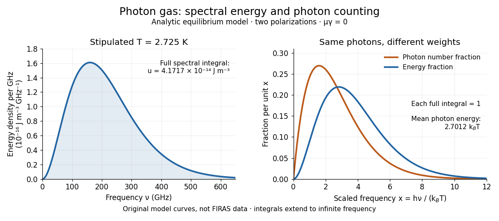

**[Figure 1](#image-analytic-photon-gas-spectra-counting-photons-and-weighting-their-energies). Analytic photon gas spectra: counting photons and weighting their energies**. Original equilibrium model, not measured data. The left panel evaluates $u_\nu$ at stipulated $T=2.725\,\mathrm K$ per gigahertz. The right panel uses $x=h\nu/(k_BT)$ and plots the normalized spectral fractions $F_n=x^2/[2\zeta(3)(e^x-1)]$ and $F_u=15x^3/[\pi^4(e^x-1)]$, each with total [integral](calculus.md#integral) one on $0<x<\infty$. Their different shapes show why a photon-counting spectrum and an [energy density](#energy-density) spectrum have different peaks.

A motivating observation is the [cosmic microwave background](cosmology.md#cosmic-microwave-background) spectrum measured by the Far Infrared Absolute Spectrophotometer (FIRAS) aboard COBE. Its apparatus used a polarizing [Michelson interferometer](optics.md#michelson-interferometer), with one input viewing a roughly seven-degree sky patch and the other an internal [blackbody](astrophysics.md#blackbody). Scanning mirrors changed the [optical path length](optics.md#optical-path-length) difference; heat-sensitive detectors recorded the varying [power](classical-mechanics.md#power), and [Fourier transform spectroscopy](optics.md#fourier-transform-spectroscopy) recovered the spectral difference. Operation outside the [terrestrial atmosphere](planetary-science.md#terrestrial-atmosphere) removed atmospheric emission and absorption, while shielding and cooling the optics in a helium cryostat suppressed the instrument's own radiation. [Mather, Fixsen and Shafer, Design for the COBE Far Infrared Absolute Spectrophotometer, apparatus and systematic-error controls](https://lambda.gsfc.nasa.gov/data/cobe/firas/doc/FES4_APP_B.pdf)

Absolute calibration came from moving an external [blackbody](astrophysics.md#blackbody) into the sky aperture, filling the same beam used for the sky. This was an iron-loaded epoxy absorber shaped as a re-entrant cone. Repeated reflections made it a close approximation to a [blackbody](astrophysics.md#blackbody), while thermometers supplied its [temperature](thermodynamics.md#temperature). Mather and colleagues explicitly evaluated reflections, [temperature](thermodynamics.md#temperature) gradients, radiation leaking through the material and leakage around its edge. These are limits on how faithfully the calibrator realizes [thermal equilibrium](thermodynamics.md#thermal-equilibrium) radiation, rather than details that can be eliminated merely by calling it black. [Mather et al., Calibrator Design for COBE FIRAS (1999): absorber geometry and calibration error budget](https://arxiv.org/abs/astro-ph/9810373)

During sky observations the internal [blackbody](astrophysics.md#blackbody) [temperature](thermodynamics.md#temperature) was adjusted to nearly null the spectral difference, reducing gain and drift errors. Fixsen and colleagues' 1996 analysis used calibrated spectra over [wavenumbers](wave-equation.md#wavenumber) $2$ to $21\,\mathrm{cm^{-1}}$, about $60$ to $630\,\mathrm{GHz}$. They separated the sky's spatially uniform component, its dipole and Galactic emission, and varied sky cuts and foreground templates as controls. The resulting [cosmic microwave background](cosmology.md#cosmic-microwave-background) spectrum agreed with a single [Planck function](astrophysics.md#planck-function), with reported RMS deviations below 50 parts per million of its peak brightness. This is a residual statistic over the analyzed spectrum, not a pointwise relative error bound at every [frequency](physics.md#frequency). [Fixsen et al., The Cosmic Microwave Background Spectrum from the Full COBE/FIRAS Data Set (1996), §§2, 5 and 5.3](https://arxiv.org/abs/astro-ph/9605054)

The observation motivates using a [photon gas](#photon-gas) as a physical model rather than merely a formal counting exercise. Its interpretation has a clear boundary: agreement with [Planck's law](#planck-s-law) constrains departures from an equilibrium spectral shape within the calibrated band and foreground assumptions; it does not directly measure [radiation pressure](thermodynamics.md#radiation-pressure) or [entropy density of a photon gas](#entropy-density-of-a-photon-gas). Nor does it establish that today's [cosmic microwave background](cosmology.md#cosmic-microwave-background) is continually re-equilibrating with matter. A previously thermal spectrum can retain its [Planck function](astrophysics.md#planck-function) shape as [expansion of the universe](cosmology.md#expansion-of-the-universe) lowers every [photon](quantum-mechanics.md#photon) [frequency](physics.md#frequency) in the same proportion. The usefulness of the model is that one measured spectral [temperature](thermodynamics.md#temperature), together with its equilibrium assumptions, predicts [energy density](#energy-density), [radiation pressure](thermodynamics.md#radiation-pressure), [photon number density](#photon-number-density) and [entropy density of a photon gas](#entropy-density-of-a-photon-gas) consistently.

### Entropy density of a photon gas

↑ **Parent:** [Photon gas](#photon-gas)

The [entropy density of a photon gas](#entropy-density-of-a-photon-gas) is its [entropy](thermodynamics.md#entropy) per physical [volume](thermodynamics.md#volume-thermodynamics), $s=S/V$. For homogeneous equilibrium vacuum radiation with two states of [electromagnetic polarization](electromagnetism.md#polarization-of-an-electromagnetic-wave) and zero [photon chemical potential](thermodynamics.md#photon-chemical-potential),

$$
s=\frac{u+p}{T}=\frac{4}{3}a_RT^3,\qquad
S=\frac{4}{3}a_RT^3V.
$$

The first equality is the [entropy density at zero chemical potential](thermodynamics.md#entropy-density-at-zero-chemical-potential), obtained from the [thermodynamic Euler relation](thermodynamics.md#euler-relation-in-thermodynamics) $U=TS-pV+\mu_\gamma N_\gamma$ with [internal energy](thermodynamics.md#internal-energy) $U=uV$. The second uses the [photon gas](#photon-gas) [equation of state](thermodynamics.md#equation-of-state), $u=a_RT^4$ and $p=u/3$. If an independently constrained [photon](quantum-mechanics.md#photon) number gives a nonzero [chemical potential](thermodynamics.md#chemical-potential), the general [entropy density](thermodynamics.md#entropy-density) is $(u+p-\mu_\gamma n_\gamma)/T$ and $u=a_RT^4$ need not hold. This distinction explains why the absence of a conserved number matters for [entropy](thermodynamics.md#entropy) as well as for the spectral shape. [David Tong, Statistical Physics, §4.4: Gibbs free energy and the thermodynamic Euler relation](https://davidtong.org/teaching/statistical-physics/statmechhtml/S4#S4.SS4)

A short [first law of thermodynamics](thermodynamics.md#first-law-of-thermodynamics) check, for neighboring equilibrium states with $\mu_\gamma=0$, is

$$
T\,dS=dU+p\,dV
 =4a_RT^3V\,dT+\frac{4}{3}a_RT^4\,dV,
\qquad
dS=\frac{4}{3}a_R\,d(T^3V).
$$

The [thermodynamic Euler relation](thermodynamics.md#euler-relation-in-thermodynamics) fixes the additive normalization. Equivalently, this radiation [entropy](thermodynamics.md#entropy) tends to zero with [temperature](thermodynamics.md#temperature) at fixed [volume](thermodynamics.md#volume-thermodynamics); no contribution from the containing walls is included. Interpreting $T\,dS$ as transferred [heat](thermodynamics.md#heat) and $p\,dV$ as boundary [work](classical-mechanics.md#work) requires a [reversible thermodynamic process](thermodynamics.md#reversible-thermodynamic-process). For a [reversible thermodynamic process](thermodynamics.md#reversible-thermodynamic-process) that is also an [adiabatic process](thermodynamics.md#adiabatic-process), there is no [entropy production](thermodynamics.md#entropy-production) or [entropy](thermodynamics.md#entropy) exchange, so

$$
T^3V=\text{constant},\qquad
T=T_0\left(\frac{V_0}{V}\right)^{1/3},\qquad
pV^{4/3}=\text{constant},\qquad
U=U_0\left(\frac{V_0}{V}\right)^{1/3}.
$$

An irreversible [adiabatic process](thermodynamics.md#adiabatic-process) can produce [entropy](thermodynamics.md#entropy) even without [heat](thermodynamics.md#heat) exchange, so the word adiabatic alone is insufficient to infer $T^3V=\text{constant}$.

For an analytic example, expand an initially equilibrated [photon gas](#photon-gas) reversibly from $V_0$ to $8V_0$, keeping only the same two [photon](quantum-mechanics.md#photon) states of [electromagnetic polarization](electromagnetism.md#polarization-of-an-electromagnetic-wave). Its [temperature](thermodynamics.md#temperature) halves, its [energy density](#energy-density) becomes $u_0/16$, its [entropy density of a photon gas](#entropy-density-of-a-photon-gas) becomes $s_0/8$, and its total [entropy](thermodynamics.md#entropy) stays $S_0$. The [internal energy](thermodynamics.md#internal-energy) halves rather than remaining fixed: the missing half leaves as [work](classical-mechanics.md#work) against [radiation pressure](thermodynamics.md#radiation-pressure),

$$
W=\int_{V_0}^{8V_0}p(V)\,dV=\frac{U_0}{2},\qquad
\Delta U=-W.
$$

This is a stipulated reversible radiation model, not a report of a piston experiment. Maintaining a real cavity along this path requires controlling wall [heat](thermodynamics.md#heat) exchange and including the wall [heat capacity](thermodynamics.md#heat-capacity) in any actual apparatus balance.

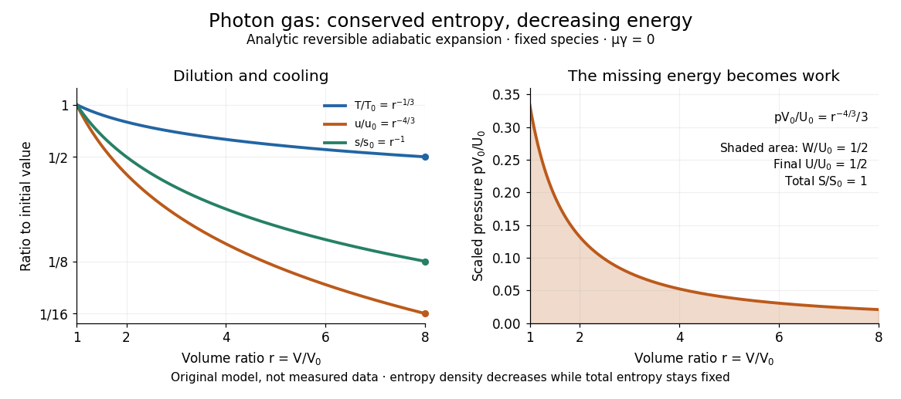

**[Figure 2](#image-analytic-reversible-photon-gas-expansion-entropy-conservation-and-pressure-work). Analytic reversible photon gas expansion: entropy conservation and pressure work**. Original fixed-species model with $r=V/V_0$ from 1 to 8 and no [entropy production](thermodynamics.md#entropy-production). The left panel shows $T/T_0=r^{-1/3}$, $u/u_0=r^{-4/3}$ and $s/s_0=r^{-1}$ on a logarithmic vertical scale. The right panel plots $pV_0/U_0=r^{-4/3}/3$; the shaded [integral](calculus.md#integral) is $W/U_0=1-8^{-1/3}=1/2$. Total [entropy](thermodynamics.md#entropy) remains constant even though both [entropy density](thermodynamics.md#entropy-density) and [internal energy](thermodynamics.md#internal-energy) decrease.

For a computed scale at stipulated $T=2.725\,\mathrm K$, $s\simeq2.04122\times10^{-14}\,\mathrm{J\,K^{-1}\,m^{-3}}$. Combining this with the [photon number density](#photon-number-density) gives

$$
\frac{S}{N_\gamma}=\frac{s}{n_\gamma}
 =\frac{2\pi^4}{45\zeta(3)}k_B\simeq3.60157\,k_B.
$$

This is the total equilibrium radiation [entropy](thermodynamics.md#entropy) divided by its mean [photon](quantum-mechanics.md#photon) number, not a separately assigned [entropy](thermodynamics.md#entropy) carried by each labeled particle. During the ideal expansion, $n_\gamma\propto T^3$ and $T^3V$ is fixed, so the mean number $N_\gamma=n_\gamma V$ also stays constant. This follows from the path; it was not imposed as the independent number constraint used to establish [chemical potential](thermodynamics.md#chemical-potential).

The beautiful connection is that expansion lowers each typical [photon](quantum-mechanics.md#photon) [energy](classical-mechanics.md#energy) and dilutes the radiation in just the proportions needed to retain its equilibrium spectral shape and total [entropy](thermodynamics.md#entropy). For the [cosmic microwave background](cosmology.md#cosmic-microwave-background), homogeneous [expansion of the universe](cosmology.md#expansion-of-the-universe) has physical [volume](thermodynamics.md#volume-thermodynamics) proportional to the cube of the [scale factor](cosmology.md#scale-factor-cosmology); fixed-species [cosmological entropy conservation](cosmology.md#cosmological-entropy-conservation) therefore gives $T\propto a^{-1}$. This describes preservation of an already established [Planck photon distribution](#planck-photon-distribution) and connects the FIRAS spectral observation in [photon gas](#photon-gas) to an [entropy](thermodynamics.md#entropy) prediction; FIRAS did not perform a direct [entropy](thermodynamics.md#entropy) measurement. When other equilibrated species disappear and transfer [energy](classical-mechanics.md#energy) into radiation, use the [effective number of relativistic entropy degrees of freedom](cosmology.md#effective-number-of-relativistic-degrees-of-freedom), $g_{*s}$: the conserved quantity for the combined sector is $g_{*s}T^3V$, under the corresponding equilibrium and no-[entropy production](thermodynamics.md#entropy-production) assumptions. A changing species population, separate decoupled sectors or [entropy production](thermodynamics.md#entropy-production) requires an appropriate [entropy](thermodynamics.md#entropy) balance rather than the pure [photon gas](#photon-gas) formula. [David Tong, Cosmology, §2.5.2: entropy conservation and heating when relativistic species disappear](https://davidtong.org/teaching/cosmology/cosmohtml/S2#S2.SS5.SSS2)

## Statistical mechanics

↑ **Parent:** [Statistical physics](statistical-physics.md)  
ⓦ [Wiki](https://en.wikipedia.org/wiki/Statistical_mechanics)

[Statistical mechanics](#statistical-mechanics) connects [microstates](#microstate) to [macrostates](#macrostate) through [probability distributions](probability-theory.md#probability-distribution). Its [microcanonical ensemble](#microcanonical-ensemble), [canonical ensemble](#canonical-ensemble) and [grand canonical ensemble](#grand-canonical-ensemble) specify different constraints on exchanges with the surroundings. An [ensemble average](probability-theory.md#expected-value) describes repeated preparations under those constraints; it need not be the value in every individual preparation.

This makes the subject useful whenever tracking every microscopic detail would obscure the question being asked. To predict a [heat capacity](thermodynamics.md#heat-capacity), we need how the [expected value](probability-theory.md#expected-value) of [energy](classical-mechanics.md#energy) changes with [temperature](thermodynamics.md#temperature), rather than a record of every unit's state. The [partition function](#canonical-partition-function) packages that calculation into one reusable object.

In his 1902 book, J. Willard Gibbs systematically developed the [canonical ensemble](#canonical-ensemble). His preface contrasts following one system through time with studying a collection of systems with different microscopic conditions. Chapter IV defines the [canonical ensemble](#canonical-ensemble) through an [exponential function](calculus.md#exponential-function) of [energy](classical-mechanics.md#energy) and establishes its normalization. This supplied a general strategy for predicting collective measurements by averaging over possible microscopic conditions, with the [partition function](#canonical-partition-function) organizing the calculation. [Gibbs, Elementary Principles in Statistical Mechanics (1902), preface](https://en.wikisource.org/wiki/Elementary_Principles_in_Statistical_Mechanics) [Gibbs (1902), Chapter IV, equations 90–93](https://en.wikisource.org/wiki/Elementary_Principles_in_Statistical_Mechanics/Chapter_IV)

## Ergodic hypothesis

↑ **Parent:** [Statistical physics](statistical-physics.md)  
ⓦ [Wiki](https://en.wikipedia.org/wiki/Ergodic_hypothesis)

The [ergodic hypothesis](#ergodic-hypothesis) identifies long-time averages of equilibrium observables along typical trajectories with averages over the invariant equilibrium ensemble at the same conserved quantities. In the microcanonical formulation, the ensemble is normalized phase-space measure on the energy surface. In a measure-preserving description, [ergodicity](measure-theory.md#ergodicity) means invariant measurable sets have measure zero or one; the [Birkhoff ergodic theorem](measure-theory.md#birkhoff-ergodic-theorem) then equates time averages and ensemble expectations almost everywhere for integrable observables. This explains why statistical-mechanical ensembles can predict long-time measurements. A particular mechanical model still requires its own ergodicity assumptions; integrable idealized systems need not be ergodic.

## Latent heat of fusion

↑ **Parent:** [Statistical physics](statistical-physics.md)

An ice bath can absorb [heat](thermodynamics.md#heat) while its [temperature](thermodynamics.md#temperature) barely changes: the [heat](thermodynamics.md#heat) converts [ice](chemistry.md#ice) into [water](chemistry.md#water). The [latent heat of fusion](#latent-heat-of-fusion) quantifies this [melting](critical-phenomenon.md#melting) budget. For a pure substance at its equilibrium [melting](critical-phenomenon.md#melting) [temperature](thermodynamics.md#temperature) $T_m(p)$ and specified [pressure](thermodynamics.md#pressure) $p$, define it here per unit [mass](classical-mechanics.md#mass):

$$
L(p)=h_l(T_m(p),p)-h_s(T_m(p),p),\qquad h=H/m.
$$

Here $h_l$ and $h_s$ are the [specific enthalpies](thermodynamics.md#specific-enthalpy) of the coexisting bulk [liquid](thermodynamics.md#liquid) and [solid](thermodynamics.md#solid), and $H$ is [enthalpy](thermodynamics.md#enthalpy). For ordinary [melting](critical-phenomenon.md#melting), $L>0$, in $\mathrm{J\,kg^{-1}}$; an amount $m$ has a total fusion [enthalpy](thermodynamics.md#enthalpy) $mL$ in [joules](physics.md#joule). A molar fusion [enthalpy](thermodynamics.md#enthalpy) instead has units $\mathrm{J\,mol^{-1}}$ and equals $ML$, where $M=m/n$ is [mass](classical-mechanics.md#mass) divided by [amount of substance](physics.md#amount-of-substance) in $\mathrm{kg\,mol^{-1}}$. Always check the normalization before inserting a tabulated value into an [energy](classical-mechanics.md#energy) balance.[§1.5: fusion and specific latent heat](physics-bibliography.md#university-physics-volume-2-by-samuel-j-ling-and-others/1-5-phase-changes) [IUPAC Gold Book, mass divided by amount of substance](https://goldbook.iupac.org/terms/view/12214)

For a [closed system](thermodynamics.md#closed-system) converting completely from [solid](thermodynamics.md#solid) to [liquid](thermodynamics.md#liquid) at fixed [pressure](thermodynamics.md#pressure), with only [pressure](thermodynamics.md#pressure)-[volume](thermodynamics.md#volume-thermodynamics) [work](classical-mechanics.md#work) and negligible changes in bulk [kinetic energy](classical-mechanics.md#kinetic-energy) and [potential energy](classical-mechanics.md#potential-energy), the [first law of thermodynamics](thermodynamics.md#first-law-of-thermodynamics) gives $Q_p=\Delta H=mL$. Both endpoints are at $T_m(p)$: warming initially colder [ice](chemistry.md#ice) or subsequently warming the resulting [water](chemistry.md#water) requires additional [sensible heat](thermodynamics.md#sensible-heat). Since $H=U+pV$, the corresponding [specific internal energy](thermodynamics.md#specific-internal-energy) jump is $\Delta u=L-p\Delta v$, where $v=V/m$; $L$ includes the [work](classical-mechanics.md#work) associated with the change in [volume](thermodynamics.md#volume-thermodynamics). [Heat](thermodynamics.md#heat) is transferred [energy](classical-mechanics.md#energy), whereas [enthalpy](thermodynamics.md#enthalpy) is a [state function](thermodynamics.md#state-function). [David Tong, Statistical Physics, §4.4.1 and the first law](https://davidtong.org/teaching/statistical-physics/statmechhtml/S4#S4.SS4.SSS1)

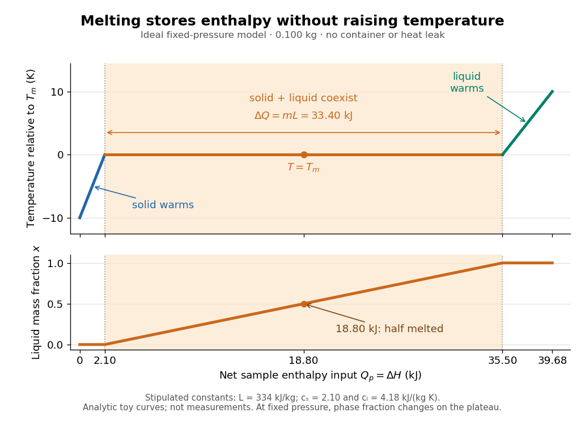

**[Figure 3](#image-during-equilibrium-melting-added-heat-changes-the-phase-fraction-while-temperature-stays-fixed). During equilibrium melting, added heat changes the phase fraction while temperature stays fixed**. An original idealized ice-inspired model, not measured data: $m=0.100\,\mathrm{kg}$, $T_m=273.15\,\mathrm K$, constant [specific heat capacity at constant pressure](thermodynamics.md#specific-heat-capacity-at-constant-pressure) in each phase, $c_s=2100$ and $c_l=4180\,\mathrm{J\,kg^{-1}\,K^{-1}}$, and $L=334000\,\mathrm{J\,kg^{-1}}$. The initial [solid](thermodynamics.md#solid) is $10\,\mathrm K$ below $T_m$; the final [liquid](thermodynamics.md#liquid) is $10\,\mathrm K$ above it. The horizontal axis is net sample [enthalpy](thermodynamics.md#enthalpy) input, excluding the container.

Let $x=m_l/m$ be the [liquid](thermodynamics.md#liquid) [phase fraction](thermodynamics.md#phase-fraction) by [mass](classical-mechanics.md#mass), rather than by [volume](thermodynamics.md#volume-thermodynamics). Neglecting interfacial contributions to [enthalpy](thermodynamics.md#enthalpy), equilibrium [phase coexistence](critical-phenomenon.md#phase-coexistence) at fixed [pressure](thermodynamics.md#pressure) gives

$$
h=(1-x)h_s+xh_l=h_s+xL,\qquad Q_p=mL(x_2-x_1),\qquad T=T_m(p).
$$

In the model above, reaching $T_m$ takes $2.10\,\mathrm{kJ}$ of [sensible heat](thermodynamics.md#sensible-heat); the plateau then absorbs $33.40\,\mathrm{kJ}$, ending at a cumulative $35.50\,\mathrm{kJ}$. At $18.80\,\mathrm{kJ}$, half the [mass](classical-mechanics.md#mass) is [liquid](thermodynamics.md#liquid) and the [temperature](thermodynamics.md#temperature) is still $T_m$. The final warming takes another $4.18\,\mathrm{kJ}$. The rounded $L$ and $c_l$ are inspired by the introductory [ice-melting calorimetry](#ice-melting-calorimetry) values in Case Western's demonstration; constant properties and exact equilibrium throughout are stipulated model assumptions. [Case Western Reserve University, specific heat and heat of fusion demonstration](https://case.edu/artsci/phys/courses/demos/spec.htm)

Within one [thermodynamic phase](thermodynamics.md#thermodynamic-phase), [specific heat capacity at constant pressure](thermodynamics.md#specific-heat-capacity-at-constant-pressure) is $c_p=(\partial h/\partial T)_p$, in $\mathrm{J\,kg^{-1}\,K^{-1}}$; a sample's [heat capacity at constant pressure](thermodynamics.md#heat-capacity-at-constant-pressure) is $C_p=mc_p$, in $\mathrm{J\,K^{-1}}$. The plateau is a finite [enthalpy](thermodynamics.md#enthalpy) change at zero [temperature](thermodynamics.md#temperature) change through varying $x$, so neither a finite single-phase $c_p$ nor $Q=mc_p\Delta T$ represents it. The [heating curve](thermodynamics.md#heating-curve) needs separate [sensible heat](thermodynamics.md#sensible-heat) intervals and a fusion contribution. [IUPAC Gold Book, heat capacity](https://goldbook.iupac.org/terms/view/H02753)

The plateau assumes a pure substance, a stable bulk [solid](thermodynamics.md#solid)-[liquid](thermodynamics.md#liquid) [phase coexistence](critical-phenomenon.md#phase-coexistence) pair, fixed [pressure](thermodynamics.md#pressure), and sufficiently slow, uniform heating to remain near [thermodynamic equilibrium](thermodynamics.md#thermodynamic-equilibrium). The total [mass](classical-mechanics.md#mass) and composition must remain fixed, with negligible evaporation and no other [phase transition](critical-phenomenon.md#phase-transition). A fast heater can produce [temperature](thermodynamics.md#temperature) gradients, so a local [thermometer](thermodynamics.md#thermometer) need not read the equilibrium $T_m$. Neither $T_m$ nor $L$ is universal across [pressures](thermodynamics.md#pressure) or compositions: [common-pressure melting-point slope](thermodynamics.md#common-pressure-melting-point-slope) describes the pressure dependence of $T_m$, while mixtures can melt over a [temperature](thermodynamics.md#temperature) range as their coexisting compositions change. Their [liquidus](thermodynamics.md#liquidus) must be consulted instead of assuming a pure-substance plateau. [Stephen A. Nelson, Tulane, Two Component Phase Diagrams, pp. 2–4: melting ranges and liquidus](https://www2.tulane.edu/~sanelson/eens211/2compphasdiag.pdf#page=3)

This makes [ice](chemistry.md#ice) useful as a [temperature](thermodynamics.md#temperature) buffer: under these conditions it can absorb $m_sL$ before the remaining [solid](thermodynamics.md#solid) [mass](classical-mechanics.md#mass) $m_s$ disappears, after which the [water](chemistry.md#water) warms. If a stipulated constant net input [power](classical-mechanics.md#power) $P$ goes entirely into [melting](critical-phenomenon.md#melting), that buffer lasts $m_sL/P$. Reversing the equilibrium conversion releases the same fusion [enthalpy](thermodynamics.md#enthalpy) during [freezing](critical-phenomenon.md#freezing). The beautiful thermodynamic connection is $L=T_m(s_l-s_s)$, with $s$ the [specific entropy](thermodynamics.md#specific-entropy) and $T_m$ absolute [temperature](thermodynamics.md#temperature): equal [Gibbs free energies](thermodynamics.md#gibbs-free-energy) at [phase coexistence](critical-phenomenon.md#phase-coexistence) allow different [enthalpies](thermodynamics.md#enthalpy) and [entropies](thermodynamics.md#entropy). The nearly stationary [thermometer](thermodynamics.md#thermometer) hides a finite, measurable change of state. [Tong, Statistical Physics, §5.1.2: coexistence and latent heat](https://davidtong.org/teaching/statistical-physics/statmechhtml/S5)

### Ice-melting calorimetry

↑ **Parent:** [Latent heat of fusion](#latent-heat-of-fusion)

[Ice-melting calorimetry](#ice-melting-calorimetry) measures the fusion [enthalpy](thermodynamics.md#enthalpy) through [conservation of energy](physics.md#conservation-of-energy), rather than inferring it from the small [temperature](thermodynamics.md#temperature) change of the [melting](critical-phenomenon.md#melting) [ice](chemistry.md#ice) itself. In a mixing experiment, warm [water](chemistry.md#water) and the container cool while added [ice](chemistry.md#ice) melts and the resulting [water](chemistry.md#water) warms. Their combined [energy](classical-mechanics.md#energy) balance separates fusion from [sensible heat](thermodynamics.md#sensible-heat).

Weigh the container and stirrer, then weigh the added warm [water](chemistry.md#water) to obtain $m_w$. Let the container and [water](chemistry.md#water) reach a common initial [temperature](thermodynamics.md#temperature) $T_i$. Prepare [ice](chemistry.md#ice) in a clean [ice](chemistry.md#ice)-[water](chemistry.md#water) mixture near $T_m$, rather than assuming freezer [ice](chemistry.md#ice) is already at $T_m$; drain and blot its surface immediately before transfer. Add it without splashing, stir gently, and record [temperature](thermodynamics.md#temperature) before addition and until after the last [ice](chemistry.md#ice) disappears. Reweigh to find the added [mass](classical-mechanics.md#mass) $m_i$. Wisconsin's laboratory guide specifies drying each piece, weighing before and after, and recording the [temperature](thermodynamics.md#temperature) history; it places the initial and final [temperatures](thermodynamics.md#temperature) on opposite sides of the jacket [temperature](thermodynamics.md#temperature) to reduce net environmental exchange. [University of Wisconsin, H-2: Latent heat of fusion of ice, procedure](https://badger.physics.wisc.edu/trash/lab_old/manual/node30.html)

For fully melted, initially dry [ice](chemistry.md#ice) at $T_m$, a common final [temperature](thermodynamics.md#temperature) $T_f>T_m$, constant [water](chemistry.md#water) [specific heat capacity at constant pressure](thermodynamics.md#specific-heat-capacity-at-constant-pressure) $c_w$, and apparatus [heat capacity](thermodynamics.md#heat-capacity) $C_{\rm cal}$ initially at $T_i$,

$$
(m_wc_w+C_{\rm cal})(T_i-T_f)+Q_{\rm env}=m_iL+m_ic_w(T_f-T_m).
$$

Here $Q_{\rm env}>0$ denotes net [heat](thermodynamics.md#heat) entering the apparatus from its surroundings. The left side supplies the fusion [enthalpy](thermodynamics.md#enthalpy) and the [sensible heat](thermodynamics.md#sensible-heat) on the right; the [water](chemistry.md#water) produced by [melting](critical-phenomenon.md#melting) must be warmed too. The balance extends Case Western's mixing demonstration by including the apparatus and environmental terms. If the [specific heat capacities](thermodynamics.md#specific-heat-capacity) vary appreciably, replace their products with the corresponding [temperature](thermodynamics.md#temperature) integrals. [Case Western, mixing-calorimetry energy balance](https://case.edu/artsci/phys/courses/demos/spec.htm)

Determine $C_{\rm cal}$ independently, for example by a warm/cold [water](chemistry.md#water) mixing balance with no [phase transition](critical-phenomenon.md#phase-transition), including the wetted stirrer and [thermometer](thermodynamics.md#thermometer) in the apparatus. Check the [thermometer calibration](thermodynamics.md#thermometer-calibration), keep the lid in place between transfers, and monitor the surroundings. Before/after drift and a comparable run without [ice](chemistry.md#ice) help bound $Q_{\rm env}$; such corrections assume comparable [heat transfer](thermodynamics.md#heat-transfer) conditions and are not automatically exact. Choosing a jacket [temperature](thermodynamics.md#temperature) between $T_i$ and $T_f$ reduces exchange but does not prove $Q_{\rm env}=0$. Ensure all the [ice](chemistry.md#ice) has melted and the contents are well mixed before using the measured $T_f$: with residual [ice](chemistry.md#ice), the weighed addition is not the [mass](classical-mechanics.md#mass) that has undergone fusion. Repeat the experiment and report [measurement errors](probability-and-statistics.md#measurement-error) in [mass](classical-mechanics.md#mass), [temperature](thermodynamics.md#temperature), $C_{\rm cal}$ and the leak correction.

An independent way to see the plateau is David Roundy's Oregon State experiment: heat an [ice](chemistry.md#ice)-[water](chemistry.md#water) mixture slowly with a waterproof resistor in an insulated cup, stir, and record [temperature](thermodynamics.md#temperature), heater [electric current](electromagnetism.md#electric-current) $I(t)$, [electric potential difference](electromagnetism.md#electric-potential-difference) $V(t)$ and elapsed time. Plot [temperature](thermodynamics.md#temperature) against $E_{\rm el}=\int I(t)V(t)\,dt$, recording changes in $I$ or $V$. The initial [solid](thermodynamics.md#solid) [mass](classical-mechanics.md#mass) must exclude accompanying [water](chemistry.md#water). For a boundary enclosing the heater as well as the sample, this input is electrical [work](classical-mechanics.md#work), so $\Delta H=E_{\rm el}+Q_{\rm env}$ under the constant-[pressure](thermodynamics.md#pressure) assumptions above. Across an ideal isothermal plateau the apparatus has no [sensible heat](thermodynamics.md#sensible-heat) change, giving $m_sL=E_{\rm el}+Q_{\rm env}$; departures from uniform [temperature](thermodynamics.md#temperature) require accounting for the heater and container response. [David Roundy, Oregon State, Ice Calorimetry Lab: apparatus, stirring and electrical input](https://paradigms.physics.oregonstate.edu/act/handout/2108)

#### Wet-ice bias in fusion calorimetry

↑ **Parent:** [Ice-melting calorimetry](#ice-melting-calorimetry)

Surface [water](chemistry.md#water) counted as [ice](chemistry.md#ice) needs warming but has already undergone [melting](critical-phenomenon.md#melting). Its presence therefore biases a dry-ice estimate of [latent heat of fusion](#latent-heat-of-fusion) downward. This is why drying the added [ice](chemistry.md#ice) is a quantitative control in [ice-melting calorimetry](#ice-melting-calorimetry), rather than cosmetic preparation. Let $m_a$ be the total added [mass](classical-mechanics.md#mass) at $T_m$, of which a fraction $r$ is already [liquid](thermodynamics.md#liquid) and $(1-r)$ remains [solid](thermodynamics.md#solid). The correct constant-property balance is

$$
(m_wc_w+C_{\rm cal})(T_i-T_f)+Q_{\rm env}=(1-r)m_aL+m_ac_w(T_f-T_m).
$$

If an analysis incorrectly treats all $m_a$ as [solid](thermodynamics.md#solid) and sets $Q_{\rm env}=0$, it obtains

$$
L_{\rm app}=\frac{(m_wc_w+C_{\rm cal})(T_i-T_f)}{m_a}-c_w(T_f-T_m)=(1-r)L-\frac{Q_{\rm env}}{m_a}.
$$

Thus $r=0.10$ gives a $10\%$ low estimate with no heat leak. Unaccounted incoming [heat](thermodynamics.md#heat) also lowers the estimate; outgoing [heat](thermodynamics.md#heat) raises it. These signs follow directly from the displayed [energy](classical-mechanics.md#energy) balance. Conversely, dry [ice](chemistry.md#ice) initially below $T_m$ absorbs additional [sensible heat](thermodynamics.md#sensible-heat); neglecting that term overestimates $L$. These are different biases and may partially cancel, so agreement with a reference value alone does not validate the controls.

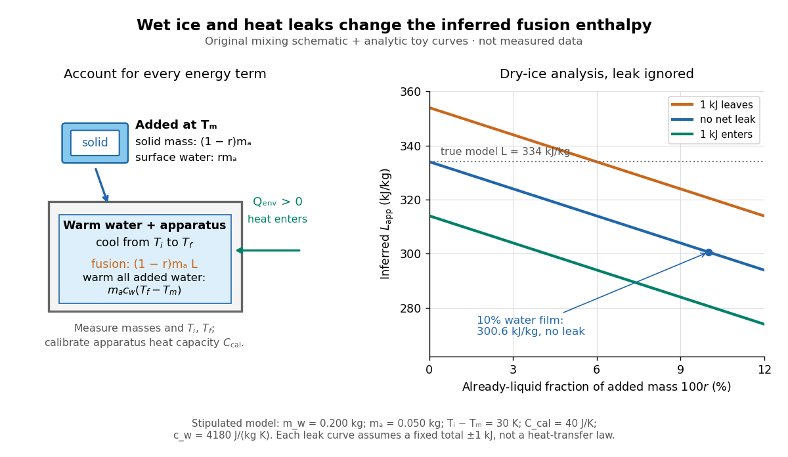

**[Figure 4](#image-count-only-the-solid-addition-as-fusion-mass-and-account-for-environmental-heat). Count only the solid addition as fusion mass, and account for environmental heat**. Original mixing schematic and analytic bias curves, not measured data. Stipulated model: $m_w=0.200\,\mathrm{kg}$, $m_a=0.050\,\mathrm{kg}$, $T_i-T_m=30\,\mathrm K$, $C_{\rm cal}=40\,\mathrm{J\,K^{-1}}$, $c_w=4180\,\mathrm{J\,kg^{-1}\,K^{-1}}$ and $L=334000\,\mathrm{J\,kg^{-1}}$. The leak curves use fixed total $Q_{\rm env}=+1000,0,-1000\,\mathrm J$ as separate hypothetical cases, not a fitted heat-transfer law.

For this model with $r=0$ and $Q_{\rm env}=0$, the balance predicts $T_f-T_m\simeq8.829\,\mathrm K$, with $16.700\,\mathrm{kJ}$ consumed by fusion and $1.845\,\mathrm{kJ}$ by warming the melted [water](chemistry.md#water). At $r=0.10$ with the same zero leak, it predicts $T_f-T_m\simeq10.369\,\mathrm K$ and $L_{\rm app}=300.6\,\mathrm{kJ\,kg^{-1}}$. A net incoming $1\,\mathrm{kJ}$ shifts $L_{\rm app}$ downward by a further $20\,\mathrm{kJ\,kg^{-1}}$ because $m_a=0.050\,\mathrm{kg}$. The warmer final [water](chemistry.md#water) in the wet case is evidence of a smaller fusion budget, not a larger true $L$.

## Superfluidity

↑ **Parent:** [Statistical physics](statistical-physics.md)  
ⓦ [Wiki](https://en.wikipedia.org/wiki/Superfluidity)

[Superfluidity](#superfluidity) is a quantum-fluid response with [phase stiffness](critical-phenomenon.md#phase-stiffness) and flow without viscous dissipation in an appropriate low-speed regime. A [superfluid](#superfluid) supports a phase-gradient current; defects and excitations can limit that flow. [Bose-Einstein condensation](#bose-einstein-condensation) concerns macroscopic one-particle occupation and is a distinct criterion: the Gaussian [phase stiffness](critical-phenomenon.md#phase-stiffness) theory can have divergent absolute-phase fluctuations while retaining a cost for [gradients](calculus.md#gradient).

### Superfluid

↑ **Parent:** [Superfluidity](#superfluidity)

A superfluid exhibits [superfluidity](#superfluidity), with [phase stiffness](critical-phenomenon.md#phase-stiffness) and a phase-gradient current. In an appropriate ordered or quasi-ordered regime it supports low-speed flow without viscous dissipation, and its long-wavelength [Goldstone boson](critical-phenomenon.md#goldstone-boson) has a sound-like dispersion. True thermodynamic phase selection and [Bose-Einstein condensation](#bose-einstein-condensation) need separate infrared conditions.

#### Normal component of a superfluid

↑ **Parent:** [Superfluid](#superfluid)

The normal component of a [superfluid](#superfluid) describes the momentum and entropy carried by excitations rather than the phase-gradient condensate current. Its [velocity](classical-mechanics.md#velocity) need not equal the [superfluid velocity](#superfluid-velocity). In phenomenological condensate equations, prescribing its motion supplies a reference flow for dissipation; a full two-component fluid theory would also evolve its momentum and energy.

#### Superfluid velocity

↑ **Parent:** [Superfluid](#superfluid)

For a condensate $\psi=\sqrt n e^{iS}$ with kinetic operator $-\hbar^2\nabla^2/(2m)$, its particle current is $n\mathbf u$ with the displayed [velocity](classical-mechanics.md#velocity). This follows by subtracting the [Gross–Pitaevskii equation](#gross-pitaevskii-equation) from its [complex conjugate](complex-analysis.md#complex-conjugate). More generally, in units where the kinetic operator is $-D\nabla^2$, the current [velocity](classical-mechanics.md#velocity) is $2D\nabla S$. The [complex argument](complex-analysis.md#argument-complex-analysis) [gradient](calculus.md#gradient) and current [velocity](classical-mechanics.md#velocity) coincide only when $D=1/2$.

#### Superfluid order-parameter effective theory

↑ **Parent:** [Superfluid](#superfluid)

For a complex superfluid order parameter $\psi=\sqrt n e^{i\theta}$, the nonrelativistic Landau-Ginzburg kinetic term contains $-n\dot\theta$. Thus number density and phase are canonically conjugate, so a phase-selected state necessarily fluctuates in particle number.

##### Number-phase conjugacy

↑ **Parent:** [Superfluid order-parameter effective theory](#superfluid-order-parameter-effective-theory)

Number-phase conjugacy is the canonical relation between a conserved $U(1)$ charge and the phase of its order parameter. A state of sharp number cannot also have a sharply selected broken-symmetry phase.

##### Thermal phase fluctuation

↑ **Parent:** [Superfluid order-parameter effective theory](#superfluid-order-parameter-effective-theory)

A thermal phase fluctuation is a finite-temperature fluctuation of the phase of a complex [order parameter](critical-phenomenon.md#order-parameter). For a linearly dispersing phase mode, its infrared variance is proportional to $T\int d^dk/k^2$, which prevents true finite-temperature long-range order when $d\leq2$.

## Superconductivity

↑ **Parent:** [Statistical physics](statistical-physics.md)  
ⓦ [Wiki](https://en.wikipedia.org/wiki/Superconductivity)

[Superconductivity](#superconductivity) is a phase of matter that supports steady [electric current](electromagnetism.md#electric-current) with zero bulk [electrical resistivity](electromagnetism.md#electrical-resistivity) and exhibits the [Meissner effect](electromagnetism.md#meissner-effect): equilibrium screening of a sufficiently weak, static [magnetic field](electromagnetism.md#magnetic-field) from the interior. It occurs below a material-dependent [superconducting transition temperature](#superconducting-transition-temperature), provided the [electric current](electromagnetism.md#electric-current) and applied [magnetic field](electromagnetism.md#magnetic-field) are also sufficiently small. [Milind N. Kunchur (2004), limits on dissipation-free superconducting current](https://arxiv.org/abs/cond-mat/0409402) Bulk expulsion means that a sample much thicker than its [London penetration depth](electromagnetism.md#london-penetration-depth) has an almost field-free interior; the [magnetic field](electromagnetism.md#magnetic-field) need not vanish at its surface. Conventional [BCS theory](#bcs-theory) explains [superconductivity](#superconductivity) through correlated [Electrons](physics.md#electron) forming [Cooper pairs](#cooper-pair). [Hoffman laboratory, introduction to superconductivity](https://hoffman.physics.harvard.edu/materials/SCintro.php)

The two observations answer different questions. A [resistance-versus-temperature experiment for superconductivity](#resistance-versus-temperature-experiment-for-superconductivity) asks whether a steady [electric current](electromagnetism.md#electric-current) requires a measurable [electric potential difference](electromagnetism.md#electric-potential-difference). A [Field-cooled Meissner experiment](#field-cooled-meissner-experiment) asks whether a [magnetic field](electromagnetism.md#magnetic-field) already present in the material is expelled when it enters [superconductivity](#superconductivity). An ideal [perfect conductor](electromagnetism.md#perfect-conductor) with zero [electrical resistivity](electromagnetism.md#electrical-resistivity) can preserve that pre-existing [magnetic field](electromagnetism.md#magnetic-field); zero [electrical resistance](electromagnetism.md#electrical-resistance) alone therefore does not establish the [Meissner effect](electromagnetism.md#meissner-effect).

The usefulness follows directly from [Joule heating](electromagnetism.md#joule-heating), $P=I^2R$: maintaining a steady [electric current](electromagnetism.md#electric-current) through a segment with zero [electrical resistance](electromagnetism.md#electrical-resistance) produces no resistive heating in that segment. This makes persistent [electric currents](electromagnetism.md#electric-current) attractive for producing steady [magnetic fields](electromagnetism.md#magnetic-field). The beauty is that one phase has both a transport property and an equilibrium magnetic response, and the second cannot be inferred just by making an ordinary [electrical resistance](electromagnetism.md#electrical-resistance) very small. The [London equations](electromagnetism.md#london-equations) encode this extra magnetic response. [F. and H. London (1935), The electromagnetic equations of the supraconductor](https://doi.org/10.1098/rspa.1935.0048)

### Type-I superconductor

↑ **Parent:** [Superconductivity](#superconductivity)

### Type-II superconductor

↑ **Parent:** [Superconductivity](#superconductivity)

#### Superconducting mixed state

↑ **Parent:** [Type-II superconductor](#type-ii-superconductor)

##### Flux pinning

↑ **Parent:** [Superconducting mixed state](#superconducting-mixed-state)

### Superconducting transition temperature

↑ **Parent:** [Superconductivity](#superconductivity)

The [superconducting transition temperature](#superconducting-transition-temperature) $T_c$ is the [temperature](thermodynamics.md#temperature) at which the material enters [superconductivity](#superconductivity) on cooling in zero applied [magnetic field](electromagnetism.md#magnetic-field) and with negligible measuring [electric current](electromagnetism.md#electric-current). A measured transition at nonzero [magnetic field](electromagnetism.md#magnetic-field) or appreciable [electric current](electromagnetism.md#electric-current) need not occur at this zero-field $T_c$. If a [resistance-versus-temperature experiment for superconductivity](#resistance-versus-temperature-experiment-for-superconductivity) gives a transition spread over several [temperatures](thermodynamics.md#temperature), report whether its quoted value is the onset, midpoint, or disappearance of detectable [electrical resistance](electromagnetism.md#electrical-resistance), together with the experimental conditions. This operational distinction matters when comparing samples. [MIT Junior Lab, superconductivity guide, §3.1](https://ocw.mit.edu/courses/8-13-14-experimental-physics-i-ii-junior-lab-fall-2016-spring-2017/ec45c3030c7ec2ba0f0537ab84d09c17_MIT8_13-14F16-S17exp39.pdf#page=2)

### Resistance-versus-temperature experiment for superconductivity

↑ **Parent:** [Superconductivity](#superconductivity)

The motivating observation is an abrupt disappearance of detectable [electrical resistance](electromagnetism.md#electrical-resistance) on cooling, rather than a smooth improvement in conduction. The diagram pairs the measuring arrangement with an idealized transition. Its curves are deliberately synthetic; neither their scales nor their abrupt step are a reconstruction of measured mercury data.

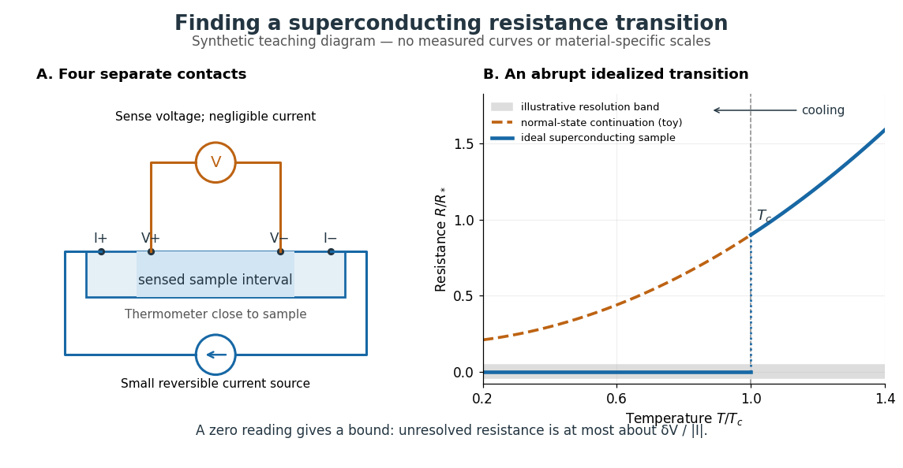

**[Figure 5](#image-separate-current-and-voltage-leads-reveal-a-synthetic-superconducting-resistance-transition). Separate current and voltage leads reveal a synthetic superconducting resistance transition**. The left panel shows [four-terminal sensing](#four-terminal-sensing); the right compares an idealized zero-[electrical resistance](electromagnetism.md#electrical-resistance) branch with a stipulated normal-state continuation. All curves and the resolution band are illustrative, not measured data. The dashed vertical segment marks an idealized jump, not a fitted transition width.

In a report communicated in November 1911, Heike Kamerlingh Onnes described a mercury thread in seven connected glass U-tubes immersed in a stirred liquid-helium bath. Expansion spaces kept freezing mercury from breaking the glass or interrupting the thread. Separate leads supplied [electric current](electromagnetism.md#electric-current) and sensed [electric potential difference](electromagnetism.md#electric-potential-difference). He compensated a troublesome [thermoelectric effect](electromagnetism.md#thermoelectric-effect) and reversed the main [electric current](electromagnetism.md#electric-current) to extract the resistive signal. He reported a rapid fall between $4.21$ and $4.19\,\mathrm K$ on his stated historical [temperature](thermodynamics.md#temperature) scale, with [electrical resistance](electromagnetism.md#electrical-resistance) disappearing at the lower value. The apparatus and control of spurious [electric potential differences](electromagnetism.md#electric-potential-difference) are part of the discovery, not incidental details. [Kamerlingh Onnes, Communication 124c (1911), §§2–3, pp. 819–821](https://dwc.knaw.nl/DL/publications/PU00013242.pdf)

A modern version places a contacted sample and a calibrated [thermometer](thermodynamics.md#thermometer) close together in a cooling environment. Use [four-terminal sensing](#four-terminal-sensing), record the small applied [electric current](electromagnetism.md#electric-current) $I$, the sensed [electric potential difference](electromagnetism.md#electric-potential-difference) $V$, and the sample [temperature](thermodynamics.md#temperature) $T$, then plot $R(T)=V/I$. Repeat on warming as well as cooling, and allow readings to stabilize near [thermal equilibrium](thermodynamics.md#thermal-equilibrium). Disagreement between warming and cooling is a reason to check sample–[thermometer](thermodynamics.md#thermometer) lag and reproducibility before quoting a [superconducting transition temperature](#superconducting-transition-temperature). Mikhailov and Kordosky's undergraduate experiment uses this strategy with liquid-nitrogen cooling. [Mikhailov and Kordosky, Physics 251 superconductivity lab, measurement procedure and discussion](https://physics.wm.edu/~evmik/classes/2021_fall_Experimental_Atomic_Physics_251/lab_descriptions/superconductivity/)

Choose the measuring [electric current](electromagnetism.md#electric-current) small enough that [Joule heating](electromagnetism.md#joule-heating) does not appreciably change the sample [temperature](thermodynamics.md#temperature), and repeat with a smaller [electric current](electromagnetism.md#electric-current) to check that the transition persists. Cancel stable offsets using the reversal described in [four-terminal sensing](#four-terminal-sensing). A reading indistinguishable from zero supplies an experimental upper bound, not a proof of exact zero [electrical resistance](electromagnetism.md#electrical-resistance). If $\delta V$ bounds the unresolved resistive [electric potential difference](electromagnetism.md#electric-potential-difference), then

$$
|R|\lesssim\frac{\delta V}{|I|}.
$$

For a stipulated sensitivity $\delta V=20\,\mathrm{nV}$ and $I=1\,\mathrm{mA}$, this is $20\,\mathrm{\mu\Omega}$. The bound applies between the sensing contacts; it is not the [electrical resistance](electromagnetism.md#electrical-resistance) of the complete wiring. A conducting path through part of an inhomogeneous sample can also make $V$ negligible, so the [Field-cooled Meissner experiment](#field-cooled-meissner-experiment) adds independent evidence about the material's magnetic response.

#### Four-terminal sensing

↑ **Parent:** [Resistance-versus-temperature experiment for superconductivity](#resistance-versus-temperature-experiment-for-superconductivity)  
ⓦ [Wiki](https://en.wikipedia.org/wiki/Four-terminal_sensing)

[Four-terminal sensing](#four-terminal-sensing) uses one pair of contacts to carry [electric current](electromagnetism.md#electric-current) and a separate pair to sense [electric potential difference](electromagnetism.md#electric-potential-difference). The sensing instrument draws negligible [electric current](electromagnetism.md#electric-current), so the voltage drops along its own leads are negligible, and the current-contact drops outside the sensing interval are excluded. A measurement using just two shared leads includes their [electrical resistance](electromagnetism.md#electrical-resistance) and contact drops, which can overwhelm the small sample signal in a [resistance-versus-temperature experiment for superconductivity](#resistance-versus-temperature-experiment-for-superconductivity). Four contacts do not automatically remove offsets from the [thermoelectric effect](electromagnetism.md#thermoelectric-effect). [Tektronix, Low-Voltage Measurement Techniques, four-lead arrangement and thermoelectric offsets](https://www.tek.com/en/documents/technical-article/low-voltage-measurement-techniques)

For a stable offset $V_0$, let $I>0$ denote the magnitude of the reversed [electric current](electromagnetism.md#electric-current). The measured [electric potential differences](electromagnetism.md#electric-potential-difference) are $V(+I)=IR+V_0$ and $V(-I)=-IR+V_0$, so subtraction gives the displayed [electrical resistance](electromagnetism.md#electrical-resistance). For example, with stipulated $I=1\,\mathrm{mA}$, $R=0.2\,\mathrm{m\Omega}$ and $V_0=3\,\mathrm{\mu V}$, the two readings are $3.2$ and $2.8\,\mathrm{\mu V}$; their difference correctly recovers $R$. If the offset changes between readings, its change leaves a residual [measurement error](probability-and-statistics.md#measurement-error); the sample and measuring circuit must remain sufficiently stable during reversal.

### Field-cooled Meissner experiment

↑ **Parent:** [Superconductivity](#superconductivity)

The [Field-cooled Meissner experiment](#field-cooled-meissner-experiment) starts above the [superconducting transition temperature](#superconducting-transition-temperature) with a weak, steady applied [magnetic field](electromagnetism.md#magnetic-field) already penetrating a solid sample. Cooling while keeping the applied [magnetic field](electromagnetism.md#magnetic-field) fixed tests whether the interior [magnetic flux](electromagnetism.md#magnetic-flux) changes. This is the decisive contrast with cooling in zero [magnetic field](electromagnetism.md#magnetic-field) and switching the [magnetic field](electromagnetism.md#magnetic-field) on afterwards. The diagram shows the two histories for the same final applied [magnetic field](electromagnetism.md#magnetic-field).

**[Figure 6](#image-field-cooling-distinguishes-equilibrium-meissner-screening-from-perfect-conductor-flux-memory). Field cooling distinguishes equilibrium Meissner screening from perfect-conductor flux memory**. Analytic idealizations, not measurements: a tangential [magnetic field](electromagnetism.md#magnetic-field) beside a planar half-space. The [perfect conductor](electromagnetism.md#perfect-conductor) preserves its initial interior [magnetic field](electromagnetism.md#magnetic-field); equilibrium [London equations](electromagnetism.md#london-equations) instead give exponential screening in both histories. $\lambda_L$ is the [London penetration depth](electromagnetism.md#london-penetration-depth) for [superconductivity](#superconductivity) and merely a common plotting length for the [perfect conductor](electromagnetism.md#perfect-conductor).

Meissner and Ochsenfeld reported magnetic expulsion in 1933, showing that the transition involves more than vanishing [electrical resistance](electromagnetism.md#electrical-resistance). A modern motivating version appears in MIT's lead-sample experiment: surround the sample with a [solenoid](electromagnetism.md#solenoid) supplying a steady [magnetic field](electromagnetism.md#magnetic-field) and a separate pickup coil connected to a recording instrument. Apply the [magnetic field](electromagnetism.md#magnetic-field) while the lead is still normal, then cool through its transition without changing the [solenoid](electromagnetism.md#solenoid) [electric current](electromagnetism.md#electric-current). Expulsion produces a transient pickup-coil [electric potential difference](electromagnetism.md#electric-potential-difference); warming through the transition produces the opposite sign as [magnetic flux](electromagnetism.md#magnetic-flux) returns. MIT also checks the signal direction by switching off the applied [magnetic field](electromagnetism.md#magnetic-field) while the sample is normal. [Hoffman laboratory, magnetic-expulsion discovery](https://hoffman.physics.harvard.edu/materials/SCintro.php) [MIT Junior Lab, §5.2.2: Meissner effect in lead](https://ocw.mit.edu/courses/8-13-14-experimental-physics-i-ii-junior-lab-fall-2016-spring-2017/ec45c3030c7ec2ba0f0537ab84d09c17_MIT8_13-14F16-S17exp39.pdf#page=10)

[Faraday's law of induction](electromagnetism.md#faraday-s-law-of-induction) explains the readout. For a stationary $N$-turn pickup coil, with the same linked [magnetic flux](electromagnetism.md#magnetic-flux) $\Phi$ per turn and a fixed orientation,

$$
V_{\rm pick}(t)=-N\frac{d\Phi}{dt},\qquad
\int_{t_1}^{t_2}V_{\rm pick}(t)\,dt=-N[\Phi(t_2)-\Phi(t_1)].
$$

Thus a transient measures a change in linked [magnetic flux](electromagnetism.md#magnetic-flux), not directly the static [magnetic field](electromagnetism.md#magnetic-field) at every point in the sample. For stipulated $N=100$ and $\Delta\Phi=-2\times10^{-8}\,\mathrm{Wb}$ per turn, the signed pulse area is $+2\times10^{-6}\,\mathrm{V\,s}$. The apparatus geometry determines how a change in interior [magnetic field](electromagnetism.md#magnetic-field) contributes to that linked [magnetic flux](electromagnetism.md#magnetic-flux). Keeping the applied [magnetic field](electromagnetism.md#magnetic-field) fixed, repeating on warming, and checking a normal-state control make the expulsion interpretation testable; a stationary pickup coil has no sustained signal after the [magnetic flux](electromagnetism.md#magnetic-flux) has stopped changing.

Why does the preparation history matter? In the stationary, ideal [perfect conductor](electromagnetism.md#perfect-conductor) model, the interior [electric field](electromagnetism.md#electric-field) is zero. The differential form of [Faraday's law of induction](electromagnetism.md#faraday-s-law-of-induction) then gives

$$
\frac{\partial\mathbf B}{\partial t}=-\nabla\times\mathbf E=0.
$$

If the interior [magnetic field](electromagnetism.md#magnetic-field) was $\mathbf B_0$ when perfect conduction began, it remains $\mathbf B_0$; if it was zero, it stays zero when an external [magnetic field](electromagnetism.md#magnetic-field) is subsequently applied. Both a [perfect conductor](electromagnetism.md#perfect-conductor) prepared in zero [magnetic field](electromagnetism.md#magnetic-field) and a sample exhibiting the [Meissner effect](electromagnetism.md#meissner-effect) can therefore exclude a newly applied weak [magnetic field](electromagnetism.md#magnetic-field). Only the field-cooled comparison tests expulsion of an already present [magnetic field](electromagnetism.md#magnetic-field). This argument concerns a stationary sample and the ideal zero-[electric field](electromagnetism.md#electric-field) model, not a moving conductor.

The equilibrium [London equations](electromagnetism.md#london-equations) supply the additional constraint. In a homogeneous region without penetrating flux tubes, they imply $\nabla^2\mathbf B=\mathbf B/\lambda_L^2$. For a half-space $z\geq0$ with a [magnetic field](electromagnetism.md#magnetic-field) parallel to its flat boundary, fixed surface value $B_s$, and a bounded solution deep inside, this gives

$$
\mathbf B(z)=B_s e^{-z/\lambda_L}\,\widehat{\mathbf x}.
$$

At $z=5\lambda_L$ only $e^{-5}\simeq0.00674$ of the surface [magnetic field](electromagnetism.md#magnetic-field) remains. The screening [electric currents](electromagnetism.md#electric-current) near the surface produce this reduction. Unlike the frozen interior [magnetic field](electromagnetism.md#magnetic-field) of a [perfect conductor](electromagnetism.md#perfect-conductor), this equilibrium profile does not retain an arbitrary initial $\mathbf B_0$. The extra constitutive relation, and not zero [electrical resistance](electromagnetism.md#electrical-resistance) by itself, selects the screened state. Expulsion occurs during the transition, when transient [electric fields](electromagnetism.md#electric-field) can be present; the steady-state zero-[electric field](electromagnetism.md#electric-field) argument does not describe the process of establishing [superconductivity](#superconductivity). The diagram gives equilibrium end states, not transition kinetics. [F. and H. London (1935), magnetic screening beyond the acceleration equation](https://doi.org/10.1098/rspa.1935.0048)

These ideal comparisons concern a solid sample in equilibrium and a sufficiently weak [magnetic field](electromagnetism.md#magnetic-field). Stronger [magnetic fields](electromagnetism.md#magnetic-field) can destroy [superconductivity](#superconductivity) or permit [magnetic flux](electromagnetism.md#magnetic-flux) to penetrate parts of a sample, so complete bulk expulsion is not a claim about every superconducting state. [Terry P. Orlando, Applied Superconductivity, Lecture 1 (2005), mixed-state magnetic penetration](https://www.ocw.mit.edu/courses/6-763-applied-superconductivity-fall-2005/41b2882232b1b43823ec488969c21b6d_lecture1.pdf#page=6) A hole in a superconducting loop can retain [magnetic flux](electromagnetism.md#magnetic-flux) even while the material surrounding it screens its own interior; see [flux conservation in a superconducting loop](physics.md#flux-conservation-in-a-superconducting-loop). The hole is not superconducting material, so its retained [magnetic flux](electromagnetism.md#magnetic-flux) does not contradict the [Meissner effect](electromagnetism.md#meissner-effect). [Feynman, Leighton and Sands, III.21.7: field cooling a superconducting ring](https://www.feynmanlectures.caltech.edu/III_21.html#Ch21-S7)

### Gauge-coupling sign in Ginzburg-Landau superconductivity

↑ **Parent:** [Superconductivity](#superconductivity)

For [energy](classical-mechanics.md#energy) with kinetic term $\hbar^2|D_\eta\psi|^2/(2m)$, $\eta=\pm1$, variation gives $-\hbar^2D_\eta^2\psi/(2m)+(\alpha+\beta|\psi|^2)\psi=0$ and current $j=\eta q\hbar\,\operatorname{Im}(\psi^*\nabla\psi)/m-q^2|\psi|^2A/m$. Thus changing the sign of the covariant [derivative](calculus.md#derivative) changes the phase-gradient term of the current. The displayed [energy](classical-mechanics.md#energy), field equation and current must use the same convention.

## Kinetic theory

↑ **Parent:** [Statistical physics](statistical-physics.md)

Kinetic theory describes many-particle systems through a distribution on [phase space](classical-mechanics.md#phase-space), retaining both position and [velocity](classical-mechanics.md#velocity). In the number-density convention, $f(t,\mathbf x,\mathbf v)\,d^3x\,d^3v$ is the expected number of particles in a small position–[velocity](classical-mechanics.md#velocity) region. For identical particles of [mass](classical-mechanics.md#mass) $m$, its [integrals](calculus.md#integral) give the [number density](#number-density) $n$ and bulk [velocity](classical-mechanics.md#velocity) $\mathbf u$:

$$
n(t,\mathbf x)=\int_{\mathbb R^3}f\,d^3v,\qquad n\mathbf u=\int_{\mathbb R^3}\mathbf v f\,d^3v.
$$

This $f$ is not normalized to one: its [integral](calculus.md#integral) over the whole [phase space](classical-mechanics.md#phase-space) gives the total expected particle number. Transport moves particles along trajectories, while [collision](classical-mechanics.md#collision) or [diffusion](thermodynamics.md#diffusion) terms change the distribution. The [Boltzmann equation](#boltzmann-equation), [Hamiltonian Liouville equation](#hamiltonian-liouville-equation) and [Fokker-Planck equation](probability-theory.md#fokker-planck-equation) describe different physical assumptions, rather than interchangeable collision laws.

An [ideal gas](thermodynamics.md#ideal-gas) is a motivating example: the [pressure](thermodynamics.md#pressure) on a wall comes from microscopic [momentum](classical-mechanics.md#momentum) transfers, even when the bulk [velocity](classical-mechanics.md#velocity) is zero. The [Maxwell-Boltzmann velocity distribution](#maxwell-boltzmann-velocity-distribution) separates this random molecular motion from bulk motion; see [ideal gas pressure from wall collisions](thermodynamics.md#ideal-gas-pressure-from-wall-collisions). The attractive feature of [kinetic theory](#kinetic-theory) is that a distribution can describe two opposing populations where one average [velocity](classical-mechanics.md#velocity) hides almost everything. It also tells us when averaging into a [continuum approximation](continuum-mechanics.md#continuum-approximation) loses essential information: compare the intermolecular [mean free path](thermodynamics.md#mean-free-path) with the apparatus scale using the [Knudsen number](#knudsen-number). [Richard Fitzpatrick, Kinetic Theory: fundamental assumptions and wall pressure](https://farside.ph.utexas.edu/teaching/355/Surveyhtml/node212.html)

### Boltzmann-Grad limit

↑ **Parent:** [Kinetic theory](#kinetic-theory)

For $N$ hard particles in a fixed macroscopic volume, shrink their diameter $a$ while keeping $Na^{d-1}$ of order one. The occupied volume fraction tends to zero, but the [mean free path](thermodynamics.md#mean-free-path) stays macroscopic. Deriving the [Boltzmann equation](#boltzmann-equation) in this dilute limit requires control of recollisions and propagation of an incoming independence hypothesis related to [molecular chaos for the Boltzmann equation](#molecular-chaos-for-the-boltzmann-equation). Its validity is not an automatic all-time consequence of small particle size.

### Knudsen number

↑ **Parent:** [Kinetic theory](#kinetic-theory)

The [Knudsen number](#knudsen-number) is the [dimensionless](physics.md#dimensionless-quantity) ratio of an intermolecular [mean free path](thermodynamics.md#mean-free-path) $\ell_{\mathrm{mfp}}$ to a specified characteristic length $L$ of the apparatus or flow. The [mean free path](thermodynamics.md#mean-free-path) measures the distance travelled between gas–gas [collisions](classical-mechanics.md#collision); $L$ measures the distance over which boundaries or macroscopic conditions matter. Wall encounters must not be counted as gas–gas [collisions](classical-mechanics.md#collision) in this comparison: doing so would hide the very wall-dominated behavior we want to detect. The same gas can therefore have a small [Knudsen number](#knudsen-number) in a large vessel and a large [Knudsen number](#knudsen-number) in a tiny opening.

For a dilute [hard-sphere gas](#hard-sphere-gas) of identical molecular diameter $d$ in [thermal equilibrium](thermodynamics.md#thermal-equilibrium), use the convention

$$
\ell_{\mathrm{mfp}}=\frac{1}{\sqrt2\,n\pi d^2}=\frac{k_BT}{\sqrt2\,\pi d^2p},\qquad \mathrm{Kn}=\frac{k_BT}{\sqrt2\,\pi d^2pL}.
$$

Here $n$ is the [number density](#number-density), $p$ the [pressure](thermodynamics.md#pressure), $T$ the absolute [temperature](thermodynamics.md#temperature), and $k_B$ the [Boltzmann constant](thermodynamics.md#boltzmann-constant); the second equality uses the [ideal gas law](thermodynamics.md#ideal-gas-law). The [collision cross-section](classical-mechanics.md#collision-cross-section) is $\pi d^2$, and the $\sqrt2$ accounts for both partners moving with independent equilibrium [velocities](classical-mechanics.md#velocity). Mixtures and velocity-dependent [collision cross-sections](classical-mechanics.md#collision-cross-section) require a stated molecular model and [mean free path](thermodynamics.md#mean-free-path) convention; the displayed expression is not an exact formula for every real gas. [Fitzpatrick, Mean Free Path, equations 5.209–5.219](https://farside.ph.utexas.edu/teaching/355/Surveyhtml/node219.html) [Steve T. Paik, Is the mean free path the mean of a distribution?, dilute hard-sphere equilibrium convention](https://arxiv.org/abs/1309.1197)

As a numerical toy example, choose $T=300\,\mathrm K$ and $d=0.37\,\mathrm{nm}$, without claiming that this is a measured molecular diameter for a particular gas. The formula gives $\ell_{\mathrm{mfp}}\simeq68.1\,\mathrm{nm}$ at $p=10^5\,\mathrm{Pa}$. It yields $\mathrm{Kn}\simeq6.81\times10^{-6}$ for a $1\,\mathrm{cm}$ vessel but $\mathrm{Kn}\simeq0.681$ for a $100\,\mathrm{nm}$ gap. At $p=1\,\mathrm{Pa}$ the same toy gas has $\ell_{\mathrm{mfp}}\simeq6.81\,\mathrm{mm}$, comparable to the centimetre vessel. Reducing either [pressure](thermodynamics.md#pressure) or apparatus size can thus expose molecular transport.

Choose $L$ for the question being asked: a tube diameter compares the [mean free path](thermodynamics.md#mean-free-path) with wall separation, while tube length describes a different geometric scale. For a positive macroscopic field $q$, a local gradient scale can instead be $L_q=|q|/|\nabla q|$, where its [gradient](calculus.md#gradient) is nonzero. A large vessel can contain a thin region with a large local [Knudsen number](#knudsen-number). Small geometric [Knudsen number](#knudsen-number) alone does not guarantee a slowly varying near-equilibrium flow. The time, [velocity](classical-mechanics.md#velocity) and space scalings must also be stated when the [Knudsen number](#knudsen-number) appears as a coefficient in a [Boltzmann equation](#boltzmann-equation). [NASA, Comparison Between DSMC and CFD for Hypersonic Planetary Entry Simulations (2023), local gradient-length breakdown analysis](https://ntrs.nasa.gov/citations/20230013741)

**[Figure 7](#image-mean-free-path-versus-apparatus-scale-with-a-fixed-rate-single-flight-toy-model). Mean free path versus apparatus scale, with a fixed-rate single-flight toy model**. The three chosen ratios are examples, not regime boundaries. The curve assumes a constant collision hazard per distance and plots $\exp(-L/\ell_{\mathrm{mfp}})$; it is neither measured gas data nor the full free-path distribution of an equilibrium hard-sphere gas.

#### Rarefied gas flow approximations

↑ **Parent:** [Knudsen number](#knudsen-number)

For $\mathrm{Kn}\ll1$, frequent gas–gas [collisions](classical-mechanics.md#collision) can establish a local [Maxwellian](#local-maxwellian) before macroscopic conditions change appreciably. Under this additional near-equilibrium assumption, the [hydrodynamic limit of the Boltzmann equation](#hydrodynamic-limit-of-the-boltzmann-equation) motivates a [continuum approximation](continuum-mechanics.md#continuum-approximation) with [Navier-Stokes equations](viscous-fluid-flow.md#navier-stokes-equation) and heat conduction. A [no-slip boundary condition](viscous-fluid-flow.md#no-slip-boundary-condition) is a leading wall approximation, not a statement about individual molecular [velocities](classical-mechanics.md#velocity).

With a small but finite [Knudsen number](#knudsen-number), a useful slip approximation retains continuum bulk equations and corrects wall [velocity](classical-mechanics.md#velocity) and [temperature](thermodynamics.md#temperature). A [Navier slip boundary condition](fluid-mechanics.md#navier-slip-boundary-condition) can represent the leading tangential [velocity](classical-mechanics.md#velocity) correction, but its [slip length](fluid-mechanics.md#slip-length) must come from the relevant gas–wall interaction model. A nearby [Knudsen layer](#knudsen-layer) still requires kinetic treatment if its detailed structure is wanted. Slip corrections are perturbations; extending them into order-one [Knudsen numbers](#knudsen-number) has no general accuracy guarantee. At order-one [Knudsen number](#knudsen-number), wall and intermolecular [collisions](classical-mechanics.md#collision) both matter; this transitional situation calls for a [kinetic theory](#kinetic-theory) model. At $\mathrm{Kn}\gg1$, [free molecular flow](#free-molecular-flow) becomes a useful limiting approximation. These are scale comparisons, with accuracy depending on geometry, flow conditions and the observable, rather than universal sharp numerical boundaries. [Frank G. Collins (1985), Low Density Gas Dynamic Wall Boundary Conditions, introduction](https://ntrs.nasa.gov/api/citations/19860015045/downloads/19860015045.pdf#page=3)

##### Knudsen layer

↑ **Parent:** [Rarefied gas flow approximations](#rarefied-gas-flow-approximations)  
ⓦ [Wiki](https://en.wikipedia.org/wiki/Knudsen_layer)

A [Knudsen layer](#knudsen-layer) is the gas region adjoining a boundary where the molecular distribution departs from the bulk near-equilibrium description over distances of order a few [mean free paths](thermodynamics.md#mean-free-path). Continuum slip and jump conditions describe an effective boundary for the outer solution; they do not resolve this layer. [Rosner and Papadopoulos (1996), Jump, Slip, and Creep Boundary Conditions at Nonequilibrium Gas/Solid Interfaces](https://doi.org/10.1021/ie9600351)

##### Free molecular flow

↑ **Parent:** [Rarefied gas flow approximations](#rarefied-gas-flow-approximations)  
ⓦ [Wiki](https://en.wikipedia.org/wiki/Free_molecular_flow)

In [free molecular flow](#free-molecular-flow), gas–gas [collisions](classical-mechanics.md#collision) are negligible over the trajectories relevant to the observable. Molecules still encounter walls, whose scattering of [momentum](classical-mechanics.md#momentum) and [energy](classical-mechanics.md#energy) must be modeled. In a long narrow tube, $\ell_{\mathrm{mfp}}$ exceeding the diameter does not by itself prove that every complete transmission path is collision-free: repeated wall reflections can create much longer paths. The approximation must be checked against those paths as well as the width. [Fitzpatrick, Molecular Flow, wall encounters in a long tube](https://farside.ph.utexas.edu/teaching/355/Surveyhtml/node223.html)

### Effusion

↑ **Parent:** [Kinetic theory](#kinetic-theory)  
ⓦ [Wiki](https://en.wikipedia.org/wiki/Effusion)

[Effusion](#effusion) is molecular passage through a small opening whose dimensions, including its thickness, are much smaller than the intermolecular [mean free path](thermodynamics.md#mean-free-path). For an equilibrium [ideal gas](thermodynamics.md#ideal-gas), the one-way particle rate through a thin hole of area $A$ is $\dot N=A p/\sqrt{2\pi m k_BT}$. This weights molecules by their wall-normal [velocity](classical-mechanics.md#velocity), rather than just counting all molecules in the reservoir. [Fitzpatrick, Molecular Effusion, equations 5.284–5.285](https://farside.ph.utexas.edu/teaching/355/Surveyhtml/node224.html)

### Thermal transpiration

↑ **Parent:** [Kinetic theory](#kinetic-theory)  
ⓦ [Wiki](https://en.wikipedia.org/wiki/Thermal_transpiration)

[Thermal transpiration](#thermal-transpiration) is gas transport driven by an imposed [temperature](thermodynamics.md#temperature) difference in a rarefied connection. Gas can move from cold to hot even when the two end [pressures](thermodynamics.md#pressure) start equal. If the reservoirs are closed, redistribution builds a counteracting [pressure](thermodynamics.md#pressure) difference until the net transfer stops. This final stationary state is not global [thermal equilibrium](thermodynamics.md#thermal-equilibrium): the two [temperatures](thermodynamics.md#temperature) remain different. It explains why a heated pressure sensor can read a different [pressure](thermodynamics.md#pressure) from the vessel to which it is connected. The correction depends on gas, connection geometry and molecular interaction with its surfaces. [Daudé, Elandaloussi and Janssen (2014), thermal-transpiration corrections for diaphragm gauges, introduction](https://arxiv.org/html/1308.6794)

The simple molecular limit is beautiful: equal opposing particle rates need not mean equal [pressures](thermodynamics.md#pressure). Consider [effusion](#effusion) through a thin hole connecting two locally equilibrated reservoirs of the same gas, at $T_h>T_c$. Equating their one-way rates gives

$$
\frac{p_c}{\sqrt{T_c}}=\frac{p_h}{\sqrt{T_h}},\qquad \frac{p_h}{p_c}=\sqrt{\frac{T_h}{T_c}}.
$$

At equal [pressure](thermodynamics.md#pressure), the hotter reservoir has lower [number density](#number-density); its faster molecules do not fully compensate for that reduction in outgoing particle rate. With $T_c=300\,\mathrm K$ and $T_h=351\,\mathrm K$, the ideal zero-transfer ratio is $\sqrt{351/300}\simeq1.0817$. The hydrodynamic, zero-flow limit instead has equal [pressures](thermodynamics.md#pressure) when other forces are absent. These are limiting models, not an interpolation formula for a glass capillary. [Fitzpatrick, Molecular Effusion, equations 5.286–5.287](https://farside.ph.utexas.edu/teaching/355/Surveyhtml/node224.html) In a real tube, incomplete exchange of molecular [energy](classical-mechanics.md#energy) with the wall can alter the limiting ratio; a [Knudsen number](#knudsen-number) does not specify that exchange. [Daudé, Elandaloussi and Janssen, §I, limitations of the ideal Knudsen pressure ratio](https://arxiv.org/html/1308.6794)

#### Thermal transpiration experiment with a glass microtube

↑ **Parent:** [Thermal transpiration](#thermal-transpiration)

Rojas Cardenas, Graur, Perrier and Méolans studied [thermal transpiration](#thermal-transpiration) in [helium](chemistry.md#helium) using a glass microtube of diameter $490\pm1\,\mathrm{\mu m}$ and length $3.05\pm0.01\,\mathrm{cm}$ in their 2012 experiment. They heated one reservoir, leaving the other near room [temperature](thermodynamics.md#temperature), and measured tube-end [temperatures](thermodynamics.md#temperature) of $300$ and $351\,\mathrm K$. Three contact [thermometers](thermodynamics.md#thermometer) and an infrared camera checked the thermal conditions; the hot reservoir was warmer than the adjacent tube end, so heater [temperature](thermodynamics.md#temperature) was not an adequate substitute for tube-end [temperature](thermodynamics.md#temperature). Two [capacitance diaphragm gauges](#capacitance-diaphragm-gauge) recorded the reservoir [pressures](thermodynamics.md#pressure); a third gauge supported calibration. [Rojas Cardenas et al. (2012), An Experimental and Numerical Study of the Final Zero-Flow Thermal Transpiration Stage, §2.1](https://www.jstage.jst.go.jp/article/jtst/7/3/7_437/_pdf/-char/en#page=4)

**[Figure 8](#image-thermal-transpiration-measurement-geometry-and-an-ideal-effusion-comparison). Thermal-transpiration measurement geometry and an ideal effusion comparison**. The upper panel is a simplified apparatus schematic, not a reproduction of the experimental hardware. The lower panels compare one-way rates in a thin-hole toy model with $T_c=300\,\mathrm K$ and $T_h=351\,\mathrm K$; they are not measured capillary data.

Their earlier 2011 paper explains the measurement sequence. A wide bypass links the reservoirs in parallel with the microtube. After isolating the gas supply and pump, keep the bypass open to equalize [pressures](thermodynamics.md#pressure) with the [temperature](thermodynamics.md#temperature) difference already established. Closing the bypass defines $t=0$. The hot-side [pressure](thermodynamics.md#pressure) rises and the cold-side [pressure](thermodynamics.md#pressure) falls; ultimately their slopes approach zero at unequal [pressures](thermodynamics.md#pressure). Repeating at different initial [pressures](thermodynamics.md#pressure) changes the degree of rarefaction without changing the microtube. The 2011 study also compared [helium](chemistry.md#helium) and [nitrogen](chemistry.md#nitrogen) and imposed [temperature](thermodynamics.md#temperature) differences of $50$, $60$ and $70\,\mathrm K$. [Rojas Cardenas et al. (2011), Thermal transpiration flow: A circular cross-section microtube submitted to a temperature gradient, measurement sequence](https://doi.org/10.1063/1.3561744)

The quantities to record are both $p_c(t)$ and $p_h(t)$, the reservoir volumes, and the [temperatures](thermodynamics.md#temperature) relevant to their particle inventories. In an idealized reservoir of fixed volume $V_i$ and uniform fixed [temperature](thermodynamics.md#temperature) $T_i$, the [ideal gas law](thermodynamics.md#ideal-gas-law) gives $\dot N_i=[V_i/(k_BT_i)]\dot p_i$, so opposite inventory changes test particle conservation. If [temperature](thermodynamics.md#temperature) changes, differentiation instead gives $\dot N_i=(V_i/k_B)[\dot p_i/T_i-p_i\dot T_i/T_i^2]$: a thermal drift can imitate particle transfer. The authors' 2011 presentation explicitly checks this thermal correction when extracting an initial [mass flow rate](fluid-mechanics.md#mass-flow-rate) from the pressure slope. [Rojas et al., IUVSTA 2011 presentation, mass-flow extraction and thermal correction](https://www.itep.kit.edu/downloads/12_Rojas.pdf#page=25)

The 2012 paper compares the final [pressure](thermodynamics.md#pressure) ratio across near-free-molecular through slip conditions with a kinetic model and empirical corrections. It does not establish the thin-hole square-root law at every measured [pressure](thermodynamics.md#pressure). [Rojas Cardenas et al. (2012), abstract and comparison of final pressure ratios](https://www.jstage.jst.go.jp/article/jtst/7/3/7_437/_pdf/-char/en) For a replication, useful additional controls follow from the interpretation: remove the [temperature](thermodynamics.md#temperature) difference to test the null signal; reverse it to test the direction; check gauge zero offsets and leaks; and wait for stable [temperatures](thermodynamics.md#temperature) before closing the bypass. These are suggested controls, not claims that the cited paper performed each one. A reproducible pressure split at zero net transfer makes the failure of a single continuum wall model observable, while the [Knudsen number](#knudsen-number) organizes which molecular and apparatus scales are competing.

##### Capacitance diaphragm gauge

↑ **Parent:** [Thermal transpiration experiment with a glass microtube](#thermal-transpiration-experiment-with-a-glass-microtube)

A [capacitance diaphragm gauge](#capacitance-diaphragm-gauge) senses [pressure](thermodynamics.md#pressure) through deflection of a diaphragm that changes a [capacitor](electromagnetism.md#capacitor)'s [capacitance](electromagnetism.md#capacitance). Its head can have a different [temperature](thermodynamics.md#temperature) from the vessel being measured, allowing [thermal transpiration](#thermal-transpiration) in the connecting tube to change the head [pressure](thermodynamics.md#pressure). [Daudé, Elandaloussi and Janssen, §I, diaphragm-gauge principle and thermal-transpiration effect](https://arxiv.org/html/1308.6794)

### Molecular chaos for the Boltzmann equation

↑ **Parent:** [Kinetic theory](#kinetic-theory)

The incoming two-particle distribution at a collision is approximated by the product of one-particle distributions. This closes the binary collision term into the quadratic [nonlinear Boltzmann collision operator](#nonlinear-boltzmann-collision-operator). It does not assert exact independence after collisions: outgoing pairs can be correlated, and time reversal generally converts those correlations into incoming correlations. A rigorous kinetic limit needs propagation and convergence estimates rather than a bare independence assertion.

### Unordered-pair collision rate

↑ **Parent:** [Kinetic theory](#kinetic-theory)

For a dilute phase-mixed population, an identical-species [collision](classical-mechanics.md#collision) rate counts unordered pairs: $\Gamma_{ii}=K_{ii}N_i(N_i-1)/2$. Different species have rate $\Gamma_{ij}=K_{ij}N_iN_j$. Here $K_{ij}=\langle\sigma_{ij}v_{ij}\rangle/V$ uses the [collision cross-section](classical-mechanics.md#collision-cross-section) and relative speed. Destroying both identical particles gives $\dot N_i=-2\Gamma_{ii}$, not $-\Gamma_{ii}$. This distinction prevents inconsistent factors when using one kinetic kernel for several particle sizes.

### Kac model

↑ **Parent:** [Kinetic theory](#kinetic-theory)

This many-particle stochastic collision model rotates one uniformly selected velocity pair by a uniformly selected angle, conserving the sum of squared velocities. Its normalized angular averaging is the [Kac collision operator](#kac-collision-operator), and its continuous-time evolution is the [Kac master equation](#kac-master-equation). In this version velocities range over $\mathbb R^N$ and initial energy is not restricted to one sphere; the evolution preserves the initial energy distribution.

<h4 id="relative-entropy-in-kac-s-model">Relative entropy in Kac's model</h4>

↑ **Parent:** [Kac model](#kac-model)

Use $\gamma_N=(2\pi)^{-N/2}e^{-|v|^2/2}$ as the reference probability density. The [relative entropy](probability-and-statistics.md#kullback-leibler-divergence) is nonnegative by writing $F=\gamma_Nu$ and integrating $u\log u-u+1$. Its expansion is $\int F\log F+(N/2)\log(2\pi)+(1/2)\int|v|^2F$. Equality holds only at $F=\gamma_N$, whereas other radial densities may still be stationary for the [Kac master equation](#kac-master-equation).

##### Kac entropy production

↑ **Parent:** [Relative entropy in Kac's model](#relative-entropy-in-kac-s-model)

For the [Kac master equation](#kac-master-equation) and finite differentiable entropy, mass and energy conservation remove the non-logarithmic entropy terms. Symmetrizing each pair rotation then gives $D_N(F)=[2\pi(N-1)]^{-1}\sum_{i<j}\int\int(F\circ R_{ij,\theta}-F)\log((F\circ R_{ij,\theta})/F)\,dv\,d\theta$. The integrand is nonnegative by monotonicity of the logarithm, with the usual extended convention at zeros. Zero dissipation corresponds to radiality; it need not imply zero relative entropy.

#### Kac chaos

↑ **Parent:** [Kac model](#kac-model)

A permutation-symmetric sequence of probability laws is chaotic with one-particle law $f$ when, for every fixed $k$, its $k$-coordinate [marginal distributions](probability-theory.md#marginal-distribution) converge weakly to the product law $f^{\otimes k}$ as $N\to\infty$. This is an asymptotic independence condition, not a consequence of symmetry alone. A rigorous kinetic limit also requires propagation of this property under the dynamics and sufficient convergence to pass collision [integrals](calculus.md#integral).

#### Kac master equation

↑ **Parent:** [Kac model](#kac-model)

The jump process with total collision rate $N$ and normalized pair-angle operator $Q$ evolves by $\partial_tF_N=N(Q-I)F_N$. It preserves mass and the total squared velocity. Its one-coordinate distribution satisfies the [Kac marginal evolution equation](#kac-marginal-evolution-equation), and its Gaussian [relative entropy in Kac's model](#relative-entropy-in-kac-s-model) decreases at the rate given by [Kac entropy production](#kac-entropy-production).

##### Kac marginal evolution equation

↑ **Parent:** [Kac master equation](#kac-master-equation)

For a permutation-symmetric density in the [Kac master equation](#kac-master-equation), integrate over all but the first velocity. Collisions among integrated coordinates cancel. The $N-1$ pairs containing the first coordinate give equal terms, with coefficient $N(N-1)/(2\pi\binom N2)=1/\pi$. The resulting exact evolution depends on the two-coordinate [marginal distribution](probability-theory.md#marginal-distribution); it is not a closed equation for the first marginal without additional asymptotic independence.

#### Kac collision operator

↑ **Parent:** [Kac model](#kac-model)

For $N\geq2$, $U_{ij,\theta}F=F\circ R_{ij,\theta}$ uses the genuine two-coordinate rotation $(v_i,v_j)\mapsto(v_i\cos\theta+v_j\sin\theta,-v_i\sin\theta+v_j\cos\theta)$. Average it uniformly over angles and pairs to obtain $Q$. Rotation invariance of [Lebesgue measure](measure-theory.md#lebesgue-measure) makes $Q$ a bounded [self-adjoint operator](linear-operator-theory.md#self-adjoint-operator) of [norm](functional-analysis.md#norm) one on $L^2(\mathbb R^N)$. Each pair average is an [orthogonal projection](hilbert-space.md#orthogonal-projection), but their full average is not in general a projection.

##### Dirichlet form of the Kac collision operator

↑ **Parent:** [Kac collision operator](#kac-collision-operator)

For the [Kac collision operator](#kac-collision-operator), expanding the squared [Hilbert space](hilbert-space.md) [norm](functional-analysis.md#norm) gives $\langle F,(I-Q)F\rangle=(4\pi\binom N2)^{-1}\sum_{i<j}\int_0^{2\pi}\int_{\mathbb R^N}|F(R_{ij,\theta}v)-F(v)|^2dv\,d\theta$. The nonnegative form measures failure of invariance under the pair rotations. It vanishes precisely on the [radial kernel of the Kac collision operator](#radial-kernel-of-the-kac-collision-operator).

###### Radial kernel of the Kac collision operator

↑ **Parent:** [Dirichlet form of the Kac collision operator](#dirichlet-form-of-the-kac-collision-operator)

Zero [Dirichlet form of the Kac collision operator](#dirichlet-form-of-the-kac-collision-operator) forces invariance under every pair rotation; strong continuity upgrades almost every angle to every angle. Coordinate-plane rotations generate the [special orthogonal group](linear-algebra.md#special-orthogonal-group), whose action is transitive on each sphere for $N\geq2$. Averaging over normalized [Haar measure](measure-theory.md#haar-measure) therefore identifies the invariant $L^2$ functions with [radial functions](partial-differential-equation.md#radial-function). Conversely radial functions are fixed by every pair rotation.

### Free-transport phase mixing

↑ **Parent:** [Kinetic theory](#kinetic-theory)

On the unit-period spatial circle, free streaming has solution $f_t(x,v)=f_0(x-tv,v)$. With Fourier phase $e^{-2\pi i(kx+\xi v)}$, its mixed [Fourier transform](analysis.md#fourier-transform) is $\widehat f_t(k,\xi)=\widehat f_0(k,\xi+kt)$. A nonzero spatial mode of the velocity-integrated density therefore samples increasingly large velocity frequencies. The conserved spatial zero mode remains, while extra velocity regularity supplies quantitative decay of the other modes.

#### Uniform phase-mixing bound from velocity derivatives

↑ **Parent:** [Free-transport phase mixing](#free-transport-phase-mixing)

For $m\geq2$ integrable weak velocity derivatives on a unit-period spatial circle, the [Fourier transform of a derivative](fourier-analysis.md#fourier-transform-of-a-derivative) gives $|\widehat f_0(k,kt)|\leq\|\partial_v^mf_0\|_1/(2\pi|kt|)^m$ for $k\ne0$. Summing these modes uses $\sum_{k\ne0}|k|^{-m}=2\zeta(m)$. The resulting absolute Fourier summability gives the displayed uniform bound for the continuous representative of the density. For $m=1$ the same summation diverges, so this argument needs additional input.

### Mean velocity of a kinetic distribution

↑ **Parent:** [Kinetic theory](#kinetic-theory)

The mass-normalized first velocity moment of a distribution on [phase space](classical-mechanics.md#phase-space). For a velocity-only distribution, omit the position integral. Nonzero finite [mass](classical-mechanics.md#mass) and a finite first moment are required. For a probability distribution this is its [expected value](probability-theory.md#expected-value); its unnormalized counterpart is the [momentum](classical-mechanics.md#momentum).

### Hamiltonian Liouville equation

↑ **Parent:** [Kinetic theory](#kinetic-theory)

Transport a phase-space density along [Hamilton's equations](classical-mechanics.md#hamilton-s-equations). The [Hamiltonian vector field](symplectic-geometry.md#hamiltonian-vector-field) is $b=(\nabla_vH,-\nabla_xH)$ and the equation is $\partial_tf+b\cdot\nabla_{x,v}f=h$. Its zero [divergence](calculus.md#divergence) gives volume-preserving transport. For $h=0$, the density is constant along characteristics; a source is integrated by the [Duhamel formula for Hamiltonian transport](#duhamel-formula-for-hamiltonian-transport). This is distinct from the elliptic Liouville equation.

#### Hyperbolic characteristic flow for an inverted oscillator

↑ **Parent:** [Hamiltonian Liouville equation](#hamiltonian-liouville-equation)

The [Hamiltonian](classical-mechanics.md#hamiltonian) $(v^2-x^2)/2$ gives $\dot x=v$, $\dot v=x$. Its [characteristic flow map](partial-differential-equation.md#characteristic-flow-map) is multiplication by $A_t$, with $A_tA_s=A_{t+s}$ and determinant one. The backward map is $A_{-t}$. This expanding-contracting linear flow preserves phase-space [Lebesgue measure](measure-theory.md#lebesgue-measure) and every finite-$p$ [integral](calculus.md#integral) of a transported density, despite stretching its level sets.

#### Invariant-source secular growth in Hamiltonian transport

↑ **Parent:** [Hamiltonian Liouville equation](#hamiltonian-liouville-equation)

If $f_0=0$ and a nonzero time-independent source is invariant along the [Hamiltonian flow](classical-mechanics.md#hamiltonian-flow), then the [Duhamel formula for Hamiltonian transport](#duhamel-formula-for-hamiltonian-transport) gives $f_t=t h$. For the nonzero-frequency oscillator, $h=e^{-H_\omega}$ is smooth and belongs to all finite [Lp spaces](measure-theory.md#lp-space), yet its resulting solution has infinite space-time norm on $(0,\infty)$.

#### Finite-time Lp bound for Hamiltonian transport

↑ **Parent:** [Hamiltonian Liouville equation](#hamiltonian-liouville-equation)

The [Duhamel formula for Hamiltonian transport](#duhamel-formula-for-hamiltonian-transport), [phase space](classical-mechanics.md#phase-space) preservation and [Minkowski integral inequality](functional-analysis.md#minkowski-integral-inequality) give the displayed bound. A time-independent source in an [Lp space](measure-theory.md#lp-space) yields finite space-time norm on every bounded interval; it need not yield integrability on infinite time.

##### Spatially nonintegrable forcing in transport

↑ **Parent:** [Finite-time Lp bound for Hamiltonian transport](#finite-time-lp-bound-for-hamiltonian-transport)

Smooth forcing need not be integrable in phase space. For the [hyperbolic characteristic flow for an inverted oscillator](#hyperbolic-characteristic-flow-for-an-inverted-oscillator), the source $x^2+v^2$ accumulates as $q_t=\tfrac12\sinh(2t)(x^2+v^2)-(\cosh(2t)-1)xv$. Its smallest quadratic-form eigenvalue is $(1-e^{-2t})/2>0$ for $t>0$. Starting with a nonnegative integrable [Gaussian function](calculus.md#gaussian-function), the solution is therefore unbounded and outside every finite [Lp space](measure-theory.md#lp-space) at positive times. Locally time-integrable $L^p$ forcing prevents this failure by the [Minkowski integral inequality](functional-analysis.md#minkowski-integral-inequality).

#### Duhamel formula for Hamiltonian transport

↑ **Parent:** [Hamiltonian Liouville equation](#hamiltonian-liouville-equation)

For a complete invertible [Hamiltonian flow](classical-mechanics.md#hamiltonian-flow) $\Phi(t,s)$, integrate the source along the backward characteristic ending at $z$ at time $t$. The displayed formula solves the [Hamiltonian Liouville equation](#hamiltonian-liouville-equation). Volume preservation makes each composition with $\Phi(s,t)$ an [isometry](riemannian-geometry.md#isometry) of [Lp spaces](measure-theory.md#lp-space).

### Vlasov equation

↑ **Parent:** [Kinetic theory](#kinetic-theory)  
ⓦ [Wiki](https://en.wikipedia.org/wiki/Vlasov_equation)

The [Vlasov equation](#vlasov-equation) describes collisionless evolution of a phase-space [distribution function](probability-theory.md#cumulative-distribution-function) in a self-consistent force field: $\partial_t f+\mathbf v\cdot\nabla_xf+\mathbf F\cdot\nabla_pf=0$. The force can be electromagnetic or gravitational; the [Collisionless dark-matter Vlasov equation](large-scale-structure-of-the-universe.md#collisionless-dark-matter-vlasov-equation) is the cosmological gravitational specialization.

## Statistical Hamiltonian

↑ **Parent:** [Statistical physics](statistical-physics.md)

A statistical Hamiltonian assigns an energy to a microscopic configuration. Its [Boltzmann weight](#boltzmann-factor) defines the [canonical ensemble](#canonical-ensemble), and summing or integrating that weight gives a [partition function](#canonical-partition-function). A reduced Hamiltonian absorbs inverse temperature into its coefficients, so the weight is $e^{-H_{\rm reduced}}$. An [Ising model](#ising-model) uses discrete [Ising spin](#ising-spin-variable) configurations, while [Landau-Ginzburg theory](critical-phenomenon.md#landau-ginzburg-theory) uses a coarse [scalar field](quantum-field-theory.md#scalar-field).

## Coarse-grained variable

↑ **Parent:** [Statistical physics](statistical-physics.md)

A coarse-grained variable retains selected macroscopic information while averaging over unresolved microscopic states. At [thermal equilibrium](thermodynamics.md#thermal-equilibrium), the statistical multiplicity of those states contributes [entropy](thermodynamics.md#entropy) to the effective [Helmholtz free energy](thermodynamics.md#helmholtz-free-energy) of the retained variable.

## Statistical field theory

↑ **Parent:** [Statistical physics](statistical-physics.md)  
ⓦ [Wiki](https://en.wikipedia.org/wiki/Statistical_field_theory)

## Thermodynamic limit

↑ **Parent:** [Statistical physics](statistical-physics.md)  
ⓦ [Wiki](https://en.wikipedia.org/wiki/Thermodynamic_limit)

The [thermodynamic limit](#thermodynamic-limit) describes a sequence of larger systems, not a single enormous specimen: particle number $N$ and [volume](thermodynamics.md#volume-thermodynamics) $V$ tend to infinity with [number density](#number-density) $n=N/V$ fixed. Hold the chosen [intensive and extensive thermodynamic quantities](thermodynamics.md#intensive-and-extensive-thermodynamic-quantities) such as [temperature](thermodynamics.md#temperature) $T$ and an applied [magnetic field](electromagnetism.md#magnetic-field) fixed along that sequence. In the [canonical ensemble](#canonical-ensemble) the controls are $T,N,V$; in the [grand canonical ensemble](#grand-canonical-ensemble) one instead fixes $T$ and [chemical potential](thermodynamics.md#chemical-potential), and the limiting [number density](#number-density) is a result, possibly with a jump at [phase coexistence](critical-phenomenon.md#phase-coexistence). These are different specifications of a limiting experiment.

The useful limit is usually an [intensive and extensive thermodynamic quantities](thermodynamics.md#intensive-and-extensive-thermodynamic-quantities) normalization of the [Helmholtz free energy](thermodynamics.md#helmholtz-free-energy), not a finite limit of the total [extensive quantity](thermodynamics.md#extensive-quantity) itself:

$$
F_{N,V}=-k_BT\log Z_{N,V},\qquad
f(T,n)=\lim_{\substack{N,V\to\infty\\N/V=n}}\frac{F_{N,V}}{V},\qquad
a(T,n)=\lim_{\substack{N,V\to\infty\\N/V=n}}\frac{F_{N,V}}{N}=\frac{f(T,n)}n.
$$

Here $Z_{N,V}$ is the [canonical partition function](#canonical-partition-function), $k_B$ is the [Boltzmann constant](thermodynamics.md#boltzmann-constant), $f$ is [free-energy density](#free-energy-density), and $a$ is [Helmholtz free energy](thermodynamics.md#helmholtz-free-energy) per particle. Thus $F_{N,V}=Vf+o(V)$ when the limit exists; finite systems need not be exactly [extensive quantities](thermodynamics.md#extensive-quantity) because of the [surface correction to thermodynamic free energy](#surface-correction-to-thermodynamic-free-energy).

Specify the interactions and the growing containers too. For a conventional fluid, use a fixed [stable pair potential](#stable-pair-potential) with a [tempered pair potential](#tempered-pair-potential) tail, and containers whose boundary layer of any fixed thickness occupies a vanishing fraction of the [volume](thermodynamics.md#volume-thermodynamics); uniformly enlarged cubes work, a tube of fixed cross-section does not give the same bulk limit. For a finite-range [Ising model](#ising-model), keep the [lattice](mathematical-logic.md#lattice) spacing and bond coupling fixed while enlarging all intended spatial directions. Ordinary bounded wall interactions or [periodic boundary conditions](differential-equation.md#periodic-boundary-conditions) can then give the same bulk [free-energy density](#free-energy-density), although [boundary conditions](differential-equation.md#boundary-condition) can select different [spontaneous symmetry breaking](quantum-field-theory.md#spontaneous-symmetry-breaking) states. This is a set of hypotheses, not a theorem that every interaction has a boundary-independent limit.[§V.F, printed pp. 55–57: stable and tempered interactions and existence of the thermodynamic limit](physics-bibliography.md#the-large-deviation-approach-to-statistical-mechanics-by-hugo-touchette)

The [Curie–Weiss model](#curie-weiss-model) below deliberately uses a different limiting prescription: its all-to-all coupling is divided by $N$. Without that factor its interaction [energy](classical-mechanics.md#energy) would grow as $N^2$, rather than as an [extensive quantity](thermodynamics.md#extensive-quantity). The model has no spatial wall or [correlation length](critical-phenomenon.md#correlation-length) to compare with a container; it is an exactly summable illustration of [finite-size rounding](#finite-size-rounding), not a quantitative model of the fluid experiment below.

### Finite-system analyticity

↑ **Parent:** [Thermodynamic limit](#thermodynamic-limit)

For finitely many [microstates](#microstate) with finite [energies](classical-mechanics.md#energy) $E_\alpha(h)$ that are [real analytic functions](analysis.md#real-analytic-function) of a real control $h$, the [canonical partition function](#canonical-partition-function) at $T>0$ is a finite positive sum:

$$
Z_N(T,h)=\sum_\alpha e^{-E_\alpha(h)/(k_BT)}>0.
$$

It and the resulting [Helmholtz free energy](thermodynamics.md#helmholtz-free-energy) are locally [real analytic functions](analysis.md#real-analytic-function) of $T$ and $h$. Hence such a finite [Ising model](#ising-model) has no literal nonanalytic equilibrium [phase transition](critical-phenomenon.md#phase-transition). A limit of these [real analytic functions](analysis.md#real-analytic-function) can nevertheless fail to be a [real analytic function](analysis.md#real-analytic-function); the narrow but smooth crossover can become a sharp [phase transition](critical-phenomenon.md#phase-transition).[§1.2.1, discussion following equation (1.14): finite sums, analyticity, and macroscopic sharpness](physics-bibliography.md#statistical-field-theory-by-david-tong/1-from-spins-to-fields)

Finite particle number alone is not the hypothesis of a finite sum. Classical [phase space](classical-mechanics.md#phase-space) is continuous, and a system of [quantum states](quantum-mechanics.md#quantum-state) can have infinitely many [energy eigenvalues](quantum-mechanics.md#energy-eigenvalue): its [partition function](#canonical-partition-function) requires convergence and local bounds that permit differentiation or an analytic extension of the integral or [thermal trace](#thermal-trace). A divergent [partition function](#canonical-partition-function), a singularly changed [statistical Hamiltonian](#statistical-hamiltonian), or the zero-[temperature](thermodynamics.md#temperature) limit falls outside the finite-positive-sum argument. Observing a steep change in a finite sample therefore motivates a limiting model; it does not measure an actual infinity.

### Symmetry-breaking order of limits

↑ **Parent:** [Thermodynamic limit](#thermodynamic-limit)

At zero field and with [spin inversion symmetry](#spin-inversion-symmetry) in its [boundary conditions](differential-equation.md#boundary-condition), a finite [Ising model](#ising-model) pairs every configuration with its spin-reversed configuration. Their equal [Boltzmann weights](#boltzmann-factor) force the [expected value](probability-theory.md#expected-value) of its [spin magnetization](#spin-magnetization) $m=N^{-1}\sum_i s_i$ to vanish. Below a model's ordering [critical temperature](#critical-temperature), an arbitrarily small positive field can instead select the positive [spontaneous magnetization](#spontaneous-magnetization) if size is taken to infinity first:

$$
\lim_{h\downarrow0}\lim_{N\to\infty}\langle m\rangle_{N,h}=m_+>0,
\qquad
\lim_{N\to\infty}\lim_{h\to0}\langle m\rangle_{N,h}=0.
$$

The distinction is the order of limits and the stated symmetric [boundary conditions](differential-equation.md#boundary-condition); [plus boundary conditions](#plus-boundary-condition) already break [spin inversion symmetry](#spin-inversion-symmetry). A zero-field symmetric mixture of the two ordered states can retain zero mean [spin magnetization](#spin-magnetization) even in the [thermodynamic limit](#thermodynamic-limit). Also, $\langle|m|\rangle>0$ in a finite system is not by itself proof of [spontaneous symmetry breaking](quantum-field-theory.md#spontaneous-symmetry-breaking).[§1.2.1, Spontaneous Symmetry Breaking: displayed nested limit and the immediately following explanation](physics-bibliography.md#statistical-field-theory-by-david-tong/1-from-spins-to-fields)

### Finite-size rounding

↑ **Parent:** [Thermodynamic limit](#thermodynamic-limit)

[Finite-size rounding](#finite-size-rounding) replaces a limiting discontinuity or divergence by a finite crossover or peak. For a spatial system near a [continuous phase transition](critical-phenomenon.md#continuous-phase-transition), the bulk description ceases to apply unchanged when the [correlation length](critical-phenomenon.md#correlation-length) becomes comparable with the sample size. How the crossover width and location depend on size also depends on the model, geometry and [boundary conditions](differential-equation.md#boundary-condition); there is no universal $1/N$ rule for every [phase transition](critical-phenomenon.md#phase-transition).

An exact finite example is the [Curie–Weiss model](#curie-weiss-model) with $s_i=\pm1$, $J>0$, and a conjugate field $h$ in [energy](classical-mechanics.md#energy) units. Set $K=J/(k_BT)$ and $u=h/(k_BT)$. Its [statistical Hamiltonian](#statistical-hamiltonian) and finite [partition function](#canonical-partition-function) are

$$
H_N=-\frac{J}{2N}\left(\sum_i s_i\right)^2-h\sum_i s_i,\qquad
Z_N(K,u)=\sum_{k=0}^N\binom Nk\exp\left[\frac{K}{2N}(2k-N)^2+u(2k-N)\right].
$$

The [binomial coefficient](combinatorics.md#binomial-coefficient) counts the [microstates](#microstate) with $k$ positive [Ising spins](#ising-spin-variable). The diagonal terms in the square add a configuration-independent constant to the [energy](classical-mechanics.md#energy); retaining them fixes the normalization used here. Divide each summand by $Z_N$ to obtain the [probability mass function](probability-theory.md#probability-mass-function) of $m_k=(2k-N)/N$. In particular,

$$
\langle m\rangle=\frac1N\partial_u\log Z_N,\qquad
\partial_u\langle m\rangle=N\operatorname{Var}(m).
$$

The [variance](variance.md) expression makes the finite response nonnegative, while [spin inversion symmetry](#spin-inversion-symmetry) gives $\langle m\rangle=0$ exactly at $u=0$ for every plotted $N$.

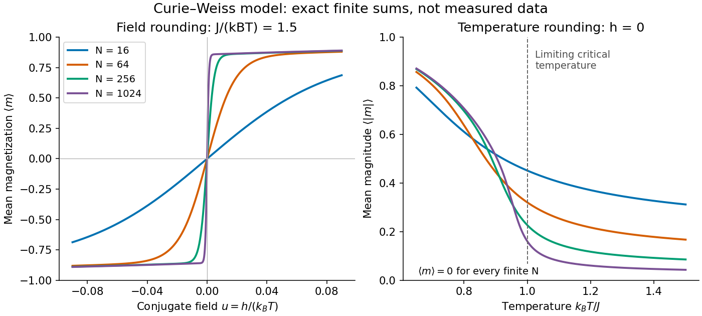

**[Figure 9](#image-exact-finite-curie-weiss-rounding-in-field-and-temperature). Exact finite Curie–Weiss rounding in field and temperature**.

Every curve is computed from the finite [partition function](#canonical-partition-function), without selecting one minimum of the [Bragg-Williams free energy of the Ising model](#bragg-williams-free-energy-of-the-ising-model). The field panel holds $K=1.5$ fixed and shows increasingly rapid switching between opposite [spin magnetizations](#spin-magnetization). The [temperature](thermodynamics.md#temperature) panel uses $u=0$: its nonzero $\langle|m|\rangle$ measures the typical magnitude, while the mean [spin magnetization](#spin-magnetization) stays zero. The reference $k_BT/J=1$ marks the limiting [critical temperature](#critical-temperature), not a singular point of any finite curve.

A short limiting argument explains the field panel. Combining the [binomial coefficient](combinatorics.md#binomial-coefficient) with its leading [entropy](thermodynamics.md#entropy) gives a [Helmholtz free energy](thermodynamics.md#helmholtz-free-energy) per spin whose stationarity equation is $m=\tanh(Km+u)$. For $K>1$ and $u=0$ the two ordered minima have $m=\pm m_*$, where $m_*=\tanh(Km_*)$. For large $N$ well below the [critical temperature](#critical-temperature), their relative [Boltzmann weight](#boltzmann-factor) is approximately $e^{2Num_*}$, giving $\langle m\rangle\approx m_*\tanh(Num_*)$. Thus this two-peak approximation has a field width of order $1/(Nm_*)$ in $u$. It is not valid at the [critical temperature](#critical-temperature), where the peaks merge; the figure uses the exact finite sum throughout.

### Surface correction to thermodynamic free energy

↑ **Parent:** [Thermodynamic limit](#thermodynamic-limit)

For finite-range interactions and bounded wall couplings, only sites within an interaction range of the wall have altered local environments. In a regular container of linear size $L$ and dimension $d$, the [surface area](differential-geometry.md#surface-area) scales as $A\sim L^{d-1}$ while [volume](thermodynamics.md#volume-thermodynamics) scales as $V\sim L^d$. A boundary contribution of order $A$ therefore gives an order-$1/L$ correction to [free-energy density](#free-energy-density). Away from a [critical phenomenon](critical-phenomenon.md), a regular surface contribution often has the form $F=Vf+A\gamma+\cdots$, with $\gamma$ a wall [Helmholtz free energy](thermodynamics.md#helmholtz-free-energy) per area. Critical [finite-size rounding](#finite-size-rounding), edges and long-range interactions require separate care; vanishing relative boundary size does not guarantee a simple surface expansion in every regime.

An exact check uses the zero-field nearest-neighbour [Ising model](#ising-model) on a chain of $N\ge3$ sites with fixed coupling $J>0$ and $K=J/(k_BT)$. The open chain has $N-1$ bonds, while the periodic ring has $N$. Their finite [partition functions](#canonical-partition-function) and dimensionless [Helmholtz free energies](thermodynamics.md#helmholtz-free-energy) per spin $g_N=F_N/(Nk_BT)$ are

$$
Z_N^{\rm open}=2(2\cosh K)^{N-1},\qquad
Z_N^{\rm ring}=(2\cosh K)^N+(2\sinh K)^N,
$$

$$
g_\infty=-\log(2\cosh K),\qquad
g_N^{\rm open}-g_\infty=\frac{\log\cosh K}{N},\qquad
g_N^{\rm ring}-g_\infty=-\frac{\log[1+(\tanh K)^N]}{N}.
$$

For the open chain, sum the last [Ising spin](#ising-spin-variable) successively: each removed bond contributes $2\cosh K$, leaving a factor of two. For the ring, the [transfer matrix for the one-dimensional Ising model](#transfer-matrix-for-the-one-dimensional-ising-model) has [eigenvalues](linear-operator-theory.md#eigenvalue) $2\cosh K$ and $2\sinh K$, and its $N$th power's [trace](linear-algebra.md#matrix-trace) gives the displayed sum. The two ends are a constant-size boundary in one dimension, so the open-chain total correction is $k_BT\log\cosh K$, and its per-spin correction is exactly proportional to $1/N$.

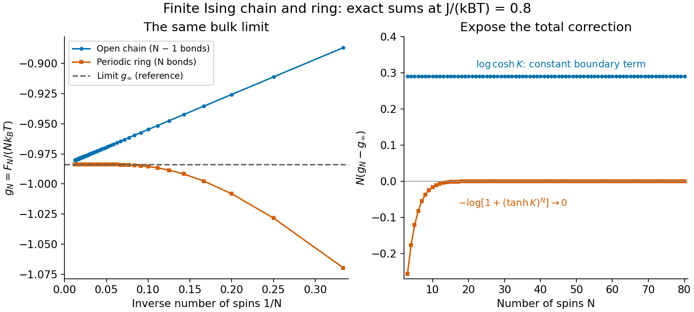

**[Figure 10](#image-exact-boundary-corrections-for-a-finite-ising-chain-and-ring). Exact boundary corrections for a finite Ising chain and ring**.

Both sets of finite results approach the same $g_\infty$ at the fixed plotted $K=0.8$. Multiplying the correction by $N$ exposes the open-chain boundary term, while the ring correction vanishes exponentially at fixed finite $K$. This model's [thermodynamic limit](#thermodynamic-limit) remains a [real analytic function](analysis.md#real-analytic-function) at every positive [temperature](thermodynamics.md#temperature): having a [thermodynamic limit](#thermodynamic-limit) does not require a [phase transition](critical-phenomenon.md#phase-transition).

### Carbon-dioxide viewing-cell phase-transition experiment

↑ **Parent:** [Thermodynamic limit](#thermodynamic-limit)

The institutional account [CO2 viewing cell](physics-bibliography.md#co2-viewing-cell) describes an optical cell at the University of Stuttgart: a fixed-[volume](thermodynamics.md#volume-thermodynamics) [carbon dioxide](chemistry.md#carbon-dioxide) sample cools from above its [liquid-gas critical point](critical-phenomenon.md#liquid-gas-critical-point) into [phase coexistence](critical-phenomenon.md#phase-coexistence). The apparatus supplies a view through the cell and displayed [temperature](thermodynamics.md#temperature) and [pressure](thermodynamics.md#pressure) readings. Near roughly $31\,{}^\circ\mathrm C$, the account reports [critical opalescence](#critical-opalescence): enhanced [scattering of light](optics.md#scattering-of-light) makes reflected light appear whitish and transmitted light dark. This readout reveals growing density [thermal fluctuations](#thermal-fluctuation); it is not a direct count of molecules or a measurement of an infinite [correlation length](critical-phenomenon.md#correlation-length). [CO2 viewing cell](physics-bibliography.md#co2-viewing-cell)

Fixed [volume](thermodynamics.md#volume-thermodynamics) constrains the experimental path; the [pressure](thermodynamics.md#pressure) varies and is a readout, not an independently held control. The account explicitly identifies the clip as part of a longer cooldown and says its endpoints are not steady states. To test an equilibrium interpretation more closely, one would hold [temperature](thermodynamics.md#temperature) until the readout settles, compare cooling and warming, and check optical background away from the [liquid-gas critical point](critical-phenomenon.md#liquid-gas-critical-point); these are proposed controls, not measurements reported on that page. The account does not provide cell dimensions, filling [number density](#number-density), calibration uncertainties or such control runs. The sample is finite: its striking appearance motivates the [thermodynamic limit](#thermodynamic-limit) as a model of macroscopic sharpness, rather than demonstrating a literal equilibrium singularity.

### Critical opalescence

↑ **Parent:** [Thermodynamic limit](#thermodynamic-limit)  
ⓦ [Wiki](https://en.wikipedia.org/wiki/Critical_opalescence)

[Critical opalescence](#critical-opalescence) is enhanced [scattering of light](optics.md#scattering-of-light) by large fluctuations near a [thermodynamic critical point](critical-phenomenon.md#thermodynamic-critical-point). The [carbon-dioxide viewing-cell phase-transition experiment](#carbon-dioxide-viewing-cell-phase-transition-experiment) gives an observable finite-sample example; cloudiness alone does not establish a divergent [correlation length](critical-phenomenon.md#correlation-length).

### Stable pair potential

↑ **Parent:** [Thermodynamic limit](#thermodynamic-limit)

A [pair potential](#pair-potential) is stable when its total interaction [energy](classical-mechanics.md#energy) obeys this lower bound for every allowed configuration, with a constant $B$ independent of $N$. It prevents collapse with an arbitrarily negative [energy](classical-mechanics.md#energy) per particle. Stability alone does not control the long-distance contribution needed for the ordinary [thermodynamic limit](#thermodynamic-limit).

### Tempered pair potential

↑ **Parent:** [Thermodynamic limit](#thermodynamic-limit)

A standard sufficient tempering condition is this tail bound beyond a fixed radius, with $\epsilon>0$ in spatial dimension $d$. It makes the distant interaction tail integrable; finite-range [pair potentials](#pair-potential) satisfy it. Together with a [stable pair potential](#stable-pair-potential) and suitable growing containers, such assumptions support the conventional [thermodynamic limit](#thermodynamic-limit). A [Curie–Weiss model](#curie-weiss-model) with its size-dependent coupling uses a different prescription.

## Virial expansion

↑ **Parent:** [Statistical physics](statistical-physics.md)  
ⓦ [Wiki](https://en.wikipedia.org/wiki/Virial_expansion)

The [virial expansion](#virial-expansion) describes the first departures from the [ideal gas law](thermodynamics.md#ideal-gas-law) as a [power series](real-analysis.md#power-series) in [number density](#number-density). For a homogeneous, single-species [gas](thermodynamics.md#gas) in three dimensions at [thermal equilibrium](thermodynamics.md#thermal-equilibrium), write $n=N/V$, with $V$ the [volume](thermodynamics.md#volume-thermodynamics), and define the [dimensionless](physics.md#dimensionless-quantity) compressibility factor $Z$ by

$$
Z=\frac{p}{nk_BT}=1+B_2(T)n+B_3(T)n^2+\cdots,
\qquad p=nk_BT\bigl[1+B_2(T)n+B_3(T)n^2+\cdots\bigr].
$$

Here $p$ is absolute [pressure](thermodynamics.md#pressure), $T$ is absolute [thermodynamic temperature](thermodynamics.md#thermodynamic-temperature), and $k_B$ is the [Boltzmann constant](thermodynamics.md#boltzmann-constant). The [second virial coefficient](#second-virial-coefficient) determines the initial slope away from $Z=1$; higher coefficients describe further corrections. The symbol $Z$ here is an [equation of state](thermodynamics.md#equation-of-state) ratio, not a [canonical partition function](#canonical-partition-function). [Tong, Statistical Physics, section 2.5, equation 2.69](https://davidtong.org/teaching/statistical-physics/statmechhtml/S2#S2.S5)

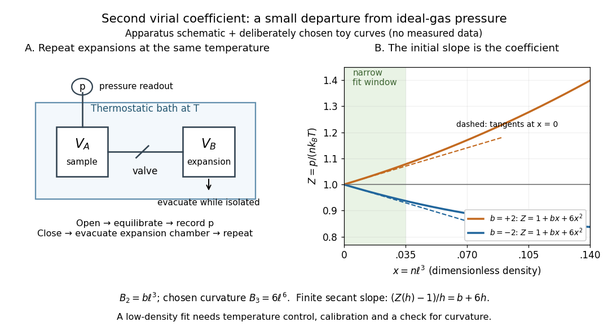

**[Figure 11](#image-controlled-gas-expansion-and-extraction-of-a-dilute-gas-slope-schematic-apparatus-and-explicitly-chosen-toy-curves). Controlled gas expansion and extraction of a dilute-gas slope: schematic apparatus and explicitly chosen toy curves**.

The left panel sketches the measurement principle; the right panel uses deliberately chosen [polynomials](polynomial.md), $Z=1+bx+6x^2$ with $x=n\ell^3$ and $b=\pm2$, where $\ell$ is a reference length. These curves are not measured data. Their initial slopes have opposite signs, but both bend because of the quadratic term. Using a finite secant from $x=0$ to $x=h$ gives $(Z(h)-1)/h=b+6h$, rather than $b$: reducing the fitting range reduces this particular truncation bias. This algebra explains why measuring one nonideal [pressure](thermodynamics.md#pressure) is insufficient to extract a reliable [second virial coefficient](#second-virial-coefficient).

Waxman and Hastings's 1971 Burnett experiment used sample and expansion chambers in a thermostatic bath, with a valve between them and a [pressure](thermodynamics.md#pressure) transducer linked to a piston gauge. They measured successive [isothermal expansions](thermodynamics.md#isothermal-expansion): evacuate the expansion chamber, open the valve, record the equilibrated [pressure](thermodynamics.md#pressure), isolate and evacuate that chamber again, then repeat. This avoids separately measuring the absolute gas amount and chamber [volumes](geometry-and-topology.md#volume). For [carbon dioxide](chemistry.md#carbon-dioxide) at $50\,{}^\circ\mathrm C$, their measurements below $35$ bar gave a molar [second virial coefficient](#second-virial-coefficient) of approximately $-102.2\,\mathrm{cm^3\,mol^{-1}}$. [Waxman and Hastings, Journal of Research of the NBS 75C (1971), pages 165–176, abstract and apparatus](https://nvlpubs.nist.gov/nistpubs/jres/75C/jresv75Cn3-4p165_A1b.pdf)

An idealized reduction makes the signal explicit. Let $q=(V_A+V_B)/V_A$ be the calibrated chamber [volume](geometry-and-topology.md#volume) ratio, $p_i$ the pre-expansion [pressure](thermodynamics.md#pressure), and $p_f$ the post-expansion [pressure](thermodynamics.md#pressure). Particle conservation during one valve opening gives $n_f=n_i/q$. At the same [temperature](thermodynamics.md#temperature), division of the two [equations of state](thermodynamics.md#equation-of-state) yields

$$
\frac{p_i}{p_f}=q\frac{Z(n_i,T)}{Z(n_i/q,T)}
=q+(q-1)\frac{B_2(T)}{k_BT}p_i+O(p_i^2).
$$

Thus the intercept determines $q$, while the dilute-limit slope determines the [second virial coefficient](#second-virial-coefficient). In the actual experiment, [helium](chemistry.md#helium) runs calibrated the cell constant and chamber deformation corrections were included. Agreement of the [carbon dioxide](chemistry.md#carbon-dioxide) low-[pressure](thermodynamics.md#pressure) intercept with the [helium](chemistry.md#helium) calibration, and the absence of an anomalous low-[pressure](thermodynamics.md#pressure) upturn, checked for gas adsorption on chamber walls. [Waxman and Hastings (1971), data reduction and adsorption checks, especially equation 13 and page 176](https://nvlpubs.nist.gov/nistpubs/jres/75C/jresv75Cn3-4p165_A1b.pdf)

For a limited dilute-gas fit, hold [temperature](thermodynamics.md#temperature) fixed, allow [thermal equilibrium](thermodynamics.md#thermal-equilibrium) after every expansion, calibrate absolute [pressure](thermodynamics.md#pressure) and the chamber ratio, and check leaks and sample composition. Repeat the analysis with a smaller upper [pressure](thermodynamics.md#pressure) cutoff and an added curvature term; compare the resulting [second virial coefficients](#second-virial-coefficient) with their uncertainties. Too wide a range mixes in higher coefficients; too narrow a range makes the nonideal signal hard to distinguish from instrument error. The displayed chamber equation neglects deformation, dead spaces and adsorption, so it is a teaching reduction rather than the complete experimental analysis.

Units matter. With [number density](#number-density) in $\mathrm{m^{-3}}$, $B_2$ has units $\mathrm{m^3}$ and $B_3$ has units $\mathrm{m^6}$. For molar density $c=n/N_{\mathrm A}$ in $\mathrm{mol\,m^{-3}}$, the same [equation of state](thermodynamics.md#equation-of-state) is

$$
Z=\frac{p}{cRT}=1+B_{2,\mathrm m}c+B_{3,\mathrm m}c^2+\cdots,
\qquad B_{2,\mathrm m}=N_{\mathrm A}B_2,\qquad
B_{3,\mathrm m}=N_{\mathrm A}^2B_3.
$$

Here $N_{\mathrm A}$ is the [Avogadro constant](physics.md#avogadro-constant) and $R=N_{\mathrm A}k_B$ is the [molar gas constant](thermodynamics.md#molar-gas-constant); the molar coefficients have units $\mathrm{m^3\,mol^{-1}}$ and $\mathrm{m^6\,mol^{-2}}$. A coefficient tabulated per [mole](physics.md#mole-unit) must therefore multiply molar density, not [number density](#number-density).

For the classical formulas below, use a [nondegenerate gas](thermodynamics.md#nondegenerate-gas) with [thermal de Broglie wavelength](#thermal-de-broglie-wavelength) $\lambda_{\mathrm{th}}$ satisfying $n\lambda_{\mathrm{th}}^3\ll1$, negligible quantum corrections to relative motion, and a stable, sufficiently short-ranged [pair potential](#pair-potential). Diluteness must also control the omitted interaction terms: $|B_2n|\ll1$ alone is not enough when positive and negative contributions cancel. A finite truncation is a local low-[number density](#number-density) approximation, not an [equation of state](thermodynamics.md#equation-of-state) for a dense liquid or across a [phase transition](critical-phenomenon.md#phase-transition). [Tong, section 2.2.4: classical-density condition](https://davidtong.org/teaching/statistical-physics/statmechhtml/S2#S2.S2.SS4) [Tong, section 2.5.1: dilute interacting gas](https://davidtong.org/teaching/statistical-physics/statmechhtml/S2#S2.S5.SS1)

### Second virial coefficient

↑ **Parent:** [Virial expansion](#virial-expansion)  
ⓦ [Wiki](https://en.wikipedia.org/wiki/Second_virial_coefficient)

The [second virial coefficient](#second-virial-coefficient) is the leading interaction correction to the [ideal gas law](thermodynamics.md#ideal-gas-law): at fixed [temperature](thermodynamics.md#temperature), $B_2(T)=\lim_{n\to0}(Z-1)/n$, where $Z=p/(nk_BT)$ and $n$ is [number density](#number-density). For identical classical particles in a homogeneous three-dimensional [gas](thermodynamics.md#gas), with an isotropic [pair potential](#pair-potential) $u(r)$ and $r$ the centre-to-centre separation,

$$
B_2(T)=-\frac12\int_{\mathbb R^3} f(|\mathbf r|)\,d^3\mathbf r
=2\pi\int_0^\infty\left[1-e^{-u(r)/(k_BT)}\right]r^2\,dr,
\qquad f(r)=e^{-u(r)/(k_BT)}-1.
$$

The function $f$ is the [Mayer f-function](#mayer-f-function). The factor $4\pi r^2dr$ counts the [volume](geometry-and-topology.md#volume) of a thin spherical shell; the factor $1/2$ counts each unordered pair once. The result has units of [volume](geometry-and-topology.md#volume). Repulsive regions, $u>0$, contribute positively, while attractive regions, $u<0$, contribute negatively. [Tong, section 2.5.2, equations 2.75–2.76](https://davidtong.org/teaching/statistical-physics/statmechhtml/S2#S2.S5.SS2)

This is a striking bridge from a microscopic [pair potential](#pair-potential) to a macroscopic [pressure](thermodynamics.md#pressure) reading. At sufficiently small [number density](#number-density), $B_2>0$ raises [pressure](thermodynamics.md#pressure) relative to an [ideal gas](thermodynamics.md#ideal-gas) at the same [temperature](thermodynamics.md#temperature) and [number density](#number-density), while $B_2<0$ lowers it. A single value of $B_2$, however, cannot determine the entire [pair potential](#pair-potential): many different functions have the same weighted [integral](calculus.md#integral). Measurements over several [temperatures](thermodynamics.md#temperature) supply more information.

The [integral](calculus.md#integral) must exist. For example, a bounded short-range attraction outside a hard core has no difficulty. If instead $u(r)\sim A/r^s$ as $r\to\infty$, then $1-e^{-u/(k_BT)}\sim u/(k_BT)$ and the radial tail behaves like $\int r^{2-s}dr$: it converges only for $s>3$. A bare unscreened [Coulomb potential](electromagnetism.md#coulomb-potential-energy) therefore falls outside this formula's ordinary short-range setting. This condition on the tail does not by itself establish the stability or convergence of the full [virial expansion](#virial-expansion).

For an exactly integrable toy attraction, choose the following square-well [pair potential](#pair-potential), with diameter $\sigma>0$, attraction depth $\epsilon>0$, and range multiplier $a>1$:

$$
u(r)=\begin{cases}
+\infty,&0\le r<\sigma,\\
-\epsilon,&\sigma\le r<a\sigma,\\
0,&r\ge a\sigma.
\end{cases}
$$

Set $T^*=k_BT/\epsilon$ and $b_{\mathrm{HS}}=2\pi\sigma^3/3$, the [second virial coefficient](#second-virial-coefficient) of a [hard-sphere gas](#hard-sphere-gas). Integrating the core and attractive shell separately gives the exact toy result

$$
B_2(T)=b_{\mathrm{HS}}\left[1-(a^3-1)\left(e^{1/T^*}-1\right)\right].
$$

The core contributes $b_{\mathrm{HS}}$; the shell contributes $-b_{\mathrm{HS}}(a^3-1)(e^{1/T^*}-1)$. Heating weakens the relative [Boltzmann factor](#boltzmann-factor) enhancement of attractive configurations, so $B_2$ approaches the positive hard-core value as $T^*\to\infty$. For the illustrative choice $a=3/2$, the zero occurs at

$$
T^*_0=\frac{1}{\log\left(1+\frac{1}{a^3-1}\right)}
=\frac{1}{\log(27/19)}\approx2.846.
$$

At this [temperature](thermodynamics.md#temperature), $Z=1+B_3n^2+\cdots$: cancellation removes the linear correction, not every correction. At low $T^*$, the negative shell contribution becomes large, requiring a correspondingly smaller [number density](#number-density) for a useful truncated [virial expansion](#virial-expansion). The square well is a deliberately chosen model, not a fit to the [carbon dioxide](chemistry.md#carbon-dioxide) experiment.

### Cluster expansion

↑ **Parent:** [Virial expansion](#virial-expansion)  
ⓦ [Wiki](https://en.wikipedia.org/wiki/Cluster_expansion)

The cluster expansion organizes the [logarithm](calculus.md#logarithm) of a dilute interacting system's [canonical partition function](#canonical-partition-function) as a sum over connected clusters built from [Mayer bonds](#mayer-f-function).

## Pair potential

↑ **Parent:** [Statistical physics](statistical-physics.md)  
ⓦ [Wiki](https://en.wikipedia.org/wiki/Pair_potential)

A pair potential assigns an interaction energy $u(|\mathbf x_i-\mathbf x_j|)$ to each pair of particles. A pairwise-additive system has $U=\sum_{i<j}u(|\mathbf x_i-\mathbf x_j|)$.

### Mayer f-function

↑ **Parent:** [Pair potential](#pair-potential)

The [Mayer f-function](#mayer-f-function) measures how a [pair potential](#pair-potential) changes a pair's [Boltzmann factor](#boltzmann-factor) relative to the noninteracting value one:

$$
f(r)=e^{-\beta u(r)}-1,\qquad \beta=\frac{1}{k_BT}.
$$

It vanishes where $u=0$, lies between $-1$ and $0$ for repulsion, and is positive for attraction. Even an infinite hard-core [potential energy](classical-mechanics.md#potential-energy) produces the finite value $f=-1$. This is why expanding in [Mayer f-functions](#mayer-f-function) handles a [hard-sphere gas](#hard-sphere-gas) more naturally than a [Taylor series](calculus.md#taylor-series) in $u$. [Tong, section 2.5.1, equation 2.72](https://davidtong.org/teaching/statistical-physics/statmechhtml/S2#S2.S5.SS1)

For pairwise-additive [potential energy](classical-mechanics.md#potential-energy) $U=\sum_{i<j}u(r_{ij})$, the exact identity

$$
e^{-\beta U}=\prod_{i<j}\bigl[1+f(r_{ij})\bigr]
$$

turns the configurational part of the [canonical partition function](#canonical-partition-function) into a sum of products associated with pairs. Drawing one edge for each chosen factor $f(r_{ij})$ gives the [graphs](graph.md) used in the [cluster expansion](#cluster-expansion). The [second virial coefficient](#second-virial-coefficient) uses just one pair's relative-position [integral](calculus.md#integral), $B_2=-\frac12\int f\,d^3\mathbf r$.

For the square-well toy [pair potential](#pair-potential) in [second virial coefficient](#second-virial-coefficient), $f=-1$ in the core, $f=e^{1/T^*}-1$ in the attractive shell, and $f=0$ beyond it. Its positive plateau need not be small: low [number density](#number-density), rather than small $f$ at every separation, controls the dilute-gas approximation. The [integral](calculus.md#integral) weights each plateau by spherical-shell [volume](geometry-and-topology.md#volume); equal-looking unweighted areas on a plot of $f$ versus $r$ need not cancel in $B_2$.

### Hard-sphere gas

↑ **Parent:** [Pair potential](#pair-potential)

A [hard-sphere gas](#hard-sphere-gas) is a classical model of identical impenetrable [spheres](geometry-and-topology.md#sphere), each of diameter $\sigma$ and radius $\sigma/2$. Its [pair potential](#pair-potential) is $u(r)=+\infty$ for centre separation $r<\sigma$ and $u(r)=0$ for $r\ge\sigma$; the convention at exact contact has no effect on the [integral](calculus.md#integral). It isolates the effect of particle size without an attractive [potential energy](classical-mechanics.md#potential-energy).

**[Figure 12](#image-hard-sphere-centre-exclusion-the-square-well-mayer-f-function-and-the-exact-temperature-dependence-of-the-toy-second-virial-coefficient). Hard-sphere centre exclusion, the square-well Mayer f-function, and the exact temperature dependence of the toy second virial coefficient**.

The upper-left panel is a cross-section of a three-dimensional forbidden region: the second centre cannot enter a [sphere](geometry-and-topology.md#sphere) of radius $\sigma$ around the first centre. The particles themselves have radius $\sigma/2$. Consequently, with particle [volume](geometry-and-topology.md#volume) $v_{\mathrm s}$ and pair [excluded volume](#excluded-volume) $v_{\mathrm{ex}}$,

$$
v_{\mathrm s}=\frac{4\pi}{3}\left(\frac\sigma2\right)^3
=\frac{\pi\sigma^3}{6},\qquad
v_{\mathrm{ex}}=\frac{4\pi\sigma^3}{3}=8v_{\mathrm s},
\qquad B_2=\frac12v_{\mathrm{ex}}=4v_{\mathrm s}=\frac{2\pi\sigma^3}{3}.
$$

The last equality follows directly from the [Mayer f-function](#mayer-f-function): $f=-1$ throughout the forbidden [volume](geometry-and-topology.md#volume) and zero outside it. Confusing particle radius with contact separation changes the answer by a factor of eight; omitting the unordered-pair factor changes it by a further factor of two.

Define the [packing fraction](geometry-and-topology.md#packing-fraction) $\eta=nv_{\mathrm s}$, where $n$ is [number density](#number-density). Then the [virial expansion](#virial-expansion) begins

$$
\frac{p}{nk_BT}=1+4\eta+O(\eta^2).
$$

For example, at the toy value $\eta=0.01$, the leading correction predicts $Z\approx1.04$; the omitted terms still matter if accuracy beyond this approximation is needed. The classical [second virial coefficient](#second-virial-coefficient) is independent of [temperature](thermodynamics.md#temperature) because the geometry of forbidden configurations does not change when the [gas](thermodynamics.md#gas) is warmed. The [pressure](thermodynamics.md#pressure) itself still scales with [temperature](thermodynamics.md#temperature) at fixed [number density](#number-density).

This model makes the positive correction particularly clear: eliminating overlapping configurations changes the dependence of the available configuration space on [volume](thermodynamics.md#volume-thermodynamics), even though the allowed configurations all have zero interaction [energy](classical-mechanics.md#energy). The figure's other panels add a toy attractive shell and show how its [Boltzmann factor](#boltzmann-factor) competes with that geometry. The [hard-sphere gas](#hard-sphere-gas) is a useful reference model, while a low-order [virial expansion](#virial-expansion) remains a dilute-gas approximation rather than a dense [sphere packing](geometry-and-topology.md#sphere-packing) formula.

#### Excluded volume

↑ **Parent:** [Hard-sphere gas](#hard-sphere-gas)  
ⓦ [Wiki](https://en.wikipedia.org/wiki/Excluded_volume)

The excluded volume is the volume of relative positions forbidden to another particle. For hard spheres of radius $r_0$, that forbidden region is a sphere of radius $2r_0$.

## Free-energy density

↑ **Parent:** [Statistical physics](statistical-physics.md)  
ⓦ [Wiki](https://en.wikipedia.org/wiki/Free-energy_density)

A free-energy density is free energy per unit volume. Its minima with respect to unconstrained order parameters determine homogeneous equilibrium states.

## Spin model

↑ **Parent:** [Statistical physics](statistical-physics.md)  
ⓦ [Wiki](https://en.wikipedia.org/wiki/Spin_model)

A spin model assigns a discrete or continuous spin variable to each site of a [lattice](mathematical-logic.md#lattice) or vertex of a graph and gives interacting configurations a [Boltzmann factor](#boltzmann-factor). Spin models describe collective order and phase transitions in magnetic and other many-body systems.

### Potts model

↑ **Parent:** [Spin model](#spin-model)  
ⓦ [Wiki](https://en.wikipedia.org/wiki/Potts_model)

The ferromagnetic [Potts model](#potts-model) on a finite [graph](graph.md) assigns $q$ possible states to each [graph vertex](graph.md#vertex-graph-theory) and rewards neighbouring equal states by the displayed weight, for $\beta\geq0$. The interaction sum counts each unoriented edge once. The [Edwards-Sokal coupling](site-percolation.md#edwards-sokal-coupling) identifies its spin clusters with the [random-cluster model](site-percolation.md#random-cluster-model) at $p=1-e^{-\beta}$ and integer $q\geq2$.

<h3 id="blume-emery-griffiths-model">Blume–Emery–Griffiths model</h3>

↑ **Parent:** [Spin model](#spin-model)

The classical Blume–Emery–Griffiths model uses spins $\sigma_i\in\{-1,0,1\}$ with both bilinear $\sigma_i\sigma_j$ and biquadratic $\sigma_i^2\sigma_j^2$ nearest-neighbour interactions, together with a single-site term proportional to $\sigma_i^2$. One convention is $H=-J\sum\sigma_i\sigma_j-L\sum\sigma_i^2\sigma_j^2-D\sum\sigma_i^2-h\sum\sigma_i$. Signs of the single-site parameter vary across conventions. Setting $L=0$ gives a [Blume–Capel model](#blume-capel-model) after matching that sign convention. The one-dimensional version admits an exact [spin-chain transfer matrix](#transfer-matrix-for-a-classical-spin-chain).

### Transfer matrix for a classical spin chain

↑ **Parent:** [Spin model](#spin-model)

For a nearest-neighbour classical chain with finitely many spin states and dimensionless bond energy $E(s,t)$, its transfer [matrix](vector-space.md#matrix) is $W_{st}=e^{-E(s,t)}$. On-site energies are divided between adjacent bonds. [Periodic boundary conditions](differential-equation.md#periodic-boundary-conditions) give [partition function](#canonical-partition-function) $Z_N=\operatorname{tr}W^N$ by direct multiplication and summation over spin labels. For a strictly positive [symmetric matrix](linear-algebra.md#symmetric-matrix), the [Perron–Frobenius theorem](vector-space.md#perron-frobenius-theorem) gives $\lim_{N\to\infty}N^{-1}\log Z_N=\log\lambda_{\max}$. A diagonal local observable $O$ has [expectation](probability-theory.md#expected-value) $\operatorname{tr}(OW^N)/Z_N$, tending to $v_{\max}^TOv_{\max}$ for a normalized dominant [eigenvector](linear-operator-theory.md#eigenvector).

#### Classical Ising chain as a quantum particle

↑ **Parent:** [Transfer matrix for a classical spin chain](#transfer-matrix-for-a-classical-spin-chain)

Hubbard-Stratonovich decoupling of an exponentially coupled Ising chain gives a scalar-field action with a nearest-neighbor [gradient](calculus.md#gradient) term and $U(m)=\tanh(\kappa/2)m^2/J-\log[2\cosh(2m+h)]$. Its continuum [partition function](#canonical-partition-function) is the [Euclidean path integral](quantum-field-theory.md#euclidean-path-integral) of the displayed quantum particle. At zero field the potential can have two wells, but a finite barrier still permits [quantum tunnelling](quantum-mechanics.md#quantum-tunnelling) and gives a unique symmetric [ground state](quantum-mechanics.md#ground-state). The excitation gap produces a finite classical [correlation length](critical-phenomenon.md#correlation-length), so there is no finite-temperature spontaneous magnetization for fixed positive $\kappa$. One classical spatial coordinate becomes imaginary time; a $d$-dimensional classical model corresponds to a quantum model with $d-1$ spatial dimensions.

##### Auxiliary-field transfer operator for an Ising chain

↑ **Parent:** [Classical Ising chain as a quantum particle](#classical-ising-chain-as-a-quantum-particle)

For a nearest-neighbor auxiliary-field representation of an [Ising model](#ising-model), sharing each local potential between adjacent bonds gives the displayed symmetric [integral operator](functional-analysis.md#integral-operator). Its periodic [partition function](#canonical-partition-function) is the trace of its $N$th power, up to Gaussian normalization constants. In the slowly varying continuum limit, a slice of length $\epsilon$ has kernel $[M/(2\pi\epsilon)]^{1/2}\exp[-M(m'-m)^2/(2\epsilon)-\epsilon\{U(m')+U(m)\}/2]$. Expanding its action on a smooth function gives $1-\epsilon\widehat H+O(\epsilon^2)$, with $\widehat H=-(2M)^{-1}\partial_m^2+U$. Thus fixed endpoints give an imaginary-time transition kernel and periodic endpoints give a [Euclidean path integral](quantum-field-theory.md#euclidean-path-integral) trace. The finite-spacing integral operator and the continuum differential operator need not have identical high-energy spectra.

##### Double-well threshold of an auxiliary Ising potential

↑ **Parent:** [Classical Ising chain as a quantum particle](#classical-ising-chain-as-a-quantum-particle)

The zero-field [Hubbard–Stratonovich transformation](quantum-field-theory.md#hubbard-stratonovich-transformation) of an exponentially coupled [Ising model](#ising-model) produces $U(m)=Am^2-\log[2\cosh(2m)]$, where $A=\tanh(\kappa/2)/J>0$. Since $U''(0)=2A-4$ and $U$ tends to positive infinity, a symmetric double well exists exactly when $A<2$. Its nonzero stationary points solve $Am=\tanh(2m)$; the ratio $\tanh(2m)/m$ decreases from 2 to 0 for $m>0$, proving that there is exactly one positive minimum. At $A=2$ the minimum is a single quartic minimum. A small conjugate field adds $-h\tanh(2m)+O(h^2)$ and tilts the wells, while a sufficiently large field can remove the metastable well. A finite barrier permits [quantum tunnelling](quantum-mechanics.md#quantum-tunnelling); two classical minima alone do not establish [spontaneous symmetry breaking](quantum-field-theory.md#spontaneous-symmetry-breaking).

### Spin magnetization

↑ **Parent:** [Spin model](#spin-model)

The spin magnetization is the average signed spin of a discrete spin system. For $S_i\in\{-1,1\}$, $k$ positive spins give $M=-1+2k/n$. Multiplying by the magnetic moment per spin and the spin density relates this dimensionless average to physical [magnetization](electromagnetism.md#magnetization).

### Spin inversion symmetry

↑ **Parent:** [Spin model](#spin-model)

Spin inversion symmetry means that simultaneous reversal of every spin leaves the [probability distribution](probability-theory.md#probability-distribution) or [energy](classical-mechanics.md#energy) unchanged. For a finite spin model with this symmetry, the weights of opposite configurations pair up, so every observable that changes sign under the reversal has zero [expected value](probability-theory.md#expected-value). An applied magnetic field generally breaks this symmetry.

### Ising model

↑ **Parent:** [Spin model](#spin-model)  
ⓦ [Wiki](https://en.wikipedia.org/wiki/Ising_model)

The Ising model assigns spins $\sigma_v\in\{-1,1\}$ to graph vertices with probability proportional to $\exp(\beta\sum_{uv}\sigma_u\sigma_v)$ in zero external field.

#### Exponentially coupled Ising inverse kernel

↑ **Parent:** [Ising model](#ising-model)

For the infinite one-dimensional coupling [matrix](vector-space.md#matrix) $J_{ij}=Je^{-\kappa|i-j|}$ with $J,\kappa>0$, its Fourier symbol is $J\sinh\kappa/(\cosh\kappa-\cos q)$. Its inverse is nearest-neighbor even though the original interaction is not. The inverse quadratic form equals $[2J\sinh\kappa]^{-1}\sum_j(m_j-m_{j+1})^2+[\tanh(\kappa/2)/J]\sum_jm_j^2$. Finite open chains add endpoint corrections; a periodized coupling gives the same translation-invariant formula.

##### Open-chain endpoint corrections for an exponential Ising kernel

↑ **Parent:** [Exponentially coupled Ising inverse kernel](#exponentially-coupled-ising-inverse-kernel)

For $N\ge2$, the open-chain [Ising model](#ising-model) coupling $[J_N]_{ij}=J\rho^{|i-j|}$, $0<\rho<1$, has a tridiagonal inverse. Its endpoint diagonal entries are $1/[J(1-\rho^2)]$, its interior diagonal entries are $(1+\rho^2)/[J(1-\rho^2)]$, and adjacent off-diagonal entries are $-\rho/[J(1-\rho^2)]$. Direct [matrix multiplication](vector-space.md#matrix-multiplication) verifies the inverse because the geometric sequences cancel in every interior row. The displayed [quadratic form](linear-algebra.md#quadratic-form) follows with $D=\rho/[J(1-\rho^2)]$, $A=(1-\rho)/[J(1+\rho)]$ and $B=\rho/[J(1+\rho)]$. For $\rho=e^{-\kappa}$, $D=(2J\sinh\kappa)^{-1}$ and $A=\tanh(\kappa/2)/J$. Omitting the endpoint term requires an infinite chain, a correctly periodized coupling, or a bulk [thermodynamic limit](#thermodynamic-limit).

#### Ising boundary condition

↑ **Parent:** [Ising model](#ising-model)

A fixed [Ising boundary condition](#ising-boundary-condition) pins the [Ising spins](#ising-spin-variable) on a specified boundary, leaving the interior distributed with the original interaction weights. The boundary can be the inner [graph vertex](graph.md#vertex-graph-theory) boundary of a finite box, or an exterior neighboring set if that convention is explicitly chosen. Conditioning on pinned [Ising spins](#ising-spin-variable) preserves the [FKG lattice condition](probability-inequality.md#fkg-lattice-condition) of a ferromagnetic [Ising model](#ising-model). The [FKG inequality](probability-inequality.md#fkg-inequality) then makes interior expectations of [increasing observables](set.md#increasing-function-on-a-partially-ordered-set) nondecreasing in the pinned boundary [Ising spins](#ising-spin-variable).

##### Extremal infinite-volume Ising measures

↑ **Parent:** [Ising boundary condition](#ising-boundary-condition)

For the ferromagnetic binary [Ising model](#ising-model), all-zero boundary measures increase and all-one boundary measures decrease as boxes exhaust the [lattice](mathematical-logic.md#lattice), in [stochastic domination](probability-and-statistics.md#stochastic-domination-of-probability-measures). The nearest-neighbor spatial conditional [probability distribution](probability-theory.md#probability-distribution) reduces each domain comparison to a mixture of boundary conditions for the smaller box. [Probabilities](probability-theory.md#probability) that a specified finite set is all one consequently converge; [inclusion-exclusion](combinatorics.md#inclusion-exclusion-principle) gives convergence of every finite [Ising spin](#ising-spin-variable) pattern. Their consistent limits define the two extreme infinite-volume measures. Existence does not assert that the two limits coincide.

#### Antiferromagnetic Ising model

↑ **Parent:** [Ising model](#ising-model)

With the convention $H=J\sum_{\langle ij\rangle}\sigma_i\sigma_j-h\sum_i\sigma_i$, positive $J$ favors opposite neighboring [Ising spins](#ising-spin-variable). On a [bipartite graph](graph-theory.md#bipartite-graph), the [Néel order parameter](#neel-order-parameter) measures opposite sublattice [magnetizations](electromagnetism.md#magnetization); it is distinct from the uniform [magnetization](electromagnetism.md#magnetization). Changing the signs of spins on one sublattice maps the zero-field model to the ferromagnetic [Ising model](#ising-model).

##### Two-sublattice Ising mean-field approximation

↑ **Parent:** [Antiferromagnetic Ising model](#antiferromagnetic-ising-model)

On a regular [bipartite graph](graph-theory.md#bipartite-graph) with coordination number $q$, replace each bond product by $\sigma_B\sigma_W\simeq M_W\sigma_B+M_B\sigma_W-M_BM_W$. For $N$ sites there are $Nq/2$ bonds, so the constant in the effective [Hamiltonian](classical-mechanics.md#hamiltonian) is $-NqJM_BM_W/2$. The [mean-field self-consistency equations](critical-phenomenon.md#self-consistency-equation) are $M_B=\tanh\beta(h+g-qJM_W)$ and $M_W=\tanh\beta(h-g-qJM_B)$. At zero fields the antisymmetric branch has a continuous [mean-field Ising critical bifurcation](#mean-field-ising-critical-bifurcation) at $k_BT_c=qJ$.

###### Uniform response of a two-sublattice Ising antiferromagnet

↑ **Parent:** [Two-sublattice Ising mean-field approximation](#two-sublattice-ising-mean-field-approximation)

On the stable zero-field branch $M_B=-M_W=M$, put $a=\beta(1-M^2)$. Differentiating the [two-sublattice Ising mean-field approximation](#two-sublattice-ising-mean-field-approximation) with respect to the uniform field gives $\chi_B=a(1-qJ\chi_W)$ and $\chi_W=a(1-qJ\chi_B)$. Thus $\chi_+=a/(1+qJa)$ and $\partial M_-/\partial h=0$. The true staggered [magnetic susceptibility](#magnetic-susceptibility), $\partial M_-/\partial g=a/(1-qJa)$, is a different response and diverges at the continuous transition. The factor $1-M^2$ is essential: the uniform response vanishes when the spins saturate at zero temperature.

###### Two-sublattice Ising variational free energy

↑ **Parent:** [Two-sublattice Ising mean-field approximation](#two-sublattice-ising-mean-field-approximation)

Here $s(m)=\frac{1+m}{2}\ln\frac{1+m}{2}+\frac{1-m}{2}\ln\frac{1-m}{2}$. This [free-energy density](#free-energy-density) is the [energy](classical-mechanics.md#energy) minus temperature times [entropy](thermodynamics.md#entropy) of independent sublattice [Ising spins](#ising-spin-variable). Since $s'(m)=\operatorname{atanh}m$, stationarity yields the [two-sublattice Ising mean-field approximation](#two-sublattice-ising-mean-field-approximation). Writing $M_\pm=(M_B\pm M_W)/2$, the quadratic coefficients are $(k_BT+qJ)/2$ for $M_+^2$ and $(k_BT-qJ)/2$ for $M_-^2$. The positive quartic coefficient $k_BT/12$ in the staggered direction stabilizes the continuous transition. Unlike a log-cosh auxiliary potential, this variational expression can be minimized away from self-consistency.

#### Ferromagnetic Ising lattice inequality

↑ **Parent:** [Ising model](#ising-model)

For $H(\sigma)=\sum_{xy}J_{xy}\sigma_x\sigma_y+\sum_xh_x\sigma_x$ on a finite graph, assume $J_{xy}\ge0$. Let $U=\{x:\sigma_x=1,\tau_x=-1\}$ and $W=\{x:\sigma_x=-1,\tau_x=1\}$. The displayed difference is $4\sum_{xy:\,x\in U,y\in W\text{ or conversely}}J_{xy}$: all other edge terms and all field terms cancel. Exponentiating proves the [FKG lattice condition](probability-inequality.md#fkg-lattice-condition) and hence [positive association of random variables](probability-theory.md#positive-association-of-random-variables) for this [Ising model](#ising-model).

#### Ising spin variable

↑ **Parent:** [Ising model](#ising-model)

An Ising [Ising spin](#ising-spin-variable) variable is a classical two-state degree of freedom. Its thermal mean can lie anywhere in $[-1,1]$ even though each microscopic value is $-1$ or $1$. It should not be confused with an arbitrary quantum-spin operator. Products of neighbouring [Ising spins](#ising-spin-variable) supply the pair interactions of the [Ising model](#ising-model), and their average defines [spin magnetization](#spin-magnetization).

#### Mean-field theory of the Ising model

↑ **Parent:** [Ising model](#ising-model)

The [mean-field approximation](critical-phenomenon.md#mean-field-approximation) neglects products of [Ising spin](#ising-spin-variable) deviations, replacing each [Ising spin](#ising-spin-variable)'s neighbours by the common [spin magnetization](#spin-magnetization). With [coordination number of a lattice](#coordination-number-of-a-lattice) $q$, the effective field is $h+qJm$. The [self-consistency equation](critical-phenomenon.md#self-consistency-equation) equates the assumed mean [Ising spin](#ising-spin-variable) with its independent-spin expectation in that effective field. It predicts $k_BT_c=qJ$ and the usual quartic [mean-field critical exponents](critical-phenomenon.md#mean-field-critical-exponent), while neglecting spatially correlated fluctuations.

##### Mean-field Ising critical bifurcation

↑ **Parent:** [Mean-field theory of the Ising model](#mean-field-theory-of-the-ising-model)

For a ferromagnetic [Ising model](#ising-model) with [coordination number of a lattice](#coordination-number-of-a-lattice) $z$, its [mean-field self-consistency equation](critical-phenomenon.md#self-consistency-equation) is $M=\tanh(zJM/(k_BT))$. Put $A=T_c/T$. For $A\leq1$, the only solution is zero. For $A>1$, [strict concavity](real-analysis.md#strict-concavity) of $\tanh(AM)-M$ on $M>0$ gives one positive solution and its spin-reversed partner. Expanding $\tanh(AM)=AM-(AM)^3/3+O(M^5)$ gives $M^2=3(A-1)/A^3+O((A-1)^2)$, proving a continuous onset with [order-parameter critical exponent](critical-phenomenon.md#order-parameter-critical-exponent) $\beta=1/2$. The [Bragg-Williams free energy of the Ising model](#bragg-williams-free-energy-of-the-ising-model) has a positive quartic coefficient at $T_c$, so these are the stable ordered minima rather than a first-order jump.

##### Bragg-Williams free energy of the Ising model

↑ **Parent:** [Mean-field theory of the Ising model](#mean-field-theory-of-the-ising-model)

A product trial distribution with actual mean [Ising spin](#ising-spin-variable) $m$ gives

$$
\frac{A_{\rm BW}}N=-\frac{qJ}{2}m^2-hm+k_BT\left[\frac{1+m}{2}\log\frac{1+m}{2}+\frac{1-m}{2}\log\frac{1-m}{2}\right].
$$

Its [entropy](thermodynamics.md#entropy) is the sum of independent-spin entropies, with $0\log0=0$. Differentiation gives $k_BT\operatorname{arctanh}m=qJm+h$, the [self-consistency equation](critical-phenomenon.md#self-consistency-equation). The variational mean parameter is distinct from the assumed field parameter of the [Ising auxiliary mean-field free energy](#ising-auxiliary-mean-field-free-energy) until the equilibrium condition is imposed.

##### Ising auxiliary mean-field free energy

↑ **Parent:** [Mean-field theory of the Ising model](#mean-field-theory-of-the-ising-model)

The approximate [partition function](#canonical-partition-function) obtained by decoupling each Ising bond has this [free energy](thermodynamics.md#thermodynamic-free-energy). The quadratic constant compensates double counting. Its stationary condition is the [self-consistency equation](critical-phenomenon.md#self-consistency-equation); away from stationarity $m$ parametrizes the assumed effective field and need not equal that distribution's mean [Ising spin](#ising-spin-variable). It agrees at [stationary points](calculus-of-variations.md#stationary-point) with the [Bragg-Williams free energy of the Ising model](#bragg-williams-free-energy-of-the-ising-model), although their off-equilibrium expansions differ.

<h4 id="curie-weiss-model">Curie–Weiss model</h4>

↑ **Parent:** [Ising model](#ising-model)

The zero-field ferromagnetic Curie–Weiss model is an [Ising model](#ising-model) on $n$ spins with an equal interaction between every pair. For $s_i\in\{-1,1\}$ and $\beta>0$, its normalized [probability mass function](probability-theory.md#probability-mass-function) is $Z_{n,\beta}^{-1}\exp[\beta(\sum_is_i)^2/(2n)]$. The [partition function](#canonical-partition-function) $Z_{n,\beta}$ sums these weights over all configurations. The square includes constant diagonal terms; these affect only normalization. [Spin inversion symmetry](#spin-inversion-symmetry) makes every spin's [expected value](probability-theory.md#expected-value) zero, while grouping configurations by their [spin magnetization](#spin-magnetization) gives

$$
\mathbb P(M=m)=Z_{n,\beta}^{-1}\binom{n}{n(1+m)/2}e^{\beta nm^2/2}.
$$

Here $m=-1+2k/n$, $0\leq k\leq n$.

#### Transfer matrix for the one-dimensional Ising model

↑ **Parent:** [Ising model](#ising-model)

For nearest-neighbour interactions, a two-by-two transfer matrix assigns one [Boltzmann factor](#boltzmann-factor) to every adjacent spin pair. With periodic boundary conditions, summing all spin configurations gives the [partition function](#canonical-partition-function) as the trace of a power of this matrix.

<h4 id="blume-capel-model">Blume–Capel model</h4>

↑ **Parent:** [Ising model](#ising-model)  
ⓦ [Wiki](https://en.wikipedia.org/wiki/Blume–Capel_model)

The Blume–Capel model is a [spin model](#spin-model) with $\sigma_i\in\{-1,0,1\}$ and Hamiltonian

$$
H=-J\sum_{\langle i,j\rangle}\sigma_i\sigma_j+D\sum_i\sigma_i^2-h\sum_i\sigma_i.
$$

Competition between the [Ising interaction](#ising-model) and the single-ion anisotropy $D$ produces a [tricritical point](critical-phenomenon.md#tricritical-point) in its phase diagram.

<h5 id="blume-capel-mean-field-tricritical-parameters">Blume–Capel mean-field tricritical parameters</h5>

↑ **Parent:** [Blume–Capel model](#blume-capel-model)

For ferromagnetic exchange $J$ and coordination $z$, the [mean-field approximation](critical-phenomenon.md#mean-field-approximation) has $f=zJM^2/2-k_BT\log[1+2e^{-g/(k_BT)}\cosh(zJM/(k_BT))]$. With $K=zJ/(k_BT)$ and $q=2e^{-g/(k_BT)}/[1+2e^{-g/(k_BT)}]$, its quadratic and quartic coefficients vanish at $q=1/3$, $K=3$. The sextic coefficient of $f/(k_BT)$ is $9/40>0$. Hence $T_{\mathrm{TCP}}=zJ/(3k_B)$ and $g_{\mathrm{TCP}}=k_BT_{\mathrm{TCP}}\log4$; these are not exact finite-dimensional lattice values.

#### Glauber dynamics

↑ **Parent:** [Ising model](#ising-model)  
ⓦ [Wiki](https://en.wikipedia.org/wiki/Glauber_dynamics)

Glauber dynamics is a local Markov chain for a spin system. In its heat-bath form, each step chooses one vertex and resamples that spin from its conditional Gibbs distribution given all other spins.

#### Free boundary condition

↑ **Parent:** [Ising model](#ising-model)

A free boundary condition retains only interactions whose endpoints both lie in the finite volume and imposes no exterior spin values.

#### Plus boundary condition

↑ **Parent:** [Ising model](#ising-model)

A plus boundary condition fixes every exterior spin adjacent to the finite volume to $+1$. The increasing-volume limit selects the maximal infinite-volume Gibbs state.

#### Peierls contour

↑ **Parent:** [Ising model](#ising-model)

A Peierls contour is a dual-lattice boundary separating clusters of opposite Ising spins. Flipping the spins inside a contour of size $m$ changes its Boltzmann weight by the factor $e^{-2\beta m}$.

#### One-dimensional Ising correlation function

↑ **Parent:** [Ising model](#ising-model)

For the zero-field nearest-neighbour Ising model on $\mathbb Z$,

$$
\langle\sigma_x\sigma_y\rangle=(\tanh\beta)^{|x-y|}.
$$

More generally, an even ordered product factors over alternating gaps.

#### Spontaneous magnetization

↑ **Parent:** [Ising model](#ising-model)  
ⓦ [Wiki](https://en.wikipedia.org/wiki/Spontaneous_magnetization)

Spontaneous magnetization is the magnetization that remains after taking the thermodynamic limit and then sending a symmetry-breaking external field to zero.

#### Random-bond Ising model

↑ **Parent:** [Ising model](#ising-model)  
ⓦ [Wiki](https://en.wikipedia.org/wiki/Random-bond_Ising_model)

A random-bond Ising model has couplings whose signs or magnitudes vary between edges according to quenched disorder. Negative bonds frustrate neighboring spins that would otherwise align.

#### Transverse-field Ising model

↑ **Parent:** [Ising model](#ising-model)  
ⓦ [Wiki](https://en.wikipedia.org/wiki/Transverse-field_Ising_model)

The transverse-field Ising model is a quantum spin model with competing Ising exchange and a perpendicular field, for example $H=-J\sum_iX_iX_{i+1}-h\sum_iZ_i$. In one dimension its ordered and paramagnetic phases meet at $|h/J|=1$.

##### Ising-chain quantum critical point

↑ **Parent:** [Transverse-field Ising model](#transverse-field-ising-model)

For positive ferromagnetic exchange and nonnegative transverse field, the [Ising-chain quasiparticle dispersion](#ising-chain-quasiparticle-dispersion) closes its gap at $g=1$, with $\epsilon_k\sim2J|k|$. This is the [quantum phase transition](critical-phenomenon.md#quantum-phase-transition) between the model's ordered and field-polarized regimes. The exact dispersion identifies the gapless scale; computing its order parameter additionally requires ground-state correlations.

##### Ising-chain Bogoliubov diagonalization

↑ **Parent:** [Transverse-field Ising model](#transverse-field-ising-model)

For a paired non-self-conjugate [momentum](classical-mechanics.md#momentum), rotate the [Ising-chain Nambu spinor](quantum-field-theory.md#ising-chain-nambu-spinor) by an angle with $\cos\theta=(g-\cos k)/r_k$, $\sin\theta=-\sin k/r_k$ and $r_k=\sqrt{1+g^2-2g\cos k}$. Opposite angles at $k,-k$ preserve the [canonical anticommutation relations](quantum-mechanics.md#canonical-anticommutation-relations). The result is $H=\sum_k\epsilon_k(\gamma_k^\dagger\gamma_k-1/2)$. Self-paired [momenta](classical-mechanics.md#momentum) have no pairing and are handled directly as number levels. Periodic spin-chain sectors additionally constrain [fermion parity](topological-quantum-matter.md#fermion-parity) and allowed mode quantization.

###### Ising-chain ground-state energy

↑ **Parent:** [Ising-chain Bogoliubov diagonalization](#ising-chain-bogoliubov-diagonalization)

The vacuum of the diagonal [Bogoliubov quasiparticles](quantum-mechanics.md#bogoliubov-quasiparticle) has the displayed energy. In the thermodynamic bulk, $E_0/N=-J(2\pi)^{-1}\int_{-\pi}^{\pi}\sqrt{1+g^2-2g\cos k}\,dk$. The [Hellmann–Feynman theorem](quantum-mechanics.md#hellmann-feynman-theorem) then gives the field [magnetization](electromagnetism.md#magnetization) $\sum_n\langle S_n^z\rangle=\sum_kJ(g-\cos k)/\epsilon_k$. Sector-dependent finite-chain boundary terms must be restored when exact finite-size levels are needed.

###### Ising-chain quasiparticle dispersion

↑ **Parent:** [Ising-chain Bogoliubov diagonalization](#ising-chain-bogoliubov-diagonalization)

For nonnegative field $g$, the bulk [quasiparticle](quantum-mechanics.md#quasiparticle) gap is $2J|g-1|$. At $g=0$ the dispersion is flat, $2J$; at large $g$ it is $2Jg-2J\cos k+O(J/g)$. At $g=1$ it becomes $4J|\sin(k/2)|$, linear near the gapless point. The finite periodic spin chain has additional global excitation constraints; a single isolated domain wall is not an allowed closed-chain spin configuration.

## Clock model

↑ **Parent:** [Statistical physics](statistical-physics.md)  
ⓦ [Wiki](https://en.wikipedia.org/wiki/Clock_model)

The clock model places a planar [unit vector](vector-space.md#unit-vector) at every [lattice](mathematical-logic.md#lattice) site but restricts its angle to finitely many equally spaced values. Nearest-neighbour spins usually interact through the cosine of their angular difference.

### Four-state clock model

↑ **Parent:** [Clock model](#clock-model)

The four-state clock model permits the four angles $0,\pi/2,\pi,3\pi/2$. Its finite [discrete symmetry](physics.md#discrete-symmetry) allows finite-temperature long-range order above one spatial dimension.

<h2 id="classical-o-n-lattice-model">Classical O(n) lattice model</h2>

↑ **Parent:** [Statistical physics](statistical-physics.md)

The classical O(n) lattice model assigns a unit vector $\sigma_x\in S^{n-1}$ to each lattice site and gives ferromagnetic nearest-neighbour configurations weight proportional to $\exp(\beta\sum_{xy}\sigma_x\cdot\sigma_y+h\sum_x\sigma_x\cdot e)$.

### XY model

↑ **Parent:** [Classical O(n) lattice model](#classical-o-n-lattice-model)  
ⓦ [Wiki](https://en.wikipedia.org/wiki/XY_model)

The XY model is the infinite-state limit of the [clock model](#clock-model): each spin is a [unit vector](vector-space.md#unit-vector) with a continuous angle and the global symmetry is $O(2)$.

#### Villain model

↑ **Parent:** [XY model](#xy-model)

A Villain model replaces the cosine [Boltzmann factor](#boltzmann-factor) of the [XY model](#xy-model) by a periodic [Gaussian](probability-theory.md#normal-distribution) weight. The [Poisson summation formula](fourier-analysis.md#poisson-summation-formula) makes its bond weight equal to $\sum_{p\in\mathbb Z}\exp[-\beta(\psi-2\pi p)^2/2]$. The periodic Gaussian retains integer winding defects and permits an explicit separation into [spin waves](critical-phenomenon.md#spin-wave) and [vortices](critical-phenomenon.md#phase-vortex) in two dimensions. Its replacement of the cosine model is an approximation; subsequent transformations within the Villain model can be exact.

##### Vortex Coulomb gas

↑ **Parent:** [Villain model](#villain-model)

In two dimensions, the integer defects $q_x$ on dual faces are [vortices](critical-phenomenon.md#phase-vortex) of winding $2\pi q_x$. Here $G$ is the inverse positive lattice [Laplacian](calculus.md#laplacian) with its boundary or zero-mode convention specified. At separations large compared with the lattice spacing, $G(r)=-(2\pi)^{-1}\log(r/a)+\text{constant}$, yielding the pair action $-2\pi\beta\sum_{i<j}q_iq_j\log(r_{ij}/a)$ and core self-energies. Like charges repel and opposite charges attract. With periodic boundaries the total charge is zero and the inverse is taken on the mean-zero subspace; harmonic winding sectors require their own factors.

###### Harmonic-sector factor in periodic Villain duality

↑ **Parent:** [Vortex Coulomb gas](#vortex-coulomb-gas)

On a rectangular torus, an integer height for the [integer-current representation of the Villain model](#integer-current-representation-of-the-villain-model) may have twists $w_x,w_y\in\mathbb Z$. Subtract $w_xx/L_x+w_yy/L_y$ to get a periodic real height. Its Gaussian energy splits into the ordinary gradient energy and $(L_yw_x^2/L_x+L_xw_y^2/L_y)/(2\beta)$. Height [Poisson summation](fourier-analysis.md#poisson-summation-formula) supplies a phase with dipole moments $P_x=\sum q_xx$ and $P_y=\sum q_xy$. A further [Poisson summation](fourier-analysis.md#poisson-summation-formula) of the twists gives, up to a charge-independent factor,

$$
\mathcal W(q)=\sum_{W_x,W_y\in\mathbb Z}\exp\left[-2\pi^2\beta\left\{\frac{L_x}{L_y}\left(W_x-\frac{P_x}{L_x}\right)^2+\frac{L_y}{L_x}\left(W_y-\frac{P_y}{L_y}\right)^2\right\}\right].
$$

Here $G$ is the inverse lattice [Laplacian](calculus.md#laplacian) on the mean-zero subspace. This keeps the smooth [spin wave](critical-phenomenon.md#spin-wave) determinant separate, while correctly retaining the coupling between vortex dipole moments and global winding sectors at finite volume. Dropping those sectors without stating boundary conditions is not an exact torus duality.

###### Vortex charge neutrality

↑ **Parent:** [Vortex Coulomb gas](#vortex-coulomb-gas)

For the [Villain model](#villain-model) on a periodic two-dimensional lattice, the vortex charge is the oriented curl of its integer bond variable. Summing over all faces cancels every bond twice, proving neutrality. In an infinite plane, a configuration with net winding $Q$ has far-field [spin wave](critical-phenomenon.md#spin-wave) action $\pi\beta Q^2\log(L/a)$, so finite-energy localized configurations must have $Q=0$. At an open boundary the total winding instead equals the boundary circulation; neutrality cannot be imposed without a boundary condition.

##### Integer-current representation of the Villain model

↑ **Parent:** [Villain model](#villain-model)

Integrating every angle in the bond [Fourier series](fourier-series.md) of the [Villain model](#villain-model) imposes the Kronecker constraint $\sum_\mu[n_{x,\mu}-n_{x-\hat\mu,\mu}]=0$. Thus its dual variables are divergence-free integer currents. On a planar lattice such currents are rotated gradients of integer heights on faces. Noncontractible current sectors must additionally be retained on a torus.

###### Dual integer-height representation of the planar Villain model

↑ **Parent:** [Integer-current representation of the Villain model](#integer-current-representation-of-the-villain-model)

On a finite simply connected planar graph, fix the height of the exterior face to zero. Every divergence-free integer bond current is uniquely the oriented difference of the two neighboring face heights. The positive [Graph Laplacian](graph-theory.md#laplacian-matrix) $L$ on the remaining faces gives its energy. Applying the [Poisson summation formula](fourier-analysis.md#poisson-summation-formula) to these heights and completing the square gives

$$
Z_V=Z_{\rm sw}\sum_{q\in\mathbb Z^{\rm faces}}e^{-2\pi^2\beta q^TL^{-1}q}.
$$

The Gaussian prefactor $Z_{\rm sw}$ equals the [spin wave](critical-phenomenon.md#spin-wave) determinant of the original graph, up to angle zero-mode normalization. One way to verify this is that the [matrix-tree theorem](combinatorics.md#kirchhoff-s-theorem) equates the spanning-tree counts of a planar graph and its dual. Boundaries can admit nonzero total vortex charge; neutrality is an additional periodic or finite-energy condition.

### Ginibre inequality

↑ **Parent:** [Classical O(n) lattice model](#classical-o-n-lattice-model)

For the ferromagnetic O(2) model, cosine observables with nonnegative integer coefficients are positively correlated. One form is

$$
\langle\cos(a\cdot\theta)\cos(b\cdot\theta)\rangle
\geq\langle\cos(a\cdot\theta)\rangle
\langle\cos(b\cdot\theta)\rangle
$$

for $a,b\in\mathbb Z_{\geq0}^{\Lambda}$, with analogous product forms.

### Reflection positivity

↑ **Parent:** [Classical O(n) lattice model](#classical-o-n-lattice-model)  
ⓦ [Wiki](https://en.wikipedia.org/wiki/Reflection_positivity)

A measure is reflection positive for a reflection $\vartheta$ when $\mathbb E[F\,\vartheta F]\geq0$ for every observable $F$ supported in one reflected half. Product measures and suitable ferromagnetic interactions satisfy this property.

#### Gaussian domination

↑ **Parent:** [Reflection positivity](#reflection-positivity)

Gaussian domination bounds the partition function of a reflection-positive spin model under a mean-zero external source by the partition function times a Gaussian exponential involving the inverse lattice Laplacian.

##### Infrared bound

↑ **Parent:** [Gaussian domination](#gaussian-domination)  
ⓦ [Wiki](https://en.wikipedia.org/wiki/Infrared_bound)

The infrared bound controls the nonzero Fourier modes of a spin correlation by the inverse lattice dispersion. Its momentum integral is finite in dimension at least three and can force [spontaneous magnetization](#spontaneous-magnetization) at low temperature.

## Phi-four lattice model

↑ **Parent:** [Statistical physics](statistical-physics.md)

The phi-four lattice model is a real scalar lattice field with nearest-neighbour gradient energy and an on-site potential $g\phi^4/4+\nu\phi^2/2$.

### Random-walk representation of a lattice-field covariance

↑ **Parent:** [Phi-four lattice model](#phi-four-lattice-model)

The Helffer-Sjöstrand random-walk representation expresses a lattice-field covariance as the Green function of a walk in an environment determined by the Hessian of the field potential. A uniformly positive Hessian supplies killing and exponential covariance decay.

## Boltzmann equation

↑ **Parent:** [Statistical physics](statistical-physics.md)  
ⓦ [Wiki](https://en.wikipedia.org/wiki/Boltzmann_equation)

The Boltzmann equation evolves a phase-space distribution by balancing free streaming, external forces, and collisions.

### Renormalized Boltzmann solution

↑ **Parent:** [Boltzmann equation](#boltzmann-equation)

A weak solution framework in which a suitable nonlinear transform $\beta(f)$ satisfies a transport equation with transformed collision source $\beta'(f)Q(f,f)$, interpreted with the required integrability and possible framework-dependent defect terms. Renormalization addresses distributions whose raw collision term is not integrable enough to support the ordinary weak formulation. This is different from a classical smooth solution and does not by itself imply smooth global well-posedness.

### Hydrodynamic limit of the Boltzmann equation

↑ **Parent:** [Boltzmann equation](#boltzmann-equation)

In a scaling $\partial_tf+v\cdot\nabla_xf=\varepsilon^{-1}Q(f,f)$ with small [Knudsen number](#knudsen-number), the leading collision balance formally forces a [local Maxwellian](#local-maxwellian). The conserved moments then give the [Euler equations](fluid-mechanics.md#euler-equations-for-an-inviscid-fluid) with a monatomic ideal-gas closure. The next nonequilibrium correction produces viscous and heat-conduction terms. These substitutions are formal: rigorous limits need uniform estimates, initial and boundary conditions, and sufficient convergence.

### Spatially homogeneous Boltzmann equation

↑ **Parent:** [Boltzmann equation](#boltzmann-equation)

When the velocity distribution is independent of position and there are no forces, the [free transport equation](partial-differential-equation.md#free-transport-equation) contributes zero and only collisions evolve $f$. For a bounded cutoff kernel, $\|Q(f,g)\|_1\leq C\|f\|_1\|g\|_1$ gives local existence and uniqueness by the [Banach fixed-point theorem](analysis.md#contraction-mapping-theorem). Positivity and mass conservation bound the norm and permit global continuation in this particular model. Stronger kernels require moment or weighted estimates.

### Nonlinear Boltzmann collision operator

↑ **Parent:** [Boltzmann equation](#boltzmann-equation)

For equal-mass [elastic collisions](classical-mechanics.md#elastic-collision), one reflection parametrization is $v'=v-((v-v_*)\cdot n)n$ and $v_*'=v_*+((v-v_*)\cdot n)n$. The fixed-$n$ transformation preserves pairwise [momentum](classical-mechanics.md#momentum), [kinetic energy](classical-mechanics.md#kinetic-energy) and velocity-pair measure. A nonnegative kernel invariant under particle interchange and collision reversal yields a gain-loss operator. Its [weak Boltzmann collision identity](#weak-boltzmann-collision-identity) proves conservation and its entropy identity proves the [Boltzmann H theorem](#h-theorem). Unlike the [Maxwell molecule collision operator](#maxwell-molecule-collision-operator), this general kernel may depend on relative speed.

#### Dissipation form of the linearized Boltzmann operator

↑ **Parent:** [Nonlinear Boltzmann collision operator](#nonlinear-boltzmann-collision-operator)

Write $f=M(1+h)$ around a fixed Maxwellian and expand the [nonlinear Boltzmann collision operator](#nonlinear-boltzmann-collision-operator) to first order. The [weak Boltzmann collision identity](#weak-boltzmann-collision-identity) gives the nonnegative dissipation form in $L^2(M\,dv)$, and polarization proves symmetry on an appropriate common domain. Its zero modes are the [collision invariants](#collision-invariant) when the scattering kernel is nondegenerate. A [spectral gap](linear-operator-theory.md#spectral-gap), and self-adjointness of an unbounded realization, require additional domain and kernel hypotheses.

#### Grad angular cutoff

↑ **Parent:** [Nonlinear Boltzmann collision operator](#nonlinear-boltzmann-collision-operator)

The angular collision rate is integrable at each nonzero relative velocity, with any needed speed-growth bounds stated separately. This makes the separate gain and loss integrals available under suitable velocity integrability. Non-cutoff kernels can have infinite angular collision rate and require cancellation rather than the same naive gain-loss split.

#### Weak Boltzmann collision identity

↑ **Parent:** [Nonlinear Boltzmann collision operator](#nonlinear-boltzmann-collision-operator)

Here $\Delta\psi=\psi(v')+\psi(v_*')-\psi(v)-\psi(v_*)$ is the pairwise collision change, not a [Laplace operator](partial-differential-equation.md#laplace-operator). Average over the two particle labels and use collision reversal to obtain the formula. Every [collision invariant](#collision-invariant) has $\Delta\psi=0$, giving mass, [momentum](classical-mechanics.md#momentum) and [kinetic energy](classical-mechanics.md#kinetic-energy) conservation. A second symmetrization replaces $ff_*\Delta\psi/2$ by $(f'f_*'-ff_*)(-\Delta\psi)/4$.

### Local Maxwellian

↑ **Parent:** [Boltzmann equation](#boltzmann-equation)

A Gaussian velocity profile at each position, with coefficients encoding local density, mean velocity and temperature. Its logarithm is a [linear combination](vector-space.md#linear-combination) of [collision invariants](#collision-invariant), so its collision term vanishes pointwise in position. Transport need not vanish: the coefficients must also satisfy their transport equations for a [local Maxwellian](#local-maxwellian) to solve the full [Boltzmann equation](#boltzmann-equation).

#### Expanding Gaussian solution of the Boltzmann equation

↑ **Parent:** [Local Maxwellian](#local-maxwellian)

This spatially nonconstant [local Maxwellian](#local-maxwellian) is constant along free [characteristic curves](partial-differential-equation.md#characteristic-curve). Its collision term vanishes by the [collision invariants](#collision-invariant), so it solves the full [Boltzmann equation](#boltzmann-equation). It is positive, rapidly decaying and integrable in [phase space](classical-mechanics.md#phase-space). Completing its velocity square gives local mean $\alpha tx/(\beta+\alpha t^2)$ and local variance proportional to $(\beta+\alpha t^2)^{-1}$, while its spatial profile broadens with time.

### Boltzmann H functional

↑ **Parent:** [Boltzmann equation](#boltzmann-equation)

The [integral](calculus.md#integral) uses $0\log0=0$ when it is defined. For the [Boltzmann equation](#boltzmann-equation), the [Boltzmann H theorem](#h-theorem) makes it nonincreasing under suitable regularity and integrability. This functional is distinct from the microstate-counting [Boltzmann entropy](thermodynamics.md#boltzmann-s-entropy-formula); the physical kinetic [entropy](thermodynamics.md#entropy) has the opposite sign.

#### Boltzmann entropy dissipation

↑ **Parent:** [Boltzmann H functional](#boltzmann-h-functional)

Put $A=f'f_*'$ and $B_0=ff_*$. The [weak Boltzmann collision identity](#weak-boltzmann-collision-identity) applied to $\log f$ gives $H'(t)=-\int D(f)\,dx$ when transport boundary fluxes vanish. Monotonicity of the logarithm makes every integrand nonnegative. For positive sufficiently regular distributions and nondegenerate angular scattering, zero dissipation forces $\log f$ to be a [collision invariant](#collision-invariant), hence $f$ to be a [local Maxwellian](#local-maxwellian). This equality statement alone does not establish convergence rates.

#### H-theorem

↑ **Parent:** [Boltzmann H functional](#boltzmann-h-functional)  
ⓦ [Wiki](https://en.wikipedia.org/wiki/H-theorem)

For the normalized isotropic [Maxwell molecule collision operator](#maxwell-molecule-collision-operator), put $a=f'f_*'$ and $b=ff_*$. The [integral](calculus.md#integral) is over position, both velocities and collision direction. The symmetrized weak identity yields the displayed [derivative](calculus.md#derivative) of the [Boltzmann H functional](#boltzmann-h-functional). It is nonpositive because $(a-b)\log(a/b)\geq0$ for positive $a,b$. Spatial transport contributes only a boundary flux, which must vanish for the total-space inequality.

### Maxwell molecule collision operator

↑ **Parent:** [Boltzmann equation](#boltzmann-equation)

For the normalized isotropic cutoff model, collisions redistribute the direction of relative velocity uniformly while keeping its length. With center $C=(v+v_*)/2$ and relative speed $r=|v-v_*|$, outgoing velocities are $C\pm r\sigma/2$. [Momentum](classical-mechanics.md#momentum) and [kinetic energy](classical-mechanics.md#kinetic-energy) are preserved, and the collision rate has no relative-speed factor. The displayed operator uses unit total angular rate. General Maxwell molecule kernels can have nonconstant angular dependence.

#### Collision invariant

↑ **Parent:** [Maxwell molecule collision operator](#maxwell-molecule-collision-operator)

A [collision invariant](#collision-invariant) has an unchanged pairwise sum in every allowed [elastic collision](classical-mechanics.md#elastic-collision). The functions $1$, each velocity coordinate, and $|v|^2$ encode mass, [momentum](classical-mechanics.md#momentum) and energy. Symmetrized weak collision identities then give zero moments of the collision operator against these functions. Under standard regularity assumptions, the invariants form their five-dimensional linear span in three velocity dimensions.

#### Bobylev identity

↑ **Parent:** [Maxwell molecule collision operator](#maxwell-molecule-collision-operator)

For the [Maxwell molecule collision operator](#maxwell-molecule-collision-operator) and the [Fourier transform](analysis.md#fourier-transform) with exponent $-i\xi\cdot v$, put $\xi^\pm=(\xi\pm|\xi|\sigma)/2$. The [angular exchange for elastic collisions](#angular-exchange-for-elastic-collisions), rotation invariance of spherical surface area and factorization of the two velocity [integrals](calculus.md#integral) give the displayed formula. This identity converts the collision [integral](calculus.md#integral) into a spherical average of products at two related frequencies.

##### Fourier distance of order two

↑ **Parent:** [Bobylev identity](#bobylev-identity)

For finite nonnegative measures with equal mass and first moment and finite second moments, the constant and linear terms of their [Fourier transforms](analysis.md#fourier-transform) cancel. Taylor's remainder bounds their difference by a constant times $|\xi|^2$, making this distance finite. Fourier uniqueness gives definiteness. The origin is excluded from the supremum; the quotient need not have a direction-independent limit there.

###### Fourier nonexpansion for Maxwell molecules

↑ **Parent:** [Fourier distance of order two](#fourier-distance-of-order-two)

Unit-mass solutions of the isotropic [Maxwell molecule collision operator](#maxwell-molecule-collision-operator) with matching first moments obey this comparison. The [Bobylev identity](#bobylev-identity), the Fourier bound by one, and $|\xi^+|^2+|\xi^-|^2=|\xi|^2$ give a scalar damped differential inequality. Its [integral](calculus.md#integral) form and the [Gronwall inequality](probability-and-statistics.md#gronwall-inequality) yield nonexpansion in the [Fourier distance of order two](#fourier-distance-of-order-two). This does not alone establish strict contraction or equilibrium convergence.

#### Angular exchange for elastic collisions

↑ **Parent:** [Maxwell molecule collision operator](#maxwell-molecule-collision-operator)

Write incoming relative velocity as $r\omega$ and outgoing relative velocity as $r\sigma$. For isotropic scattering, the product measure $dC\,r^2dr\,d\omega\,d\sigma$ is invariant under exchanging the two angular variables. This gives the pre/post-collision weak identities. Keeping $\sigma$ fixed and sending only the velocities to the outgoing pair is not invertible: that map discards the incoming angular direction.

### Linear Boltzmann equation

↑ **Parent:** [Boltzmann equation](#boltzmann-equation)

A linear kinetic transport equation with velocity-integral gain $K_t$ and nonnegative loss coefficient $a$. Its characteristic integral formulation combines the [damped free-transport evolution](#damped-free-transport-evolution) with the [Boltzmann Volterra operator](#boltzmann-volterra-operator). A uniform square-integrable velocity kernel yields bounded gain on $L^2_{x,v}$ and a globally convergent [Volterra series for the linear Boltzmann equation](#volterra-series-for-the-linear-boltzmann-equation) on every finite time interval.

#### Order preservation for the linear Boltzmann equation

↑ **Parent:** [Linear Boltzmann equation](#linear-boltzmann-equation)

Nonnegative gain kernels and positive damping preserve pointwise order. The [Volterra series for the linear Boltzmann equation](#volterra-series-for-the-linear-boltzmann-equation) has nonnegative terms when its initial datum is nonnegative. Applying this to the difference of two solutions proves comparison, with uniqueness identifying that difference with the positive series. This order property is distinct from positivity of a quadratic form on a [Hilbert space](hilbert-space.md).

#### Normalized velocity-reset collision operator

↑ **Parent:** [Linear Boltzmann equation](#linear-boltzmann-equation)

Let $M\geq0$ have velocity [integral](calculus.md#integral) one, and $\rho(g)(x)=\int g(x,v)dv$. On phase-space $L^1$, the normalized relaxation collision operator is $B=P-I$, where $Pg=\rho(g)M$. It obeys $\|B\|\leq2$ because $\|Pg\|_1\leq\|g\|_1$. It preserves mass at each spatial position. The corresponding [linear Boltzmann equation](#linear-boltzmann-equation) combines this bounded collision operator with the [free-transport semigroup](partial-differential-equation.md#free-transport-semigroup).

##### Weighted Hilbert structure of velocity-reset relaxation

↑ **Parent:** [Normalized velocity-reset collision operator](#normalized-velocity-reset-collision-operator)

For $M>0$ with [integral](calculus.md#integral) one, the [Cauchy-Schwarz inequality](probability-and-statistics.md#cauchy-schwarz-inequality) makes the mass functional bounded on the weighted [Hilbert space](hilbert-space.md). The vector $M$ has [norm](functional-analysis.md#norm) one, so the velocity-reset projection is the [orthogonal projection](hilbert-space.md#orthogonal-projection) onto its span. Consequently $L=\Pi-I$ is bounded and [self-adjoint](linear-operator-theory.md#self-adjoint-operator). This Hilbert geometry differs from the norm-one positive reset projection on phase-space $L^1$.

###### Exact spectral gap of normalized velocity relaxation

↑ **Parent:** [Weighted Hilbert structure of velocity-reset relaxation](#weighted-hilbert-structure-of-velocity-reset-relaxation)

For the [normalized velocity-reset collision operator](#normalized-velocity-reset-collision-operator) on the weighted [Hilbert space](hilbert-space.md), $L=\Pi-I$ vanishes on the equilibrium direction and equals $-I$ on its [orthogonal complement](hilbert-space.md#orthogonal-complement). The [spectral gap](linear-operator-theory.md#spectral-gap) is exactly one. Conservation of the projected component and the displayed energy identity give exact exponential decay of the remaining component; the full solution need not decay to zero.

##### Integrable Volterra solution for normalized velocity relaxation

↑ **Parent:** [Normalized velocity-reset collision operator](#normalized-velocity-reset-collision-operator)

For $E=L^1_{x,v}$, let $(\tau f)(t)=\int_0^tU_{t-s}(P-I)f(s)ds$. The [factorial bound for a Volterra iterate](analysis.md#factorial-bound-for-a-volterra-iterate) is $\|\tau^nf(t)\|_1\leq(2t)^n\sup_{s\leq t}\|f(s)\|_1/n!$. Thus the [Neumann series](banach-algebra.md#neumann-series) converges in $C([0,T];E)$ for every finite $T$ and solves $f=U_\cdot f_0+\tau f$. The same estimate applied to a difference proves uniqueness among locally time-bounded [integral](calculus.md#integral) solutions. The whole collision term remains inside this undamped [integral](calculus.md#integral), rather than absorbing loss into the free propagator.

##### Normalized velocity-reset projection

↑ **Parent:** [Normalized velocity-reset collision operator](#normalized-velocity-reset-collision-operator)

For a nonnegative normalized velocity density $M$, $Pg(x,v)=M(v)\int g(x,w)dw$ is a positive [norm](functional-analysis.md#norm)-one projection on phase-space $L^1$. Normalization gives $P^2=P$. Its range consists of fields $a(x)M(v)$. This Banach-space projection need not be an [orthogonal projection](hilbert-space.md#orthogonal-projection) in unweighted $L^2$; no such assertion is needed for the $L^1$ collision estimates.

#### Volterra series for the linear Boltzmann equation

↑ **Parent:** [Linear Boltzmann equation](#linear-boltzmann-equation)

The [factorial bound for a Volterra iterate](analysis.md#factorial-bound-for-a-volterra-iterate) gives convergence in the space of bounded strongly measurable $L^2$-valued functions on $[0,T]$. The sum solves $(I-\tau)f=F$, where $F=U_a(t,0)f_0$, and satisfies $\sup_{t\leq T}\|f(t)\|_2\leq e^{CT}\|f_0\|_2$. Applying the same iterate bound to a difference $g=\tau g$ proves uniqueness on every finite interval.

#### Boltzmann Volterra operator

↑ **Parent:** [Linear Boltzmann equation](#linear-boltzmann-equation)

Combine the [damped free-transport evolution](#damped-free-transport-evolution) and the [linear Boltzmann collision operator](#linear-boltzmann-collision-operator) in a time-ordered [Bochner integral](measure-theory.md#bochner-integral). Its norm obeys $\|\tau f(t)\|_2\leq C\int_0^t\|f(s)\|_2ds$. This reduces the characteristic integral equation to $(I-\tau)f=U_a(t,0)f_0$.

#### Damped free-transport evolution

↑ **Parent:** [Linear Boltzmann equation](#linear-boltzmann-equation)

For nonnegative measurable $a$, define $(U_a(t,s)g)(x,v)=e^{-\int_s^t a(r,x-v(t-r),v)dr}g(x-v(t-s),v)$. The shear preserves [Lebesgue measure](measure-theory.md#lebesgue-measure) and the multiplier lies in $[0,1]$, so this is a contraction on [Lp spaces](measure-theory.md#lp-space). Extended nonnegative integrals use $e^{-\infty}=0$. Characteristic local integrability gives the usual continuous trace at the starting time.

#### Linear Boltzmann collision operator

↑ **Parent:** [Linear Boltzmann equation](#linear-boltzmann-equation)

The gain term integrates over the incoming velocity. If $C^2=\int\sup_{t,x}|k(t,x,v,v_*)|^2\,dv\,dv_*<\infty$, the [Hilbert-Schmidt kernel bound](compact-operator.md#hilbert-schmidt-kernel-bound) at each $x$ gives $\|K_tg\|_{L^2_{x,v}}\leq C\|g\|_{L^2_{x,v}}$, uniformly in time. The existence proof uses boundedness; kernel positivity is not needed for that estimate.

##### Rank-one gain on bounded continuous functions

↑ **Parent:** [Linear Boltzmann collision operator](#linear-boltzmann-collision-operator)

A bounded continuous factor $k_1$ and an integrable factor $k_2$ give a bounded velocity-integral gain on [bounded continuous functions](calculus.md#bounded-continuous-functions), with bound $\|Kf\|_\infty\leq\|k_1\|_\infty\|k_2\|_1\|f\|_\infty$. The [dominated convergence theorem](measure-theory.md#dominated-convergence-theorem) proves joint continuity of the velocity [integral](calculus.md#integral). Combined with damped transport, the [factorial bound for a Volterra iterate](analysis.md#factorial-bound-for-a-volterra-iterate) proves existence on arbitrary finite time slabs.

### Relativistic kinetic theory

↑ **Parent:** [Boltzmann equation](#boltzmann-equation)

Relativistic kinetic theory describes particles by a scalar [phase-space distribution function](#phase-space-distribution-function) on the future mass shell. Its [Boltzmann equation](#boltzmann-equation) uses geodesic streaming and a collision operator. Integrating its momentum moments supplies a [kinetic stress-energy tensor](#kinetic-stress-energy-tensor) and particle-number currents. An [orthonormal tetrad](general-relativity.md#orthonormal-frame-in-spacetime) makes the local momentum integrals identical in form to those of [special relativity](special-relativity.md).

#### One-particle distribution function

↑ **Parent:** [Relativistic kinetic theory](#relativistic-kinetic-theory)

A scalar function on the future mass shell describing the expected particle count in a [phase-space distribution](#phase-space-distribution-function) cell. In a local [orthonormal tetrad](general-relativity.md#orthonormal-frame-in-spacetime), the number crossing a spacelike surface element is $f\,p^\mu d\Sigma_\mu\,d^3p/E$. On a constant-time slice it becomes $f\,d^3x\,d^3p$. Including degeneracy and phase-space normalization in $f$ gives the [stress-energy tensor](general-relativity.md#stress-energy-tensor) $T^{\mu\nu}=\int(d^3p/E)fp^\mu p^\nu$. Other conventions may put the degeneracy or $(2\pi)^{-3}$ explicitly in the measure.

##### Photon energy density

↑ **Parent:** [One-particle distribution function](#one-particle-distribution-function)

The temporal-temporal component of the photon [stress-energy tensor](general-relativity.md#stress-energy-tensor) in a local [orthonormal tetrad](general-relativity.md#orthonormal-frame-in-spacetime). For an isotropic [one-particle distribution function](#one-particle-distribution-function) expressed using comoving energy $\epsilon=aE$, it is $\bar\rho_\gamma=4\pi a^{-4}\int d\epsilon\,\epsilon^3\bar f(\epsilon)$. A thermal [photon temperature perturbation](cosmic-microwave-background-anisotropy.md#photon-temperature-perturbation) gives a first-order directional energy perturbation four times its fractional temperature change. Boundary conditions on the distribution justify this factor through [integration by parts](calculus.md#integration-by-parts).

#### Kinetic stress-energy tensor

↑ **Parent:** [Relativistic kinetic theory](#relativistic-kinetic-theory)

The invariant future mass-shell measure is $d^3p/E$, up to fixed normalization factors absorbed in $f$. Its relation to the [Lorentz-invariant phase-space measure](quantum-mechanics.md#lorentz-invariant-phase-space-measure) follows by integrating $2\theta(p^0)\delta(p_\mu p^\mu+m^2)\,d^4p$ over $p^0$ in a local [orthonormal tetrad](general-relativity.md#orthonormal-frame-in-spacetime). A particle carries [four-momentum](special-relativity.md#four-momentum) $p^\mu$ and crosses a local spatial surface with velocity $p^i/p^0$. Integrating the associated [momentum flux](physics.md#momentum-flux) gives the displayed [stress-energy tensor](general-relativity.md#stress-energy-tensor). For [photons](quantum-mechanics.md#photon), $p^{\hat a}=E(1,\mathbf e)$ and $|\mathbf e|=1$.

### Boltzmann hierarchy

↑ **Parent:** [Boltzmann equation](#boltzmann-equation)

Expanding an angular distribution in multipoles converts the Boltzmann equation into a hierarchy in which free streaming couples neighboring multipoles and collisions damp or source selected moments.

## One-dimensional freely jointed chain

↑ **Parent:** [Statistical physics](statistical-physics.md)

This is the one-dimensional version of a [freely jointed chain](mathematical-biology.md#ideal-chain), an [ideal chain](mathematical-biology.md#ideal-chain). A chain of $n$ links of length $a$, each pointing independently right or left, has extension

$$
l=(n_+-n_-)a=(2n_+-n)a
$$

and multiplicity $n!/(n_+!n_-!)$.

### Fixed-tension partition function of a one-dimensional chain

↑ **Parent:** [One-dimensional freely jointed chain](#one-dimensional-freely-jointed-chain)

Weighting each configuration by $e^{\tau l}$ gives

$$
Z=(e^{\tau a}+e^{-\tau a})^n
=(2\cosh(\tau a))^n,
\qquad
L=\partial_\tau\log Z=na\tanh(\tau a).
$$

#### Entropic Hooke law for a one-dimensional chain

↑ **Parent:** [Fixed-tension partition function of a one-dimensional chain](#fixed-tension-partition-function-of-a-one-dimensional-chain)

The physical tension is $f=k_BT\tau$. At small extension,

$$
f\sim\frac{k_BT}{na^2}L.
$$

At fixed tension the extension is $L=na\tanh(fa/(k_BT))$ and decreases as temperature rises.

## State degeneracy

↑ **Parent:** [Statistical physics](statistical-physics.md)

This counts [microstates](#microstate) sharing a [macrostate](#macrostate); when the shared quantity is energy, it gives the multiplicity of [degenerate energy levels](quantum-mechanics.md#degenerate-energy-levels). The degeneracy $g(l)$ of a [macrostate](#macrostate) labelled by $l$ is the number of distinct [microstates](#microstate) having that value of $l$.

### Degeneracy factor

↑ **Parent:** [State degeneracy](#state-degeneracy)

A degeneracy factor counts the distinct microscopic states that share the same macroscopic quantum numbers or energy.

### Microstate

↑ **Parent:** [State degeneracy](#state-degeneracy)  
ⓦ [Wiki](https://en.wikipedia.org/wiki/Microstate)

A [microstate](#microstate) is a complete microscopic specification within the chosen model. For two distinguishable, noninteracting [two-level systems](#two-level-system), label the units $A,B$ and their states $0,1$, with [energies](classical-mechanics.md#energy) $0,\Delta$ and $\Delta>0$. The four [microstates](#microstate) are

$$
(0,0),\quad(0,1),\quad(1,0),\quad(1,1),
$$

with total [energies](classical-mechanics.md#energy) $0,\Delta,\Delta,2\Delta$. Distinguishability matters: $(0,1)$ and $(1,0)$ describe different assignments to the labeled units. Noninteraction matters too: their [energies](classical-mechanics.md#energy) add without an extra coupling term.

For a classical particle model, a [microstate](#microstate) can instead be a point in [phase space](classical-mechanics.md#phase-space), specifying every [position](classical-mechanics.md#position) and [momentum](classical-mechanics.md#momentum). In the quantum [canonical ensemble](#canonical-ensemble), the sum uses [energy eigenstates](quantum-mechanics.md#energy-eigenstate); a general [quantum state](quantum-mechanics.md#quantum-state) may also contain [quantum coherence](quantum-theory.md#quantum-coherence-in-a-specified-basis), which an [energy](classical-mechanics.md#energy) label alone does not specify.

### Macrostate

↑ **Parent:** [State degeneracy](#state-degeneracy)  
ⓦ [Wiki](https://en.wikipedia.org/wiki/Macrostate)

A [macrostate](#macrostate) groups [microstates](#microstate) sharing prescribed coarse data. The grouping depends on what is retained: here retain only total [energy](classical-mechanics.md#energy). For the two distinguishable [two-level systems](#two-level-system), the [macrostates](#macrostate) $E=0,\Delta,2\Delta$ have [state degeneracies](#state-degeneracy) $1,2,1$. Although two units are not macroscopic in size, they make this loss of information visible: knowing $E=\Delta$ does not tell us which unit is excited.

At [inverse temperature](thermodynamics.md#inverse-temperature) $\beta\Delta=\ln3$, each unit's excited-state [probability](probability-theory.md#probability) is $p=1/4$. Their [independence](random-variable.md#independent-random-variables) gives [microstate](#microstate) [probabilities](probability-theory.md#probability) $9/16,3/16,3/16,1/16$ in the order above. Adding within each [macrostate](#macrostate) gives

$$
P(E=0)=\frac9{16},\qquad P(E=\Delta)=\frac6{16},\qquad P(E=2\Delta)=\frac1{16}.
$$

The total [expected value](probability-theory.md#expected-value) of [energy](classical-mechanics.md#energy) is therefore $\Delta(6/16)+2\Delta(1/16)=\Delta/2$, matching two units each with [expected value](probability-theory.md#expected-value) of [energy](classical-mechanics.md#energy) $\Delta/4$. Equal [state degeneracies](#state-degeneracy) would give the wrong answer: [macrostate](#macrostate) [probabilities](probability-theory.md#probability) combine counting with the [Boltzmann factor](#boltzmann-factor). At very high positive [temperature](thermodynamics.md#temperature), all four [microstates](#microstate) become equally likely, but these three [macrostate](#macrostate) [probabilities](probability-theory.md#probability) approach $1/4,1/2,1/4$.

**[Figure 13](#image-four-microstates-grouped-into-three-energy-macrostates-with-their-thermal-probabilities). Four microstates grouped into three energy macrostates, with their thermal probabilities**.

## Quantum ideal-gas statistics

↑ **Parent:** [Statistical physics](statistical-physics.md)

An ideal quantum gas has mean occupation

$$
[\exp((E-\mu)/(k_BT))\mp1]^{-1},
$$

with one sign for bosons and the other for fermions.

<h3 id="maxwell-boltzmann-statistics">Maxwell–Boltzmann statistics</h3>

↑ **Parent:** [Quantum ideal-gas statistics](#quantum-ideal-gas-statistics)  
ⓦ [Wiki](https://en.wikipedia.org/wiki/Maxwell–Boltzmann_statistics)

Maxwell–Boltzmann statistics describes a dilute classical gas whose single-particle occupation factors have the displayed exponential form. It is the low-occupation [classical limit of Bose--Einstein and Fermi--Dirac statistics](#classical-limit-of-bose-einstein-and-fermi-dirac-statistics). Integrating this factor over momentum gives the [nonrelativistic Maxwell--Boltzmann number density](#nonrelativistic-maxwell-boltzmann-number-density) when the particle energy is $mc^2+p^2/(2m)$.

<h4 id="nonrelativistic-maxwell-boltzmann-number-density">Nonrelativistic Maxwell--Boltzmann number density</h4>

↑ **Parent:** [Maxwell–Boltzmann statistics](#maxwell-boltzmann-statistics)

Integrating [Maxwell–Boltzmann statistics](#maxwell-boltzmann-statistics) over momentum for [nonrelativistic particles](special-relativity.md#nonrelativistic-particle) of mass $m$, spin-state count $g_s$, and energy $mc^2+p^2/(2m)$ gives

$$
n=g_s\left(\frac{2\pi mk_BT}{h^2}\right)^{3/2}
e^{(\mu-mc^2)/(k_BT)}.
$$

### Fermi level

↑ **Parent:** [Quantum ideal-gas statistics](#quantum-ideal-gas-statistics)  
ⓦ [Wiki](https://en.wikipedia.org/wiki/Fermi_level)

The Fermi level is the [chemical potential](thermodynamics.md#chemical-potential) controlling electron occupations. For an ideal [Fermi gas](#fermi-gas) at zero temperature it equals the [Fermi energy](#fermi-energy); at nonzero temperature the chemical potential need not equal that zero-temperature energy.

### Maxwell-Boltzmann distribution

↑ **Parent:** [Quantum ideal-gas statistics](#quantum-ideal-gas-statistics)  
ⓦ [Wiki](https://en.wikipedia.org/wiki/Maxwell–Boltzmann_distribution)

The Maxwell-Boltzmann distribution describes the random [velocities](classical-mechanics.md#velocity) and [speeds](classical-mechanics.md#speed) of particles in a classical [ideal gas](thermodynamics.md#ideal-gas) at [thermal equilibrium](thermodynamics.md#thermal-equilibrium). Individual particles keep changing [velocity](classical-mechanics.md#velocity) through [collisions](classical-mechanics.md#collision), while the equilibrium [probability distribution](probability-theory.md#probability-distribution) stays fixed. For one species of particle [mass](classical-mechanics.md#mass) $m$ at positive [temperature](thermodynamics.md#temperature) $T$, the characteristic scale is

$$
s=\sqrt{\frac{k_BT}{m}},
$$

where $k_B$ is the [Boltzmann constant](thermodynamics.md#boltzmann-constant). A signed [velocity](classical-mechanics.md#velocity) component follows a [normal distribution](probability-theory.md#normal-distribution); the nonnegative magnitude follows the [Maxwell speed distribution](#maxwell-speed-distribution). Their peaks differ because a [speed](classical-mechanics.md#speed) measurement groups together all directions of motion.

Use the gas rest frame, three spatial dimensions, and [nonrelativistic particles](special-relativity.md#nonrelativistic-particle), with $k_BT\ll mc^2$ where $c$ is the [speed of light](special-relativity.md#speed-of-light). Assume a dilute gas whose interactions between encounters can be neglected in the [ideal gas](thermodynamics.md#ideal-gas) approximation and whose translational motion is classical. A sufficient condition for negligible quantum exchange effects is $n\lambda^3\ll1$, where $n$ is the [number density](#number-density) and $\lambda$ the [thermal de Broglie wavelength](#thermal-de-broglie-wavelength). Diluteness alone does not guarantee [thermal equilibrium](thermodynamics.md#thermal-equilibrium); the gas must have equilibrated. These are the assumptions behind the classical [Maxwell-Boltzmann velocity distribution](#maxwell-boltzmann-velocity-distribution). [Fitzpatrick, The Maxwell distribution](https://farside.ph.utexas.edu/teaching/sm1/lectures/node72.html) [Fitzpatrick, Quantum statistics in the classical limit](https://farside.ph.utexas.edu/teaching/sm1/lectures/node82.html)

The connection to [Maxwell–Boltzmann statistics](#maxwell-boltzmann-statistics) is the [Boltzmann factor](#boltzmann-factor) for translational [kinetic energy](classical-mechanics.md#kinetic-energy), $E_{\rm kin}=m|\mathbf v|^2/2$. Normalizing $e^{-E_{\rm kin}/(k_BT)}$ over [velocity](classical-mechanics.md#velocity) gives a probability density; an occupation factor $e^{(\mu-E)/(k_BT)}$ instead specifies a mean occupation, with [chemical potential](thermodynamics.md#chemical-potential) $\mu$. Their normalizations serve different purposes. [Fitzpatrick, Maxwell-Boltzmann statistics](https://farside.ph.utexas.edu/teaching/sm1/lectures/node81.html)

This connects microscopic motion to measurements: a [gas thermometer](thermodynamics.md#gas-thermometer) uses the [ideal gas law](thermodynamics.md#ideal-gas-law), [collisions](classical-mechanics.md#collision) and the [mean free path](thermodynamics.md#mean-free-path) govern transport, and measurements of [spectral lines](stellar-astrophysics.md#spectral-line) use [thermal Doppler broadening](#thermal-doppler-broadening) to infer [temperature](thermodynamics.md#temperature). Each probes a different aspect of the same thermal motion.

In 1860, [James Clerk Maxwell](physics.md#james-clerk-maxwell) presented the component and [speed](classical-mechanics.md#speed) laws in Part I, Proposition IV of _Illustrations of the Dynamical Theory of Gases_, pp. 22–23. His argument combined [independence](random-variable.md#independent-random-variables) of the three [velocity](classical-mechanics.md#velocity) components with [isotropy](continuum-mechanics.md#isotropy), and he explicitly compared the component law with the [normal distribution](probability-theory.md#normal-distribution) of observational errors. Independence is an assumption of that argument; perpendicular coordinate axes alone do not establish it. [Maxwell (1860), original article scan with annotations](https://sites.pitt.edu/~jdnorton/teaching/2559_Therm_Stat_Mech/handouts/Maxwell_1860_annot.pdf#page=5)

#### Maxwell-Boltzmann velocity distribution

↑ **Parent:** [Maxwell-Boltzmann distribution](#maxwell-boltzmann-distribution)

In the gas rest frame, the [Maxwell-Boltzmann velocity distribution](#maxwell-boltzmann-velocity-distribution) is the [probability density function](continuous-probability-distribution.md#probability-density-function) per unit volume in [velocity](classical-mechanics.md#velocity) space:

$$
f(\mathbf v)=
\left(\frac{m}{2\pi k_BT}\right)^{3/2}
\exp\left(-\frac{m|\mathbf v|^2}{2k_BT}\right)
=\frac{e^{-|\mathbf v|^2/(2s^2)}}{(2\pi s^2)^{3/2}},
\qquad \int_{\mathbb R^3}f(\mathbf v)\,d^3\mathbf v=1.
$$

Thus $f(\mathbf v)\,d^3\mathbf v$ gives the [probability](probability-theory.md#probability) of a small three-dimensional [velocity](classical-mechanics.md#velocity) region. For a gas with bulk [mean velocity](#mean-velocity-of-a-kinetic-distribution) $\mathbf V$, replace $\mathbf v$ by $\mathbf v-\mathbf V$; the [Maxwell speed distribution](#maxwell-speed-distribution) then describes the magnitude relative to that bulk motion.

For any one Cartesian [velocity](classical-mechanics.md#velocity) component $v_x$, integrating out the other two gives

$$
q(v_x)=\frac{1}{\sqrt{2\pi}s}e^{-v_x^2/(2s^2)},
\qquad \langle v_x\rangle=0,
\qquad \langle v_x^2\rangle=s^2=\frac{k_BT}{m}.
$$

The factorization $f(\mathbf v)=q(v_x)q(v_y)q(v_z)$ establishes [independence](random-variable.md#independent-random-variables): all three components are centered [normal random variables](probability-theory.md#gaussian-random-variable), with [variance](variance.md) $s^2$. Both the component density $q$ and the vector density $f$ have their largest values at zero. This concerns densities for small equal-sized regions; any single exact [velocity](classical-mechanics.md#velocity) still has [probability](probability-theory.md#probability) zero. [Fitzpatrick, component distribution and factorization](https://farside.ph.utexas.edu/teaching/sm1/lectures/node72.html)

The [standard deviation](variance.md#standard-deviation) $s$ measures thermal motion even though the [mean velocity](#mean-velocity-of-a-kinetic-distribution) is zero. Positive and negative components cancel in the [mean](probability-theory.md#expected-value), but their squares add. This is why [thermal Doppler broadening](#thermal-doppler-broadening) measures a nonzero line width in a gas with no bulk motion.

##### Maxwell speed distribution

↑ **Parent:** [Maxwell-Boltzmann velocity distribution](#maxwell-boltzmann-velocity-distribution)

The Maxwell speed distribution is the [probability density function](continuous-probability-distribution.md#probability-density-function) for the magnitude $v=|\mathbf v|$. Unlike a signed [velocity](classical-mechanics.md#velocity) component, [speed](classical-mechanics.md#speed) cannot be negative:

$$
g(v)=4\pi v^2
\left(\frac{m}{2\pi k_BT}\right)^{3/2}
e^{-mv^2/(2k_BT)}
=\sqrt{\frac2\pi}\frac{v^2}{s^3}e^{-v^2/(2s^2)},
\qquad v\geq0.
$$

For $0\leq a<b$, the [probability](probability-theory.md#probability) of a [speed](classical-mechanics.md#speed) in $[a,b]$ is $\int_a^b g(v)\,dv$, and $\int_0^\infty g(v)\,dv=1$. The density has units of inverse [speed](classical-mechanics.md#speed), so its height alone is not a [probability](probability-theory.md#probability). [OpenStax, University Physics Volume 2, §2.4](https://openstax.org/books/university-physics-volume-2/pages/2-4-distribution-of-molecular-speeds)

All [velocities](classical-mechanics.md#velocity) with magnitudes from $v$ to $v+dv$ occupy a thin [spherical shell](geometry-and-topology.md#spherical-shell) of volume $4\pi v^2\,dv$ in [velocity](classical-mechanics.md#velocity) space. The [isotropy](continuum-mechanics.md#isotropy) of the [Maxwell-Boltzmann velocity distribution](#maxwell-boltzmann-velocity-distribution) makes its density constant over each shell, giving $g(v)=4\pi v^2 f(v\mathbf e_x)$ for any fixed unit direction $\mathbf e_x$. A larger radius offers more directions and more volume. The increasing shell factor initially wins over the decreasing [Boltzmann factor](#boltzmann-factor), so $g(0)=0$ and the [most probable speed](#most-probable-speed-in-the-maxwell-distribution) is positive. This is the geometric reason that the peaks of the vector and [speed](classical-mechanics.md#speed) densities disagree.

With the [dimensionless quantity](physics.md#dimensionless-quantity) $u=v/s$, every such gas has the same rescaled [speed](classical-mechanics.md#speed) density:

$$
g(v)\,dv=h(u)\,du,
\qquad h(u)=\sqrt{\frac2\pi}u^2e^{-u^2/2},\quad u\geq0.
$$

For comparison, $w=v_x/s$ has the standard [normal distribution](probability-theory.md#normal-distribution) density $\phi(w)=e^{-w^2/2}/\sqrt{2\pi}$ on the whole real line. The [Maxwell speed distribution](#maxwell-speed-distribution) is neither the positive half of this curve nor the distribution of $|v_x|$: it combines three components.

**[Figure 14](#image-one-signed-velocity-component-peaks-at-zero-while-speed-peaks-above-zero-because-of-spherical-shells). One signed velocity component peaks at zero, while speed peaks above zero because of spherical shells**.

The first two [moments](probability-theory.md#moment) of the [Maxwell speed distribution](#maxwell-speed-distribution) give the [mean](probability-theory.md#expected-value) and [root mean square](analysis.md#root-mean-square):

$$
\langle v\rangle=\sqrt{\frac8\pi}\,s,\qquad
\langle v^2\rangle=3s^2,\qquad
v_{\rm rms}=\sqrt{\langle v^2\rangle}=\sqrt3\,s.
$$

Consequently the [mean](probability-theory.md#expected-value) translational [kinetic energy](classical-mechanics.md#kinetic-energy) is $m\langle v^2\rangle/2=3k_BT/2$, as required by the [equipartition theorem](#equipartition-theorem). [OpenStax, University Physics Volume 2, §2.2](https://openstax.org/books/university-physics-volume-2/pages/2-2-pressure-temperature-and-rms-speed) The [mean](probability-theory.md#expected-value) [speed](classical-mechanics.md#speed) weights fast particles more than the density peak does, and the [root mean square](analysis.md#root-mean-square) weights them more strongly still.

Changing [temperature](thermodynamics.md#temperature) or particle [mass](classical-mechanics.md#mass) only changes $s\propto\sqrt{T/m}$. At fixed [mass](classical-mechanics.md#mass), four times the [temperature](thermodynamics.md#temperature) doubles every characteristic [speed](classical-mechanics.md#speed); at fixed [temperature](thermodynamics.md#temperature), four times the [mass](classical-mechanics.md#mass) halves them. A stretched density becomes lower so that its area stays one. For two species at the same [temperature](thermodynamics.md#temperature), equal [mean](probability-theory.md#expected-value) translational [kinetic energy](classical-mechanics.md#kinetic-energy) therefore means different typical [speeds](classical-mechanics.md#speed).

**[Figure 15](#image-fourfold-temperature-doubles-the-speed-scale-while-fourfold-particle-mass-halves-it). Fourfold temperature doubles the speed scale, while fourfold particle mass halves it**.

###### Most probable speed in the Maxwell distribution

↑ **Parent:** [Maxwell speed distribution](#maxwell-speed-distribution)

The most probable speed is the [mode](probability-and-statistics.md#mode-statistics), or density maximum, of the [Maxwell speed distribution](#maxwell-speed-distribution):

$$
v_{\rm mp}=\sqrt{\frac{2k_BT}{m}}=\sqrt2\,s.
$$

For small equal-width [speed](classical-mechanics.md#speed) bins, the bin near $v_{\rm mp}$ contains the largest expected fraction of particles. This does not mean that any exact [speed](classical-mechanics.md#speed) has positive [probability](probability-theory.md#probability), or that every particle has this [speed](classical-mechanics.md#speed). The three common summaries obey

$$
\frac{v_{\rm mp}}s=\sqrt2\approx1.414,
\qquad \frac{\langle v\rangle}s=\sqrt{\frac8\pi}\approx1.596,
\qquad \frac{v_{\rm rms}}s=\sqrt3\approx1.732,
$$

so $v_{\rm mp}<\langle v\rangle<v_{\rm rms}$. The first describes a density peak, the second the [mean](probability-theory.md#expected-value) [speed](classical-mechanics.md#speed), and the third the [root mean square](analysis.md#root-mean-square) associated with [kinetic energy](classical-mechanics.md#kinetic-energy). [OpenStax, characteristic molecular speeds](https://openstax.org/books/university-physics-volume-2/pages/2-4-distribution-of-molecular-speeds)

For a concrete scale $s=300\,\mathrm{m\,s^{-1}}$, these are approximately $424$, $479$, and $520\,\mathrm{m\,s^{-1}}$. The most probable [velocity](classical-mechanics.md#velocity) vector and each most probable component remain zero in the gas rest frame. A zero vector labels one small region of [velocity](classical-mechanics.md#velocity) space, whereas a positive [speed](classical-mechanics.md#speed) labels an entire [spherical shell](geometry-and-topology.md#spherical-shell).

A short check uses the [derivative](calculus.md#derivative) of the [logarithm](calculus.md#logarithm) of the [Maxwell speed distribution](#maxwell-speed-distribution) for $v>0$:

$$
\frac{d}{dv}\log g(v)=\frac2v-\frac{v}{s^2}.
$$

It is positive below $\sqrt2\,s$ and negative above it, locating the unique peak. The factor $v^2$ from the [spherical shell](geometry-and-topology.md#spherical-shell) supplies the term $2/v$; omitting it would incorrectly move the [speed](classical-mechanics.md#speed) peak to zero.

##### Doppler broadening

↑ **Parent:** [Maxwell-Boltzmann velocity distribution](#maxwell-boltzmann-velocity-distribution)  
ⓦ [Wiki](https://en.wikipedia.org/wiki/Doppler_broadening)

Doppler broadening is the spread of an observed spectral line caused by the distribution of emitter velocities along the line of sight.

###### Thermal Doppler broadening

↑ **Parent:** [Doppler broadening](#doppler-broadening)

If nonrelativistic emitters of mass $m$ have rest-frame angular frequency $\omega_0$, then the one-dimensional [Maxwell-Boltzmann velocity distribution](#maxwell-boltzmann-velocity-distribution) produces a Gaussian line with standard deviation

$$
\sigma_\omega=\frac{\omega_0}{c}\sqrt{\frac{k_BT}{m}}.
$$

Measuring the line width therefore determines the gas temperature when nonthermal broadening is negligible or separately modeled.

###### Thermal cutoff of Lyman-alpha line widths

↑ **Parent:** [Thermal Doppler broadening](#thermal-doppler-broadening)

A purely thermal hydrogen [absorption line](stellar-astrophysics.md#absorption-line) has velocity-space optical depth proportional to $\exp[-(v-v_0)^2/b^2]$ with the displayed width. Additional independent Gaussian broadening contributes positive terms to $b^2$. Fitting the lower envelope of width against neutral-hydrogen [column density](#column-density), with numerical calibration for density and pressure smoothing, estimates the [temperature-density relation of photoionized intergalactic gas](astrophysics.md#temperature-density-relation-of-photoionized-intergalactic-gas). A single broad line only bounds the temperature from above when its nonthermal width is unknown.

### Density of states

↑ **Parent:** [Quantum ideal-gas statistics](#quantum-ideal-gas-statistics)  
ⓦ [Wiki](https://en.wikipedia.org/wiki/Density_of_states)

The density of states $g(E)$ is defined so that $g(E)\,dE$ counts one-particle states with energies in an interval of width $dE$. A sum over closely spaced states then becomes an integral weighted by $g(E)$.

#### Spin-summed density of states

↑ **Parent:** [Density of states](#density-of-states)

For a spin-degenerate band, the total [density of states](#density-of-states) includes both spin species and is twice the [single-spin density of states](#single-spin-density-of-states). Per lattice site, $\nu(\epsilon)=2N^{-1}\sum_k\delta(\epsilon-\epsilon_k)$. Using a separate explicit spin sum then requires a compensating factor one half when converting momentum sums. The normalization matters in the [Stoner criterion](#stoner-criterion).

#### Single-spin density of states

↑ **Parent:** [Density of states](#density-of-states)

The [single-spin density of states](#single-spin-density-of-states) counts momentum states for one spin species. For degenerate up and down species, the spin-summed [density of states](#density-of-states) is twice this value. Specify separately whether the density is per unit volume or extensive. In the [BCS gap equation](#bcs-gap-equation), the momentum sum labels opposite-spin pairs once and therefore uses the single-spin density per volume when the interaction has normalization $V/\mathcal V$.

### Fermi-Dirac distribution

↑ **Parent:** [Quantum ideal-gas statistics](#quantum-ideal-gas-statistics)

The [Fermi-Dirac distribution](#fermi-dirac-distribution) follows from [Fermi-Dirac statistics](quantum-mechanics.md#fermi-dirac-statistics) and is $n(E)=[e^{\beta(E-\mu)}+1]^{-1}$.

The mean occupation of a fermionic one-particle state of energy $E$ is

$$
f(E)=\frac{1}{e^{\beta(E-\mu)}+1},
\qquad \beta=(k_BT)^{-1}.
$$

At zero temperature this becomes the step function $\mathbf 1_{E<E_F}$.

#### Electron-positron thermal pair abundance

↑ **Parent:** [Fermi-Dirac distribution](#fermi-dirac-distribution)

Thermal electron-positron pairs in [chemical equilibrium](thermodynamics.md#chemical-equilibrium) with [photons](quantum-mechanics.md#photon) have opposite [chemical potentials](thermodynamics.md#chemical-potential) when the one-particle [energy](classical-mechanics.md#energy) includes rest [energy](classical-mechanics.md#energy). For negligible degeneracy and $k_BT\ll m_ec^2$, the zero-chemical-potential density per charge species is $n_0=2[m_ek_BT/(2\pi\hbar^2)]^{3/2}e^{-m_ec^2/(k_BT)}$. In that nondegenerate limit, [charge neutrality](electromagnetism.md#charge-neutrality) and the classical equilibrium product $n_-n_+=n_0^2$ give $n_+=(\sqrt{n_b^2+4n_0^2}-n_b)/2$, with net [Electron](physics.md#electron) density $n_b$. Pairs are important when $n_0\gtrsim n_b$. At arbitrary [temperature](thermodynamics.md#temperature) the zero-chemical-potential marker uses the integral $n_0=(\pi^2\hbar^3)^{-1}\int_0^\infty p^2[\exp(\sqrt{m_e^2c^4+p^2c^2}/k_BT)+1]^{-1}dp$. Its ultrarelativistic limit is $3\zeta(3)(k_BT/\hbar c)^3/(2\pi^2)$. A nonzero net [chemical potential](thermodynamics.md#chemical-potential) shifts the exact abundance boundary; the zero-potential curve is an approximate crossover marker.

#### Fermion-to-boson thermal integral ratio

↑ **Parent:** [Fermi-Dirac distribution](#fermi-dirac-distribution)

For $s>0$,

$$
\int_0^\infty\frac{x^s\,dx}{e^x+1}
=\left(1-2^{-s}\right)
\int_0^\infty\frac{x^s\,dx}{e^x-1}.
$$

This follows from $(e^x+1)^{-1}=(e^x-1)^{-1}-2(e^{2x}-1)^{-1}$. In three spatial dimensions it gives the fermion-to-boson ratios $3/4$ for ultrarelativistic particle number and $7/8$ for energy density.

#### Fermi gas

↑ **Parent:** [Fermi-Dirac distribution](#fermi-dirac-distribution)  
ⓦ [Wiki](https://en.wikipedia.org/wiki/Fermi_gas)

A Fermi gas consists of noninteracting fermions whose one-particle states are occupied according to the Fermi-Dirac distribution.

##### Degenerate electron gas

↑ **Parent:** [Fermi gas](#fermi-gas)

An electron [Fermi gas](#fermi-gas) whose occupation is governed mainly by the [Pauli exclusion principle](quantum-mechanics.md#pauli-exclusion-principle), with thermal energy small compared with its kinetic [Fermi energy](#fermi-energy). At zero temperature its momentum states are filled up to $p_F$. In the ultrarelativistic limit $E/V=3ncp_F/4\propto n^{4/3}$, with $n=4\pi g_sp_F^3/(3h^3)$. This supplies the pressure supporting a [white dwarf](stellar-astrophysics.md#white-dwarf) until the relativistic mass limit is approached.

##### Finite-temperature electron equation of state

↑ **Parent:** [Fermi gas](#fermi-gas)

Neglecting interactions and thermal pairs, the [Fermi-Dirac distribution](#fermi-dirac-distribution) $f(p)=[\exp((\varepsilon(p)-\mu_{\rm kin})/(k_BT))+1]^{-1}$ with kinetic energy $\varepsilon(p)=\sqrt{m_e^2c^4+p^2c^2}-m_ec^2$ determines the [Electron](physics.md#electron) contribution to a stellar [equation of state](thermodynamics.md#equation-of-state). The kinetic [chemical potential](thermodynamics.md#chemical-potential) is fixed by the electron [number density](#number-density), not an independently chosen pressure fraction:

$$
n_e=\frac1{\pi^2\hbar^3}\int_0^\infty p^2f(p)\,dp,\qquad
P_e=\frac1{3\pi^2\hbar^3}\int_0^\infty\frac{p^4c^2}{\sqrt{m_e^2c^4+p^2c^2}}f(p)\,dp.
$$

The electron kinetic [internal energy](thermodynamics.md#internal-energy) per volume is $(\pi^2\hbar^3)^{-1}\int_0^\infty p^2\varepsilon(p)f(p)\,dp$. In the nondegenerate limit $P_e=n_ek_BT$; at zero [temperature](thermodynamics.md#temperature) the integrals become the [equation of state of a cold electron gas](#equation-of-state-of-a-cold-electron-gas). These are limits of one component and must not be added together as independent electron pressures. When [electron-positron thermal pair abundance](#electron-positron-thermal-pair-abundance) matters, both charge species must be included, with charge neutrality fixing their net density.

##### Adiabatic scaling of a Fermi gas with power-law density of states

↑ **Parent:** [Fermi gas](#fermi-gas)

For [density of states](#density-of-states) $AV\epsilon^a$, $a>-1$, the [grand canonical ensemble](#grand-canonical-ensemble) has $\log\mathcal Z=VT^{a+1}f(\mu/T)$. [Strict monotonicity of Fermi gas entropy per particle](#strict-monotonicity-of-fermi-gas-entropy-per-particle) makes $\mu/T$ constant at fixed entropy and particle number. Therefore $VT^{a+1}$ and $PV^{(a+2)/(a+1)}$ are constant along a reversible [adiabatic process](thermodynamics.md#adiabatic-process).

##### Strict monotonicity of Fermi gas entropy per particle

↑ **Parent:** [Fermi gas](#fermi-gas)

For [density of states](#density-of-states) proportional to $\epsilon^a$, $a>-1$, and positive temperature, set $q=\mu/(kT)$, $n(x)=(1+e^{x-q})^{-1}$, $b=a+1$ and $M_j=\int_0^\infty x^{a+j}n(1-n)\,dx$. Differentiation and [integration by parts](calculus.md#integration-by-parts) give

$$
\frac d{dq}\frac S{kN}=b\left(1-\frac{M_0M_2}{M_1^2}\right)<0.
$$

The inequality is strict [Cauchy-Schwarz inequality](probability-and-statistics.md#cauchy-schwarz-inequality), since $x$ is not constant under this positive weight. Thus fixed entropy per particle forces fixed $\mu/T$. This is the injectivity step behind the adiabatic scaling of an ideal [Fermi gas](#fermi-gas).

##### Fermi energy

↑ **Parent:** [Fermi gas](#fermi-gas)  
ⓦ [Wiki](https://en.wikipedia.org/wiki/Fermi_energy)

The Fermi energy is the energy of the highest occupied one-particle state of a noninteracting Fermi gas at zero temperature. Equivalently, it is the zero-temperature [chemical potential](thermodynamics.md#chemical-potential).

###### Electron Fermi temperature

↑ **Parent:** [Fermi energy](#fermi-energy)

The kinetic [electron Fermi temperature](#electron-fermi-temperature) is $T_F=[\sqrt{m_e^2c^4+p_F^2c^2}-m_ec^2]/k_B$, where the [Fermi momentum](#fermi-momentum) $p_F=\hbar(3\pi^2n_e)^{1/3}$ counts the net [Electrons](physics.md#electron). Strong degeneracy requires $T\ll T_F$. With [mean molecular weight per electron](thermodynamics.md#mean-molecular-weight-per-electron) $\mu_e$ and $n_e=\rho/(\mu_em_u)$, $T_F=(m_ec^2/k_B)[\sqrt{1+(\rho/\rho_*)^{2/3}}-1]$. Its nonrelativistic and ultrarelativistic limits scale as $\rho^{2/3}$ and $\rho^{1/3}$, respectively.

###### Fermi momentum

↑ **Parent:** [Fermi energy](#fermi-energy)

Fermi momentum is the momentum at the boundary of occupied one-particle states in a zero-temperature [Fermi gas](#fermi-gas). For spin-one-half particles in three dimensions, counting the two spin states gives $p_F=\hbar(3\pi^2n)^{1/3}$, where $n$ is [number density](#number-density).

###### Fermi sea

↑ **Parent:** [Fermi energy](#fermi-energy)  
ⓦ [Wiki](https://en.wikipedia.org/wiki/Fermi_sea)

The Fermi sea is the zero-temperature many-fermion state in which every one-particle state below the [Fermi energy](#fermi-energy) is occupied and every state above it is empty.

##### Ultrarelativistic ideal Fermi gas

↑ **Parent:** [Fermi gas](#fermi-gas)

For spin-one-half particles in three dimensions with dispersion $\varepsilon=pc$, the [density of states](#density-of-states) is

$$
g(\varepsilon)=\frac{V\varepsilon^2}{\pi^2\hbar^3c^3}.
$$

At zero temperature,

$$
E_F=\hbar c\left(3\pi^2\frac NV\right)^{1/3},
\qquad
E=\frac34NE_F,
\qquad
p=\frac E{3V}.
$$

##### Degeneracy pressure

↑ **Parent:** [Fermi gas](#fermi-gas)  
ⓦ [Wiki](https://en.wikipedia.org/wiki/Degeneracy_pressure)

Degeneracy pressure is the pressure of a fermionic system that remains at zero temperature because the [Pauli exclusion principle](quantum-mechanics.md#pauli-exclusion-principle) forces particles to occupy states with nonzero momentum.

###### Electron degeneracy pressure

↑ **Parent:** [Degeneracy pressure](#degeneracy-pressure)  
ⓦ [Wiki](https://en.wikipedia.org/wiki/Electron_degeneracy_pressure)

Electron degeneracy pressure supports dense objects when electrons fill momentum states up to a Fermi surface. In the nonrelativistic limit, a fixed-mass self-gravitating object has the characteristic degenerate scaling $R\propto M^{-1/3}$.

###### Nonrelativistic electron-degeneracy pressure in a hydrogen-helium mixture

↑ **Parent:** [Electron degeneracy pressure](#electron-degeneracy-pressure)

For completely degenerate, nonrelativistic electrons in fully ionized hydrogen and helium with hydrogen mass fraction $X$, $n_e=(1+X)\rho/(2m_p)$. Filling the spin-degenerate momentum states to $p_F$ gives $n_e=8\pi p_F^3/(3h^3)$ and $P_e=(1/3)\int_0^{p_F}(p^2/m_e)(8\pi p^2/h^3)dp=8\pi p_F^5/(15m_eh^3)$. Eliminating $p_F$ gives $P_e=K\rho^{5/3}$, where

$$
K=\left(\frac3{2\pi}\right)^{2/3}\frac{h^2(1+X)^{5/3}}{40m_em_p^{5/3}}.
$$

It is a [polytropic index](stellar-structure.md#polytropic-index) $3/2$ relation. Complete degeneracy suppresses thermal dependence, while the nonrelativistic assumption requires $p_F\ll m_ec$.

###### Electron relativistic density threshold

↑ **Parent:** [Electron degeneracy pressure](#electron-degeneracy-pressure)

The condition $p_F=m_ec$ gives $\rho_*=[\mu_em_u/(3\pi^2)](m_ec/\hbar)^3\simeq9.74\times10^5\mu_e\,\mathrm{g\,cm^{-3}}$. Degenerate [Electrons](physics.md#electron) are nonrelativistic for $\rho\ll\rho_*$ and ultrarelativistic for $\rho\gg\rho_*$. This density threshold differs from thermal relativity in a [nondegenerate gas](thermodynamics.md#nondegenerate-gas).

###### Equation of state of a cold electron gas

↑ **Parent:** [Electron degeneracy pressure](#electron-degeneracy-pressure)

For noninteracting electrons at zero temperature, define $x=p_F/(m_ec)$ with [Fermi momentum](#fermi-momentum) $p_F=\hbar(3\pi^2n_e)^{1/3}$. The isotropic momentum flux gives [electron degeneracy pressure](#electron-degeneracy-pressure)

$$
P=\frac1{3\pi^2\hbar^3}\int_0^{p_F}\frac{p^4c^2}{\sqrt{m_e^2c^4+p^2c^2}}\,dp
=\frac{m_e^4c^5}{24\pi^2\hbar^3}
\left[x(2x^2-3)\sqrt{1+x^2}+3\operatorname{arsinh}x\right].
$$

Its nonrelativistic and ultrarelativistic limits are

$$
P\sim\frac{\hbar^2(3\pi^2)^{2/3}}{5m_e}n_e^{5/3},\qquad
P\sim\frac{\hbar c(3\pi^2)^{1/3}}4n_e^{4/3},
$$

respectively. In a fully ionized stellar gas, $n_e=\rho/(\mu_em_u)$, using [mean molecular weight per electron](thermodynamics.md#mean-molecular-weight-per-electron) $\mu_e$. This neglects finite-temperature effects, interactions, and changes in composition.

##### Pauli paramagnetism

↑ **Parent:** [Fermi gas](#fermi-gas)  
ⓦ [Wiki](https://en.wikipedia.org/wiki/Pauli_paramagnetism)

Pauli paramagnetism is the weak positive magnetic response produced when a magnetic field shifts the two spin Fermi surfaces of a degenerate electron gas. At zero temperature, if $g(E_F)$ includes both spin states, its total magnetic moment and susceptibility are

$$
M=\mu_B^2B\,g(E_F),
\qquad
\chi=\mu_B^2g(E_F).
$$

###### Pauli moment of a massless electron gas

↑ **Parent:** [Pauli paramagnetism](#pauli-paramagnetism)

For noninteracting spin-half particles with dispersion $E=cp$, the two spin populations at common chemical potential $\varepsilon$ are $V(\varepsilon\pm\mu B)^3/(6\pi^2\hbar^3c^3)$. Fixed total number changes $\varepsilon$ only at quadratic order in $B$. Their population difference is therefore $3N\mu B/(cp_F)$ to first order, giving the displayed magnetic moment. Only the specified spin-energy splitting is included, not orbital magnetic effects.

##### Two-dimensional free-electron density of states

↑ **Parent:** [Fermi gas](#fermi-gas)

For nonrelativistic electrons in area $A$, with spin degeneracy $g_s=2$ and energy $E=\hbar^2k^2/(2m)$, the density of one-particle states is independent of energy:

$$
g(E)=\frac{Am}{\pi\hbar^2}.
$$

###### Low-temperature particle-number cancellation for constant density of states

↑ **Parent:** [Two-dimensional free-electron density of states](#two-dimensional-free-electron-density-of-states)

When the density of states is constant and the chemical potential is fixed at $E_F$, the thermal gain above $E_F$ cancels the thermal depletion below it after the energy range is extended to the whole real line. The finite lower edge leaves only an exponentially small correction of order $e^{-\beta E_F}$.

###### Quadratic low-temperature energy correction for constant density of states

↑ **Parent:** [Low-temperature particle-number cancellation for constant density of states](#low-temperature-particle-number-cancellation-for-constant-density-of-states)

For constant density of states, weighting the difference between the Fermi-Dirac distribution and the zero-temperature step by $E-E_F$ produces a convergent integral that scales as $\beta^{-2}$. Hence the leading low-temperature energy correction is proportional to $T^2$.

###### Linear low-temperature heat capacity of a two-dimensional Fermi gas

↑ **Parent:** [Quadratic low-temperature energy correction for constant density of states](#quadratic-low-temperature-energy-correction-for-constant-density-of-states)

For a two-dimensional [Fermi gas](#fermi-gas) of $N$ spin-one-half particles with [Fermi energy](#fermi-energy) $E_F$, the constant [density of states](#density-of-states) makes the low-temperature [internal energy](thermodynamics.md#internal-energy) correction and [heat capacity at constant area](thermodynamics.md#heat-capacity-at-constant-area)

$$
U(T)-U(0)=\frac{\pi^2N}{6E_F}(k_BT)^2+o(T^2),
\qquad
C_A=\frac{\pi^2Nk_B^2}{3E_F}T+o(T).
$$

Thus its low-temperature heat capacity obeys a [power law](analysis.md#power-law) with exponent one.

##### Degeneracy pressure of a two-dimensional Fermi gas

↑ **Parent:** [Fermi gas](#fermi-gas)

At zero temperature, a two-dimensional free Fermi gas satisfies

$$
N=gE_F,
\qquad
E_{\rm tot}=\frac12NE_F,
\qquad
p=-\left(\frac{\partial E_{\rm tot}}{\partial A}\right)_N
=\frac{NE_F}{2A}.
$$

<h3 id="classical-limit-of-bose-einstein-and-fermi-dirac-statistics">Classical limit of Bose--Einstein and Fermi--Dirac statistics</h3>

↑ **Parent:** [Quantum ideal-gas statistics](#quantum-ideal-gas-statistics)

When $E-\mu\gg k_BT$, the additive $\mp1$ is negligible and both quantum distributions reduce to the Maxwell--Boltzmann factor $e^{-(E-\mu)/(k_BT)}$.

### Bose-Einstein statistics

↑ **Parent:** [Quantum ideal-gas statistics](#quantum-ideal-gas-statistics)  
ⓦ [Wiki](https://en.wikipedia.org/wiki/Bose–Einstein_statistics)

[Bose-Einstein statistics](#bose-einstein-statistics) describes identical noninteracting [bosons](quantum-mechanics.md#boson) in equilibrium. Any occupation number is allowed in a one-particle state; the resulting [Bose-Einstein distribution](#bose-einstein-distribution) is $n(E)=[e^{\beta(E-\mu)}-1]^{-1}$.

#### Bose-Einstein distribution

↑ **Parent:** [Bose-Einstein statistics](#bose-einstein-statistics)

The mean occupation of a bosonic one-particle state of energy $E$ is

$$
n(E)=\frac1{e^{\beta(E-\mu)}-1},
\qquad \beta=(k_BT)^{-1}.
$$

##### Mean photon energy

↑ **Parent:** [Bose-Einstein distribution](#bose-einstein-distribution)

The number and energy integrals of a zero-chemical-potential [photon](quantum-mechanics.md#photon) gas give $n=2\zeta(3)T^3/\pi^2$ and $\rho=\pi^2T^4/15$ in [natural units](physics.md#natural-units). Their ratio is the mean energy per [photon](quantum-mechanics.md#photon). It is useful for converting a relic number-density ratio into an energy-density ratio.

##### Bose-Einstein condensation

↑ **Parent:** [Bose-Einstein distribution](#bose-einstein-distribution)  
ⓦ [Wiki](https://en.wikipedia.org/wiki/Bose-Einstein_condensation)

Bose-Einstein condensation is the macroscopic occupation of the lowest one-particle state by bosons below a critical temperature.

###### Bose condensation with power-law dispersion

↑ **Parent:** [Bose-Einstein condensation](#bose-einstein-condensation)

For a homogeneous ideal gas in $d$ dimensions with $A,\alpha>0$, the [density of states](#density-of-states) scales as $\epsilon^{d/\alpha-1}$. At limiting chemical potential zero, the [Bose-Einstein distribution](#bose-einstein-distribution) is proportional to $1/\epsilon$ near zero energy. The excited-particle integral is finite exactly when $d/\alpha>1$. Thus positive-temperature condensation at fixed nonzero density is possible precisely for $0<\alpha<d$. A nonconserved particle number, as for ordinary equilibrium photons, removes the fixed-number saturation mechanism even when the integral is finite.

###### Bose-Einstein condensate

↑ **Parent:** [Bose-Einstein condensation](#bose-einstein-condensation)

A Bose-Einstein condensate is a state with macroscopic occupation of a one-particle mode. A phase-selected mean-field description can use $\langle\psi\rangle\ne0$, while a fixed-number finite-volume state need not have a nonzero field expectation. [Bose-Einstein condensation](#bose-einstein-condensation) and [superfluidity](#superfluidity) are related but distinct notions; long-wavelength phase fluctuations can invalidate a uniform condensate saddle in low dimensions.

###### Two-component Bose-Einstein condensate

↑ **Parent:** [Bose-Einstein condensate](#bose-einstein-condensate)

Two separately conserved bosonic species have two condensate fields and independent [chemical potentials](thermodynamics.md#chemical-potential). A contact interaction energy density $U_{11}n_1^2/2+U_{22}n_2^2/2+U_{12}n_1n_2$ gives $\mu_1=U_{11}n_1+U_{12}n_2$ and $\mu_2=U_{12}n_1+U_{22}n_2$ in a uniform mixture. Coherent interconversion would change the conservation constraints and cannot be included while retaining independent particle-number constraints unchanged.

###### Miscibility criterion for a two-component condensate

↑ **Parent:** [Two-component Bose-Einstein condensate](#two-component-bose-einstein-condensate)

In a homogeneous overlapping [two-component Bose-Einstein condensate](#two-component-bose-einstein-condensate), the long-wavelength energy change at fixed species numbers is one half the integral of the density perturbation [quadratic form](linear-algebra.md#quadratic-form) with matrix $\left(\begin{smallmatrix}U_{11}&U_{12}\\U_{12}&U_{22}\end{smallmatrix}\right)$. Strict [positive definiteness](linear-algebra.md#positive-definiteness) gives the displayed criterion. Strong positive cross-repulsion favors separation; sufficiently strong cross-attraction instead produces an unstable joint density mode. Equality is marginal at this order, not strict stability.

###### Weakly interacting Bose gas

↑ **Parent:** [Bose-Einstein condensation](#bose-einstein-condensation)

A dilute condensed Bose system whose interaction is sufficiently weak for a small-depletion expansion. Its low-energy excitations are described by a [Bogoliubov transformation](quantum-field-theory.md#bogoliubov-transformation) rather than free particles. The homogeneous quadratic theory is controlled only while noncondensate occupation remains small compared with the condensate and its excitation energies are stable.

###### Density-phase action of a Bose gas

↑ **Parent:** [Weakly interacting Bose gas](#weakly-interacting-bose-gas)

In units $\hbar=1$, polar fields rewrite the coherent-state action as

$$
S=\int\left[i\rho\partial_\tau\phi+\frac{|\nabla\rho|^2}{8m\rho}+\frac\rho{2m}|\nabla\phi|^2-\mu\rho+\frac g2\rho^2\right],
$$

after removing the periodic total density [derivative](calculus.md#derivative). The potential has positive-density minimum $\rho_0=\mu/g$ for $\mu>0$. Density curvature gives a finite static amplitude cost, while phase changes cost only [derivatives](calculus.md#derivative). [Number-phase conjugacy](#number-phase-conjugacy) couples their dynamics; the two fields do not automatically represent two independent excitation branches.

###### Quadratic density-phase action

↑ **Parent:** [Density-phase action of a Bose gas](#density-phase-action-of-a-bose-gas)

Expand the [density-phase action of a Bose gas](#density-phase-action-of-a-bose-gas) around $\rho_0=\mu/g>0$ and a constant phase. Density and phase are coupled by $i\delta\rho\partial_\tau\phi$, and retaining density [gradients](calculus.md#gradient) gives the full quadratic [Bogoliubov spectrum](#bogoliubov-quasiparticle-dispersion). Dropping those [gradients](calculus.md#gradient) is a long-wavelength approximation. A small-fluctuation Gaussian extension around $\rho_0$ does not exactly remove the original nonnegative-density constraint.

###### Bose-gas phase-only action

↑ **Parent:** [Quadratic density-phase action](#quadratic-density-phase-action)

In the smooth zero-winding long-wave sector, integrate the density [Gaussian integral](calculus.md#gaussian-integral) by completing $g(\delta\rho+i\partial_\tau\phi/g)^2/2$. Its field-independent normalization leaves the displayed action. The real-frequency pole is $\omega^2=g\rho_0 k^2/m$, so the [phonon](#phonon) speed is $\sqrt{g\rho_0/m}$. Keeping density [gradients](calculus.md#gradient) yields $\omega^2=g\rho_0k^2/m+k^4/(4m^2)$, matching the [Bogoliubov spectrum](#bogoliubov-quasiparticle-dispersion).

###### Compact phase winding term

↑ **Parent:** [Density-phase action of a Bose gas](#density-phase-action-of-a-bose-gas)

A periodic complex field permits $\phi(\beta,\mathbf r)-\phi(0,\mathbf r)=2\pi w(\mathbf r)$. Its uniform-density first-order term is therefore a winding-dependent imaginary action, not generally a removable global constant. It vanishes in the smooth zero-winding sector used for Gaussian [phonons](#phonon). Density defects and vortices require more than that smooth-sector approximation.

###### Particle-number phase symmetry

↑ **Parent:** [Weakly interacting Bose gas](#weakly-interacting-bose-gas)

Conservation of particle number corresponds to global [circle group](lie-theory.md#circle-group) phase rotations of a nonrelativistic Bose field. A positive-density uniform mean-field saddle chooses a phase, with degenerate saddle manifold a circle. The associated [Goldstone boson](critical-phenomenon.md#goldstone-boson) is the long-wavelength phase mode. This is a thermodynamic symmetry-selection statement; an exact finite-volume number [eigenstate](quantum-mechanics.md#eigenstate) does not itself choose a phase.

###### Quantum depletion of a Bose condensate

↑ **Parent:** [Weakly interacting Bose gas](#weakly-interacting-bose-gas)

The [quasiparticle](quantum-mechanics.md#quasiparticle) vacuum contains physical particles at nonzero momentum because the [Bogoliubov transformation](quantum-field-theory.md#bogoliubov-transformation) mixes creation and [annihilation operators](quantum-mechanics.md#annihilation-operator). Their occupation is $v_k^2=(A_k/E_k-1)/2$, and the depletion density is its momentum sum divided by the volume. At nonzero temperature an additional $(A_k/E_k)n_B(E_k)$ contribution is required; quantum depletion alone is a zero-temperature expression.

###### Bogoliubov quasiparticle dispersion

↑ **Parent:** [Weakly interacting Bose gas](#weakly-interacting-bose-gas)

The stable quadratic spectrum is $E_k=\sqrt{\epsilon_k(\epsilon_k+2nV_k)}$. If $V_k\to V_0>0$, its low-momentum form is $\hbar|k|\sqrt{nV_0/m}$, a linear sound branch. For contact repulsion the [healing length](#healing-length) separates the [phonon](#phonon) and particle regimes. General momentum-dependent interactions can change the higher-energy shape.

###### Number-conserving Bogoliubov quadratic Hamiltonian

↑ **Parent:** [Weakly interacting Bose gas](#weakly-interacting-bose-gas)

At fixed total particle number, $N_0=N-\sum_{k\ne0}b_k^\dagger b_k$. Expanding the condensate interaction energy subtracts $nV_0$ from the normal excited-particle coefficient, cancelling its direct Hartree term. The resulting quadratic coefficients are $A_k=\epsilon_k+nV_k$ and $B_k=nV_k$, with an opposite-momentum anomalous pair term. Replacing $N_0$ by $N$ before making this correction loses the cancellation.

###### Exciton-polariton condensate

↑ **Parent:** [Bose-Einstein condensation](#bose-einstein-condensation)

An exciton-polariton condensate has coherent macroscopic occupation of an [exciton](quantum-mechanics.md#exciton)–photon hybrid mode. Finite photon lifetime makes it an open system: pumping a noncondensed reservoir can replenish condensate losses. A condensate equation coupled to a reservoir-rate equation describes gain saturation, interaction shifts and reservoir feedback; it need not possess a conserved [Hamiltonian](classical-mechanics.md#hamiltonian).

###### Cylindrical pump-loss balance

↑ **Parent:** [Exciton-polariton condensate](#exciton-polariton-condensate)

For a stationary pumped condensate in a closed cross-section, integrate the [gain-loss Madelung equations](#gain-loss-madelung-equations). Vanishing lateral [condensate number current](#condensate-number-current) and constant integrated axial current imply the displayed balance. It fixes a density-weighted mean, not the pointwise density. If the integrated axial current $J(z)$ varies, the exact relation instead is $\int_S n^2dS=(\gamma/\Gamma)N(z)-[\hbar/(2\Gamma)]J'(z)$. Thus lateral no-flux conditions alone are insufficient for a slice-by-slice balance in an axially inhomogeneous state.

###### Uniform pumped polariton condensate

↑ **Parent:** [Exciton-polariton condensate](#exciton-polariton-condensate)

For the cubic [complex Ginzburg–Landau equation](partial-differential-equation.md#complex-ginzburg-landau-equation) with $\alpha,\beta>0$, $\Psi=\sqrt{\alpha/\beta}\,e^{-i\mu t}$ is spatially uniform, with $\mu=g\alpha/\beta-s$. In the [reservoir reduction of a polariton condensate](#reservoir-reduction-of-a-polariton-condensate), its pump threshold is $P_{\rm th}=\gamma_C\gamma_R/R_R$ and its [number density](#number-density) is $(\gamma_R/R_R)(1-P_{\rm th}/P)$. The full two-field homogeneous model instead gives $(P-P_{\rm th})/\gamma_C$. These agree near threshold only to the expansion's accuracy. Existence of the homogeneous solution does not imply stability for arbitrary interaction coefficients.

###### Uniform-current pumped polariton condensate

↑ **Parent:** [Uniform pumped polariton condensate](#uniform-pumped-polariton-condensate)

For positive gain and nonlinear-loss coefficients, a constant-density [exciton-polariton condensate](#exciton-polariton-condensate) with physical velocity $v\widehat x$ has $\psi=\sqrt{\gamma/\Gamma}\exp[i(mvx-\mu t)/\hbar]$. Its [chemical potential](thermodynamics.md#chemical-potential) obeys the displayed relation. For prescribed real $\mu$, a real velocity requires $\mu\ge g\gamma/\Gamma$. If chemical potential is determined by the solution, any real velocity is allowed. Linear density-phase perturbations in the comoving frame satisfy $\lambda(\lambda+2\gamma/\hbar)+\epsilon_k(\epsilon_k+2g n_*)/\hbar^2=0$, where $\epsilon_k=\hbar^2k^2/(2m)$. Repulsive coupling has no growing modes in this simple model; attractive coupling has a long-wavelength instability even though the plane wave exists.

###### Reservoir reduction of a polariton condensate

↑ **Parent:** [Exciton-polariton condensate](#exciton-polariton-condensate)

For reservoir kinetics $\mathcal R_t=-(\gamma_R+R_Rn)\mathcal R+P$, [adiabatic elimination](differential-equation.md#adiabatic-elimination) gives $\mathcal R=P/(\gamma_R+R_Rn)$. Expanding for $R_Rn/\gamma_R\ll1$ and inserting into the condensate equation gives a [complex Ginzburg–Landau equation](partial-differential-equation.md#complex-ginzburg-landau-equation) with

$$
\alpha=\frac12\left(\frac{R_RP}{\gamma_R}-\gamma_C\right),\quad
\beta=\frac{R_R^2P}{2\gamma_R^2},\quad
g=U_0-\frac{g_RR_RP}{\gamma_R^2},\quad s=-\frac{g_RP}{\gamma_R}.
$$

Fast reservoir response and weak depletion are separate assumptions. Without the [number density](#number-density) expansion the gain is saturable, not cubic. The coefficients depend on position when the pump does.

<h6 id="gross-pitaevskii-equation">Gross–Pitaevskii equation</h6>

↑ **Parent:** [Bose-Einstein condensation](#bose-einstein-condensation)  
ⓦ [Wiki](https://en.wikipedia.org/wiki/Gross–Pitaevskii_equation)

The [Gross–Pitaevskii equation](#gross-pitaevskii-equation) describes a dilute interacting condensate through a complex [order parameter](critical-phenomenon.md#order-parameter) $\psi$, normalized so that $|\psi|^2$ is [number density](#number-density). Repulsive contact interactions have $g>0$. In a frame rotating at the condensate frequency, the operator includes $-\mu$, with [chemical potential](thermodynamics.md#chemical-potential) $\mu$. It is generated by a [Hamiltonian](classical-mechanics.md#hamiltonian) [functional](calculus-of-variations.md#functional); its homogeneous positive-density state has $n_0=\mu/g$ when $g,\mu>0$.

<h6 id="material-density-damping-of-a-gross-pitaevskii-condensate">Material-density damping of a Gross–Pitaevskii condensate</h6>

↑ **Parent:** [Gross–Pitaevskii equation](#gross-pitaevskii-equation)

Let $D_n=\partial_t+\mathbf v_n\cdot\nabla$ be the [material derivative](continuum-mechanics.md#material-derivative) of the [normal fluid](#normal-component-of-a-superfluid), and $\zeta>0$. The displayed phenomenological density damping preserves the condensate [continuity equation](physics.md#continuity-equation) because its coefficient is real. Under a [Galilean boost](special-relativity.md#galilean-transformation), both velocities shift by the boost velocity and the field acquires the Schrödinger phase; $D_n|\psi|^2$ is invariant. Thus the normal-fluid derivative, rather than a derivative along the condensate flow, is essential to the model.

###### Plane-wave dispersion of a material-density-damped condensate

↑ **Parent:** [Material-density damping of a Gross–Pitaevskii condensate](#material-density-damping-of-a-gross-pitaevskii-condensate)

With the [normal fluid](#normal-component-of-a-superfluid) at rest, linearize about the unit-amplitude [plane wave](quantum-mechanics.md#plane-wave) $e^{i(\mathbf k\cdot\mathbf x-k^2t/2)}$. For amplitude and phase perturbations proportional to $e^{i\mathbf l\cdot\mathbf x+\sigma t}$, the [continuity equation](physics.md#continuity-equation) gives $(\sigma+i\mathbf k\cdot\mathbf l)R=l^2\Theta/2$, and the phase equation gives $(\sigma+i\mathbf k\cdot\mathbf l)\Theta=-(2+l^2/2+2\zeta\sigma)R$. Their determinant is the displayed dispersion relation. The damping contains the laboratory exponent $\sigma$, not the Doppler-shifted exponent, because the reference flow is the normal component.

###### Bulk-viscous limit of a material-density-damped condensate

↑ **Parent:** [Material-density damping of a Gross–Pitaevskii condensate](#material-density-damping-of-a-gross-pitaevskii-condensate)

Write $\psi=\sqrt\rho e^{i\theta}$ away from zeros, and $\mathbf v_s=\nabla\theta$. Its [Madelung equations](physics.md#madelung-equations) give $\rho_t+\nabla\cdot(\rho\mathbf v_s)=0$ and $\theta_t+|\mathbf v_s|^2/2=1-\rho+\nabla^2\sqrt\rho/(2\sqrt\rho)-\zeta D_n\rho$. For an incompressible [normal fluid](#normal-component-of-a-superfluid), $D_n\rho=-\nabla\cdot[\rho(\mathbf v_s-\mathbf v_n)]$. Taking a gradient proves the displayed equation when each space-time derivative of the slowly varying amplitudes is $O(\epsilon)$: the [quantum potential](quantum-theory.md#quantum-potential) force is $O(\epsilon^3)$, while the bulk term is $O(\epsilon^2)$.

###### Effective two-dimensional contact coupling

↑ **Parent:** [Gross–Pitaevskii equation](#gross-pitaevskii-equation)

Factorizing a normalized condensate field as $\Psi_{3D}(x,y,z)=\psi(x,y)\chi(z)$ with $\int|\chi|^2dz=1$ reduces its contact interaction energy to $(g_{2D}/2)\int|\psi|^4dxdy$, with the displayed coupling. Thus $g_{2D}$ has units of energy times area, whereas $g_{3D}=4\pi\hbar^2a/m$ has units of energy times volume for a physical [scattering length](quantum-mechanics.md#scattering-length-from-a-partial-wave-s-matrix) $a$. For a normalized axial Gaussian $\chi(z)=\pi^{-1/4}a_z^{-1/2}e^{-z^2/(2a_z^2)}$, direct Gaussian integration gives $g_{2D}=g_{3D}/(\sqrt{2\pi}a_z)$. A model with density normalized per unit axial length can instead retain $g_{3D}$ with a line-density normalization.

<h6 id="cubic-quintic-gross-pitaevskii-equation">Cubic-quintic Gross–Pitaevskii equation</h6>

↑ **Parent:** [Gross–Pitaevskii equation](#gross-pitaevskii-equation)

A local two-body and three-body mean-field energy density $V_0n^2/2+W_0n^3/3$ generates cubic and quintic terms in the [Gross–Pitaevskii equation](#gross-pitaevskii-equation). Variation with respect to $\psi^*$ gives $(V_0n+W_0n^2)\psi$, with $n=|\psi|^2$. A uniform stationary state's [chemical potential](thermodynamics.md#chemical-potential) is $\mu=V_0n_0+W_0n_0^2$. Its positive-compressibility condition is $V_0+2W_0n_0>0$. If $\mu>0$, scaling amplitude by $\sqrt{n_0}$ and distance by $\hbar/\sqrt{2m\mu}$ gives coefficients $\alpha=V_0n_0/\mu$, $\beta=W_0n_0^2/\mu$ and $\alpha+\beta=1$. Negative chemical potential requires a different sign in the dimensionless linear term.

###### Condensate number current

↑ **Parent:** [Gross–Pitaevskii equation](#gross-pitaevskii-equation)

For $i\psi_t=-D\nabla^2\psi+[V(n)+i\Gamma(n)]\psi$, with real $D,V,\Gamma$ and $\psi=\sqrt n e^{iS}$, the [continuity equation](physics.md#continuity-equation) is

$$
\partial_t n+\nabla\cdot\mathbf j=2\Gamma n,\qquad
\mathbf j=2D\operatorname{Im}(\psi^*\nabla\psi)=2Dn\nabla S.
$$

Multiply the equation by $\psi^*$ and subtract its [complex conjugate](complex-analysis.md#complex-conjugate) multiplied by $\psi$ to obtain this identity; real interaction and potential terms cancel. Thus the current [velocity](classical-mechanics.md#velocity) is $\mathbf j/n=2D\nabla S$. With dimensional kinetic operator $-\hbar^2\nabla^2/(2m)$ and left side $i\hbar\psi_t$, this gives the physical [superfluid velocity](#superfluid-velocity) $(\hbar/m)\nabla S$. In normalized equations with $D=1/2$ or $D=1$, the current velocity is respectively $\nabla S$ or $2\nabla S$. The distinction fixes the radial-flow slope of a driven [quantum vortex](critical-phenomenon.md#quantum-vortex).

###### Gain-loss Madelung equations

↑ **Parent:** [Condensate number current](#condensate-number-current)

For the pumped [Gross–Pitaevskii equation](#gross-pitaevskii-equation) with gain term $i(\gamma-\Gamma n)\psi$, put $\psi=\sqrt n\exp(im\phi/\hbar)$. The physical [superfluid velocity](#superfluid-velocity) is $\nabla\phi$. The imaginary part gives the displayed number balance, while the real part gives $m\phi_t+m|\nabla\phi|^2/2+g n-\hbar^2\nabla^2\sqrt n/(2m\sqrt n)=0$. These [Madelung equations](physics.md#madelung-equations) hold away from density zeros. The source term permits stationary density with nonzero current divergence; local gain need not balance local loss pointwise.

<h6 id="thomas-fermi-approximation-for-a-condensate">Thomas–Fermi approximation for a condensate</h6>

↑ **Parent:** [Gross–Pitaevskii equation](#gross-pitaevskii-equation)

Neglecting density-gradient [kinetic energy](classical-mechanics.md#kinetic-energy) in the stationary [Gross–Pitaevskii equation](#gross-pitaevskii-equation) gives $n=(\mu-V)_+/g$ for repulsive interactions. For a radial harmonic trap $V=m\omega_r^2r^2/2$, this is $n=n_0(1-r^2/R_r^2)_+$ with $R_r=\sqrt{2gn_0/(m\omega_r^2)}$. Hard boundaries can truncate this natural support. The approximation fails in vortex cores and boundary healing regions and requires a cloud much larger than its [healing length](#healing-length).

<h6 id="thomas-fermi-profiles-for-unequal-condensate-trap-curvatures">Thomas–Fermi profiles for unequal condensate trap curvatures</h6>

↑ **Parent:** [Thomas–Fermi approximation for a condensate](#thomas-fermi-approximation-for-a-condensate)

For a miscible [two-component Bose-Einstein condensate](#two-component-bose-einstein-condensate) with $V_i=A_ir^2$, $D=U_{11}U_{22}-U_{12}^2>0$, invert the local interaction matrix. The displayed result and $n_2=[U_{11}(\mu_2-A_2r^2)-U_{12}(\mu_1-A_1r^2)]/D$ hold in the overlap region. Factoring by $R_i^2=\mu_i/A_i$ puts the ratio $\lambda=A_2/A_1$ in the first profile and $\lambda^{-1}$ in the second. Outside overlap, a negative formal density must be replaced by the appropriate single-component solution, not retained as a physical density.

<h6 id="two-dimensional-thomas-fermi-condensate">Two-dimensional Thomas–Fermi condensate</h6>

↑ **Parent:** [Thomas–Fermi approximation for a condensate](#thomas-fermi-approximation-for-a-condensate)

In a two-dimensional isotropic harmonic trap with repulsive effective coupling $g>0$, neglecting density-gradient [kinetic energy](classical-mechanics.md#kinetic-energy) gives the displayed parabolic [number density](#number-density). Normalization to $N$ particles yields $\mu=\sqrt{Ngm\omega^2/\pi}$, radius $R^2=2\mu/(m\omega^2)$ and central density $n_c=\mu/g$. The bulk approximation requires $\mu\gg\hbar\omega$, equivalently $m gN/(\pi\hbar^2)\gg1$. It fails near the outer edge and inside [quantum vortex](critical-phenomenon.md#quantum-vortex) cores. The coupling must have two-dimensional units; an unreduced three-dimensional contact coupling cannot be inserted without a normalization convention.

<h6 id="gross-pitaevskii-solitary-wave">Gross–Pitaevskii solitary wave</h6>

↑ **Parent:** [Gross–Pitaevskii equation](#gross-pitaevskii-equation)

For the normalized conservative equation $-2i\psi_t=\nabla^2\psi+(1-|\psi|^2)\psi$, a localized disturbance translating at speed $v$ obeys $\nabla^2\psi+(1-|\psi|^2)\psi-2iv\psi_x=0$ in translating coordinates. Its complex-field boundary is $\psi\to1$. This permits zero-net-winding vortex pairs, but excludes a lone [quantum vortex](critical-phenomenon.md#quantum-vortex). The usual subsonic far field has $\psi-1=O(r^{-1})$ in two dimensions.

###### Longitudinal scaling identity for a condensate solitary wave

↑ **Parent:** [Gross–Pitaevskii solitary wave](#gross-pitaevskii-solitary-wave)

For a finite-energy [Gross–Pitaevskii solitary wave](#gross-pitaevskii-solitary-wave), write $E=E_z+E_\perp+E_{\rm pot}$ with $E_z=\frac12\int|\psi_z|^2$. The longitudinal dilation $\psi_\lambda(x_\perp,z)=\psi(x_\perp,\lambda z)$ leaves its [renormalized momentum of a condensate](#renormalized-momentum-of-a-condensate) invariant and changes energy to $\lambda E_z+\lambda^{-1}(E_\perp+E_{\rm pot})$. Stationarity of $E-Up$ at $\lambda=1$ implies $E_z=E_\perp+E_{\rm pot}$ and hence the displayed identity. This is a directional [Pohozaev identity](nonlinear-analysis.md#pohozaev-identity), valid when the integrals and variation boundary terms converge.

<h6 id="energy-momentum-slope-of-a-solitary-wave">Energy–momentum slope of a solitary wave</h6>

↑ **Parent:** [Gross–Pitaevskii solitary wave](#gross-pitaevskii-solitary-wave)

With $E=\frac12\int[|\nabla\psi|^2+\frac12(1-|\psi|^2)^2]$ and the [renormalized momentum of a condensate](#renormalized-momentum-of-a-condensate), a [Gross–Pitaevskii solitary wave](#gross-pitaevskii-solitary-wave) is a critical point of $E-vp_x$. Along a differentiable solution family, fixed bulk normalization and vanishing variation boundary terms give $dE/d\lambda=v\,dp_x/d\lambda$. Therefore $dE/dp_x=v$ wherever $dp_x/d\lambda\ne0$. At a cusp or turning point the parametrized identity is the appropriate statement; one must not assume a globally single-valued dispersion branch.

###### Renormalized momentum of a condensate

↑ **Parent:** [Gross–Pitaevskii solitary wave](#gross-pitaevskii-solitary-wave)

For a condensate with uniform bulk complex field one, its convergent localized [momentum](classical-mechanics.md#momentum) is

$$
\mathbf p=\frac1{2i}\int[(\psi^*-1)\nabla\psi-(\psi-1)\nabla\psi^*]d^d x.
$$

The subtraction removes the uniform-background phase-gradient contribution. If $\psi-1=O(r^{-1})$ and $\nabla\psi=O(r^{-2})$, its integrand is $O(r^{-3})$, integrable in two dimensions. Under decaying variations its [functional derivative](calculus-of-variations.md#functional-derivative) is $\delta p_j/\delta\psi^*=-i\partial_j\psi$; the subtraction is a boundary correction and does not change the bulk equation.

###### Healing length

↑ **Parent:** [Gross–Pitaevskii equation](#gross-pitaevskii-equation)

The [healing length](#healing-length) of a repulsive homogeneous condensate is the length at which density-gradient [kinetic energy](classical-mechanics.md#kinetic-energy) and interaction [energy](classical-mechanics.md#energy) balance. The displayed convention sets the dimensionless [Laplacian](calculus.md#laplacian) coefficient to one in the stationary [Gross–Pitaevskii equation](#gross-pitaevskii-equation). A hard-wall [number density](#number-density) profile has width $\sqrt2\ell_h$; definitions without the factor $\sqrt2$ occur, so the equation and convention must be specified.

###### Hard-wall condensate healing profile

↑ **Parent:** [Healing length](#healing-length)

A repulsive condensate next to an impenetrable planar wall has [Dirichlet boundary condition](differential-equation.md#dirichlet-boundary-condition) $\psi(0)=0$. Writing $\psi=\sqrt{n_0}f$ reduces its stationary [Gross–Pitaevskii equation](#gross-pitaevskii-equation) to $\ell_h^2f''+(1-f^2)f=0$. The bulk conditions $f\to1,f'\to0$ give $\ell_h^2(f')^2=(1-f^2)^2/2$ and hence the displayed [number density](#number-density). Omitting $n_0$ describes normalized [number density](#number-density), not dimensional [number density](#number-density).

###### Critical temperature

↑ **Parent:** [Bose-Einstein condensation](#bose-einstein-condensation)

The critical temperature is the temperature at which the excited states of a Bose system are just saturated as the chemical potential approaches the lowest one-particle energy. Cooling below it puts the excess particles into the condensate.

##### Phonon

↑ **Parent:** [Bose-Einstein distribution](#bose-einstein-distribution)  
ⓦ [Wiki](https://en.wikipedia.org/wiki/Phonon)

A phonon is a bosonic quantum of a crystal's normal modes. Because phonon number is not conserved in thermal equilibrium, its [chemical potential](thermodynamics.md#chemical-potential) is zero.

<h6 id="debye-waller-factor">Debye–Waller factor</h6>

↑ **Parent:** [Phonon](#phonon)  
ⓦ [Wiki](https://en.wikipedia.org/wiki/Debye–Waller_factor)

The Debye–Waller factor suppresses coherent scattering because atoms fluctuate about their equilibrium positions. For Gaussian displacement $u$, the amplitude factor is $\langle e^{iqu}\rangle=\exp[-q^2\langle u^2\rangle/2]$ and the intensity factor is its squared modulus. It multiplies the lattice interference factor, so exact extrema of the full finite-lattice intensity need not coincide with the constructive-interference centers when this envelope varies appreciably.

###### Periodic displacements in a harmonic chain

↑ **Parent:** [Phonon](#phonon)

For a chain with lattice spacing $b$ and $N$ atoms, write $x_s=sb+u_s$. The periodic normal-mode condition is $u_N=u_0$, equivalently $x_N=x_0+Nb$ for unwrapped positions. The literal position condition $x_N=x_0$ is incompatible with the equilibrium $x_s=sb$ in that coordinate system. Fourier modes $k_r=2\pi r/(Nb)$ give $\omega_r=2\lambda|\sin(k_rb/2)|$ for spring coefficient $m\lambda^2$. The zero mode describes free center-of-mass translation and must be fixed or handled separately when defining an oscillator vacuum.

###### Phonon dispersion relation

↑ **Parent:** [Phonon](#phonon)

A phonon dispersion relation gives its angular frequency $\omega$ as a function of its [wavevector](continuum-mechanics.md#wavevector) $k$. For an isotropic power law, $\omega=C|k|^\alpha$.

###### Acoustic phonon branch

↑ **Parent:** [Phonon dispersion relation](#phonon-dispersion-relation)

An acoustic phonon branch has $\omega(k)\to0$ as $k\to0$. Its long-wavelength [group velocity](wave-equation.md#group-velocity) is the [speed of sound](compressible-flow.md#speed-of-sound).

###### Optical phonon branch

↑ **Parent:** [Phonon dispersion relation](#phonon-dispersion-relation)

An optical phonon branch has a nonzero frequency as $k\to0$, corresponding to relative motion of degrees of freedom within one primitive cell.

###### Alternating-spring chain dispersion relation

↑ **Parent:** [Phonon dispersion relation](#phonon-dispersion-relation)

For equal masses $m$ separated by $a$ and alternating spring constants $\lambda$ and $\alpha\lambda$, the primitive-cell length is $2a$ and the two branches are

$$
\omega_\pm^2(k)=\frac{\lambda}{m}
\left[1+\alpha\pm\sqrt{(1-\alpha)^2+4\alpha\cos^2(ka)}\right].
$$

The minus and plus signs give the [acoustic phonon branch](#acoustic-phonon-branch) and [optical phonon branch](#optical-phonon-branch), respectively.

###### Density of states for a two-dimensional power-law phonon dispersion

↑ **Parent:** [Phonon dispersion relation](#phonon-dispersion-relation)

For two polarizations in area $A$ and $\omega=C|k|^\alpha$, counting [wavevector](continuum-mechanics.md#wavevector) states in a disk gives

$$
g(\omega)=\frac{A}{\pi\alpha C^{2/\alpha}}
\omega^{2/\alpha-1}.
$$

###### Debye model

↑ **Parent:** [Phonon](#phonon)  
ⓦ [Wiki](https://en.wikipedia.org/wiki/Debye_model)

The Debye model replaces the crystal's vibrational spectrum by a continuum of phonon modes up to a cutoff chosen to preserve the total number of vibrational degrees of freedom.

###### Debye frequency

↑ **Parent:** [Debye model](#debye-model)

The Debye frequency is the upper frequency cutoff fixed by equating the continuum mode count to the crystal's number of vibrational degrees of freedom.

###### Debye temperature

↑ **Parent:** [Debye frequency](#debye-frequency)

The Debye temperature is $T_D=\hbar\omega_D/k_B$.

###### Two-dimensional power-law Debye model

↑ **Parent:** [Debye model](#debye-model)

For two polarizations, $n$ atoms in area $A$, and $\omega=C|k|^\alpha$, mode counting gives

$$
\omega_D=C\left(\frac{4\pi n}{A}\right)^{\alpha/2}.
$$

At low temperature its energy scales as $T^{1+2/\alpha}$ and its constant-volume heat capacity as $T^{2/\alpha}$.

## Magnetic susceptibility

↑ **Parent:** [Statistical physics](statistical-physics.md)  
ⓦ [Wiki](https://en.wikipedia.org/wiki/Magnetic_susceptibility)

[Magnetic susceptibility](#magnetic-susceptibility) describes how readily a [magnetic field](electromagnetism.md#magnetic-field) changes a material's [magnetization](electromagnetism.md#magnetization). The field variable and normalization matter: [volume magnetic susceptibility](#volume-magnetic-susceptibility) in the [International System of Units](physics.md#international-system-of-units) is dimensionless, whereas a [derivative](calculus.md#derivative) of total [magnetic moment](electromagnetism.md#magnetic-dipole-moment) with respect to $B$ has units of $\mathrm{J\,T^{-2}}$. A slope measured against the applied [magnetic field intensity](electromagnetism.md#magnetic-field-intensity) also depends on the sample's [demagnetizing field](#demagnetizing-field).

For an isotropic, reversible linear response through the origin, write

$$
\mathbf M=\chi_v\mathbf H_{\rm int},\qquad
\mathbf B_{\rm int}=\mu_0(\mathbf H_{\rm int}+\mathbf M)
=\mu_0(1+\chi_v)\mathbf H_{\rm int}.
$$

Here $\mathbf M$ is [magnetization](electromagnetism.md#magnetization), or [magnetic moment](electromagnetism.md#magnetic-dipole-moment) per [volume](geometry-and-topology.md#volume); $\mathbf H_{\rm int}$ is the internal [magnetic field intensity](electromagnetism.md#magnetic-field-intensity); $\mathbf B_{\rm int}$ is the internal [magnetic flux density](electromagnetism.md#magnetic-field); and $\mu_0$ is the [vacuum permeability](electromagnetism.md#vacuum-permeability). Both $M$ and $H$ have units $\mathrm{A\,m^{-1}}$. The [magnetic permeability](electromagnetism.md#permeability-electromagnetism) is $\mu_0(1+\chi_v)$. [Richard Fitzpatrick, Magnetic susceptibility and permeability, equations (866)–(868): isotropic linear response and permeability](physics-bibliography.md#classical-electromagnetism-an-intermediate-level-course-by-richard-fitzpatrick/magnetic-susceptibility-and-permeability)

The [independent-moment magnetic response](#independent-moment-magnetic-response) below shows why one number cannot describe every field: [magnetization](electromagnetism.md#magnetization) approaches a [saturation magnetization](#saturation-magnetization), while its [differential magnetic susceptibility](#differential-magnetic-susceptibility) approaches zero. [Anisotropy](continuum-mechanics.md#anisotropy) requires a [magnetic susceptibility tensor](#magnetic-susceptibility-tensor); [hysteresis](critical-phenomenon.md#hysteresis) requires specifying the preparation and sweep branch as well as the bias [magnetic field](electromagnetism.md#magnetic-field), [temperature](thermodynamics.md#temperature), and timescale. The [Gouy balance](#gouy-balance) turns a small response into a measurable [force](classical-mechanics.md#force) without presuming that its readout is already the intrinsic [volume magnetic susceptibility](#volume-magnetic-susceptibility).

<h3 id="curie-s-law">Curie's law</h3>

↑ **Parent:** [Magnetic susceptibility](#magnetic-susceptibility)  
ⓦ [Wiki](https://en.wikipedia.org/wiki/Curie's_law)

For independent moments of angular momentum $J$ at small $\mu_B|B|/(k_BT)$, the zero-field [variance](variance.md) is $\langle m^2\rangle=J(J+1)/3$. Differentiating the canonical mean gives the [magnetic susceptibility](#magnetic-susceptibility)

$$
\chi=\frac{N\mu_B^2J(J+1)}{3k_BT}.
$$

Thus susceptibility is inversely proportional to temperature. The small-field or high-temperature condition distinguishes this law from the exponentially vanishing fixed-field susceptibility of a saturated paramagnet at low temperature.

### Volume magnetic susceptibility

↑ **Parent:** [Magnetic susceptibility](#magnetic-susceptibility)

[Volume magnetic susceptibility](#volume-magnetic-susceptibility) is the dimensionless ratio of longitudinal [magnetization](electromagnetism.md#magnetization) to internal [magnetic field intensity](electromagnetism.md#magnetic-field-intensity) in a linear regime through the origin. Positive response gives [paramagnetism](electromagnetism.md#paramagnetism). Always distinguish [magnetization](electromagnetism.md#magnetization) $M=\mathcal M/V$ from total [magnetic moment](electromagnetism.md#magnetic-dipole-moment) $\mathcal M$: dividing by [volume](geometry-and-topology.md#volume) changes the normalization. Mass-normalized and mole-normalized values likewise require the [mass density](fluid-mechanics.md#density) or the [volume](geometry-and-topology.md#volume) per [amount of substance](physics.md#amount-of-substance) before comparison with $\chi_v$.

In the existing [Pauli paramagnetism](#pauli-paramagnetism) formula, $M$ denotes total [magnetic moment](electromagnetism.md#magnetic-dipole-moment), and $g(E_F)$ is the total [spin-summed density of states](#spin-summed-density-of-states). Relabel that response as

$$
\chi_B^{\rm tot}=\left(\frac{\partial\mathcal M}{\partial B}\right)_T
=\mu_B^2g(E_F),\qquad
\chi_B^{\rm vol}=\frac{\chi_B^{\rm tot}}{V}.
$$

Here $\mu_B$ is the [Bohr magneton](electromagnetism.md#bohr-magneton). If its $B$ is a prescribed vacuum/applied [magnetic flux density](electromagnetism.md#magnetic-field) $B_0=\mu_0H_{\rm app}$, the dimensionless apparent slope is $\mu_0\chi_B^{\rm vol}$. It agrees approximately with intrinsic $\chi_v$ only when the [demagnetizing field](#demagnetizing-field) correction and magnetic feedback are negligible. The existing [Curie's law](#curie-s-law) formula also uses a total-[magnetic moment](electromagnetism.md#magnetic-dipole-moment), $B$-derivative convention; its $N$ counts moments rather than giving a [number density](#number-density).

### Differential magnetic susceptibility

↑ **Parent:** [Magnetic susceptibility](#magnetic-susceptibility)

[Differential magnetic susceptibility](#differential-magnetic-susceptibility) is the local slope at a specified bias [magnetic field intensity](electromagnetism.md#magnetic-field-intensity), holding [temperature](thermodynamics.md#temperature) and other stated constraints fixed. It equals [volume magnetic susceptibility](#volume-magnetic-susceptibility) only for a linear response through the origin. For example, $M=M_s\tanh(H/H_s)$ has $M/H=(M_s/H_s)\tanh(x)/x$, but $dM/dH=(M_s/H_s)/\cosh^2(x)$, where $x=H/H_s$. At $x=1$ these are about $0.762$ and $0.420$ times their common zero-field slope. A finite sweep chord is another quantity, not automatically this [derivative](calculus.md#derivative).

If the differentiated field is instead the internal [magnetic flux density](electromagnetism.md#magnetic-field), the longitudinal [chain rule](calculus.md#chain-rule) applied to $B_{\rm int}=\mu_0(H_{\rm int}+M)$ gives

$$
\left(\frac{\partial M}{\partial B_{\rm int}}\right)_T
=\frac{\chi_{\rm diff}}{\mu_0(1+\chi_{\rm diff})}.
$$

This differs from the vacuum/applied-$B_0$ conversion in [volume magnetic susceptibility](#volume-magnetic-susceptibility). It assumes a differentiable single branch with locally invertible $B_{\rm int}(H_{\rm int})$.

### Magnetic susceptibility tensor

↑ **Parent:** [Magnetic susceptibility](#magnetic-susceptibility)

A [magnetic susceptibility tensor](#magnetic-susceptibility-tensor) maps a small change of internal [magnetic field intensity](electromagnetism.md#magnetic-field-intensity) to a change of [magnetization](electromagnetism.md#magnetization):

$$
\delta M_i=\sum_j\chi_{ij}\,\delta H_{{\rm int},j}.
$$

This [tensor](linear-algebra.md#tensor) reduces to $\chi\delta_{ij}$ for [isotropy](continuum-mechanics.md#isotropy). With [anisotropy](continuum-mechanics.md#anisotropy), even a linear response need not point along the applied [magnetic field intensity](electromagnetism.md#magnetic-field-intensity). As a stipulated example, $\boldsymbol\chi=\operatorname{diag}(1,1,3)\times10^{-4}$ sends $(H,0,H)$ to $(H,0,3H)\times10^{-4}$. State the axes and bias field when reporting its components. A constant [tensor](linear-algebra.md#tensor) describes linear response; in a nonlinear material it is the [Jacobian matrix](calculus.md#jacobian-matrix) of the response at the chosen operating point.

### Field conventions for magnetic susceptibility

↑ **Parent:** [Magnetic susceptibility](#magnetic-susceptibility)

In vacuum, [magnetization](electromagnetism.md#magnetization) is zero and [magnetic flux density](electromagnetism.md#magnetic-field) obeys $\mathbf B=\mu_0\mathbf H$. The applied quantities $\mathbf H_{\rm app}$ and $\mathbf B_0=\mu_0\mathbf H_{\rm app}$ mean the field of the external sources at the sample position with the sample absent. The internal [magnetic field intensity](electromagnetism.md#magnetic-field-intensity) includes the sample's [demagnetizing field](#demagnetizing-field); its internal [magnetic flux density](electromagnetism.md#magnetic-field) additionally includes $\mu_0\mathbf M$. A field quoted in the [tesla](electromagnetism.md#tesla-unit) is a $B$ quantity, even when an instrument informally calls it “$H$”.

For a uniformly magnetized [ellipsoid](geometry-and-topology.md#ellipsoid), along a principal axis with [demagnetizing factor](#demagnetizing-factor) $N_d$ in the [International System of Units](physics.md#international-system-of-units),

$$
H_{\rm int}=H_{\rm app}-N_dM,\qquad
\chi_{\rm app}\equiv\frac{M}{H_{\rm app}}
=\frac{\chi_v}{1+N_d\chi_v},\qquad
\chi_v=\frac{\chi_{\rm app}}{1-N_d\chi_{\rm app}}.
$$

For a [sphere](geometry-and-topology.md#sphere), $N_d=1/3$. The axial value approaches zero in the long slender [ellipsoid](geometry-and-topology.md#ellipsoid) limit and the normal value approaches one in the thin flat [ellipsoid](geometry-and-topology.md#ellipsoid) limit. Thus a stipulated intrinsic [volume magnetic susceptibility](#volume-magnetic-susceptibility) $\chi_v=3$ would yield apparent values $1.5$ in a [sphere](geometry-and-topology.md#sphere) and approximately $3$ in a long axial sample. These are calculated geometry effects, not measured material values. For fixed $N_d$, [implicit differentiation](calculus.md#implicit-differentiation) gives the same conversion for local [differential magnetic susceptibility](#differential-magnetic-susceptibility), $dM/dH_{\rm app}=\chi_{\rm diff}/(1+N_d\chi_{\rm diff})$.

### Demagnetizing field

↑ **Parent:** [Magnetic susceptibility](#magnetic-susceptibility)  
ⓦ [Wiki](https://en.wikipedia.org/wiki/Demagnetizing_field)

The [demagnetizing field](#demagnetizing-field) is the contribution to [magnetic field intensity](electromagnetism.md#magnetic-field-intensity) produced by the sample's own [magnetization](electromagnetism.md#magnetization). Inside a uniformly magnetized [ellipsoid](geometry-and-topology.md#ellipsoid), it is uniform and has the form $\mathbf H_d=-\mathsf N\mathbf M$; the [demagnetizing factor](#demagnetizing-factor) along a principal axis gives its longitudinal component. These conditions make the scalar correction in [field conventions for magnetic susceptibility](#field-conventions-for-magnetic-susceptibility) useful.

A cylinder generally has spatially varying [magnetization](electromagnetism.md#magnetization) and [demagnetizing field](#demagnetizing-field). A volume-sensitive instrument and a short central pickup coil consequently need different effective corrections: one averages over the sample, while the other samples central flux. A shape factor copied from an [ellipsoid](geometry-and-topology.md#ellipsoid) is not an exact correction for every cylinder, especially with nonlinear response or [hysteresis](critical-phenomenon.md#hysteresis). [R. B. Goldfarb, Demagnetizing Factors, printed p. 104, §2 opening paragraphs: magnetometric versus fluxmetric sensing, nonuniform cylindrical fields and susceptibility-dependent factors](physics-bibliography.md#concise-encyclopedia-of-magnetic-and-superconducting-materials/demagnetizing-factors)

#### Demagnetizing factor

↑ **Parent:** [Demagnetizing field](#demagnetizing-field)

A [demagnetizing factor](#demagnetizing-factor) relates a component of [demagnetizing field](#demagnetizing-field) to [magnetization](electromagnetism.md#magnetization). The three principal factors of a uniformly magnetized [ellipsoid](geometry-and-topology.md#ellipsoid) sum to one in the [International System of Units](physics.md#international-system-of-units). Factors quoted in a different unit convention need conversion; state the convention and measurement geometry before applying them.

### Independent-moment magnetic response

↑ **Parent:** [Magnetic susceptibility](#magnetic-susceptibility)

Consider a stipulated dilute collection of independent [two-level systems](#two-level-system), each with longitudinal [magnetic moment](electromagnetism.md#magnetic-dipole-moment) $s\mu$, $s=\pm1$, and [energy](classical-mechanics.md#energy) $E_s=-s\mu B_0$. The prescribed vacuum/applied [magnetic flux density](electromagnetism.md#magnetic-field) is $B_0=\mu_0H_{\rm app}$. Ignore interactions, orbital magnetic response, and the small sample-field correction. This is the magnetic version of the existing [independent spin-one-half two-level system](#independent-spin-one-half-two-level-system), with alignment probabilities rather than an interacting [Curie–Weiss model](#curie-weiss-model).

For [temperature](thermodynamics.md#temperature) $T>0$, the [canonical ensemble](#canonical-ensemble) gives the one-moment [partition function](#canonical-partition-function) $Z_1=2\cosh x$, with $x=\mu B_0/(k_BT)$. Taking the [expected value](probability-theory.md#expected-value) over its two [Boltzmann weights](#boltzmann-factor) gives

$$
\langle s\rangle=\frac{e^x-e^{-x}}{e^x+e^{-x}}=\tanh x,\qquad
M=n\mu\tanh x,\qquad
\chi_{\rm model}\equiv\left(\frac{\partial M}{\partial H_{\rm app}}\right)_T
=\frac{\mu_0n\mu^2}{k_BT}\frac1{\cosh^2x}.
$$

Here $n$ is the [number density](#number-density), $k_B$ the [Boltzmann constant](thermodynamics.md#boltzmann-constant), and $\tanh$ the [hyperbolic tangent](calculus.md#hyperbolic-tangent). For $|x|\ll1$, its [small-argument expansion of the hyperbolic tangent](calculus.md#small-argument-expansion-of-the-hyperbolic-tangent) gives $M\simeq\mu_0n\mu^2H_{\rm app}/(k_BT)$, a [Curie's law](#curie-s-law) response in the applied-$H$ convention. For large $|x|$, $M$ approaches the [saturation magnetization](#saturation-magnetization) $n\mu$ with sign set by the field, and its [differential magnetic susceptibility](#differential-magnetic-susceptibility) falls towards zero.

Both plots use stipulated $n=10^{26}\,\mathrm{m^{-3}}$, $\mu=9.2740101\times10^{-24}\,\mathrm{J\,T^{-1}}$, $k_B=1.380649\times10^{-23}\,\mathrm{J\,K^{-1}}$, and $\mu_0=1.25663706\times10^{-6}\,\mathrm{T\,m\,A^{-1}}$. The moment is approximately one [Bohr magneton](electromagnetism.md#bohr-magneton); the chosen [vacuum permeability](electromagnetism.md#vacuum-permeability) is a rounded model input. At $T=2\,\mathrm K$, $M_s=927.401\,\mathrm{A\,m^{-1}}$ and $\chi_{\rm model}(0)=3.91410\times10^{-4}$. The linear approximation overestimates $M$ by less than $3\%$ for $|x|\le0.3$, corresponding to $|\mu_0H_{\rm app}|\le0.89324\,\mathrm T$ or $|H_{\rm app}|\le0.71082\,\mathrm{MA\,m^{-1}}$. These parameters keep the modeled response weak; neglected magnetic feedback is of relative order $\chi_{\rm model}(0)$, rather than an explanation of a material's ordered phase.

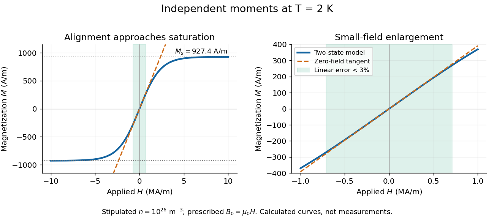

**[Figure 16](#image-magnetization-approaching-saturation-magnetization-with-its-small-field-linear-range). Magnetization approaching saturation magnetization, with its small-field linear range**. Original independent-moment calculation at stipulated $T=2\,\mathrm K$. The shaded range has less than $3\%$ error relative to the exact [magnetization](electromagnetism.md#magnetization). The second panel enlarges this range. The prescribed field is $B_0=\mu_0H_{\rm app}$; curves are model predictions, not measured data.

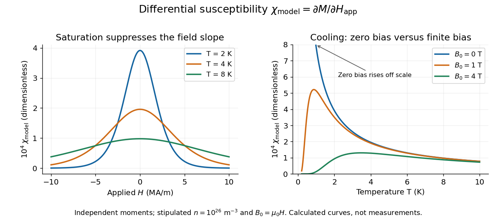

**[Figure 17](#image-bias-field-and-temperature-dependence-of-the-independent-moment-differential-magnetic-susceptibility). Bias-field and temperature dependence of the independent-moment differential magnetic susceptibility**. Original calculation using the same stipulated moments and [number density](#number-density). The left panel compares field sweeps at $2$, $4$ and $8\,\mathrm K$. The right panel compares [temperature](thermodynamics.md#temperature) sweeps at prescribed $B_0=0$, $1$ and $4\,\mathrm T$. The zero-field slope follows [Curie's law](#curie-s-law); cooling at fixed nonzero field eventually suppresses the slope through [saturation magnetization](#saturation-magnetization).

At $B_0=0$, cooling increases the zero-field slope as $1/T$. At fixed $B_0\ne0$, cooling instead gives $\chi_{\rm model}\sim4\mu_0n\mu^2e^{-2\mu|B_0|/(k_BT)}/(k_BT)$: a saturated moment can hardly change further. The order of the zero-field and zero-[temperature](thermodynamics.md#temperature) limits matters. This independent model has no finite-[temperature](thermodynamics.md#temperature) collective [phase transition](critical-phenomenon.md#phase-transition); the diverging zero-field slope alone does not establish one.

### Saturation magnetization

↑ **Parent:** [Magnetic susceptibility](#magnetic-susceptibility)

[Saturation magnetization](#saturation-magnetization) is the limiting [magnetization](electromagnetism.md#magnetization) when the responding [magnetic moments](electromagnetism.md#magnetic-dipole-moment) are fully aligned within the stated model or experimental regime. In [independent-moment magnetic response](#independent-moment-magnetic-response), $M_s=n\mu$. Reaching a large [magnetization](electromagnetism.md#magnetization) does not imply a large [differential magnetic susceptibility](#differential-magnetic-susceptibility): the remaining slope can be almost zero.

### Gouy balance

↑ **Parent:** [Magnetic susceptibility](#magnetic-susceptibility)  
ⓦ [Wiki](https://en.wikipedia.org/wiki/Gouy_balance)

A [Gouy balance](#gouy-balance) detects the [force](classical-mechanics.md#force) exerted by a nonuniform [magnetic field](electromagnetism.md#magnetic-field) on a sample of uniform cross-section extending between high- and low-field regions. TeachSpin's implementation reverses the usual arrangement: a rare-earth permanent-magnet assembly sits on a one-pan electronic balance, while a separate holder brings the sample into the field. The magnet's apparent mass change measures the opposite of the sample's vertical [force](classical-mechanics.md#force), by [Newton's third law](classical-mechanics.md#newton-s-third-law). The described pole faces have diameter $25\,\mathrm{mm}$ and separation $15\,\mathrm{mm}$; samples occupy cuvettes of cross-section $(10\,\mathrm{mm})^2$ and height about $32\,\mathrm{mm}$. [TeachSpin, Foundational Magnetic Susceptibility, Instrument: The Gouy Method and “Weighing the magnet” method; Specifications: magnet and sample dimensions](physics-bibliography.md#foundational-magnetic-susceptibility-by-teachspin)

The same balance calibrates [magnetic flux density](electromagnetism.md#magnetic-field) by measuring the reaction [force](classical-mechanics.md#force) on the magnet when a wire of known horizontal length $L$ carries known [electric current](electromagnetism.md#electric-current) $i$ perpendicular to the field: $|F_z|=iLB_0$. The manufacturer describes water being repelled by the high-field region, identifying negative [magnetic susceptibility](#magnetic-susceptibility). This observed sign supplies a qualitative test, not a measured [Curie's law](#curie-s-law) curve. [TeachSpin, Foundational Magnetic Susceptibility, Instrument: Absolute calibration method and Diamagnetism](physics-bibliography.md#foundational-magnetic-susceptibility-by-teachspin)

For weak reversible linear response, a uniform sample displacing a weakly magnetic surrounding medium has, to leading order, downward [force](classical-mechanics.md#force)

$$
F_\downarrow\simeq\frac{A(\chi_v-\chi_{\rm medium})}{2\mu_0}
\left(B_{0,\rm bottom}^2-B_{0,\rm top}^2\right).
$$

This follows by integrating the induced-dipole force density $(\chi_v-\chi_{\rm medium})\partial_z(B_0^2)/(2\mu_0)$ along a downward coordinate. $A$ is the cross-sectional [area](differential-geometry.md#surface-area), and the two $B_0$ values are applied [magnetic flux densities](electromagnetism.md#magnetic-field). The [force](classical-mechanics.md#force) depends on the endpoint fields; the entire field-gradient profile need not be measured under these assumptions. In the reversed apparatus, $F_\downarrow=-g\Delta m_{\rm magnet}$ after subtracting the holder background, where $g$ is [gravitational acceleration](classical-mechanics.md#gravitational-acceleration). This sign must be reversed before inferring [volume magnetic susceptibility](#volume-magnetic-susceptibility).

Useful controls are an empty-holder reading at the same position, a distant-sample baseline, repeated wire-current reversals during field calibration, and stable [temperature](thermodynamics.md#temperature). They separate holder response, balance drift, force offsets, and thermal changes; these are proposed checks for the stated inference. Finite endpoint fields, nonuniform cross-section, uneven powder packing, stray forces and a [demagnetizing field](#demagnetizing-field) limit the simple formula. If [magnetization](electromagnetism.md#magnetization) is nonlinear, the weak-response force involves $A\int_{B_{0,\rm top}}^{B_{0,\rm bottom}}M(B_0)\,dB_0$ instead of a constant-$\chi_v$ endpoint square. A balance reading then measures an integrated response, not directly the local [differential magnetic susceptibility](#differential-magnetic-susceptibility).

<h2 id="planck-s-law">Planck's law</h2>

↑ **Parent:** [Statistical physics](statistical-physics.md)  
ⓦ [Wiki](https://en.wikipedia.org/wiki/Planck's_law)

[Planck's law](#planck-s-law) gives the [spectral radiance](optics.md#spectral-radiance) of an ideal [blackbody](astrophysics.md#blackbody) in [thermal equilibrium](thermodynamics.md#thermal-equilibrium) at absolute [temperature](thermodynamics.md#temperature) $T>0$. It predicts how much [power](classical-mechanics.md#power) is carried in each small [frequency](physics.md#frequency) or [wavelength](wave-equation.md#wavelength) interval, per projected [area](differential-geometry.md#surface-area) and per [solid angle](geometry-and-topology.md#solid-angle). The whole curve is determined by $T$: no material-specific parameter enters this ideal [Planck function](astrophysics.md#planck-function).

Writing $\nu$ for [frequency](physics.md#frequency) in hertz and $\lambda$ for [wavelength](wave-equation.md#wavelength) in metres, the two forms of the [Planck function](astrophysics.md#planck-function) are

$$
B_\nu(T)=\frac{2h\nu^3}{c^2}\frac1{e^{h\nu/(k_BT)}-1},
\qquad
B_\lambda(T)=\frac{2hc^2}{\lambda^5}\frac1{e^{hc/(\lambda k_BT)}-1}.
$$

Here $h$ is the [Planck constant](quantum-mechanics.md#planck-constant), $k_B$ the [Boltzmann constant](thermodynamics.md#boltzmann-constant), and $c$ the [speed of light](special-relativity.md#speed-of-light) in vacuum. Their exact values in the [International System of Units](physics.md#international-system-of-units) are $h=6.62607015\times10^{-34}\,\mathrm{J\,s}$, $k_B=1.380649\times10^{-23}\,\mathrm{J\,K^{-1}}$, and $c=299792458\,\mathrm{m\,s^{-1}}$. [NIST, Meet the Constants](https://www.nist.gov/si-redefinition/meet-constants)

The units matter: $B_\nu$ is measured in $\mathrm{W\,m^{-2}\,sr^{-1}\,Hz^{-1}}$, whereas $B_\lambda$ is measured in $\mathrm{W\,m^{-2}\,sr^{-1}\,m^{-1}}$. Both are [spectral radiance](optics.md#spectral-radiance), rather than [radiant exitance](optics.md#radiant-exitance) or [energy density](#energy-density). To report $B_\lambda$ per micrometre, multiply its per-metre value by $10^{-6}$; a micrometre-wide interval is $10^{-6}$ metres wide.

For a computed example, at $T=6000\,\mathrm K$ and $\lambda=0.500\,\mu\mathrm m$, the exponent is $hc/(\lambda k_BT)\approx4.79592$. Substitution into [Planck's law](#planck-s-law) gives $B_\lambda\approx3.17569\times10^{13}\,\mathrm{W\,m^{-2}\,sr^{-1}\,m^{-1}}$, or $3.17569\times10^7\,\mathrm{W\,m^{-2}\,sr^{-1}}$ per micrometre. At the same [wavelength](wave-equation.md#wavelength), the illustrative [temperatures](thermodynamics.md#temperature) $3000\,\mathrm K$ and $4500\,\mathrm K$ give $2.60268\times10^5$ and $6.37793\times10^6$ in the latter units. These are ideal predictions for stipulated [temperatures](thermodynamics.md#temperature).

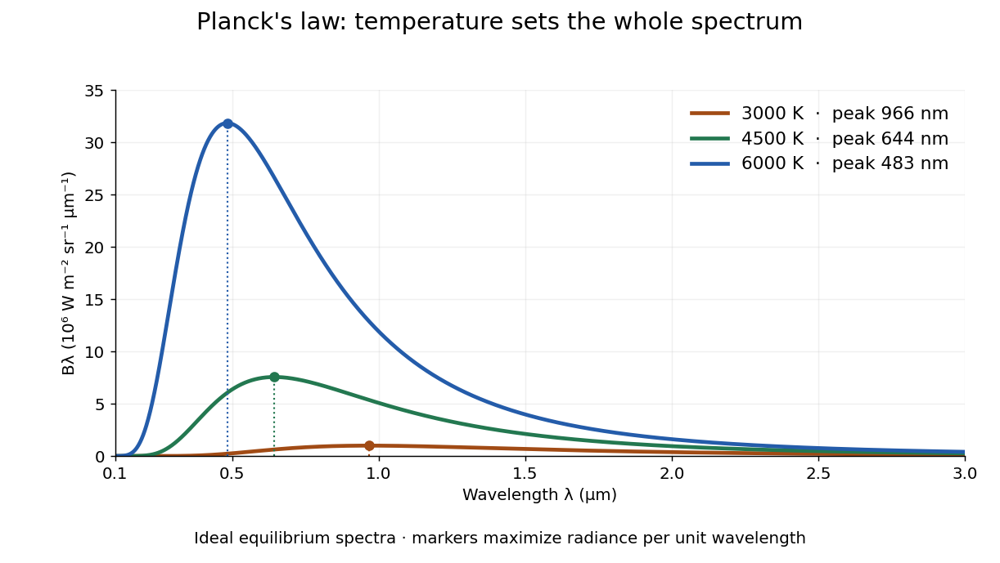

**[Figure 18](#image-ideal-planck-s-law-spectra-at-three-temperatures). Ideal Planck's law spectra at three temperatures**. The vertical axis is [spectral radiance](optics.md#spectral-radiance) per micrometre, including the $10^{-6}$ conversion from per metre. Increasing [temperature](thermodynamics.md#temperature) raises the curve at every fixed [wavelength](wave-equation.md#wavelength) and moves its marked peak toward shorter [wavelengths](wave-equation.md#wavelength). The peaks are approximately $966$, $644$, and $483\,\mathrm{nm}$ for $3000$, $4500$, and $6000\,\mathrm K$, respectively; only $0.1$ to $3\,\mu\mathrm m$ of each spectrum is shown.

The key [change of variables](calculus.md#change-of-variables-formula) is $\nu=c/\lambda$. Corresponding positive intervals carry the same [power](classical-mechanics.md#power), so $B_\lambda\,d\lambda=B_\nu\,|d\nu|$ and

$$
B_\lambda(T)=B_\nu(T)\big|_{\nu=c/\lambda}\,\frac{c}{\lambda^2}.
$$

Equal-width [wavelength](wave-equation.md#wavelength) intervals have unequal widths in [frequency](physics.md#frequency); the factor $c/\lambda^2$ compensates for this. Merely replacing the horizontal-axis labels of $B_\nu$ by $c/\nu$ does not produce $B_\lambda$. This explains the [frequency and wavelength peaks of Planck's law](#frequency-and-wavelength-peaks-of-planck-s-law).

A short derivation uses the [Boltzmann distribution](thermodynamics.md#boltzmann-distribution) for a single electromagnetic mode with thermal [energies](classical-mechanics.md#energy) $nh\nu$, $n=0,1,\ldots$. Put $q=e^{-h\nu/(k_BT)}$. The [geometric series](real-analysis.md#geometric-series) gives $Z=\sum_{n\geq0}q^n=(1-q)^{-1}$ and mean thermal [energy](classical-mechanics.md#energy) $h\nu q/(1-q)$. The [electromagnetic mode density in a box](#electromagnetic-mode-density-in-a-box), including both independent [polarization of an electromagnetic wave](electromagnetism.md#polarization-of-an-electromagnetic-wave) states of a [photon](quantum-mechanics.md#photon), is $8\pi\nu^2/c^3$ per volume per unit [frequency](physics.md#frequency). Multiplication gives spectral [energy density](#energy-density) $u_\nu=8\pi h\nu^3/[c^3(e^{h\nu/(k_BT)}-1)]$; [isotropy](continuum-mechanics.md#isotropy) gives $B_\nu=cu_\nu/(4\pi)$. This counts thermal excitation [energy](classical-mechanics.md#energy), excluding [zero-point energy](quantum-mechanics.md#zero-point-energy). [Feynman Lectures, I.41.3, quantum oscillator and radiation](https://www.feynmanlectures.caltech.edu/I_41.html#Ch41-S3)

[Planck's law](#planck-s-law) connects [quantum mechanics](quantum-mechanics.md) to a measurable radiation curve. Its small-$h\nu/(k_BT)$ limit is the [Rayleigh-Jeans law](astrophysics.md#rayleigh-jeans-law), $B_\nu\approx2k_BT\nu^2/c^2$; its large-$h\nu/(k_BT)$ limit is the [Wien approximation](astrophysics.md#wien-approximation), $B_\nu\approx(2h\nu^3/c^2)e^{-h\nu/(k_BT)}$. The suppression at high [frequency](physics.md#frequency) makes the total [energy density](#energy-density) finite. Integrating the curve gives the [Stefan–Boltzmann law](thermodynamics.md#stefan-boltzmann-law), while locating its peak gives [Wien's displacement law](astrophysics.md#wien-s-displacement-law). Thus one formula predicts both the spectral shape and the total emission.

<h3 id="frequency-and-wavelength-peaks-of-planck-s-law">Frequency and wavelength peaks of Planck's law</h3>

↑ **Parent:** [Planck's law](#planck-s-law)

At a fixed [temperature](thermodynamics.md#temperature), the [frequency](physics.md#frequency) maximizing $B_\nu$ and the [wavelength](wave-equation.md#wavelength) maximizing $B_\lambda$ in [Planck's law](#planck-s-law) are different ways of describing the same [black-body radiation](#black-body-radiation). They are maxima of different densities. The inverse relation between [frequency](physics.md#frequency) and [wavelength](wave-equation.md#wavelength) does not preserve those maxima because its interval-conversion factor varies with [wavelength](wave-equation.md#wavelength).

For a short extremum calculation, substitute $x=h\nu/(k_BT)$ into $B_\nu$, leaving a positive constant times $x^3/(e^x-1)$. Substitute $x=hc/(\lambda k_BT)$ into $B_\lambda$, leaving a positive constant times $x^5/(e^x-1)$. Setting each [derivative](calculus.md#derivative) to zero gives

$$
3(1-e^{-x_\nu})=x_\nu,\qquad 5(1-e^{-x_\lambda})=x_\lambda.
$$

Select the positive roots: $x_\nu=2.821439372\ldots$ and $x_\lambda=4.965114232\ldots$. Although $x=0$ solves the rearranged equations, it is an endpoint, not either peak. For $m=3$ or $5$, the function $m(1-e^{-x})-x$ initially increases, its [derivative](calculus.md#derivative) $me^{-x}-1$ crosses zero once, and it eventually becomes negative. Hence it has exactly one positive root. Each density tends to zero at both ends, so this root gives its unique maximum. The [bisection method](numerical-analysis.md#bisection-method) brackets these roots in $(1,3)$ and $(1,5)$.

Consequently [Wien's displacement law](astrophysics.md#wien-s-displacement-law) gives

$$
\lambda_{\max}T=\frac{hc}{k_Bx_\lambda}=b\approx2.897771955\times10^{-3}\,\mathrm{m\,K},
\qquad \frac{\nu_{\max}}T=\frac{k_Bx_\nu}{h}\approx5.878925758\times10^{10}\,\mathrm{Hz\,K^{-1}}.
$$

These constants agree with NIST's tabulation. [Fundamental Physical Constants — Complete Listing by National Institute of Standards and Technology and others](chemistry-bibliography.md#fundamental-physical-constants-complete-listing-by-national-institute-of-standards-and-technology-and-others) The [wavelength](wave-equation.md#wavelength) peaks at $3000$, $4500$, and $6000\,\mathrm K$ are $965.924$, $643.949$, and $482.962\,\mathrm{nm}$. Doubling [temperature](thermodynamics.md#temperature) halves this peak [wavelength](wave-equation.md#wavelength).

At $6000\,\mathrm K$, the [frequency](physics.md#frequency) peak is $\nu_{\max}\approx352.736\,\mathrm{THz}$, whose converted [wavelength](wave-equation.md#wavelength) is $c/\nu_{\max}\approx0.849907\,\mu\mathrm m$. The $B_\lambda$ peak is instead $0.482962\,\mu\mathrm m$, corresponding to about $620.737\,\mathrm{THz}$. These numbers are compatible: equal-width [frequency](physics.md#frequency) bins and equal-width [wavelength](wave-equation.md#wavelength) bins partition the same radiation differently. Specifying which density was maximized is essential when using a peak to infer [temperature](thermodynamics.md#temperature).

**[Figure 19](#image-one-6000-mathrm-k-spectrum-two-spectral-coordinate-peaks). One $6000\,\mathrm K$ spectrum, two spectral-coordinate peaks**. The left panel plots the [Planck function](astrophysics.md#planck-function) per terahertz and marks its [frequency](physics.md#frequency) peak. The right panel plots the same [black-body radiation](#black-body-radiation) per micrometre and marks its [wavelength](wave-equation.md#wavelength) peak. Dashed lines locate the counterpart of the other panel's peak. The converted [frequency](physics.md#frequency) peak at $0.849907\,\mu\mathrm m$ is not the $B_\lambda$ peak at $0.482962\,\mu\mathrm m$: the [change of variables](calculus.md#change-of-variables-formula) changes density heights through $c/\lambda^2$.

### Planck photon distribution

↑ **Parent:** [Planck's law](#planck-s-law)

For [photons](quantum-mechanics.md#photon) in [thermal equilibrium](thermodynamics.md#thermal-equilibrium) at [temperature](thermodynamics.md#temperature) $T$, [Planck's law](#planck-s-law) gives the photon [number density](#number-density) per frequency interval. In terms of the [Planck function](astrophysics.md#planck-function), it is $dn/d\nu=4\pi B_\nu(T)/(ch\nu)$, hence

$$
\frac{dn}{d\nu}=\frac{8\pi\nu^2}{c^3}\frac1{e^{h\nu/(k_BT)}-1}.
$$

#### Temperature scaling of thermal photon number and energy densities

↑ **Parent:** [Planck photon distribution](#planck-photon-distribution)

Changing variables to $x=h\nu/(k_BT)$ in the Planck distribution gives

$$
n=\alpha T^3,
\qquad
\rho=\xi T^4,
$$

where $\alpha$ and $\xi$ are temperature-independent constants.

##### Photon number density

↑ **Parent:** [Temperature scaling of thermal photon number and energy densities](#temperature-scaling-of-thermal-photon-number-and-energy-densities)

In natural units, a thermal photon gas with two polarizations has

$$
n_\gamma=\frac{2\zeta(3)}{\pi^2}T^3.
$$

###### Photon number current

↑ **Parent:** [Photon number density](#photon-number-density)

In an [orthonormal tetrad](general-relativity.md#orthonormal-frame-in-spacetime), $J^{\hat0}=\int f\,d^3p$ is the [photon number density](#photon-number-density) and $J^{\hat i}=\int f e^i\,d^3p$ is its number flux. Integrating the [Boltzmann equation](#boltzmann-equation) gives $\nabla_\mu J^\mu=\int C[f]\,d^3p/E$ when momentum-boundary terms vanish. Collisionless propagation and photon-number-conserving scattering give zero [divergence](calculus.md#divergence). [Photon emission](quantum-mechanics.md#photon-emission), [photon absorption](quantum-mechanics.md#photon-absorption), [electron-positron annihilation in cosmology](cosmology.md#electron-positron-annihilation-in-cosmology), [bremsstrahlung](electromagnetism.md#bremsstrahlung) and [double Compton scattering](physics.md#double-compton-scattering) generally do not. This is a number current, not an electric charge current: [photons](quantum-mechanics.md#photon) are neutral.

## Thermodynamics

↑ **Parent:** [Statistical physics](statistical-physics.md)

[This section is present in another page, follow this link to view it.](thermodynamics.md)

### Black-body radiation

↑ **Parent:** [Planck's law](#planck-s-law)  
ⓦ [Wiki](https://en.wikipedia.org/wiki/Black-body_radiation)

[Black-body radiation](#black-body-radiation) is the [electromagnetic radiation](electromagnetism.md#electromagnetic-radiation) in [thermal equilibrium](thermodynamics.md#thermal-equilibrium) with an ideal [blackbody](astrophysics.md#blackbody). It can be described as a [photon gas](#photon-gas): a cavity whose walls are all at the same [temperature](thermodynamics.md#temperature) contains radiation with the universal [Planck's law](#planck-s-law) spectrum. A small opening in such a cavity approximates a [blackbody](astrophysics.md#blackbody) emitter because incoming radiation undergoes repeated absorption inside. The radiation's equilibrium spectrum depends on [temperature](thermodynamics.md#temperature), rather than the wall material. [OpenStax, University Physics 3, §6.1, blackbody cavity and emission laws](https://openstax.org/books/university-physics-volume-3/pages/6-1-blackbody-radiation)

There are three useful quantities to keep distinct: directional [spectral radiance](optics.md#spectral-radiance) $B_\nu$ or $B_\lambda$, total [energy density](#energy-density) $u$ in the cavity, and outward [radiant exitance](optics.md#radiant-exitance) $j^*$ from its opening. [Planck's law](#planck-s-law) supplies the first; [integrals](calculus.md#integral) over [frequency](physics.md#frequency) and directions supply the others. For [isotropy](continuum-mechanics.md#isotropy), every direction has the same $B_\nu$, so the full $4\pi$ [solid angle](geometry-and-topology.md#solid-angle) gives

$$
u(T)=\frac{4\pi}{c}\int_0^\infty B_\nu(T)\,d\nu
=a_{\rm rad}T^4,\qquad
a_{\rm rad}=\frac{8\pi^5k_B^4}{15h^3c^3}
=\frac{\pi^2k_B^4}{15\hbar^3c^3}.
$$

Here $\hbar=h/(2\pi)$ is the reduced [Planck constant](quantum-mechanics.md#planck-constant), and the [radiation constant](astrophysics.md#radiation-constant) is $a_{\rm rad}\approx7.565733250\times10^{-16}\,\mathrm{J\,m^{-3}\,K^{-4}}$. The explicit [Boltzmann constant](thermodynamics.md#boltzmann-constant) makes this an SI formula; adopting [natural units](physics.md#natural-units) with $k_B=1$ recovers $u=\pi^2T^4/(15\hbar^3c^3)$.

For a short [integral](calculus.md#integral) outline, substitute $x=h\nu/(k_BT)$ and use

$$
\int_0^\infty\frac{x^3}{e^x-1}\,dx
=\sum_{n=1}^\infty\int_0^\infty x^3e^{-nx}\,dx
=6\sum_{n=1}^\infty\frac1{n^4}=\frac{\pi^4}{15}.
$$

The expansion is a [geometric series](real-analysis.md#geometric-series) with nonnegative terms; repeated [integration by parts](calculus.md#integration-by-parts) evaluates each [integral](calculus.md#integral), and $\zeta(4)=\pi^4/90$ is a value of the [Riemann zeta function](analytic-number-theory.md#riemann-zeta-function). This gives the coefficient above.

The [photon gas](#photon-gas) also exerts [radiation pressure](thermodynamics.md#radiation-pressure), $p=u/3$. The factor $1/3$ comes from the [angular average](geometry-and-topology.md#angular-average) of the squared directional component of [photon](quantum-mechanics.md#photon) [momentum](classical-mechanics.md#momentum), $\langle\cos^2\theta\rangle=1/3$. The [thermodynamic derivation of blackbody radiation pressure](#thermodynamic-derivation-of-blackbody-radiation-pressure) gives the same result. In contrast, outgoing [power](classical-mechanics.md#power) involves one projected-direction factor over an outward hemisphere, yielding [radiant exitance](optics.md#radiant-exitance)

$$
j^*=\pi\int_0^\infty B_\nu(T)\,d\nu
=\frac{cu}{4}=\sigma T^4,
\qquad \sigma=\frac{2\pi^5k_B^4}{15h^3c^2}.
$$

This is the [Stefan–Boltzmann law](thermodynamics.md#stefan-boltzmann-law) with unit [emissivity](thermodynamics.md#emissivity); $\sigma$ is the [Stefan-Boltzmann constant](thermodynamics.md#stefan-boltzmann-constant). The factor $\pi$ follows from [Lambert's cosine law](optics.md#lambert-s-cosine-law), rather than the $4\pi$ full-sphere factor used for [energy density](#energy-density).

For example, an ideal $6000\,\mathrm K$ cavity has $u\approx0.980519\,\mathrm{J\,m^{-3}}$, [radiation pressure](thermodynamics.md#radiation-pressure) $p\approx0.326840\,\mathrm{Pa}$, and outward [radiant exitance](optics.md#radiant-exitance) $j^*\approx7.34881\times10^7\,\mathrm{W\,m^{-2}}$. A stipulated $3000\,\mathrm K$ cavity has one-sixteenth each value because all three scale as $T^4$. These describe stored [energy](classical-mechanics.md#energy), mechanical [pressure](thermodynamics.md#pressure), and outgoing [power](classical-mechanics.md#power) per [area](differential-geometry.md#surface-area), respectively. In a closed equilibrium cavity, equal opposing radiation balances the directional [power](classical-mechanics.md#power) flow even though $u$ and $p$ are nonzero.

The usefulness of [black-body radiation](#black-body-radiation) is this common reference: [Planck's law](#planck-s-law), [Wien's displacement law](astrophysics.md#wien-s-displacement-law), and the [Stefan–Boltzmann law](thermodynamics.md#stefan-boltzmann-law) consistently connect spectral measurements, [temperature](thermodynamics.md#temperature), and total emission. The three illustrative curves in [Planck's law](#planck-s-law) are ideal equilibrium spectra; applying them to a material requires considering its [emissivity](thermodynamics.md#emissivity) and whether [thermal equilibrium](thermodynamics.md#thermal-equilibrium) is a suitable approximation.

#### Electromagnetic mode density in a box

↑ **Parent:** [Black-body radiation](#black-body-radiation)

In a large periodic box of volume $V$, one polarization has $V/(2\pi)^3$ wavevector modes per unit $d^3k$. The two transverse photon polarizations therefore give

$$
dN=\frac{2V}{(2\pi)^3}\,d^3k
=\frac{V}{\pi^2}k^2\,dk
$$

after integration over directions.

#### Thermodynamic derivation of blackbody radiation pressure

↑ **Parent:** [Black-body radiation](#black-body-radiation)

For an equilibrium system with energy $E(T,V)$ and no conserved particle number, exactness of the entropy differential obtained from $dE=T\,dS-P\,dV$ gives

$$
\left(\frac{\partial E}{\partial V}\right)_T
=T\left(\frac{\partial P}{\partial T}\right)_V-P.
$$

If $E=aVT^4$ and $P=o(T)$ as $T\to0$, integration gives $P=aT^4/3=E/(3V)$.

## Gibbs entropy

↑ **Parent:** [Statistical physics](statistical-physics.md)

For a discrete probability distribution over microstates, the Gibbs entropy is

$$
S=-k_B\sum_n p_n\log p_n.
$$

### Maximum-entropy derivation of equilibrium ensembles

↑ **Parent:** [Gibbs entropy](#gibbs-entropy)

Maximizing the [Gibbs entropy](#gibbs-entropy) under normalization alone gives a uniform distribution. Adding a fixed mean-energy constraint gives the Boltzmann distribution $p_n=Z^{-1}e^{-\beta E_n}$.

## Microcanonical ensemble

↑ **Parent:** [Statistical physics](statistical-physics.md)  
ⓦ [Wiki](https://en.wikipedia.org/wiki/Microcanonical_ensemble)

The microcanonical ensemble assigns equal probability to accessible states in a narrow energy shell at fixed energy, volume, and particle number.

### Microcanonical energy-shell entropy

↑ **Parent:** [Microcanonical ensemble](#microcanonical-ensemble)

If $\Omega(E,V,N;\delta E)$ counts states in a narrow experimental energy window, the [Boltzmann entropy](thermodynamics.md#boltzmann-s-entropy-formula) is

$$
S(E,V,N)=k_B\log\Omega(E,V,N;\delta E).
$$

Changing the macroscopic resolution $\delta E$ by a fixed factor changes $S$ only by an additive quantity of order $k_B$, whereas $S$ itself is of order $Nk_B$ in the [thermodynamic limit](#thermodynamic-limit). The dependence on the precise energy-window width is therefore negligible for macroscopic thermodynamics.

## Grand canonical ensemble

↑ **Parent:** [Statistical physics](statistical-physics.md)  
ⓦ [Wiki](https://en.wikipedia.org/wiki/Grand_canonical_ensemble)

At fixed temperature, volume, and chemical potential, the grand canonical ensemble permits both energy and particle number to fluctuate and weights a state by $e^{-\beta(E-\mu N)}$.

### Grand canonical partition function

↑ **Parent:** [Grand canonical ensemble](#grand-canonical-ensemble)

The grand canonical partition function is

$$
\mathcal Z=\sum_s e^{-\beta(E_s-\mu N_s)}.
$$

### Grand potential

↑ **Parent:** [Grand canonical ensemble](#grand-canonical-ensemble)  
ⓦ [Wiki](https://en.wikipedia.org/wiki/Grand_potential)

The grand potential is

$$
\Phi=E-TS-\mu\langle N\rangle=-k_BT\log\mathcal Z.
$$

For a homogeneous extensive system, $\Phi=-pV$.

## Equivalence of statistical ensembles

↑ **Parent:** [Statistical physics](statistical-physics.md)

For an additive system with short-range interactions and a regular extensive entropy, microcanonical, canonical, and grand canonical predictions agree for bulk observables in the thermodynamic limit because relative fluctuations vanish. Equivalence can fail for finite systems, long-range interactions, or at singular phase-coexistence points.

## Canonical ensemble

↑ **Parent:** [Statistical physics](statistical-physics.md)  
ⓦ [Wiki](https://en.wikipedia.org/wiki/Canonical_ensemble)

The [canonical ensemble](#canonical-ensemble) is the [probability distribution](probability-theory.md#probability-distribution) for a system in [thermal equilibrium](thermodynamics.md#thermal-equilibrium) with a [heat bath](thermodynamics.md#heat-bath) at fixed [temperature](thermodynamics.md#temperature) $T$, with fixed particle number and external parameters. It allows [energy](classical-mechanics.md#energy) exchange, so individual [energy](classical-mechanics.md#energy) measurements fluctuate. With [Boltzmann constant](thermodynamics.md#boltzmann-constant) $k_B$ and [inverse temperature](thermodynamics.md#inverse-temperature) $\beta=1/(k_BT)$,

$$
p_s=\frac{e^{-\beta E_s}}{Z},\qquad Z=\sum_s e^{-\beta E_s}.
$$

The [heat bath](thermodynamics.md#heat-bath) is idealized as large enough that exchanges barely change its [temperature](thermodynamics.md#temperature); coupling must permit equilibration while contributing negligible interaction [energy](classical-mechanics.md#energy). A finite [heat bath](thermodynamics.md#heat-bath) approximates this description only when its [temperature](thermodynamics.md#temperature) change is negligible over the relevant exchanges. Strong coupling or a small [heat bath](thermodynamics.md#heat-bath) can require a different description.

For one [two-level system](#two-level-system) at positive [temperature](thermodynamics.md#temperature), the [Boltzmann weights](#boltzmann-factor) are $1,e^{-\beta\Delta}$, hence

$$
Z_1=1+e^{-\beta\Delta},\qquad p=\frac{e^{-\beta\Delta}}{Z_1}=\frac1{1+e^{\beta\Delta}}.
$$

At $\beta\Delta=\ln3$, $Z_1=4/3$ and $p=1/4$. This is a probabilistic thermal [mixed state](quantum-theory.md#mixed-state). For quantum levels, its [density matrix](quantum-theory.md#density-matrix) is $\rho=(1-p)|0\rangle\langle0|+p|1\rangle\langle1|$. The [pure state](quantum-theory.md#pure-state) $\sqrt{1-p}|0\rangle+\sqrt p|1\rangle$ has the same [energy measurement](quantum-mechanics.md#energy-measurement) [probabilities](probability-theory.md#probability), but also has [quantum coherence](quantum-theory.md#quantum-coherence-in-a-specified-basis) between the [energy eigenstates](quantum-mechanics.md#energy-eigenstate). Matching those [probabilities](probability-theory.md#probability) does not make the states equivalent.

### Two-level system

↑ **Parent:** [Canonical ensemble](#canonical-ensemble)

### Canonical partition function

↑ **Parent:** [Canonical ensemble](#canonical-ensemble)

The [partition function](#canonical-partition-function) $Z(\beta)=\sum_s e^{-\beta E_s}$ is the sum of the [Boltzmann weights](#boltzmann-factor) over individual [microstates](#microstate). Dividing by it makes their [probabilities](probability-theory.md#probability) sum to one. When summing distinct [energies](classical-mechanics.md#energy) instead, include the [state degeneracy](#state-degeneracy): $Z=\sum_E g(E)e^{-\beta E}$. For two independent distinguishable [two-level systems](#two-level-system),

$$
Z_2=1+2e^{-\beta\Delta}+e^{-2\beta\Delta}=Z_1^2.
$$

The middle coefficient counts two [microstates](#microstate), exactly as in the preceding figure. For $N$ such units, $Z_N=Z_1^N$; this factorization requires additive [energy](classical-mechanics.md#energy) and [independence](random-variable.md#independent-random-variables), and generally fails with interactions.

The usefulness goes beyond normalization. For fixed [energies](classical-mechanics.md#energy), [derivatives](calculus.md#derivative) of the [natural logarithm](calculus.md#natural-logarithm) of the [partition function](#canonical-partition-function) yield measurable quantities:

$$
U=\langle E\rangle=-\partial_\beta\ln Z,\qquad
\operatorname{Var}(E)=\partial_\beta^2\ln Z,\qquad
S=k_B(\ln Z+\beta U).
$$

Here $U$ is [internal energy](thermodynamics.md#internal-energy), the second expression is the [energy](classical-mechanics.md#energy) [variance](variance.md), and $S$ is [Gibbs entropy](#gibbs-entropy). For one [two-level system](#two-level-system) at fixed $\Delta$, its [heat capacity](thermodynamics.md#heat-capacity) $C=\partial U/\partial T$ and [entropy](thermodynamics.md#entropy) are

$$
U=\Delta p,\qquad \frac{C}{k_B}=\frac{(\beta\Delta)^2e^{\beta\Delta}}{(1+e^{\beta\Delta})^2},\qquad
\frac{S}{k_B}=\ln(1+e^{-\beta\Delta})+\beta\Delta p.
$$

At $\beta\Delta=\ln3$, these give $U/\Delta=0.25$, $C/k_B\simeq0.2263$ and $S/k_B\simeq0.5623$. For independent units, all three quantities add.

The figure shows why [heat capacity](thermodynamics.md#heat-capacity) peaks. At low [temperature](thermodynamics.md#temperature), the excited [energy](classical-mechanics.md#energy) is rarely occupied; at high [temperature](thermodynamics.md#temperature), the [probabilities](probability-theory.md#probability) are almost equal and further warming barely changes [internal energy](thermodynamics.md#internal-energy). The largest response lies between these limits, at $k_BT/\Delta\simeq0.4168$, where $C/k_B\simeq0.4392$. Meanwhile [entropy](thermodynamics.md#entropy) rises from zero toward $k_B\ln2$, reflecting two equally likely alternatives. This high-[temperature](thermodynamics.md#temperature) limit belongs to the stipulated [two-level system](#two-level-system); extra accessible [energy eigenstates](quantum-mechanics.md#energy-eigenstate) would change it.

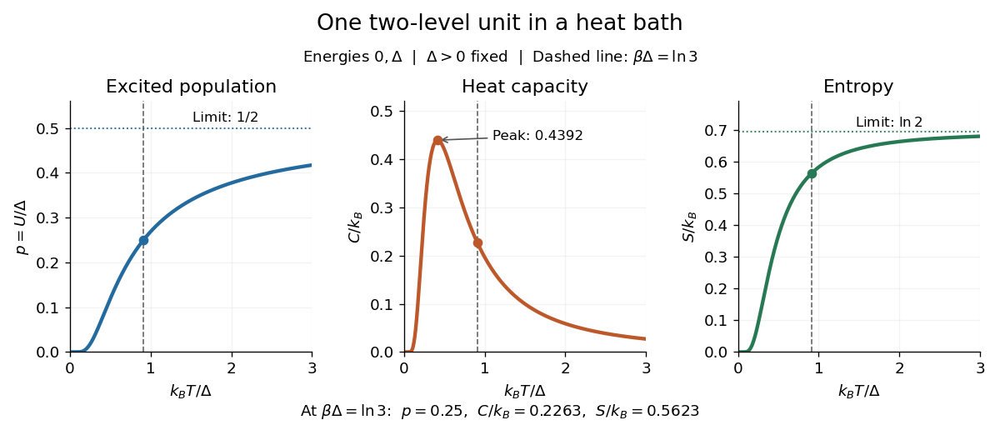

**[Figure 20](#image-population-heat-capacity-and-entropy-of-one-two-level-system-as-temperature-increases). Population, heat capacity and entropy of one two-level system as temperature increases**.

#### Thermal trace

↑ **Parent:** [Canonical partition function](#canonical-partition-function)

The [trace](linear-algebra.md#matrix-trace) of imaginary-time evolution is the [canonical partition function](#canonical-partition-function) of a quantum system. In a coordinate basis it is the integral of the diagonal [Euclidean path integral](quantum-field-theory.md#euclidean-path-integral) kernel. Inserting a symmetry operator instead gives a weighted thermal [trace](linear-algebra.md#matrix-trace).

##### Parity-twisted oscillator thermal trace

↑ **Parent:** [Thermal trace](#thermal-trace)

For two equal-frequency [quantum harmonic oscillators](quantum-mechanics.md#quantum-harmonic-oscillator), the ordinary [thermal trace](#thermal-trace) is $r/(1-r)^2$ and the [trace](linear-algebra.md#matrix-trace) with the [parity operator](quantum-mechanics.md#parity-operator) is $r/(1+r)^2$, where $r=e^{-\beta\omega}$. Total excitation $N$ has degeneracy $N+1$ and parity $(-1)^N$. Therefore the traces expand as $\sum_{n\ge1}(\pm1)^{n-1}nr^n$. The alternating weights come from parity insertion in a bosonic state space, not fermionic statistics.

#### Thermodynamic derivatives of the canonical partition function

↑ **Parent:** [Canonical partition function](#canonical-partition-function)

Canonical differentiation gives

$$
F=-\beta^{-1}\log Z,\qquad
\langle E\rangle=-\partial_\beta\log Z,
\qquad
(\Delta E)^2=\partial_\beta^2\log Z.
$$

##### Canonical energy fluctuation

↑ **Parent:** [Thermodynamic derivatives of the canonical partition function](#thermodynamic-derivatives-of-the-canonical-partition-function)

Canonical energy variance equals $\partial_\beta^2\log Z=k_BT^2C_V$.

#### Particle in a finite two-dimensional harmonic trap

↑ **Parent:** [Canonical partition function](#canonical-partition-function)

For

$$
H=\frac{p_x^2+p_y^2}{2m}+\frac\kappa2(x^2+y^2),
\qquad x^2+y^2<R^2,
$$

put $a=\kappa R^2/2$. The normalized classical one-particle partition function is

$$
Z_1=\frac{4\pi^2m}{h^2\beta^2\kappa}
\left(1-e^{-\beta a}\right).
$$

Its mean total and potential energies are

$$
\langle E\rangle=\frac2\beta-\frac a{e^{\beta a}-1},
\qquad
\langle V\rangle=\frac1\beta-\frac a{e^{\beta a}-1}.
$$

##### Hard-wall correction to harmonic equipartition

↑ **Parent:** [Particle in a finite two-dimensional harmonic trap](#particle-in-a-finite-two-dimensional-harmonic-trap)

If $a\gg k_BT$, the wall is thermally inaccessible and $\langle E\rangle\sim2k_BT$, as four quadratic terms predict. If $a\ll k_BT$, the spatial distribution is nearly uniform in the disk and

$$
\langle E\rangle
=k_BT+\frac{\kappa R^2}{4}+O\left(\frac{\kappa^2R^4}{k_BT}\right),
$$

so only the two kinetic quadratic terms contribute at leading order.

#### Classical ideal-gas partition function

↑ **Parent:** [Canonical partition function](#canonical-partition-function)

For $N$ indistinguishable noninteracting classical particles, $Z_N=z_1^N/N!$, where $z_1$ is the normalized one-particle phase-space integral.

##### Classical ideal gas in a homogeneous soft trap

↑ **Parent:** [Classical ideal-gas partition function](#classical-ideal-gas-partition-function)

For the potential $U=r^{2n}/V^{2n/3}$, rescaling $r=V^{1/3}(kT)^{1/(2n)}u$ in the classical one-particle [partition function](#canonical-partition-function) gives the formula above. The parameter-conjugate force is $P=NkT/V$, the [internal energy](thermodynamics.md#internal-energy) is $(3/2+3/(2n))NkT$, and $C_P-C_V=Nk$. The kinetic term contributes $3NkT/2$, while the potential term contributes $3NkT/(2n)$. For indistinguishable particles the $N!$ [factor](statistical-modelling.md#regression-factor) changes [free energy](thermodynamics.md#thermodynamic-free-energy) and [entropy](thermodynamics.md#entropy) but not these force and heat-capacity formulas.

##### Thermal de Broglie wavelength

↑ **Parent:** [Classical ideal-gas partition function](#classical-ideal-gas-partition-function)  
ⓦ [Wiki](https://en.wikipedia.org/wiki/Thermal_de_Broglie_wavelength)

The three-dimensional translational momentum integral is $1/\lambda^3$ per unit volume, where

$$
\lambda=\sqrt{\frac{2\pi\hbar^2}{mk_BT}}.
$$

##### Canonical partition function for an ultrarelativistic gas in a power-law trap

↑ **Parent:** [Classical ideal-gas partition function](#classical-ideal-gas-partition-function)

For energy $pc+U(x)$,

$$
Z_1=\frac{(k_BT)^3}{\pi^2(\hbar c)^3}
\int e^{-U(x)/(k_BT)}d^3x.
$$

If $U(r)=r^{2n}/V^{2n/3}$, then

$$
Z_1=\frac4{\pi(\hbar c)^3}
V(k_BT)^{3+3/(2n)}I_n,
\qquad
I_n=\int_0^\infty u^2e^{-u^{2n}}du.
$$

Consequently $pV=Nk_BT$, while the mean energy and variance are $NAk_BT$ and $NA(k_BT)^2$ with $A=3+3/(2n)$.

###### Most likely radius in an isotropic power-law trap

↑ **Parent:** [Canonical partition function for an ultrarelativistic gas in a power-law trap](#canonical-partition-function-for-an-ultrarelativistic-gas-in-a-power-law-trap)

The radial density is proportional to $r^2e^{-r^{2n}/(V^{2n/3}k_BT)}$, whose mode is

$$
r=V^{1/3}\left(\frac{k_BT}{n}\right)^{1/(2n)}.
$$

##### Sackur-Tetrode equation

↑ **Parent:** [Classical ideal-gas partition function](#classical-ideal-gas-partition-function)  
ⓦ [Wiki](https://en.wikipedia.org/wiki/Sackur–Tetrode_equation)

In the classical dilute regime, a monatomic ideal gas has entropy

$$
S=Nk_B\left[\log\left(\frac{V}{N\lambda^3}\right)+\frac52\right].
$$

### Independent spin-one-half two-level system

↑ **Parent:** [Canonical ensemble](#canonical-ensemble)

For $N$ distinguishable noninteracting spins, let a fraction $\alpha$ occupy the level $+\epsilon$ and the remainder occupy $-\epsilon$. The [Stirling formula](real-analysis.md#stirling-formula) gives

$$
S=-Nk_B\bigl[\alpha\log\alpha+(1-\alpha)\log(1-\alpha)\bigr],
\qquad
E=N\epsilon(2\alpha-1).
$$

The relation $1/T=\partial S/\partial E$ yields

$$
\alpha=\frac1{1+e^{2\epsilon/(k_BT)}},
\qquad
E=-N\epsilon\tanh\left(\frac\epsilon{k_BT}\right).
$$

Positive temperature corresponds to $0\leq\alpha<1/2$; a population inversion $1/2<\alpha\leq1$ has [negative temperature](#negative-temperature).

### Spin-1 paramagnet

↑ **Parent:** [Canonical ensemble](#canonical-ensemble)

For $N$ independent spins with $s_z\in\{-1,0,1\}$ and one-spin Hamiltonian $-\mu Bs_z$,

$$
Z=\left(1+2\cosh(\beta\mu B)\right)^N.
$$

Writing $x=\beta\mu B$, its heat capacity is

$$
C=Nk_Bx^2\frac{2(\cosh x+2)}
{(1+2\cosh x)^2}.
$$

#### Independent symmetric three-level system

↑ **Parent:** [Spin-1 paramagnet](#spin-1-paramagnet)

For $N$ noninteracting units with energies $-\epsilon,0,\epsilon$, put $x=\beta\epsilon$. Then

$$
Z=(1+2\cosh x)^N,
\qquad
E=-\frac{2N\epsilon\sinh x}{1+2\cosh x},
$$

and

$$
S=Nk_B\left[
\log(1+2\cosh x)
-\frac{2x\sinh x}{1+2\cosh x}
\right].
$$

### Negative temperature

↑ **Parent:** [Canonical ensemble](#canonical-ensemble)  
ⓦ [Wiki](https://en.wikipedia.org/wiki/Negative_temperature)

Negative absolute temperature can occur only for a system with an energy spectrum bounded above. Since $\beta=\partial S/\partial E<0$, higher-energy states are more populated than lower-energy states.

#### Magnetic-field reversal and negative temperature

↑ **Parent:** [Negative temperature](#negative-temperature)

Instantaneously reversing a Hamiltonian $H(B)$ satisfying $H(-B)=-H(B)$ leaves populations unchanged but rewrites them as a canonical distribution with $\beta'=-\beta$. When the partition function is unchanged, the free energy changes sign and the heat capacity is unchanged.

#### Heat flow from negative to positive temperature

↑ **Parent:** [Negative temperature](#negative-temperature)

A negative-temperature system is hotter than every positive-temperature system. If heat $\delta Q$ passes from it to a positive-temperature body, the total entropy change is

$$
\delta S_{\rm total}
=\delta Q(\beta_{\rm positive}-\beta_{\rm negative})>0.
$$

### Equipartition theorem

↑ **Parent:** [Canonical ensemble](#canonical-ensemble)  
ⓦ [Wiki](https://en.wikipedia.org/wiki/Equipartition_theorem)

The [equipartition theorem](#equipartition-theorem) says that each independent quadratic term in a [Hamiltonian](classical-mechanics.md#hamiltonian) described by [classical mechanics](classical-mechanics.md) has mean [energy](classical-mechanics.md#energy) $k_BT/2$ in a [canonical ensemble](#canonical-ensemble). Here $k_B$ is the [Boltzmann constant](thermodynamics.md#boltzmann-constant) and $T>0$ the absolute [temperature](thermodynamics.md#temperature). Count terms in the [energy](classical-mechanics.md#energy), rather than vaguely counting everything that can move: one [harmonic oscillator](classical-mechanics.md#simple-harmonic-motion) has one position [degree of freedom](classical-mechanics.md#degree-of-freedom) but TWO quadratic terms, one in [momentum](classical-mechanics.md#momentum) and one in [displacement](classical-mechanics.md#displacement).

A precise sufficient setting is $H(y,\xi)=ay^2/2+H_0(\xi)$ with $a>0$, where $y$ is one of the [canonical variables](classical-mechanics.md#canonical-variables), $\xi$ denotes all remaining variables, and the [phase space](classical-mechanics.md#phase-space) integration measure factors as $dy\,d\xi$. The range of $y$ is the whole [real line](real-analysis.md#real-line), independently of $\xi$; there is no [constraint](classical-mechanics.md#constraint-mechanics) coupling its allowed values to other variables. The [partition function](#canonical-partition-function) must be finite, and the relevant [expected values](probability-theory.md#expected-value) must exist. The [Boltzmann factor](#boltzmann-factor) then gives

$$
\beta=\frac{1}{k_BT},\qquad
\rho_y(y)=\sqrt{\frac{\beta a}{2\pi}}e^{-\beta ay^2/2},\qquad
\left\langle\frac{ay^2}{2}\right\rangle=\frac{k_BT}{2}.
$$

The [probability density function](continuous-probability-distribution.md#probability-density-function) $\rho_y$ is a [normal distribution](probability-theory.md#normal-distribution) with [variance](variance.md) $k_BT/a$. A larger coefficient narrows the fluctuations enough to cancel its greater [energy](classical-mechanics.md#energy) cost. This is why the mean contribution is independent of [mass](classical-mechanics.md#mass) or [spring constant](continuum-mechanics.md#spring-constant).[equations 7.124–7.135](physics-bibliography.md#thermodynamics-and-statistical-mechanics-by-richard-fitzpatrick/equipartition-theorem)

For a proof outline, the one-variable [Gaussian integral](calculus.md#gaussian-integral) is $Z_y=\int_{-\infty}^{\infty}e^{-\beta ay^2/2}\,dy=\sqrt{2\pi/(\beta a)}$, so $-\partial_\beta\ln Z_y=1/(2\beta)$. More generally, [integration by parts](calculus.md#integration-by-parts) in a canonical variable gives $\langle y\,\partial_yH\rangle=k_BT$ when its boundary term $[y e^{-\beta H}]$ vanishes and the integrals converge. For $ay^2/2$ this is twice its mean [energy](classical-mechanics.md#energy). At a finite hard boundary the boundary term need not vanish; [hard-wall correction to harmonic equipartition](#hard-wall-correction-to-harmonic-equipartition) illustrates the resulting departure. A [constraint](classical-mechanics.md#constraint-mechanics), a nonquadratic [potential energy](classical-mechanics.md#potential-energy), or a noncanonical integration measure therefore requires its own calculation. The theorem is an [ensemble average](probability-theory.md#expected-value), not equality of instantaneous [energies](classical-mechanics.md#energy), and applying it to a recorded trajectory requires equilibration and sufficient sampling.

For a classical one-dimensional [harmonic oscillator](classical-mechanics.md#simple-harmonic-motion), with positive [mass](classical-mechanics.md#mass) $m$ and [spring constant](continuum-mechanics.md#spring-constant) $k$,

$$
H=\frac{p^2}{2m}+\frac{kx^2}{2},\qquad
\frac{\langle p^2\rangle}{2m}=\frac{k\langle x^2\rangle}{2}=\frac{k_BT}{2},\qquad
\langle H\rangle=k_BT.
$$

The origin is the [equilibrium](dynamical-systems.md#equilibrium-point-of-a-dynamical-system) position. Its [heat capacity](thermodynamics.md#heat-capacity) is $k_B$ at fixed $m,k$, not $k_B/2$. Although the two mean [energies](classical-mechanics.md#energy) agree, their measured amplitudes do not: $\langle p^2\rangle=mk_BT$ and $\langle x^2\rangle=k_BT/k$. In a [harmonic optical trap](optics.md#harmonic-optical-trap), the position measurement observes the [potential energy](classical-mechanics.md#potential-energy) contribution; it does not measure both contributions by observing $x$ alone.[equations 7.136–7.139](physics-bibliography.md#thermodynamics-and-statistical-mechanics-by-richard-fitzpatrick/harmonic-oscillators)

For $N$ particles in a three-dimensional classical [monatomic gas](thermodynamics.md#monatomic-gas), neglect interactions and thermally accessible internal excitations. Its three translational [momentum](classical-mechanics.md#momentum) terms give [internal energy](thermodynamics.md#internal-energy) $U=3Nk_BT/2$, [heat capacity at constant volume](thermodynamics.md#heat-capacity-at-constant-volume) $C_V=3Nk_B/2$, and [heat capacity at constant pressure](thermodynamics.md#heat-capacity-at-constant-pressure) $C_p=C_V+Nk_B=5Nk_B/2$. Per mole, replace $Nk_B$ by the [molar gas constant](thermodynamics.md#molar-gas-constant) $R$. For example, using stipulated $R=8.314\,\mathrm{J\,mol^{-1}\,K^{-1}}$, the [molar heat capacity](thermodynamics.md#molar-heat-capacity) at fixed [volume](thermodynamics.md#volume-thermodynamics) is $12.471\,\mathrm{J\,mol^{-1}\,K^{-1}}$. These results assume a dilute, nonrelativistic [ideal gas](thermodynamics.md#ideal-gas) with classical translational statistics, rather than a [quantum degeneracy](quantum-mechanics.md#degenerate-energy-levels) regime.

For an [ideal gas](thermodynamics.md#ideal-gas) of diatomic [molecules](chemistry.md#molecule), modeled as two [chemical atoms](physics.md#atom-physics) with a bond, there are three translational quadratic terms, two accessible [rotational kinetic energy](classical-mechanics.md#rotational-kinetic-energy) terms for changes of bond orientation, and one bond-stretching [harmonic oscillator](classical-mechanics.md#simple-harmonic-motion) with two quadratic terms. Rotation about the bond axis is not an additional active mode in this linear-molecule model. The three familiar limits of [heat capacity at constant volume](thermodynamics.md#heat-capacity-at-constant-volume) are

$$
\frac{C_V}{Nk_B}\simeq
\begin{cases}
3/2,&\text{rotations and vibrations frozen},\\
5/2,&\text{rotations active, vibrations frozen},\\
7/2,&\text{rotations and vibrations classical}.
\end{cases}
$$

Corresponding [molar heat capacities](thermodynamics.md#molar-heat-capacity) are $3R/2$, $5R/2$ and $7R/2$. Counting the stretching [harmonic oscillator](classical-mechanics.md#simple-harmonic-motion) only once as $k_BT/2$ would give the wrong last value.[§§2.2.1](physics-bibliography.md#statistical-physics-by-david-tong/2-classical-gases)

The frozen regimes require [quantum mechanics](quantum-mechanics.md). In the simple molecular rotation model, $E_j=k_B\theta_r j(j+1)$ with [state degeneracy](#state-degeneracy) $2j+1$, $\theta_r=\hbar^2/(2Ik_B)$, and [moment of inertia](classical-mechanics.md#moment-of-inertia) $I$. For the bond-stretching [quantum harmonic oscillator](quantum-mechanics.md#quantum-harmonic-oscillator), $\theta_v=\hbar\omega/k_B$ with [angular frequency](classical-mechanics.md#angular-frequency) $\omega$ and $\hbar=h/(2\pi)$ from the [Planck constant](quantum-mechanics.md#planck-constant). When $\theta_r\ll\theta_v$, the three limits above correspond to $T\ll\theta_r$, $\theta_r\ll T\ll\theta_v$, and $T\gg\theta_v$, provided translational motion remains classical. They are smooth crossovers, not abrupt switches. Real [molecules](chemistry.md#molecule) can have different allowed rotational populations; at high [temperature](thermodynamics.md#temperature), [thermal dissociation](chemistry.md#thermal-dissociation), internal excitations and nonharmonic bond motion can invalidate the fixed-molecule model before its last limit is reached.[§3.4](physics-bibliography.md#statistical-physics-by-david-tong/3-quantum-gases)

For a [quantum harmonic oscillator](quantum-mechanics.md#quantum-harmonic-oscillator) with fixed $\omega$, put $z=\theta_v/T$. Its exact mean [energy](classical-mechanics.md#energy) and [heat capacity](thermodynamics.md#heat-capacity) are

$$
\langle H\rangle=\frac{\hbar\omega}{2}+\frac{\hbar\omega}{e^z-1},\qquad
\frac{C_{\rm osc}}{k_B}=\frac{z^2e^{-z}}{(1-e^{-z})^2}.
$$

At $T\gg\theta_v$, the mean [energy](classical-mechanics.md#energy) approaches $k_BT$ and $C_{\rm osc}$ approaches $k_B$. At $T\ll\theta_v$, thermal excitation is exponentially suppressed and $C_{\rm osc}$ tends to zero, although the [zero-point energy](quantum-mechanics.md#zero-point-energy) $\hbar\omega/2$ survives. Frozen thus means little thermal response, not zero motion or zero [energy](classical-mechanics.md#energy).[equations 7.140–7.155](physics-bibliography.md#thermodynamics-and-statistical-mechanics-by-richard-fitzpatrick/harmonic-oscillators)

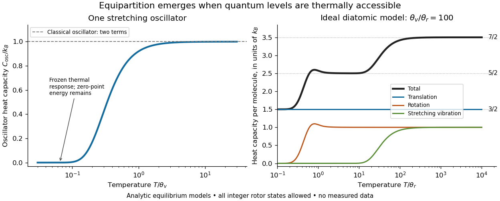

**[Figure 21](#image-model-heat-capacities-a-quantum-harmonic-oscillator-and-a-diatomic-ideal-gas). Model heat capacities: a quantum harmonic oscillator and a diatomic ideal gas**. Original computed equilibrium curves, not measured gas data. Left: $C_{\rm osc}/k_B$ approaches its classical value 1 as $T/\theta_v$ grows. Right: $C_V/(Nk_B)=3/2+C_{\rm rot}/k_B+C_{\rm osc}/k_B$ for stipulated $\theta_v/\theta_r=100$. The rotational [partition function](#canonical-partition-function) is $\sum_{j=0}^{\infty}(2j+1)e^{-\theta_r j(j+1)/T}$ with every nonnegative integer $j$ allowed; $C_{\rm rot}/k_B$ is the [variance](variance.md) of $j(j+1)$ divided by $(T/\theta_r)^2$. No molecular nuclear-spin restrictions, [thermal dissociation](chemistry.md#thermal-dissociation) or nonharmonic effects are modeled. Horizontal guides mark the three limiting values, not exact plateaus at finite [temperature](thermodynamics.md#temperature).

A motivating measurement is [thermal calibration of an optical trap](optics.md#thermal-calibration-of-an-optical-trap). A focused [laser](optics.md#laser) through a microscope objective confines a bead in water; imaging or a quadrant photodetector records a position [time series](time-series.md). Gieseler and colleagues describe a polystyrene bead of radius $1.03\,\mathrm{\mu m}$ at $293.15\,\mathrm K$, a $1064\,\mathrm{nm}$ trapping [laser](optics.md#laser), and photodetector acquisition at $10^5\,\mathrm{Hz}$. Their recorded bead continues undergoing [Brownian motion](brownian-motion.md); higher trapping power produces a narrower equilibrium position distribution. Infer the centered [variance](variance.md), not a squared distance from an arbitrary camera origin:

$$
\sigma_x^2=\left\langle(x-\langle x\rangle)^2\right\rangle,\qquad
k=\frac{k_BT}{\sigma_x^2}.
$$

The [normal distribution](probability-theory.md#normal-distribution) position histogram and agreement with dynamical calibration methods support the local [harmonic optical trap](optics.md#harmonic-optical-trap) interpretation. For a stipulated example, $T=300\,\mathrm K$ and $\sigma_x=20\,\mathrm{nm}$ imply $k\simeq1.04\times10^{-5}\,\mathrm{N/m}=0.0104\,\mathrm{pN/nm}$. This calculated scale is not an experimental reading.[§§2.1–2.2, 3.3; Tables 1–3](physics-bibliography.md#optical-tweezers-a-comprehensive-tutorial-from-calibration-to-applications-by-jan-gieseler)

Position calibration is essential: if detector output $v$ has conversion $x=s(v-v_0)$, its physical [variance](variance.md) is $s^2\operatorname{Var}(v)$. An unknown scale $s$ cannot be determined together with $k$ from that one [variance](variance.md). A complementary calibration demonstrated by Tolić-Nørrelykke and colleagues combines the [power spectrum](probability-and-statistics.md#power-spectrum) of thermal motion with the bead response to known sinusoidal motion of a translation stage. The driven response supplies an additional length scale, and their method does not require bead size, liquid [dynamic viscosity](fluid-mechanics.md#dynamic-viscosity) or wall distance as inputs. It still uses a thermal dynamical model; agreement between methods is a consistency check, not a theory-free proof of [equipartition theorem](#equipartition-theorem).[abstract](physics-bibliography.md#calibration-of-optical-tweezers-with-positional-detection-in-the-back-focal-plane-by-simon-f-tolic-norrelykke-and-others)

The readout itself can hide fluctuations. Wong and Halvorsen used a $1064\,\mathrm{nm}$ [optical trap](optics.md#optical-tweezers) and adjustable-exposure CCD imaging of a bead in water. They varied exposure and trapping power, held the bead away from the nearest wall, adjusted illumination to maintain comparable images, and measured tracking noise using a stuck bead. The measured [variance](variance.md) fell as exposure increased; corrected results agreed with their time-averaging model. For a stationary overdamped [harmonic optical trap](optics.md#harmonic-optical-trap), with [optical trap relaxation time](optics.md#optical-trap-relaxation-time) $\tau$, an exposure of length $W$ measures $\bar x_W=W^{-1}\int_0^W x(t)\,dt$. Its ideal noise-free [variance](variance.md) is

$$
\operatorname{Var}(\bar x_W)=\frac{k_BT}{k}S(\alpha),\qquad
\alpha=\frac{W}{\tau},\qquad
S(\alpha)=\frac{2(\alpha-1+e^{-\alpha})}{\alpha^2}.
$$

For $\alpha>0$, $S(\alpha)<1$: using the blurred [variance](variance.md) in the uncorrected formula overestimates $k$ by $1/S(\alpha)$. At $W=\tau$, the calculated factor is $e/2\simeq1.36$. Additive tracking noise instead raises the measured [variance](variance.md) and biases the inferred $k$ downward if left uncorrected.[equations 15](physics-bibliography.md#the-effect-of-integration-time-on-fluctuation-measurements-calibrating-an-optical-trap-in-the-presence-of-motion-blur-by-wesley-p-wong-and-others)

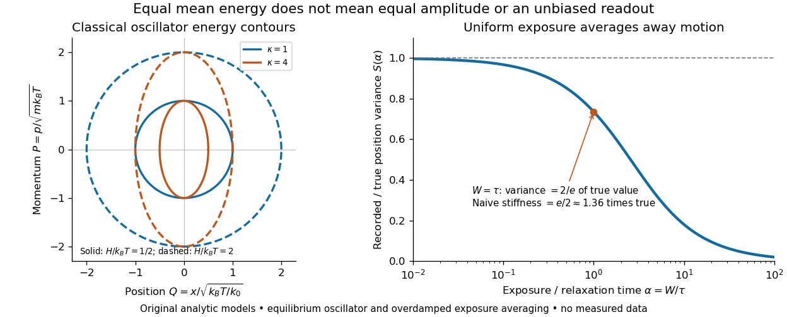

**[Figure 22](#image-equal-mean-quadratic-energies-with-unequal-fluctuations-and-exposure-biased-readout). Equal mean quadratic energies with unequal fluctuations, and exposure-biased readout**. Original analytic models, not bead trajectories or measured curves. Left: equal-[energy](classical-mechanics.md#energy) contours $H/(k_BT)=1/2,2$ in scaled [phase space](classical-mechanics.md#phase-space), with $Q=x/\sqrt{k_BT/k_0}$, $P=p/\sqrt{mk_BT}$ and $H/(k_BT)=(P^2+\kappa Q^2)/2$, for $\kappa=k/k_0=1,4$. Increasing stiffness narrows position fluctuations but leaves both mean quadratic contributions equal to $k_BT/2$. Right: the exact noise-free exposure reduction $S(W/\tau)$; at $W/\tau=1$, $S=2/e$ and naive inferred stiffness is $e/2$ times true stiffness. The exposure calculation assumes stationary overdamped harmonic [Brownian motion](brownian-motion.md) and uniform averaging.

Useful controls are to record over many [optical trap relaxation times](optics.md#optical-trap-relaxation-time), compare blocks for drift, calibrate the position scale, measure fixed-bead noise, vary exposure, and check the position histogram for departures from a [normal distribution](probability-theory.md#normal-distribution). A sparse sequence of accurate instantaneous positions can estimate an equilibrium [variance](variance.md); a long exposure averages away motion even if many frames are collected. Flow, appreciable [laser](optics.md#laser) heating, escape from the harmonic region or nonconservative [forces](classical-mechanics.md#force) can break the assumed [thermal equilibrium](thermodynamics.md#thermal-equilibrium). Inferring $k$ by imposing [equipartition theorem](#equipartition-theorem) is a calibration, whereas testing the relation requires an independently established stiffness and position scale. The beautiful practical connection is that microscopic randomness can set a [force](classical-mechanics.md#force) scale: once calibrated, a small constant applied [force](classical-mechanics.md#force) displaces the mean by $f/k$. The same quadratic-term counting predicts macroscopic [heat capacity](thermodynamics.md#heat-capacity) and makes microscopic fluctuations useful measurements.

### Nonrelativistic equilibrium number density

↑ **Parent:** [Canonical ensemble](#canonical-ensemble)

In the dilute Maxwell--Boltzmann regime, a species has number density proportional to $g(mk_BT)^{3/2}e^{(\mu-mc^2)/(k_BT)}$.

### Boltzmann factor

↑ **Parent:** [Canonical ensemble](#canonical-ensemble)  
ⓦ [Wiki](https://en.wikipedia.org/wiki/Boltzmann_factor)

At inverse temperature $\beta=1/(k_BT)$, the Boltzmann factor $e^{-\beta E}$ is the relative [canonical ensemble](#canonical-ensemble) weight of a [microstate](#microstate) with energy $E$.

## Ideal-gas atmosphere in uniform gravity

↑ **Parent:** [Statistical physics](statistical-physics.md)

An isothermal noninteracting gas in potential $mgz$ has an exponential vertical density and scale height $k_BT/(mg)$.

### Isothermal atmosphere

↑ **Parent:** [Ideal-gas atmosphere in uniform gravity](#ideal-gas-atmosphere-in-uniform-gravity)

An isothermal atmosphere has constant temperature. Under constant gravity and ideal-gas hydrostatic equilibrium, its pressure and density decay exponentially with altitude.

### Barometric formula

↑ **Parent:** [Ideal-gas atmosphere in uniform gravity](#ideal-gas-atmosphere-in-uniform-gravity)  
ⓦ [Wiki](https://en.wikipedia.org/wiki/Barometric_formula)

For constant gravitational acceleration and temperature,

$$
p(z)=p(0)e^{-mgz/(k_BT)}.
$$

#### Scale height of an isothermal atmosphere

↑ **Parent:** [Barometric formula](#barometric-formula)

This is the constant [scale height](#scale-height) of an [isothermal atmosphere](#isothermal-atmosphere). The pressure and density decay length in an isothermal atmosphere is $H=k_BT/(mg)$.

### Hydrostatic equilibrium

↑ **Parent:** [Ideal-gas atmosphere in uniform gravity](#ideal-gas-atmosphere-in-uniform-gravity)  
ⓦ [Wiki](https://en.wikipedia.org/wiki/Hydrostatic_equilibrium)

A static fluid in a uniform downward gravitational field obeys $dp/dz=-\rho g$.

#### Scale height

↑ **Parent:** [Hydrostatic equilibrium](#hydrostatic-equilibrium)  
ⓦ [Wiki](https://en.wikipedia.org/wiki/Scale_height)

A scale height is a characteristic distance over which a vertically stratified physical quantity varies. For a decreasing exponential $q(z)=q_0e^{-z/H}$, it is $H=-(d\log q/dz)^{-1}$. The local [pressure scale height](#pressure-scale-height) applies this logarithmic measure to [pressure](thermodynamics.md#pressure); density and pressure scale heights need not coincide when [temperature](thermodynamics.md#temperature) varies.

##### Pressure scale height

↑ **Parent:** [Scale height](#scale-height)

A pressure scale height is the local distance over which [pressure](thermodynamics.md#pressure) would change by a factor $e$ if its logarithmic gradient were constant. In [hydrostatic equilibrium](#hydrostatic-equilibrium), $H_P=P/(\rho g)$; for an [ideal gas](thermodynamics.md#ideal-gas) it is $k_BT/(\mu m_ug)$. A small logarithmic pressure interval has depth approximately $H_P\,\Delta\log P$.

## Ideal gas free energy

↑ **Parent:** [Statistical physics](statistical-physics.md)

Up to volume-independent terms, $F=-Nk_BT\log V$, so $-\partial F/\partial V=Nk_BT/V$.

## Critical phenomenon

↑ **Parent:** [Statistical physics](statistical-physics.md)

[This section is present in another page, follow this link to view it.](critical-phenomenon.md)

## Phase-space distribution function

↑ **Parent:** [Statistical physics](statistical-physics.md)  
ⓦ [Wiki](https://en.wikipedia.org/wiki/Phase-space_distribution_function)

A phase-space distribution function gives the occupation density of particles as a function of position and momentum. For a spatially homogeneous gas it depends only on momentum.

### Number density

↑ **Parent:** [Phase-space distribution function](#phase-space-distribution-function)  
ⓦ [Wiki](https://en.wikipedia.org/wiki/Number_density)

The number density is the number of particles per unit volume. For a homogeneous species with $g$ internal states and phase-space distribution $f(\mathbf p)$ in natural units,

$$
n=g\int\frac{d^3p}{(2\pi)^3}f(\mathbf p).
$$

#### Column density

↑ **Parent:** [Number density](#number-density)

Column density is the [number density](#number-density) integrated along a [line of sight](astrophysics.md#line-of-sight). Multiplication by an absorption cross-section gives an [optical depth](astrophysics.md#optical-depth). A small column can result from a small local density, a small path length, or a small fraction of atoms in the absorbing state, so density inference requires these quantities to be constrained.

#### Electron number density

↑ **Parent:** [Number density](#number-density)

Electron number density is the number of free electrons per unit volume. In fully ionized stellar matter, $n_e=\rho/(\mu_em_u)$, with [mass density](fluid-mechanics.md#density) $\rho$ and [mean molecular weight per electron](thermodynamics.md#mean-molecular-weight-per-electron) $\mu_e$.

### Energy density

↑ **Parent:** [Phase-space distribution function](#phase-space-distribution-function)  
ⓦ [Wiki](https://en.wikipedia.org/wiki/Energy_density)

The energy density is energy per unit volume. A homogeneous particle species with one-particle energy $E(\mathbf p)$ has

$$
\rho=g\int\frac{d^3p}{(2\pi)^3}E(\mathbf p)f(\mathbf p).
$$

### Kinetic pressure of an isotropic gas

↑ **Parent:** [Phase-space distribution function](#phase-space-distribution-function)

For an isotropic gas, averaging the momentum flux over directions gives

$$
P=g\int\frac{d^3p}{(2\pi)^3}\frac{\mathbf p^2}{3E(\mathbf p)}f(\mathbf p).
$$

## Quantum magnetism

↑ **Parent:** [Statistical physics](statistical-physics.md)  
ⓦ [Wiki](https://en.wikipedia.org/wiki/Quantum_magnetism)

Quantum magnetism studies collective phases and excitations of interacting quantum spins.

### Geometrical frustration

↑ **Parent:** [Quantum magnetism](#quantum-magnetism)  
ⓦ [Wiki](https://en.wikipedia.org/wiki/Geometrical_frustration)

Geometric frustration occurs when the interaction graph prevents all local preferred configurations from being satisfied simultaneously. Antiferromagnetic spins can be antiparallel on every bond of a [bipartite graph](graph-theory.md#bipartite-graph), but three equal spins on a triangle instead minimize their total exchange by summing to zero, giving a coplanar $120$-degree arrangement.

### Hubbard model

↑ **Parent:** [Quantum magnetism](#quantum-magnetism)  
ⓦ [Wiki](https://en.wikipedia.org/wiki/Hubbard_model)

A lattice [fermion](quantum-mechanics.md#fermion) model combining hopping with local density interaction, conventionally written $U_H\sum_n n_{n\uparrow}n_{n\downarrow}$. Its interaction parameter must be matched when a spin-square representation is used: $-2U(\mathbf S^2-3n/4)$ equals $3U n_\uparrow n_\downarrow$, so $U_H=3U$ for that representation.

#### On-site spin-square normal-ordering identity

↑ **Parent:** [Hubbard model](#hubbard-model)

For a single spinful [fermion](quantum-mechanics.md#fermion) orbital, $\mathbf S^2=3(n-2n_\uparrow n_\downarrow)/4$. The contraction term is $3n/4$, so $:\mathbf S^2:=\mathbf S^2-3n/4=-3n_\uparrow n_\downarrow/2$. Empty and doubly occupied states are spinless while singly occupied states have spin one half, which also proves the identity directly.

#### Itinerant ferromagnetism

↑ **Parent:** [Hubbard model](#hubbard-model)

Ferromagnetic spin polarization carried by mobile electrons rather than a separate fixed-spin lattice. A homogeneous spin field splits the electron bands and competes with a positive field cost. Mean-field instability is governed by the [Stoner criterion](#stoner-criterion); the ordered metal supports transverse spin waves as well as fermionic particle-hole excitations.

##### Mean-field itinerant ferromagnetic Goldstone mode

↑ **Parent:** [Itinerant ferromagnetism](#itinerant-ferromagnetism)

An isotropic spin-polarized metal has a degenerate magnetization direction and a long-wavelength transverse magnon with quadratic dispersion. Nonzero spin density pairs the two transverse broken generators into one [type-B Goldstone boson](critical-phenomenon.md#type-b-goldstone-boson). Exchange-split [Fermi surfaces](#fermi-surface) also support fermionic low-energy excitations; the magnon is distinct from longitudinal amplitude motion and the spin-flip continuum.

##### Stoner criterion

↑ **Parent:** [Itinerant ferromagnetism](#itinerant-ferromagnetism)

In the homogeneous spin-vector mean-field scheme with field cost $M^2/(2U)$ and [spin-summed density of states](#spin-summed-density-of-states) per site, the paramagnetic curvature is proportional to $U^{-1}-\int\nu(\epsilon)[-n_F'(\epsilon)]d\epsilon$. It changes sign at $U\chi_0=1$. For a smooth low-temperature [density of states](#density-of-states), $\chi_0\simeq\nu(\mu)$, giving the familiar Fermi-level criterion. Interaction and spin-counting conventions must be specified before comparing coefficients.

##### Homogeneous spin-field effective action

↑ **Parent:** [Itinerant ferromagnetism](#itinerant-ferromagnetism)

Integrating free [fermions](quantum-mechanics.md#fermion) in a constant auxiliary spin field gives $S_{\rm eff}=\beta NM^2/(2U)-\sum_{k\sigma}\ln[1+e^{-\beta(\epsilon_k-\mu-\sigma M)}]$. Differentiation gives the self-consistent spin polarization. The extensive action is a mean-field restriction of the full auxiliary-field functional integral, not an exact omission of all spatial/time fluctuations.

### Coordination number of a lattice

↑ **Parent:** [Quantum magnetism](#quantum-magnetism)

The coordination number $z$ is the number of nearest neighbors of a lattice site. A Kac normalization divides a pair coupling by $z$ so that the interaction energy per site remains finite as $z\to\infty$.

<h3 id="neel-state">Néel state</h3>

↑ **Parent:** [Quantum magnetism](#quantum-magnetism)  
ⓦ [Wiki](https://en.wikipedia.org/wiki/Néel_state)

A Néel state is a two-sublattice product state with antiparallel spin polarization on the two sublattices. It is the classical ordered reference state of a bipartite antiferromagnet.

<h4 id="neel-order-parameter">Néel order parameter</h4>

↑ **Parent:** [Néel state](#neel-state)

The Néel order parameter is the slowly varying staggered magnetization of an antiferromagnet. On a bipartite lattice it changes sign between neighboring sublattices before coarse graining.

<h5 id="quantum-depletion-of-neel-order">Quantum depletion of Néel order</h5>

↑ **Parent:** [Néel order parameter](#neel-order-parameter)

For a [linear spin-wave approximation](critical-phenomenon.md#linear-spin-wave-approximation), the ground state is empty of the diagonal [quasiparticles](quantum-mechanics.md#quasiparticle) but contains the original spin bosons. If $a_k=u_k\alpha_k-v_k\alpha_{-k}^\dagger$, their [occupation number](quantum-field-theory.md#occupation-number) is $v_k^2$. The [staggered magnetization](#staggered-magnetization) is reduced from $S$ to $S-N^{-1}\sum_kv_k^2$. For the one-dimensional nearest-neighbor [Heisenberg antiferromagnet](quantum-mechanics.md#heisenberg-antiferromagnet), $v_k^2=(|\sin k|^{-1}-1)/2$ and the integral diverges logarithmically. This invalidates finite ordered magnetization within the approximation; it is not itself a determination of the exact spectral gap.

##### Staggered magnetization

↑ **Parent:** [Néel order parameter](#neel-order-parameter)

The staggered magnetization weights the local [magnetization](electromagnetism.md#magnetization) with opposite signs on the two sublattices of a [bipartite graph](graph-theory.md#bipartite-graph). It is nonzero in a [Néel state](#neel-state) even when the uniform magnetization vanishes.

##### Uniform magnetization

↑ **Parent:** [Néel order parameter](#neel-order-parameter)

The uniform magnetization is the nonalternating component of local spin polarization. In a nearly Néel-ordered antiferromagnet it describes the small canting shared by the two sublattices.

### Long-range order

↑ **Parent:** [Quantum magnetism](#quantum-magnetism)  
ⓦ [Wiki](https://en.wikipedia.org/wiki/Long-range_order)

Long-range order means that an appropriate connected or symmetry-resolved correlation remains nonzero at arbitrarily large separation. It cannot be created from a product state by a bounded-depth circuit of bounded-range gates.

### Antiferromagnetic spin wave

↑ **Parent:** [Quantum magnetism](#quantum-magnetism)  
ⓦ [Wiki](https://en.wikipedia.org/wiki/Antiferromagnetic_spin_wave)

An antiferromagnetic spin wave is a long-wavelength fluctuation of staggered magnetic order. In an isotropic ordered antiferromagnet its low-energy dispersion is linear.

#### Hypercubic antiferromagnetic spin-wave dispersion

↑ **Parent:** [Antiferromagnetic spin wave](#antiferromagnetic-spin-wave)

For a nearest-neighbour [Heisenberg antiferromagnet](quantum-mechanics.md#heisenberg-antiferromagnet) on a [hypercubic lattice](graph.md#cubic-lattice), the [linear spin-wave approximation](critical-phenomenon.md#linear-spin-wave-approximation) gives $\gamma_{\mathbf k}=d^{-1}\sum_j\cos(k_ja)$ and the displayed frequency. Near a gapless point its [spin-wave velocity](#spin-wave-velocity) is $2JSa\sqrt d$. Its ground-state boson occupation is $[1/\sqrt{1-\gamma_{\mathbf k}^2}-1]/2$, producing [quantum depletion of Néel order](#quantum-depletion-of-neel-order). Exact zero modes need an infrared regulator or separate global-rotation treatment.

#### Spin-wave velocity

↑ **Parent:** [Antiferromagnetic spin wave](#antiferromagnetic-spin-wave)

The spin-wave velocity is the slope $c=\lim_{k\to0}\omega(k)/k$ of a linearly dispersing spin wave. For the leading square-lattice Heisenberg antiferromagnet continuum theory, $c=2\sqrt2JSa$.

#### Zeeman splitting

↑ **Parent:** [Antiferromagnetic spin wave](#antiferromagnetic-spin-wave)  
ⓦ [Wiki](https://en.wikipedia.org/wiki/Zeeman_splitting)

Zeeman splitting is the separation of energy levels or mode frequencies by a background magnetic field. Opposite circular spin polarizations receive opposite frequency shifts.

### Ferromagnetic spin chain

↑ **Parent:** [Quantum magnetism](#quantum-magnetism)  
ⓦ [Wiki](https://en.wikipedia.org/wiki/Ferromagnetic_spin_chain)

A ferromagnetic spin chain favors aligned neighbouring spins. Its conventional long-wavelength magnons have quadratic dispersion.

#### Easy-plane anisotropy

↑ **Parent:** [Ferromagnetic spin chain](#ferromagnetic-spin-chain)  
ⓦ [Wiki](https://en.wikipedia.org/wiki/Easy-plane_anisotropy)

Easy-plane anisotropy penalizes spin components normal to a preferred plane, leaving a low-energy angular degree of freedom within that plane.

#### Ferromagnetic magnon

↑ **Parent:** [Ferromagnetic spin chain](#ferromagnetic-spin-chain)  
ⓦ [Wiki](https://en.wikipedia.org/wiki/Ferromagnetic_magnon)

A ferromagnetic magnon is a quantized spin wave. Without a linear restoring term its long-wavelength frequency is proportional to $k^2$.

##### Nearest-neighbour ferromagnetic magnon dispersion

↑ **Parent:** [Ferromagnetic magnon](#ferromagnetic-magnon)

For $H=-J\sum_n\mathbf S_n\cdot\mathbf S_{n+1}$ and unit spacing, the one-magnon energy is $2JS(1-\cos k)=4JS\sin^2(k/2)$. The exact one-magnon hopping matrix has diagonal $2JS$ and neighbour entries $-JS$. The same result follows from the [linear spin-wave approximation](critical-phenomenon.md#linear-spin-wave-approximation). Its long-wavelength stiffness is $JS$, with energy proportional to $k^2$.

###### Next-nearest-neighbour ferromagnetic magnon dispersion

↑ **Parent:** [Nearest-neighbour ferromagnetic magnon dispersion](#nearest-neighbour-ferromagnetic-magnon-dispersion)

Positive nearest- and next-nearest-neighbour exchanges give one-magnon energy $2S[J_1(1-\cos k)+J_2(1-\cos2k)]$. At small momentum this is $S(J_1+4J_2)k^2$. The quadratic-boson result describes the harmonic many-magnon spectrum; higher-order spin-wave interactions remain in the full Hamiltonian.

##### Damped ferromagnetic spin wave

↑ **Parent:** [Ferromagnetic magnon](#ferromagnetic-magnon)

A damped ferromagnetic spin wave has a complex pole $\omega=\mathord\pm\omega_k-i\Gamma_k$. Both poles of its [retarded Green function](quantum-field-theory.md#retarded-green-function) must lie in the lower half of the complex frequency plane so that the response respects [causality](special-relativity.md#causality).

### Spin coherent-state Berry phase

↑ **Parent:** [Quantum magnetism](#quantum-magnetism)  
ⓦ [Wiki](https://en.wikipedia.org/wiki/Spin_coherent-state_Berry_phase)

The spin coherent-state path integral contains a Berry phase equal, modulo gauge choices, to the spin $S$ times the solid angle swept on the Bloch sphere. Single-valued path-integral amplitudes require $2S\in\mathbb Z$.

<h4 id="wess-zumino-term">Wess–Zumino term</h4>

↑ **Parent:** [Spin coherent-state Berry phase](#spin-coherent-state-berry-phase)

For a spin coherent-state history, a Wess--Zumino term records the oriented target-sphere area bounded by the spin path. Its variation is local even though a single gauge-patch expression for the area need not be global.

<h5 id="antiferromagnetic-wess-zumino-term">Antiferromagnetic Wess–Zumino term</h5>

↑ **Parent:** [Wess–Zumino term](#wess-zumino-term)

In a bipartite antiferromagnet, the smooth staggered contributions to the spin Wess--Zumino terms cancel between sublattices. Their term linear in uniform canting is proportional to $\mathbf m\cdot(\mathbf n\times\partial_t\mathbf n)$.

#### CP1 spinor representation

↑ **Parent:** [Spin coherent-state Berry phase](#spin-coherent-state-berry-phase)

The CP1 spinor representation writes a unit vector as $n_i=z^\dagger\sigma_i z$ with $z^\dagger z=1$. The phase redundancy $z\mapsto e^{i\alpha}z$ identifies normalized spinors that represent the same point of the [two-sphere](geometry-and-topology.md#two-sphere).

<h5 id="ferromagnetic-wess-zumino-term">Ferromagnetic Wess–Zumino term</h5>

↑ **Parent:** [CP1 spinor representation](#cp1-spinor-representation)

The ferromagnetic Wess–Zumino term is the first-order kinetic term $i\kappa z^\dagger\dot z$ in the CP1 description. A local phase change of $z$ changes it only by the total derivative $-\kappa\dot\alpha$.

## Fermi liquid

↑ **Parent:** [Statistical physics](statistical-physics.md)  
ⓦ [Wiki](https://en.wikipedia.org/wiki/Fermi_liquid)

A Fermi liquid is an interacting fermion phase whose low-energy excitations are long-lived quasiparticles near a [Fermi surface](#fermi-surface). Its effective interactions are classified by scaling only the frequency and momentum normal to that surface.

### Fermi surface

↑ **Parent:** [Fermi liquid](#fermi-liquid)  
ⓦ [Wiki](https://en.wikipedia.org/wiki/Fermi_surface)

A Fermi surface is the codimension-one surface in momentum space separating occupied and unoccupied zero-temperature states of a fermionic system.

### Fermi-surface renormalization-group scaling

↑ **Parent:** [Fermi liquid](#fermi-liquid)

Fermi-surface renormalization-group scaling sends frequency and normal displacement from the Fermi surface to zero while leaving tangential momentum fixed. Generic interactions are irrelevant, while forward-scattering and opposite-momentum Cooper channels can remain marginal.

### BCS theory

↑ **Parent:** [Fermi liquid](#fermi-liquid)  
ⓦ [Wiki](https://en.wikipedia.org/wiki/BCS_theory)

BCS theory describes a superconducting instability caused by attractive interactions between opposite-momentum fermions near a [Fermi surface](#fermi-surface).

#### Cooper pair

↑ **Parent:** [BCS theory](#bcs-theory)  
ⓦ [Wiki](https://en.wikipedia.org/wiki/Cooper_pair)

A Cooper pair is a correlated pair of [fermions](quantum-mechanics.md#fermion) associated with [superconductivity](#superconductivity). The conventional [BCS ground state](#bcs-ground-state) uses opposite-momentum, opposite-spin pair creation operators $c_{k\uparrow}^\dagger c_{-k\downarrow}^\dagger$. Their total momentum is zero for every relative momentum $k$; zero total momentum does not restrict $k$ to zero.

#### BCS ground state

↑ **Parent:** [BCS theory](#bcs-theory)

The BCS ground state is the normalized product of empty and occupied pair states $\prod_k(u_k+v_kb_k^\dagger)|0\rangle$. For $u_k^2+v_k^2=1$, each pair factor is normalized. The inverse [Bogoliubov transformation](quantum-field-theory.md#bogoliubov-transformation) annihilates it, so it is the vacuum of positive-energy [quasiparticles](quantum-mechanics.md#quasiparticle). Although individual factors use opposite momenta, $k$ runs over the relative pair momenta; it is not restricted to $k=0$.

#### BCS coherence factors

↑ **Parent:** [BCS theory](#bcs-theory)

For real gap and the particle-hole block $\left(\begin{smallmatrix}\xi_k&-\Delta_k\\-\Delta_k&-\xi_k\end{smallmatrix}\right)$, the BCS coherence factors obey $u_k^2=(1+\xi_k/E_k)/2$, $v_k^2=(1-\xi_k/E_k)/2$ and $u_kv_k=\Delta_k/(2E_k)$, where $E_k=\sqrt{\xi_k^2+\Delta_k^2}$. They diagonalize the [Bogoliubov--de Gennes Hamiltonian](topological-quantum-matter.md#bogoliubov-de-gennes-hamiltonian) and give the empty/pair amplitudes of the [BCS ground state](#bcs-ground-state). Their relative sign depends on the pairing convention.

#### BCS anomalous average

↑ **Parent:** [BCS theory](#bcs-theory)

The BCS anomalous average is the pair expectation $\langle b_k\rangle=\langle c_{-k\downarrow}c_{k\uparrow}\rangle$. In the [BCS ground state](#bcs-ground-state) it is $u_kv_k=\Delta_k/(2E_k)$ for real gap at zero temperature. At temperature $T$ it becomes $\Delta_k\tanh(E_k/(2k_BT))/(2E_k)$. Substitution into the pairing-field definition gives the [BCS gap equation](#bcs-gap-equation).

#### Reduced BCS pairing Hamiltonian

↑ **Parent:** [BCS theory](#bcs-theory)

The [reduced BCS pairing Hamiltonian](#reduced-bcs-pairing-hamiltonian) retains scattering of opposite-momentum, opposite-spin [Cooper pairs](#cooper-pair):

$$
H=\sum_{k,\sigma}\epsilon_kc_{k\sigma}^\dagger c_{k\sigma}+\sum_{k,k'}V_{k,k'}b_k^\dagger b_{k'},\qquad b_k^\dagger=c_{k\uparrow}^\dagger c_{-k\downarrow}^\dagger.
$$

A [mean-field approximation](critical-phenomenon.md#mean-field-approximation) introduces the [BCS anomalous average](#bcs-anomalous-average) and pairing field $\Delta_k=-\sum_{k'}V_{k,k'}\langle b_{k'}\rangle$. The subtraction $-\sum V_{k,k'}\langle b_k^\dagger\rangle\langle b_{k'}\rangle$ corrects the double counting of the mean-field interaction energy.

#### Cooper instability

↑ **Parent:** [BCS theory](#bcs-theory)  
ⓦ [Wiki](https://en.wikipedia.org/wiki/Cooper_instability)

The Cooper instability is the logarithmic growth of an attractive BCS coupling at low energy. If $\nu_F$ is the density of states and $V<0$, perturbation theory breaks down at a scale proportional to $\Lambda e^{-1/(\nu_F|V|)}$.

#### BCS gap equation

↑ **Parent:** [BCS theory](#bcs-theory)  
ⓦ [Wiki](https://en.wikipedia.org/wiki/BCS_gap_equation)

At zero temperature and weak coupling, the BCS gap equation gives $\Delta\simeq2\Lambda e^{-1/(\nu_F|V|)}$. Its exponential scale agrees with the renormalization-group scale of the [Cooper instability](#cooper-instability).

##### Constant-shell BCS gap equation

↑ **Parent:** [BCS gap equation](#bcs-gap-equation)

An attractive interaction $V_{k,k'}=-V/\mathcal V$ within $|\xi_k|,|\xi_{k'}|<\Omega_D$ gives a constant gap inside that energy shell and zero outside. With approximately constant [single-spin density of states](#single-spin-density-of-states) $\nu_s$ per volume,

$$
1=\nu_sV\int_0^{\Omega_D}\frac{d\xi}{\sqrt{\xi^2+\Delta^2}}=\nu_sV\operatorname{arsinh}(\Omega_D/\Delta),\qquad \Delta=\frac{\Omega_D}{\sinh(1/(\nu_sV))}.
$$

The [weak coupling](perturbative-quantum-field-theory.md#weak-coupling) limit is $\Delta\simeq2\Omega_De^{-1/(\nu_sV)}$. A density counting both spin species is twice $\nu_s$ and must be divided by two. The shell cutoff is a relative-energy condition, even when every [Cooper pair](#cooper-pair) has zero total momentum.

## Coulomb collision

↑ **Parent:** [Statistical physics](statistical-physics.md)

A Coulomb collision is the deflection or energy exchange of charged particles through their electric interaction. In a dilute plasma, the cumulative effect of many small-angle encounters controls transport and interspecies thermal equilibration.

## ↑ Ancestors (3)

1. [Branches of physics](physics.md#branches-of-physics)
2. [Physics](physics.md)
3. [Codex Wiki](README.md)

## ← Incoming links (1)

- [Statistical physics](statistical-physics.md)
