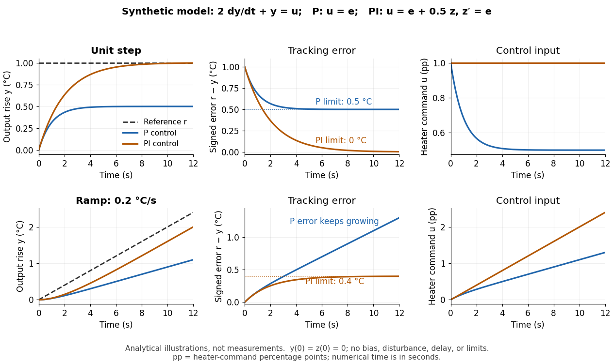

# Steady-state tracking error

↑ **Parent:** [Tracking error](tracking-error.md)

The [steady-state tracking error](steady-state-tracking-error.md) is

$$
e_{\mathrm{ss}}=\lim_{t\to\infty}e(t),
$$

when this finite [limit](limit-of-a-function.md) exists. A finite [steady-state tracking error](steady-state-tracking-error.md) does not require the [reference signal](reference-signal.md), the [plant output](output-control-theory.md), or the [control input](control-input.md) to become constant: all can grow while their difference settles. If the [tracking error](tracking-error.md) grows without bound or keeps oscillating, report that behavior rather than assigning a finite [steady-state tracking error](steady-state-tracking-error.md). Eventual accuracy and [asymptotic stability](asymptotic-stability.md) are different questions.

For the [first-order low-pass filter](first-order-low-pass-filter.md) $\tau\dot y+y=Ku+d$ introduced in [reference signal](reference-signal.md), assume exact measurement, constant [control disturbance](control-disturbance.md) $d$, and no [actuator saturation](actuator-saturation.md) or [feedback delay](feedback-delay.md). Under [proportional control](proportional-control.md) $u=k_p(r-y)$ with $k_p>0$, a constant [reference signal](reference-signal.md) $r=R$ gives

$$
\tau\dot y+(1+Kk_p)y=Kk_pR+d,\qquad e_{\mathrm{ss}}=\frac{R-d}{1+Kk_p}.
$$

The decaying homogeneous solution has rate $(1+Kk_p)/\tau>0$, so this [equilibrium point](equilibrium-point-of-a-dynamical-system.md) is approached from any finite [initial condition](initial-condition.md). A nonzero [tracking error](tracking-error.md) is needed to maintain the [control input](control-input.md) that balances the model's tendency to relax toward $y=d$. This differs from the accumulating [controlled plant](plant-control-theory.md) $\dot x=u+w$, for which [proportional control](proportional-control.md) already tracks a constant [reference signal](reference-signal.md) exactly when $w=0$. The presence or absence of a step offset depends on both the [controlled plant](plant-control-theory.md) and the [controller](controller-control-theory.md).

For a [ramp reference signal](ramp-reference-signal.md) $r=vt$, the same [proportional control](proportional-control.md) gives

$$
\tau\dot e+(1+Kk_p)e=\tau v+vt-d.
$$

Its long-time particular solution grows with slope $v/(1+Kk_p)$ when $v\ne0$. Thus the [controlled plant](plant-control-theory.md) and homogeneous closed-loop response are stable, but the [tracking error](tracking-error.md) has no finite [steady-state tracking error](steady-state-tracking-error.md). A changing goal requires a different performance test from a fixed destination.

Now use [proportional-integral control](proportional-integral-control.md) $u=k_pe+k_i z$, $\dot z=e$, with $k_i>0$. For the same [controlled plant](plant-control-theory.md), differentiate the error equation on intervals where the inputs are smooth:

$$
\tau\ddot e+(1+Kk_p)\dot e+Kk_i e=\tau\ddot r+\dot r-\dot d.
$$

The [characteristic polynomial](characteristic-polynomial.md) $\tau\lambda^2+(1+Kk_p)\lambda+Kk_i$ has both [roots of a polynomial](root-of-a-polynomial.md) in the open left half-plane: real roots have negative sum and positive product, and a nonreal [complex conjugate](complex-conjugate.md) pair has negative real part. This proves decay of the homogeneous error for this model. It does not prove stability of an arbitrary [controlled plant](plant-control-theory.md) controlled by positive gains. At a reference jump, use the original [ordinary differential equations](ordinary-differential-equation.md) to set the new [initial conditions](initial-condition.md), rather than treating the reference as smooth at that jump.

With a constant [reference signal](reference-signal.md) and constant [control disturbance](control-disturbance.md), [proportional-integral control](proportional-integral-control.md) therefore gives $e_{\mathrm{ss}}=0$. At its [equilibrium point](equilibrium-point-of-a-dynamical-system.md), $y_*=R$, $u_*=(R-d)/K$, and $z_*=(R-d)/(Kk_i)$. The stored [integral](integral-split.md) maintains the required command while the current [tracking error](tracking-error.md) vanishes. For a [ramp reference signal](ramp-reference-signal.md), however, the forcing above is $v$, and

$$
e_{\mathrm{ss}}=\frac{v}{Kk_i}.
$$

The [tracking error](tracking-error.md) settles even though the accumulated [integral](integral-split.md) and the required [control input](control-input.md) grow. This finite offset is the error needed to keep increasing that command. For $r=at^2/2$ with $a\ne0$, the forcing is $\tau a+at$ and even this [proportional-integral control](proportional-integral-control.md) leaves a [tracking error](tracking-error.md) growing with slope $a/(Kk_i)$. [Integral action](integral-action.md) is therefore a precise mechanism for selected input classes, not a promise of perfect tracking for every [reference signal](reference-signal.md). [Åström and Murray, Feedback Systems, Chapter 11: integral action and actuator limits](https://www.fbswiki.org/wiki/index.php/PID_Control)

Here are completely explicit synthetic examples with $y(0)=z(0)=0$, $d=0$, and no [sensor bias](sensor-bias.md). Choose $\tau=2\,\mathrm s$, $K=1\,{}^\circ\mathrm C$ per percentage point, $k_p=1$ percentage point per degree, and $k_i=0.5$ percentage points per degree-second. Thus $Kk_p=1$ is [dimensionless](dimensionless-quantity.md), and $Kk_i=0.5\,\mathrm s^{-1}$. In the following formulas, $t$ denotes the numerical time in seconds and $y,e,r$ denote numerical [temperature](temperature-split.md) rises in degrees. For the unit-step [reference signal](reference-signal.md) $r=1$, [proportional control](proportional-control.md) and [proportional-integral control](proportional-integral-control.md) respectively give

$$
y_P(t)=\tfrac12(1-e^{-t}),\quad e_P(t)=\tfrac12(1+e^{-t}),\quad u_P(t)=e_P(t);
$$

$$
y_{PI}(t)=1-e^{-t/2},\quad e_{PI}(t)=e^{-t/2},\quad u_{PI}(t)=1.
$$

For the [ramp reference signal](ramp-reference-signal.md) $r=0.2t$, the corresponding solutions are

$$
y_P(t)=0.1(t-1+e^{-t}),\quad e_P(t)=0.1(t+1-e^{-t}),\quad u_P(t)=e_P(t);
$$

$$
y_{PI}(t)=0.2(t-2+2e^{-t/2}),\quad e_{PI}(t)=0.4(1-e^{-t/2}),\quad u_{PI}(t)=0.2t.
$$

The [control inputs](control-input.md) here are numerical heater-command percentage points. Substitution into $2\dot y+y=u$ and into the [controller](controller-control-theory.md) equations checks these solutions without invoking an unverified limiting rule. The [proportional control](proportional-control.md) step offset is $0.5$ degrees; the [proportional-integral control](proportional-integral-control.md) step offset is zero. The [proportional control](proportional-control.md) ramp error grows; the [proportional-integral control](proportional-integral-control.md) ramp offset is $0.4$ degrees, exactly $v/(Kk_i)$.

**[Figure 5](#image-synthetic-step-and-ramp-tracking-of-one-stable-first-order-low-pass-filter). Synthetic step and ramp tracking of one stable first-order low-pass filter**. Original analytical model curves, not measurements or fits to the temperature laboratory. Columns compare [plant output](output-control-theory.md) with [reference signal](reference-signal.md), signed [tracking error](tracking-error.md), and [control input](control-input.md); rows use a unit step and a ramp of $0.2$ degrees per second. Both designs have decaying homogeneous responses. [Proportional-integral control](proportional-integral-control.md) removes the step offset but leaves the ramp offset $0.4$ degrees; [proportional control](proportional-control.md) has an increasing ramp error. Heater-command percentage points and output degrees use separate axes.

The conclusions have specific limits. With constant [sensor bias](sensor-bias.md) $b$, stable [proportional-integral control](proportional-integral-control.md) for a feasible constant [reference signal](reference-signal.md) drives the measured [tracking error](tracking-error.md) to zero but leaves the physical discrepancy $\varepsilon_{\mathrm{ss}}=b$. Under [proportional control](proportional-control.md), the measured offset instead becomes $(R-b-d)/(1+Kk_p)$. If [actuator saturation](actuator-saturation.md) prevents the required [control input](control-input.md), zero step offset is not achievable by these formulas. A changing [control disturbance](control-disturbance.md) contributes $-\dot d$ to the error equation, while [feedback delay](feedback-delay.md) can change stability; neither is covered by the constant-disturbance result. These restrictions are what make [steady-state tracking error](steady-state-tracking-error.md) useful: it identifies the input, measurement convention, and model for which an accuracy claim is actually justified.

## ↑ Ancestors (6)

1. [Tracking error](tracking-error.md)
2. [Closed-loop control](closed-loop-control.md)
3. [Control theory](control-theory-split.md)
4. [Area of mathematics](area-of-mathematics.md)
5. [Mathematics](mathematics-split.md)
6. [Codex Wiki](split.md)

## ← Incoming links (5)

- [Actuator saturation](actuator-saturation.md)
- [Proportional control](proportional-control.md)
- [Ramp reference signal](ramp-reference-signal.md)
- [Reference signal](reference-signal.md)
- [Steady-state tracking error](steady-state-tracking-error.md)
