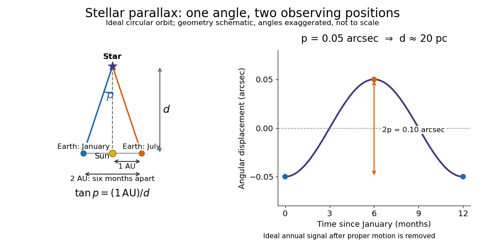

# Stellar parallax

↑ **Parent:** [Astrophysics](astrophysics-split.md)  
ⓦ [Wiki](https://en.wikipedia.org/wiki/Stellar_parallax)

Stellar parallax is the apparent change in a [star](star.md)'s viewing direction caused by the observer's changing position. Nearby [stars](star.md) shift more against a distant reference background. In an ideal circular [Earth](earth.md) orbit, the conventional annual [stellar parallax](stellar-parallax.md) $p$ uses a baseline of one [astronomical unit](astronomical-unit.md), approximately the [Earth](earth.md)-[Sun](sun.md) distance. Two opposite observing positions, about six months apart, are separated by approximately two [astronomical units](astronomical-unit.md). Their maximum angular separation is $2p$, so $p$ is half that excursion, not the full January-to-July shift. The observed excursion depends on the projected baseline and observing dates. [ESA: Six-month parallax geometry](https://www.esa.int/ESA_Multimedia/Images/2013/06/Measuring_stellar_distances_by_parallax).

For the perpendicular baseline in the diagram, a [right triangle](right-triangle.md) gives

$$
\tan p=\frac{1\,\mathrm{au}}{d},\qquad d=\frac{1\,\mathrm{au}}{\tan p}\simeq\frac{1\,\mathrm{au}}{p},
$$

where $p$ in the final expression is in [radians](radian.md). Combining the [small-angle approximation](small-angle-approximation.md) with the [parsec](parsec.md) convention gives

$$
\frac{d}{1\,\mathrm{pc}}\simeq\frac{1}{p/(1\,\mathrm{arcsec})}.
$$

Thus $p=0.05$ [arcseconds](arcsecond.md) implies $d\simeq20$ [parsecs](parsec.md), while the ideal six-month excursion is $0.10$ [arcseconds](arcsecond.md). Geometry supplies this distance without assuming a [luminosity](luminosity.md) or a particular [stellar atmosphere](stellar-atmosphere.md).

**[Figure 1](#image-one-au-parallax-angle-and-an-ideal-annual-signal-geometry-schematic-not-to-scale). One-AU parallax angle and an ideal annual signal; geometry schematic, not to scale**.

In practical [astrometry](astrometry.md), many observations separate the annual [stellar parallax](stellar-parallax.md) signal from [proper motion](proper-motion.md), the [star](star.md)'s own changing sky position. The Gaia DR3 catalogue reports [stellar parallax](stellar-parallax.md) and its uncertainty in milliarcseconds: $50\,\mathrm{mas}=0.05$ [arcseconds](arcsecond.md). A catalogue angle is a fitted measurement with [measurement error](measurement-error.md). [ESA Gaia DR3: Parallax, errors, and proper motion columns](https://gea.esac.esa.int/archive/documentation/GDR3/Gaia_archive/chap_datamodel/sec_dm_main_source_catalogue/ssec_dm_gaia_source.html).

For a positive [stellar parallax](stellar-parallax.md) with small [standard deviation](standard-deviation.md) $\sigma_p$, first-order propagation gives $\sigma_d/d\simeq\sigma_p/p$. Thus $p=50\,\mathrm{mas}$ with $\sigma_p=1\,\mathrm{mas}$ gives $d\simeq20$ [parsecs](parsec.md) with $\sigma_d\simeq0.4$ [parsecs](parsec.md), assuming systematic offsets are negligible. This linear estimate requires $\sigma_p\ll p$; a reciprocal is nonlinear and does not generally preserve symmetric uncertainty intervals.

**Table of contents**

- [Parsec](parsec.md)

## ↑ Ancestors (4)

1. [Astrophysics](astrophysics-split.md)
2. [Branches of physics](branches-of-physics.md)
3. [Physics](physics-split.md)
4. [Codex Wiki](split.md)

## ← Incoming links (10)

- [Apparent magnitude](apparent-magnitude.md)
- [Astrometry](astrometry.md)
- [Astronomy](astronomy-split.md)
- [Astrophysics](astrophysics-split.md)
- [Equatorial coordinate system](equatorial-coordinate-system.md)
- [Flux-distance degeneracy](flux-distance-degeneracy.md)
- [Luminosity](luminosity.md)
- [Parsec](parsec.md)
- [Proper motion](proper-motion.md)
- [Stellar parallax](stellar-parallax.md)
