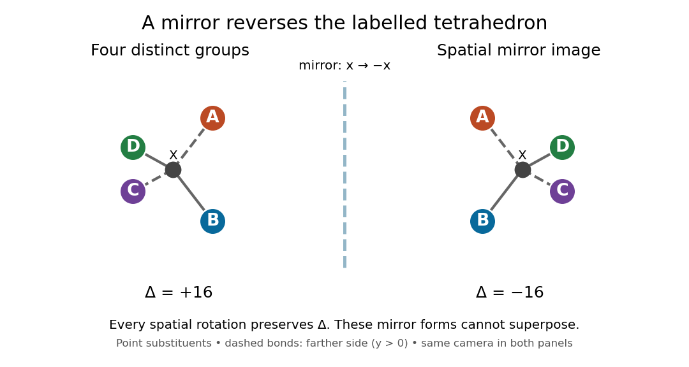

# Stereochemistry

↑ **Parent:** [Chemistry](chemistry.md)  
ⓦ [Wiki](https://en.wikipedia.org/wiki/Stereochemistry)

[Stereochemistry](stereochemistry.md) studies the spatial arrangement of [chemical atoms](physics.md#atom-physics) in [molecules](molecule.md). A [Fischer projection](#fischer-projection) records this information at successive [stereocenters](#stereocenter), whereas a [molecular formula](chemical-substance.md#molecular-formula) only counts [chemical atoms](physics.md#atom-physics). See [McMurry: representing carbohydrate stereochemistry](https://openstax.org/books/organic-chemistry/pages/25-2-representing-carbohydrate-stereochemistry-fischer-projections).

**Table of contents**

- [Retention of configuration](#retention-of-configuration)
- [Inversion of configuration](#inversion-of-configuration)
- [Stereoselectivity](#stereoselectivity)
- [Planar chirality](#planar-chirality)
- [Suprafaciality](#suprafaciality)
- [Dynamic kinetic resolution](#dynamic-kinetic-resolution)
- [Catalytic asymmetric synthesis](#catalytic-asymmetric-synthesis)
- [Pyramidal inversion](#pyramidal-inversion)
- [Stereoelectronic effect](#stereoelectronic-effect)
- [Enantioselectivity](#enantioselectivity)
- [Epimerization](#epimerization)
- [Topicity](#topicity)
  - [Enantiotopicity](#enantiotopicity)
- [Diastereotopic](#diastereotopic)
- [Steric hindrance](#steric-hindrance)
  - [Steric strain](#steric-strain)
  - [1,3-Diaxial interaction](#1-3-diaxial-interaction)
- [Racemic mixture](#racemic-mixture)
- [Anomeric effect](#anomeric-effect)
- [Diastereoselectivity](#diastereoselectivity)
  - [Cram chelation model](#cram-chelation-model)
  - [Fürst-Plattner rule](#furst-plattner-rule)
  - [Felkin-Anh model](#felkin-anh-model)
- [Cahn-Ingold-Prelog priority rules](#cahn-ingold-prelog-priority-rules)
- [Newman projection](#newman-projection)
- [Sugar puckering](#sugar-puckering)
- [Trans configuration](#trans-configuration)
- [Cis configuration](#cis-configuration)
- [Chirality (chemistry)](#chirality-chemistry)
  - [Enantiomer](#enantiomer)
    - [Racemate](#racemate)
  - [Chiral molecule](#chiral-molecule)
  - [Achirality](#achirality)
  - [Tetrahedral mirror-image test](#tetrahedral-mirror-image-test)
  - [Meso compound](#meso-compound)
  - [Axial chirality](#axial-chirality)
    - [Spiro axial chirality](#spiro-axial-chirality)
    - [Alkylidenecyclohexane axial chirality](#alkylidenecyclohexane-axial-chirality)
    - [Atropisomerism](#atropisomerism)
  - [Optical activity](#optical-activity)
    - [Optical rotation](#optical-rotation)
      - [Specific rotation](#specific-rotation)
        - [Enantiomeric excess](#enantiomeric-excess)
    - [Polarimetry](#polarimetry)
      - [Polarimeter](#polarimeter)
        - [Polarimeter analyzer](#polarimeter-analyzer)
    - [Circular dichroism](#circular-dichroism)
- [Stereoisomer](#stereoisomer)
  - [Geometrical isomerism](#geometrical-isomerism)
    - [Octahedral bis-chelate isomerism](#octahedral-bis-chelate-isomerism)
    - [Geometrical isomer](#geometrical-isomer)
  - [Geometric isomer](#geometric-isomer)
    - [Meridional isomer](#meridional-isomer)
    - [Facial isomer](#facial-isomer)
  - [Diastereomer](#diastereomer)
    - [Anomer](#anomer)
      - [Anomeric carbon](#anomeric-carbon)
- [Absolute configuration](#absolute-configuration)
  - [R and S configuration](#r-and-s-configuration)
  - [Stereochemical sequence rule](#stereochemical-sequence-rule)
- [Conformational isomerism](#conformational-isomerism)
  - [Rotamer](#rotamer)
  - [Conformation](#conformation)
    - [Antiperiplanar geometry](#antiperiplanar-geometry)
    - [Gauche interaction](#gauche-interaction)
    - [Ring inversion](#ring-inversion)
    - [Chair conformation](#chair-conformation)
      - [Axial and equatorial bonds](#axial-and-equatorial-bonds)
    - [Antiperiplanar conformation](#antiperiplanar-conformation)
- [Substituent](#substituent)
  - [Electron-donating group](#electron-donating-group)
  - [Electron-withdrawing group](#electron-withdrawing-group)
  - [Cyclohexyl group](#cyclohexyl-group)
- [Stereocenter](#stereocenter)
  - [Phosphorus stereocenter](#phosphorus-stereocenter)
  - [Quaternary ammonium stereocenter](#quaternary-ammonium-stereocenter)
- [Fischer projection](#fischer-projection)
- [Haworth projection](#haworth-projection)

## Retention of configuration

↑ **Parent:** [Stereochemistry](stereochemistry.md)

Preservation of the relative spatial arrangement at a stereogenic center during a reaction.

## Inversion of configuration

↑ **Parent:** [Stereochemistry](stereochemistry.md)

Reversal of the spatial arrangement at a stereogenic center during a reaction.

## Stereoselectivity

↑ **Parent:** [Stereochemistry](stereochemistry.md)

Preferential formation of one [stereoisomer](#stereoisomer) over another.

## Planar chirality

↑ **Parent:** [Stereochemistry](stereochemistry.md)

Chirality associated with the arrangement of [substituents](#substituent) relative to a plane, as in an unsymmetrically substituted coordinated cyclopentadienyl ring. Two planar-chiral [coordination ligands](chemistry.md#ligand-in-coordination-chemistry) can give a meso arrangement and a pair of enantiomeric arrangements.

## Suprafaciality

↑ **Parent:** [Stereochemistry](stereochemistry.md)

Bond-making or bond-breaking at the same face of the interacting orbital array in a [pericyclic reaction](chemical-reaction.md#pericyclic-reaction). It is a local stereochemical relation, not a statement that all substituents end on one molecular face or a specification of an absolute clockwise rotation.

## Dynamic kinetic resolution

↑ **Parent:** [Stereochemistry](stereochemistry.md)

Selective conversion of interconverting substrate stereoisomers to an enriched product. Unlike a simple kinetic resolution, rapid substrate interconversion can in principle allow more than 50% yield of one stereoisomer.

## Catalytic asymmetric synthesis

↑ **Parent:** [Stereochemistry](stereochemistry.md)

A [chiral](#chirality-chemistry) catalyst preferentially forms one stereoisomer from an achiral or stereochemically labile substrate. Product [stereochemistry](stereochemistry.md) depends on competing transition-state [free energies](thermodynamic-potential.md#thermodynamic-free-energy), rather than a catalyst simply transferring its own R or S label.

## Pyramidal inversion

↑ **Parent:** [Stereochemistry](stereochemistry.md)

Interconversion of the two spatial orientations of a three-coordinate pyramidal centre through a flatter geometry. Quaternary [ammonium](chemistry.md#ammonium) [nitrogen](chemical-substance.md#nitrogen) has no [lone pair](covalent-bond.md#lone-pair) and cannot follow the ordinary three-coordinate [amine](chemical-substance.md#amine) pathway.

## Stereoelectronic effect

↑ **Parent:** [Stereochemistry](stereochemistry.md)

A dependence of reactivity or stability on the spatial alignment of donor and acceptor orbitals. Antiperiplanar lone-pair donation into a breaking bond can accelerate a suitable cleavage.

## Enantioselectivity

↑ **Parent:** [Stereochemistry](stereochemistry.md)

## Epimerization

↑ **Parent:** [Stereochemistry](stereochemistry.md)

Epimerization interconverts [diastereomers](#diastereomer) differing at one [stereocenter](#stereocenter). It can change a product ratio after the initial bond-forming [chemical reaction](chemical-reaction.md).

## Topicity

↑ **Parent:** [Stereochemistry](stereochemistry.md)

### Enantiotopicity

↑ **Parent:** [Topicity](#topicity)

Two sites are enantiotopic if separately replacing one or the other by the same distinguishing group gives [enantiomers](#enantiomer). Achiral conditions do not distinguish them by [chirality](relativistic-quantum-field.md#chirality-physics) alone.

## Diastereotopic

↑ **Parent:** [Stereochemistry](stereochemistry.md)

Two sites are [diastereotopic](#diastereotopic) if replacing one or the other with the same test group gives [diastereomers](#diastereomer). In an achiral solvent they can have different [chemical shifts](nuclear-magnetic-resonance.md#chemical-shift), unlike a simple pair of symmetry-related sites. A rigid chiral metal chelate can make the two hydrogens of a linker methylene diastereotopic.

## Steric hindrance

↑ **Parent:** [Stereochemistry](stereochemistry.md)

[Steric hindrance](#steric-hindrance) is the restriction of access to a reactive site or molecular arrangement by the spatial demands of surrounding groups. It can affect both relative stability and reaction barriers; these are distinct effects.

### Steric strain

↑ **Parent:** [Steric hindrance](#steric-hindrance)

Energetic destabilization associated with unfavourably close nonbonded contacts or deformation needed to avoid those contacts.

<h3 id="1-3-diaxial-interaction">1,3-Diaxial interaction</h3>

↑ **Parent:** [Steric hindrance](#steric-hindrance)

A [1,3-Diaxial interaction](#1-3-diaxial-interaction) is the close nonbonded contact between axial groups separated by one ring atom in a chair. Replacing a [carbon](chemical-substance.md#carbon)-bearing axial [hydrogen](chemical-substance.md#hydrogen) by an [oxygen](chemical-substance.md#oxygen) changes this contact, so cyclohexane substituent preferences cannot be transferred unchanged to dioxanes.

## Racemic mixture

↑ **Parent:** [Stereochemistry](stereochemistry.md)

An equimolar mixture of two [enantiomers](#enantiomer).

## Anomeric effect

↑ **Parent:** [Stereochemistry](stereochemistry.md)  
ⓦ [Wiki](https://en.wikipedia.org/wiki/Anomeric_effect)

An [anomeric effect](#anomeric-effect) can favour an axial electronegative substituent at a cyclic acetal carbon. Donation from an endocyclic oxygen lone pair into an antiperiplanar exocyclic C–O antibonding orbital is one important contribution. Steric, electrostatic and solvent effects also influence the observed preference.

## Diastereoselectivity

↑ **Parent:** [Stereochemistry](stereochemistry.md)

### Cram chelation model

↑ **Parent:** [Diastereoselectivity](#diastereoselectivity)

An oxygen adjacent to a carbonyl can coordinate the same metal as the carbonyl oxygen, constraining conformation. Nucleophilic attack on the less hindered face of the chelate can differ from an open Felkin–Anh prediction.

<h3 id="furst-plattner-rule">Fürst-Plattner rule</h3>

↑ **Parent:** [Diastereoselectivity](#diastereoselectivity)

The [Fürst-Plattner rule](#furst-plattner-rule) describes a preference for trans-diaxial opening of suitable bridged intermediates on six-membered rings. A chair-like pathway generally avoids the unfavorable geometry of a competing twist/boat pathway; substrate fusion and substitution determine which route is accessible.

### Felkin-Anh model

↑ **Parent:** [Diastereoselectivity](#diastereoselectivity)

The [Felkin-Anh model](#felkin-anh-model) predicts facial preference in nucleophilic addition beside a stereogenic centre under suitable open, non-chelating conditions. Orient the large alpha substituent approximately perpendicular to C=O, then favour approach opposite it and past the small substituent. It is a predictive model rather than a universal guarantee.

## Cahn-Ingold-Prelog priority rules

↑ **Parent:** [Stereochemistry](stereochemistry.md)  
ⓦ [Wiki](https://en.wikipedia.org/wiki/Cahn–Ingold–Prelog_priority_rules)

The [Cahn-Ingold-Prelog priority rules](#cahn-ingold-prelog-priority-rules) rank substituent paths to assign stereochemical descriptors. Compare the next shell only after a tie; multiple bonds and aromatic paths require the prescribed duplicate-atom treatment. Spatial orientation and priority ranking are separate steps.

## Newman projection

↑ **Parent:** [Stereochemistry](stereochemistry.md)  
ⓦ [Wiki](https://en.wikipedia.org/wiki/Newman_projection)

A [Newman projection](#newman-projection) views a molecule along a chosen bond, showing substituents on the front atom and rear atom. It makes relative torsions visible without assuming that the two centres lie in the plane of a skeletal drawing.

## Sugar puckering

↑ **Parent:** [Stereochemistry](stereochemistry.md)

[Sugar puckering](#sugar-puckering) describes the nonplanar conformation of a sugar ring. In nucleic acids, C2′-endo and C3′-endo conformations alter backbone geometry and help distinguish [B-DNA](polymer.md#b-dna) from [A-DNA](polymer.md#a-dna).

## Trans configuration

↑ **Parent:** [Stereochemistry](stereochemistry.md)

A [trans configuration](#trans-configuration) places the specified substituents on opposite sides of a restricted structural element. For comparable fatty-acyl chains, trans unsaturation usually permits closer packing than cis unsaturation.

## Cis configuration

↑ **Parent:** [Stereochemistry](stereochemistry.md)

A [cis configuration](#cis-configuration) places the specified substituents on the same side of a restricted structural element. A cis double bond in a fatty-acyl chain commonly disrupts close chain packing relative to the comparable trans arrangement.

## Chirality (chemistry)

↑ **Parent:** [Stereochemistry](stereochemistry.md)  
ⓦ [Wiki](https://en.wikipedia.org/wiki/Chirality_(chemistry))

[Chirality](#chirality-chemistry) means that a [molecule](molecule.md) cannot be superposed on its mirror image. A [carbon](chemical-substance.md#carbon) attached to four different groups is a common source of [chirality](#chirality-chemistry); the definition concerns the whole [molecule](molecule.md), rather than requiring this particular structural feature.

The test is spatial: apply a [translation](geometry-and-topology.md#translation-geometry) and a [rotation](riemannian-geometry.md#rotation-mathematics) to the entire [molecule](molecule.md) until corresponding [chemical atoms](physics.md#atom-physics) coincide, keeping their identities and [chemical bonds](chemical-bond.md). A mirror operation is a [reflection](linear-algebra.md#reflection-mathematics); physically turning a model is a [rotation](riemannian-geometry.md#rotation-mathematics). They are different operations. If no such superposition exists, the two forms are [enantiomers](#enantiomer); if one succeeds, the [molecule](molecule.md) is [achiral](#achirality). A different-looking flat drawing alone establishes neither conclusion.

For a simple [molecule](molecule.md) with exactly one tetrahedral [stereocenter](#stereocenter) and four constitutionally different [substituents](#substituent), the mirror forms cannot superpose. Compare entire attached groups, including paths around a ring, rather than just the first [chemical atom](physics.md#atom-physics). Several tetrahedral [stereocenters](#stereocenter) require a whole-[molecule](molecule.md) check: a [meso compound](#meso-compound) can be [achiral](#achirality). Conversely, [axial chirality](#axial-chirality) needs no tetrahedral [stereocenter](#stereocenter).[McMurry, Organic Chemistry, §5.2: whole-molecule chirality, four different groups and equivalent ring paths](chemistry-bibliography.md#organic-chemistry-by-john-mcmurry/5-2-the-reason-for-handedness-in-molecules-chirality)

**[Figure 1](#image-spatial-mirror-pair-with-four-distinct-substituents). Spatial mirror pair with four distinct substituents**. Ideal [tetrahedral molecular geometry](molecule.md#tetrahedral-molecular-geometry) with distinct [substituents](#substituent) A, B, C and D. The two models use the same viewing direction and the [reflection](linear-algebra.md#reflection-mathematics) $x\mapsto-x$. Their opposite signed [determinants](multilinear-algebra.md#determinant) exclude superposition by any label-preserving [rotation](riemannian-geometry.md#rotation-mathematics). The letters do not denote [R and S configuration](#r-and-s-configuration) priorities.

Why care about this distinction? Two [enantiomers](#enantiomer) can fit differently into an already [chiral molecule](#chiral-molecule), just as two opposite hands fit differently into one glove. Thus a [protein](protein.md)'s spatial arrangement can distinguish a mirror pair even when an [achiral](#achirality) measurement cannot. [Polarimetry](#polarimetry) provides a different kind of test: it measures a sample's net [optical rotation](#optical-rotation), which depends on the populations of its [enantiomers](#enantiomer).

### Enantiomer

↑ **Parent:** [Chirality (chemistry)](#chirality-chemistry)  
ⓦ [Wiki](https://en.wikipedia.org/wiki/Enantiomer)

[Enantiomers](#enantiomer) are a pair of nonsuperposable mirror-image [molecules](molecule.md). The D and L configurations of [alanine](chemical-substance.md#alanine) are an example; [glycine](protein.md#glycine) has no such pair because its [amino acid alpha carbon](protein.md#amino-acid-alpha-carbon) carries two identical [hydrogen](chemical-substance.md#hydrogen) [chemical atoms](physics.md#atom-physics). [§26.1, discussion of glycine and Fischer projections after Table 26.1](chemistry-bibliography.md#organic-chemistry-by-john-mcmurry)

The word names a relation between two [stereoisomers](#stereoisomer). Merely finding two different spatial arrangements does not make them [enantiomers](#enantiomer): arrangements that are different but not mirror partners are [diastereomers](#diastereomer).

#### Racemate

↑ **Parent:** [Enantiomer](#enantiomer)

A [racemate](#racemate) contains the same [amount of substance](physics.md#amount-of-substance) of each member of an [enantiomer](#enantiomer) pair. Their equal and opposite contributions cancel in ordinary solution [polarimetry](#polarimetry) under identical conditions. Zero net [optical rotation](#optical-rotation) therefore does not establish [achirality](#achirality) of the individual [molecules](molecule.md).[McMurry, Organic Chemistry, §5.8: equal enantiomer populations and cancelling optical rotations](chemistry-bibliography.md#organic-chemistry-by-john-mcmurry/5-8-racemic-mixtures-and-the-resolution-of-enantiomers)

### Chiral molecule

↑ **Parent:** [Chirality (chemistry)](#chirality-chemistry)

A [chiral molecule](#chiral-molecule) fails the whole-[molecule](molecule.md) mirror-superposition test defining [chirality](#chirality-chemistry).

### Achirality

↑ **Parent:** [Chirality (chemistry)](#chirality-chemistry)

[Achirality](#achirality) means that a [molecule](molecule.md) is superposable on its mirror image. A [reflection](linear-algebra.md#reflection-mathematics) plane that leaves the complete labelled spatial structure unchanged establishes [achirality](#achirality). Absence of such a plane alone is not a complete test: other orientation-reversing spatial symmetries can also make a rigid structure [achiral](#achirality).

### Tetrahedral mirror-image test

↑ **Parent:** [Chirality (chemistry)](#chirality-chemistry)

Take a central [chemical atom](physics.md#atom-physics) at the origin and four [substituents](#substituent) at the vertices of an ideal [regular tetrahedron](euclidean-geometry.md#regular-tetrahedron):

$$
a=(1,1,1),\quad b=(1,-1,-1),\quad c=(-1,1,-1),\quad d=(-1,-1,1).
$$

These dimensionless [coordinates](vector-space.md#coordinate-linear-algebra) describe shape, not measured [bond lengths](chemical-bond.md#bond-length). For distinct labels A, B, C and D, define a signed [determinant](multilinear-algebra.md#determinant)

$$
\Delta=\det\begin{pmatrix}|&|&|\\a-d&b-d&c-d\\|&|&|\end{pmatrix}=+16.
$$

It is six times the [oriented volume](multilinear-algebra.md#oriented-volume) of the labelled [tetrahedron](euclidean-geometry.md#tetrahedron). A [translation](geometry-and-topology.md#translation-geometry) cancels from the differences. A [rotation](riemannian-geometry.md#rotation-mathematics) $Q$ has $\det Q=+1$ and preserves $\Delta$, whereas the mirror [matrix](vector-space.md#matrix) $S=\operatorname{diag}(-1,1,1)$ has $\det S=-1$ and changes it to $-16$. Consequently no [rotation](riemannian-geometry.md#rotation-mathematics) can place every distinct label on its mirror partner. This argument uses three-dimensional [coordinates](vector-space.md#coordinate-linear-algebra), not clockwise order on a page.

Now let C and D both be the same [substituent](#substituent) H. Swapping these identical groups is allowed. For this model the half-turn

$$
Q=\begin{pmatrix}-1&0&0\\0&0&1\\0&1&0\end{pmatrix},\qquad Q^{\mathsf T}Q=I,\qquad\det Q=+1,
$$

about the axis $(0,1,1)$ maps the reflected A and B to their original positions and exchanges the two H positions. The models superpose. With distinct C and D, the same half-turn fails precisely at those two labels; the [determinant](multilinear-algebra.md#determinant) argument rules out every other [rotation](riemannian-geometry.md#rotation-mathematics) as well. This is the local reason two identical [hydrogen](chemical-substance.md#hydrogen) [chemical atoms](physics.md#atom-physics) prevent [glycine](protein.md#glycine)'s [amino acid alpha carbon](protein.md#amino-acid-alpha-carbon) from being a tetrahedral [stereocenter](#stereocenter).

**[Figure 2](#image-the-same-spatial-half-turn-succeeds-only-when-the-exchanged-groups-are-identical). The same spatial half-turn succeeds only when the exchanged groups are identical**. Original model, mirror model and rotated mirror model. Top: the distinct C and D remain mismatched, so the A/B/C/D model is [chiral](#chirality-chemistry). Bottom: the identical H groups may exchange, so the A/B/H/H model is [achiral](#achirality). The operation is an actual three-dimensional $180^\circ$ [rotation](riemannian-geometry.md#rotation-mathematics) about $(0,1,1)$, with [determinant](multilinear-algebra.md#determinant) $+1$.

For a flexible [molecule](molecule.md), also distinguish [conformational isomerism](#conformational-isomerism) from a persistent [enantiomer](#enantiomer) pair. A particular frozen shape may be [chiral](#chirality-chemistry) while ordinary internal motions interconvert mirror shapes. Turning the entire model is always allowed in a spatial comparison; an internal motion must be considered with its actual accessibility and timescale.

### Meso compound

↑ **Parent:** [Chirality (chemistry)](#chirality-chemistry)  
ⓦ [Wiki](https://en.wikipedia.org/wiki/Meso_compound)

A [meso compound](#meso-compound) is an [achiral](#achirality) [molecule](molecule.md) despite having [stereocenters](#stereocenter). [Tartaric acid](chemical-substance.md#tartaric-acid), $\mathrm{HOOC{-}CH(OH){-}CH(OH){-}COOH}$, has two tetrahedral [carbon](chemical-substance.md#carbon) [stereocenters](#stereocenter). Its $(2R,3R)$ and $(2S,3S)$ forms are [enantiomers](#enantiomer), but $(2R,3S)$ and $(2S,3R)$ name the same meso form after equivalent ends are identified. A symmetric spatial arrangement has a mirror plane exchanging its two halves. Thus there are three [stereoisomers](#stereoisomer), not four.[McMurry, Organic Chemistry, §5.7, Figure 5.12: meso-tartaric acid and its symmetry plane](chemistry-bibliography.md#organic-chemistry-by-john-mcmurry/5-7-meso-compounds)

Opposite [R and S configurations](#r-and-s-configuration) alone do not guarantee a [meso compound](#meso-compound): the rest of the [molecule](molecule.md) must permit mirror superposition. Likewise, a [meso compound](#meso-compound) is one [achiral](#achirality) [chemical compound](chemical-substance.md#chemical-compound), whereas a [racemate](#racemate) is a mixture of two [chiral molecule](#chiral-molecule) populations. Both can give zero [optical rotation](#optical-rotation) for different reasons.

### Axial chirality

↑ **Parent:** [Chirality (chemistry)](#chirality-chemistry)

An [allene](chemical-substance.md#allene) has a $\mathrm{C=C=C}$ unit whose terminal [substituents](#substituent) lie in perpendicular planes. In $\mathrm{abC=C=Ccd}$, with $a\ne b$ and $c\ne d$, the two terminal pairs can define [enantiomers](#enantiomer) without any tetrahedral [carbon](chemical-substance.md#carbon) [stereocenter](#stereocenter). The groups need be different within each end pair, not all four mutually different. This is [axial chirality](#axial-chirality).[Basic Terminology of Stereochemistry, entry Axial Chirality: nonplanar pairs about an axis, including allenes](chemistry-bibliography.md#basic-terminology-of-stereochemistry-by-g-p-moss/axial-chirality)

#### Spiro axial chirality

↑ **Parent:** [Axial chirality](#axial-chirality)

[chirality](#chirality-chemistry) produced by distinguishable terminal substituents arranged about the constrained axis of a spiro framework.

#### Alkylidenecyclohexane axial chirality

↑ **Parent:** [Axial chirality](#axial-chirality)

Axial stereoisomerism in suitably substituted alkylidenecyclohexanes, where the constrained ring and [alkene](chemical-substance.md#alkene) distinguish two handed arrangements.

#### Atropisomerism

↑ **Parent:** [Axial chirality](#axial-chirality)

Stereoisomerism arising from restricted rotation about a bond. A hindered biaryl can make otherwise similar methylene hydrogens diastereotopic on the NMR timescale.

### Optical activity

↑ **Parent:** [Chirality (chemistry)](#chirality-chemistry)

[Optical activity](#optical-activity) is the ability to rotate the direction of [linear polarization](electromagnetic-wave.md#linear-polarization) of transmitted [light](optics.md#light). In an [achiral](#achirality) [solvent](mixture.md#solvent), the two members of an [enantiomer](#enantiomer) pair have equal and opposite [optical rotations](#optical-rotation) at the same [wavelength](wave-equation.md#wavelength), [temperature](temperature.md) and [concentration](mathematical-physics.md#concentration). The measured angle concerns a bulk sample; it is not a geometric rotation of the [molecules](molecule.md).[McMurry, Organic Chemistry, §5.3, Figure 5.6 and specific-rotation discussion](chemistry-bibliography.md#organic-chemistry-by-john-mcmurry/5-3-optical-activity)

The rotating object in this description is the direction along which the [electric field](electric-field.md) oscillates. At each position the transmitted [light](optics.md#light) can still have [linear polarization](electromagnetic-wave.md#linear-polarization): its [electric field](electric-field.md) moves back and forth along a line, while the orientation of that line changes along the sample. Nothing requires the [molecules](molecule.md) to turn bodily through the observed [angle](geometry-and-topology.md#angle). This makes [polarimetry](#polarimetry) a bridge from molecular [chirality](#chirality-chemistry) to a visible bulk measurement, and, with a suitable calibration, a way to follow [concentration](mathematical-physics.md#concentration) or the balance of [enantiomers](#enantiomer).

In a transparent, isotropic [chemical solution](mixture.md#solution-chemistry), natural [optical rotation](#optical-rotation) can be understood as [circular birefringence](maxwell-equations.md#circular-birefringence): the two opposite [circular polarizations](electromagnetic-wave.md#circular-polarization) accumulate different [wave phases](wave.md#phase-waves), and their equal-amplitude sum remains linearly polarized along a rotated direction. [Circular dichroism](#circular-dichroism) instead means unequal absorption of those components and can produce [elliptical polarization](wave.md#elliptical-polarization). These are related responses, not interchangeable measurements. General [birefringence](maxwell-equations.md#birefringence) need not produce this simple rotation of [linear polarization](electromagnetic-wave.md#linear-polarization).[Optical Activity and Molecular Dissymmetry in Coordination Chemistry, introduction, printed pp. 335–336: refractive-index difference and absorption counterpart](chemistry-bibliography.md#optical-activity-and-molecular-dissymmetry-in-coordination-chemistry-by-stephen-f-mason)

**[Figure 3](#image-polarimeter-apparatus-and-plane-orientation). A polarimeter compares the directions of linear polarization before and after a sample**. Original schematic, not a scale drawing of a commercial instrument. The model stipulates $\alpha=+8^\circ$. The end view faces the source from the detector side: clockwise is positive, with the incoming [light](optics.md#light) directed out of the page. The lines represent [electric field](electric-field.md) oscillation directions, not [molecule](molecule.md) orientations.

#### Optical rotation

↑ **Parent:** [Optical activity](#optical-activity)

[Optical rotation](#optical-rotation) is the signed [angle](geometry-and-topology.md#angle) measured in [polarimetry](#polarimetry). Positive rotation is clockwise for an observer facing the incoming [light](optics.md#light); negative rotation is counterclockwise. State the viewing convention, [wavelength](wave-equation.md#wavelength), [temperature](temperature.md), [solvent](mixture.md#solvent), [concentration](mathematical-physics.md#concentration) and path length when comparing measurements. [R and S configuration](#r-and-s-configuration) specifies spatial arrangement, and does not predict the sign of [optical rotation](#optical-rotation).[McMurry, Organic Chemistry, §5.5, discussion after Figure 5.10: no simple relation between R/S and rotation sign](chemistry-bibliography.md#organic-chemistry-by-john-mcmurry/5-5-sequence-rules-for-specifying-configuration)

Here the observer stands beyond the sample, on the detector side, looking back toward the source. Measure both the [polarimeter analyzer](#polarimeter-analyzer) [angle](geometry-and-topology.md#angle) $\theta$ and the [optical rotation](#optical-rotation) $\alpha$ clockwise from the blank's polarization direction. Looking from the source end reverses the apparent sense. A line has no distinguished arrowhead, so an intensity scan alone determines its orientation only modulo $180^\circ$; continuity or additional information must choose the appropriate rotation branch.

##### Specific rotation

↑ **Parent:** [Optical rotation](#optical-rotation)

For a [chemical solution](mixture.md#solution-chemistry) in a validated linear regime,

$$
\alpha=[\alpha]_{\lambda}^{T}\,l\,c,
$$

where $l$ is path length in $\mathrm{dm}$ and $c$ is [solute](mixture.md#solute) [mass](classical-mechanics.md#mass) per final solution [volume](thermodynamics.md#volume-thermodynamics) in $\mathrm{g\,mL^{-1}}$. These conventions give [specific rotation](#specific-rotation) units $\mathrm{deg\,mL\,g^{-1}\,dm^{-1}}$. Specify [solvent](mixture.md#solvent), [temperature](temperature.md) $T$ and [wavelength](wave-equation.md#wavelength) $\lambda$: [specific rotation](#specific-rotation) is conditional on the sample environment.[McMurry, Organic Chemistry, §5.3: observed rotation divided by path length and mass concentration](chemistry-bibliography.md#organic-chemistry-by-john-mcmurry/5-3-optical-activity)

For an original model, stipulate an unnamed [enantiomer](#enantiomer) pair in the same [achiral](#achirality) [solvent](mixture.md#solvent) at $T=20^\circ\mathrm C$ and [wavelength](wave-equation.md#wavelength) $\lambda=589\,\mathrm{nm}$. Assign the positive member [specific rotation](#specific-rotation) $+40\,\mathrm{deg\,mL\,g^{-1}\,dm^{-1}}$, assumed constant over the modeled [concentrations](mathematical-physics.md#concentration). With $l=1\,\mathrm{dm}$ and $c=0.200\,\mathrm{g\,mL^{-1}}$,

$$
\alpha=(+40)(1)(0.200)^\circ=+8^\circ.
$$

These are chosen model parameters, not measured properties of a named material. Doubling only $l$ or only $c$ doubles $\alpha$ within this stipulated linear model; doubling both multiplies it by four. A real [chemical solution](mixture.md#solution-chemistry) must be checked for [concentration](mathematical-physics.md#concentration) dependence rather than assuming that $0.200\,\mathrm{g\,mL^{-1}}$ is dilute enough.

For an additive mixture containing only this [enantiomer](#enantiomer) pair as solutes, put $k=[\alpha]_+$ and write $c_+,c_-$ for their mass [concentrations](mathematical-physics.md#concentration). Then

$$
\alpha=kl(c_+-c_-),\qquad c=c_++c_-.
$$

Because [enantiomers](#enantiomer) have the same [molar mass](chemistry.md#molar-mass), their relative [mole fractions](mathematical-biology.md#mole-fraction) within the pair also equal their relative mass fractions: $c_+=x_+c$, $c_-=x_-c$. Thus $\alpha=klc(x_+-x_-)$, which connects [optical rotation](#optical-rotation) to [enantiomeric excess](#enantiomeric-excess).

###### Enantiomeric excess

↑ **Parent:** [Specific rotation](#specific-rotation)  
ⓦ [Wiki](https://en.wikipedia.org/wiki/Enantiomeric_excess)

The [enantiomeric excess](#enantiomeric-excess) of an [enantiomer](#enantiomer) pair is the magnitude of the difference between their relative [mole fractions](mathematical-biology.md#mole-fraction), $\mathrm{ee}=|x_+-x_-|$, often reported as a percentage. Here $x_++x_-=1$ counts the pair only, excluding [solvent](mixture.md#solvent); the signs label [optical rotation](#optical-rotation) under the specified conditions, not [R and S configuration](#r-and-s-configuration).

In the model above, $x_+=0.75$ and $x_-=0.25$ give $\mathrm{ee}=0.50=50\%$. Keep the same total pair [concentration](mathematical-physics.md#concentration) $c=0.200\,\mathrm{g\,mL^{-1}}$, path length, [solvent](mixture.md#solvent), [temperature](temperature.md) and [wavelength](wave-equation.md#wavelength). The two contributions are

$$
c_+=0.150,\quad c_-=0.050\quad(\mathrm{g\,mL^{-1}}),\qquad
\alpha=40(1)(0.150-0.050)^\circ=+4^\circ.
$$

The $+8^\circ$ pure-member reference therefore gives $\alpha/\alpha_{\mathrm{pure},+}=+0.50$. This ratio measures signed population imbalance only for a pure pair with additive linear responses under matching conditions. Adding unrelated [solutes](mixture.md#solute), changing total [concentration](mathematical-physics.md#concentration), or changing [chemical equilibrium](chemical-potential.md#chemical-equilibrium) can invalidate that inference. For $x_+=x_-=0.50$, the [racemate](#racemate) gives zero net [optical rotation](#optical-rotation) by cancellation; each [molecule](molecule.md) remains [chiral](#chirality-chemistry). A zero reading alone proves neither a [racemate](#racemate) nor molecular [achirality](#achirality).

#### Polarimetry

↑ **Parent:** [Optical activity](#optical-activity)

[Polarimetry](#polarimetry) measures [optical rotation](#optical-rotation) with a [polarimeter](#polarimeter). The vertical Vernier Go Direct instrument uses a $589\,\mathrm{nm}$ [light-emitting diode](electrical-circuit.md#light-emitting-diode) source, fixed [polarizer](electromagnetic-wave.md#polarizer), sample cell, motor-driven [polarimeter analyzer](#polarimeter-analyzer), [photodetector](optical-instrument.md#photodetector) and optical [rotary encoder](rigid-body-dynamics.md#rotary-encoder). Calibrate using the same [solvent](mixture.md#solvent) at $10\,\mathrm{cm}$ fill height; rinse with sample, fill to $10.0\,\mathrm{cm}$, and read the meniscus to $0.1\,\mathrm{cm}$. The readout plots illumination against analyzer [angle](geometry-and-topology.md#angle); a maximum near zero or a cosine-squared fit locates $\alpha$.[Using the Product steps 2–4; Specifications; How the Sensor Works](chemistry-bibliography.md#go-direct-polarimeter-user-manual-by-vernier)

An actual teaching experiment in the Truman State University-hosted Optical Activity Laboratory handout, revised July 2013, uses [sucrose](chemical-substance.md#sucrose) [chemical solutions](mixture.md#solution-chemistry). Weigh the [sucrose](chemical-substance.md#sucrose), dissolve completely without heating, and measure final solution [volume](thermodynamics.md#volume-thermodynamics) for [concentration](mathematical-physics.md#concentration). Use one [polarimeter](#polarimeter) throughout; measure the [water](chemical-substance.md#water) blank's extinction reading, then each sample's extinction reading and actual liquid path length near $10\,\mathrm{cm}$. Subtract the blank and plot corrected [optical rotation](#optical-rotation) against [concentration](mathematical-physics.md#concentration). The attached apparatus description specifies a vertical [light](optics.md#light) path, an incandescent or tungsten source with yellow filter, sheet [polarizers](electromagnetic-wave.md#polarizer) and a rotating eyepiece [polarimeter analyzer](#polarimeter-analyzer). Its coarse demonstration permits [temperature](temperature.md) control to the nearest $5^\circ\mathrm C$, path length to the nearest millimeter and approximately $1^\circ$ angular precision. These are design tolerances, not measured results.[Optical Activity Laboratory, revised July 2013, pp. 1–2 Experiment 1; p. 3 The Design and General Use of Simple Polarimeters](chemistry-bibliography.md#optical-activity-laboratory-truman-state-university)

For a quantitative comparison, equilibrate blank, reference and sample at the same recorded [temperature](temperature.md); use a thermostatted cell when needed. This is a recommended control, not a claim that the teaching instruments provide a thermostat. A yellow filter also passes a band of [wavelengths](wave-equation.md#wavelength), so its result need not match a narrow-source reference exactly. The laboratory's concentration series tests the linear model rather than establishing it in advance; a second series varying only path length tests the other factor.

For our original ideal model, [Malus's law](wave.md#malus-s-law) gives

$$
I(\theta)=I_0\cos^2(\theta-\alpha),
$$

where $I_0$ is [light intensity](wave.md#light-intensity) immediately before the ideal [polarimeter analyzer](#polarimeter-analyzer), after sample transmission. It is not the intensity of the original unpolarized source. The [angle](geometry-and-topology.md#angle) difference is evaluated in consistent units; the plotted degree values are converted to [radians](geometry-and-topology.md#radian) before computing the [cosine](geometry-and-topology.md#cosine). Assume transmitted [light](optics.md#light) retains [linear polarization](electromagnetic-wave.md#linear-polarization), with negligible scattering and no polarization-dependent absorption. The pure positive model, $75{:}25$ mixture and [racemate](#racemate) shift the maxima to $8^\circ$, $4^\circ$ and $0^\circ$, respectively. Minima shift by the same amount, to $98^\circ$, $94^\circ$ and $90^\circ$. Thus an extinction measurement and a maximum measurement recover the same shift after their respective blanks are subtracted.

**[Figure 4](#image-polarimetry-mixtures-and-analyzer-intensity). Computed optical rotations and polarimeter analyzer intensity for a stipulated enantiomer pair**. Original model, not experimental data: $k=40\,\mathrm{deg\,mL\,g^{-1}\,dm^{-1}}$, $l=1\,\mathrm{dm}$ and total pair [concentration](mathematical-physics.md#concentration) $c=0.200\,\mathrm{g\,mL^{-1}}$. Left: additive [optical rotation](#optical-rotation) versus positive-member [mole fraction](mathematical-biology.md#mole-fraction). Right: normalized [Malus's law](wave.md#malus-s-law) curves for $\alpha=8^\circ,4^\circ,0^\circ$, with a close view of their extinction minima. Normalization by each trace's pre-analyzer $I_0$ compares orientations rather than sample transmission losses.

Repeat blanks and use a reference to check drift and scale. Bubbles, particles, stressed windows and sample absorption can spoil the ideal curve. Vernier specifies $\pm1^\circ$ accuracy; the manual's $\pm0.1^\circ$ fit reproducibility does not establish that accuracy. It warns against interpreting its illumination readout quantitatively and requires a transparent homogeneous sample.[Using the Product, cosine-squared fit; Specifications; Troubleshooting, illumination and sample limits](chemistry-bibliography.md#go-direct-polarimeter-user-manual-by-vernier) Neither a zero reading nor a matching [specific rotation](#specific-rotation) uniquely identifies a [molecule](molecule.md).

##### Polarimeter

↑ **Parent:** [Polarimetry](#polarimetry)

A [polarimeter](#polarimeter) uses [polarizers](electromagnetic-wave.md#polarizer) to compare the direction of [linear polarization](electromagnetic-wave.md#linear-polarization) before and after [light](optics.md#light) passes through a sample; [polarimetry](#polarimetry) explains the apparatus, readout and controls.

###### Polarimeter analyzer

↑ **Parent:** [Polarimeter](#polarimeter)

A [polarimeter analyzer](#polarimeter-analyzer) is the rotatable final [polarizer](electromagnetic-wave.md#polarizer). Comparing its transmission maximum or extinction minimum with the corresponding blank reading measures the sample's [optical rotation](#optical-rotation).

#### Circular dichroism

↑ **Parent:** [Optical activity](#optical-activity)  
ⓦ [Wiki](https://en.wikipedia.org/wiki/Circular_dichroism)

[Circular dichroism](#circular-dichroism) is unequal absorption of opposite [circular polarizations](electromagnetic-wave.md#circular-polarization). It can produce [elliptical polarization](wave.md#elliptical-polarization); it is the absorptive response related to [optical rotation](#optical-rotation), rather than the same measured quantity.

## Stereoisomer

↑ **Parent:** [Stereochemistry](stereochemistry.md)

[Stereoisomers](#stereoisomer) have the same [chemical bond](chemical-bond.md) connectivity but different spatial arrangements. A mirror pair of distinct [stereoisomers](#stereoisomer) comprises [enantiomers](#enantiomer); [diastereomers](#diastereomer) have no mirror-pair relation.

### Geometrical isomerism

↑ **Parent:** [Stereoisomer](#stereoisomer)

Different spatial arrangements of a fixed ligand connectivity, including cis and trans arrangements in square-planar or octahedral complexes.

#### Octahedral bis-chelate isomerism

↑ **Parent:** [Geometrical isomerism](#geometrical-isomerism)

For ideal $\mathrm{M(AA)_2a_2}$ with equivalent ends of each [chelate](chemistry.md#chelate), the monodentate donors can be trans or cis. The cis form has two mirror-related configurations; the trans form is achiral when the [chelate](chemistry.md#chelate) backbones introduce no additional [stereochemistry](stereochemistry.md).

#### Geometrical isomer

↑ **Parent:** [Geometrical isomerism](#geometrical-isomerism)

A [stereoisomer](#stereoisomer) distinguished by the spatial arrangement of connected groups, such as cis versus trans ligands.

### Geometric isomer

↑ **Parent:** [Stereoisomer](#stereoisomer)

[Geometric isomers](#geometric-isomer) share connectivity but differ in spatial relationships such as cis/trans or facial/meridional coordination. A reflected chiral facial complex instead gives an [enantiomer](#enantiomer).

#### Meridional isomer

↑ **Parent:** [Geometric isomer](#geometric-isomer)

In an octahedral [meridional isomer](#meridional-isomer), three selected like donors lie in a plane through the [metal](chemical-substance.md#metal) and include one trans pair. For three unsymmetrical bidentate ligands, this changes both steric contacts and the identity of opposite donor pairs.

#### Facial isomer

↑ **Parent:** [Geometric isomer](#geometric-isomer)

In an octahedral [facial isomer](#facial-isomer), three selected like donors occupy one triangular face and are pairwise cis. Unsymmetrical bidentate ligands can give facial and [meridional isomers](#meridional-isomer), each with distinct optical configurations.

### Diastereomer

↑ **Parent:** [Stereoisomer](#stereoisomer)

[Diastereomers](#diastereomer) are different [stereoisomers](#stereoisomer) that are not [enantiomers](#enantiomer). The [meso compound](#meso-compound) form of [tartaric acid](chemical-substance.md#tartaric-acid) is a [diastereomer](#diastereomer) of either member of its [enantiomer](#enantiomer) pair.

#### Anomer

↑ **Parent:** [Diastereomer](#diastereomer)  
ⓦ [Wiki](https://en.wikipedia.org/wiki/Anomer)

[Anomers](#anomer) differ only in configuration at the [anomeric carbon](#anomeric-carbon) of the same cyclic [monosaccharide](chemical-substance.md#monosaccharide) form.

##### Anomeric carbon

↑ **Parent:** [Anomer](#anomer)

The [anomeric carbon](#anomeric-carbon) is the former [carbonyl group](chemical-bond.md#carbonyl-group) [carbon](chemical-substance.md#carbon) that becomes a [stereocenter](#stereocenter) on ring closure: C1 of [glucose](chemical-substance.md#glucose). It is an existing [chemical atom](physics.md#atom-physics), not an added one.

## Absolute configuration

↑ **Parent:** [Stereochemistry](stereochemistry.md)

[Absolute configuration](#absolute-configuration) records a spatial arrangement without leaving its handedness relative to its mirror unspecified. [R and S configuration](#r-and-s-configuration) is one naming convention; [optical rotation](#optical-rotation) is a measured response.

### R and S configuration

↑ **Parent:** [Absolute configuration](#absolute-configuration)

For a tetrahedral [stereocenter](#stereocenter), rank its four [substituents](#substituent) using [stereochemical sequence rules](#stereochemical-sequence-rule). With lowest-priority group pointing away, a clockwise $1\to2\to3$ sequence is $R$ and a counterclockwise sequence is $S$. Looking from the other side reverses the apparent sequence, so the viewing condition is essential. The geometric letters A/B/C/D in the [tetrahedral mirror-image test](#tetrahedral-mirror-image-test) carry no assigned priority. Neither $R$ nor $S$ determines positive or negative [optical rotation](#optical-rotation).[McMurry, Organic Chemistry, §5.5, Figure 5.8 and discussion after Figure 5.10](chemistry-bibliography.md#organic-chemistry-by-john-mcmurry/5-5-sequence-rules-for-specifying-configuration)

### Stereochemical sequence rule

↑ **Parent:** [Absolute configuration](#absolute-configuration)

[Stereochemical sequence rules](#stereochemical-sequence-rule) rank [substituents](#substituent) for [R and S configuration](#r-and-s-configuration). Compare the directly attached [chemical atoms](physics.md#atom-physics) by [atomic number](chemical-substance.md#atomic-number) first, then resolve ties by comparing successive shells at the first difference. [Isotopes](chemical-substance.md#isotope) and multiple [chemical bonds](chemical-bond.md) require additional rules. This ranking convention does not involve [optical rotation](#optical-rotation).[McMurry, Organic Chemistry, §5.5, Rules 1–3](chemistry-bibliography.md#organic-chemistry-by-john-mcmurry/5-5-sequence-rules-for-specifying-configuration)

## Conformational isomerism

↑ **Parent:** [Stereochemistry](stereochemistry.md)

[Conformational isomerism](#conformational-isomerism) concerns spatial arrangements interconverted by internal motion, such as turning about a single [chemical bond](chemical-bond.md). Moving the entire [molecule](molecule.md) or applying a [rotation](riemannian-geometry.md#rotation-mathematics) changes its position or viewing direction, not its internal arrangement.

### Rotamer

↑ **Parent:** [Conformational isomerism](#conformational-isomerism)

A conformational form distinguished by rotation about a specified bond. Interconversion can be slow when resonance gives that bond partial multiple-bond character.

### Conformation

↑ **Parent:** [Conformational isomerism](#conformational-isomerism)

#### Antiperiplanar geometry

↑ **Parent:** [Conformation](#conformation)

[Antiperiplanar geometry](#antiperiplanar-geometry) places two specified bonds at a torsion near $180^\circ$. It often enables favorable orbital alignment in [E2 elimination](chemical-reaction.md#e2-elimination) and supports large vicinal [proton](physics.md#proton) couplings in an appropriate calibrated [Karplus relation](nuclear-magnetic-resonance.md#karplus-equation).

#### Gauche interaction

↑ **Parent:** [Conformation](#conformation)

A [gauche interaction](#gauche-interaction) concerns groups separated by an approximately $60^\circ$ torsion about a bond. Its energetic effect depends on the groups and electronic environment; not every gauche geometry is unfavorable.

#### Ring inversion

↑ **Parent:** [Conformation](#conformation)

[Ring inversion](#ring-inversion) interconverts ring [conformations](#conformation) while preserving covalent connectivity and configurational [stereochemistry](stereochemistry.md). In a cyclohexane chair flip, axial and equatorial labels exchange, while the up/down face of a given substituent is retained.

#### Chair conformation

↑ **Parent:** [Conformation](#conformation)

##### Axial and equatorial bonds

↑ **Parent:** [Chair conformation](#chair-conformation)

#### Antiperiplanar conformation

↑ **Parent:** [Conformation](#conformation)

## Substituent

↑ **Parent:** [Stereochemistry](stereochemistry.md)

A [substituent](#substituent) is an attached [chemical atom](physics.md#atom-physics) or group considered relative to a chosen molecular framework. Testing whether two [substituents](#substituent) are identical may require comparing their full [chemical bond](chemical-bond.md) connectivity and [stereochemistry](stereochemistry.md).

### Electron-donating group

↑ **Parent:** [Substituent](#substituent)

A [substituent](#substituent) that increases [electron](physics.md#electron) density in a specified molecular region through induction or [chemical resonance](covalent-bond.md#resonance-chemistry). Donation into an [arene](molecule.md#arene) can affect an attached [metal](chemical-substance.md#metal) and its other [coordination ligands](chemistry.md#ligand-in-coordination-chemistry).

### Electron-withdrawing group

↑ **Parent:** [Substituent](#substituent)

A [substituent](#substituent) that reduces [electron](physics.md#electron) density in a specified molecular region by induction or [chemical resonance](covalent-bond.md#resonance-chemistry). The sign and size of its effect depend on connectivity and the measured property.

### Cyclohexyl group

↑ **Parent:** [Substituent](#substituent)

The $\mathrm{C_6H_{11}-}$ group formed by removing one hydrogen from cyclohexane.

## Stereocenter

↑ **Parent:** [Stereochemistry](stereochemistry.md)  
ⓦ [Wiki](https://en.wikipedia.org/wiki/Stereocenter)

At a [stereocenter](#stereocenter), exchanging two attached groups produces a different spatial configuration. The open-chain [ribose](chemical-substance.md#ribose) and [glucose](chemical-substance.md#glucose) examples have [carbon](chemical-substance.md#carbon) [stereocenters](#stereocenter) bearing four different groups; C2 of [deoxyribose](chemical-substance.md#deoxyribose) has two identical [hydrogen](chemical-substance.md#hydrogen) substituents and is not a [stereocenter](#stereocenter). See [Moss, Basic Terminology of Stereochemistry, IUPAC Recommendations 1996: stereogenic units](https://iupac.qmul.ac.uk/stereo/RS.html#stereogenic).

### Phosphorus stereocenter

↑ **Parent:** [Stereocenter](#stereocenter)

A phosphorus centre with an appropriate set of four distinguishable substituent directions can be stereogenic. A phosphate triester with three different alkoxy groups illustrates phosphorus chirality.

### Quaternary ammonium stereocenter

↑ **Parent:** [Stereocenter](#stereocenter)

A nitrogen bonded to four distinct substituents is stereogenic. It cannot undergo ordinary three-coordinate amine inversion without a bond-breaking process.

## Fischer projection

↑ **Parent:** [Stereochemistry](stereochemistry.md)  
ⓦ [Wiki](https://en.wikipedia.org/wiki/Fischer_projection)

In a [Fischer projection](#fischer-projection), each cross represents a [carbon](chemical-substance.md#carbon) position: horizontal [chemical bonds](chemical-bond.md) point toward the viewer and vertical [chemical bonds](chemical-bond.md) point away. For the open-chain [aldehyde](chemical-substance.md#aldehyde) [sugars](chemical-substance.md#sugar) illustrated here, place $\mathrm{CHO}$ at the top and $\mathrm{CH}_2\mathrm{OH}$ at the bottom. This is a convention for [stereochemistry](stereochemistry.md), not a measured molecular shape. See [Moss, IUPAC Recommendations 1996: Fischer projection](https://iupac.qmul.ac.uk/stereo/FM.html#Fischer).

In these [Fischer projections](#fischer-projection), D specifies that the [hydroxy group](chemistry.md#hydroxy-group) at the lowest [stereocenter](#stereocenter) lies on the right: C4 for [ribose](chemical-substance.md#ribose) and [deoxyribose](chemical-substance.md#deoxyribose), C5 for [glucose](chemical-substance.md#glucose). D does not specify every other [stereocenter](#stereocenter), and it does not specify the direction of rotation of polarized [light](optics.md#light). See [McMurry: the meaning of D and L](https://openstax.org/books/organic-chemistry/pages/25-3-d-l-sugars).

## Haworth projection

↑ **Parent:** [Stereochemistry](stereochemistry.md)  
ⓦ [Wiki](https://en.wikipedia.org/wiki/Haworth_projection)

A [Haworth projection](#haworth-projection) depicts cyclic [monosaccharide](chemical-substance.md#monosaccharide) connectivity and substituents above or below a reference ring plane; it does not assert a physically flat ring.

## ↑ Ancestors (2)

1. [Chemistry](chemistry.md)
2. [Codex Wiki](README.md)

## ← Incoming links (40)

- [Biochemistry](biochemistry.md)
- [Boron-directed aldol reaction](chemical-reaction.md#boron-directed-aldol-reaction)
- [Bromohydrin](chemical-substance.md#bromohydrin)
- [Catalytic asymmetric synthesis](#catalytic-asymmetric-synthesis)
- [Fischer projection](#fischer-projection)
- [Methanolysis of an anhydro acetal](chemical-reaction.md#methanolysis-of-an-anhydro-acetal)
- [Methylene group](chemistry.md#methylene-group)
- [Monosaccharide](chemical-substance.md#monosaccharide)
- [Neighboring group participation](chemical-reaction.md#neighboring-group-participation)
- [Octahedral bis-chelate isomerism](#octahedral-bis-chelate-isomerism)
- [Palladium-catalysed hydrodehalogenation](chemical-reaction.md#palladium-catalysed-hydrodehalogenation)
- [Solution](past-exam-of-the-chemistry-b-course-of-the-university-of-cambridge/2021/paper-1.md#b1/b/ii/solution)
- [Solution](past-exam-of-the-chemistry-b-course-of-the-university-of-cambridge/2022/paper-1.md#b3/b/solution)
- [Solution](past-exam-of-the-chemistry-b-course-of-the-university-of-cambridge/2022/paper-2.md#b8/c/ii/solution)
- [Solution](past-exam-of-the-chemistry-course-of-the-year-3-of-the-natural-sciences-course-of-the-university-of-cambridge/2021/paper-1.md#11/a/solution)
- [Solution](past-exam-of-the-chemistry-course-of-the-year-3-of-the-natural-sciences-course-of-the-university-of-cambridge/2021/paper-1.md#12/a/solution)
- [Solution](past-exam-of-the-chemistry-course-of-the-year-3-of-the-natural-sciences-course-of-the-university-of-cambridge/2021/paper-1.md#12/b/solution)
- [Solution](past-exam-of-the-chemistry-course-of-the-year-4-of-the-natural-sciences-course-of-the-university-of-cambridge/2022/paper-1.md#1/a/ii/solution)
- [Solution](past-exam-of-the-chemistry-course-of-the-year-4-of-the-natural-sciences-course-of-the-university-of-cambridge/2022/paper-1.md#10/a/solution)
- [Solution](past-exam-of-the-chemistry-course-of-the-year-4-of-the-natural-sciences-course-of-the-university-of-cambridge/2022/paper-1.md#10/b/solution)
- [Solution](past-exam-of-the-chemistry-course-of-the-year-4-of-the-natural-sciences-course-of-the-university-of-cambridge/2022/paper-1.md#15/a/solution)
- [Solution](past-exam-of-the-chemistry-course-of-the-year-4-of-the-natural-sciences-course-of-the-university-of-cambridge/2022/paper-1.md#16/a/solution)
- [Solution](past-exam-of-the-chemistry-course-of-the-year-4-of-the-natural-sciences-course-of-the-university-of-cambridge/2022/paper-1.md#6/a/solution)
- [Solution](past-exam-of-the-chemistry-course-of-the-year-4-of-the-natural-sciences-course-of-the-university-of-cambridge/2022/paper-1.md#8/b/ii/solution)
- [Solution](past-exam-of-the-chemistry-course-of-the-year-4-of-the-natural-sciences-course-of-the-university-of-cambridge/2022/paper-2.md#section-a/18/f/solution)
- [Solution](past-exam-of-the-chemistry-course-of-the-year-4-of-the-natural-sciences-course-of-the-university-of-cambridge/2022/paper-2.md#section-f/29/b/solution)
- [Solution](past-exam-of-the-chemistry-course-of-the-year-4-of-the-natural-sciences-course-of-the-university-of-cambridge/2022/paper-2.md#section-f/29/c/solution)
- [Solution](past-exam-of-the-chemistry-course-of-the-year-4-of-the-natural-sciences-course-of-the-university-of-cambridge/2022/paper-3.md#section-a/37/a/solution)
- [Solution](past-exam-of-the-chemistry-course-of-the-year-4-of-the-natural-sciences-course-of-the-university-of-cambridge/2022/paper-3.md#section-g/48/b/solution)
- [Solution](past-exam-of-the-chemistry-course-of-the-year-4-of-the-natural-sciences-course-of-the-university-of-cambridge/2022/paper-3.md#section-g/48/c/solution)
- [Prins cyclization](chemistry.md#prins-cyclization)
- [Ribose](chemical-substance.md#ribose)
- [Ring inversion](#ring-inversion)
- [Sharpless asymmetric epoxidation](chemical-reaction.md#sharpless-asymmetric-epoxidation)
- [SMILES string](chemistry.md#smiles-string)
- [Stereochemistry](stereochemistry.md)
- [Substituent](#substituent)
- [Sugar](chemical-substance.md#sugar)
- [Total synthesis of (±)-tirandamycin A by Philip DeShong and others](chemistry-bibliography.md#total-synthesis-of-±-tirandamycin-a-by-philip-deshong-and-others)
- [Zimmerman-Traxler model](chemical-reaction.md#zimmerman-traxler-model)
