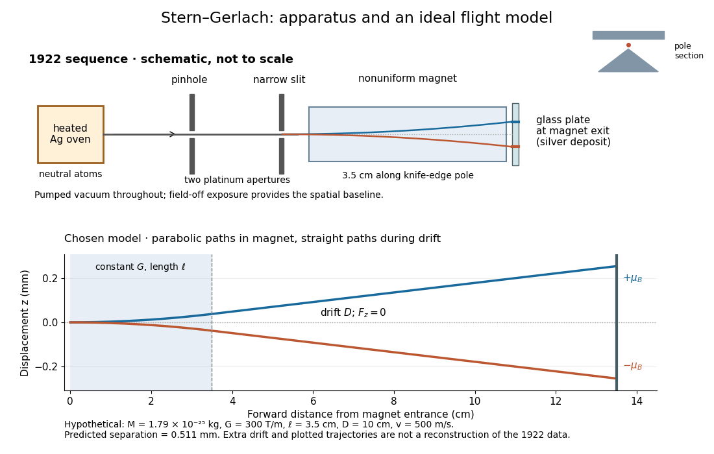

# Stern-Gerlach apparatus in 1922

↑ **Parent:** [Stern-Gerlach experiment](stern-gerlach-experiment.md)

In 1922, [Otto Stern](otto-stern.md) and [Walther Gerlach](walther-gerlach.md) used an electrically heated oven to emit neutral [silver](silver.md) [chemical atoms](atom-physics.md). Two platinum apertures, a pinhole and a slit $0.03$–$0.04\,\mathrm{mm}$ wide, supplied [collimation](collimation.md). The beam passed along a $3.5\,\mathrm{cm}$ knife-edge pole in a nonuniform [magnetic field](magnetic-field-split.md). At its end, a glass plate collected the condensed [silver](silver.md). Continuous pumping maintained [vacuum](vacuum.md); the thin deposit required development even after eight hours.[Experimental setup, paragraphs 1–5; original 1922 paper in Martin Bauer's translation, PDF pp. 2–3](der-experimentelle-nachweis-der-richtungsquantelung-im-magnetfeld-by-walther-gerlach-and-otto-stern.md)

The field-off image established the undeflected slit width. A comparison put field-on and field-off deposits on the same plate. Microscopy revealed two deflected bands, no detectable central component, and broadening attributed to the [velocity](velocity.md) distribution. Alignment and distance from the knife-edge affected the pattern; precise [magnetic field](magnetic-field-split.md) [gradient](gradient.md) measurements were still pending.[Results, Figs. 2–5 and observations b–e; closing paragraph, PDF pp. 3–5](der-experimentelle-nachweis-der-richtungsquantelung-im-magnetfeld-by-walther-gerlach-and-otto-stern.md)

The apertures act as a [collimator](collimator.md): they constrain the initial transverse [positions](position.md) and [velocities](velocity.md), so a magnetic displacement can be distinguished from an initially broad beam. [Vacuum](vacuum.md) reduces collisions that would destroy this preparation. Deposition integrates arrivals over the exposure; a darkened band is not a time-resolved record of individual [chemical atoms](atom-physics.md). The field-off comparison tests whether the magnet changes the spatial distribution, while alignment checks address a geometric source of apparent asymmetry. Finite sensitivity qualifies the absence of a central deposit: it is an experimental upper limit, not a proof that exactly zero atoms landed there.

**[Figure 1](#image-from-an-oven-to-a-silver-deposit-and-a-separate-ideal-flight-model). From an oven to a silver deposit, and a separate ideal flight model**. The upper schematic shows the historical sequence without reproducing the original image. The lower diagram introduces the hypothetical constant-gradient magnet length $\ell$ and additional drift distance $D$ used below. The historical plate was at the magnet exit; the extra drift is a modeling choice.

## ↑ Ancestors (7)

1. [Stern-Gerlach experiment](stern-gerlach-experiment.md)
2. [Spin](spin.md)
3. [Angular momentum operator](angular-momentum-operator-split.md)
4. [Quantum mechanics](quantum-mechanics-split.md)
5. [Branches of physics](branches-of-physics.md)
6. [Physics](physics-split.md)
7. [Codex Wiki](split.md)
