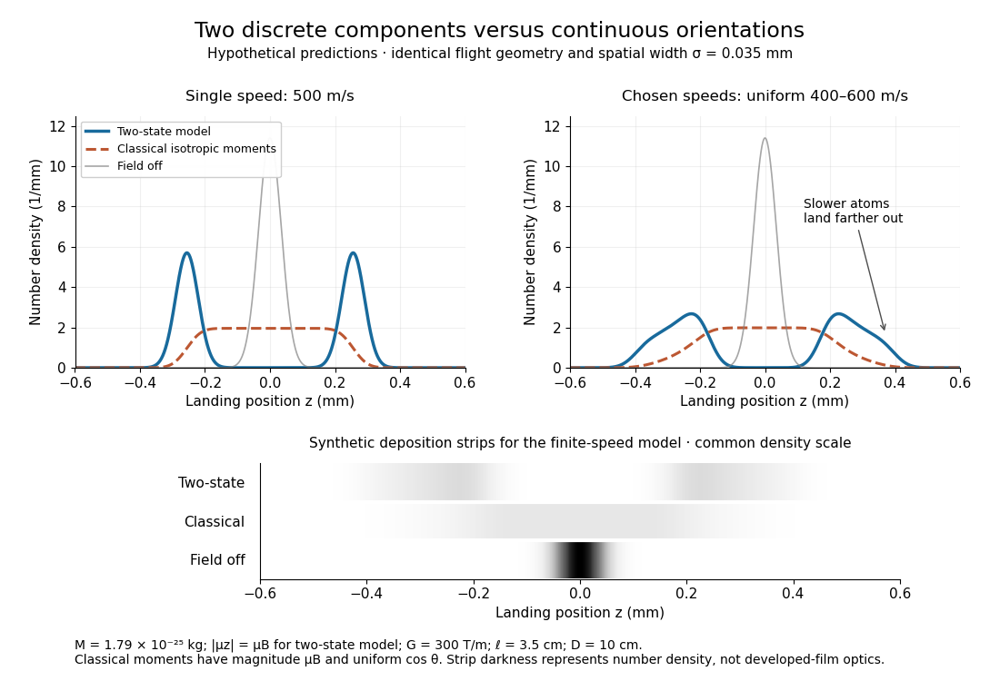

# Stern-Gerlach discrete and classical profiles

↑ **Parent:** [Stern-Gerlach experiment](stern-gerlach-experiment.md)

For an equally populated ideal pair of [angular momentum eigenstates](angular-momentum-eigenstate.md), the [magnetic moment](magnetic-dipole-moment.md) component takes two values, $\pm\mu_B$, and the displacements at fixed [velocity](velocity.md) are $\pm d(v)$. Compare a specified classical alternative: every [chemical atom](atom-physics.md) carries a permanent [magnetic moment](magnetic-dipole-moment.md) of fixed magnitude $\mu_B$, with independently isotropic initial orientations and no dissipative alignment. If $u=\cos\theta$, the sphere's area element is $2\pi\,du$, so $u$ has a [uniform distribution](continuous-uniform-distribution.md) on $[-1,1]$. With precession preserving this component in the ideal geometry, the displacement $d(v)u$ fills the interval $[-d(v),d(v)]$ continuously. A pair of bands therefore tests allowed components rather than merely proving that [silver](silver.md) is magnetic. Other classical preparation assumptions would be different models and must be stated.

To include finite instrumental width, choose a normalized [Gaussian distribution](normal-distribution.md)

$$
\phi_\sigma(z)=\frac{1}{\sqrt{2\pi}\sigma}\exp\left(-\frac{z^2}{2\sigma^2}\right)
$$

with [standard deviation](standard-deviation.md) $\sigma=0.035\,\mathrm{mm}$, representing a combined field-off spatial width. At fixed [velocity](velocity.md) the model [probability density functions](probability-density-function.md) are

$$
p_{\rm two}(z\mid v)=\frac{\phi_\sigma(z-d(v))+\phi_\sigma(z+d(v))}{2},\qquad
p_{\rm classical}(z\mid v)=\frac12\int_{-1}^1\phi_\sigma(z-d(v)u)\,du.
$$

Each has unit [integral](integral-split.md) and zero [mean](expected-value-split.md); the different shapes, rather than a different average displacement, distinguish them. The discrete model has [variance](variance-split.md) $\sigma^2+d(v)^2$, whereas the classical model has [variance](variance-split.md) $\sigma^2+d(v)^2/3$. Their common mean also explains why the raw average landing position is insufficient to identify the internal [quantum state](quantum-state.md).

Now choose a [uniform distribution](continuous-uniform-distribution.md) of forward [velocities](velocity.md) from $400$ to $600\,\mathrm{m\,s^{-1}}$, explicitly as an example rather than the oven's actual distribution. Average either conditional [probability density function](probability-density-function.md) over that interval. The positive-channel displacement ranges from $0.1776$ to $0.3995\,\mathrm{mm}$, since slower [chemical atoms](atom-physics.md) spend longer accelerating and drifting. The two components broaden into bands even though their internal [magnetic moment](magnetic-dipole-moment.md) values remain discrete. The corresponding classical profile continues to populate the center. The displayed strip darkness is proportional to predicted deposited number density, with equal total arrivals; it is not a photograph or a calibrated optical response of a developed film.

**[Figure 2](#image-discrete-magnetic-components-and-continuous-classical-deflections). Discrete magnetic components and continuous classical deflections**. Original model predictions with the chosen flight parameters, comparing one forward speed with a finite speed interval. Both alternatives include the same Gaussian spatial width. Synthetic deposition strips use a common density scale; none of the curves or strips is measured data.

Increasing the spatial width until it is comparable with $d$ can hide the two maxima. At fixed [velocity](velocity.md), differentiating the two-state [probability density function](probability-density-function.md) twice gives $p_{\rm two}''(0)=\phi_\sigma(d)(d^2-\sigma^2)/\sigma^4$: the central minimum becomes a central maximum when $\sigma>d$. Conversely, a broad distribution of [velocities](velocity.md) need not create a new internal component: it spreads each existing component through the $v^{-2}$ dependence. Further instrumental limits include collisions, aperture clipping of strongly deflected trajectories, asymmetric pole geometry, and nonlinear film development. Field-off widths and a mapped [magnetic field](magnetic-field-split.md) [gradient](gradient.md) are needed to separate such effects. For a modern counting experiment, channel calibration and efficiency corrections belong to [Stern-Gerlach expectation estimation](stern-gerlach-expectation-estimation.md); spatial separation alone does not supply those statistics.

## ↑ Ancestors (7)

1. [Stern-Gerlach experiment](stern-gerlach-experiment.md)
2. [Spin](spin.md)
3. [Angular momentum operator](angular-momentum-operator-split.md)
4. [Quantum mechanics](quantum-mechanics-split.md)
5. [Branches of physics](branches-of-physics.md)
6. [Physics](physics-split.md)
7. [Codex Wiki](split.md)
