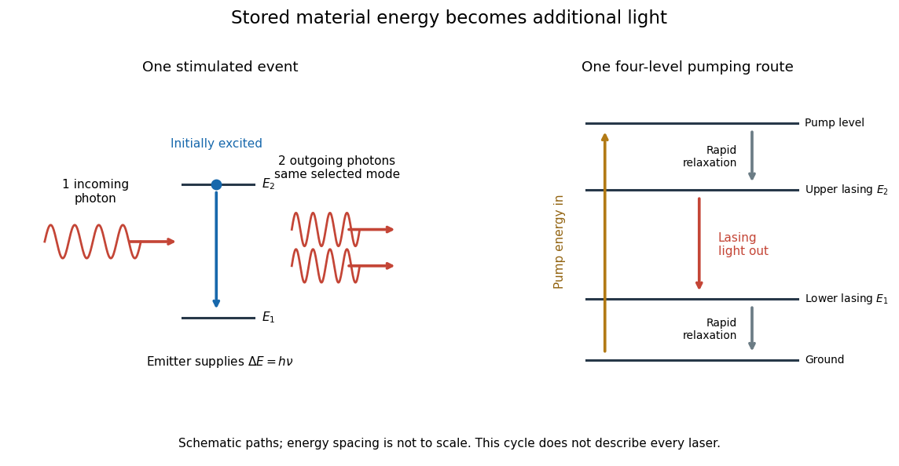

# Stimulated emission

↑ **Parent:** [Laser](laser-split.md)  
ⓦ [Wiki](https://en.wikipedia.org/wiki/Stimulated_emission)

Stimulated emission is emission induced by incident [light](light.md), in contrast with the unprompted decay in [spontaneous emission](spontaneous-emission.md). It supplies the amplification mechanism of a [laser](laser-split.md). [OpenStax, §8.6: stimulated emission](https://openstax.org/books/university-physics-volume-3/pages/8-6-lasers).

For an emitter with upper and lower [energy](energy-split.md) values $E_2>E_1$, the resonant [photon](photon.md) has [frequency](frequency.md) $\nu$ satisfying

$$
\Delta E=E_2-E_1=h\nu,
$$

where $h$ is the [Planck constant](planck-constant.md). In the elementary [photon](photon.md) picture, an incident [photon](photon.md) stimulates an emitter in the upper [quantum state](quantum-state.md) to emit an additional [photon](photon.md) into the same optical [normal mode](normal-mode.md), with the same [frequency](frequency.md), propagation direction and [photon polarization](photon-polarization.md). The emitter supplies the extra [energy](energy-split.md); the stimulating [photon](photon.md) is not consumed. This builds the existing field and its [optical coherence](optical-coherence.md). An emitter in the lower [quantum state](quantum-state.md) can instead undergo [photon absorption](photon-absorption.md), so [stimulated emission](stimulated-emission.md) alone does not establish net [optical gain](optical-gain.md).

For example, a $2.0\,\mathrm{eV}$ gap corresponds to $\nu\approx4.8360\times10^{14}\,\mathrm{Hz}$ and a [vacuum](vacuum.md) [wavelength](wavelength.md) of about $620\,\mathrm{nm}$. One ideal [stimulated emission](stimulated-emission.md) event converts one incoming [photon](photon.md) into two outgoing [photons](photon.md) in the selected optical [normal mode](normal-mode.md), adding $2.0\,\mathrm{eV}$ of [light](light.md) [energy](energy-split.md) while lowering the emitter's [energy](energy-split.md) by that amount.

**[Figure 3](#image-stimulated-emission-and-one-illustrative-four-level-laser-pumping-cycle). Stimulated emission and one illustrative four-level laser pumping cycle**. Left: one incoming [photon](photon.md) induces an additional [photon](photon.md) while the emitter falls from $E_2$ to $E_1$. Right: pumping supplies [energy](energy-split.md), rapid relaxation feeds the upper lasing state, [stimulated emission](stimulated-emission.md) supplies [light](light.md), and rapid lower-state relaxation completes a four-level cycle. These paths are schematic, not universal to all [lasers](laser-split.md); line spacing is not to scale.

**Table of contents**

- [Photon occupation enhancement of emission](photon-occupation-enhancement-of-emission.md)
- [Population inversion](population-inversion.md)
  - [Lower-level depopulation in a four-level laser](lower-level-depopulation-in-a-four-level-laser.md)

## ↑ Ancestors (5)

1. [Laser](laser-split.md)
2. [Optics](optics-split.md)
3. [Branches of physics](branches-of-physics.md)
4. [Physics](physics-split.md)
5. [Codex Wiki](split.md)

## ← Incoming links (22)

- [Continuous double heterostructure laser experiment](continuous-double-heterostructure-laser-experiment.md)
- [Double heterostructure laser](double-heterostructure-laser.md)
- [Laser](laser-split.md)
- [Laser spectroscopy](laser-spectroscopy.md)
- [Maser](maser-split.md)
- [Optical gain](optical-gain.md)
- [Solution](past-exam-of-the-advanced-quantum-physics-course-of-the-university-of-cambridge/2012/paper-1/2/c/solution.md)
- [Solution](past-exam-of-the-advanced-quantum-physics-course-of-the-university-of-cambridge/2013/paper-1/4/solution.md)
- [Solution](past-exam-of-the-advanced-quantum-physics-course-of-the-university-of-cambridge/2014/paper-1/2/c/solution.md)
- [Solution](past-exam-of-the-advanced-quantum-physics-course-of-the-university-of-cambridge/2016/paper-1/2/b/solution.md)
- [Solution](past-exam-of-the-advanced-quantum-physics-course-of-the-university-of-cambridge/2019/section-a/2/solution.md)
- [Solution](past-exam-of-the-atomic-and-optical-physics-course-of-the-university-of-cambridge/2015/paper-1/3/b/solution.md)
- [Solution](past-exam-of-the-systems-biology-course-of-the-university-of-cambridge/2024/paper-2/6/iii/solution.md)
- [Photon occupation enhancement of emission](photon-occupation-enhancement-of-emission.md)
- [Population inversion](population-inversion.md)
- [Rotational state populations](rotational-state-populations.md)
- [Ruby laser](ruby-laser.md)
- [Stimulated emission](stimulated-emission.md)
- [Stimulated Raman transition](stimulated-raman-transition.md)
- [Three-level laser](three-level-laser.md)
- [Three-sublevel optical pumping model](three-sublevel-optical-pumping-model.md)
- [Two-level saturation population model](two-level-saturation-population-model.md)
