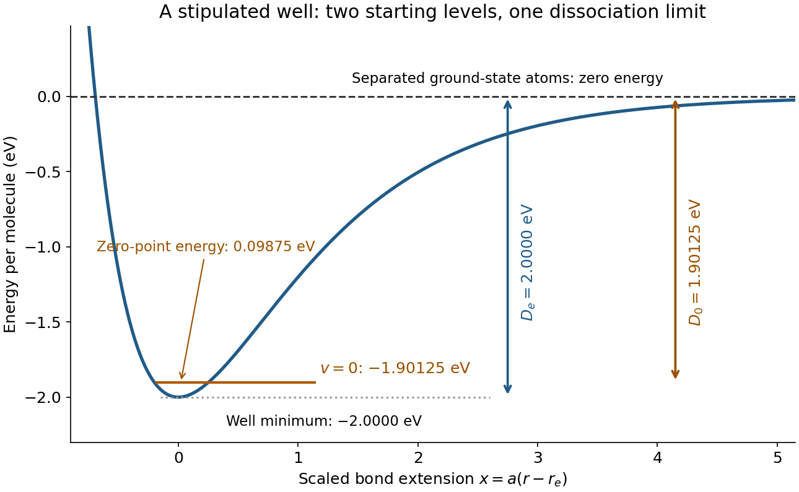

# Stipulated bond dissociation model

↑ **Parent:** [Bond-dissociation energy](bond-dissociation-energy.md)

Take an invented [diatomic molecule](diatomic-molecule.md) with a [Morse potential](morse-potential.md), setting the separated-atom [energy](energy.md) to zero:

$$
V(r)=D_e\left[\left(1-e^{-a(r-r_e)}\right)^2-1\right],\qquad
D_e=2.0000\,\mathrm{eV},\qquad A=\hbar\omega_e=0.2000\,\mathrm{eV}.
$$

Here $a$ is an inverse length, $r_e$ the equilibrium [bond length](bond-length.md), and $\omega_e=a\sqrt{2D_e/\mu}$, with [reduced mass](reduced-mass.md) $\mu$. These stipulated parameters describe a simple model, not a measured [chemical substance](chemical-substance.md). For the one-dimensional [Morse oscillator](morse-oscillator.md), [energy eigenvalues](energy-eigenvalue.md) above the minimum are

$$
\epsilon_v=A\left(v+\tfrac12\right)-\frac{A^2}{4D_e}\left(v+\tfrac12\right)^2,
\qquad v=0,1,\ldots,\quad v+\tfrac12<\frac{2D_e}{A}.
$$

Consequently,

$$
E_{\rm ZP}=\frac A2-\frac{A^2}{16D_e}=0.09875\,\mathrm{eV},\qquad
D_0=2.0000-0.09875=1.90125\,\mathrm{eV}.
$$

The harmonic estimate $A/2=0.1000\,\mathrm{eV}$ is slightly larger than this model's exact [zero-point energy](zero-point-energy.md). The physical bound-level restriction matters: the quadratic expression is not an infinite ladder of vibrational [quantum states](quantum-state.md).

**[Figure 10](#image-bond-dissociation-well-and-zero-point). Bond potential-well depth and ground-state dissociation energy reach the same separated-atom limit from different starting energies**. Original stipulated [Morse potential](morse-potential.md) with $D_e=2\,\mathrm{eV}$ and $A=0.2\,\mathrm{eV}$. The horizontal coordinate is $a(r-r_e)$; the horizontal $v=0$ line is an [energy eigenvalue](energy-eigenvalue.md), not a classical trajectory or a measured spectrum.

For a separate thermal illustration using this same stipulated $D_0$, assume an [ideal gas](ideal-gas.md), fully active [molecular rotation](molecular-rotation.md) of the parent, negligible thermal [molecular vibration](molecular-vibration.md), and negligible electronic excitation for all species. Each monatomic product contributes $\delta h=5RT/2$; the [diatomic molecule](diatomic-molecule.md) contributes $7RT/2$. Thus the net increment is $3RT/2$, with [molar gas constant](molar-gas-constant.md) $R$. At $T=300\,\mathrm K$,

$$
N_{\rm A}D_e\approx192.971\,\mathrm{kJ\,mol^{-1}},\qquad
N_{\rm A}D_0\approx183.443\,\mathrm{kJ\,mol^{-1}},\qquad
\Delta_{\rm diss}H^{\circ}\approx187.184\,\mathrm{kJ\,mol^{-1}}.
$$

This last result follows from the stated thermal model, not a universal correction for every [chemical bond](chemical-bond.md). Frozen rotations, accessible excited states, different fragment composition, or a condensed [phase](phase-waves.md) change the thermal increments.

## ↑ Ancestors (4)

1. [Bond-dissociation energy](bond-dissociation-energy.md)
2. [Chemical bond](chemical-bond.md)
3. [Chemistry](chemistry-split.md)
4. [Codex Wiki](split.md)
