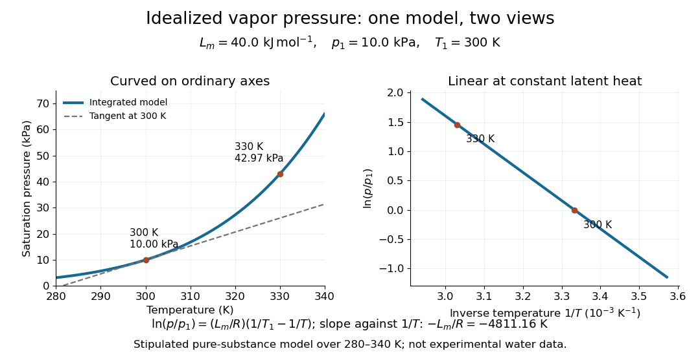

# Stipulated vapor-pressure calculation

↑ **Parent:** [Integrated Clausius-Clapeyron relation](integrated-clausius-clapeyron-relation.md)

Consider an unnamed model substance with molar [latent heat](latent-heat.md) $L_m=40.0\,\mathrm{kJ\,mol^{-1}}$ and [saturation pressure](vapor-pressure.md) $p_1=10.0\,\mathrm{kPa}$ at $T_1=300\,\mathrm K$. Stipulate the [Ideal-vapor Clausius-Clapeyron approximation](ideal-vapor-clausius-clapeyron-approximation.md) throughout $280\leq T\leq340\,\mathrm K$, constant $L_m$, and $R=8.314\,\mathrm{J\,mol^{-1}\,K^{-1}}$. These parameters define an illustrative model, not a measured dataset or a fit to [water](water.md). At $T_2=330\,\mathrm K$,

$$
\ln\frac{p_2}{p_1}=\frac{40000}{8.314}\left(\frac{1}{300}-\frac{1}{330}\right)\simeq1.458,\qquad p_2\simeq42.97\,\mathrm{kPa}.
$$

At the reference state the [gas](gas.md) [molar volume](molar-volume.md) is $RT_1/p_1=0.24942\,\mathrm{m^3\,mol^{-1}}$, and the local slope is $dp/dT\simeq0.5346\,\mathrm{kPa\,K^{-1}}$. The tangent estimate $p_2\approx10.0+30(0.5346)=26.04\,\mathrm{kPa}$ is much lower than the integrated result: a local [derivative](derivative.md) should not be extrapolated over this whole interval. By contrast, over a small [temperature](temperature.md) increment, the fractional sensitivity is $d\ln(p/p_1)/dT=L_m/(RT_1^2)\simeq0.05346\,\mathrm{K^{-1}}$.

**[Figure 48](#image-stipulated-saturation-pressure-versus-temperature-and-its-linear-logarithm-versus-inverse-temperature). Stipulated saturation pressure versus temperature and its linear logarithm versus inverse temperature**.

## ↑ Ancestors (13)

1. [Integrated Clausius-Clapeyron relation](integrated-clausius-clapeyron-relation.md)
2. [Ideal-vapor Clausius-Clapeyron approximation](ideal-vapor-clausius-clapeyron-approximation.md)
3. [Clausius-Clapeyron relation](clausius-clapeyron-relation.md)
4. [Latent heat](latent-heat.md)
5. [Phase coexistence curve](phase-coexistence-curve.md)
6. [Gibbs free energy](gibbs-free-energy.md)
7. [Thermodynamic free energy](thermodynamic-free-energy.md)
8. [Thermodynamic potential](thermodynamic-potential.md)
9. [Thermodynamics](thermodynamics-split.md)
10. [Statistical physics](statistical-physics-split.md)
11. [Branches of physics](branches-of-physics.md)
12. [Physics](physics-split.md)
13. [Codex Wiki](split.md)

## ← Incoming links (1)

- [Latent heat from a vapor-pressure slope](latent-heat-from-a-vapor-pressure-slope.md)
