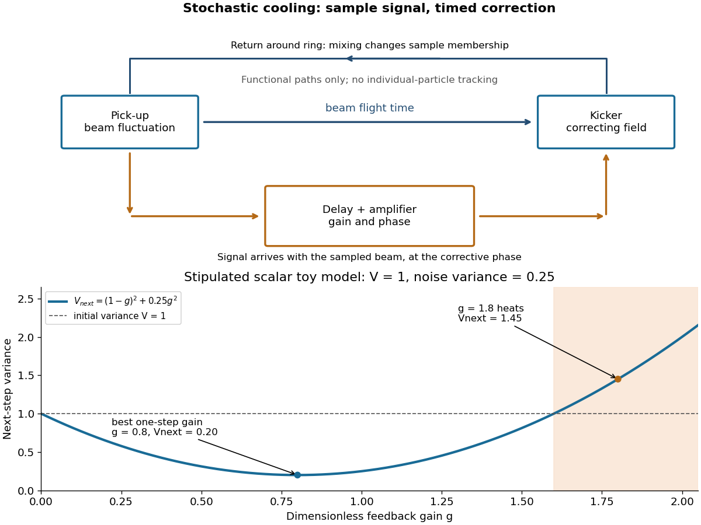

# Stochastic cooling

↑ **Parent:** [Beam cooling](beam-cooling.md)  
ⓦ [Wiki](https://en.wikipedia.org/wiki/Stochastic_cooling)

[Simon van der Meer](simon-van-der-meer.md)'s [stochastic cooling](stochastic-cooling.md) uses measured beam fluctuations, a pick-up, [amplifier](amplifier.md) and timed kicker. Finite samples supply the signal; other [particles](particle-physics.md) and electronic [noise](noise-signal-processing.md) contribute unwanted kicks. Delay and oscillation phase must make the correction oppose the sampled deviation.[1984 lecture, sections 2–3, p.292 onward; section 5, p.295](stochastic-cooling-and-the-accumulation-of-antiprotons-by-simon-van-der-meer.md)

This active system dissipates [energy](energy-split.md); it is no one-particle [Maxwell's demon](maxwell-s-demon.md) individually tracking [antiprotons](antiproton.md). The [stochastic cooling variance model](stochastic-cooling-variance-model.md) isolates the tradeoff.

**[Figure 5](#image-measured-beam-fluctuations-drive-a-delayed-kicker-while-excessive-gain-amplifies-noise). Measured beam fluctuations drive a delayed kicker, while excessive gain amplifies noise**. Original functional signal path, not a mechanical or scale drawing of a historical ring. Beam flight and electrical signal paths are distinct; phase and delay must make the correction oppose the sampled deviation. The graph is the stipulated scalar model with initial variance one and independent noise variance one quarter; it is not a measured cooling curve.

**Table of contents**

- [Beam mixing](beam-mixing.md)
- [Stochastic cooling variance model](stochastic-cooling-variance-model.md)

## ↑ Ancestors (5)

1. [Beam cooling](beam-cooling.md)
2. [Particle accelerator](particle-accelerator-split.md)
3. [Experimental apparatus](experimental-apparatus.md)
4. [Physics](physics-split.md)
5. [Codex Wiki](split.md)

## ← Incoming links (7)

- [Beam cooling](beam-cooling.md)
- [Beam mixing](beam-mixing.md)
- [Maxwell's demon](maxwell-s-demon.md)
- [Stochastic cooling](stochastic-cooling.md)
- [Stochastic cooling variance model](stochastic-cooling-variance-model.md)
- [Super Proton-Antiproton Synchrotron](super-proton-antiproton-synchrotron.md)
- [W and Z discovery experiments](w-and-z-discovery-experiments.md)
