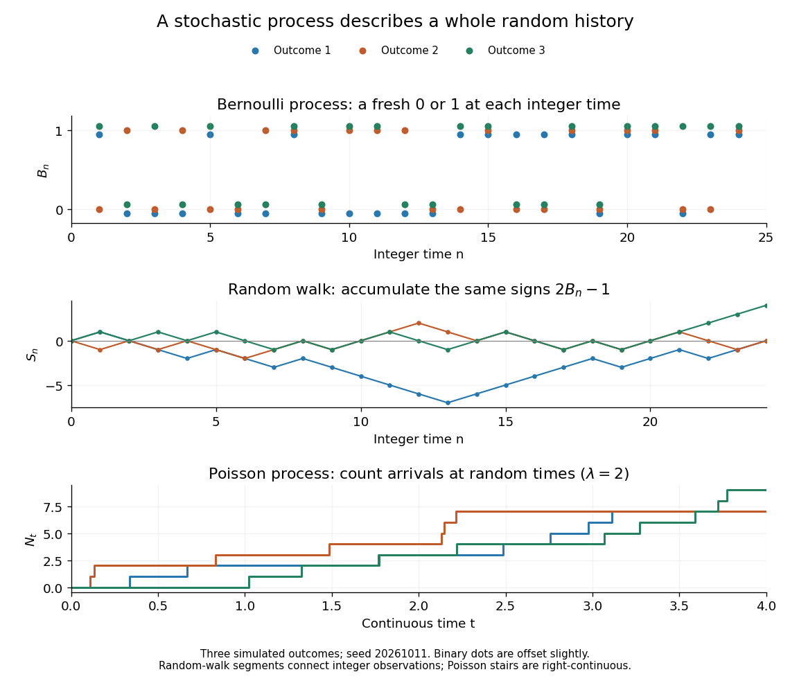
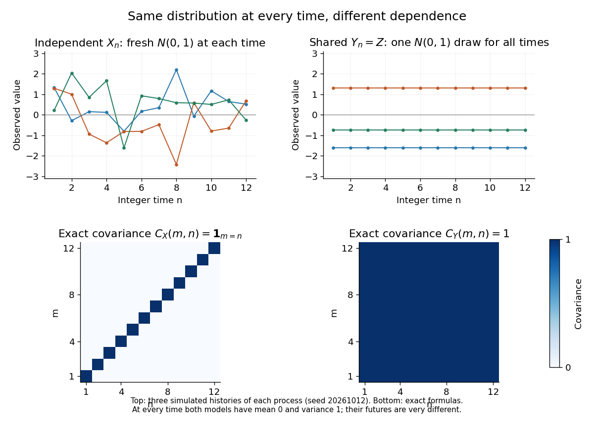

# Stochastic process

↑ **Parent:** [Probability theory](probability-theory.md)  
ⓦ [Wiki](https://en.wikipedia.org/wiki/Stochastic_process)

A stochastic process describes uncertainty about a whole history: not just the [probability distribution](probability-distribution.md) of a measurement now, but how measurements at different times fit together. It is a family $(X_t)_{t\in T}$ of [random variables](random-variable.md) on one [probability space](probability-space.md), with [index set](computability-theory.md#index-set) $T$. Time is the usual index: $T=\{0,1,2,\ldots\}$ for successive observations or $T=[0,\infty)$ for continuous time. An [index set](computability-theory.md#index-set) need not be ordered; a [random field](#random-field) can instead assign a [random variable](random-variable.md) to each point in space.

There are two complementary views. Fix a time $t$ and $X_t$ is a [random variable](random-variable.md); fix a [sample space](probability-space.md#sample-space) outcome $\omega$ and $t\mapsto X_t(\omega)$ is one [sample path](#sample-path). A model specifies the [probability distribution](probability-distribution.md) of these histories. This viewpoint lets [queueing theory](queueing-theory.md) ask whether a workload will ever cross a capacity threshold, and lets a [random walk](random-walk.md) describe accumulated fluctuations rather than isolated errors. The common [probability space](probability-space.md) and the distinction between a time coordinate and a [sample path](#sample-path) are developed in [MIT, The basics of stochastic processes, section 1](https://ocw.mit.edu/courses/6-436j-fundamentals-of-probability-fall-2018/b9342e718ec4c58d98ec97dcfcb0d56e_MIT6_436JF18_lec20.pdf).

A concrete construction starts with a [Bernoulli process](#bernoulli-process) of independent fair bits $B_1,B_2,\ldots$. Keeping $B_n$ records the next trial; adding the signs gives a [simple random walk on the integer line](random-walk.md#simple-random-walk-on-the-integer-line), $S_0=0$ and $S_n=\sum_{j=1}^n(2B_j-1)$. Every [increment](#increment) of this [random walk](random-walk.md) is $\pm1$, yet the positions are dependent: $S_{n+1}$ contains all the previous increments. Counting arrivals at random continuous times instead gives a [Poisson process](poisson-process.md). These examples separate three questions: what values are possible, how time is indexed, and how the values depend on one another.

**[Figure 1](#image-three-kinds-of-random-history-fair-bits-their-accumulated-signs-and-poisson-arrival-counts). Three kinds of random history: fair bits, their accumulated signs, and Poisson arrival counts**.

For the fair [simple random walk on the integer line](random-walk.md#simple-random-walk-on-the-integer-line), the [expected value](expected-value.md) is $\mathbb E S_n=0$ and the [variance](variance.md) is $\operatorname{Var}(S_n)=n$. At time four, returning to zero requires exactly two positive steps, so $\mathbb P(S_4=0)=\binom42/2^4=3/8$. A rate-two [Poisson process](poisson-process.md) instead has $\mathbb P(N_1=0)=e^{-2}\approx0.1353$. A single realized [sample path](#sample-path) does not establish either [probability](probability-theory.md#probability): they follow from the specified [joint probability distributions](probability-distribution.md#joint-probability-distribution).

The most revealing feature is often dependence. Two [stochastic processes](stochastic-process.md) can have identical [marginal distributions](probability-distribution.md#marginal-distribution) at every time while one forgets everything at the next step and the other repeats its first value forever. Their [finite-dimensional distributions](#finite-dimensional-distribution) and [covariance functions](#covariance-function) distinguish them. That extra structure is what makes a [stochastic process](stochastic-process.md) useful for prediction.

**Table of contents**

- [Random sequential adsorption](#random-sequential-adsorption)
- [Mean reversion](#mean-reversion)
- [Bernoulli process](#bernoulli-process)
- [Skorokhod problem](#skorokhod-problem)
  - [Skorokhod reflection map on the half-line](#skorokhod-reflection-map-on-the-half-line)
- [Self-similarity of a stochastic process](#self-similarity-of-a-stochastic-process)
- [Random field](#random-field)
- [Locally bounded process](#locally-bounded-process)
- [Branching process](#branching-process)
  - [Critical branching process](#critical-branching-process)
  - [Multitype Poisson branching process](#multitype-poisson-branching-process)
    - [Spectral survival criterion for multitype Poisson branching](#spectral-survival-criterion-for-multitype-poisson-branching)
- [Unnormalized time autocorrelation](#unnormalized-time-autocorrelation)
  - [Intrawell phase autocorrelation](#intrawell-phase-autocorrelation)
- [Sample path](#sample-path)
- [Bounded increments](#bounded-increments)
  - [Bounded-increment martingale convergence-or-oscillation dichotomy](#bounded-increment-martingale-convergence-or-oscillation-dichotomy)
    - [Oscillation of a bounded centered iid random walk](#oscillation-of-a-bounded-centered-iid-random-walk)
- [Locally defined stochastic process](#locally-defined-stochastic-process)
  - [Local solution of a stochastic differential equation](#local-solution-of-a-stochastic-differential-equation)
- [Stochastic interval](#stochastic-interval)
- [Modification of a stochastic process](#modification-of-a-stochastic-process)
  - [Càdlàg modification](#cadlag-modification)
  - [Continuous modification](#continuous-modification)
- [Linear fluctuating interface](#linear-fluctuating-interface)
  - [Stationary spectrum of a linear fluctuating interface](#stationary-spectrum-of-a-linear-fluctuating-interface)
  - [Brownian zero mode of a fluctuating interface](#brownian-zero-mode-of-a-fluctuating-interface)
- [Path probability](#path-probability)
- [Langevin dynamics](#langevin-dynamics)
  - [Independent-record averaging versus high detector bandwidth](#independent-record-averaging-versus-high-detector-bandwidth)
  - [Thermal Langevin force normalization](#thermal-langevin-force-normalization)
  - [Velocity relaxation time](#velocity-relaxation-time)
- [Interacting particle system](#interacting-particle-system)
  - [Voter model](#voter-model)
    - [Voter-model duality](#voter-model-duality)
      - [Finite-seed local extinction in the voter model](#finite-seed-local-extinction-in-the-voter-model)
      - [Invariant measures of the two-dimensional voter model](#invariant-measures-of-the-two-dimensional-voter-model)
  - [Exclusion process](#exclusion-process)
    - [Symmetric simple exclusion process](#symmetric-simple-exclusion-process)
      - [Bernoulli invariant laws of finite symmetric exclusion](#bernoulli-invariant-laws-of-finite-symmetric-exclusion)
      - [Stirring representation of symmetric exclusion](#stirring-representation-of-symmetric-exclusion)
        - [Product self-duality of symmetric exclusion](#product-self-duality-of-symmetric-exclusion)
          - [Exchangeable invariant laws of symmetric exclusion](#exchangeable-invariant-laws-of-symmetric-exclusion)
  - [Contact process](#contact-process)
    - [Exponential cardinality supermartingale for the contact process on a tree](#exponential-cardinality-supermartingale-for-the-contact-process-on-a-tree)
    - [Extremal invariant measures of the contact process](#extremal-invariant-measures-of-the-contact-process)
    - [Branching bound for contact-process survival](#branching-bound-for-contact-process-survival)
    - [Graphical representation of the contact process](#graphical-representation-of-the-contact-process)
      - [Independent oriented-percolation comparison for the contact process](#independent-oriented-percolation-comparison-for-the-contact-process)
      - [Dimension comparison for the contact process](#dimension-comparison-for-the-contact-process)
      - [Additivity of the contact process](#additivity-of-the-contact-process)
      - [Duality of the contact process](#duality-of-the-contact-process)
    - [Survival probability of the contact process](#survival-probability-of-the-contact-process)
      - [Local survival threshold of the contact process](#local-survival-threshold-of-the-contact-process)
        - [Height-weighted local extinction bound for the contact process](#height-weighted-local-extinction-bound-for-the-contact-process)
      - [Global survival threshold of the contact process](#global-survival-threshold-of-the-contact-process)
        - [Two-vertex branching comparison for contact-process survival](#two-vertex-branching-comparison-for-contact-process-survival)
- [Telegraph process](#telegraph-process)
  - [Diffusion limit of the telegraph process](#diffusion-limit-of-the-telegraph-process)
- [Increment](#increment)
- [Stationary increments](#stationary-increments)
- [Independent increments](#independent-increments)
- [Finite-dimensional distribution](#finite-dimensional-distribution)
  - [Kolmogorov extension theorem](#kolmogorov-extension-theorem)
- [Covariance function](#covariance-function)
- [Kolmogorov continuity theorem](#kolmogorov-continuity-theorem)
  - [Dyadic increment chaining](#dyadic-increment-chaining)
- [Brownian snake](#brownian-snake)
  - [Hölder regularity of the Brownian snake](#holder-regularity-of-the-brownian-snake)
- [Schramm–Loewner evolution](schramm-loewner-evolution.md)
  - [Cardy boundary crossing formula](schramm-loewner-evolution.md#cardy-boundary-crossing-formula)
  - [Chordal SLE4](schramm-loewner-evolution.md#chordal-sle4)
  - [Radial Schramm–Loewner evolution](schramm-loewner-evolution.md#radial-schramm-loewner-evolution)
    - [Radial SLE2](schramm-loewner-evolution.md#radial-sle2)
  - [Scale-and-domain-Markov characterization of SLE](schramm-loewner-evolution.md#scale-and-domain-markov-characterization-of-sle)
  - [SLE angle process](schramm-loewner-evolution.md#sle-angle-process)
    - [Dirichlet boundary values of the SLE angle process](schramm-loewner-evolution.md#dirichlet-boundary-values-of-the-sle-angle-process)
    - [Logarithmic martingale for SLE4](schramm-loewner-evolution.md#logarithmic-martingale-for-sle4)
      - [Fixed-interior-point avoidance of SLE4](schramm-loewner-evolution.md#fixed-interior-point-avoidance-of-sle4)
    - [SLE4 angle martingale](schramm-loewner-evolution.md#sle4-angle-martingale)
    - [SLE interior-point martingale](schramm-loewner-evolution.md#sle-interior-point-martingale)
  - [Compact H-hull](schramm-loewner-evolution.md#compact-h-hull)
    - [Mapping-out function of a compact H-hull](schramm-loewner-evolution.md#mapping-out-function-of-a-compact-h-hull)
      - [Monotonicity of boundary derivatives of mapping-out functions](schramm-loewner-evolution.md#monotonicity-of-boundary-derivatives-of-mapping-out-functions)
      - [Differentiability estimate for a mapping-out function](schramm-loewner-evolution.md#differentiability-estimate-for-a-mapping-out-function)
      - [High-level escape representation of a mapping-out height](schramm-loewner-evolution.md#high-level-escape-representation-of-a-mapping-out-height)
      - [Height contraction of a hydrodynamically normalized mapping-out function](schramm-loewner-evolution.md#height-contraction-of-a-hydrodynamically-normalized-mapping-out-function)
      - [Inverse-at-infinity criterion for local boundedness of a mapping-out function](schramm-loewner-evolution.md#inverse-at-infinity-criterion-for-local-boundedness-of-a-mapping-out-function)
      - [Mapping-out function of a vertical slit](schramm-loewner-evolution.md#mapping-out-function-of-a-vertical-slit)
      - [Real boundary bounds for a unit-disc H-hull](schramm-loewner-evolution.md#real-boundary-bounds-for-a-unit-disc-h-hull)
        - [Sharp displacement bound for a compact H-hull](schramm-loewner-evolution.md#sharp-displacement-bound-for-a-compact-h-hull)
          - [Nearly closed semicircular slit](schramm-loewner-evolution.md#nearly-closed-semicircular-slit)
      - [Hydrodynamic normalization at infinity](schramm-loewner-evolution.md#hydrodynamic-normalization-at-infinity)
      - [Half-plane capacity](schramm-loewner-evolution.md#half-plane-capacity)
        - [Half-plane capacity versus harmonic hull capacity](schramm-loewner-evolution.md#half-plane-capacity-versus-harmonic-hull-capacity)
        - [Half-plane capacity of a half-disc](schramm-loewner-evolution.md#half-plane-capacity-of-a-half-disc)
        - [Conformal change of half-plane capacity](schramm-loewner-evolution.md#conformal-change-of-half-plane-capacity)
          - [Conformal conjugacy derivative for the chordal Loewner equation](schramm-loewner-evolution.md#conformal-conjugacy-derivative-for-the-chordal-loewner-equation)
            - [Boundary derivative diffusion under conformal Loewner conjugacy](schramm-loewner-evolution.md#boundary-derivative-diffusion-under-conformal-loewner-conjugacy)
            - [Transformed SLE driving function](schramm-loewner-evolution.md#transformed-sle-driving-function)
        - [Half-plane capacity of a vertical slit](schramm-loewner-evolution.md#half-plane-capacity-of-a-vertical-slit)
        - [Scaling and translation of half-plane capacity](schramm-loewner-evolution.md#scaling-and-translation-of-half-plane-capacity)
        - [Monotonicity of half-plane capacity](schramm-loewner-evolution.md#monotonicity-of-half-plane-capacity)
          - [Half-plane-capacity composition rule](schramm-loewner-evolution.md#half-plane-capacity-composition-rule)
        - [Brownian representation of half-plane capacity](schramm-loewner-evolution.md#brownian-representation-of-half-plane-capacity)
        - [Half-plane capacity is bounded by squared diameter](schramm-loewner-evolution.md#half-plane-capacity-is-bounded-by-squared-diameter)
        - [Half-plane capacity of a low rectangle](schramm-loewner-evolution.md#half-plane-capacity-of-a-low-rectangle)
        - [Half-plane-capacity parameterization](schramm-loewner-evolution.md#half-plane-capacity-parameterization)
      - [Boundary degeneration under a mapping-out function](schramm-loewner-evolution.md#boundary-degeneration-under-a-mapping-out-function)
  - [Loewner chain](schramm-loewner-evolution.md#loewner-chain)
    - [Domain Markov property of a chordal Loewner chain](schramm-loewner-evolution.md#domain-markov-property-of-a-chordal-loewner-chain)
      - [Simplicity of SLE from boundary-avoiding restarts](schramm-loewner-evolution.md#simplicity-of-sle-from-boundary-avoiding-restarts)
    - [Capacity-parametrized scale invariance of a Loewner chain](schramm-loewner-evolution.md#capacity-parametrized-scale-invariance-of-a-loewner-chain)
    - [Trace of a Loewner chain](schramm-loewner-evolution.md#trace-of-a-loewner-chain)
      - [Boundary extension of the inverse map for a continuous Loewner trace](schramm-loewner-evolution.md#boundary-extension-of-the-inverse-map-for-a-continuous-loewner-trace)
    - [Loewner local growth property](schramm-loewner-evolution.md#loewner-local-growth-property)
      - [Loewner correspondence theorem](schramm-loewner-evolution.md#loewner-correspondence-theorem)
    - [Loewner differential equation](schramm-loewner-evolution.md#loewner-differential-equation)
      - [Chordal Loewner equation](schramm-loewner-evolution.md#chordal-loewner-equation)
        - [Loewner variation of the Dirichlet Green function](schramm-loewner-evolution.md#loewner-variation-of-the-dirichlet-green-function)
        - [Boundary-point swallowing time for a Loewner chain](schramm-loewner-evolution.md#boundary-point-swallowing-time-for-a-loewner-chain)
          - [SLE boundary swallowing criterion](schramm-loewner-evolution.md#sle-boundary-swallowing-criterion)
        - [Interior-point swallowing time for a Loewner chain](schramm-loewner-evolution.md#interior-point-swallowing-time-for-a-loewner-chain)
        - [Loewner driving function](schramm-loewner-evolution.md#loewner-driving-function)
          - [Continuity estimate for the Loewner driving function](schramm-loewner-evolution.md#continuity-estimate-for-the-loewner-driving-function)
          - [Driving-function reconstruction for a chordal Loewner chain](schramm-loewner-evolution.md#driving-function-reconstruction-for-a-chordal-loewner-chain)
          - [Composition rule for chordal Loewner driving functions](schramm-loewner-evolution.md#composition-rule-for-chordal-loewner-driving-functions)
          - [Square-root Loewner driving function generates a straight slit](schramm-loewner-evolution.md#square-root-loewner-driving-function-generates-a-straight-slit)
          - [Boundary derivative of a chordal Loewner chain](schramm-loewner-evolution.md#boundary-derivative-of-a-chordal-loewner-chain)
  - [Scaling invariance of SLE](schramm-loewner-evolution.md#scaling-invariance-of-sle)
    - [SLE reaches every positive height](schramm-loewner-evolution.md#sle-reaches-every-positive-height)
  - [Conformal Markov property of SLE](schramm-loewner-evolution.md#conformal-markov-property-of-sle)
    - [Characterization of the SLE driving function](schramm-loewner-evolution.md#characterization-of-the-sle-driving-function)
  - [Conformal invariance of SLE](schramm-loewner-evolution.md#conformal-invariance-of-sle)
    - [Chordal SLE in a specified scale](schramm-loewner-evolution.md#chordal-sle-in-a-specified-scale)
    - [Chordal restriction property](schramm-loewner-evolution.md#chordal-restriction-property)
      - [Restriction exponent of a chordal filling](schramm-loewner-evolution.md#restriction-exponent-of-a-chordal-filling)
      - [Chordal filling](schramm-loewner-evolution.md#chordal-filling)
        - [Avoidance probabilities determine a chordal filling law](schramm-loewner-evolution.md#avoidance-probabilities-determine-a-chordal-filling-law)
      - [Derivative avoidance criterion for chordal restriction](schramm-loewner-evolution.md#derivative-avoidance-criterion-for-chordal-restriction)
      - [Avoidance probabilities determine a simple chordal curve law](schramm-loewner-evolution.md#avoidance-probabilities-determine-a-simple-chordal-curve-law)
      - [SLE eight-thirds restriction martingale](schramm-loewner-evolution.md#sle-eight-thirds-restriction-martingale)
    - [Locality property of SLE](schramm-loewner-evolution.md#locality-property-of-sle)
      - [Locality of a chord law under conformal changes of neighborhoods](schramm-loewner-evolution.md#locality-of-a-chord-law-under-conformal-changes-of-neighborhoods)
      - [Target-change locality of SLE6](schramm-loewner-evolution.md#target-change-locality-of-sle6)
        - [Target-dependent continuation of SLE6](schramm-loewner-evolution.md#target-dependent-continuation-of-sle6)
  - [Phase classification of the SLE trace](schramm-loewner-evolution.md#phase-classification-of-the-sle-trace)
    - [Space-filling SLE above parameter eight](schramm-loewner-evolution.md#space-filling-sle-above-parameter-eight)
    - [SLE Green-function estimate](schramm-loewner-evolution.md#sle-green-function-estimate)
    - [SLE4 left-passage probability](schramm-loewner-evolution.md#sle4-left-passage-probability)
    - [Boundary-intersection threshold for SLE](schramm-loewner-evolution.md#boundary-intersection-threshold-for-sle)
      - [Positive boundary-interval hitting probability for SLE above parameter four](schramm-loewner-evolution.md#positive-boundary-interval-hitting-probability-for-sle-above-parameter-four)
  - [Transience of chordal SLE](schramm-loewner-evolution.md#transience-of-chordal-sle)
  - [Reverse Loewner flow](schramm-loewner-evolution.md#reverse-loewner-flow)
    - [Reverse SLE derivative martingale](schramm-loewner-evolution.md#reverse-sle-derivative-martingale)
      - [Reverse SLE derivative bound above the space-filling threshold](schramm-loewner-evolution.md#reverse-sle-derivative-bound-above-the-space-filling-threshold)
  - [Boundary-point Bessel flow for SLE](schramm-loewner-evolution.md#boundary-point-bessel-flow-for-sle)
    - [Boundary approach forces a small SLE Bessel gap](schramm-loewner-evolution.md#boundary-approach-forces-a-small-sle-bessel-gap)
    - [SLE two-boundary-point ratio diffusion](schramm-loewner-evolution.md#sle-two-boundary-point-ratio-diffusion)
      - [Strict ordering threshold for SLE boundary swallowing](schramm-loewner-evolution.md#strict-ordering-threshold-for-sle-boundary-swallowing)
        - [Real-line visitation from strict SLE swallowing order](schramm-loewner-evolution.md#real-line-visitation-from-strict-sle-swallowing-order)
    - [SLE boundary-point logarithmic separation diffusion](schramm-loewner-evolution.md#sle-boundary-point-logarithmic-separation-diffusion)
      - [SLE does not hit a fixed nonzero boundary point](schramm-loewner-evolution.md#sle-does-not-hit-a-fixed-nonzero-boundary-point)
    - [Two-sided SLE boundary swallowing probability](schramm-loewner-evolution.md#two-sided-sle-boundary-swallowing-probability)
- [Infinitesimal generator (stochastic processes)](#infinitesimal-generator-stochastic-processes)
  - [Dynkin's formula](#dynkin-s-formula)
  - [Diffusion generator](#diffusion-generator)
    - [Dynkin formula for a diffusion](#dynkin-formula-for-a-diffusion)
- [Filtration (probability theory)](#filtration-probability-theory)
  - [Dyadic filtration](#dyadic-filtration)
  - [Filtered probability space](#filtered-probability-space)
    - [Usual conditions for a filtration](#usual-conditions-for-a-filtration)
  - [Left-limit sigma-algebra](#left-limit-sigma-algebra)
- [Natural filtration](#natural-filtration)
- [Adapted process](#adapted-process)
  - [Adaptedness of a stopped right-continuous process](#adaptedness-of-a-stopped-right-continuous-process)
  - [Progressive measurability](#progressive-measurability)
    - [Almost sure path regularity does not ensure progressive measurability](#almost-sure-path-regularity-does-not-ensure-progressive-measurability)
    - [Right-continuous adapted processes are progressively measurable](#right-continuous-adapted-processes-are-progressively-measurable)
- [Uniform convergence on compacts in probability](#uniform-convergence-on-compacts-in-probability)
  - [Uniform convergence on compacts in probability under an absolutely continuous measure change](#uniform-convergence-on-compacts-in-probability-under-an-absolutely-continuous-measure-change)
- [Càdlàg process](#cadlag-process)
- [Time change of a continuous process](#time-change-of-a-continuous-process)
  - [Optional time-change theorem](#optional-time-change-theorem)
- [Indistinguishability of stochastic processes](#indistinguishability-of-stochastic-processes)
  - [Càdlàg versions are indistinguishable](#cadlag-versions-are-indistinguishable)
- [Stochastic calculus](stochastic-calculus.md)
  - [Itô process](stochastic-calculus.md#ito-process)
  - [Stochastic Fubini theorem](stochastic-calculus.md#stochastic-fubini-theorem)
  - [Semimartingale](stochastic-calculus.md#semimartingale)
    - [Continuous semimartingale](stochastic-calculus.md#continuous-semimartingale)
    - [Semimartingale stability under an absolutely continuous measure change](stochastic-calculus.md#semimartingale-stability-under-an-absolutely-continuous-measure-change)
      - [Stochastic integral under an absolutely continuous measure change](stochastic-calculus.md#stochastic-integral-under-an-absolutely-continuous-measure-change)
    - [Bichteler-Dellacherie theorem](stochastic-calculus.md#bichteler-dellacherie-theorem)
    - [Finite-variation process](stochastic-calculus.md#finite-variation-process)
      - [Total-variation process](stochastic-calculus.md#total-variation-process)
        - [Càdlàg regularity of finite total variation](stochastic-calculus.md#cadlag-regularity-of-finite-total-variation)
    - [Semimartingale decomposition](stochastic-calculus.md#semimartingale-decomposition)
      - [Continuous semimartingale decomposition](stochastic-calculus.md#continuous-semimartingale-decomposition)
        - [Initial-value integrability in normalized semimartingale decompositions](stochastic-calculus.md#initial-value-integrability-in-normalized-semimartingale-decompositions)
  - [Quadratic variation](stochastic-calculus.md#quadratic-variation)
    - [Predictable quadratic variation](stochastic-calculus.md#predictable-quadratic-variation)
    - [Uniqueness of an increasing square compensator](stochastic-calculus.md#uniqueness-of-an-increasing-square-compensator)
    - [Dyadic quadratic variation of a bounded continuous martingale](stochastic-calculus.md#dyadic-quadratic-variation-of-a-bounded-continuous-martingale)
    - [Finite-variation terms do not change quadratic variation](stochastic-calculus.md#finite-variation-terms-do-not-change-quadratic-variation)
    - [Localization and patching of quadratic variation](stochastic-calculus.md#localization-and-patching-of-quadratic-variation)
    - [Quadratic variation from completed grid increments](stochastic-calculus.md#quadratic-variation-from-completed-grid-increments)
    - [Weighted realized variance](stochastic-calculus.md#weighted-realized-variance)
      - [Spot variance](stochastic-calculus.md#spot-variance)
    - [Quadratic variation obstruction to Hölder regularity](stochastic-calculus.md#quadratic-variation-obstruction-to-holder-regularity)
    - [Dyadic quadratic variation of Brownian motion](stochastic-calculus.md#dyadic-quadratic-variation-of-brownian-motion)
    - [Dyadic power variation of a continuous local martingale](stochastic-calculus.md#dyadic-power-variation-of-a-continuous-local-martingale)
    - [Quadratic covariation](stochastic-calculus.md#quadratic-covariation)
      - [Quadratic covariations of an analytic Brownian image](stochastic-calculus.md#quadratic-covariations-of-an-analytic-brownian-image)
      - [Covariance identity for continuous square-integrable martingales](stochastic-calculus.md#covariance-identity-for-continuous-square-integrable-martingales)
      - [Weakly orthogonal continuous martingales](stochastic-calculus.md#weakly-orthogonal-continuous-martingales)
      - [Orthogonal continuous local martingales](stochastic-calculus.md#orthogonal-continuous-local-martingales)
        - [Knight theorem for orthogonal martingales](stochastic-calculus.md#knight-theorem-for-orthogonal-martingales)
        - [Complex exponential of two orthogonal Brownian motions](stochastic-calculus.md#complex-exponential-of-two-orthogonal-brownian-motions)
      - [Quadratic covariation under an absolutely continuous measure change](stochastic-calculus.md#quadratic-covariation-under-an-absolutely-continuous-measure-change)
        - [Quadratic variation under an absolutely continuous measure change](stochastic-calculus.md#quadratic-variation-under-an-absolutely-continuous-measure-change)
      - [Martingale product identity](stochastic-calculus.md#martingale-product-identity)
      - [Kunita-Watanabe inequality](stochastic-calculus.md#kunita-watanabe-inequality)
      - [Realized absolute covariation](stochastic-calculus.md#realized-absolute-covariation)
    - [Pathwise quadratic variation distinguishes Brownian speeds](stochastic-calculus.md#pathwise-quadratic-variation-distinguishes-brownian-speeds)
  - [Stochastic integral](stochastic-calculus.md#stochastic-integral)
    - [Semimartingale integration by parts](stochastic-calculus.md#semimartingale-integration-by-parts)
    - [Stochastic dominated convergence theorem](stochastic-calculus.md#stochastic-dominated-convergence-theorem)
    - [Left-endpoint approximation of a continuous semimartingale integral](stochastic-calculus.md#left-endpoint-approximation-of-a-continuous-semimartingale-integral)
    - [Stopping-time shift of a stochastic integral](stochastic-calculus.md#stopping-time-shift-of-a-stochastic-integral)
    - [Conditionally Gaussian stochastic integral with an independent integrator](stochastic-calculus.md#conditionally-gaussian-stochastic-integral-with-an-independent-integrator)
    - [Stratonovich integral](stochastic-calculus.md#stratonovich-integral)
      - [Stratonovich chain rule](stochastic-calculus.md#stratonovich-chain-rule)
    - [Itô integral](stochastic-calculus.md#ito-integral)
      - [Gaussianity of deterministic Brownian stochastic integrals](stochastic-calculus.md#gaussianity-of-deterministic-brownian-stochastic-integrals)
      - [Gaussian coordinates of deterministic orthonormal Wiener integrands](stochastic-calculus.md#gaussian-coordinates-of-deterministic-orthonormal-wiener-integrands)
      - [Recovery of a continuous Brownian integrand from short increments](stochastic-calculus.md#recovery-of-a-continuous-brownian-integrand-from-short-increments)
    - [Associativity of stochastic integration](stochastic-calculus.md#associativity-of-stochastic-integration)
    - [Itô isometry](stochastic-calculus.md#ito-isometry)
      - [Square-integrable stochastic integrand](stochastic-calculus.md#square-integrable-stochastic-integrand)
      - [Fractional-moment control of Brownian increment ratios](stochastic-calculus.md#fractional-moment-control-of-brownian-increment-ratios)
      - [Conditional bracket isometry for stopped martingale increments](stochastic-calculus.md#conditional-bracket-isometry-for-stopped-martingale-increments)
      - [Quadratic-variation measure](stochastic-calculus.md#quadratic-variation-measure)
    - [Quadratic variation of a stochastic integral](stochastic-calculus.md#quadratic-variation-of-a-stochastic-integral)
      - [Localized isometry proof of stochastic-integral quadratic variation](stochastic-calculus.md#localized-isometry-proof-of-stochastic-integral-quadratic-variation)
  - [Itô's lemma](stochastic-calculus.md#ito-s-lemma)
    - [Polynomial Itô formula from integration by parts](stochastic-calculus.md#polynomial-ito-formula-from-integration-by-parts)
    - [Itô formula for semimartingales with jumps](stochastic-calculus.md#ito-formula-for-semimartingales-with-jumps)
    - [Itô product rule](stochastic-calculus.md#ito-product-rule)
    - [Tanaka's formula](stochastic-calculus.md#tanaka-s-formula)
      - [Smooth convex approximation proof of the Tanaka formula](stochastic-calculus.md#smooth-convex-approximation-proof-of-the-tanaka-formula)
      - [Discrete Tanaka formula](stochastic-calculus.md#discrete-tanaka-formula)
  - [Local time (mathematics)](stochastic-calculus.md#local-time-mathematics)
    - [Local time of a semimartingale](stochastic-calculus.md#local-time-of-a-semimartingale)
      - [Brownian local time](stochastic-calculus.md#brownian-local-time)
        - [Occupation approximations for Brownian local time](stochastic-calculus.md#occupation-approximations-for-brownian-local-time)
          - [Ratio-one interpolation for shrinking-window occupation integrals](stochastic-calculus.md#ratio-one-interpolation-for-shrinking-window-occupation-integrals)
      - [Right local time of a continuous semimartingale](stochastic-calculus.md#right-local-time-of-a-continuous-semimartingale)
  - [Stochastic differential equation](stochastic-calculus.md#stochastic-differential-equation)
    - [Bounded diffusion coefficient gives square martingales](stochastic-calculus.md#bounded-diffusion-coefficient-gives-square-martingales)
    - [Bernoulli stochastic differential equation](stochastic-calculus.md#bernoulli-stochastic-differential-equation)
      - [Explosion threshold for a Bernoulli stochastic differential equation](stochastic-calculus.md#explosion-threshold-for-a-bernoulli-stochastic-differential-equation)
    - [Brownian rotation in the plane](stochastic-calculus.md#brownian-rotation-in-the-plane)
    - [Stroock-Varadhan support theorem](stochastic-calculus.md#stroock-varadhan-support-theorem)
    - [Square-root branching diffusion](stochastic-calculus.md#square-root-branching-diffusion)
      - [Cutoff construction of an absorbed square-root diffusion](stochastic-calculus.md#cutoff-construction-of-an-absorbed-square-root-diffusion)
      - [Addition law for square-root branching diffusions](stochastic-calculus.md#addition-law-for-square-root-branching-diffusions)
    - [Strict order preservation for scalar Lipschitz diffusions](stochastic-calculus.md#strict-order-preservation-for-scalar-lipschitz-diffusions)
      - [Reciprocal barrier proof of scalar diffusion comparison](stochastic-calculus.md#reciprocal-barrier-proof-of-scalar-diffusion-comparison)
    - [Global existence theorem for stochastic differential equations with Lipschitz coefficients](stochastic-calculus.md#global-existence-theorem-for-stochastic-differential-equations-with-lipschitz-coefficients)
    - [Tanaka equation](stochastic-calculus.md#tanaka-equation)
    - [Itô diffusion](stochastic-calculus.md#ito-diffusion)
      - [Exponential small-noise concentration for a Lipschitz diffusion](stochastic-calculus.md#exponential-small-noise-concentration-for-a-lipschitz-diffusion)
      - [Generator of an SDE diffusion](stochastic-calculus.md#generator-of-an-sde-diffusion)
      - [Initial mean and variance derivatives of an Itô diffusion](stochastic-calculus.md#initial-mean-and-variance-derivatives-of-an-ito-diffusion)
      - [Wright–Fisher diffusion](stochastic-calculus.md#wright-fisher-diffusion)
        - [Wright–Fisher binomial sampling chain](stochastic-calculus.md#wright-fisher-binomial-sampling-chain)
      - [Diffusion with hyperbolic tangent drift](stochastic-calculus.md#diffusion-with-hyperbolic-tangent-drift)
      - [Diffusion amplitude](stochastic-calculus.md#diffusion-amplitude)
      - [Diffusion occupation time](stochastic-calculus.md#diffusion-occupation-time)
      - [Power diffusion](stochastic-calculus.md#power-diffusion)
        - [Finite lifetime threshold for a power diffusion](stochastic-calculus.md#finite-lifetime-threshold-for-a-power-diffusion)
      - [Lamperti transform (diffusion)](stochastic-calculus.md#lamperti-transform-diffusion)
      - [Drift coefficient](stochastic-calculus.md#drift-coefficient)
        - [Drift estimator](stochastic-calculus.md#drift-estimator)
      - [Geometric Brownian motion](stochastic-calculus.md#geometric-brownian-motion)
        - [Killed geometric Brownian heat kernel](stochastic-calculus.md#killed-geometric-brownian-heat-kernel)
    - [Invariant distribution of an Itô diffusion](stochastic-calculus.md#invariant-distribution-of-an-ito-diffusion)
    - [Underdamped Langevin dynamics](stochastic-calculus.md#underdamped-langevin-dynamics)
      - [Inertial Brownian displacement with zero initial velocity](stochastic-calculus.md#inertial-brownian-displacement-with-zero-initial-velocity)
    - [Overdamped Langevin dynamics](stochastic-calculus.md#overdamped-langevin-dynamics)
      - [Isothermal diffusion with position-dependent drag](stochastic-calculus.md#isothermal-diffusion-with-position-dependent-drag)
      - [Tilted washboard potential](stochastic-calculus.md#tilted-washboard-potential)
      - [Kramers escape rate](stochastic-calculus.md#kramers-escape-rate)
    - [Euler-Maruyama method](stochastic-calculus.md#euler-maruyama-method)
      - [Milstein method](stochastic-calculus.md#milstein-method)
    - [Strong convergence of a stochastic numerical method](stochastic-calculus.md#strong-convergence-of-a-stochastic-numerical-method)
    - [Weak convergence of a stochastic numerical method](stochastic-calculus.md#weak-convergence-of-a-stochastic-numerical-method)
    - [Markov diffusion](stochastic-calculus.md#markov-diffusion)
      - [Driftless square-root diffusion](stochastic-calculus.md#driftless-square-root-diffusion)
        - [Compound Poisson transition law of a driftless square-root diffusion](stochastic-calculus.md#compound-poisson-transition-law-of-a-driftless-square-root-diffusion)
      - [Diffusion limit](stochastic-calculus.md#diffusion-limit)
      - [Speed density of a one-dimensional diffusion](stochastic-calculus.md#speed-density-of-a-one-dimensional-diffusion)
        - [Finite-interval diffusion exit Green kernel](stochastic-calculus.md#finite-interval-diffusion-exit-green-kernel)
    - [Maximal local solution of a stochastic differential equation](stochastic-calculus.md#maximal-local-solution-of-a-stochastic-differential-equation)
      - [Existence and pathwise uniqueness theorem for a stochastic differential equation](stochastic-calculus.md#existence-and-pathwise-uniqueness-theorem-for-a-stochastic-differential-equation)
        - [Linear growth condition for an SDE](stochastic-calculus.md#linear-growth-condition-for-an-sde)
          - [Maximal second-moment bound under linear growth](stochastic-calculus.md#maximal-second-moment-bound-under-linear-growth)
    - [Scale function (stochastic processes)](stochastic-calculus.md#scale-function-stochastic-processes)
      - [Arctangent transform of a two-noise affine diffusion](stochastic-calculus.md#arctangent-transform-of-a-two-noise-affine-diffusion)
        - [Endpoint convergence of a bounded angle diffusion](stochastic-calculus.md#endpoint-convergence-of-a-bounded-angle-diffusion)
      - [Scale transform for an additive-noise diffusion](stochastic-calculus.md#scale-transform-for-an-additive-noise-diffusion)
        - [Strong well-posedness of additive-noise equations with bounded continuous drift](stochastic-calculus.md#strong-well-posedness-of-additive-noise-equations-with-bounded-continuous-drift)
        - [Zero extension of a scale diffusion coefficient at finite endpoints](stochastic-calculus.md#zero-extension-of-a-scale-diffusion-coefficient-at-finite-endpoints)
      - [Boundary hitting probability from a diffusion scale function](stochastic-calculus.md#boundary-hitting-probability-from-a-diffusion-scale-function)
        - [Hypotheses for a diffusion scale hitting formula](stochastic-calculus.md#hypotheses-for-a-diffusion-scale-hitting-formula)
    - [Weak solution of a stochastic differential equation](stochastic-calculus.md#weak-solution-of-a-stochastic-differential-equation)
      - [Weak existence and uniqueness in law for an additive-noise SDE with bounded drift](stochastic-calculus.md#weak-existence-and-uniqueness-in-law-for-an-additive-noise-sde-with-bounded-drift)
    - [Strong solution of a stochastic differential equation](stochastic-calculus.md#strong-solution-of-a-stochastic-differential-equation)
      - [Strong existence](stochastic-calculus.md#strong-existence)
      - [Strong existence theorem for additive-noise SDEs with bounded measurable drift](stochastic-calculus.md#strong-existence-theorem-for-additive-noise-sdes-with-bounded-measurable-drift)
    - [Pathwise uniqueness](stochastic-calculus.md#pathwise-uniqueness)
    - [Uniqueness in law](stochastic-calculus.md#uniqueness-in-law)
    - [Kolmogorov backward equation](stochastic-calculus.md#kolmogorov-backward-equation)
      - [Bounded backward-equation stochastic representation](stochastic-calculus.md#bounded-backward-equation-stochastic-representation)
      - [Feynman-Kac formula](stochastic-calculus.md#feynman-kac-formula)
        - [Critical quadratic potential for the Ornstein-Uhlenbeck generator](stochastic-calculus.md#critical-quadratic-potential-for-the-ornstein-uhlenbeck-generator)
        - [Elliptic Feynman-Kac formula](stochastic-calculus.md#elliptic-feynman-kac-formula)
        - [Parabolic Feynman-Kac formula with a source](stochastic-calculus.md#parabolic-feynman-kac-formula-with-a-source)
        - [Discounted boundary-hitting representation](stochastic-calculus.md#discounted-boundary-hitting-representation)
        - [Feynman-Kac formula with a bounded potential](stochastic-calculus.md#feynman-kac-formula-with-a-bounded-potential)
          - [Soft killing limit for Brownian nonnegative survival](stochastic-calculus.md#soft-killing-limit-for-brownian-nonnegative-survival)
          - [Zero-noise limit with a bounded potential](stochastic-calculus.md#zero-noise-limit-with-a-bounded-potential)
          - [Positive-potential growth from Brownian recurrence](stochastic-calculus.md#positive-potential-growth-from-brownian-recurrence)
    - [Martingale problem](stochastic-calculus.md#martingale-problem)
      - [Martingale problem for Brownian motion](stochastic-calculus.md#martingale-problem-for-brownian-motion)
      - [Diffusion approximation theorem](stochastic-calculus.md#diffusion-approximation-theorem)
      - [Well-posed martingale problem](stochastic-calculus.md#well-posed-martingale-problem)
      - [Diffusion martingale problem](stochastic-calculus.md#diffusion-martingale-problem)
        - [Bounded-domain harmonic uniqueness for a diffusion](stochastic-calculus.md#bounded-domain-harmonic-uniqueness-for-a-diffusion)
        - [Projection unboundedness of a uniformly elliptic diffusion](stochastic-calculus.md#projection-unboundedness-of-a-uniformly-elliptic-diffusion)
        - [Time-dependent test functions for a diffusion martingale problem](stochastic-calculus.md#time-dependent-test-functions-for-a-diffusion-martingale-problem)
  - [Doléans-Dade exponential](stochastic-calculus.md#doleans-dade-exponential)
    - [Pathwise uniqueness for a multiplicative martingale equation](stochastic-calculus.md#pathwise-uniqueness-for-a-multiplicative-martingale-equation)
    - [Stochastic logarithm](stochastic-calculus.md#stochastic-logarithm)
      - [Divergent logarithmic clock for a positive local martingale tending to zero](stochastic-calculus.md#divergent-logarithmic-clock-for-a-positive-local-martingale-tending-to-zero)
    - [Kazamaki's condition](stochastic-calculus.md#kazamaki-s-condition)
    - [Terminal scaling inequality for stochastic exponentials](stochastic-calculus.md#terminal-scaling-inequality-for-stochastic-exponentials)
    - [Hölder factorization of stochastic exponentials](stochastic-calculus.md#holder-factorization-of-stochastic-exponentials)
      - [Half-threshold for the exponential-martingale Hölder bound](stochastic-calculus.md#half-threshold-for-the-exponential-martingale-holder-bound)
    - [Novikov's condition](stochastic-calculus.md#novikov-s-condition)
      - [Bounded-bracket criterion for a stochastic exponential](stochastic-calculus.md#bounded-bracket-criterion-for-a-stochastic-exponential)
      - [Dambis-Dubins-Schwarz proof of the Novikov condition](stochastic-calculus.md#dambis-dubins-schwarz-proof-of-the-novikov-condition)
    - [Girsanov theorem](stochastic-calculus.md#girsanov-theorem)
      - [Ornstein-Uhlenbeck likelihood relative to Wiener measure](stochastic-calculus.md#ornstein-uhlenbeck-likelihood-relative-to-wiener-measure)
      - [Bounded Girsanov density for exit of an unstable linear diffusion](stochastic-calculus.md#bounded-girsanov-density-for-exit-of-an-unstable-linear-diffusion)
      - [Semimartingale invariance under equivalent measures](stochastic-calculus.md#semimartingale-invariance-under-equivalent-measures)
      - [Finite-horizon drift replacement by a change of measure](stochastic-calculus.md#finite-horizon-drift-replacement-by-a-change-of-measure)
      - [Girsanov density for a stopped Bessel process](stochastic-calculus.md#girsanov-density-for-a-stopped-bessel-process)
        - [Brownian conditioning by a stopped Bessel density](stochastic-calculus.md#brownian-conditioning-by-a-stopped-bessel-density)
      - [Martingale transfer under a density process](stochastic-calculus.md#martingale-transfer-under-a-density-process)
        - [Initial integrability under a density change](stochastic-calculus.md#initial-integrability-under-a-density-change)
        - [Bounded-process density-product criterion](stochastic-calculus.md#bounded-process-density-product-criterion)
- [Stochastic continuity](#stochastic-continuity)
- [Lévy process](#levy-process)
  - [Continuous Lévy process](#continuous-levy-process)
  - [Atomic compound Poisson process with drift](#atomic-compound-poisson-process-with-drift)
  - [Closure of Lévy processes under locally controlled convergence in probability](#closure-of-levy-processes-under-locally-controlled-convergence-in-probability)
  - [Cauchy process](#cauchy-process)
    - [Self-similarity of a Cauchy process](#self-similarity-of-a-cauchy-process)
  - [Characteristic exponent of a Lévy process](#characteristic-exponent-of-a-levy-process)
    - [Exponential martingale of a Lévy process](#exponential-martingale-of-a-levy-process)
    - [Exponential form of Lévy characteristic functions](#exponential-form-of-levy-characteristic-functions)
    - [Continuity of Lévy characteristic functions](#continuity-of-levy-characteristic-functions)
  - [Subordination of a Lévy process](#subordination-of-a-levy-process)
  - [Subordinator](#subordinator)
    - [Brownian first-passage subordinator](#brownian-first-passage-subordinator)
      - [Countable dense jumps of the Brownian first-passage subordinator](#countable-dense-jumps-of-the-brownian-first-passage-subordinator)
  - [Lévy measure](#levy-measure)
    - [Lévy measure of a symmetric Laplace time-one law](#levy-measure-of-a-symmetric-laplace-time-one-law)
  - [Compound Poisson process](#compound-poisson-process)
    - [Independent compound Poisson jumps cannot cancel](#independent-compound-poisson-jumps-cannot-cancel)
    - [Grid-sampled compound Poisson workload bound](#grid-sampled-compound-poisson-workload-bound)
    - [Exponential Laplace martingale of a compound Poisson process](#exponential-laplace-martingale-of-a-compound-poisson-process)
    - [Difference of independent Poisson processes](#difference-of-independent-poisson-processes)
    - [Continuous-time symmetric simple random walk](#continuous-time-symmetric-simple-random-walk)
      - [Scaling classification of a continuous-time symmetric simple random walk](#scaling-classification-of-a-continuous-time-symmetric-simple-random-walk)
    - [Martingale compound Poisson process](#martingale-compound-poisson-process)
    - [Independent coordinates of a compound Poisson process](#independent-coordinates-of-a-compound-poisson-process)
  - [Lévy–Khintchine formula](#levy-khintchine-formula)
    - [Uncompensated Lévy–Khintchine formula](#uncompensated-levy-khintchine-formula)
    - [Lévy–Itô decomposition](#levy-ito-decomposition)
      - [Path and moment criteria from a Lévy triplet](#path-and-moment-criteria-from-a-levy-triplet)
  - [Centered square-integrable Lévy martingale](#centered-square-integrable-levy-martingale)
- [Gaussian process](gaussian-process.md)
  - [Gaussian process regression](gaussian-process.md#gaussian-process-regression)
  - [Gaussian exponential martingale with deterministic variance](gaussian-process.md#gaussian-exponential-martingale-with-deterministic-variance)
  - [Covariance criterion for a stationary Gaussian Markov process](gaussian-process.md#covariance-criterion-for-a-stationary-gaussian-markov-process)
  - [Gaussian process construction from square-summable features](gaussian-process.md#gaussian-process-construction-from-square-summable-features)
  - [Canonical pseudometric of a Gaussian process](gaussian-process.md#canonical-pseudometric-of-a-gaussian-process)
  - [Fractional Brownian motion](gaussian-process.md#fractional-brownian-motion)
    - [Hurst exponent](gaussian-process.md#hurst-exponent)
  - [Sudakov-Fernique inequality](gaussian-process.md#sudakov-fernique-inequality)
  - [Slepian's lemma](gaussian-process.md#slepian-s-lemma)
  - [Mean-square derivative of a Gaussian process](gaussian-process.md#mean-square-derivative-of-a-gaussian-process)
    - [Differentiable modification of a stationary Gaussian process](gaussian-process.md#differentiable-modification-of-a-stationary-gaussian-process)
    - [Mean-square fundamental theorem of calculus](gaussian-process.md#mean-square-fundamental-theorem-of-calculus)
  - [Gaussian process classification](gaussian-process.md#gaussian-process-classification)
  - [Periodic covariance function](gaussian-process.md#periodic-covariance-function)
    - [Periodic Gaussian process with zero period average](gaussian-process.md#periodic-gaussian-process-with-zero-period-average)
  - [Gaussian-process marginal likelihood](gaussian-process.md#gaussian-process-marginal-likelihood)
  - [Gaussian concentration inequality](gaussian-process.md#gaussian-concentration-inequality)
    - [Brownian martingale proof of Gaussian concentration](gaussian-process.md#brownian-martingale-proof-of-gaussian-concentration)
    - [Gaussian rotation interpolation inequality](gaussian-process.md#gaussian-rotation-interpolation-inequality)
  - [Dudley entropy integral](gaussian-process.md#dudley-entropy-integral)
  - [Borell-TIS inequality](gaussian-process.md#borell-tis-inequality)
  - [Isonormal Gaussian process](gaussian-process.md#isonormal-gaussian-process)
    - [Exponential tilting of an isonormal Gaussian process](gaussian-process.md#exponential-tilting-of-an-isonormal-gaussian-process)
  - [Gaussian white noise](gaussian-process.md#gaussian-white-noise)
    - [Gaussian white noise model](gaussian-process.md#gaussian-white-noise-model)
    - [White-noise likelihood for a square-integrable shift](gaussian-process.md#white-noise-likelihood-for-a-square-integrable-shift)
    - [Gaussian sequence model](gaussian-process.md#gaussian-sequence-model)
      - [Bernstein-von Mises theorem](gaussian-process.md#bernstein-von-mises-theorem)
      - [Gaussian net test](gaussian-process.md#gaussian-net-test)
      - [Gaussian least-squares contrast](gaussian-process.md#gaussian-least-squares-contrast)
  - [Independent increments of a Gaussian martingale](gaussian-process.md#independent-increments-of-a-gaussian-martingale)
    - [Gaussian continuous martingale](gaussian-process.md#gaussian-continuous-martingale)
      - [Deterministic quadratic variation characterizes a Gaussian continuous local martingale](gaussian-process.md#deterministic-quadratic-variation-characterizes-a-gaussian-continuous-local-martingale)
  - [Exponential covariance function](gaussian-process.md#exponential-covariance-function)
  - [Gaussian random field](gaussian-process.md#gaussian-random-field)
    - [Brownian sheet](gaussian-process.md#brownian-sheet)
    - [Gaussian marginals do not imply a Gaussian random field](gaussian-process.md#gaussian-marginals-do-not-imply-a-gaussian-random-field)
    - [Centered quadratic Gaussian transformation](gaussian-process.md#centered-quadratic-gaussian-transformation)
    - [Exponential moment of a Gaussian linear functional](gaussian-process.md#exponential-moment-of-a-gaussian-linear-functional)
      - [Gaussian quadratic exponential moment](gaussian-process.md#gaussian-quadratic-exponential-moment)
    - [Stationary Gaussian random field](gaussian-process.md#stationary-gaussian-random-field)
      - [Autocorrelation function of a random field](gaussian-process.md#autocorrelation-function-of-a-random-field)
        - [Covariance of a squared random field](gaussian-process.md#covariance-of-a-squared-random-field)
    - [Novikov's theorem](gaussian-process.md#novikov-s-theorem)
    - [Markov approximation for a random medium](gaussian-process.md#markov-approximation-for-a-random-medium)
    - [Gaussian free field](gaussian-process.md#gaussian-free-field)
      - [Discrete Gaussian free field](gaussian-process.md#discrete-gaussian-free-field)
        - [Gaussian free field with Dirichlet boundary condition](gaussian-process.md#gaussian-free-field-with-dirichlet-boundary-condition)
          - [Gibbs-Markov property of the discrete Gaussian free field](gaussian-process.md#gibbs-markov-property-of-the-discrete-gaussian-free-field)
          - [Spatial Markov property of the Gaussian free field](gaussian-process.md#spatial-markov-property-of-the-gaussian-free-field)
      - [Continuum Gaussian free field](gaussian-process.md#continuum-gaussian-free-field)
        - [Conformal invariance of the two-dimensional Gaussian free field](gaussian-process.md#conformal-invariance-of-the-two-dimensional-gaussian-free-field)
        - [Zero-boundary Gaussian free field](gaussian-process.md#zero-boundary-gaussian-free-field)
          - [SLE4 coupling with a Gaussian free field](gaussian-process.md#sle4-coupling-with-a-gaussian-free-field)
            - [Gaussian characteristic-function martingale from covariance loss](gaussian-process.md#gaussian-characteristic-function-martingale-from-covariance-loss)
            - [Gaussian free field level line](gaussian-process.md#gaussian-free-field-level-line)
          - [Test-function pairing with a Gaussian free field](gaussian-process.md#test-function-pairing-with-a-gaussian-free-field)
          - [Green-kernel expansion in the Dirichlet space](gaussian-process.md#green-kernel-expansion-in-the-dirichlet-space)
            - [Finite-Green-energy measure pairing with a Gaussian free field](gaussian-process.md#finite-green-energy-measure-pairing-with-a-gaussian-free-field)
          - [Domain Markov property of the Gaussian free field](gaussian-process.md#domain-markov-property-of-the-gaussian-free-field)
            - [Local set of a Gaussian free field](gaussian-process.md#local-set-of-a-gaussian-free-field)
          - [Circle-average process of the Gaussian free field](gaussian-process.md#circle-average-process-of-the-gaussian-free-field)
            - [Circle-average process of the Gaussian free field is Brownian motion](gaussian-process.md#circle-average-process-of-the-gaussian-free-field-is-brownian-motion)
      - [Green energy](gaussian-process.md#green-energy)
      - [Pinned Gaussian free field](gaussian-process.md#pinned-gaussian-free-field)
  - [Gaussian zero-one law for measurable linear subspaces](gaussian-process.md#gaussian-zero-one-law-for-measurable-linear-subspaces)
  - [Gaussian measure](gaussian-process.md#gaussian-measure)
    - [Fernique's theorem](gaussian-process.md#fernique-s-theorem)
    - [First Gaussian chaos](gaussian-process.md#first-gaussian-chaos)
    - [Gaussian random variable in a Banach space](gaussian-process.md#gaussian-random-variable-in-a-banach-space)
      - [Strict increase of a Gaussian norm distribution](gaussian-process.md#strict-increase-of-a-gaussian-norm-distribution)
    - [Cameron-Martin theorem for a Gaussian measure](gaussian-process.md#cameron-martin-theorem-for-a-gaussian-measure)
      - [Symmetric Gaussian translation lower bound](gaussian-process.md#symmetric-gaussian-translation-lower-bound)
    - [Cameron-Martin space of a Gaussian measure](gaussian-process.md#cameron-martin-space-of-a-gaussian-measure)
      - [Cameron-Martin space of a Gaussian random variable in a Banach space](gaussian-process.md#cameron-martin-space-of-a-gaussian-random-variable-in-a-banach-space)
    - [Covariance operator of a Gaussian measure](gaussian-process.md#covariance-operator-of-a-gaussian-measure)
      - [Hilbert-space Gaussian series](gaussian-process.md#hilbert-space-gaussian-series)
    - [Bayesian inverse problem](gaussian-process.md#bayesian-inverse-problem)
      - [Bayes formula for a dominated observation model](gaussian-process.md#bayes-formula-for-a-dominated-observation-model)
      - [Well-posed Bayesian inverse problem in total variation](gaussian-process.md#well-posed-bayesian-inverse-problem-in-total-variation)
      - [Well-posed Bayesian inverse problem in Hellinger distance](gaussian-process.md#well-posed-bayesian-inverse-problem-in-hellinger-distance)
  - [Ornstein-Uhlenbeck process](gaussian-process.md#ornstein-uhlenbeck-process)
    - [Stationary trapped Brownian displacement](gaussian-process.md#stationary-trapped-brownian-displacement)
    - [Ornstein-Uhlenbeck transition distribution](gaussian-process.md#ornstein-uhlenbeck-transition-distribution)
    - [Ornstein-Uhlenbeck stationary initialization](gaussian-process.md#ornstein-uhlenbeck-stationary-initialization)
    - [Exact sampling of an Ornstein-Uhlenbeck process](gaussian-process.md#exact-sampling-of-an-ornstein-uhlenbeck-process)
    - [Stationary drift saturation](gaussian-process.md#stationary-drift-saturation)
      - [Same-noise stationary Ornstein-Uhlenbeck processes](gaussian-process.md#same-noise-stationary-ornstein-uhlenbeck-processes)
    - [Exponential Brownian time change to a stationary Ornstein-Uhlenbeck process](gaussian-process.md#exponential-brownian-time-change-to-a-stationary-ornstein-uhlenbeck-process)
    - [Ornstein-Uhlenbeck stochastic differential equation](gaussian-process.md#ornstein-uhlenbeck-stochastic-differential-equation)
    - [Ornstein-Uhlenbeck multiplicative amplification](gaussian-process.md#ornstein-uhlenbeck-multiplicative-amplification)
      - [Tilted Ornstein-Uhlenbeck oscillator transformation](gaussian-process.md#tilted-ornstein-uhlenbeck-oscillator-transformation)
    - [Integrated Ornstein-Uhlenbeck displacement](gaussian-process.md#integrated-ornstein-uhlenbeck-displacement)
    - [Explicit Ornstein-Uhlenbeck solution](gaussian-process.md#explicit-ornstein-uhlenbeck-solution)
      - [Zero-start Ornstein-Uhlenbeck covariance](gaussian-process.md#zero-start-ornstein-uhlenbeck-covariance)
    - [Multivariate Ornstein-Uhlenbeck process](gaussian-process.md#multivariate-ornstein-uhlenbeck-process)
      - [Ornstein-Uhlenbeck power spectrum](gaussian-process.md#ornstein-uhlenbeck-power-spectrum)
        - [Overdamped harmonic-trap power spectrum](gaussian-process.md#overdamped-harmonic-trap-power-spectrum)
          - [Variance of a long-time mean in a harmonic trap](gaussian-process.md#variance-of-a-long-time-mean-in-a-harmonic-trap)
          - [Graphical corner frequency of a Lorentzian spectrum](gaussian-process.md#graphical-corner-frequency-of-a-lorentzian-spectrum)
    - [Colored noise](gaussian-process.md#colored-noise)
- [Counting process](#counting-process)
  - [Counting-process intensity](#counting-process-intensity)
  - [Counting-process intensity in survival analysis](#counting-process-intensity-in-survival-analysis)
  - [Compensator of a counting process](#compensator-of-a-counting-process)
    - [Counting-process martingale](#counting-process-martingale)
- [Brownian motion](brownian-motion.md)
  - [Ballistic-to-diffusive Brownian displacement](brownian-motion.md#ballistic-to-diffusive-brownian-displacement)
  - [Brownian displacement conventions](brownian-motion.md#brownian-displacement-conventions)
  - [Radial Brownian displacement](brownian-motion.md#radial-brownian-displacement)
  - [Perrin sedimentation experiment](brownian-motion.md#perrin-sedimentation-experiment)
    - [Sedimentation scale height](brownian-motion.md#sedimentation-scale-height)
    - [Avogadro constant from sedimentation and diffusion](brownian-motion.md#avogadro-constant-from-sedimentation-and-diffusion)
    - [Radius sensitivity in the Perrin sedimentation experiment](brownian-motion.md#radius-sensitivity-in-the-perrin-sedimentation-experiment)
    - [Wall hindrance in Brownian diffusion](brownian-motion.md#wall-hindrance-in-brownian-diffusion)
  - [Strict comparison of one-sided and absolute Brownian maxima](brownian-motion.md#strict-comparison-of-one-sided-and-absolute-brownian-maxima)
  - [Brownian sign transform](brownian-motion.md#brownian-sign-transform)
  - [Cylindrical Brownian motion](brownian-motion.md#cylindrical-brownian-motion)
  - [Brownian motion under a quadratic time change](brownian-motion.md#brownian-motion-under-a-quadratic-time-change)
  - [Rotational invariance of Brownian motion](brownian-motion.md#rotational-invariance-of-brownian-motion)
  - [Brownian moment recursion](brownian-motion.md#brownian-moment-recursion)
    - [Centered Brownian powers need not be martingales](brownian-motion.md#centered-brownian-powers-need-not-be-martingales)
  - [Planar Brownian motion avoids a fixed point](brownian-motion.md#planar-brownian-motion-avoids-a-fixed-point)
  - [Lévy area](brownian-motion.md#levy-area)
  - [Projection criterion for Brownian avoidance of affine subspaces](brownian-motion.md#projection-criterion-for-brownian-avoidance-of-affine-subspaces)
  - [Wiener sausage](brownian-motion.md#wiener-sausage)
    - [Survival among independently moving Poisson traps](brownian-motion.md#survival-among-independently-moving-poisson-traps)
  - [Blumenthal zero-one law](brownian-motion.md#blumenthal-zero-one-law)
  - [Brownian increment](brownian-motion.md#brownian-increment)
  - [Brownian fluctuations exceed the square-root scale](brownian-motion.md#brownian-fluctuations-exceed-the-square-root-scale)
  - [Integrated Brownian motion](brownian-motion.md#integrated-brownian-motion)
  - [Integrated square of Brownian motion](brownian-motion.md#integrated-square-of-brownian-motion)
    - [Laplace transform of the integrated square of Brownian motion](brownian-motion.md#laplace-transform-of-the-integrated-square-of-brownian-motion)
  - [Brownian time reversal on a finite interval](brownian-motion.md#brownian-time-reversal-on-a-finite-interval)
    - [Independent Brownian arms at a deterministic time](brownian-motion.md#independent-brownian-arms-at-a-deterministic-time)
  - [Longitudinal Brownian field with transverse covariance](brownian-motion.md#longitudinal-brownian-field-with-transverse-covariance)
  - [Local maximum of Brownian motion](brownian-motion.md#local-maximum-of-brownian-motion)
  - [Nowhere monotonicity of Brownian motion](brownian-motion.md#nowhere-monotonicity-of-brownian-motion)
  - [Brownian hitting of lattice spheres](brownian-motion.md#brownian-hitting-of-lattice-spheres)
  - [Brownian paths are not uniformly continuous on the half-line](brownian-motion.md#brownian-paths-are-not-uniformly-continuous-on-the-half-line)
  - [Brownian filtration](brownian-motion.md#brownian-filtration)
    - [Natural Brownian filtration](brownian-motion.md#natural-brownian-filtration)
  - [Martingale representation theorem](brownian-motion.md#martingale-representation-theorem)
    - [Brownian martingale representation theorem](brownian-motion.md#brownian-martingale-representation-theorem)
      - [Clark-Ocone formula for a smooth Brownian terminal payoff](brownian-motion.md#clark-ocone-formula-for-a-smooth-brownian-terminal-payoff)
  - [Exponential martingale for Brownian motion](brownian-motion.md#exponential-martingale-for-brownian-motion)
  - [Integral of Brownian motion](brownian-motion.md#integral-of-brownian-motion)
    - [Brownian motion transform by three times its running average](brownian-motion.md#brownian-motion-transform-by-three-times-its-running-average)
  - [Diffusion coefficient](brownian-motion.md#diffusion-coefficient)
    - [Mean squared displacement](brownian-motion.md#mean-squared-displacement)
      - [Mean displacement magnitude of three-dimensional Brownian motion](brownian-motion.md#mean-displacement-magnitude-of-three-dimensional-brownian-motion)
    - [Solutal diffusivity](brownian-motion.md#solutal-diffusivity)
  - [Orthogonal invariance of Brownian motion](brownian-motion.md#orthogonal-invariance-of-brownian-motion)
  - [Meeting time of two independent Brownian motions](brownian-motion.md#meeting-time-of-two-independent-brownian-motions)
  - [Wiener measure](brownian-motion.md#wiener-measure)
    - [Wiener theorem](brownian-motion.md#wiener-theorem)
    - [Cameron-Martin space of Wiener measure](brownian-motion.md#cameron-martin-space-of-wiener-measure)
      - [Cameron-Martin theorem](brownian-motion.md#cameron-martin-theorem)
        - [Cameron-Martin shifts on infinite Wiener path space](brownian-motion.md#cameron-martin-shifts-on-infinite-wiener-path-space)
        - [Cameron-Martin theorem for a linear drift](brownian-motion.md#cameron-martin-theorem-for-a-linear-drift)
          - [First-passage density of Brownian motion with positive drift](brownian-motion.md#first-passage-density-of-brownian-motion-with-positive-drift)
  - [Brownian Hölder regularity](brownian-motion.md#brownian-holder-regularity)
  - [Brownian zero set](brownian-motion.md#brownian-zero-set)
  - [Reflection invariance of Brownian motion](brownian-motion.md#reflection-invariance-of-brownian-motion)
  - [Critical exponential moment of a drifted Brownian hitting time](brownian-motion.md#critical-exponential-moment-of-a-drifted-brownian-hitting-time)
  - [Bessel process](brownian-motion.md#bessel-process)
    - [Two-dimensional Bessel transition law](brownian-motion.md#two-dimensional-bessel-transition-law)
    - [Squared Bessel process](brownian-motion.md#squared-bessel-process)
      - [Additivity of independently driven squared Bessel processes](brownian-motion.md#additivity-of-independently-driven-squared-bessel-processes)
    - [Oppositely driven Bessel exit probability](brownian-motion.md#oppositely-driven-bessel-exit-probability)
    - [Truncation construction of a positive Bessel strong solution](brownian-motion.md#truncation-construction-of-a-positive-bessel-strong-solution)
    - [Three-dimensional Bessel process](brownian-motion.md#three-dimensional-bessel-process)
      - [Logarithmic escape rate of three-dimensional Brownian motion](brownian-motion.md#logarithmic-escape-rate-of-three-dimensional-brownian-motion)
    - [Beta integral for strict ordering of coupled Bessel lifetimes](brownian-motion.md#beta-integral-for-strict-ordering-of-coupled-bessel-lifetimes)
    - [Reciprocal three-dimensional Bessel strict local martingale](brownian-motion.md#reciprocal-three-dimensional-bessel-strict-local-martingale)
    - [Bessel power local martingale](brownian-motion.md#bessel-power-local-martingale)
      - [Stopped inverse radial power martingale classification](brownian-motion.md#stopped-inverse-radial-power-martingale-classification)
      - [All-time minimum of a transient Bessel process](brownian-motion.md#all-time-minimum-of-a-transient-bessel-process)
    - [Hitting-zero classification for a Bessel process](brownian-motion.md#hitting-zero-classification-for-a-bessel-process)
      - [Finite-time access to zero for Bessel dimensions below two](brownian-motion.md#finite-time-access-to-zero-for-bessel-dimensions-below-two)
    - [Scaling invariance of a Bessel process](brownian-motion.md#scaling-invariance-of-a-bessel-process)
    - [Exponential Brownian-to-Bessel time change](brownian-motion.md#exponential-brownian-to-bessel-time-change)
      - [Logarithmic growth of an exponential Brownian clock with positive drift](brownian-motion.md#logarithmic-growth-of-an-exponential-brownian-clock-with-positive-drift)
    - [Power time change of a Bessel process](brownian-motion.md#power-time-change-of-a-bessel-process)
  - [Reflected Brownian motion](brownian-motion.md#reflected-brownian-motion)
    - [Reflected Brownian motion with negative drift](brownian-motion.md#reflected-brownian-motion-with-negative-drift)
      - [Stationary law of negatively drifted reflected Brownian motion](brownian-motion.md#stationary-law-of-negatively-drifted-reflected-brownian-motion)
  - [Brownian occupation time](brownian-motion.md#brownian-occupation-time)
    - [Infinite occupation time of one-dimensional Brownian motion](brownian-motion.md#infinite-occupation-time-of-one-dimensional-brownian-motion)
      - [Divergence of a driftless Brownian exponential clock](brownian-motion.md#divergence-of-a-driftless-brownian-exponential-clock)
    - [Occupation-times formula](brownian-motion.md#occupation-times-formula)
  - [Planar Brownian motion](brownian-motion.md#planar-brownian-motion)
    - [Area of a planar Brownian path](brownian-motion.md#area-of-a-planar-brownian-path)
    - [Logarithmic radius of planar Brownian motion](brownian-motion.md#logarithmic-radius-of-planar-brownian-motion)
      - [Winding at logarithmic radial passage levels](brownian-motion.md#winding-at-logarithmic-radial-passage-levels)
    - [Planar Brownian stochastic area](brownian-motion.md#planar-brownian-stochastic-area)
      - [Orthogonality of the radial martingale and planar Brownian area](brownian-motion.md#orthogonality-of-the-radial-martingale-and-planar-brownian-area)
        - [Common-clock Brownian representation of radius and area](brownian-motion.md#common-clock-brownian-representation-of-radius-and-area)
    - [Brownian excursion in the upper half-plane](brownian-motion.md#brownian-excursion-in-the-upper-half-plane)
      - [Restriction probability of a Brownian half-plane excursion](brownian-motion.md#restriction-probability-of-a-brownian-half-plane-excursion)
        - [Boundary derivative is an excursion avoidance probability](brownian-motion.md#boundary-derivative-is-an-excursion-avoidance-probability)
    - [Conformal invariance of planar Brownian motion](brownian-motion.md#conformal-invariance-of-planar-brownian-motion)
      - [Small-radius Brownian winding law](brownian-motion.md#small-radius-brownian-winding-law)
      - [Cauchy exit law from a Brownian half-plane](brownian-motion.md#cauchy-exit-law-from-a-brownian-half-plane)
      - [Complex exponential construction of planar Brownian motion](brownian-motion.md#complex-exponential-construction-of-planar-brownian-motion)
      - [Power-map reduction for Brownian exit from a wedge](brownian-motion.md#power-map-reduction-for-brownian-exit-from-a-wedge)
        - [Brownian wedge-exit probability](brownian-motion.md#brownian-wedge-exit-probability)
      - [Conformal Brownian clock](brownian-motion.md#conformal-brownian-clock)
        - [Finite exit from a conformal image of a bounded planar domain](brownian-motion.md#finite-exit-from-a-conformal-image-of-a-bounded-planar-domain)
    - [Rotational invariance of planar Brownian motion](brownian-motion.md#rotational-invariance-of-planar-brownian-motion)
    - [Recurrence of planar Brownian motion](brownian-motion.md#recurrence-of-planar-brownian-motion)
      - [Polar point for planar Brownian motion](brownian-motion.md#polar-point-for-planar-brownian-motion)
      - [Divergence of a positive planar Brownian occupation integral](brownian-motion.md#divergence-of-a-positive-planar-brownian-occupation-integral)
    - [Brownian reflection coupling](brownian-motion.md#brownian-reflection-coupling)
    - [Harmonic measure](brownian-motion.md#harmonic-measure)
      - [Brownian exit law from a quadrant](brownian-motion.md#brownian-exit-law-from-a-quadrant)
      - [Harmonic capacity from infinity in the upper half-plane](brownian-motion.md#harmonic-capacity-from-infinity-in-the-upper-half-plane)
        - [Reflection lower bound for harmonic hull capacity](brownian-motion.md#reflection-lower-bound-for-harmonic-hull-capacity)
        - [Radius gives no positive lower bound for disconnected harmonic hull capacity](brownian-motion.md#radius-gives-no-positive-lower-bound-for-disconnected-harmonic-hull-capacity)
        - [Subadditivity of harmonic hull capacity](brownian-motion.md#subadditivity-of-harmonic-hull-capacity)
      - [Harmonic-measure asymptotic at infinity](brownian-motion.md#harmonic-measure-asymptotic-at-infinity)
      - [Möbius calculation of circular Brownian exit](brownian-motion.md#mobius-calculation-of-circular-brownian-exit)
      - [Reflection identity for Brownian exit from a half-disc](brownian-motion.md#reflection-identity-for-brownian-exit-from-a-half-disc)
      - [Bottom-boundary harmonic measure of a strip](brownian-motion.md#bottom-boundary-harmonic-measure-of-a-strip)
      - [Upper-half-plane harmonic measure of the positive half-axis](brownian-motion.md#upper-half-plane-harmonic-measure-of-the-positive-half-axis)
      - [Planar Brownian annulus hitting probability](brownian-motion.md#planar-brownian-annulus-hitting-probability)
      - [Brownian entrance law to a disc from infinity](brownian-motion.md#brownian-entrance-law-to-a-disc-from-infinity)
  - [Coordinatewise coalescing coupling of Brownian motions](brownian-motion.md#coordinatewise-coalescing-coupling-of-brownian-motions)
  - [Strong law for Brownian motion](brownian-motion.md#strong-law-for-brownian-motion)
  - [Brownian loop measure](brownian-motion.md#brownian-loop-measure)
    - [Pinned Brownian loop measure at an interior point](brownian-motion.md#pinned-brownian-loop-measure-at-an-interior-point)
    - [Conformal restriction measure on simple loops](brownian-motion.md#conformal-restriction-measure-on-simple-loops)
      - [Recovery of a loop measure from conformal deficits](brownian-motion.md#recovery-of-a-loop-measure-from-conformal-deficits)
  - [Nowhere differentiability of Brownian motion](brownian-motion.md#nowhere-differentiability-of-brownian-motion)
  - [Lévy characterization of Brownian motion](brownian-motion.md#levy-characterization-of-brownian-motion)
    - [Lévy characterization of multidimensional Brownian motion](brownian-motion.md#levy-characterization-of-multidimensional-brownian-motion)
  - [Brownian scaling](brownian-motion.md#brownian-scaling)
  - [Recurrence of one-dimensional Brownian motion](brownian-motion.md#recurrence-of-one-dimensional-brownian-motion)
  - [Transience of Brownian motion in dimension at least three](brownian-motion.md#transience-of-brownian-motion-in-dimension-at-least-three)
    - [Brownian sphere-hitting probability in dimension three](brownian-motion.md#brownian-sphere-hitting-probability-in-dimension-three)
      - [Last visit to a bounded ball for three-dimensional Brownian motion](brownian-motion.md#last-visit-to-a-bounded-ball-for-three-dimensional-brownian-motion)
  - [Brownian exit time](brownian-motion.md#brownian-exit-time)
    - [Brownian hitting probability of a ball](brownian-motion.md#brownian-hitting-probability-of-a-ball)
      - [Small-ball Brownian hitting asymptotic](brownian-motion.md#small-ball-brownian-hitting-asymptotic)
    - [Brownian exit-time expectation in an orthant](brownian-motion.md#brownian-exit-time-expectation-in-an-orthant)
    - [Uniform ball sampling by Brownian stopping](brownian-motion.md#uniform-ball-sampling-by-brownian-stopping)
      - [Brownian exit-time ball averaging identity](brownian-motion.md#brownian-exit-time-ball-averaging-identity)
        - [Finiteness propagation of Brownian mean exit times](brownian-motion.md#finiteness-propagation-of-brownian-mean-exit-times)
    - [Brownian exit from an interval](brownian-motion.md#brownian-exit-from-an-interval)
      - [Asymmetric Brownian interval-exit transform](brownian-motion.md#asymmetric-brownian-interval-exit-transform)
      - [Brownian exit-time skeleton](brownian-motion.md#brownian-exit-time-skeleton)
        - [Gaussian limit of a Brownian exit skeleton](brownian-motion.md#gaussian-limit-of-a-brownian-exit-skeleton)
        - [Brownian exit-skeleton clock convergence](brownian-motion.md#brownian-exit-skeleton-clock-convergence)
      - [Laplace transform of symmetric Brownian interval-exit time](brownian-motion.md#laplace-transform-of-symmetric-brownian-interval-exit-time)
      - [Brownian symmetric interval-exit moments](brownian-motion.md#brownian-symmetric-interval-exit-moments)
      - [Conditional Brownian interval-exit time](brownian-motion.md#conditional-brownian-interval-exit-time)
    - [Dynkin formula for Brownian motion](brownian-motion.md#dynkin-formula-for-brownian-motion)
  - [Brownian bridge](brownian-motion.md#brownian-bridge)
    - [Time reversal of a Brownian bridge](brownian-motion.md#time-reversal-of-a-brownian-bridge)
    - [Stochastic integral representation of a Brownian bridge](brownian-motion.md#stochastic-integral-representation-of-a-brownian-bridge)
    - [F-Brownian bridge](brownian-motion.md#f-brownian-bridge)
    - [Brownian bridge independence from its endpoint](brownian-motion.md#brownian-bridge-independence-from-its-endpoint)
    - [Brownian-bridge crossing probability](brownian-motion.md#brownian-bridge-crossing-probability)
  - [Exponential Brownian martingale](brownian-motion.md#exponential-brownian-martingale)
    - [Parameter derivative of the exponential Brownian martingale](brownian-motion.md#parameter-derivative-of-the-exponential-brownian-martingale)
  - [Gaussian-process characterization of Brownian motion](brownian-motion.md#gaussian-process-characterization-of-brownian-motion)
  - [Time inversion of Brownian motion](brownian-motion.md#time-inversion-of-brownian-motion)
  - [Brownian motion with drift](brownian-motion.md#brownian-motion-with-drift)
    - [Drifted Brownian interval-exit probability](brownian-motion.md#drifted-brownian-interval-exit-probability)
    - [Infinite-horizon singularity of Brownian motion with constant drift](brownian-motion.md#infinite-horizon-singularity-of-brownian-motion-with-constant-drift)
    - [Finite-horizon maximum of Brownian motion with negative drift](brownian-motion.md#finite-horizon-maximum-of-brownian-motion-with-negative-drift)
    - [Infinite-horizon crossing probability for Brownian motion with negative drift](brownian-motion.md#infinite-horizon-crossing-probability-for-brownian-motion-with-negative-drift)
    - [Last passage time above a level for Brownian motion with negative drift](brownian-motion.md#last-passage-time-above-a-level-for-brownian-motion-with-negative-drift)
  - [Reflection principle (Wiener process)](brownian-motion.md#reflection-principle-wiener-process)
    - [Brownian terminal-to-maximum ratio](brownian-motion.md#brownian-terminal-to-maximum-ratio)
    - [Brownian reflection at a stopping time](brownian-motion.md#brownian-reflection-at-a-stopping-time)
    - [Brownian running maximum](brownian-motion.md#brownian-running-maximum)
      - [Gaussian maximal bound for Brownian motion](brownian-motion.md#gaussian-maximal-bound-for-brownian-motion)
      - [Atomless maxima on separated Brownian intervals](brownian-motion.md#atomless-maxima-on-separated-brownian-intervals)
      - [Finite-horizon maximum of Brownian motion with drift](brownian-motion.md#finite-horizon-maximum-of-brownian-motion-with-drift)
        - [Joint endpoint and maximum law for drifted Brownian motion](brownian-motion.md#joint-endpoint-and-maximum-law-for-drifted-brownian-motion)
      - [Integral lower envelope for the Brownian maximum](brownian-motion.md#integral-lower-envelope-for-the-brownian-maximum)
      - [Brownian barrier survival asymptotic](brownian-motion.md#brownian-barrier-survival-asymptotic)
      - [Maximum before a lower Brownian barrier](brownian-motion.md#maximum-before-a-lower-brownian-barrier)
      - [Joint distribution of Brownian motion and its running maximum](brownian-motion.md#joint-distribution-of-brownian-motion-and-its-running-maximum)
      - [Lévy identity for Brownian motion](brownian-motion.md#levy-identity-for-brownian-motion)
      - [Time of the Brownian maximum](brownian-motion.md#time-of-the-brownian-maximum)
        - [Brownian motion shifted at its finite-horizon maximum](brownian-motion.md#brownian-motion-shifted-at-its-finite-horizon-maximum)
  - [Brownian transition semigroup](brownian-motion.md#brownian-transition-semigroup)
    - [Brownian transition density](brownian-motion.md#brownian-transition-density)
      - [Killed Brownian transition density](brownian-motion.md#killed-brownian-transition-density)
    - [Brownian compensator martingale](brownian-motion.md#brownian-compensator-martingale)
  - [Exponential test-function characterization of Brownian motion](brownian-motion.md#exponential-test-function-characterization-of-brownian-motion)
    - [Conditional characteristic-function criterion for Brownian increments](brownian-motion.md#conditional-characteristic-function-criterion-for-brownian-increments)

## Random sequential adsorption

↑ **Parent:** [Stochastic process](stochastic-process.md)

## Mean reversion

↑ **Parent:** [Stochastic process](stochastic-process.md)

Mean reversion is a tendency for a [stochastic process](stochastic-process.md) to move back towards a reference level. For an [Ornstein-Uhlenbeck process](gaussian-process.md#ornstein-uhlenbeck-process), the [conditional expected value](measure-theory.md#conditional-expectation) of a future deviation is the present deviation multiplied by $e^{-\theta h}$ after time $h$. Individual [sample paths](#sample-path) can move away from that level: mean reversion describes a conditional tendency, not monotone motion or a guaranteed return by a deadline. It also does not by itself imply a [stationary process](time-series.md#stationary-process); the initial [probability distribution](probability-distribution.md) matters.

## Bernoulli process

↑ **Parent:** [Stochastic process](stochastic-process.md)  
ⓦ [Wiki](https://en.wikipedia.org/wiki/Bernoulli_process)

A Bernoulli process is a sequence of [independent and identically distributed random variables](random-variable.md#independent-and-identically-distributed-random-variables) with a [Bernoulli distribution](discrete-probability-distribution.md#bernoulli-distribution): $\mathbb P(B_n=1)=p$ and $\mathbb P(B_n=0)=1-p$. It models repeated [Bernoulli trials](discrete-probability-distribution.md#bernoulli-trial) with a fixed success [probability](probability-theory.md#probability) and no dependence between trials. The count $K_n=\sum_{j=1}^nB_j$ has a [binomial distribution](discrete-probability-distribution.md#binomial-distribution), [expected value](expected-value.md) $np$, and [variance](variance.md) $np(1-p)$; the first success time has a [geometric distribution](discrete-probability-distribution.md#geometric-distribution) on $\{1,2,\ldots\}$. The observations $B_n$ and the accumulated count $K_n$ are different [stochastic processes](stochastic-process.md): the observations are independent, while consecutive counts share all earlier observations. [MIT, The basics of stochastic processes, section 2](https://ocw.mit.edu/courses/6-436j-fundamentals-of-probability-fall-2018/b9342e718ec4c58d98ec97dcfcb0d56e_MIT6_436JF18_lec20.pdf)

## Skorokhod problem

↑ **Parent:** [Stochastic process](stochastic-process.md)  
ⓦ [Wiki](https://en.wikipedia.org/wiki/Skorokhod_problem)

Find a constrained path and a boundary regulator which together modify a given driving path. In the half-line case, write $x=g+k\ge0$, require $k(0)=0$ and $k$ nondecreasing, and require its increases to occur only where $x=0$. For multidimensional orthants the regulator acts through a specified reflection matrix. The [Skorokhod reflection map on the half-line](#skorokhod-reflection-map-on-the-half-line) solves the one-dimensional continuous-path case explicitly.

### Skorokhod reflection map on the half-line

↑ **Parent:** [Skorokhod problem](#skorokhod-problem)

For a [continuous](calculus.md#continuous-function) driving path with $g(0)\ge0$, the running supremum supplies the minimal nondecreasing regulator keeping the path nonnegative. It increases only at a new negative running minimum, where the reflected path is zero. Any regulator satisfying the [Skorokhod problem](#skorokhod-problem) constraints must coincide with it. On a finite time interval, $\|\Gamma(g)-\Gamma(h)\|_\infty\le2\|g-h\|_\infty$, so the map is continuous and transfers a [functional central limit theorem](convergence-of-random-variables.md#donsker-s-theorem) to reflected workloads.

## Self-similarity of a stochastic process

↑ **Parent:** [Stochastic process](stochastic-process.md)

A process $Z$ is self-similar with exponent $H$ if $Z(a\,\cdot)$ and $a^HZ$ have the same finite-dimensional distributions for every $a>0$, or the same path law when the process is considered as a random path. [Fractional Brownian motion](gaussian-process.md#fractional-brownian-motion) has this property with its [Hurst exponent](gaussian-process.md#hurst-exponent). It converts dilation of time to deterministic scaling of amplitude: $Z(N\,\cdot)/N\overset d=N^{H-1}Z$. Consequently a small-noise [large deviation principle](convergence-of-random-variables.md#large-deviation-principle) with inverse-variance speed produces the [large-deviation speed](convergence-of-random-variables.md#large-deviation-speed) $N^{2(1-H)}$ for those rescaled paths.

## Random field

↑ **Parent:** [Stochastic process](stochastic-process.md)

A random field is a family of [random variables](random-variable.md) indexed by points of a spatial domain, or more generally by a multi-dimensional parameter set. Its componentwise [covariance function](#covariance-function) and [spectral tensor](probability-and-statistics.md#spectral-tensor) describe second-order dependence. A [Gaussian random field](gaussian-process.md#gaussian-random-field) has jointly Gaussian finite-dimensional distributions; a general random field need not be Gaussian.

## Locally bounded process

↑ **Parent:** [Stochastic process](stochastic-process.md)

A process is locally bounded if there are stopping times $\tau_n\uparrow\infty$ and finite deterministic constants $K_n$ bounding it on the stopped intervals. A locally bounded predictable process is integrable against a semimartingale. Continuous adapted processes are locally bounded by stopping their magnitudes and time.

// Target: probability-and-statistics.bigb

## Branching process

↑ **Parent:** [Stochastic process](stochastic-process.md)

A [stochastic process](stochastic-process.md) in which individuals independently produce offspring according to specified distributions. It models growing populations and gives an approximation to sparse [percolation clusters](bond-percolation.md#percolation-cluster) when collisions between branches can be neglected. On a lattice, loops and overlapping branches prevent this approximation from being an exact identity.

### Critical branching process

↑ **Parent:** [Branching process](#branching-process)

A branching process with mean offspring number one. In a continuous-time birth–death example with equal per-cell birth and death rates $\beta$, one initial individual has survival probability $1/(1+\beta t)$ and mean size $1+\beta t$ conditional on survival.

### Multitype Poisson branching process

↑ **Parent:** [Branching process](#branching-process)

A particle of type $i$ has independently a [Poisson distribution](discrete-probability-distribution.md#poisson-distribution) of type-$j$ offspring with [mean](expected-value.md) $\lambda_{ij}$. Different particles reproduce independently. If $p^{(t)}_i$ is the [probability](probability-theory.md#probability) generation $t$ is nonempty from one type-$i$ ancestor, then $p^{(0)}=\mathbf1$ and $p^{(t+1)}=T(p^{(t)})$, where $T_i(x)=1-\exp[-(\Lambda x)_i]$. This iteration decreases to the [survival probability of a branching process](galton-watson-process.md#survival-probability-of-a-branching-process), the greatest nonnegative [fixed point](function.md#fixed-point) of $T$. The expected type-count row [vector](vector-space.md#vector) in generation $t$ is $e_i^T\Lambda^t$.

#### Spectral survival criterion for multitype Poisson branching

↑ **Parent:** [Multitype Poisson branching process](#multitype-poisson-branching-process)

This criterion holds even for reducible [nonnegative matrices](vector-space.md#nonnegative-matrix). If a [fixed point](function.md#fixed-point) $p\ne0$ exists, $1-e^{-z}<z$ for $z>0$ gives $(\Lambda p)_i>p_i$ on its support. Some $\alpha>1$ therefore satisfies $\Lambda p\ge\alpha p$, forcing the [spectral radius](analysis.md#spectral-radius) above one by the [Perron–Frobenius theorem](vector-space.md#perron-frobenius-theorem). Conversely take $v\ge0$, $v\ne0$, with $\Lambda v=\rho v$ and $\rho>1$. For sufficiently small $\eta>0$, $1-e^{-\eta\rho v_i}\ge\eta v_i$. Thus $\eta v$ is a subsolution; monotone iteration under $T$ gives a positive [fixed point](function.md#fixed-point) below $\mathbf1$. Strictness of $1-e^{-z}<z$ excludes survival at the critical value for this Poisson offspring law.

## Unnormalized time autocorrelation

↑ **Parent:** [Stochastic process](stochastic-process.md)

The raw same-observable time correlation $C(t,\tau)=\langle X(t)X(t+\tau)\rangle$. For a stationary process, it equals $\langle X\rangle^2+\operatorname{Cov}(X(t),X(t+\tau))$. Its connected part is the [autocovariance](time-series.md#autocovariance); unlike the normalized statistical [autocorrelation](time-series.md#autocorrelation), no division by the [variance](variance.md) is imposed. The distinction matters for fluctuations around a nonzero [equilibrium point](dynamical-systems.md#equilibrium-point-of-a-dynamical-system).

### Intrawell phase autocorrelation

↑ **Parent:** [Unnormalized time autocorrelation](#unnormalized-time-autocorrelation)

Near the stable [Adler phase equation](dynamical-systems.md#adler-phase-equation) point $\alpha=\arcsin(\omega/\epsilon)$, linearized noise obeys an [Ornstein-Uhlenbeck process](gaussian-process.md#ornstein-uhlenbeck-process) with relaxation rate $\kappa=\sqrt{\epsilon^2-\omega^2}$. Its harmonic-model raw correlation is $\alpha^2+(T_{\rm eff}/\kappa)e^{-\kappa|\tau|}$. Nonlinear drift also shifts the local mean at order $T_{
m eff}$. This describes times after relaxation but before appreciable [phase slips](dynamical-systems.md#phase-slip); it is not a stationary infinite-time correlation of the unwrapped phase at fixed nonzero noise.

## Sample path

↑ **Parent:** [Stochastic process](stochastic-process.md)

For a [stochastic process](stochastic-process.md) $X_t$ and a fixed [sample space](probability-space.md#sample-space) outcome $\omega$, its sample path is the [function](function.md) $t\mapsto X_t(\omega)$. One row of observed fair bits, one trajectory of a [random walk](random-walk.md), or one staircase of [Poisson process](poisson-process.md) arrival counts is a [sample path](#sample-path). Fixing $t$ instead gives a [random variable](random-variable.md) ranging across possible histories. The same two-variable object $X_t(\omega)$ therefore describes both observations across outcomes and evolution within an outcome.

Statements about [continuous](calculus.md#continuous-function), [càdlàg](calculus.md#cadlag) or [Hölder continuous function](sobolev-space.md#holder-condition) [sample paths](#sample-path) concern these [functions](function.md) simultaneously in time. They differ from assertions made at each fixed time separately. For example, take $U$ with a [uniform distribution](continuous-probability-distribution.md#continuous-uniform-distribution) on $[0,1]$ and set $X_t=\mathbf1_{\{t=U\}}$. For every fixed $t$, $X_t=0$ [almost surely](convergence-of-random-variables.md#almost-sure-convergence), but every [sample path](#sample-path) has a single spike. Thus this process is a [modification of a stochastic process](#modification-of-a-stochastic-process) that is identically zero, while the two are not [indistinguishable stochastic processes](#indistinguishability-of-stochastic-processes). [Continuity](calculus.md#continuous-function) of both sets of [sample paths](#sample-path) rules out this discrepancy: equality at a countable dense set then implies equality everywhere. This is why path regularity is an additional part of constructing a continuous-time model.

## Bounded increments

↑ **Parent:** [Stochastic process](stochastic-process.md)

A discrete-time [stochastic process](stochastic-process.md) has [bounded increments](#bounded-increments) if a single deterministic $C<\infty$ satisfies $|X_{n+1}-X_n|\leq C$ almost surely for every $n$. The constant is uniform in time and sample outcome; bounding each increment by a different constant does not suffice. This property applies to differences, so it does not require the process itself to stay bounded.

### Bounded-increment martingale convergence-or-oscillation dichotomy

↑ **Parent:** [Bounded increments](#bounded-increments)

A discrete-time [martingale](martingale.md) with a common deterministic bound on all increments either converges finitely or has $\liminf X_n=-\infty$ and $\limsup X_n=+\infty$, [almost surely](convergence-of-random-variables.md#almost-sure-convergence). Stopping on first crossing below $-A$ gives a lower bound $-A-M$ on the overshoot. Adding $A+M+X_0^-$ produces a nonnegative [martingale](martingale.md), so the [martingale convergence theorem](martingale.md#martingale-convergence-theorem) forces finite convergence on the event of never crossing. Apply the same argument to $-X$.

#### Oscillation of a bounded centered iid random walk

↑ **Parent:** [Bounded-increment martingale convergence-or-oscillation dichotomy](#bounded-increment-martingale-convergence-or-oscillation-dichotomy)

Let $S_n=\sum_{j=1}^nX_j$, where the increments are nonconstant [independent and identically distributed random variables](random-variable.md#independent-and-identically-distributed-random-variables) with zero [expected value](expected-value.md) and $|X_j|\leq c$. Then the [random walk](random-walk.md) oscillates between arbitrarily large positive and negative levels [almost surely](convergence-of-random-variables.md#almost-sure-convergence). For $T_a=\inf\{n:S_n\geq a\}$, the [stopped martingale](martingale.md#stopped-martingale) $a+c-S_{n\wedge T_a}$ is nonnegative. The [martingale convergence theorem](martingale.md#martingale-convergence-theorem) implies that $S_n$ converges finitely on $\{T_a=\infty\}$. However, some $\delta>0$ has $\mathbb P(|X_1|>\delta)>0$, and the [Borel-Cantelli lemmas](probability-theory.md#borel-cantelli-lemmas) imply $|X_n|>\delta$ infinitely often. Hence finite convergence is impossible. Apply this to every positive integer $a$ and to $-S_n$.

The [bounded increments](#bounded-increments) also imply infinitely many visits to $[-c/2,c/2]$: a path cannot cross from above $c/2$ to below $-c/2$ without entering this interval. Identical distribution cannot simply be dropped. For independent symmetric signs $\varepsilon_j$, the increments $X_j=c4^{-(j-1)}\varepsilon_j$ satisfy $|S_n|\geq2c/3$ for every $n$, even though they are nonzero, independent, symmetric and uniformly bounded.

## Locally defined stochastic process

↑ **Parent:** [Stochastic process](stochastic-process.md)

A continuous locally defined process is a pair $(X,T)$ specified on the [stochastic interval](#stochastic-interval) $[0,T)$, with a lifetime [stopping time](martingale.md#stopping-time) $T$ approached by an [announcing sequence for a stopping time](martingale.md#announcing-sequence-for-a-stopping-time) $T_n$. Each stopped process is an ordinary continuous [adapted process](#adapted-process). This is the convention used for continuous local differential equations; no value at $T$ is required. Restricting a globally defined process gives examples, but finite lifetimes also allow approach to a domain boundary or explosion.

### Local solution of a stochastic differential equation

↑ **Parent:** [Locally defined stochastic process](#locally-defined-stochastic-process)

A local solution is a [locally defined stochastic process](#locally-defined-stochastic-process) taking values in a specified open domain $U$ and satisfying the [stochastic differential equation](stochastic-calculus.md#stochastic-differential-equation) on every stopped interval before its lifetime. For $dX=b(X)dt+\sigma(X)dB$, the integral equation holds after each announcing stop, with the requisite local drift and noise integrability. A [maximal local solution of a stochastic differential equation](stochastic-calculus.md#maximal-local-solution-of-a-stochastic-differential-equation) cannot be extended while remaining in $U$; a finite lifetime can be a boundary hit rather than divergence to infinity.

## Stochastic interval

↑ **Parent:** [Stochastic process](stochastic-process.md)

For a [stopping time](martingale.md#stopping-time) $T$, the stochastic interval $[0,T)$ means the subset $\{(\omega,t):0\leq t<T(\omega)\}$ of sample-time space. Its endpoint varies with the sample. A [locally defined stochastic process](#locally-defined-stochastic-process) on it has no prescribed value at the endpoint. This notation is distinct from an ordinary deterministic interval.

## Modification of a stochastic process

↑ **Parent:** [Stochastic process](stochastic-process.md)

Processes $X,Y$ on the same probability space and index set are modifications of each other if $\mathbb P(X_t=Y_t)=1$ for each fixed index $t$. This differs from [indistinguishability of stochastic processes](#indistinguishability-of-stochastic-processes), which requires equality at all indices on a single [event](probability-space.md#event) of probability one. Equality at a countable dense set upgrades to indistinguishability when both processes have continuous paths.

<h3 id="cadlag-modification">Càdlàg modification</h3>

↑ **Parent:** [Modification of a stochastic process](#modification-of-a-stochastic-process)

A [càdlàg modification](#cadlag-modification) of a [stochastic process](stochastic-process.md) is a [modification of a stochastic process](#modification-of-a-stochastic-process) whose paths are [càdlàg](calculus.md#cadlag) on one event of probability one. Equality [almost surely](convergence-of-random-variables.md#almost-sure-convergence) at every separately fixed time does not imply [indistinguishability of stochastic processes](#indistinguishability-of-stochastic-processes) when the original process lacks path regularity. A [stochastic process](stochastic-process.md) starting at zero, with [independent increments](#independent-increments), [stationary increments](#stationary-increments), and [stochastic continuity](#stochastic-continuity), has a [càdlàg modification](#cadlag-modification) and is a [Lévy process](#levy-process) under the intrinsic definition.

### Continuous modification

↑ **Parent:** [Modification of a stochastic process](#modification-of-a-stochastic-process)

A continuous modification of a [stochastic process](stochastic-process.md) is a [modification of a stochastic process](#modification-of-a-stochastic-process) whose paths are continuous outside a single null [event](probability-space.md#event). For a process originally given only on a countable dense set, the analogous construction gives a continuous extension agreeing simultaneously at all original indices. The [Kolmogorov continuity theorem](#kolmogorov-continuity-theorem) and [dyadic increment chaining](#dyadic-increment-chaining) are standard ways to obtain it.

## Linear fluctuating interface

↑ **Parent:** [Stochastic process](stochastic-process.md)

A linear fluctuating interface smooths height gradients by diffusion and receives additive [Gaussian white noise](gaussian-process.md#gaussian-white-noise). With periodic or [Neumann boundary conditions](differential-equation.md#neumann-boundary-condition), its nonzero [Fourier modes](fourier-analysis.md#fourier-mode) are independent [Ornstein-Uhlenbeck processes](gaussian-process.md#ornstein-uhlenbeck-process) if the noise is diagonal in that basis. The unconstrained uniform height is a [Brownian zero mode of a fluctuating interface](#brownian-zero-mode-of-a-fluctuating-interface).

### Stationary spectrum of a linear fluctuating interface

↑ **Parent:** [Linear fluctuating interface](#linear-fluctuating-interface)

For a nonzero [Fourier mode](fourier-analysis.md#fourier-mode) satisfying $dh_q=-\alpha q^2h_q\,dt+\sigma\,dW_q$ with $\alpha>0$, the [explicit Ornstein-Uhlenbeck solution](gaussian-process.md#explicit-ornstein-uhlenbeck-solution) and [Itô isometry](stochastic-calculus.md#ito-isometry) give the stationary [second moment](expected-value.md#second-moment) $\sigma^2/(2\alpha q^2)$. The prefactor depends on the normalization of the mode noise, while the inverse-square dependence follows from diffusive relaxation.

### Brownian zero mode of a fluctuating interface

↑ **Parent:** [Linear fluctuating interface](#linear-fluctuating-interface)

An unpinned uniform height driven by [Gaussian white noise](gaussian-process.md#gaussian-white-noise) is [Brownian motion](brownian-motion.md). Its [variance](variance.md) grows as $\sigma^2t$ and it has no [stationary distribution](markov-chain.md#stationary-distribution) on the real height axis for $\sigma>0$. Indeed, a stationary [characteristic function](characteristic-function.md) would obey $\widehat\mu(k)=\widehat\mu(k)e^{-\sigma^2k^2t/2}$, incompatible with continuity at zero. Quotienting out the uniform height can still leave stationary shape fluctuations.

## Path probability

↑ **Parent:** [Stochastic process](stochastic-process.md)

A path probability is a [probability measure](probability-space.md#probability-measure), or a density relative to a specified reference measure, on histories of a [stochastic process](stochastic-process.md). A formal [Onsager--Machlup path probability](critical-phenomenon.md#onsager-machlup-path-probability) must be interpreted with its discretization and initial-state conditioning specified; conditioning on both endpoints produces a separately normalized bridge measure.

## Langevin dynamics

↑ **Parent:** [Stochastic process](stochastic-process.md)

[Langevin dynamics](#langevin-dynamics) describes a dynamical variable driven by deterministic forces and random noise. [Underdamped Langevin dynamics](stochastic-calculus.md#underdamped-langevin-dynamics) retains inertia, whereas [overdamped Langevin dynamics](stochastic-calculus.md#overdamped-langevin-dynamics) neglects it. At [thermal equilibrium](thermal-equilibrium.md), the [fluctuation-dissipation relation for a Langevin particle](stochastic-thermodynamics.md#fluctuation-dissipation-relation-for-a-langevin-particle) relates [Gaussian white noise](gaussian-process.md#gaussian-white-noise) strength to drag and [temperature](temperature.md).

### Independent-record averaging versus high detector bandwidth

↑ **Parent:** [Langevin dynamics](#langevin-dynamics)

Zero-[mean](expected-value.md) random forces vanish in an [ensemble average](expected-value.md), while independent finite-bandwidth sample averages have [variance](variance.md) proportional to the inverse sample count. Merely increasing detector bandwidth does not suppress physical noise; it can expose more fluctuations. Independence, filtering and averaging are separate assumptions.

### Thermal Langevin force normalization

↑ **Parent:** [Langevin dynamics](#langevin-dynamics)

For $m\dot v_i=-\zeta v_i+\xi_i$, classical equilibrium [white noise](time-series.md#white-noise) satisfies $\langle\xi_i(t)\xi_j(t')\rangle=2\zeta k_BT\delta_{ij}\delta(t-t')$. The normalization produces the equipartition velocity variance $k_BT/m$.

### Velocity relaxation time

↑ **Parent:** [Langevin dynamics](#langevin-dynamics)

For a particle of [mass](classical-mechanics.md#mass) $m$ with [linear drag](fluid-mechanics.md#linear-drag) $-\zeta v$, the velocity relaxation time is the [exponential relaxation time](differential-equation.md#exponential-relaxation-time) $\tau_v=m/\zeta$. Under a constant applied [force](force.md) $F$ and zero-mean random forcing, the averaged [Langevin equation](#langevin-dynamics) is $m\,d\langle v\rangle/dt=-\zeta\langle v\rangle+F$. Solving gives

$$
\langle v(t)\rangle-\frac{F}{\zeta}=\left(\langle v(0)\rangle-\frac{F}{\zeta}\right)e^{-t/\tau_v}.
$$

Thus the initial mean-velocity deviation decays by a factor $e^{-1}$ after time $\tau_v$. Since the force-per-velocity coefficient $\zeta$ has units $\mathrm{kg\,s^{-1}}$, $m/\zeta$ has units of time. If the damping parameter is instead defined as a rate $\gamma=\zeta/m$, the same time is $1/\gamma$. For a sphere obeying [Stokes's law](stokes-flow.md#stokes-s-law), $\tau_v=m/(6\pi\eta R)$. The [fluctuation-dissipation relation for a Langevin particle](stochastic-thermodynamics.md#fluctuation-dissipation-relation-for-a-langevin-particle) gives the same decay time for its equilibrium velocity [covariance](variance.md#covariance).

## Interacting particle system

↑ **Parent:** [Stochastic process](stochastic-process.md)  
ⓦ [Wiki](https://en.wikipedia.org/wiki/Interacting_particle_system)

An interacting particle system is a [stochastic process](stochastic-process.md) whose local states evolve through random transitions whose rates depend on nearby states.

### Voter model

↑ **Parent:** [Interacting particle system](#interacting-particle-system)  
ⓦ [Wiki](https://en.wikipedia.org/wiki/Voter_model)

At each site, a rate-one clock rings and the site copies the state of a randomly chosen neighbor. The model is a [Markov process](markov-process.md) on [Ising spin](spin-model.md#ising-spin-variable) configurations, interpreted through its local update [infinitesimal generator](#infinitesimal-generator-stochastic-processes). All constant configurations are [absorbing state](markov-chain.md#absorbing-state). Tracing copying arrows backwards gives the [voter-model duality](#voter-model-duality) with [coalescing random walks](continuous-time-markov-chain.md#coalescing-random-walks).

#### Voter-model duality

↑ **Parent:** [Voter model](#voter-model)

Independent [Poisson process](poisson-process.md) copying arrows construct the [voter model](#voter-model). A backward ancestral line from a site follows a [continuous-time random walk](continuous-time-markov-chain.md#continuous-time-random-walk); lines that meet then coincide. Thus a finite collection of [Ising spins](spin-model.md#ising-spin-variable) at time $t$ equals initial [Ising spins](spin-model.md#ising-spin-variable) at the positions of [coalescing random walks](continuous-time-markov-chain.md#coalescing-random-walks). In particular $E_\eta\xi_t(x)=\sum_zp_t(x,z)\eta(z)$, and the [probability](probability-theory.md#probability) of disagreement at two sites is bounded by the [probability](probability-theory.md#probability) their ancestral walks have not yet coalesced.

##### Finite-seed local extinction in the voter model

↑ **Parent:** [Voter-model duality](#voter-model-duality)

If the initial one-spin set $F$ is finite on the [square lattice](graph.md#square-lattice), [voter-model duality](#voter-model-duality) gives $P(\xi_t(x)=1)=\sum_{z\in F}p_t(x,z)\to0$. The [transition probabilities](markov-chain.md#transition-probability) tend to zero on this infinite [lattice](mathematical-logic.md#lattice); their [Fourier transform](fourier-transform.md) also proves the [limit of a sequence](sequence-and-series.md#limit-of-a-sequence) by [dominated convergence](measure-theory.md#dominated-convergence-theorem). A [union bound](probability-inequality.md#boole-s-inequality) on any finite set of observation sites then proves [weak convergence of probability measures](convergence-of-random-variables.md#weak-convergence-of-probability-measures) to the all-zero point mass in the [product topology](geometry-and-topology.md#product-topology).

##### Invariant measures of the two-dimensional voter model

↑ **Parent:** [Voter-model duality](#voter-model-duality)

In a nearest-neighbor [voter model](#voter-model) on the [square lattice](graph.md#square-lattice), any two ancestral [coalescing random walks](continuous-time-markov-chain.md#coalescing-random-walks) meet almost surely. For an [invariant probability measure of a Markov process](markov-process.md#invariant-probability-law-of-a-markov-process), the disagreement [probability](probability-theory.md#probability) is constant in time but bounded by the vanishing [probability](probability-theory.md#probability) of noncoalescence. Hence every pair of sites agrees almost surely. Countability concentrates the measure on the two constant configurations; both are [absorbing state](markov-chain.md#absorbing-state), so every mixture of their [Dirac measures](measure.md#dirac-measure) is invariant. [Translation invariance](physics.md#translation-invariance) need not be assumed.

### Exclusion process

↑ **Parent:** [Interacting particle system](#interacting-particle-system)

Particles on a countable lattice attempt jumps at the rates $p(x,y)$, and an attempt into an occupied site is suppressed. Thus each site contains at most one particle and the number of particles is conserved when finite. Here $\eta^{xy}$ interchanges the occupations at $x$ and $y$. Bounded nearest-neighbour rates give a well-defined [Markov process](markov-process.md). A symmetric jump kernel gives the [symmetric simple exclusion process](#symmetric-simple-exclusion-process); an unequal left-right kernel gives the [asymmetric simple exclusion process](mathematical-biology.md#asymmetric-simple-exclusion-process).

#### Symmetric simple exclusion process

↑ **Parent:** [Exclusion process](#exclusion-process)

On $\mathbb Z$, put independent rate-$c$ [Poisson processes](poisson-process.md) on unoriented nearest-neighbour [edges](graph-theory.md#edge-of-a-graph), and exchange their endpoint occupations at each mark. Its generator on cylinder functions is $Lf(\eta)=c\sum_x[f(\eta^{x,x+1})-f(\eta)]$. Equal occupations do not change the state, and a particle next to a vacancy jumps across at rate $c$. The [stirring representation of symmetric exclusion](#stirring-representation-of-symmetric-exclusion) constructs it for arbitrary initial configurations. The simple occupation-product [product self-duality of symmetric exclusion](#product-self-duality-of-symmetric-exclusion) requires symmetry and is not the ordinary duality of an asymmetric process.

##### Bernoulli invariant laws of finite symmetric exclusion

↑ **Parent:** [Symmetric simple exclusion process](#symmetric-simple-exclusion-process)

On a finite [graph](graph.md) with symmetric [edge](graph-theory.md#edge-of-a-graph)-swap rates, the [stirring representation of symmetric exclusion](#stirring-representation-of-symmetric-exclusion) transports the occupations by a random [permutation](combinatorics.md#permutation). An independent identically distributed [Bernoulli distribution](discrete-probability-distribution.md#bernoulli-distribution) occupation field is invariant under every deterministic [permutation](combinatorics.md#permutation), and hence under this random [permutation](combinatorics.md#permutation) when it is independent of the initial field. Therefore the displayed [product measure](probability-theory.md#product-measure) is invariant, including densities zero and one. Equivalently, an [edge](graph-theory.md#edge-of-a-graph) swap preserves the number of particles and has the same reverse rate, giving [detailed balance](markov-chain.md#detailed-balance).

##### Stirring representation of symmetric exclusion

↑ **Parent:** [Symmetric simple exclusion process](#symmetric-simple-exclusion-process)

Give every site a distinct label and interchange labels at the edge marks defining the [symmetric simple exclusion process](#symmetric-simple-exclusion-process). Each forward or backward label path makes only finitely many jumps in a bounded time interval, since its total rate is $2c$. Occupations are transported along these paths. The backward ancestors of a finite set have the law of the finite-particle [symmetric exclusion process](#symmetric-simple-exclusion-process), by time reversal of the Poisson marks. This proves the [product self-duality of symmetric exclusion](#product-self-duality-of-symmetric-exclusion).

###### Product self-duality of symmetric exclusion

↑ **Parent:** [Stirring representation of symmetric exclusion](#stirring-representation-of-symmetric-exclusion)

For finite $A\subset\mathbb Z$ put $D(\eta,A)=\prod_{x\in A}\eta(x)$, with empty product one. Interchanging occupations gives $D(\eta^{xy},A)=D(\eta,A^{xy})$, where $A^{xy}$ interchanges membership of the two sites. The edge-swap generators therefore agree on $D$. The [stirring representation of symmetric exclusion](#stirring-representation-of-symmetric-exclusion) proves the displayed identity at all times by tracing the ancestors of $A$ backwards. A general asymmetric jump kernel does not satisfy this product self-duality.

###### Exchangeable invariant laws of symmetric exclusion

↑ **Parent:** [Product self-duality of symmetric exclusion](#product-self-duality-of-symmetric-exclusion)

If the probability of occupation at every site in a finite set depends only on its cardinality, the law is exchangeable. The [product self-duality of symmetric exclusion](#product-self-duality-of-symmetric-exclusion) and conservation of the finite dual particle count imply that all these occupation-product moments are unchanged by evolution. [Inclusion-exclusion principle](combinatorics.md#inclusion-exclusion-principle) reconstructs every finite cylinder probability from them, proving invariance. This direct argument does not require a representation theorem for exchangeable laws.

### Contact process

↑ **Parent:** [Interacting particle system](#interacting-particle-system)  
ⓦ [Wiki](https://en.wikipedia.org/wiki/Contact_process)

In the contact process, infected vertices recover at rate $\mu$, while each oriented nearest-neighbour edge transmits infection at rate $\lambda$. The empty configuration is absorbing.

#### Exponential cardinality supermartingale for the contact process on a tree

↑ **Parent:** [Contact process](#contact-process)

For the [contact process](#contact-process) with per-[edge](graph-theory.md#edge-of-a-graph) infection rate $\lambda$ and recovery rate one on a degree-$(d+1)$ [regular tree](tree-graph-theory.md#regular-tree), the [infinitesimal generator](#infinitesimal-generator-stochastic-processes) gives $L\nu_\rho(A)=(1-\rho)\nu_\rho(A)(|A|/\rho-\lambda|\partial_E A|)$. The [edge boundary of a finite forest in a regular tree](tree-graph-theory.md#edge-boundary-of-a-finite-forest-in-a-regular-tree) implies $L\nu_\rho\le0$ whenever $\rho\lambda(d-1)\ge1$, including the absorbing empty state where the generator is zero. Thus the displayed functional is a bounded [supermartingale](martingale.md#supermartingale), and the extinction [probability](probability-theory.md#probability) from $A$ is at most $\rho^{|A|}$.

#### Extremal invariant measures of the contact process

↑ **Parent:** [Contact process](#contact-process)

The [graphical representation of the contact process](#graphical-representation-of-the-contact-process) preserves coordinatewise order. Its law from the all-infected state decreases in [stochastic domination](probability-and-statistics.md#stochastic-domination-of-probability-measures) with time, and its limit is invariant by the [Feller semigroup](functional-analysis.md#feller-semigroup) property. The all-healthy state is absorbing. Any invariant probability law lies between these two laws. [Duality of the contact process](#duality-of-the-contact-process) gives $\overline\nu(\eta(x)=1)=\theta(\lambda)$ when the recovery rate is one. Consequently the two extremal laws coincide exactly when the [survival probability of the contact process](#survival-probability-of-the-contact-process) is zero.

#### Branching bound for contact-process survival

↑ **Parent:** [Contact process](#contact-process)

With recovery rate one, the number of infected sites in a nearest-neighbour [contact process](#contact-process) has death rate equal to its size and birth rate at most $2d\lambda$ times its size. It is dominated by a linear birth-death [branching process](#branching-process) with these per-particle rates. In particular, from one infection its expected size is at most $e^{(2d\lambda-1)t}$, so its survival probability is zero when $2d\lambda<1$. This proves the displayed lower bound on the critical rate.

#### Graphical representation of the contact process

↑ **Parent:** [Contact process](#contact-process)

Place recovery marks at each vertex according to independent rate-$\mu$ [Poisson processes](poisson-process.md) and infection arrows on each oriented nearest-neighbour edge according to independent rate-$\lambda$ Poisson processes. A vertex is infected at time $t$ exactly when a time-directed path from an initially infected vertex reaches it while following arrows and avoiding recovery marks.

##### Independent oriented-percolation comparison for the contact process

↑ **Parent:** [Graphical representation of the contact process](#graphical-representation-of-the-contact-process)

For the one-dimensional [contact process](#contact-process) with recovery rate one and per-neighbour infection rate $\lambda$, use parity sites $(x,n)$ with $x+n$ even. Call a site good if $x$ has no recovery in $[(n-1)\delta,(n+1)\delta]$ and sends an arrow to each neighbour during $[n\delta,(n+1)\delta]$. The goodness indicators are independent: recovery intervals for successive parity sites at the same spatial point only touch at endpoints, and all outgoing-arrow intervals and clocks are disjoint. Their common probability is the displayed $q$. A path of good sites carries infection from each time layer to the next, because both its source and target avoid recovery during the transmitting interval. Taking $\delta=\lambda^{-1/2}$ makes $q\to1$. The [incoming-edge coupling of site and bond percolation](percolation-theory.md#incoming-edge-coupling-of-site-and-bond-percolation) and $p_c^{\mathrm{bond}}<1$ imply $p_c^{\mathrm{site}}<1$, so this proves a finite critical infection rate.

##### Dimension comparison for the contact process

↑ **Parent:** [Graphical representation of the contact process](#graphical-representation-of-the-contact-process)

Map a site $x\in\mathbb Z^d$ to its height $h(x)=\sum_i x_i$. Maintain one infected representative in height $n$ for every infected site of an auxiliary one-dimensional [contact process](#contact-process). The representative's death makes that auxiliary site recover. Its $d$ outgoing arrows to each neighbouring height, each of rate $\lambda$, make an auxiliary infection at total rate $d\lambda$, using the arrow's target as the new representative. Arrows to an already infected auxiliary height do nothing there. Distinct active representatives use distinct death and outgoing-arrow clocks, so their conditional rates are exactly those of the one-dimensional process. Every auxiliary infection has a live representative upstairs, proving the survival comparison.

##### Additivity of the contact process

↑ **Parent:** [Graphical representation of the contact process](#graphical-representation-of-the-contact-process)

Reachability in the graphical representation gives

$$
\xi_t^{A\cup B}=\xi_t^A\cup\xi_t^B.
$$

##### Duality of the contact process

↑ **Parent:** [Graphical representation of the contact process](#graphical-representation-of-the-contact-process)

Time reversal of the Poisson graphical representation, together with reversal of every infection arrow, gives

$$
\mathbb P(\xi_t^A\cap B\ne\varnothing)
=\mathbb P(\xi_t^B\cap A\ne\varnothing).
$$

#### Survival probability of the contact process

↑ **Parent:** [Contact process](#contact-process)

The survival probability is the probability that the contact process begun from one infected vertex never reaches its absorbing empty state. Its critical infection rate is $\lambda_c(\mu)=\inf\{\lambda:\theta(\lambda,\mu)>0\}$.

##### Local survival threshold of the contact process

↑ **Parent:** [Survival probability of the contact process](#survival-probability-of-the-contact-process)

Local survival means repeated infection of a fixed [vertex](graph.md#vertex-graph-theory) at arbitrarily large times in the [contact process](#contact-process). It implies global survival, but infection can survive by moving away from every fixed [vertex](graph.md#vertex-graph-theory) on an infinite [graph](graph.md). On a transitive [graph](graph.md) the threshold is independent of the chosen [vertex](graph.md#vertex-graph-theory), and $\lambda_1\le\lambda_2$, with $\lambda_1$ the [global survival threshold of the contact process](#global-survival-threshold-of-the-contact-process).

###### Height-weighted local extinction bound for the contact process

↑ **Parent:** [Local survival threshold of the contact process](#local-survival-threshold-of-the-contact-process)

Orient a degree-$(d+1)$ [regular tree](tree-graph-theory.md#regular-tree) towards one end, and let height $g$ decrease along the unique parent [edge](graph-theory.md#edge-of-a-graph) and increase along the $d$ child [edges](graph-theory.md#edge-of-a-graph). For $w_\rho(A)=\sum_{x\in A}\rho^{g(x)}$, suppressing the occupied-target constraint only increases births, so its [infinitesimal generator](#infinitesimal-generator-stochastic-processes) satisfies $Lw_\rho\le[-1+\lambda(\rho^{-1}+d\rho)]w_\rho$. For $d>1$, choose $\rho=d^{-1/2}$. If $\lambda<1/(2\sqrt d)$, the expected weight and the infection [probability](probability-theory.md#probability) at each fixed site decay exponentially. The expected number of recoveries there equals its expected total occupation time, which is finite. Each infection episode ends almost surely at a recovery, so infinitely late infection is impossible. For $d=1$, take $\rho<1$ sufficiently close to one for each $\lambda<1/2$.

##### Global survival threshold of the contact process

↑ **Parent:** [Survival probability of the contact process](#survival-probability-of-the-contact-process)

This is the critical infection rate for the [contact process](#contact-process) started from one infected site to avoid its absorbing empty state forever. It concerns infection somewhere in the [graph](graph.md) at all times, rather than repeated infection of a fixed site. On a transitive [graph](graph.md) it is independent of the starting site. Infection-arrow inclusion couples different rates monotonically.

###### Two-vertex branching comparison for contact-process survival

↑ **Parent:** [Global survival threshold of the contact process](#global-survival-threshold-of-the-contact-process)

Inside a rooted $d$-ary subtree of a degree-$(d+1)$ [regular tree](tree-graph-theory.md#regular-tree), pair each cell root with one distinguished child. Keep reinfection inside each pair, suppress infection back into its parent cell, and allow each child cell to be activated only once. Offspring counts of different cells are independent and identically distributed, so cell genealogies form a [Galton-Watson process](galton-watson-process.md). A cell root has $d-1$ outgoing child-cell [edges](graph-theory.md#edge-of-a-graph) and its paired [vertex](graph.md#vertex-graph-theory) has $d$. Starting at the root, the [probabilities](probability-theory.md#probability) to send an arrow along one specified outgoing [edge](graph-theory.md#edge-of-a-graph) from these two [vertices](graph.md#vertex-graph-theory) before internal extinction are respectively

$$
a=\frac{2\lambda^3+3\lambda^2+2\lambda}{D},\qquad b=\frac{2\lambda^3+2\lambda^2}{D},\qquad D=2\lambda^3+4\lambda^2+5\lambda+2.
$$

They follow by first-step equations on the three nonempty pair states. The offspring mean is $M=(d-1)a+db$, and

$$
M\bigl(1/(d-1)\bigr)-1=\frac{2(d-1)}{2d^3-d^2+1}>0.
$$

Continuity makes $M>1$ at some strictly smaller positive rate. The [branching-process extinction criterion](probability-and-statistics.md#branching-process-extinction-criterion) then gives positive survival [probability](probability-theory.md#probability) for the suppressed process, hence for the original [contact process](#contact-process).

## Telegraph process

↑ **Parent:** [Stochastic process](stochastic-process.md)  
ⓦ [Wiki](https://en.wikipedia.org/wiki/Telegraph_process)

The telegraph process moves at one of two opposite constant velocities and reverses direction at Poisson event times. Its position has finite propagation speed and persistent increments.

### Diffusion limit of the telegraph process

↑ **Parent:** [Telegraph process](#telegraph-process)

If speed $s$ and reversal rate $\lambda$ tend to infinity with $s^2/(2\lambda)=D$ fixed, the integrated telegraph velocity converges to Brownian motion with diffusivity $D$.

## Increment

↑ **Parent:** [Stochastic process](stochastic-process.md)

An increment of a real- or [vector](vector-space.md#vector)-valued [stochastic process](stochastic-process.md) is the difference $X_t-X_s$ between its values at two times $s<t$. A [random walk](random-walk.md) accumulates its one-step increments; a [Poisson process](poisson-process.md) has nonnegative integer increments counting arrivals in $(s,t]$. A process can have [independent increments](#independent-increments) even though its values at different times are dependent.

## Stationary increments

↑ **Parent:** [Stochastic process](stochastic-process.md)

A [stochastic process](stochastic-process.md) has stationary increments when the [probability distribution](probability-distribution.md) of $X_{t+h}-X_t$ depends only on the duration $h$, whenever both times belong to the [index set](computability-theory.md#index-set). The clock origin then does not change the [increment](#increment) law. For [Brownian motion](brownian-motion.md), that law is $N(0,h)$; for a rate-$\lambda$ [Poisson process](poisson-process.md), it is a [Poisson distribution](discrete-probability-distribution.md#poisson-distribution) with [expected value](expected-value.md) $\lambda h$. Neither process itself is a [stationary process](time-series.md#stationary-process): their [variances](variance.md) grow with $t$. [Stationary increments](#stationary-increments) and a [stationary process](time-series.md#stationary-process) describe different properties.

## Independent increments

↑ **Parent:** [Stochastic process](stochastic-process.md)

A [stochastic process](stochastic-process.md) has independent increments when, for every $t_0<t_1<\cdots<t_k$, the [random variables](random-variable.md) $X_{t_1}-X_{t_0},\ldots,X_{t_k}-X_{t_{k-1}}$ are [independent](random-variable.md#independent-random-variables). Adjacent intervals are allowed: each [increment](#increment) represents the change after its left endpoint up to its right endpoint. A [Poisson process](poisson-process.md), [Brownian motion](brownian-motion.md), and a [random walk](random-walk.md) with independent steps have this property. Their values at different times need not be independent: for a fair [simple random walk on the integer line](random-walk.md#simple-random-walk-on-the-integer-line), $\operatorname{Cov}(S_m,S_n)=\min(m,n)$ because both positions contain the same first $\min(m,n)$ increments. [Independent increments](#independent-increments) need not be [stationary increments](#stationary-increments); summing independent steps with time-dependent [variances](variance.md) gives a counterexample.

## Finite-dimensional distribution

↑ **Parent:** [Stochastic process](stochastic-process.md)  
ⓦ [Wiki](https://en.wikipedia.org/wiki/Finite-dimensional_distribution)

For times $t_1,\ldots,t_n$, the corresponding finite-dimensional distribution of a [stochastic process](stochastic-process.md) $X$ is the [joint probability distribution](probability-distribution.md#joint-probability-distribution) of the [random vector](random-variable.md#random-vector) $(X_{t_1},\ldots,X_{t_n})$. The collection of these distributions records every finite set of coordinates of the process.

Knowing only the one-time [marginal distributions](probability-distribution.md#marginal-distribution) is insufficient. Let $X_n$ be independent [standard normal random variables](probability-distribution.md#standard-normal-random-variable), and let $Y_n=Z$ for every $n$, where $Z$ is one [standard normal random variable](probability-distribution.md#standard-normal-random-variable). Every $X_n$ and $Y_n$ has the same [standard normal distribution](probability-distribution.md#standard-normal-distribution). Nevertheless, for $m\ne n$, the difference $X_n-X_m$ has a [normal distribution](probability-distribution.md#normal-distribution) with [variance](variance.md) two, whereas $Y_n-Y_m=0$. The [joint probability distribution](probability-distribution.md#joint-probability-distribution) of $(Y_m,Y_n)$ is concentrated on the diagonal; that of $(X_m,X_n)$ is spread across the plane. A model for tomorrow's value therefore needs the relation between observations as well as their separate distributions.

**[Figure 2](#image-identical-standard-normal-marginals-can-give-independent-histories-or-perfectly-shared-histories). Identical standard normal marginals can give independent histories or perfectly shared histories**.

For a real-valued [stochastic process](stochastic-process.md), its [finite-dimensional distributions](#finite-dimensional-distribution) determine its [probability law](probability-distribution.md) on the [product sigma-algebra](probability-theory.md#product-sigma-algebra). With an uncountable [index set](computability-theory.md#index-set), a path property such as [continuity](calculus.md#continuous-function) need not be measurable in that [sigma-algebra](measure-theory.md#sigma-algebra); specifying a suitable space of [sample paths](#sample-path) and a regular [modification of a stochastic process](#modification-of-a-stochastic-process) is a separate step. This distinction is explained in [MIT, The basics of stochastic processes, section 1.1](https://ocw.mit.edu/courses/6-436j-fundamentals-of-probability-fall-2018/b9342e718ec4c58d98ec97dcfcb0d56e_MIT6_436JF18_lec20.pdf).

### Kolmogorov extension theorem

↑ **Parent:** [Finite-dimensional distribution](#finite-dimensional-distribution)

Consistent [probability distributions](probability-distribution.md) on finite collections of coordinates in [standard Borel spaces](measure-theory.md#standard-borel-space) determine a unique [probability measure](probability-space.md#probability-measure) on the [product sigma-algebra](probability-theory.md#product-sigma-algebra). Consistency means that discarding coordinates by [marginalization](probability-distribution.md#marginalization) agrees with the law already assigned to the smaller collection, and relabeling coordinates relabels the law. The theorem turns finite recipes into a complete [stochastic process](stochastic-process.md). In particular, products of one fixed [probability distribution](probability-distribution.md) construct an [independent and identically distributed](random-variable.md#independent-and-identically-distributed-random-variables) sequence; putting one common [random variable](random-variable.md) in every coordinate constructs the perfectly shared process above. The theorem supplies a law on the coordinate space, but does not by itself ensure [continuous](calculus.md#continuous-function) [sample paths](#sample-path).

## Covariance function

↑ **Parent:** [Stochastic process](stochastic-process.md)

For a real-valued [stochastic process](stochastic-process.md) $(X_t)$ with finite [second moments](expected-value.md#second-moment), write $m(t)=\mathbb E X_t$. Its covariance function is

$$
C(s,t)=\operatorname{Cov}(X_s,X_t)=\mathbb E[(X_s-m(s))(X_t-m(t))].
$$

The diagonal gives the [variance](variance.md) at each time; off-diagonal values record linear dependence between times. For the independent [standard normal random variables](probability-distribution.md#standard-normal-random-variable) above, $C_X(m,n)=\mathbf1_{\{m=n\}}$, whereas the shared [Gaussian process](gaussian-process.md) $Y_n=Z$ has $C_Y(m,n)=1$ for all $m,n$. For a fair [simple random walk on the integer line](random-walk.md#simple-random-walk-on-the-integer-line), $C(m,n)=\min(m,n)$; [Brownian motion](brownian-motion.md) has the continuous-time counterpart $C(s,t)=\min(s,t)$. These formulas quantify how much random history the observations share.

Every covariance function is a [positive-semidefinite kernel](positive-semidefinite-kernel.md). Indeed, for any real coefficients $a_1,\ldots,a_k$,

$$
\sum_{i,j=1}^k a_i a_j C(t_i,t_j)=\operatorname{Var}\!\left(\sum_{i=1}^k a_i X_{t_i}\right)\ge0.
$$

Thus a proposed covariance function must make every finite [covariance matrix](variance.md#covariance-matrix) [positive semidefinite](quadratic-form.md#positive-semidefinite-matrix). For a [Gaussian process](gaussian-process.md), the [mean](expected-value.md) function and the covariance function determine every [finite-dimensional distribution](#finite-dimensional-distribution), including degenerate ones such as the shared process. Conversely, any real [positive-semidefinite kernel](positive-semidefinite-kernel.md) satisfying $C(s,t)=C(t,s)$, together with a specified [mean](expected-value.md) function, defines consistent [multivariate normal distributions](probability-and-statistics.md#multivariate-normal-distribution); the [Kolmogorov extension theorem](#kolmogorov-extension-theorem) then constructs a [Gaussian process](gaussian-process.md). For a general [stochastic process](stochastic-process.md), [covariance](variance.md#covariance) alone does not determine the full law. The exceptional completeness of this description is what makes [Gaussian process regression](gaussian-process.md#gaussian-process-regression) possible with a mean and a covariance model.

## Kolmogorov continuity theorem

↑ **Parent:** [Stochastic process](stochastic-process.md)  
ⓦ [Wiki](https://en.wikipedia.org/wiki/Kolmogorov_continuity_theorem)

If a [stochastic process](stochastic-process.md) indexed by a subset of $\mathbb R^d$ satisfies

$$
\mathbb E|X_t-X_s|^p\leq C|t-s|^{d+\beta}
$$

for some $p,\beta>0$, then it has a continuous modification. More precisely, that modification is locally $\gamma$-Hölder continuous for every $\gamma<\beta/p$.

### Dyadic increment chaining

↑ **Parent:** [Kolmogorov continuity theorem](#kolmogorov-continuity-theorem)

For a function on the [dyadic rationals](arithmetic.md#dyadic-rational) in $[0,1]$, let $A_n$ be its largest absolute adjacent increment on the level-$n$ grid. If $K_\alpha<\infty$ for $\alpha>0$, the function extends uniquely to a [Hölder continuous function](sobolev-space.md#holder-condition) with

$$
|X_t-X_s|\leq K_\alpha|t-s|^\alpha.
$$

Choose $n$ with $2^{-n}\leq|t-s|<2^{1-n}$. The level-$n$ left approximations differ by at most two grid steps, and each finer approximation adds at most one level increment. Thus the difference is bounded by $2\sum_{j\geq n}A_j\leq2^{-n\alpha}K_\alpha$. For a [stochastic process](stochastic-process.md) with $\|\xi_t-\xi_s\|_p\leq C|t-s|^\beta$, the bound $\|A_n\|_p\leq C2^{-n(\beta-1/p)}$ makes this series converge in the [Lp norm](real-analysis.md#lp-norm) for $0<\alpha<\beta-1/p$.

## Brownian snake

↑ **Parent:** [Stochastic process](stochastic-process.md)  
ⓦ [Wiki](https://en.wikipedia.org/wiki/Brownian_snake)

For a nonnegative [continuous function](calculus.md#continuous-function) $g$ on $[0,1]$ that vanishes at both endpoints, the head of the Brownian snake driven by $g$ is the centered [Gaussian process](gaussian-process.md) $(Z_t)_{0\leq t\leq1}$ with [covariance function](#covariance-function)

$$
\mathbb E[Z_sZ_t]=m_g(s,t)
=\inf_{r\in[s\wedge t,s\vee t]}g(r).
$$

Consequently $\mathbb E[(Z_t-Z_s)^2]=d_g(s,t)$, the [pseudometric](topological-analysis.md#pseudometric) used by the [real tree encoded by an excursion](topological-analysis.md#real-tree-encoded-by-an-excursion).

<h3 id="holder-regularity-of-the-brownian-snake">Hölder regularity of the Brownian snake</h3>

↑ **Parent:** [Brownian snake](#brownian-snake)

If the driving function $g$ is $\alpha$-Hölder continuous, then its [Brownian snake](#brownian-snake) has a modification that is $\gamma$-Hölder continuous for every $\gamma<\alpha/2$. Indeed,

$$
\mathbb E|Z_t-Z_s|^p=C_p d_g(s,t)^{p/2}
\leq C'_p|t-s|^{\alpha p/2},
$$

and the conclusion follows from the [Kolmogorov continuity theorem](#kolmogorov-continuity-theorem) by taking $p$ arbitrarily large.

<h2 id="schramm-loewner-evolution">Schramm–Loewner evolution</h2>

↑ **Parent:** [Stochastic process](stochastic-process.md)

[This section is present in another page, follow this link to view it.](schramm-loewner-evolution.md)

## Infinitesimal generator (stochastic processes)

↑ **Parent:** [Stochastic process](stochastic-process.md)  
ⓦ [Wiki](https://en.wikipedia.org/wiki/Infinitesimal_generator_(stochastic_processes))

For a Markov process with transition semigroup $(P_t)$, its infinitesimal generator is the operator

$$
Lf=\lim_{t\downarrow0}\frac{P_tf-f}{t}
$$

on the functions for which this limit exists.

<h3 id="dynkin-s-formula">Dynkin's formula</h3>

↑ **Parent:** [Infinitesimal generator (stochastic processes)](#infinitesimal-generator-stochastic-processes)  
ⓦ [Wiki](https://en.wikipedia.org/wiki/Dynkin's_formula)

For a [Markov process](markov-process.md) with [infinitesimal generator](#infinitesimal-generator-stochastic-processes) $L$ and a suitable test function $f$, the displayed process is a [local martingale](martingale.md#local-martingale). With integrability it is a true [martingale](martingale.md) and yields the corresponding expectation identity at admissible stopping times. For bounded $f,Lf$ in the semigroup generator domain, $P_tf-f=\int_0^tP_sLf\,ds$. The [Markov property](markov-chain.md#markov-property) applies this identity conditionally over each interval, proving the martingale increments have zero conditional expectation. Localization gives the local version. For a continuous diffusion, these identities are the [martingale problem](stochastic-calculus.md#martingale-problem) for $L$.

### Diffusion generator

↑ **Parent:** [Infinitesimal generator (stochastic processes)](#infinitesimal-generator-stochastic-processes)

For the one-dimensional Itô equation $dX=b(X)dt+\sigma(X)dW$, the infinitesimal generator on smooth test functions is $L=b\partial_x+\sigma^2\partial_{xx}/2$. The [Kolmogorov backward equation](stochastic-calculus.md#kolmogorov-backward-equation) is $u_t=Lu$, while its formal adjoint produces the [Fokker-Planck equation](probability-theory.md#fokker-planck-equation).

#### Dynkin formula for a diffusion

↑ **Parent:** [Diffusion generator](#diffusion-generator)

For a [diffusion process](stochastic-calculus.md#markov-diffusion) with [diffusion generator](#diffusion-generator) $L$, the [Itô formula](stochastic-calculus.md#ito-s-lemma) makes $\varphi(X_t)-\varphi(X_0)-\int_0^tL\varphi(X_s)ds$ a local martingale. Under stopping and integrability conditions making it a true martingale, taking expectations gives the displayed identity. For [Brownian motion](brownian-motion.md), $L=\tfrac12\Delta$, recovering the usual Brownian formula.

## Filtration (probability theory)

↑ **Parent:** [Stochastic process](stochastic-process.md)  
ⓦ [Wiki](https://en.wikipedia.org/wiki/Filtration_(probability_theory))

A filtration is an increasing family of sigma-algebras: $\mathcal F_s\subseteq\mathcal F_t$ whenever $s\leq t$. It represents the information available as time passes.

### Dyadic filtration

↑ **Parent:** [Filtration (probability theory)](#filtration-probability-theory)

On $(0,1]^d$, the dyadic [filtration](#filtration-probability-theory) is generated by the partitions into half-open cubes of side $2^{-n}$. The [conditional expectation](measure-theory.md#conditional-expectation) of an integrable function is its average on each atom. The increasing partitions generate the Borel sigma-algebra. Step functions on these partitions are dense in $L^1$; approximation and the [Doob maximal inequality](martingale.md#doob-maximal-inequality-for-a-nonnegative-submartingale) show that their conditional averages converge in $L^1$ and [almost everywhere](measure-theory.md#almost-everywhere) to the original function.

### Filtered probability space

↑ **Parent:** [Filtration (probability theory)](#filtration-probability-theory)

A filtered probability space is a [probability space](probability-space.md) together with an increasing family of [sigma-algebras](measure-theory.md#sigma-algebra) $\mathcal F_t\subseteq\mathcal F$ describing the information available by time $t$.

#### Usual conditions for a filtration

↑ **Parent:** [Filtered probability space](#filtered-probability-space)

The usual conditions are completeness and right continuity of a [filtration](#filtration-probability-theory): $\mathcal F_0$ contains all subsets of null events in the ambient [probability space](probability-space.md), and $\mathcal F_t=\bigcap_{s>t}\mathcal F_s$. They allow the standard continuous-time [martingale](martingale.md), [stopping time](martingale.md#stopping-time) and stochastic integration theorems to be used without repeated augmentation qualifications. An [absolute continuity of measures](measure-theory.md#absolute-continuity-of-measures) change preserves old null sets but can introduce new ones; the usual completion under the new measure may therefore be understood when needed.

### Left-limit sigma-algebra

↑ **Parent:** [Filtration (probability theory)](#filtration-probability-theory)

For a [filtration](#filtration-probability-theory) $(\mathcal F_t)$, the information strictly before time $t$ is

$$
\mathcal F_{t-}=\sigma\!\left(\bigcup_{s<t}\mathcal F_s\right).
$$

A [predictable process](martingale.md#predictable-process) evaluated at a deterministic positive time $t$ is $\mathcal F_{t-}$-measurable.

## Natural filtration

↑ **Parent:** [Stochastic process](stochastic-process.md)

The natural filtration of a stochastic process $X$ records its history:

$$
\mathcal F_t^X=\sigma(X_s:0\leq s\leq t),
$$

possibly completed and made right-continuous when the usual conditions are required.

## Adapted process

↑ **Parent:** [Stochastic process](stochastic-process.md)  
ⓦ [Wiki](https://en.wikipedia.org/wiki/Adapted_process)

A stochastic process $X$ is adapted to a [filtration](#filtration-probability-theory) $(\mathcal F_t)$ when $X_t$ is $\mathcal F_t$-measurable at every time $t$. Its present value therefore depends only on information already available.

### Adaptedness of a stopped right-continuous process

↑ **Parent:** [Adapted process](#adapted-process)

For an [adapted process](#adapted-process) with right-continuous paths and a [stopping time](martingale.md#stopping-time) $T$, $X^T_t=X_{t\wedge T}$ is [adapted](#adapted-process). At fixed $t$, round $t\wedge T$ upward on finite partitions of $[0,t]$. Every approximating value is $\mathcal F_t$-[measurable](measure-theory.md#measurability), and right continuity gives the limit. Completeness handles a null exceptional set if right continuity holds only [almost surely](convergence-of-random-variables.md#almost-sure-convergence). A [martingale](martingale.md) assumption and boundedness of $T$ are unnecessary.

### Progressive measurability

↑ **Parent:** [Adapted process](#adapted-process)

A process $H$ is progressively measurable when, for every $T$, its restriction to $[0,T]\times\Omega$ is measurable for $\mathcal B([0,T])\otimes\mathcal F_T$. Continuous [adapted processes](#adapted-process) are progressively measurable, and a Borel function of such a process remains so. A progressively measurable square-integrable Brownian integrand has an equivalent predictable integrand for the [Itô integral](stochastic-calculus.md#ito-integral), up to equality for $dt\,d\mathbb P$.

#### Almost sure path regularity does not ensure progressive measurability

↑ **Parent:** [Progressive measurability](#progressive-measurability)

Let a probability space have two sample points, one of probability zero and one of probability one, and give it the complete power-set sigma-algebra at every time. Let $A\subseteq[0,1]$ be non-Borel. Assign the [stochastic process](stochastic-process.md) the path $\mathbf1_A(t)$ at the null sample point and the zero path at the other point. Each fixed-time variable is measurable and the paths are [càdlàg](calculus.md#cadlag) [almost surely](convergence-of-random-variables.md#almost-sure-convergence), but the [stochastic process](stochastic-process.md) is not [progressively measurable](#progressive-measurability): a section in the time variable of a product-measurable function must be Borel measurable at every sample point. The zero [stochastic process](stochastic-process.md) is an [indistinguishable](#indistinguishability-of-stochastic-processes) [progressively measurable](#progressive-measurability) version. Completing the filtration does not complete the time-product sigma-algebra or remove this distinction.

#### Right-continuous adapted processes are progressively measurable

↑ **Parent:** [Progressive measurability](#progressive-measurability)

For an [adapted process](#adapted-process) with pathwise [right continuity](calculus.md#right-continuous-function), fix $T$ and approximate its time argument by the next endpoint of a deterministic partition of $[0,T]$. Every approximation is jointly measurable for the terminal [product sigma-algebra](probability-theory.md#product-sigma-algebra) because all sampled values are $\mathcal F_T$-measurable. [Right continuity](calculus.md#right-continuous-function) makes them converge pointwise, proving [progressive measurability](#progressive-measurability). Sampling from the right need not preserve adaptedness at intermediate times, but that is not required in this proof.

## Uniform convergence on compacts in probability

↑ **Parent:** [Stochastic process](stochastic-process.md)

Processes $X_n$ converge uniformly on compacts in probability to $X$ when, for every $T<\infty$ and $\varepsilon>0$,

$$
\mathbb P\!\left(\sup_{t\leq T}|X_n(t)-X(t)|>\varepsilon\right)\to0.
$$

### Uniform convergence on compacts in probability under an absolutely continuous measure change

↑ **Parent:** [Uniform convergence on compacts in probability](#uniform-convergence-on-compacts-in-probability)

If $Q\ll P$, [uniform convergence on compacts in probability](#uniform-convergence-on-compacts-in-probability) under $P$ implies the same convergence under $Q$. Indeed, let $Z=dQ/dP$ be the [Radon-Nikodym derivative](measure-theory.md#radon-nikodym-derivative). For every event $E$,

$$
Q(E)\leq K P(E)+\mathbb E_P[Z\mathbf1_{\{Z>K\}}].
$$

Integrability makes the second term arbitrarily small for large $K$. Thus $P(E_n)\to0$ implies $Q(E_n)\to0$; apply this to each event where the supremum on $[0,T]$ exceeds a fixed tolerance. Only [absolute continuity of measures](measure-theory.md#absolute-continuity-of-measures) is needed, not equivalence.

<h2 id="cadlag-process">Càdlàg process</h2>

↑ **Parent:** [Stochastic process](stochastic-process.md)

A càdlàg process has sample paths that are [càdlàg functions](calculus.md#cadlag): they are right-continuous and have a finite left limit at every positive time.

## Time change of a continuous process

↑ **Parent:** [Stochastic process](stochastic-process.md)

If $X$ has continuous paths and $\tau_s$ is a finite continuous increasing family of random times, then $X_{\tau_s}$ also has continuous paths. A strictly increasing continuous clock that tends to infinity has a continuous inverse.

### Optional time-change theorem

↑ **Parent:** [Time change of a continuous process](#time-change-of-a-continuous-process)

Let $M$ be a [continuous local martingale](martingale.md#continuous-local-martingale) and let $(\tau_s)$ be an increasing continuous family of finite [stopping times](martingale.md#stopping-time). Under the usual compatibility conditions, $M_{\tau_s}$ is a continuous local martingale for the time-changed filtration $\mathcal F_{\tau_s}$. A finite-variation process remains of finite variation after the same time change.

## Indistinguishability of stochastic processes

↑ **Parent:** [Stochastic process](stochastic-process.md)

Two stochastic processes $X,Y$ are indistinguishable when

$$
\mathbb P(X_t=Y_t\text{ for every }t)=1.
$$

This is stronger than equality almost surely at each fixed time, though the two notions agree for continuous processes after checking equality on a countable dense set.

<h3 id="cadlag-versions-are-indistinguishable">Càdlàg versions are indistinguishable</h3>

↑ **Parent:** [Indistinguishability of stochastic processes](#indistinguishability-of-stochastic-processes)

If two [versions of a stochastic process](#modification-of-a-stochastic-process) both have [càdlàg](calculus.md#cadlag) paths on an event of probability one, equality at every rational time holds simultaneously outside one null event. Approaching an arbitrary time by rationals from the right then gives equality at every time on the same event. Thus the [stochastic processes](stochastic-process.md) are [indistinguishable](#indistinguishability-of-stochastic-processes). [Right continuity](calculus.md#right-continuous-function) suffices; left limits are unnecessary for this conclusion.

## Stochastic calculus

↑ **Parent:** [Stochastic process](stochastic-process.md)

[This section is present in another page, follow this link to view it.](stochastic-calculus.md)

## Stochastic continuity

↑ **Parent:** [Stochastic process](stochastic-process.md)

A stochastic process $X$ is stochastically continuous when $X_s\to X_t$ in probability as $s\to t$.

<h2 id="levy-process">Lévy process</h2>

↑ **Parent:** [Stochastic process](stochastic-process.md)  
ⓦ [Wiki](https://en.wikipedia.org/wiki/Lévy_process)

A Lévy process starts at zero, has independent stationary increments, is stochastically continuous, and is conventionally taken to have càdlàg paths.

<h3 id="continuous-levy-process">Continuous Lévy process</h3>

↑ **Parent:** [Lévy process](#levy-process)

A real [Lévy process](#levy-process) with continuous paths is [Brownian motion](brownian-motion.md) with deterministic linear drift: $X_t=bt+\sigma W_t$. Continuity forces the jump measure in the [Lévy–Khintchine formula](#levy-khintchine-formula) to vanish, leaving characteristic function $\exp(t(ibu-\sigma^2u^2/2))$. If its law is also invariant under $X_t\mapsto\lambda^{-1}X_{\lambda^2t}$ for every $\lambda>0$, then $b=0$. The zero-variance case is included.

### Atomic compound Poisson process with drift

↑ **Parent:** [Lévy process](#levy-process)

With finitely many nonzero marks $z_j$ and independent [Poisson processes](poisson-process.md) $N^j$ of rates $\lambda_j$, the displayed process is a [Lévy process](#levy-process) with no Gaussian component. Its [Lévy measure](#levy-measure) is $\sum_j\lambda_j\delta_{z_j}$, its mean is $t(\gamma+\sum_j\lambda_jz_j)$, and its [variance](variance.md) is $t\sum_j\lambda_jz_j^2$. Its paths have finitely many jumps on every bounded interval and deterministic slope $\gamma$ between jumps. Coincident mark sizes combine their rates; zero marks have no effect. The drift here uses the uncompensated finite-sum convention, which differs from the drift parameter in a compensated [Lévy–Khintchine formula](#levy-khintchine-formula).

<h3 id="closure-of-levy-processes-under-locally-controlled-convergence-in-probability">Closure of Lévy processes under locally controlled convergence in probability</h3>

↑ **Parent:** [Lévy process](#levy-process)

Suppose [Lévy processes](#levy-process) $X^n$ converge to $X$ in probability at every fixed time, and

$$
\lim_{n\to\infty}\limsup_{t\downarrow0}\mathbb P(|X_t^n-X_t|>\varepsilon)=0\qquad(\varepsilon>0).
$$

Then $X$ starts at zero, has [independent increments](#independent-increments) and [stationary increments](#stationary-increments), and has [stochastic continuity](#stochastic-continuity). Finite increment vectors inherit their independent laws by [convergence in distribution](convergence-of-random-variables.md#convergence-in-distribution); the near-zero estimate supplies continuity at zero. Hence $X$ has a [càdlàg modification](#cadlag-modification) that is a [Lévy process](#levy-process). The hypotheses alone cannot assert that the original version has [càdlàg](calculus.md#cadlag) paths.

### Cauchy process

↑ **Parent:** [Lévy process](#levy-process)

The standard symmetric [Cauchy process](#cauchy-process) is the [Lévy process](#levy-process) with [Lévy characteristic exponent](#characteristic-exponent-of-a-levy-process) $\Psi(u)=|u|$. Its time-$t$ distribution for $t>0$ is the [Cauchy distribution](probability-distribution.md#cauchy-distribution) of location zero and scale $t$. It can be constructed by [subordination of a Lévy process](#subordination-of-a-levy-process): evaluate an independent standard [Brownian motion](brownian-motion.md) at the [Brownian first-passage subordinator](#brownian-first-passage-subordinator), whose Laplace exponent is $\sqrt{2\lambda}$.

#### Self-similarity of a Cauchy process

↑ **Parent:** [Cauchy process](#cauchy-process)

For a standard [Cauchy process](#cauchy-process), the increment [characteristic function](characteristic-function.md) is $\exp[-(t-s)|u|]$. Scaling space by $\alpha^{-1}$ and time by $\alpha$ leaves this expression unchanged and preserves [independent increments](#independent-increments), proving equality of all [finite-dimensional distributions](#finite-dimensional-distribution). Equivalently, $\alpha X_{t/\alpha}$ has the original process law. Scaling both space and time by $\alpha$ instead changes the exponent by $\alpha^2$ and is not an invariance unless $\alpha=1$.

<h3 id="characteristic-exponent-of-a-levy-process">Characteristic exponent of a Lévy process</h3>

↑ **Parent:** [Lévy process](#levy-process)

Use the convention

$$
\mathbb E e^{iuX_t}=e^{-t\Psi(u)}.
$$

Then $\Psi$ is the characteristic exponent of the [Lévy process](#levy-process). Some authors instead write $e^{t\psi(u)}$, with $\psi=-\Psi$. The sign convention should always be specified. The [Lévy–Khintchine formula](#levy-khintchine-formula) describes all possible exponents.

<h4 id="exponential-martingale-of-a-levy-process">Exponential martingale of a Lévy process</h4>

↑ **Parent:** [Characteristic exponent of a Lévy process](#characteristic-exponent-of-a-levy-process)

With the convention $\mathbb E e^{iuX_t}=e^{t\psi(u)}$, this complex process is a [martingale](martingale.md) for each real $u$. Its absolute value is the deterministic finite number $e^{-t\operatorname{Re}\psi(u)}$. Conditioning on the past at time $s$ and using [independent increments](#independent-increments) multiplies $e^{iuX_s-t\psi(u)}$ by $e^{(t-s)\psi(u)}$, giving $M_s^u$. Under the opposite exponent convention the sign of the compensating term reverses.

<h4 id="exponential-form-of-levy-characteristic-functions">Exponential form of Lévy characteristic functions</h4>

↑ **Parent:** [Characteristic exponent of a Lévy process](#characteristic-exponent-of-a-levy-process)

[Independent increments](#independent-increments) and [stationary increments](#stationary-increments) make a [Lévy process](#levy-process)'s [characteristic functions](characteristic-function.md) multiplicative in time. Together with [continuity of Lévy characteristic functions](#continuity-of-levy-characteristic-functions) and the value one at time zero, this forces an exponential. A continuous local [complex logarithm](analysis.md#complex-logarithm) is additive: its failure of additivity would be a continuous integer multiple of $2\pi i$, hence zero. The [Cauchy functional equation](analysis.md#cauchy-s-functional-equation) and subdivision then give the exponential at every time. This construction of the [characteristic exponent of a Lévy process](#characteristic-exponent-of-a-levy-process) precedes the [Lévy–Khintchine formula](#levy-khintchine-formula) describing the exponent's possible form.

<h4 id="continuity-of-levy-characteristic-functions">Continuity of Lévy characteristic functions</h4>

↑ **Parent:** [Characteristic exponent of a Lévy process](#characteristic-exponent-of-a-levy-process)

For a [Lévy process](#levy-process), [stochastic continuity](#stochastic-continuity) gives continuity of its [characteristic function](characteristic-function.md) in time at every fixed frequency. The elementary estimate $|\varphi_{X_s}(u)-\varphi_{X_t}(u)|\leq |u|\delta+2\mathbb P(|X_s-X_t|>\delta)$ proves this by first taking $s\to t$ and then $\delta\downarrow0$. The argument works for any stochastically continuous [stochastic process](stochastic-process.md) and needs no finite-moment assumption.

<h3 id="subordination-of-a-levy-process">Subordination of a Lévy process</h3>

↑ **Parent:** [Lévy process](#levy-process)

If $X$ is a [Lévy process](#levy-process) and $T$ an independent [subordinator](#subordinator), then $Y_t=X_{T_t}$ is a [Lévy process](#levy-process). Conditional on the clock, increments of $X$ over disjoint clock intervals are independent; averaging over the independent [stationary increments](#stationary-increments) of the clock gives the same properties for $Y$. If $\mathbb Ee^{iuX_s}=e^{-s\Psi(u)}$, its [characteristic function](characteristic-function.md) is $\mathbb E e^{-T_t\Psi(u)}$. For standard [Brownian motion](brownian-motion.md), $\Psi(u)=u^2/2$, so this is the clock's [Laplace transform](integral-transform.md#laplace-transform) at $u^2/2$.

### Subordinator

↑ **Parent:** [Lévy process](#levy-process)

A subordinator is a [Lévy process](#levy-process) with nondecreasing paths. Its nonnegative [stationary increments](#stationary-increments) have a [Laplace transform](integral-transform.md#laplace-transform) of the form

$$
\mathbb E e^{-\lambda T_t}=e^{-t\Phi(\lambda)},\qquad\lambda\geq0,
$$

where $\Phi$ is called its Laplace exponent. Its standard path convention is [càdlàg](calculus.md#cadlag). Subordinators provide random clocks for [subordination of a Lévy process](#subordination-of-a-levy-process).

#### Brownian first-passage subordinator

↑ **Parent:** [Subordinator](#subordinator)

For standard [Brownian motion](brownian-motion.md) started at zero, the strict first-passage times form a [subordinator](#subordinator) in the level parameter $a$. The [Strong Markov property](markov-chain.md#strong-markov-property) gives [independent increments](#independent-increments) and [stationary increments](#stationary-increments); the strict inverse of the continuous running maximum has [càdlàg](calculus.md#cadlag) paths. The [Brownian first-passage Laplace transform](markov-chain.md#brownian-first-passage-laplace-transform) gives Laplace exponent $\Phi(\lambda)=\sqrt{2\lambda}$, so the process is strictly stable of index $1/2$. Choosing the non-strict hitting times preserves each fixed-level law but generally loses right continuity at random levels, as in the [fixed-level versus simultaneous Brownian passage-time equality](markov-chain.md#fixed-level-versus-simultaneous-brownian-passage-time-equality).

##### Countable dense jumps of the Brownian first-passage subordinator

↑ **Parent:** [Brownian first-passage subordinator](#brownian-first-passage-subordinator)

The [Brownian first-passage subordinator](#brownian-first-passage-subordinator) has a countable dense set of jump levels almost surely, and is continuous at every other level. Its paths are finite [nondecreasing functions](calculus.md#nondecreasing-function), so on a bounded level interval there can be only finitely many jumps larger than any fixed positive size; a countable union proves countability. For density, suppose its path were continuous throughout an open level interval. It is strictly increasing, since the original continuous Brownian path takes different values at different passage times. Its continuous inverse on that interval would parametrize a positive-length time interval on which the Brownian path increases monotonically. This contradicts [nowhere monotonicity of Brownian motion](brownian-motion.md#nowhere-monotonicity-of-brownian-motion). Thus every level interval contains a jump. In particular dense discontinuities do not mean that the path is nowhere continuous: it is continuous at every level outside a countable random set.

<h3 id="levy-measure">Lévy measure</h3>

↑ **Parent:** [Lévy process](#levy-process)  
ⓦ [Wiki](https://en.wikipedia.org/wiki/Lévy_measure)

The Lévy measure $\nu$ of a [Lévy process](#levy-process) records the intensity of its jumps: for every measurable set $A$ bounded away from zero, $\nu(A)$ is the expected number per unit time of jumps whose sizes lie in $A$. It satisfies

$$
\nu(\{0\})=0,
\qquad
\int_{\mathbb R^d}(1\wedge |x|^2)\,\nu(dx)<\infty.
$$

<h4 id="levy-measure-of-a-symmetric-laplace-time-one-law">Lévy measure of a symmetric Laplace time-one law</h4>

↑ **Parent:** [Lévy measure](#levy-measure)

For $\alpha>0$, the [Lévy process](#levy-process) with [characteristic function](characteristic-function.md) $\mathbb E e^{iuX_t}=(1+u^2/\alpha^2)^{-t}$ has zero Gaussian coefficient, zero uncompensated drift, and the displayed [Lévy measure](#levy-measure). Indeed, the symmetric jump integral is $2\int_0^\infty(\cos(uy)-1)e^{-\alpha y}dy/y$. Differentiating in $u$ gives $-2u/(\alpha^2+u^2)$, and integrating back from zero gives $-\log(1+u^2/\alpha^2)$. The time-one law is the [Laplace distribution](continuous-probability-distribution.md#laplace-distribution) of rate $\alpha$. The jump activity is infinite, since $K$ has infinite mass near zero, but the jump variation is finite because $\int(1\wedge|y|)K(dy)<\infty$.

### Compound Poisson process

↑ **Parent:** [Lévy process](#levy-process)  
ⓦ [Wiki](https://en.wikipedia.org/wiki/Compound_Poisson_process)

A compound Poisson process has the form

$$
X_t=\sum_{n=1}^{N_t}Y_n,
$$

where $N$ is a [Poisson process](poisson-process.md) and the independent identically distributed marks $Y_n$ are independent of $N$. It is a [Lévy process](#levy-process) with a finite Lévy measure.

#### Independent compound Poisson jumps cannot cancel

↑ **Parent:** [Compound Poisson process](#compound-poisson-process)

Let $Y$ be a [Compound Poisson process](#compound-poisson-process) with nonzero jump marks and positive rate, [independent](random-variable.md#independent-random-variables) of a [càdlàg](calculus.md#cadlag) process $Z$. Conditional on the path of $Z$, its discontinuities form a [countable set](cardinal-number.md#countable-set). The Poisson jump times have continuous distributions and avoid that set almost surely. At every jump of $Y$, the sum $Y+Z$ therefore has the same nonzero jump. In particular a [continuous Lévy process](#continuous-levy-process) cannot have a positive-rate [independent](random-variable.md#independent-random-variables) compound Poisson component. Applying this to each truncation of its [Lévy measure](#levy-measure) proves that its jump measure is zero.

#### Grid-sampled compound Poisson workload bound

↑ **Parent:** [Compound Poisson process](#compound-poisson-process)

For nondecreasing compound Poisson input U, let $W=\sup_{t\geq0}(U(t)-Ct)$ and $W_\delta=\sup_{k\geq0}(U(k\delta)-Ck\delta)$. The second [supremum](real-analysis.md#supremum) is bounded above by the first. For each t, the next grid point is at most delta later, its input is at least U(t), and it offers at most an extra $C\delta$ service. Hence $W\leq W_\delta+C\delta$. This supplies explicit stationary-tail brackets and shows that time discretization preserves the workload's exponential tail rate.

#### Exponential Laplace martingale of a compound Poisson process

↑ **Parent:** [Compound Poisson process](#compound-poisson-process)

Let $Y_t=\sum_{j=1}^{N_t}X_j$ for a rate-$\lambda$ [Poisson process](poisson-process.md) and [independent and identically distributed](random-variable.md#independent-and-identically-distributed-random-variables) nonnegative marks independent of that process, with $\phi(q)=\mathbb E e^{-qX_1}$. The [Laplace transform of a nonnegative random variable](probability-theory.md#laplace-transform-of-a-nonnegative-random-variable) for the increment over $[s,t]$ is $\exp[\lambda(t-s)(\phi(q)-1)]$. That increment is independent of the past of $Y$, so the displayed nonnegative process has mean one and satisfies $\mathbb E[Z_t\mid\sigma(Y_u:u\leq s)]=Z_s$. No finite first moment of the marks is needed for this [martingale](martingale.md) when $q\geq0$.

#### Difference of independent Poisson processes

↑ **Parent:** [Compound Poisson process](#compound-poisson-process)

For independent [Poisson processes](poisson-process.md) with rates $r_+,r_-\geq0$, their difference is a [Lévy process](#levy-process) with [characteristic function](characteristic-function.md) $\exp(t[r_+(e^{iu}-1)+r_-(e^{-iu}-1)])$. When the combined rate is positive, its jumps occur at rate $r_++r_-$, with direction probabilities proportional to the two rates. Equal unit rates give $\exp(2t(\cos u-1))$ and a rate-two [Compound Poisson process](#compound-poisson-process) with [Rademacher distribution](probability-distribution.md#rademacher-distribution) jumps. Its paths are integer-valued, [càdlàg](calculus.md#cadlag), and of [finite variation](real-analysis.md#total-variation-of-a-function) on compact intervals.

#### Continuous-time symmetric simple random walk

↑ **Parent:** [Compound Poisson process](#compound-poisson-process)

At unit jump rate, this is $X_t=\sum_{k=1}^{N_t}\xi_k$, where $N$ is a rate-one [Poisson process](poisson-process.md) and the independent marks are uniform signs. Equivalently it is the difference of two independent rate-$1/2$ Poisson processes. It is a [Lévy process](#levy-process) with characteristic function $\exp\{t(\cos\theta-1)\}$, mean zero, [variance](variance.md) $t$, and [Lévy characteristic exponent](#characteristic-exponent-of-a-levy-process) $1-\cos\theta$ in the negative-exponent convention. A general total jump rate rescales time.

##### Scaling classification of a continuous-time symmetric simple random walk

↑ **Parent:** [Continuous-time symmetric simple random walk](#continuous-time-symmetric-simple-random-walk)

For the unit-rate [continuous-time symmetric simple random walk](#continuous-time-symmetric-simple-random-walk), the processes $n^{-\alpha}X_{nt}$ have three finite-dimensional regimes. For $0<\alpha<1/2$ no probability limit is possible, because the one-time characteristic functions tend to zero off the origin and are discontinuous there. At $\alpha=1/2$ the limit is standard [Brownian motion](brownian-motion.md). For $\alpha>1/2$ it is the identically zero [Lévy process](#levy-process). This follows from $n(1-\cos(n^{-\alpha}\theta))\sim(\theta^2/2)n^{1-2\alpha}$ and independent increments. Thus a nonzero limit uniquely determines the exponent, whereas merely asking for a Lévy limit does not.

#### Martingale compound Poisson process

↑ **Parent:** [Compound Poisson process](#compound-poisson-process)

A compound Poisson process with rate $\lambda$ and mark $Y$ is a [martingale](martingale.md) exactly when $\mathbb E|Y|<\infty$ and $\mathbb E Y=0$.

#### Independent coordinates of a compound Poisson process

↑ **Parent:** [Compound Poisson process](#compound-poisson-process)

The coordinates of a vector-valued [Compound Poisson process](#compound-poisson-process) are independent exactly when its [Lévy measure](#levy-measure) is supported on the union of the coordinate axes. For marks $(g_1(U),g_2(U))$ with $U$ uniform on $[0,1]$ and continuous $g_i$, this is equivalent to

$$
g_1(y)g_2(y)=0
$$

for every $y\in[0,1]$.

<h3 id="levy-khintchine-formula">Lévy–Khintchine formula</h3>

↑ **Parent:** [Lévy process](#levy-process)  
ⓦ [Wiki](https://en.wikipedia.org/wiki/Lévy–Khintchine_formula)

Every real Lévy process has a unique triplet $(a,b,K)$ with $b\geq0$ and $\int(1\wedge x^2)K(dx)<\infty$ such that

$$
\mathbb E e^{iuX_t}=\exp\left\{t\left(iua-\frac12bu^2+\int_{\mathbb R\setminus\{0\}}(e^{iux}-1-iux\mathbf1_{\{|x|\leq1\}})K(dx)\right)\right\}.
$$

<h4 id="uncompensated-levy-khintchine-formula">Uncompensated Lévy–Khintchine formula</h4>

↑ **Parent:** [Lévy–Khintchine formula](#levy-khintchine-formula)

If a [Lévy measure](#levy-measure) satisfies $\int_{|y|\le1}|y|K(dy)<\infty$, the jump integral in the [Lévy–Khintchine formula](#levy-khintchine-formula) can be written without compensation: $\mathbb E e^{iuX_t}=e^{t\psi(u)}$, with the displayed exponent. Its integral is absolutely convergent because $|e^{iuy}-1|\le|u||y|$ near zero and is at most $2$ elsewhere. If the compensated formula uses drift $\gamma$, the uncompensated drift is $b=\gamma-\int_{|y|\le1}yK(dy)$. The Gaussian coefficient is still $\sigma^2\ge0$.

<h4 id="levy-ito-decomposition">Lévy–Itô decomposition</h4>

↑ **Parent:** [Lévy–Khintchine formula](#levy-khintchine-formula)  
ⓦ [Wiki](https://en.wikipedia.org/wiki/Lévy–Itô_decomposition)

Given a Brownian motion $B$ and an independent Poisson random measure $N$ with intensity $dt\,K(dx)$, a Lévy process with triplet $(a,b,K)$ is

$$
X_t=at+\sqrt b B_t
+\int_0^t\!\int_{|x|\leq1}x\,\widetilde N(ds,dx)
+\int_0^t\!\int_{|x|>1}x\,N(ds,dx).
$$

<h5 id="path-and-moment-criteria-from-a-levy-triplet">Path and moment criteria from a Lévy triplet</h5>

↑ **Parent:** [Lévy–Itô decomposition](#levy-ito-decomposition)

For the convention in the [Lévy–Khintchine formula](#levy-khintchine-formula), a Lévy process has almost surely differentiable paths exactly when $b=0$ and $K=0$, and continuous paths exactly when $K=0$. It is integrable exactly when $\int_{|x|>1}|x|K(dx)<\infty$, and it has a finite second moment exactly when $\int x^2K(dx)<\infty$.

<h3 id="centered-square-integrable-levy-martingale">Centered square-integrable Lévy martingale</h3>

↑ **Parent:** [Lévy process](#levy-process)

If a Lévy process has mean zero and $\operatorname{Var}(X_1)=\sigma^2<\infty$, then $\operatorname{Var}(X_t)=t\sigma^2$ and $X_t^2-t\sigma^2$ is a martingale.

## Gaussian process

↑ **Parent:** [Stochastic process](stochastic-process.md)

[This section is present in another page, follow this link to view it.](gaussian-process.md)

## Counting process

↑ **Parent:** [Stochastic process](stochastic-process.md)  
ⓦ [Wiki](https://en.wikipedia.org/wiki/Counting_process)

A counting process is an integer-valued stochastic process that starts at zero and increases by recording the cumulative number of events up to each time.

### Counting-process intensity

↑ **Parent:** [Counting process](#counting-process)

A predictable intensity $\lambda(t)$ is the derivative of an absolutely continuous [compensator of a counting process](#compensator-of-a-counting-process): $N(t)-\int_0^t\lambda(u)\,du$ is a [local martingale](martingale.md#local-martingale). It represents the conditional event rate given the immediately preceding history. In [survival analysis](survival-analysis.md) the individual intensity is an at-risk indicator multiplied by its [hazard function](survival-analysis.md#hazard-function).

### Counting-process intensity in survival analysis

↑ **Parent:** [Counting process](#counting-process)

An observed event [counting process](#counting-process) has conditional increment $\mathbb E(dN_i(t)\mid\mathcal H_{t-})=Y_i(t)h_i(t)\,dt$, where $Y_i$ is the [at-risk process](survival-analysis.md#at-risk-process). The [filtration](#filtration-probability-theory) records the past observed events, censoring, and [covariates](statistical-model.md#covariate); the integral of $Y_i h_i$ is the [compensator of a counting process](#compensator-of-a-counting-process).

### Compensator of a counting process

↑ **Parent:** [Counting process](#counting-process)

The compensator of a [counting process](#counting-process) $N(t)$ is a predictable increasing process $\Lambda(t)$ such that $N(t)-\Lambda(t)$ is a [local martingale](martingale.md#local-martingale). For an observed event process with [at-risk process](survival-analysis.md#at-risk-process) $Y(t)$ and [hazard function](survival-analysis.md#hazard-function) $h(t)$, it is $\Lambda(t)=\int_0^tY(u)h(u)\,du$ under [independent censoring](survival-analysis.md#independent-censoring). It is cumulative intensity, rather than an event probability.

#### Counting-process martingale

↑ **Parent:** [Compensator of a counting process](#compensator-of-a-counting-process)

If a [counting process](#counting-process) $N$ has predictable conditional intensity $\lambda$, subtracting its [compensator of a counting process](#compensator-of-a-counting-process) gives the associated martingale $M$. Conditional expected event increments and compensator increments agree, so their difference is conditionally centered. With the necessary integrability, $M$ is a mean-zero [martingale](martingale.md); for a simple no-ties process its predictable quadratic variation is $\int_0^t\lambda(u)du$. A predictable weighted martingale integral has mean zero and variance determined by the square of its weights. In [survival analysis](survival-analysis.md), $\lambda=Yh$ produces the event-minus-expected representation used to derive the [Nelson–Aalen estimator](survival-analysis.md#nelson-aalen-estimator).

## Brownian motion

↑ **Parent:** [Stochastic process](stochastic-process.md)

[This section is present in another page, follow this link to view it.](brownian-motion.md)

## ↑ Ancestors (5)

1. [Probability theory](probability-theory.md)
2. [Probability and statistics](probability-and-statistics.md)
3. [Area of mathematics](mathematics.md#area-of-mathematics)
4. [Mathematics](mathematics.md)
5. [Codex Wiki](README.md)

## ← Incoming links (67)

- [Almost sure path regularity does not ensure progressive measurability](#almost-sure-path-regularity-does-not-ensure-progressive-measurability)
- [Arcsine distribution from a uniform angle](continuous-probability-distribution.md#arcsine-distribution-from-a-uniform-angle)
- [Autocovariance](time-series.md#autocovariance)
- [Bernoulli process](#bernoulli-process)
- [Biased random walk](random-walk.md#biased-random-walk)
- [Bounded increments](#bounded-increments)
- [Branching process](#branching-process)
- [Brownian bridge independence from its endpoint](brownian-motion.md#brownian-bridge-independence-from-its-endpoint)
- [Brownian motion](brownian-motion.md)
- [Brownian scaling](brownian-motion.md#brownian-scaling)
- [Càdlàg modification](#cadlag-modification)
- [Càdlàg versions are indistinguishable](#cadlag-versions-are-indistinguishable)
- [Continuity of Lévy characteristic functions](#continuity-of-levy-characteristic-functions)
- [Continuous modification](#continuous-modification)
- [Correlation time](time-series.md#correlation-time)
- [Covariance function](#covariance-function)
- [Dyadic increment chaining](#dyadic-increment-chaining)
- [Entropy rate](information-theory.md#entropy-rate)
- [Finite-dimensional distribution](#finite-dimensional-distribution)
- [Fluid limit](queueing-theory.md#fluid-limit)
- [Gaussian process](gaussian-process.md)
- [Increment](#increment)
- [Independent increments](#independent-increments)
- [Interacting particle system](#interacting-particle-system)
- [Kolmogorov continuity theorem](#kolmogorov-continuity-theorem)
- [Kolmogorov extension theorem](#kolmogorov-extension-theorem)
- [Kyle Siegrist](mathematics.md#kyle-siegrist)
- [Laplace transform of symmetric Brownian interval-exit time](brownian-motion.md#laplace-transform-of-symmetric-brownian-interval-exit-time)
- [Local time (mathematics)](stochastic-calculus.md#local-time-mathematics)
- [Markov process](markov-process.md)
- [Mean reversion](#mean-reversion)
- [Measurability](measure-theory.md#measurability)
- [Ornstein-Uhlenbeck transition distribution](gaussian-process.md#ornstein-uhlenbeck-transition-distribution)
- [Solution](past-exam-of-the-mathematics-course-of-the-university-of-cambridge/2004/iii/paper-28.md#4/solution)
- [Solution](past-exam-of-the-mathematics-course-of-the-university-of-cambridge/2008/iii/paper-34.md#3/b/solution)
- [Solution](past-exam-of-the-mathematics-course-of-the-university-of-cambridge/2008/iii/paper-34.md#6/solution)
- [Solution](past-exam-of-the-mathematics-course-of-the-university-of-cambridge/2013/iii/paper-24.md#2/a/solution)
- [Solution](past-exam-of-the-mathematics-course-of-the-university-of-cambridge/2013/iii/paper-24.md#3/a/solution)
- [Solution](past-exam-of-the-mathematics-course-of-the-university-of-cambridge/2013/iii/paper-24.md#4/a/solution)
- [Solution](past-exam-of-the-mathematics-course-of-the-university-of-cambridge/2013/iii/paper-24.md#4/b/solution)
- [Solution](past-exam-of-the-mathematics-course-of-the-university-of-cambridge/2013/iii/paper-24.md#4/c/solution)
- [Solution](past-exam-of-the-mathematics-course-of-the-university-of-cambridge/2013/iii/paper-24.md#4/d/solution)
- [Solution](past-exam-of-the-mathematics-course-of-the-university-of-cambridge/2015/iii/paper-29.md#6/i/solution)
- [Solution](past-exam-of-the-mathematics-course-of-the-university-of-cambridge/2016/iii/paper-201.md#1/a/solution)
- [Solution](past-exam-of-the-mathematics-course-of-the-university-of-cambridge/2016/iii/paper-201.md#4/a/solution)
- [Solution](past-exam-of-the-mathematics-course-of-the-university-of-cambridge/2016/iii/paper-201.md#6/a/solution)
- [Solution](past-exam-of-the-mathematics-course-of-the-university-of-cambridge/2017/iii/paper-201.md#1/a/solution)
- [Solution](past-exam-of-the-mathematics-course-of-the-university-of-cambridge/2017/iii/paper-202.md#5/d/solution)
- [Solution](past-exam-of-the-mathematics-course-of-the-university-of-cambridge/2018/iii/paper-201.md#4/a/solution)
- [Solution](past-exam-of-the-mathematics-course-of-the-university-of-cambridge/2018/iii/paper-201.md#5/a/solution)
- [Solution](past-exam-of-the-mathematics-course-of-the-university-of-cambridge/2018/iii/paper-202.md#1/i/solution)
- [Solution](past-exam-of-the-mathematics-course-of-the-university-of-cambridge/2018/iii/paper-202.md#2/ii/solution)
- [Solution](past-exam-of-the-mathematics-course-of-the-university-of-cambridge/2018/iii/paper-202.md#2/iii/solution)
- [Solution](past-exam-of-the-mathematics-course-of-the-university-of-cambridge/2018/iii/paper-202.md#4/ii/solution)
- [Solution](past-exam-of-the-mathematics-course-of-the-university-of-cambridge/2018/iii/paper-202.md#6/ii/solution)
- [Path probability](#path-probability)
- [Random walk](random-walk.md)
- [Sample path](#sample-path)
- [Simple random walk](random-walk.md#simple-random-walk)
- [Spot volatility](mathematical-finance.md#spot-volatility)
- [Stationary increments](#stationary-increments)
- [Stochastic process](stochastic-process.md)
- [Stochasticity](probability-and-statistics.md#stochasticity)
- [Stock](mathematical-finance.md#stock)
- [Stopped process](martingale.md#stopped-process)
- [Time series](time-series.md)
- [Weakly stationary process](time-series.md#weakly-stationary-process)
