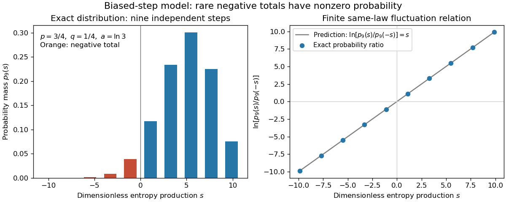
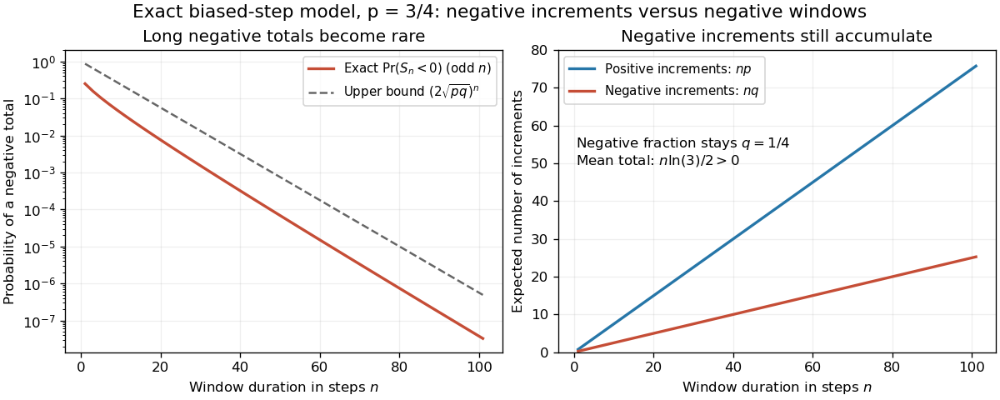

# Stochastic thermodynamics

↑ **Parent:** [Thermodynamics](thermodynamics.md)  
ⓦ [Wiki](https://en.wikipedia.org/wiki/Stochastic_thermodynamics)

Stochastic thermodynamics assigns work, heat, and entropy production to individual fluctuating trajectories while recovering ordinary thermodynamics after ensemble averaging.

**Table of contents**

- [Local detailed balance](#local-detailed-balance)
  - [Microscopic reversibility](#microscopic-reversibility)
- [Entropy production](#entropy-production)
  - [Entropy gain from impact and thermal equilibration](#entropy-gain-from-impact-and-thermal-equilibration)
  - [Thermodynamic entropy flux](#thermodynamic-entropy-flux)
  - [Fluctuation theorem](#fluctuation-theorem)
    - [Finite trajectory entropy production](#finite-trajectory-entropy-production)
      - [Integral fluctuation theorem](#integral-fluctuation-theorem)
    - [Biased-step entropy production model](#biased-step-entropy-production-model)
      - [Negative entropy production over finite durations](#negative-entropy-production-over-finite-durations)
    - [Steady-state asymptotic fluctuation theorem](#steady-state-asymptotic-fluctuation-theorem)
    - [Crooks fluctuation theorem](#crooks-fluctuation-theorem)
      - [Jarzynski equality](#jarzynski-equality)
    - [Dragged-bead fluctuation theorem experiment](#dragged-bead-fluctuation-theorem-experiment)
- [Fluctuation-dissipation relation for a Langevin particle](#fluctuation-dissipation-relation-for-a-langevin-particle)
  - [Vector noise normalization in inertial Langevin dynamics](#vector-noise-normalization-in-inertial-langevin-dynamics)

## Local detailed balance

↑ **Parent:** [Stochastic thermodynamics](stochastic-thermodynamics.md)

Local detailed balance states that the logarithm of the probability ratio between a trajectory and its time reverse equals the entropy delivered to the environment in units of $k_B$. For one heat bath, $\log(P_F/P_B)=\Delta Q/(k_BT)$ when positive $\Delta Q$ flows into the bath.

### Microscopic reversibility

↑ **Parent:** [Local detailed balance](#local-detailed-balance)  
ⓦ [Wiki](https://en.wikipedia.org/wiki/Microscopic_reversibility)

For an equilibrium process, a path and its physically time-reversed path have equal probability after including their equilibrium starting weights. Conditional on their endpoints, this means

$$
\frac{P_F}{P_B}=\exp[-(F_2-F_1)/(k_BT)].
$$

This is the path version of [detailed balance](markov-chain.md#detailed-balance). A time-even [order parameter](critical-phenomenon.md#order-parameter) is read backward without changing sign, while a transport flux changes sign. The [Onsager--Machlup path probability](critical-phenomenon.md#onsager-machlup-path-probability) implements this reversal in a coarse-grained stochastic description.

## Entropy production

↑ **Parent:** [Stochastic thermodynamics](stochastic-thermodynamics.md)  
ⓦ [Wiki](https://en.wikipedia.org/wiki/Entropy_production)

Entropy production is the sum of the entropy changes of a system and its environment. Under local detailed balance it is represented by a forward-to-reversed path-probability logarithm and has nonnegative expectation.

### Entropy gain from impact and thermal equilibration

↑ **Parent:** [Entropy production](#entropy-production)

A body of mass $m$, [heat capacity](heat.md#heat-capacity) $c$, [temperature](temperature.md) $T_i$ and speed $v$ that stops in a large reservoir at $T_L$ produces [entropy](entropy.md) $mc[\log(T_L/T_i)+T_i/T_L-1]+mv^2/(2T_L)$, assuming constant [heat capacity](heat.md#heat-capacity) and no phase changes. The first term follows by adding the body's logarithmic [entropy](entropy.md) change to the reservoir's [heat](heat.md) gain; the second is kinetic-energy dissipation. A numerical answer needs the reservoir [temperature](temperature.md).

### Thermodynamic entropy flux

↑ **Parent:** [Entropy production](#entropy-production)

Local equilibrium associates the outgoing [heat flux](heat.md#heat-flux-density) $q$ with outgoing [entropy](entropy.md) flux $q/\theta$ at positive [temperature](temperature.md) $\theta$. Its [divergence](multivariable-calculus.md#divergence) appears in the [Lagrangian entropy inequality](continuum-mechanics.md#lagrangian-entropy-inequality), with the appropriate nominal flux in reference coordinates.

### Fluctuation theorem

↑ **Parent:** [Entropy production](#entropy-production)  
ⓦ [Wiki](https://en.wikipedia.org/wiki/Fluctuation_theorem)

A fluctuation theorem compares the [probability](probability-theory.md#probability) of a fluctuating [sample trajectory](stochastic-process.md#sample-path) with that of its reverse. Positive mean [entropy production](#entropy-production) permits negative individual realizations: what is constrained is their relative [probability](probability-theory.md#probability), not a prohibition on every reversal. The finite statement below compares specified forward and reverse [probability laws](probability-distribution.md); replacing the reverse law by the forward law requires an additional symmetry. The [biased-step entropy production model](#biased-step-entropy-production-model) exhibits that symmetry exactly, while the [Crooks fluctuation theorem](#crooks-fluctuation-theorem) compares two different driving protocols.

#### Finite trajectory entropy production

↑ **Parent:** [Fluctuation theorem](#fluctuation-theorem)

Consider a finite-duration [Markov process](markov-process.md) with discrete, time-even states coupled to one [thermal reservoir](thermal-equilibrium.md#heat-bath) at positive [temperature](temperature.md) $T$. Let $P_F[\gamma]$ include the initial [probability](probability-theory.md#probability) $\rho_0(x_0)$ of the [sample trajectory](stochastic-process.md#sample-path) $\gamma$. Define $P_R$ by reversing the control protocol and initializing it with the actual forward final [probability distribution](probability-distribution.md) $\rho_\tau$. Write $\Theta\gamma$ for the same states visited in reverse time order. Require normalized path laws with matching [probability support](probability-distribution.md#support-of-a-probability-distribution): a path has positive forward weight exactly when its reverse has positive reverse weight. This excludes irreversible forbidden transitions and missing initial states.

Under [local detailed balance](#local-detailed-balance), with positive [heat](heat.md) $Q_{\rm bath}$ delivered to the [thermal reservoir](thermal-equilibrium.md#heat-bath), the full path-weight [logarithm](calculus.md#logarithm) is

$$
\Sigma_F[\gamma]=\ln\frac{P_F[\gamma]}{P_R[\Theta\gamma]}
=\frac{Q_{\rm bath}[\gamma]}{k_BT}+\ln\frac{\rho_0(x_0)}{\rho_\tau(x_\tau)}
=\frac{\Delta S_{\rm tot}[\gamma]}{k_B}.
$$

The endpoint term is the change in stochastic system [entropy](entropy.md); the conditional path ratio alone accounts for the [thermal reservoir](thermal-equilibrium.md#heat-bath). Here $k_B$ is the [Boltzmann constant](thermodynamics.md#boltzmann-constant). Both terms matter even for a short observation. [Seifert, 2005, Eqs. (14)–(18) and (30): conditional and full path weights, endpoint distributions, total entropy](physics-bibliography.md#entropy-production-along-a-stochastic-trajectory-and-an-integral-fluctuation-theorem-by-udo-seifert)

Define the conjugate reverse functional by $\Sigma_R[\eta]=\ln(P_R[\eta]/P_F[\Theta\eta])$, so $\Sigma_R[\Theta\gamma]=-\Sigma_F[\gamma]$. Summing the path identity over paths with a given value gives the exact finite [fluctuation theorem](#fluctuation-theorem)

$$
\frac{p_F(s)}{p_R(-s)}=e^s,
$$

for nonzero denominator, using [probability masses](probability-distribution.md#probability-mass) or corresponding [probability density functions](continuous-probability-distribution.md#probability-density-function). This $\Sigma_R$ is defined by the paired laws: it need not be the total [entropy production](#entropy-production) obtained by independently restarting the thermodynamic construction for the reverse experiment. A generic driven experiment therefore does not imply $p_F(s)/p_F(-s)=e^s$.

##### Integral fluctuation theorem

↑ **Parent:** [Finite trajectory entropy production](#finite-trajectory-entropy-production)

Normalization of the reverse law gives an exact finite identity:

$$
\left\langle e^{-\Sigma_F}\right\rangle_F
=\sum_\gamma P_F[\gamma]\frac{P_R[\Theta\gamma]}{P_F[\gamma]}=1.
$$

The sum notation describes discrete paths; the corresponding path [integral](integral.md) has the same change-of-variable argument. [Jensen's inequality](real-analysis.md#jensen-s-inequality) for the [exponential function](calculus.md#exponential-function) then gives $e^{-\langle\Sigma_F\rangle_F}\le1$, hence $\langle\Sigma_F\rangle_F\ge0$. Equivalently this mean is the [Kullback-Leibler divergence](f-divergence.md#kullback-leibler-divergence) between the forward path law and the reverse path law pulled back by $\Theta$. Equality requires those two laws to agree. [Seifert, 2005, Eqs. (17)–(18): integral relation and its mean inequality](physics-bibliography.md#entropy-production-along-a-stochastic-trajectory-and-an-integral-fluctuation-theorem-by-udo-seifert)

Rare negative [entropy production](#entropy-production) contributes disproportionately to this [expectation](expected-value.md) through $e^{-\Sigma_F}$. Missing such events in a finite sample can spoil an estimate of the identity. Matching [probability support](probability-distribution.md#support-of-a-probability-distribution) is also essential: reverse paths absent from the forward law cannot be recovered by cancelling forward weights. This [Second law of thermodynamics](second-law-of-thermodynamics.md) statement concerns an [ensemble average](expected-value.md); an individual negative value is compatible with it.

#### Biased-step entropy production model

↑ **Parent:** [Fluctuation theorem](#fluctuation-theorem)

Take $n$ [independent](random-variable.md#independent-random-variables) steps, each $+1$ with [probability](probability-theory.md#probability) $p>1/2$ and $-1$ with [probability](probability-theory.md#probability) $q=1-p>0$. Reverse a step sequence by reading it backward and changing each sign; use the same biased law for both experiments. With $K$ positive steps, the forward sequence weight is $p^Kq^{n-K}$ and its reversed weight is $p^{n-K}q^K$. Their [logarithm](calculus.md#logarithm) ratio is

$$
S_n=(2K-n)a,\qquad a=\ln(p/q)>0,\qquad
K\sim\operatorname{Binomial}(n,p).
$$

Here $S_n$ is dimensionless [entropy production](#entropy-production), not an [entropy](entropy.md) in joules per kelvin. A [Markov chain](markov-chain.md) on a three-state ring gives a state-space realization: start uniformly, take a clockwise step with [probability](probability-theory.md#probability) $p$ and a counterclockwise step with [probability](probability-theory.md#probability) $q$. The uniform [stationary distribution](markov-chain.md#stationary-distribution) makes endpoint weights cancel. A physical interpretation as exchanged [heat](heat.md) requires [local detailed balance](#local-detailed-balance) with bath [entropy](entropy.md) $\pm k_Ba$ per directed step; the abstract model alone specifies path [probabilities](probability-theory.md#probability).

For an allowed value $s=a(2k-n)$, the [binomial distribution](discrete-probability-distribution.md#binomial-distribution) gives

$$
p_n(s)=\binom nkp^kq^{n-k},\qquad
\frac{p_n(s)}{p_n(-s)}
=\frac{\binom nkp^kq^{n-k}}{\binom n{n-k}p^{n-k}q^k}
=\left(\frac pq\right)^{2k-n}=e^s.
$$

This is an exact same-law finite [fluctuation theorem](#fluctuation-theorem), with no long-time approximation. For $p=3/4$, $n=9$ and $k=6$, $s=3\ln3$ and $p_n(s)/p_n(-s)=27$. The positive mean is $\langle S_n\rangle=na(p-q)$, although the all-negative path has nonzero [probability](probability-theory.md#probability) $q^n$. Directly, $\langle e^{-S_n}\rangle=(pe^{-a}+qe^a)^n=(q+p)^n=1$.

**[Figure 1](#image-exact-biased-step-model-discrete-entropy-production-probabilities-and-their-log-ratio-at-nine-steps). Exact biased-step model: discrete entropy-production probabilities and their log ratio at nine steps**.

The left panel shows exact [probability masses](probability-distribution.md#probability-mass) for $p=3/4$, with negative values highlighted; the right panel tests the [logarithm](calculus.md#logarithm) ratio against $s$. These are model values, without experimental measurements or simulated measurement noise.

##### Negative entropy production over finite durations

↑ **Parent:** [Biased-step entropy production model](#biased-step-entropy-production-model)

A single step has negative [entropy production](#entropy-production) with [probability](probability-theory.md#probability) $q$, independent of how long an observation lasts. A whole window is negative only if negative steps outnumber positive ones:

$$
\Pr(S_n<0)=\sum_{k=0}^{\lfloor(n-1)/2\rfloor}\binom nkp^kq^{n-k}.
$$

For even $n$, the tie $K=n/2$ has zero [entropy production](#entropy-production) and is excluded. At $p=3/4$, the negative-window [probabilities](probability-theory.md#probability) for $n=1,9,21$ are approximately $0.25$, $0.04893$, and $0.00642$. Longer windows still contain negative increments: their expected number is $nq$. Their total is usually positive because the expected number of positive increments is $np$.

**[Figure 2](#image-exact-biased-step-model-negative-totals-become-rare-with-duration-while-negative-increments-remain-frequent). Exact biased-step model: negative totals become rare with duration while negative increments remain frequent**.

Only odd window lengths are plotted to avoid alternating tie effects. The left panel gives the exact negative-window [probability](probability-theory.md#probability) and the upper bound $(2\sqrt{pq})^n$; the right gives expected counts $np$ and $nq$. For steps of fixed duration $\delta t$, physical duration is $n\delta t$. These are counts and [probabilities](probability-theory.md#probability) predicted by the model, not bead traces. The bound follows from $\Pr(S_n<0)\le\langle e^{-S_n/2}\rangle=(2\sqrt{pq})^n$. Since $2\sqrt{pq}<1$ for $p\ne q$, negative totals are exponentially suppressed even though the negative-step fraction stays $q$.

#### Steady-state asymptotic fluctuation theorem

↑ **Parent:** [Fluctuation theorem](#fluctuation-theorem)

A [steady state](dynamical-systems.md#steady-state) does not by itself give every fluctuating observable an [entropy production](#entropy-production) symmetry. If the dimensionless total [entropy production](#entropy-production) $\Sigma_t$ has the same-law finite relation and a [large deviation principle](convergence-of-random-variables.md#large-deviation-principle) with [rate function](convergence-of-random-variables.md#rate-function) $I$ for $\Sigma_t/t$, then, on its common domain,

$$
p_t(\Sigma_t/t\approx s)\asymp e^{-tI(s)},\qquad
I(-s)-I(s)=s.
$$

The first expression denotes leading exponential scaling; the second follows by taking the scaled [logarithm](calculus.md#logarithm) of the probability ratio. A finite-state, autonomous [Markov process](markov-process.md) with time-even states, positive bidirectional rates and a positive [stationary distribution](markov-chain.md#stationary-distribution) supplies a standard setting for a finite total-[entropy production](#entropy-production) relation. The stochastic system [entropy](entropy.md) is then bounded, so its endpoint contribution does not change the long-time [rate function](convergence-of-random-variables.md#rate-function) of bath [entropy production](#entropy-production). [Seifert, 2012, §3.3.2, p. 22, Eq. (65); §4.4.3, p. 28, Eqs. (93)–(95): finite stationary total entropy and endpoint-conditioned medium entropy](physics-bibliography.md#stochastic-thermodynamics-fluctuation-theorems-and-molecular-machines-by-udo-seifert)

Unbounded state spaces can have endpoint fluctuations on the scale relevant to a [large deviation principle](convergence-of-random-variables.md#large-deviation-principle). Dropping system [entropy](entropy.md), changing the measured observable to [heat](heat.md), or changing the reverse preparation therefore requires a fresh argument. The exact finite [integral fluctuation theorem](#integral-fluctuation-theorem), a same-law finite relation, and an asymptotic [rate function](convergence-of-random-variables.md#rate-function) symmetry are distinct claims.

#### Crooks fluctuation theorem

↑ **Parent:** [Fluctuation theorem](#fluctuation-theorem)

For a system coupled to a [thermal reservoir](thermal-equilibrium.md#heat-bath) at fixed [temperature](temperature.md) $T$, prepare the forward process in the initial [canonical ensemble](canonical-ensemble.md) and the reverse process in the final control parameter's [canonical ensemble](canonical-ensemble.md). Reverse the protocol, assume [microscopic reversibility](#microscopic-reversibility) and matching path [probability support](probability-distribution.md#support-of-a-probability-distribution), and count $W$ as [work](energy.md#work) done on the system. With [Helmholtz free energy](thermodynamic-potential.md#helmholtz-free-energy) difference $\Delta F=F_{\rm final}-F_{\rm initial}$ and $\beta=1/(k_BT)$,

$$
\frac{P_F(W)}{P_R(-W)}=e^{\beta(W-\Delta F)}.
$$

The final forward distribution need not already be in [thermal equilibrium](thermal-equilibrium.md). Its reverse preparation is prescribed equilibrium preparation, rather than the actual forward final distribution used in [finite trajectory entropy production](#finite-trajectory-entropy-production). Thus the paired path [logarithm](calculus.md#logarithm) $\beta(W-\Delta F)$ is dissipated [work](energy.md#work) in thermal units, not automatically the instantaneous total stochastic [entropy production](#entropy-production) at the end of an arbitrary driven protocol. [Crooks, 1999, Eqs. (5)–(7), (9)–(11): reversal, equilibrium weights and work relation](physics-bibliography.md#the-entropy-production-fluctuation-theorem-and-the-nonequilibrium-work-relation-for-free-energy-differences-by-gavin-e-crooks) [Seifert, 2005, Eq. (19) and following paragraph: actual final distribution versus final equilibrium distribution](physics-bibliography.md#entropy-production-along-a-stochastic-trajectory-and-an-integral-fluctuation-theorem-by-udo-seifert)

##### Jarzynski equality

↑ **Parent:** [Crooks fluctuation theorem](#crooks-fluctuation-theorem)

Integrating the [Crooks fluctuation theorem](#crooks-fluctuation-theorem) over [work](energy.md#work) and using normalization of the reverse [probability distribution](probability-distribution.md) gives

$$
\langle e^{-\beta W}\rangle_F=e^{-\beta\Delta F}.
$$

Consequently [Jensen's inequality](real-analysis.md#jensen-s-inequality) gives $\langle W\rangle_F\ge\Delta F$. Some realizations may nevertheless have $W<\Delta F$. This is a [work](energy.md#work) relation with equilibrium endpoint preparations, while the [integral fluctuation theorem](#integral-fluctuation-theorem) for total [entropy production](#entropy-production) uses the actual final forward distribution. [Crooks, 1999, Eq. (3) and derivation from Eqs. (10)–(11)](physics-bibliography.md#the-entropy-production-fluctuation-theorem-and-the-nonequilibrium-work-relation-for-free-energy-differences-by-gavin-e-crooks)

#### Dragged-bead fluctuation theorem experiment

↑ **Parent:** [Fluctuation theorem](#fluctuation-theorem)

The 2002 experiment trapped a $6.3\,\mathrm{\mu m}$ bead in [water](chemical-substance.md#water) with a $980\,\mathrm{nm}$ [laser](laser.md), a $100\times$, [numerical aperture](point-spread-function.md#numerical-aperture) $1.3$ objective and a piezo-driven microscope stage. A quadrant [photodiode](optical-instrument.md#photodiode) tracked bead position at $1\,\mathrm{kHz}$ with approximately $500\,\mathrm{Hz}$ bandwidth and reported $15\,\mathrm{nm}$ resolution. Stage translation drove water past the fixed [optical trap](optics.md#optical-tweezers) at $1.25\,\mathrm{\mu m/s}$. Weak trapping prolonged the transient; stationary recording before translation established the position reference. [Stokes drag law](stokes-flow.md#stokes-s-law) calibration was checked against the bead's measured [diffusion coefficient](brownian-motion.md#diffusion-coefficient). [Wang and colleagues, 2002, p. 050601-2: apparatus, calibration and trajectory protocol](physics-bibliography.md#experimental-demonstration-of-violations-of-the-second-law-of-thermodynamics-for-small-systems-and-short-time-scales-by-g-m-wang-and-others)

From calibrated [displacement](classical-mechanics.md#displacement) and calibrated [harmonic optical trap](optics.md#harmonic-optical-trap) [force](force.md), the experimenters evaluated the dimensionless driven-bead dissipation functional

$$
\Sigma_t^{\rm drive}=\frac1{k_BT}\int_0^t\mathbf v_{\rm opt}\cdot\mathbf F_{\rm opt}(u)\,du.
$$

Among 540 trajectories, negative values became less frequent with duration. Figure 2 compared the negative/positive count ratio with $\langle e^{-\Sigma_t^{\rm drive}}\rangle_{\Sigma_t^{\rm drive}>0}$; its agreement tested the paper's integrated transient relation. The detailed log-ratio plot in Figure 4 used simulated particle [sample trajectories](stochastic-process.md#sample-path), not bead measurements. Near-zero sign discrimination and stage-start transients limited the earliest points. [Wang and colleagues, 2002, Eq. (2), Eq. (3), pp. 050601-2–4 and Figs. 1, 2 and 4](physics-bibliography.md#experimental-demonstration-of-violations-of-the-second-law-of-thermodynamics-for-small-systems-and-short-time-scales-by-g-m-wang-and-others)

For any continuous [probability distribution](probability-distribution.md) satisfying the same-law relation, integration over $s>0$ yields

$$
\frac{\Pr(\Sigma<0)}{\Pr(\Sigma>0)}
=\left\langle e^{-\Sigma}\right\rangle_{\Sigma>0}.
$$

This conditional relation explains the comparison without equating it to the unconditional [integral fluctuation theorem](#integral-fluctuation-theorem). The experiment supports a specified driven-system relation; it does not establish a universal same-law symmetry for any definition of [heat](heat.md) or [entropy production](#entropy-production). In particular, a transient work-like functional should not silently acquire the actual-distribution endpoint term in [finite trajectory entropy production](#finite-trajectory-entropy-production). Negative realizations are compatible with positive mean dissipation and the [Second law of thermodynamics](second-law-of-thermodynamics.md); they do not provide a cyclic machine with reliable [work](energy.md#work) output from a single [thermal reservoir](thermal-equilibrium.md#heat-bath).

## Fluctuation-dissipation relation for a Langevin particle

↑ **Parent:** [Stochastic thermodynamics](stochastic-thermodynamics.md)

For a Langevin particle with drag coefficient $\zeta$ and white-force covariance amplitude $\sigma^2$, detailed balance at temperature $T$ requires $\sigma^2=2\zeta k_BT$.

### Vector noise normalization in inertial Langevin dynamics

↑ **Parent:** [Fluctuation-dissipation relation for a Langevin particle](#fluctuation-dissipation-relation-for-a-langevin-particle)

Divide the inertial [Langevin equation](stochastic-process.md#langevin-dynamics) by mass and let $\zeta=\gamma/m$. An isotropic three-dimensional equilibrium velocity has $\langle|\mathbf u|^2\rangle=3k_BT/m$ by the [equipartition theorem](canonical-ensemble.md#equipartition-theorem). Its white acceleration dot-covariance amplitude is therefore $6\zeta k_BT/m$, while the amplitude per Cartesian component is $2\zeta k_BT/m$. A scalar moment formula must use the component variance rather than the trace.

## ↑ Ancestors (5)

1. [Thermodynamics](thermodynamics.md)
2. [Statistical physics](statistical-physics.md)
3. [Branches of physics](physics.md#branches-of-physics)
4. [Physics](physics.md)
5. [Codex Wiki](README.md)
