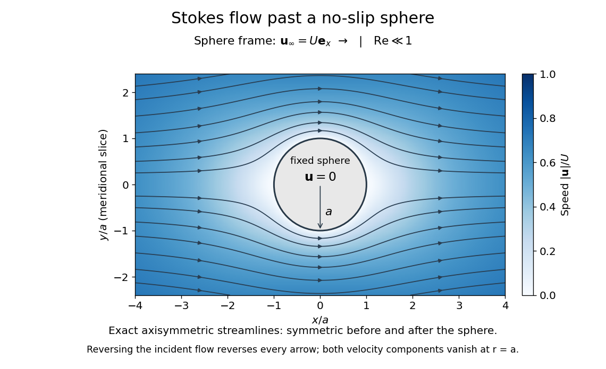

# Stokes flow

↑ **Parent:** [Viscous fluid flow](viscous-fluid-flow.md)  
ⓦ [Wiki](https://en.wikipedia.org/wiki/Stokes_flow)

[Stokes flow](stokes-flow.md) is the limit of [fluid mechanics](fluid-mechanics.md) in which [inertia](classical-mechanics.md#inertia) is negligible: [pressure gradients](fluid-mechanics.md#pressure-gradient), [viscosity](dynamic-viscosity.md) and any [body forces](fluid-mechanics.md#body-force) balance at each instant. A small [Reynolds number](dynamic-viscosity.md#reynolds-number) can arise from a small object, a slow [velocity](classical-mechanics.md#velocity), or a large [dynamic viscosity](dynamic-viscosity.md). A microscopic [sphere](euclidean-geometry.md#sphere) moving through water is a useful example: the surrounding [fluid](fluid-mechanics.md#fluid) continually dissipates the supplied [power](energy.md#power) through [viscous dissipation](#viscous-dissipation).

**[Figure 1](#image-exact-stokes-streamlines-around-a-stationary-no-slip-sphere-in-a-uniform-incident-flow). Exact Stokes streamlines around a stationary no-slip sphere in a uniform incident flow**.

The picture is a meridional slice of the three-dimensional [axisymmetric flow](fluid-mechanics.md#axisymmetric-flow) around a [sphere](euclidean-geometry.md#sphere), with the [sphere](euclidean-geometry.md#sphere) held fixed and the distant [fluid](fluid-mechanics.md#fluid) moving rightward at [speed](classical-mechanics.md#speed) $U$. The [no-slip boundary condition](viscous-fluid-flow.md#no-slip-boundary-condition) makes both components of [velocity](classical-mechanics.md#velocity) vanish on the surface. The [streamlines](fluid-mechanics.md#streamline) have fore-aft reflection [symmetry](physics.md#symmetry-physics); reversing the incident [velocity](classical-mechanics.md#velocity) reverses their arrows. The underlying field is the [translating sphere in Stokes flow](#translating-sphere-in-stokes-flow) solution viewed in the stationary-sphere frame.

For an [incompressible flow](fluid-mechanics.md#incompressible-flow) of a [Newtonian fluid](viscous-fluid-flow.md#newtonian-fluid) with constant [dynamic viscosity](dynamic-viscosity.md) $\mu$, the steady [Stokes equation](#stokes-equation) is

$$
-\nabla p+\mu\nabla^2\mathbf u+\mathbf f=\mathbf 0,\qquad \nabla\cdot\mathbf u=0.
$$

Here $p$ is [pressure](pressure.md), $\mathbf u$ is [velocity](classical-mechanics.md#velocity), and $\mathbf f$ is [body force](fluid-mechanics.md#body-force) per unit [volume](geometry-and-topology.md#volume). The [pressure gradient](fluid-mechanics.md#pressure-gradient) enforces [incompressible flow](fluid-mechanics.md#incompressible-flow); it need not be small just because [inertia](classical-mechanics.md#inertia) is small. At [speed](classical-mechanics.md#speed) $U$ and length $L$, the motion-induced [pressure gradient](fluid-mechanics.md#pressure-gradient) has typical scale $\mu U/L^2$, corresponding to a disturbance [pressure](pressure.md) difference of order $\mu U/L$. See [Shreyas Mandre's fluid dynamics notes, sections 9.1.1–9.1.2](https://notes.shreyasmandre.com/fluid-dynamics-notes/Ch9.html).

The controlling [Reynolds number](dynamic-viscosity.md#reynolds-number) is

$$
\mathrm{Re}_L=\frac{\rho UL}{\mu}=\frac{UL}{\nu},\qquad \nu=\frac{\mu}{\rho},
$$

where $\rho$ is [density](fluid-mechanics.md#density) and $\nu$ is [kinematic viscosity](dynamic-viscosity.md#kinematic-viscosity). The condition $\mathrm{Re}_L\ll1$ suppresses [advection](fluid-mechanics.md#advection) of [momentum](momentum.md) on the length $L$. Rapid changes require an additional check of the [viscous diffusion time](viscous-fluid-flow.md#viscous-diffusion-time): small [Reynolds number](dynamic-viscosity.md#reynolds-number) alone does not eliminate the time derivative in the [Unsteady Stokes equation](#unsteady-stokes-equation).

Two rewards of this limit are the exact [Stokes's law](#stokes-s-law) for the [drag](fluid-mechanics.md#drag-physics) on a [sphere](euclidean-geometry.md#sphere) and [kinematic reversibility of Stokes flow](#kinematic-reversibility-of-stokes-flow). The first predicts [settling velocities](suspension-chemistry.md#settling-velocity) and connects to the [Stokes–Einstein relation](#stokes-einstein-relation); the second explains why a [microswimmer](#microswimmer) needs a nonreciprocal stroke, as expressed by the [scallop theorem](#scallop-theorem). Despite [viscous dissipation](#viscous-dissipation), reversing the driving can retrace the motion: an especially striking consequence of [Linearity of Stokes flow](#linearity-of-stokes-flow).

George Gabriel Stokes obtained the [sphere](euclidean-geometry.md#sphere) [drag](fluid-mechanics.md#drag-physics) and its [terminal velocity](classical-mechanics.md#terminal-velocity) in his 1851 investigation of how [viscosity](dynamic-viscosity.md) changes [physical pendulum](mathematical-physics.md#physical-pendulum) motion. He also used the slow fall of small water droplets to discuss clouds. The paper was read on 9 December 1850; 1851 is its publication date. See [Stokes, On the effect of the internal friction of fluids on the motion of pendulums, original 1851 printing](https://archive.org/details/b22464074), especially articles 42–43; the formulas are also accessible in [the collected-paper reprint, articles 42–43](https://mural.uv.es/daroig/documentos/stokes1850.pdf).

**Table of contents**

- [Relaxation of a symmetric viscous layer](#relaxation-of-a-symmetric-viscous-layer)
  - [Uniform high-viscosity limit of viscous-layer relaxation](#uniform-high-viscosity-limit-of-viscous-layer-relaxation)
- [Fourier traction map for a viscous half-space](#fourier-traction-map-for-a-viscous-half-space)
- [Stokes far-field multipoles of a deforming body](#stokes-far-field-multipoles-of-a-deforming-body)
- [Mutual drag reduction of two distant translating spheres](#mutual-drag-reduction-of-two-distant-translating-spheres)
- [Oseen approximation](#oseen-approximation)
  - [Potential-source and wake decomposition of sphere Oseen flow](#potential-source-and-wake-decomposition-of-sphere-oseen-flow)
- [Cylinder in a simple shear Stokes flow](#cylinder-in-a-simple-shear-stokes-flow)
- [Zero total flux for localized tube Stokes flow](#zero-total-flux-for-localized-tube-stokes-flow)
- [Surface independence of Stokes force and torque integrals](#surface-independence-of-stokes-force-and-torque-integrals)
- [Brinkman equation](#brinkman-equation)
  - [Matrix-relative Brinkman velocity](#matrix-relative-brinkman-velocity)
- [Viscous buoyant conduit](#viscous-buoyant-conduit)
  - [Conduit equation](#conduit-equation)
    - [Solitary-wave amplitude-speed relation for the conduit equation](#solitary-wave-amplitude-speed-relation-for-the-conduit-equation)
- [Hydrodynamic interaction](#hydrodynamic-interaction)
  - [Stresslet reflection between two force-free and forced spheres](#stresslet-reflection-between-two-force-free-and-forced-spheres)
    - [Rotation-clamped reflection between two spheres](#rotation-clamped-reflection-between-two-spheres)
  - [Externally driven two-sphere pump](#externally-driven-two-sphere-pump)
    - [Minimum separation of phase-shifted sphere oscillations](#minimum-separation-of-phase-shifted-sphere-oscillations)
    - [Phase-dependent mean force of an externally driven sphere pair](#phase-dependent-mean-force-of-an-externally-driven-sphere-pair)
  - [Longitudinal two-sphere mobility](#longitudinal-two-sphere-mobility)
- [Particle stresslet tensor](#particle-stresslet-tensor)
- [Sphere in a uniform straining Stokes flow](#sphere-in-a-uniform-straining-stokes-flow)
  - [Papkovich potentials for a strained sphere](#papkovich-potentials-for-a-strained-sphere)
- [Stokes equation](#stokes-equation)
  - [Unsteady Stokes equation](#unsteady-stokes-equation)
- [Linearity of Stokes flow](#linearity-of-stokes-flow)
- [Uniqueness of Stokes flow](#uniqueness-of-stokes-flow)
- [Pressure-driven thinning of a uniform Stokes layer](#pressure-driven-thinning-of-a-uniform-stokes-layer)
- [Stokeslet](#stokeslet)
  - [Oseen tensor](#oseen-tensor)
  - [No-slip image system of a normal Stokeslet](#no-slip-image-system-of-a-normal-stokeslet)
  - [Stress-free image of a normal Stokeslet](#stress-free-image-of-a-normal-stokeslet)
  - [Rate of strain and vorticity of a Stokeslet](#rate-of-strain-and-vorticity-of-a-stokeslet)
  - [Normal Stokeslet below a stress-free plane](#normal-stokeslet-below-a-stress-free-plane)
- [Slender-body theory](#slender-body-theory)
  - [Straight-rod resistance in a linear flow](#straight-rod-resistance-in-a-linear-flow)
    - [Force-free straight-rod orientation equation](#force-free-straight-rod-orientation-equation)
      - [Rod excess dissipation in shear](#rod-excess-dissipation-in-shear)
  - [Slender-body force density](#slender-body-force-density)
    - [Right-angle two-rod resistance matrix](#right-angle-two-rod-resistance-matrix)
      - [Sedimentation drift of a weighted two-rod body](#sedimentation-drift-of-a-weighted-two-rod-body)
    - [Axial resistance matrix of a slender helix](#axial-resistance-matrix-of-a-slender-helix)
      - [Axial coupling of an elliptic helix](#axial-coupling-of-an-elliptic-helix)
      - [Determinant of helical resistance in resistive-force theory](#determinant-of-helical-resistance-in-resistive-force-theory)
      - [Handedness reversal of helical hydrodynamic resistance](#handedness-reversal-of-helical-hydrodynamic-resistance)
- [Hydrodynamic resistance matrix](#hydrodynamic-resistance-matrix)
  - [Hydrodynamic mobility matrix](#hydrodynamic-mobility-matrix)
  - [Symmetry and positivity of a rigid-body resistance matrix](#symmetry-and-positivity-of-a-rigid-body-resistance-matrix)
- [Lorentz reciprocal theorem for Stokes flow](#lorentz-reciprocal-theorem-for-stokes-flow)
  - [Body-force-driven rotation of a torque-free sphere](#body-force-driven-rotation-of-a-torque-free-sphere)
  - [Boundary integral representation of Stokes flow](#boundary-integral-representation-of-stokes-flow)
    - [Capillary boundary integral equation for a viscous drop](#capillary-boundary-integral-equation-for-a-viscous-drop)
- [Viscous dissipation](#viscous-dissipation)
  - [Turbulent kinetic energy dissipation rate](#turbulent-kinetic-energy-dissipation-rate)
  - [Minimum-dissipation theorem for Stokes flow](#minimum-dissipation-theorem-for-stokes-flow)
    - [Extra dissipation due to a rigid inclusion](#extra-dissipation-due-to-a-rigid-inclusion)
      - [Force-free inclusions increase rotational resistance](#force-free-inclusions-increase-rotational-resistance)
      - [Einstein viscosity formula for a dilute suspension](#einstein-viscosity-formula-for-a-dilute-suspension)
    - [Fixed-force comparison of minimum viscous dissipation](#fixed-force-comparison-of-minimum-viscous-dissipation)
      - [Force-free inclusion reduces axial mobility of a centred settling sphere](#force-free-inclusion-reduces-axial-mobility-of-a-centred-settling-sphere)
- [Biharmonic stream function for planar Stokes flow](#biharmonic-stream-function-for-planar-stokes-flow)
  - [Zero-mean normal velocity in periodic half-space Stokes flow](#zero-mean-normal-velocity-in-periodic-half-space-stokes-flow)
  - [Similarity solution for tangentially forced Stokes wedge](#similarity-solution-for-tangentially-forced-stokes-wedge)
  - [Stokes flow between touching counter-rotating cylinders](#stokes-flow-between-touching-counter-rotating-cylinders)
  - [Biharmonic stream function for a fixed disk in planar shear](#biharmonic-stream-function-for-a-fixed-disk-in-planar-shear)
    - [Hydrodynamic torque on a fixed disk in planar shear](#hydrodynamic-torque-on-a-fixed-disk-in-planar-shear)
- [Harmonic pressure and vorticity in Stokes flow](#harmonic-pressure-and-vorticity-in-stokes-flow)
- [Velocity gradient of translating-sphere Stokes flow](#velocity-gradient-of-translating-sphere-stokes-flow)
- [Vorticity of translating-sphere Stokes flow](#vorticity-of-translating-sphere-stokes-flow)
- [Harmonicity of derivatives of the Newtonian potential](#harmonicity-of-derivatives-of-the-newtonian-potential)
- [Direct incompressibility check for translating-sphere flow](#direct-incompressibility-check-for-translating-sphere-flow)
- [Surface traction in translating-sphere Stokes flow](#surface-traction-in-translating-sphere-stokes-flow)
  - [Stokes's law](#stokes-s-law)
    - [Rarefied-gas nanoparticle drag](#rarefied-gas-nanoparticle-drag)
    - [Particle velocity-relaxation time](#particle-velocity-relaxation-time)
    - [Gas slip correction to Stokes drag](#gas-slip-correction-to-stokes-drag)
    - [Clean-bubble Stokes drag](#clean-bubble-stokes-drag)
      - [Bubble rise near a distant stress-free free surface](#bubble-rise-near-a-distant-stress-free-free-surface)
      - [Spherical clean bubble without surface tension](#spherical-clean-bubble-without-surface-tension)
    - [Stokes–Einstein relation](#stokes-einstein-relation)
      - [Brownian radius estimate from endpoint displacements](#brownian-radius-estimate-from-endpoint-displacements)
        - [Sampling uncertainty of an endpoint diffusivity estimate](#sampling-uncertainty-of-an-endpoint-diffusivity-estimate)
      - [Stokes-Einstein experimental consistency test](#stokes-einstein-experimental-consistency-test)
- [Kinematic reversibility of Stokes flow](#kinematic-reversibility-of-stokes-flow)
  - [Reflection symmetry of a two-sphere passing trajectory](#reflection-symmetry-of-a-two-sphere-passing-trajectory)
  - [No lateral migration of a single sphere in a uniform tube in Stokes flow](#no-lateral-migration-of-a-single-sphere-in-a-uniform-tube-in-stokes-flow)
  - [Fore-aft symmetry of a sedimenting-sphere encounter](#fore-aft-symmetry-of-a-sedimenting-sphere-encounter)
  - [Scallop theorem](#scallop-theorem)
    - [Force-free two-sphere stroke](#force-free-two-sphere-stroke)
  - [Reflection argument for zero Stokes migration](#reflection-argument-for-zero-stokes-migration)
- [Rotational Stokes flow between concentric spheres](#rotational-stokes-flow-between-concentric-spheres)
  - [Torque in rotational Stokes flow between concentric spheres](#torque-in-rotational-stokes-flow-between-concentric-spheres)
- [Papkovich–Neuber representation](#papkovich-neuber-representation)
  - [Unscaled Papkovich–Neuber representation](#unscaled-papkovich-neuber-representation)
    - [Traction of translating-sphere Papkovich–Neuber potentials](#traction-of-translating-sphere-papkovich-neuber-potentials)
- [Rotating sphere in Stokes flow](#rotating-sphere-in-stokes-flow)
  - [Rotlet](#rotlet)
    - [Rotlet dipole](#rotlet-dipole)
      - [Free-surface image of a rotlet dipole](#free-surface-image-of-a-rotlet-dipole)
        - [Surface-induced yaw of a rotlet dipole](#surface-induced-yaw-of-a-rotlet-dipole)
- [Translating sphere in Stokes flow](#translating-sphere-in-stokes-flow)
  - [Holding force and torque for a sphere in a distant Stokeslet](#holding-force-and-torque-for-a-sphere-in-a-distant-stokeslet)
  - [Faxén's first law](#faxen-s-first-law)
    - [Rotne--Prager mobility](#rotne-prager-mobility)
      - [Hydrodynamic displacement of a force-free sphere](#hydrodynamic-displacement-of-a-force-free-sphere)
- [Faxén's rotational law](#faxen-s-rotational-law)
- [Method of reflections for Stokes flow](#method-of-reflections-for-stokes-flow)
  - [Forced-sphere rotation reflected from a held sphere](#forced-sphere-rotation-reflected-from-a-held-sphere)
  - [Leading interaction of two sedimenting spheres](#leading-interaction-of-two-sedimenting-spheres)
    - [Vertical bound pair in the point-force sedimentation model](#vertical-bound-pair-in-the-point-force-sedimentation-model)
    - [Passing invariant for unequal point-force spheres](#passing-invariant-for-unequal-point-force-spheres)
  - [Reversible scattering of two spheres in simple shear](#reversible-scattering-of-two-spheres-in-simple-shear)
  - [Mobility correction from a fixed distant sphere](#mobility-correction-from-a-fixed-distant-sphere)
    - [Deflection and spin in a distant sphere encounter](#deflection-and-spin-in-a-distant-sphere-encounter)
  - [Squirmer reflection from a held sphere](#squirmer-reflection-from-a-held-sphere)
  - [Rotational constraint correction to sphere mobility](#rotational-constraint-correction-to-sphere-mobility)
  - [Self-mobility correction from a distant force-free sphere](#self-mobility-correction-from-a-distant-force-free-sphere)
    - [Suppressed spin from a force-free distant sphere](#suppressed-spin-from-a-force-free-distant-sphere)
  - [Rotlet interaction of two spheres](#rotlet-interaction-of-two-spheres)
- [Microswimmer](#microswimmer)
  - [Opposite-handed counterrotating helical swimmer](#opposite-handed-counterrotating-helical-swimmer)
    - [Large reaction helix limit](#large-reaction-helix-limit)
    - [Vanishing reaction rotor in a helical swimmer](#vanishing-reaction-rotor-in-a-helical-swimmer)
    - [Equal-length opposite-handed helices](#equal-length-opposite-handed-helices)
  - [Helical microswimmer with a spherical head](#helical-microswimmer-with-a-spherical-head)
    - [Entrained-head approximation for a helical microswimmer](#entrained-head-approximation-for-a-helical-microswimmer)
    - [Optimal pitch of a helical microswimmer](#optimal-pitch-of-a-helical-microswimmer)
  - [Squirmer](#squirmer)
    - [Torque-free rotation of a spherical squirmer](#torque-free-rotation-of-a-spherical-squirmer)
      - [Flow-free rotation of a spherical squirmer](#flow-free-rotation-of-a-spherical-squirmer)
    - [Two-mode tensorial squirmer flow](#two-mode-tensorial-squirmer-flow)
    - [Surface slip velocity](#surface-slip-velocity)
  - [Taylor swimming sheet](#taylor-swimming-sheet)
    - [Brinkman swimming sheet](#brinkman-swimming-sheet)
      - [Power of a Brinkman sheet](#power-of-a-brinkman-sheet)
      - [Swimming speed of a Brinkman sheet](#swimming-speed-of-a-brinkman-sheet)
      - [Screened first-order transverse sheet flow](#screened-first-order-transverse-sheet-flow)
    - [Navier-slip Taylor swimming sheet](#navier-slip-taylor-swimming-sheet)
      - [Slip-enhanced swimming speed of a transverse sheet](#slip-enhanced-swimming-speed-of-a-transverse-sheet)
      - [First-order slip independence of a transverse sheet](#first-order-slip-independence-of-a-transverse-sheet)
    - [Longitudinal mode of a Taylor swimming sheet](#longitudinal-mode-of-a-taylor-swimming-sheet)
    - [Transverse mode of a Taylor swimming sheet](#transverse-mode-of-a-taylor-swimming-sheet)
    - [Mean boundary velocity determines Taylor-sheet swimming speed](#mean-boundary-velocity-determines-taylor-sheet-swimming-speed)
      - [Fourier orthogonality of sheet swimming modes](#fourier-orthogonality-of-sheet-swimming-modes)
        - [Different-wavenumber cancellation in sheet swimming](#different-wavenumber-cancellation-in-sheet-swimming)
    - [Taylor-sheet swimming next to a rigid wall](#taylor-sheet-swimming-next-to-a-rigid-wall)
  - [Force-dipole flow](#force-dipole-flow)
    - [Axial repulsion of pusher stresslets](#axial-repulsion-of-pusher-stresslets)
    - [Orientation averaging of an axisymmetric stresslet](#orientation-averaging-of-an-axisymmetric-stresslet)
      - [Far-field orbit average of a tangent stresslet](#far-field-orbit-average-of-a-tangent-stresslet)
        - [Even displacement correction in an orbit-averaged stresslet](#even-displacement-correction-in-an-orbit-averaged-stresslet)
    - [Axisymmetric stresslet from a Stokeslet pair](#axisymmetric-stresslet-from-a-stokeslet-pair)
    - [Pusher microswimmer](#pusher-microswimmer)
    - [Puller microswimmer](#puller-microswimmer)
    - [Free-surface image of a force dipole](#free-surface-image-of-a-force-dipole)
      - [Free-surface interaction of two parallel stresslets](#free-surface-interaction-of-two-parallel-stresslets)
      - [Finite-time free-surface approach of a point stresslet](#finite-time-free-surface-approach-of-a-point-stresslet)
- [Force-free](#force-free)
- [Torque-free](#torque-free)
- [Boundary perturbation of a nearly spherical particle](#boundary-perturbation-of-a-nearly-spherical-particle)
  - [First-order mobility of a nearly spherical particle](#first-order-mobility-of-a-nearly-spherical-particle)

## Relaxation of a symmetric viscous layer

↑ **Parent:** [Stokes flow](stokes-flow.md)

A layer of half-thickness $h_0$, [dynamic viscosity](dynamic-viscosity.md) $\mu$ and density $\rho$, between semi-infinite fluids of viscosity $\lambda\mu$ and densities $\rho\mp\Delta\rho$, relaxes a symmetric thickness [Fourier mode](fourier-analysis.md#fourier-mode). In the plug-like [extensional viscosity](rheology.md#extensional-viscosity) regime, [mass conservation](continuum-mechanics.md#mass-conservation) and $4\mu(hu_x)_x=h\Delta\rho gh_x-\sigma_{xz}^+$ together with the [Fourier traction map for a viscous half-space](#fourier-traction-map-for-a-viscous-half-space) give the displayed rate, where $\kappa=|k|h_0$. Inner longitudinal extension dominates for $\lambda\ll\kappa$; outer tangential resistance dominates for $\kappa\ll\lambda$ while the plug approximation remains valid.

### Uniform high-viscosity limit of viscous-layer relaxation

↑ **Parent:** [Relaxation of a symmetric viscous layer](#relaxation-of-a-symmetric-viscous-layer)

For $\kappa\ll1$ and $\lambda\kappa\gg1$, the displayed formula retains both inner transverse [shear stress](viscous-fluid-flow.md#shear-stress) and outer normal-velocity resistance. When $\kappa^{-1}\ll\lambda\ll\kappa^{-3}$, almost immobile tangential interfaces create a pressure-driven parabolic flow and $s\sim\Delta\rho gh_0\kappa^2/(3\mu)$. When $\lambda\kappa^3\gg1$, the exterior's normal [viscous dissipation](#viscous-dissipation) dominates and $s\sim\Delta\rho g/(2\lambda\mu|k|)$. The exact symmetric three-layer [Stokes flow](stokes-flow.md) dispersion relation is

$$
s=\frac{\Delta\rho gh_0}{2\mu\kappa}\frac{\sinh^2\kappa+\lambda(\sinh\kappa\cosh\kappa-\kappa)}{\lambda\cosh(2\kappa)+(\sinh\kappa\cosh\kappa+\kappa)+\lambda^2(\sinh\kappa\cosh\kappa-\kappa)}.
$$

The term proportional to $\lambda^2\kappa^3$ in its denominator prevents extrapolating a fixed-$\lambda$ long-wave expansion uniformly to every large-$\lambda$ scaling.

## Fourier traction map for a viscous half-space

↑ **Parent:** [Stokes flow](stokes-flow.md)

For a two-dimensional decaying [Stokes flow](stokes-flow.md) in $y>0$, prescribe boundary [Fourier mode](fourier-analysis.md#fourier-mode) $(U,V)e^{ikx}$. The boundary [shear stress](viscous-fluid-flow.md#shear-stress) and normal stress are the displayed diagonal map, with the common exponential understood. For $k>0$ and $V=0$, the [Unscaled Papkovich–Neuber representation](#unscaled-papkovich-neuber-representation) gives $u=U(1-ky)e^{ikx-ky}$, $v=-ikUy e^{ikx-ky}$ and $p=-2i\mu kUe^{ikx-ky}$. Differentiation proves the tangential traction and vanishing normal stress. The normal-velocity calculation supplies the second diagonal entry. The map converts a viscous exterior into a nonlocal boundary resistance proportional to $|k|$.

## Stokes far-field multipoles of a deforming body

↑ **Parent:** [Stokes flow](stokes-flow.md)

With body-outward normal $n$, put $F=-\int\sigma n\,dS$, $\Sigma_{ij}=\int x_i(\sigma n)_j\,dS$, $U_{ij}=\int u_i n_j\,dS$, and $M=\Sigma-2\mu U$. Taylor expansion of the exterior [boundary integral representation of Stokes flow](#boundary-integral-representation-of-stokes-flow) gives a [Stokeslet](#stokeslet) from $F$, a [rotlet](#rotlet) from $G_j=-\epsilon_{jkl}\Sigma_{kl}$, a source from $Q=\operatorname{Tr}U$, and a [stresslet](#force-dipole-flow) from $S=(M+M^T)/2-I\operatorname{Tr}M/3$. Thus $F$ and $G$ are the force and torque exerted on the fluid, while $Q$ is the instantaneous displaced-volume rate. A volume-preserving deforming body has $Q=0$.

## Mutual drag reduction of two distant translating spheres

↑ **Parent:** [Stokes flow](stokes-flow.md)

Two identical radius-$a$ spheres moving together through a viscous fluid at separation $b\gg a$ entrain each other. The leading far velocity of one sphere at the other is $3aU/(4b)$ for separation perpendicular to the velocity, and $3aU/(2b)$ for parallel separation. Replacing $U$ by its velocity relative to this induced flow in [Stokes law](#stokes-s-law) gives the displayed drag reductions relative to $D_0=6\pi\mu aU$, with errors of order $(a/b)^2$. Reflection symmetry and linearity imply equal drag on the two spheres in either geometry.

## Oseen approximation

↑ **Parent:** [Stokes flow](stokes-flow.md)

The [Oseen approximation](#oseen-approximation) retains [advection](fluid-mechanics.md#advection) of a small disturbance by a uniform incident [velocity](classical-mechanics.md#velocity) $\mathbf U$, but neglects [advection](fluid-mechanics.md#advection) of the disturbance by itself. Its steady equations are

$$
\rho(\mathbf U\cdot\nabla)\mathbf u=-\nabla p+\mu\nabla^2\mathbf u,\qquad\nabla\cdot\mathbf u=0.
$$

A Stokes disturbance of a [sphere](euclidean-geometry.md#sphere) decays as $Ua/r$, so the ratio of background [advection](fluid-mechanics.md#advection) to viscous [diffusion](thermodynamics.md#diffusion) grows as $Ur/\nu$. Thus the approximation resolves the outer region $r\sim\nu/U$, where the [Stokes flow](stokes-flow.md) expansion is nonuniform, while self-convection remains smaller by $a/r$.

### Potential-source and wake decomposition of sphere Oseen flow

↑ **Parent:** [Oseen approximation](#oseen-approximation)

Let $U=|\mathbf U|$, $\nu=\mu/\rho$, and $r=|\mathbf x|$. A decaying outer disturbance matched to the leading [translating sphere in Stokes flow](#translating-sphere-in-stokes-flow) is

$$
\phi=-\frac{3a\nu}{2r},\qquad\chi=\frac{3a}{2r}\exp\left[\frac{\mathbf U\cdot\mathbf x-Ur}{2\nu}\right],\qquad\mathbf u=\nabla\phi+\nu\nabla\chi-\mathbf U\chi.
$$

Here $\Delta\phi=0$ and $(\nu\Delta-\mathbf U\cdot\nabla)\chi=0$ away from zero. The substitution $\chi=h e^{\mathbf U\cdot\mathbf x/(2\nu)}$ reduces the latter equation to $(\Delta-U^2/(4\nu^2))h=0$, whose decaying radial solution is proportional to $e^{-Ur/(2\nu)}/r$. In the inner overlap, cancellation of the potential monopole gives $\mathbf u\sim-3a[\mathbf U+\mathbf n(\mathbf U\cdot\mathbf n)]/(4r)$. The potential source's [volume flux](fluid-mechanics.md#volumetric-flow-rate) is $6\pi\nu a$, and its [mass flux](mathematical-physics.md#mass-flux) is $6\pi\mu a$. Downstream, the [fluid wake](fluid-mechanics.md#wake-physics) width grows as $\sqrt{\nu x/U}$; its mass deficit balances this source, while its [momentum](momentum.md) deficit is $6\pi\mu aU$, the [Stokes drag law](#stokes-s-law).

## Cylinder in a simple shear Stokes flow

↑ **Parent:** [Stokes flow](stokes-flow.md)

For a stationary cylinder of radius $a$ in the far-field shear $(\Gamma y,0)$, the [stream function](fluid-mechanics.md#stream-function) is $\psi=(\Gamma/4)[r^2-2a^2\log(r/a)-a^2-(r^2-2a^2+a^4/r^2)\cos2\varphi]$. It solves the [biharmonic equation](multivariable-calculus.md#biharmonic-equation) and the [no-slip boundary condition](viscous-fluid-flow.md#no-slip-boundary-condition). The fluid exerts torque $-2\pi\mu\Gamma a^2$ per unit length, because the angular part of the surface [traction](continuum-mechanics.md#traction) averages to zero and the mean tangential traction is $-\mu\Gamma$.

## Zero total flux for localized tube Stokes flow

↑ **Parent:** [Stokes flow](stokes-flow.md)

Extend the [velocity](classical-mechanics.md#velocity) rigidly through a moving [sphere](euclidean-geometry.md#sphere) in an incompressible tube flow. The extended [velocity](classical-mechanics.md#velocity) is continuous and divergence-free, so its total flux is independent of height. Quiescent far-field conditions make this flux zero. The [sphere](euclidean-geometry.md#sphere) contributes $V_zA_s$ through a cross-section; the rotational contribution integrates to zero over its circular slice. Thus the fluid flux compensates the solid displacement. A descending [sphere](euclidean-geometry.md#sphere) generates upward fluid flux in every section cutting its interior. This statement assumes a localized flow with no imposed throughflow and negligible tube-end effects.

## Surface independence of Stokes force and torque integrals

↑ **Parent:** [Stokes flow](stokes-flow.md)

For [Stokes flow](stokes-flow.md) without body forces, $\nabla\cdot\boldsymbol\sigma=0$. Symmetry of the [Newtonian fluid stress tensor](viscous-fluid-flow.md#newtonian-fluid-stress-tensor) also gives $\nabla\cdot(\mathbf x\times\boldsymbol\sigma)=0$, interpreted componentwise as the angular-momentum flux. The [divergence theorem](multivariable-calculus.md#divergence-theorem) makes the resultant [force](force.md) and [torque](momentum.md#torque) the same on any two homologous enclosing surfaces lying in a nonsingular fluid region. In a [boundary perturbation of a nearly spherical particle](#boundary-perturbation-of-a-nearly-spherical-particle), evaluating each perturbation field on a fixed enclosing surface avoids spurious geometric force terms: the geometric terms from changing the surface normal and area cancel those from evaluating the base stress at the displaced surface.

## Brinkman equation

↑ **Parent:** [Stokes flow](stokes-flow.md)

The Brinkman equation augments [Stokes flow](stokes-flow.md) with a local drag against a background matrix of [velocity](classical-mechanics.md#velocity) $\mathbf u_m$. The inverse screening length $\alpha$ has units of inverse length. With equal viscous coefficients the permeability is $\alpha^{-2}$. Taking the curl produces a screened [vorticity](vorticity.md) equation.

### Matrix-relative Brinkman velocity

↑ **Parent:** [Brinkman equation](#brinkman-equation)

Porous-matrix drag depends on fluid [velocity](classical-mechanics.md#velocity) relative to the matrix, so it is not invariant under adding a uniform fluid [velocity](classical-mechanics.md#velocity) while leaving the matrix fixed. In a swimmer frame with stationary laboratory matrix, the drag is proportional to $\mathbf u-U\mathbf e_x$. A constant shift can alternatively be absorbed into a linear [pressure](pressure.md) term, whose physical interpretation must then be retained.

## Viscous buoyant conduit

↑ **Parent:** [Stokes flow](stokes-flow.md)

A slender low-viscosity fluid column inside a much more viscous fluid rises under a density contrast. At negligible inertia, its axial flux is approximately $q=\pi a^4(\Delta\rho g-P_{i,z})/(8\mu_i)$. Radial expansion strains the outer fluid and gives the normal-stress [pressure](pressure.md) difference $P_i-P_o=2\mu_o a_t/a$ at leading order when inner normal viscous stress and interfacial tension are negligible. Coupling that [pressure](pressure.md) to volume conservation yields the [conduit equation](#conduit-equation). This two-fluid viscous model differs from a turbulent entraining thermal plume.

### Conduit equation

↑ **Parent:** [Viscous buoyant conduit](#viscous-buoyant-conduit)

The conduit equation evolves the positive cross-sectional area $A$ of a [viscous buoyant conduit](#viscous-buoyant-conduit). Its scaling uses axial length $a_0/\sqrt{8\lambda}$ and [velocity](classical-mechanics.md#velocity) $\Delta\rho ga_0^2/(8\lambda\mu_o)$, where $\lambda=\mu_i/\mu_o$. Linearization at $A=1$ gives $\omega=2k/(1+k^2)$: [phase velocity](dispersion-relation.md#phase-velocity) is upward but [group velocity](dispersion-relation.md#group-velocity) changes sign at $|k|=1$. Nonlinear elevation waves obey the [solitary-wave amplitude-speed relation for the conduit equation](#solitary-wave-amplitude-speed-relation-for-the-conduit-equation).

#### Solitary-wave amplitude-speed relation for the conduit equation

↑ **Parent:** [Conduit equation](#conduit-equation)

A positive [travelling wave](analysis.md#travelling-wave) $f$ on a uniform background $f_0$ has first integral $cf'^2/(2f^2)+V(f)=V(f_0)$, with $V(f)=\ln f+c/f+(f_0^2-cf_0)/(2f^2)$. Equating the crest and background potentials gives the displayed speed relation for crest ratio $\alpha>1$. The elevation-wave speed exceeds $2f_0$ and approaches that long-wave speed as $\alpha\to1$. The formula requires the positive-area branch, rather than continuation through $f=0$.

## Hydrodynamic interaction

↑ **Parent:** [Stokes flow](stokes-flow.md)

Bodies immersed in one fluid affect each other through the flow that each produces. At large separation, a force-driven sphere generates a [Stokeslet](#stokeslet) that modifies the other sphere's velocity. These interactions produce off-diagonal entries in the [hydrodynamic mobility matrix](#hydrodynamic-mobility-matrix).

### Stresslet reflection between two force-free and forced spheres

↑ **Parent:** [Hydrodynamic interaction](#hydrodynamic-interaction)

Consider two widely separated rigid spheres of equal radius $a$, with separation $R\mathbf n$, in [Stokes flow](stokes-flow.md). Apply a [force](force.md) $6\pi\mu a\mathbf U_0$ to the first [sphere](euclidean-geometry.md#sphere) and let the second be [force-free](#force-free) and [torque-free](#torque-free). The second [sphere](euclidean-geometry.md#sphere) samples the [rate-of-strain tensor](viscous-fluid-flow.md#strain-rate-tensor) of the first [sphere](euclidean-geometry.md#sphere)'s [Stokeslet](#stokeslet), $\mathbf E=3a(\mathbf U_0\cdot\mathbf n)(\mathbf I-3\mathbf n\mathbf n)/(4R^2)$. Its leading disturbance is the [stresslet](#force-dipole-flow) of a [sphere in a uniform straining Stokes flow](#sphere-in-a-uniform-straining-stokes-flow). Evaluating that disturbance back at the first [sphere](euclidean-geometry.md#sphere) gives

$$
\Delta\mathbf U=-\frac{15}{4}\left(\frac aR\right)^4(\mathbf U_0\cdot\mathbf n)\mathbf n.
$$

The [hydrodynamic mobility matrix](#hydrodynamic-mobility-matrix) decreases at fixed [force](force.md), consistently with the increase of resistance caused by an additional rigid inclusion.

#### Rotation-clamped reflection between two spheres

↑ **Parent:** [Stresslet reflection between two force-free and forced spheres](#stresslet-reflection-between-two-force-free-and-forced-spheres)

If the otherwise [force-free](#force-free) second [sphere](euclidean-geometry.md#sphere) is held against rotation, its [angular velocity](rigid-body-dynamics.md#angular-velocity) relative to the incident fluid is $-3a(\mathbf U_0\times\mathbf n)/(4R^2)$. The [rotlet](#rotlet) reflected back to the first [sphere](euclidean-geometry.md#sphere) adds

$$
\Delta\mathbf U_{\mathrm{rot}}=-\frac34\left(\frac aR\right)^4\left[\mathbf U_0-(\mathbf U_0\cdot\mathbf n)\mathbf n\right].
$$

This follows by evaluating the [rotating sphere in Stokes flow](#rotating-sphere-in-stokes-flow) at displacement $-R\mathbf n$ and using the vector triple-product identity. The holding couple does no work because the held [sphere](euclidean-geometry.md#sphere)'s [angular velocity](rigid-body-dynamics.md#angular-velocity) is zero.

### Externally driven two-sphere pump

↑ **Parent:** [Hydrodynamic interaction](#hydrodynamic-interaction)

Two spheres whose prescribed translations have a phase lag can exert a nonzero mean force on the fluid while each returns to its starting position. Their changing separation correlates the interaction strength with the other sphere's velocity. This pump is externally driven, so it is distinct from [force-free](#force-free) swimming governed by the [scallop theorem](#scallop-theorem).

#### Minimum separation of phase-shifted sphere oscillations

↑ **Parent:** [Externally driven two-sphere pump](#externally-driven-two-sphere-pump)

The centre separation for equal-amplitude oscillations has minimum $\ell_0-2\delta|\sin(\phi/2)|$. A bound $\ell_0\geq\delta$ alone cannot guarantee nonoverlap. An asymptotic mobility calculation needs this minimum much larger than the sphere radii.

#### Phase-dependent mean force of an externally driven sphere pair

↑ **Parent:** [Externally driven two-sphere pump](#externally-driven-two-sphere-pump)

For equal oscillation amplitudes $\delta$, frequency $\omega$, mean separation $\ell_0$ and phase lag $\phi$, the leading mean total force on the fluid is $9\pi\mu a_1a_2\delta^2\omega\sin\phi/\ell_0^2$. Each sphere supplies half. The large-separation calculation expands the [Stokeslet](#stokeslet) interaction; reciprocal in-phase and antiphase motions have zero mean force.

### Longitudinal two-sphere mobility

↑ **Parent:** [Hydrodynamic interaction](#hydrodynamic-interaction)

For well-separated spheres moving along their line of centres, the leading mobility matrix has diagonal entries $m_i=(6\pi\mu a_i)^{-1}$ and off-diagonal entries $h=(4\pi\mu\ell)^{-1}$. This is the axial [Stokeslet](#stokeslet) interaction. Finite-size and repeated-reflection corrections enter at higher order.

## Particle stresslet tensor

↑ **Parent:** [Stokes flow](stokes-flow.md)

The symmetric first moment of the [traction](continuum-mechanics.md#traction) exerted by a rigid inclusion, with the surface normal pointing into the inclusion. Its contraction with the background [rate-of-strain tensor](viscous-fluid-flow.md#strain-rate-tensor) is the strain-related contribution to [extra dissipation due to a rigid inclusion](#extra-dissipation-due-to-a-rigid-inclusion). A trace-free version is equivalent for an [incompressible flow](fluid-mechanics.md#incompressible-flow). This tensor is distinct from the axisymmetric [force-dipole flow](#force-dipole-flow) used as a far-field singularity.

## Sphere in a uniform straining Stokes flow

↑ **Parent:** [Stokes flow](stokes-flow.md)

Let the ambient velocity be $\mathbf E\mathbf x$, with $\mathbf E$ symmetric and trace free, and centre a rigid sphere of radius $a$ at the origin. It is [force-free](#force-free) and [torque-free](#torque-free), with zero translation and rotation. Its disturbance is

$$
\mathbf u'=-\frac{a^5}{r^5}\mathbf E\mathbf x
-\frac{5a^3}{2r^5}\left(1-\frac{a^2}{r^2}\right)
(\mathbf E:\mathbf x\mathbf x)\mathbf x,
\qquad p'=-\frac{5\mu a^3}{r^5}(\mathbf E:\mathbf x\mathbf x).
$$

The total velocity vanishes at $r=a$, and the leading disturbance is a [stresslet](#force-dipole-flow). Harmonic dipole and quadrupole potentials in the [Papkovich–Neuber representation](#papkovich-neuber-representation) give the complete field.

### Papkovich potentials for a strained sphere

↑ **Parent:** [Sphere in a uniform straining Stokes flow](#sphere-in-a-uniform-straining-stokes-flow)

With symmetric traceless strain $\mathbf E$, these harmonic potentials solve the decaying disturbance around a stationary sphere in the convention $\mathbf u=\boldsymbol\Phi-\tfrac12\nabla(\mathbf x\cdot\boldsymbol\Phi+\chi)$ and $p=-\mu\nabla\cdot\boldsymbol\Phi$. The vector potential supplies the leading [stresslet](#force-dipole-flow); the scalar degree-two potential corrects no slip at finite radius. Matching the independent $\mathbf E\mathbf x$ and $(\mathbf x\cdot\mathbf E\mathbf x)\mathbf x$ structures fixes both coefficients.

## Stokes equation

↑ **Parent:** [Stokes flow](stokes-flow.md)

For a steady [incompressible flow](fluid-mechanics.md#incompressible-flow) of a [Newtonian fluid](viscous-fluid-flow.md#newtonian-fluid) with constant [density](fluid-mechanics.md#density) $\rho$ and constant [dynamic viscosity](dynamic-viscosity.md) $\mu>0$, neglecting [inertia](classical-mechanics.md#inertia) in the [Navier-Stokes equation](viscous-fluid-flow.md#navier-stokes-equation) gives

$$
-\nabla p+\mu\nabla^2\mathbf u+\mathbf f=\mathbf 0,
\qquad
\nabla\cdot\mathbf u=0.
$$

The first equation is local [force](force.md) balance; the second is [mass conservation](continuum-mechanics.md#mass-conservation). The term $\mu\nabla^2\mathbf u$ is the [divergence](multivariable-calculus.md#divergence) of the viscous part of the [Newtonian fluid stress tensor](viscous-fluid-flow.md#newtonian-fluid-stress-tensor). The [body force](fluid-mechanics.md#body-force) $\mathbf f$ has units of [force](force.md) per unit [volume](geometry-and-topology.md#volume), $\mathrm{N\,m^{-3}}$, and equals $\rho\mathbf g$ for uniform [gravity](physics.md#gravity). Appropriate boundary data for [velocity](classical-mechanics.md#velocity) or [traction](continuum-mechanics.md#traction), together with suitable distant conditions for an exterior flow, complete the problem; a rigid surface normally imposes the [no-slip boundary condition](viscous-fluid-flow.md#no-slip-boundary-condition).

With uniform [gravity](physics.md#gravity), write $p=p_h+p'$ where the [hydrostatic pressure](fluid-mechanics.md#hydrostatic-pressure) satisfies $\nabla p_h=\rho\mathbf g$. Then the disturbance equation is $-\nabla p'+\mu\nabla^2\mathbf u=\mathbf 0$. This removes [gravity](physics.md#gravity) from the fluid disturbance equation, while the [hydrostatic pressure](fluid-mechanics.md#hydrostatic-pressure) still supplies [buoyancy](fluid-mechanics.md#buoyancy) on an immersed body. Omitting it from the total [force](force.md) balance would give the wrong [Stokes settling velocity](suspension-chemistry.md#stokes-settling-velocity).

### Unsteady Stokes equation

↑ **Parent:** [Stokes equation](#stokes-equation)

For variations on a time scale $T$, the ratio of local [inertia](classical-mechanics.md#inertia) to viscous resistance is $L^2/(\nu T)$. Steady [Stokes flow](stokes-flow.md) at each instant requires both $UL/\nu\ll1$ and $L^2/(\nu T)\ll1$. If only the first is small, retain local [acceleration](classical-mechanics.md#acceleration):

$$
\rho\frac{\partial\mathbf u}{\partial t}=-\nabla p+\mu\nabla^2\mathbf u+\mathbf f,\qquad \nabla\cdot\mathbf u=0.
$$

For an oscillating [sphere](euclidean-geometry.md#sphere) with angular frequency $\omega$, the second condition becomes $\omega a^2/\nu\ll1$ on the radius scale $a$. The [Unsteady Stokes equation](#unsteady-stokes-equation) is still linear, but needs initial data and has memory; its [velocity field](fluid-mechanics.md#velocity-field) is not determined by instantaneous boundary [velocities](classical-mechanics.md#velocity) alone. See [E. J. Hinch, Slow Viscous Flow, example sheet 1, question 1](https://www.damtp.cam.ac.uk/user/coflu/teaching/eg1-2008.pdf) for the distinction between steady and unsteady limits of an oscillating [sphere](euclidean-geometry.md#sphere).

## Linearity of Stokes flow

↑ **Parent:** [Stokes flow](stokes-flow.md)

The [Stokes equation](#stokes-equation) is linear in velocity, pressure, body force, and boundary data. Solutions may therefore be superposed, and rigid-body velocities depend linearly on applied forces and torques.

## Uniqueness of Stokes flow

↑ **Parent:** [Stokes flow](stokes-flow.md)

With prescribed velocity on the boundary and suitable decay or far-field data, a [Stokes flow](stokes-flow.md) is unique up to an additive pressure constant. Applying the [viscous dissipation](#viscous-dissipation) identity to the difference of two solutions makes its rate-of-strain tensor vanish; the homogeneous boundary data then eliminate the remaining rigid motion.

## Pressure-driven thinning of a uniform Stokes layer

↑ **Parent:** [Stokes flow](stokes-flow.md)

Let a viscous layer occupy $0<y<h(t)$, with no slip at $y=0$, zero tangential traction at $y=h$, and exterior pressure $p_0-\rho_aE^2x^2/2$. The [Cartesian streamfunction](fluid-mechanics.md#cartesian-streamfunction) ansatz $\psi=xf(y)$ reduces the Stokes equations to $f^{(4)}=0$. The resulting surface velocity is

$$
\dot h=-\frac{\rho_aE^2}{3\mu}h^3,
$$

so the positive thinning rate is $-\dot h=\rho_aE^2h^3/(3\mu)$.

## Stokeslet

↑ **Parent:** [Stokes flow](stokes-flow.md)  
ⓦ [Wiki](https://en.wikipedia.org/wiki/Stokeslet)

A Stokeslet is the velocity field produced by a point force $\mathbf F$ in an unbounded three-dimensional Stokes fluid:

$$
u_i(\mathbf r)=\frac1{8\pi\mu}
\left(\frac{\delta_{ij}}r+\frac{r_ir_j}{r^3}\right)F_j.
$$

### Oseen tensor

↑ **Parent:** [Stokeslet](#stokeslet)

The [Oseen tensor](#oseen-tensor) is the unbounded three-dimensional incompressible [Stokes flow](stokes-flow.md) Green tensor relating a point [force](force.md) to the [velocity](classical-mechanics.md#velocity) it produces: $u_i=\mathsf G_{ij}F_j$. At separation $r$, its longitudinal mobility is twice its transverse mobility. It generates the leading far-field [hydrodynamic interaction](#hydrodynamic-interaction) between externally forced particles. The singular value at $r=0$ is not a particle's self mobility; a no-slip sphere instead has self mobility $1/(6\pi\eta a)$. Walls and near-contact lubrication require different or corrected tensors.

### No-slip image system of a normal Stokeslet

↑ **Parent:** [Stokeslet](#stokeslet)

A normal point [force](force.md) $F\mathbf n$ at height $d$ above a plane with a [no-slip boundary condition](viscous-fluid-flow.md#no-slip-boundary-condition) is balanced by an image [Stokeslet](#stokeslet) $-F\mathbf n$, a [stresslet](#force-dipole-flow) of tensor strength $S$, and a [source dipole](fluid-mechanics.md#source-dipole) of moment $\mathbf M$ at the reflected point. Here the stresslet convention is $u_i=-S_{jk}\partial_kG_{ij}$, with $G$ the free-space Stokes tensor. Substitution on the plane cancels both normal and tangential [velocity](classical-mechanics.md#velocity). The original and image forces cancel their $r^{-1}$ terms, while the image stresslet cancels the remaining $r^{-2}$ force-dipole term; the generic fixed-angle far field is $O(r^{-3})$.

### Stress-free image of a normal Stokeslet

↑ **Parent:** [Stokeslet](#stokeslet)

Place a normal [Stokeslet](#stokeslet) below a plane and an equal, oppositely directed image at the reflected point above it. The normal velocity of their sum is odd across the plane and the tangential velocity is even. The plane therefore has zero normal velocity and zero normal derivative of tangential velocity, giving zero tangential stress. For a sphere of radius $a$ translating towards that plane at speed $U$ from distance $d\gg a$, the leading radial surface flow is $3aUrd/[2(r^2+d^2)^{3/2}]$, directed outward. The image's incident flow at the sphere changes its required force by relative order $a/d$, so the first correction to surface velocity at fixed $r/d$ is $O(U(a/d)^2)$; the isolated sphere's potential-dipole correction occurs only at third order.

### Rate of strain and vorticity of a Stokeslet

↑ **Parent:** [Stokeslet](#stokeslet)

Differentiating the [Stokeslet](#stokeslet) gives its [rate-of-strain tensor](viscous-fluid-flow.md#strain-rate-tensor) and [vorticity](vorticity.md), displayed above for $r=|\mathbf x|>0$. The pressure is $p=\mathbf F\cdot\mathbf x/(4\pi r^3)$. Integrating the [Newtonian fluid stress tensor](viscous-fluid-flow.md#newtonian-fluid-stress-tensor) over a sphere enclosing the origin gives traction resultant $-\mathbf F$, fixing the point-force normalization.

### Normal Stokeslet below a stress-free plane

↑ **Parent:** [Stokeslet](#stokeslet)

An impermeable stress-free plane is enforced for a normally oriented Stokeslet by an oppositely directed image Stokeslet at the reflected point. Two equal normal point forces at the same depth then attract laterally through their image flows.

## Slender-body theory

↑ **Parent:** [Stokes flow](stokes-flow.md)  
ⓦ [Wiki](https://en.wikipedia.org/wiki/Slender-body_theory)

Slender-body theory approximates the hydrodynamic force on a long thin body by a force density determined primarily by its local tangent and velocity, with logarithmic dependence on the aspect ratio.

### Straight-rod resistance in a linear flow

↑ **Parent:** [Slender-body theory](#slender-body-theory)

For a straight rod $\mathbf X=s\mathbf p$, $-L<s<L$, leading [slender-body theory](#slender-body-theory) uses $\mathbf f=C(I-\mathbf p\mathbf p/2)[\Delta\mathbf U+s(\Delta\boldsymbol\Omega\times\mathbf p-E\mathbf p)]$. Integration gives $\mathbf F=2CL(I-\mathbf p\mathbf p/2)\Delta\mathbf U$ and $\mathbf G=(2CL^3/3)[(I-\mathbf p\mathbf p)\Delta\boldsymbol\Omega-\mathbf p\times E\mathbf p]$. Axial spin is outside this centreline approximation.

#### Force-free straight-rod orientation equation

↑ **Parent:** [Straight-rod resistance in a linear flow](#straight-rod-resistance-in-a-linear-flow)

The orientation of a [force-free](#force-free), [torque-free](#torque-free) infinitely slender straight rod follows background rotation plus the transverse component of strain. The last term preserves $|\mathbf p|=1$. Finite aspect ratio changes the strain coefficient and permits periodic tumbling in a [simple shear flow](viscous-fluid-flow.md#simple-shear-flow).

##### Rod excess dissipation in shear

↑ **Parent:** [Force-free straight-rod orientation equation](#force-free-straight-rod-orientation-equation)

A [force-free](#force-free), [torque-free](#torque-free) straight rod contributes a [particle stresslet tensor](#particle-stresslet-tensor) $(CL^3/3)(\mathbf p\cdot E\mathbf p)\mathbf p\mathbf p$. Its extra [viscous dissipation](#viscous-dissipation) is $(CL^3/3)(\mathbf p\cdot E\mathbf p)^2$. In a [simple shear flow](viscous-fluid-flow.md#simple-shear-flow), $\dot\theta=-\gamma\sin^2\theta$; the dissipation is greatest along the extensional or compressional axes and vanishes at flow and gradient alignment.

### Slender-body force density

↑ **Parent:** [Slender-body theory](#slender-body-theory)

At leading logarithmic order, a straight slender rod with unit tangent $\mathbf t$ and local velocity $\mathbf v$ exerts force per unit length

$$
\mathbf f=C\left(I-\frac12\mathbf t\mathbf t\right)\mathbf v,
$$

where $C$ depends logarithmically on the rod aspect ratio.

#### Right-angle two-rod resistance matrix

↑ **Parent:** [Slender-body force density](#slender-body-force-density)

For two perpendicular rods of length $2L$ joined at one endpoint, the [slender-body force density](#slender-body-force-density) gives translation resistance $CL\operatorname{diag}(3,3,4)$, rotation resistance $CL^3\operatorname{diag}(8/3,8/3,16/3)$, and translation–rotation block $CL^2\begin{pmatrix}0&0&-2\\0&0&2\\2&-2&0\end{pmatrix}$. The opposite block is its transpose. Here $G$ is the [torque](momentum.md#torque) about the joint and $F$ the [force](force.md) on the fluid. Integrating along each rod proves the entries and makes the [symmetry and positivity of a rigid-body resistance matrix](#symmetry-and-positivity-of-a-rigid-body-resistance-matrix) explicit.

##### Sedimentation drift of a weighted two-rod body

↑ **Parent:** [Right-angle two-rod resistance matrix](#right-angle-two-rod-resistance-matrix)

Attach weights $mg$ at the joint and $\lambda mg$ at each outer endpoint of the [right-angle two-rod resistance matrix](#right-angle-two-rod-resistance-matrix) geometry. With the first rod initially horizontal and the second vertically upwards, quasistatic [Stokes flow](stokes-flow.md) gives $\dot\theta=(1-\lambda)mg(\cos\theta-\sin\theta)/(4CL^2)$. For $\lambda<1$ the orientation tends to $\pi/4$; for $\lambda>1$ it tends to $-3\pi/4$. Eliminating time gives $x-x_0=(2L/3)(1+\sin\theta-\cos\theta)$ and the same rightward net displacement $2L/3$ in both cases. For $\lambda>1$ the initial drift is leftwards before reversing. At $\lambda=1$ there is no rotation or lateral drift, illustrating noncommuting infinite-time and parameter limits.

#### Axial resistance matrix of a slender helix

↑ **Parent:** [Slender-body force density](#slender-body-force-density)

For radius $b$, arc length $L$, tangent angle $\phi$ to the horizontal plane, and local drag coefficient $C$, [resistive-force theory](biological-fluid-dynamics.md#resistive-force-theory) gives

$$
A=\frac{CL}{2}(1+\cos^2\phi),\quad
B=-\frac{CLb}{2}\sin\phi\cos\phi,\quad
D=\frac{CLb^2}{2}(1+\sin^2\phi).
$$

The sign of $B$ selects the handedness convention. With the force exerted on the fluid taken positive, $AD-B^2=C^2L^2b^2/2>0$. Translation-rotation coupling supplies propulsion for a rotating [helical microswimmer with a spherical head](#helical-microswimmer-with-a-spherical-head).

##### Axial coupling of an elliptic helix

↑ **Parent:** [Axial resistance matrix of a slender helix](#axial-resistance-matrix-of-a-slender-helix)

For a slender centreline $\mathbf X(\theta)=(A\cos\theta,B\sin\theta,b\theta)$, $-\pi\leq\theta\leq\pi$, let $s'(\theta)=(A^2\sin^2\theta+B^2\cos^2\theta+b^2)^{1/2}$ and use local [force](force.md) density $\mathbf f=c(2I-\mathbf t\mathbf t)\mathbf v$, $\mathbf t=d\mathbf X/ds$, $c=2\pi\mu/\ln(L/R)$. Rotation with angular speed $\Omega$ gives $\mathbf t\cdot\mathbf v=\Omega AB/s'$, hence

$$
F_z=-c\Omega ABb\int_{-\pi}^{\pi}\frac{d\theta}{s'(\theta)}.
$$

Axial translation with speed $W$ gives exactly the same coefficient for the [torque](momentum.md#torque): $G_z=-cWABb\int d\theta/s'$. Indeed $(\mathbf X\times\mathbf t)_z=AB/s'$. Both [forces](force.md) and [torques](momentum.md#torque) here are exerted on the fluid. In the circular case $A=B=a$, this reduces to $F_z/\Omega=G_z/W=-2\pi c a^2b/\sqrt{a^2+b^2}$. The equality is also a consequence of the [Lorentz reciprocal theorem](#lorentz-reciprocal-theorem-for-stokes-flow), since the local resistance [tensor](multilinear-algebra.md#tensor) is symmetric.

##### Determinant of helical resistance in resistive-force theory

↑ **Parent:** [Axial resistance matrix of a slender helix](#axial-resistance-matrix-of-a-slender-helix)

Local [resistive-force theory](biological-fluid-dynamics.md#resistive-force-theory) for a [helix](topology.md#helix) gives $AD-B^2=\ell^2a^2\xi_\parallel\xi_\perp$. Positive local drag therefore guarantees a positive-definite axial resistance matrix and positive viscous power loss. The identity also keeps the denominator in counterrotating two-helix balances positive.

##### Handedness reversal of helical hydrodynamic resistance

↑ **Parent:** [Axial resistance matrix of a slender helix](#axial-resistance-matrix-of-a-slender-helix)

Mirroring the handedness of a [helix](topology.md#helix) reverses its axial translation-rotation coupling coefficients while preserving its pure translation and rotation resistances. With $\mathbf t=\cos\theta\mathbf e_z-\sin\theta\mathbf e_\varphi$ for a left-handed [helix](topology.md#helix) and the force-on-body convention, $B=C=\ell a(\xi_\perp-\xi_\parallel)\sin\theta\cos\theta$.

## Hydrodynamic resistance matrix

↑ **Parent:** [Stokes flow](stokes-flow.md)

At fixed orientation, linearity of Stokes flow relates a rigid body's translational velocity $\mathbf U$ to the hydrodynamic force $\mathbf F$ by

$$
\mathbf F=-\mathbf R\mathbf U.
$$

The Lorentz reciprocal theorem makes $\mathbf R$ symmetric, and positive viscous dissipation makes it positive definite.

### Hydrodynamic mobility matrix

↑ **Parent:** [Hydrodynamic resistance matrix](#hydrodynamic-resistance-matrix)

With a consistent force convention, the mobility matrix maps applied generalized forces to rigid-body velocities; it is the inverse of the [hydrodynamic resistance matrix](#hydrodynamic-resistance-matrix). For a sphere with force on the fluid $\mathbf F$, its isolated mobility is $1/(6\pi\mu a)$. Coupling between bodies represents [hydrodynamic interactions](#hydrodynamic-interaction).

### Symmetry and positivity of a rigid-body resistance matrix

↑ **Parent:** [Hydrodynamic resistance matrix](#hydrodynamic-resistance-matrix)

Here $\mathbf F,\mathbf G$ are forces and torques exerted by the body on the fluid, or the external force and torque needed to maintain its motion. The [Lorentz reciprocal theorem for Stokes flow](#lorentz-reciprocal-theorem-for-stokes-flow) makes the six-dimensional [hydrodynamic resistance matrix](#hydrodynamic-resistance-matrix) symmetric. The power identity $\mathbf F\cdot\mathbf U+\mathbf G\cdot\boldsymbol\Omega=2\mu\int e:e\,dV$ makes it a [positive-definite matrix](quadratic-form.md#positive-definite-matrix) for a body moving in otherwise stationary unbounded fluid.

## Lorentz reciprocal theorem for Stokes flow

↑ **Parent:** [Stokes flow](stokes-flow.md)

For two Stokes velocity-stress fields in the same domain,

$$
\int_{\partial\mathcal D}\mathbf u^{(1)}\cdot\boldsymbol\sigma^{(2)}\mathbf n\,dS
=
\int_{\partial\mathcal D}\mathbf u^{(2)}\cdot\boldsymbol\sigma^{(1)}\mathbf n\,dS.
$$

It follows by integrating the divergence of the corresponding cross-work flux and using symmetry of the Newtonian stress.

### Body-force-driven rotation of a torque-free sphere

↑ **Parent:** [Lorentz reciprocal theorem for Stokes flow](#lorentz-reciprocal-theorem-for-stokes-flow)

Use a [rotlet](#rotlet) as the auxiliary [Stokes flow](stokes-flow.md), with a rigid sphere at its center. Its exterior-domain boundary torque is the imposed auxiliary couple. In the [Lorentz reciprocal theorem](#lorentz-reciprocal-theorem-for-stokes-flow), the actual sphere's zero torque removes the other surface term, while the volume term is the rotlet dotted with the [body force](fluid-mechanics.md#body-force). Varying the auxiliary couple gives the displayed angular velocity, assuming the integrals and the far boundary limit converge.

### Boundary integral representation of Stokes flow

↑ **Parent:** [Lorentz reciprocal theorem for Stokes flow](#lorentz-reciprocal-theorem-for-stokes-flow)

For homogeneous [Stokes flow](stokes-flow.md) in a smooth bounded volume, use $J_{ij}(r)=(\delta_{ij}/|r|+r_ir_j/|r|^3)/(8\pi\mu)$ and $K_{ijk}(r)=-3r_ir_jr_k/(4\pi|r|^5)$. The [Lorentz reciprocal theorem](#lorentz-reciprocal-theorem-for-stokes-flow) with a point-force [Stokeslet](#stokeslet) gives the displayed representation, with $c=1$ inside, $0$ outside and $1/2$ on a smooth boundary. The double-layer integral at the boundary has its limiting principal-value meaning. In an exterior problem the body's outward normal is opposite to the fluid-domain normal, reversing both boundary terms; a nonzero ambient flow adds its far-boundary contribution.

#### Capillary boundary integral equation for a viscous drop

↑ **Parent:** [Boundary integral representation of Stokes flow](#boundary-integral-representation-of-stokes-flow)

For a drop with internal [viscosity](dynamic-viscosity.md) $\lambda\mu$, exterior viscosity $\mu$, continuous velocity and a decaying exterior [Stokes flow](stokes-flow.md), use the drop-outward normal $n$ and curvature $\kappa=\nabla_s\cdot n$, twice the [mean curvature](second-fundamental-form.md#mean-curvature). Constant [surface tension](surface-tension.md) gives $(\sigma^+-\sigma^-)n=\gamma\kappa n$. Multiply the interior boundary representation by $\lambda$ and add it to the exterior one: the traction difference yields the single-layer term shown, while the viscosity-independent stress kernel yields $(\lambda-1)D[u]$. Here $S,D$ denote the kernels in [boundary integral representation of Stokes flow](#boundary-integral-representation-of-stokes-flow). For equal viscosities the double layer vanishes.

## Viscous dissipation

↑ **Parent:** [Stokes flow](stokes-flow.md)

For an incompressible Newtonian fluid, the nonnegative rate at which viscosity converts mechanical energy into heat is

$$
2\mu\int_{\mathcal D}\mathbf e:\mathbf e\,dV,
\qquad
\mathbf e=\frac12(\nabla\mathbf u+\nabla\mathbf u^T).
$$

### Turbulent kinetic energy dissipation rate

↑ **Parent:** [Viscous dissipation](#viscous-dissipation)

The positive rate per unit mass at which molecular viscosity removes [turbulent kinetic energy](turbulence.md#turbulent-kinetic-energy), with $s'_{ij}$ the fluctuating symmetric velocity-gradient tensor. Its dimensions are velocity squared per time. The integral-scale estimate is $\epsilon\sim q^3/L$, expressing transfer over turnover time $L/q$; numerical constants depend on the convention for the turbulent velocity and length scales.

### Minimum-dissipation theorem for Stokes flow

↑ **Parent:** [Viscous dissipation](#viscous-dissipation)

Among all incompressible velocity fields with the same prescribed boundary velocity and far-field behavior, the [Stokes flow](stokes-flow.md) minimizes [viscous dissipation](#viscous-dissipation). If $\mathbf v=\mathbf u+\mathbf w$, where $\mathbf u$ is the Stokes solution and $\mathbf w$ has homogeneous boundary data, integration by parts and the Stokes equation eliminate the cross term, leaving

$$
\mathcal D[\mathbf v]-\mathcal D[\mathbf u]
=2\mu\int\mathbf e(\mathbf w):\mathbf e(\mathbf w)\,dV\geq0.
$$

#### Extra dissipation due to a rigid inclusion

↑ **Parent:** [Minimum-dissipation theorem for Stokes flow](#minimum-dissipation-theorem-for-stokes-flow)

At fixed outer boundary velocity, extending the inclusion velocity rigidly through its interior makes the particle flow an admissible competitor for the particle-free [Minimum-dissipation theorem for Stokes flow](#minimum-dissipation-theorem-for-stokes-flow). Its interior [rate-of-strain tensor](viscous-fluid-flow.md#strain-rate-tensor) vanishes. For a linear background, the increase in [viscous dissipation](#viscous-dissipation) is force times relative translation, [torque](momentum.md#torque) times relative rotation, plus the contraction of the [particle stresslet tensor](#particle-stresslet-tensor) with background strain.

##### Force-free inclusions increase rotational resistance

↑ **Parent:** [Extra dissipation due to a rigid inclusion](#extra-dissipation-due-to-a-rigid-inclusion)

At fixed sphere rotation in an annular [Stokes flow](stokes-flow.md), add rigid particles with zero net [force](force.md) and [torque](momentum.md#torque). Extend their actual rigid velocities through their interiors. The extension is an admissible incompressible competitor in the particle-free annulus, with zero interior [rate-of-strain tensor](viscous-fluid-flow.md#strain-rate-tensor). The [Minimum-dissipation theorem for Stokes flow](#minimum-dissipation-theorem-for-stokes-flow) gives $D\ge D_0$. The boundary-work identity gives $D=\boldsymbol\Omega\cdot\mathbf G$, because the stationary outer wall and the freely moving particles contribute no power. Equality would require the extension to equal the unique particle-free flow, whose strain cannot vanish on a finite particle volume when $\Omega\ne0$. Thus the resistance component along the imposed rotation strictly increases.

##### Einstein viscosity formula for a dilute suspension

↑ **Parent:** [Extra dissipation due to a rigid inclusion](#extra-dissipation-due-to-a-rigid-inclusion)

A dilute suspension of identical rigid spheres raises the [dynamic viscosity](dynamic-viscosity.md) by a fraction $5\phi/2$, where $\phi$ is the particle volume fraction. At imposed trace-free [rate-of-strain tensor](viscous-fluid-flow.md#strain-rate-tensor) $E$, a sphere of radius $a$ adds [viscous dissipation](#viscous-dissipation) $20\pi\mu a^3(E:E)/3$. Multiplication by the number density $3\phi/(4\pi a^3)$ gives $5\mu\phi E:E$, which added to $2\mu E:E$ proves the formula. This is the leading noninteracting-sphere term; [hydrodynamic interactions](#hydrodynamic-interaction) enter at higher concentration.

#### Fixed-force comparison of minimum viscous dissipation

↑ **Parent:** [Minimum-dissipation theorem for Stokes flow](#minimum-dissipation-theorem-for-stokes-flow)

The [Minimum-dissipation theorem for Stokes flow](#minimum-dissipation-theorem-for-stokes-flow) compares fields with fixed boundary velocities. Introducing a freely moving rigid inclusion can reduce velocity and total power at fixed applied force while increasing the resistance at fixed velocity. Extending the inclusion's rigid velocity through its interior adds zero [viscous dissipation](#viscous-dissipation) and gives a trial field in the domain without that inclusion, proving the fixed-velocity comparison.

##### Force-free inclusion reduces axial mobility of a centred settling sphere

↑ **Parent:** [Fixed-force comparison of minimum viscous dissipation](#fixed-force-comparison-of-minimum-viscous-dissipation)

Take the original [sphere](euclidean-geometry.md#sphere) on the tube axis, with diagonal positive [hydrodynamic resistance matrix](#hydrodynamic-resistance-matrix) $R_0$ and axial [force](force.md) $W>0$. Add a freely moving neutral [sphere](euclidean-geometry.md#sphere) and extend its rigid [velocity](classical-mechanics.md#velocity) through its interior. The resulting field is admissible in the original domain, so its dissipation obeys $D>q^TR_0q\geq R_{zz}V_z^2$ for any finite nonoverlapping placement of the extra [sphere](euclidean-geometry.md#sphere). Since only the first [sphere](euclidean-geometry.md#sphere) does external work, $D=WV_z$, giving the displayed bound without assuming zero transverse [velocity](classical-mechanics.md#velocity) or rotation. Strictness follows because equality would require the original nontrivial analytic flow to have zero strain throughout the added ball.

## Biharmonic stream function for planar Stokes flow

↑ **Parent:** [Stokes flow](stokes-flow.md)

Taking the curl of the planar Stokes equation makes vorticity harmonic. Since vorticity is minus the Laplacian of the stream function,

$$
\nabla^4\psi=0.
$$

### Zero-mean normal velocity in periodic half-space Stokes flow

↑ **Parent:** [Biharmonic stream function for planar Stokes flow](#biharmonic-stream-function-for-planar-stokes-flow)

Incompressibility and periodicity imply that the spatial mean of the normal velocity is constant with height. Zero normal flow at infinity therefore requires zero mean normal boundary velocity. In the bounded [biharmonic stream function for planar Stokes flow](#biharmonic-stream-function-for-planar-stokes-flow) solution, the mean [streamfunction](fluid-mechanics.md#stream-function) is a constant plus a term linear in height.

### Similarity solution for tangentially forced Stokes wedge

↑ **Parent:** [Biharmonic stream function for planar Stokes flow](#biharmonic-stream-function-for-planar-stokes-flow)

For $\psi=r^2f(\theta)$, biharmonicity gives  
$f^{(4)}+4f''=0$. In the wedge $-\alpha<\theta<0$, no slip at the lower wall and no penetration plus tangential stress $S$ at the upper surface give

$$
f(-\alpha)=f'(-\alpha)=f(0)=0,
\qquad \mu f''(0)=S.
$$

The resulting surface speed is

$$
U(r)=\frac{Sr}{\mu}
\frac{1-\cos2\alpha-\alpha\sin2\alpha}
{\sin2\alpha-2\alpha\cos2\alpha}.
$$

### Stokes flow between touching counter-rotating cylinders

↑ **Parent:** [Biharmonic stream function for planar Stokes flow](#biharmonic-stream-function-for-planar-stokes-flow)

An inner cylinder of radius $a$ centered at $(0,a)$ and an outer cylinder of radius $2a$ centered at $(0,2a)$ have polar boundaries $r=2a\sin\theta$ and $r=4a\sin\theta$. If their angular velocities are $\Omega$ and $-\Omega/4$, respectively, the no-slip [Stokes flow](stokes-flow.md) between them has streamfunction

$$
\psi=\frac{a\Omega\sin\theta}{r}
(r-2a\sin\theta)(r-4a\sin\theta).
$$

Its unique interior stagnation point is $(x,y)=(0,2\sqrt2a)$, and its nonzero streamlines are closed curves around that point.

### Biharmonic stream function for a fixed disk in planar shear

↑ **Parent:** [Biharmonic stream function for planar Stokes flow](#biharmonic-stream-function-for-planar-stokes-flow)

For a stationary disk of radius $a$ in the far-field shear $u_\infty=\gamma y e_x$, using $u_r=\psi_\theta/r$ and $u_\theta=-\psi_r$, the exterior solution is

$$
\psi=\frac\gamma4\left[
r^2-a^2-2a^2\log\frac ra
-\left(r^2-2a^2+\frac{a^4}{r^2}\right)\cos2\theta
\right].
$$

It satisfies no slip at $r=a$ and approaches the imposed shear in velocity.

#### Hydrodynamic torque on a fixed disk in planar shear

↑ **Parent:** [Biharmonic stream function for a fixed disk in planar shear](#biharmonic-stream-function-for-a-fixed-disk-in-planar-shear)

The surface shear stress is

$$
\sigma_{r\theta}(a,\theta)
=-\mu\gamma+2\mu\gamma\cos2\theta.
$$

The torque exerted by the fluid on the disk per unit axial length is therefore

$$
\mathcal T_z
=a^2\int_0^{2\pi}\sigma_{r\theta}(a,\theta)\,d\theta
=-2\pi\mu\gamma a^2.
$$

## Harmonic pressure and vorticity in Stokes flow

↑ **Parent:** [Stokes flow](stokes-flow.md)

Divergence and curl of $-\nabla p+\mu\nabla^2u=0$ with $\nabla\cdot u=0$ give $\nabla^2p=0$ and $\nabla^2\omega=0$.

## Velocity gradient of translating-sphere Stokes flow

↑ **Parent:** [Stokes flow](stokes-flow.md)

Writing $u=A(r)U+B(r)(U\cdot x)x$ reduces its gradient to radial derivatives of $A,B$ plus the product rule for $(U\cdot x)x$.

## Vorticity of translating-sphere Stokes flow

↑ **Parent:** [Stokes flow](stokes-flow.md)

For the classical translating-sphere solution, $\omega=(3a/(2r^3))U\times x$.

## Harmonicity of derivatives of the Newtonian potential

↑ **Parent:** [Stokes flow](stokes-flow.md)

Since $\nabla^2(1/r)=0$ away from the origin, every constant-coefficient derivative of $1/r$ is harmonic there as well.

## Direct incompressibility check for translating-sphere flow

↑ **Parent:** [Stokes flow](stokes-flow.md)

For $u=A(r)U+B(r)(U\cdot x)x$, its divergence is $(U\cdot x)(A'/r+rB'+4B)$, which vanishes for the translating-sphere coefficients.

## Surface traction in translating-sphere Stokes flow

↑ **Parent:** [Stokes flow](stokes-flow.md)

On the sphere, pressure and the normal part of the viscous stress cancel, leaving uniform traction $-3\mu U/(2a)$.

<h3 id="stokes-s-law">Stokes's law</h3>

↑ **Parent:** [Surface traction in translating-sphere Stokes flow](#surface-traction-in-translating-sphere-stokes-flow)  
ⓦ [Wiki](https://en.wikipedia.org/wiki/Stokes's_law)

For an isolated rigid [sphere](euclidean-geometry.md#sphere) of radius $a$ moving at [velocity](classical-mechanics.md#velocity) $\mathbf U$ relative to a distant uniform [Newtonian fluid](viscous-fluid-flow.md#newtonian-fluid), the [drag force](fluid-mechanics.md#drag-physics) exerted by the [fluid](fluid-mechanics.md#fluid) is

$$
\mathbf F_D=-6\pi\mu a\mathbf U,\qquad |\mathbf F_D|=6\pi\mu aU.
$$

The assumptions are steady [incompressible flow](fluid-mechanics.md#incompressible-flow), constant [dynamic viscosity](dynamic-viscosity.md) $\mu$, an unbounded surrounding [fluid](fluid-mechanics.md#fluid), the [no-slip boundary condition](viscous-fluid-flow.md#no-slip-boundary-condition), and a small diameter-based [particle Reynolds number](suspension-chemistry.md#particle-reynolds-number), $\mathrm{Re}_d=2a\rho_fU/\mu\ll1$. Integrating the [surface traction in translating-sphere Stokes flow](#surface-traction-in-translating-sphere-stokes-flow) gives the factor $6\pi$: the disturbance [pressure](pressure.md) contributes $2\pi\mu aU$ to the [drag](fluid-mechanics.md#drag-physics) magnitude and the viscous [shear stress](viscous-fluid-flow.md#shear-stress) contributes $4\pi\mu aU$. See [Richard Fitzpatrick, Axisymmetric Stokes Flow Around a Solid Sphere, equations 10.120–10.129](https://farside.ph.utexas.edu/teaching/336L/Fluid/node142.html).

The result is [linear drag](fluid-mechanics.md#linear-drag): doubling $U$ doubles the [drag force](fluid-mechanics.md#drag-physics), and doubling $a$ at fixed $U$ also doubles it. The required [power](energy.md#power) is $6\pi\mu aU^2$, all supplied to [viscous dissipation](#viscous-dissipation). [Density](fluid-mechanics.md#density) enters the check of the [particle Reynolds number](suspension-chemistry.md#particle-reynolds-number), although it does not appear in the leading [drag](fluid-mechanics.md#drag-physics) formula.

Nearby walls or other particles change the [hydrodynamic resistance matrix](#hydrodynamic-resistance-matrix) and invalidate the isolated-[sphere](euclidean-geometry.md#sphere) coefficient, even at very small [Reynolds number](dynamic-viscosity.md#reynolds-number). Finite [Reynolds number](dynamic-viscosity.md#reynolds-number) introduces [inertia](classical-mechanics.md#inertia) corrections; the [Oseen approximation](#oseen-approximation) resolves the distant region where the leading [Stokes flow](stokes-flow.md) approximation ceases to be uniform. A clean gas bubble has tangential slip and instead obeys [clean-bubble Stokes drag](#clean-bubble-stokes-drag), with coefficient $4\pi\mu a$ in its spherical, negligible-internal-[viscosity](dynamic-viscosity.md) limit. See [H. K. Moffatt, Six Lectures on General Fluid Dynamics, section 3.4](https://www.damtp.cam.ac.uk/user/hkm2/PDFs/Moffatt_1977_GordonandBreach_Slogfdatohdt_149.pdf) for the [sphere](euclidean-geometry.md#sphere) solution and its small-[Reynolds number](dynamic-viscosity.md#reynolds-number) limitation. The [continuum mechanics](continuum-mechanics.md) and boundary assumptions must also remain valid as the particle becomes very small.

Balancing this [Stokes drag law](#stokes-s-law) against [gravity](physics.md#gravity) and [buoyancy](fluid-mechanics.md#buoyancy) gives the [Stokes settling velocity](suspension-chemistry.md#stokes-settling-velocity) of an isolated rigid [sphere](euclidean-geometry.md#sphere).

#### Rarefied-gas nanoparticle drag

↑ **Parent:** [Stokes's law](#stokes-s-law)

Drag on a small particle when the gas [mean free path](ideal-gas.md#mean-free-path) is not negligible relative to its size. Continuum no-slip Stokes friction then needs a slip or kinetic correction depending on pressure and gas-surface interactions.

#### Particle velocity-relaxation time

↑ **Parent:** [Stokes's law](#stokes-s-law)

The exponential inertial relaxation time $\tau_p=m/\zeta$ for linear drag. A no-slip sphere has $\tau_p=\rho_pd^2/(18\eta)$; particle [density](fluid-mechanics.md#density) enters this time, whereas fluid [density](fluid-mechanics.md#density) enters the fluid [Reynolds number](dynamic-viscosity.md#reynolds-number).

#### Gas slip correction to Stokes drag

↑ **Parent:** [Stokes's law](#stokes-s-law)

The [dimensionless](physics.md#dimensionless-quantity) factor $C$ compares a corrected [linear drag](fluid-mechanics.md#linear-drag) resistance with the continuum [Stokes's law](#stokes-s-law): dividing by $C>1$ reduces the resistance. The [oil drop charge readout and calibration](electric-charge.md#oil-drop-charge-readout-and-calibration) article explains why this matters for [electric charge](electric-charge.md) inference.

#### Clean-bubble Stokes drag

↑ **Parent:** [Stokes's law](#stokes-s-law)

A spherical clean bubble with negligible internal [dynamic viscosity](dynamic-viscosity.md) has zero tangential [traction](continuum-mechanics.md#traction) and permits tangential slip. In the creeping-flow, negligible-deformation limit its drag is $-4\pi\mu a\mathbf U$, versus $-6\pi\mu a\mathbf U$ for a no-slip rigid sphere.

##### Bubble rise near a distant stress-free free surface

↑ **Parent:** [Clean-bubble Stokes drag](#clean-bubble-stokes-drag)

For a clean inviscid bubble a distance $d\gg a$ below a gravity-restored approximately flat [free surface](fluid-mechanics.md#free-surface), the surface displacement scales as $F/(\rho gd^2)=O(a^3/d^2)$. Zero normal [velocity](classical-mechanics.md#velocity) and zero tangential traction are imposed to leading order by an opposite normal image [Stokeslet](#stokeslet) at distance $2d$ from the bubble. Its incident [velocity](classical-mechanics.md#velocity) is $-F/(8\pi\mu d)$, which gives the displayed correction at fixed [buoyancy](fluid-mechanics.md#buoyancy). The image can be represented by a same-radius inviscid drop of density $2\rho$ in liquid of density $\rho$. Its deformation-producing strain is $O(F/(\mu d^2))$, so the leading fractional capillary deformation is $O(\mathrm{Bo}(a/d)^2)$; small [Bond number](surface-tension.md#bond-number) is the conventional stronger sufficient criterion.

##### Spherical clean bubble without surface tension

↑ **Parent:** [Clean-bubble Stokes drag](#clean-bubble-stokes-drag)

A buoyantly rising inviscid bubble in otherwise quiescent unbounded liquid has an exterior [Stokeslet](#stokeslet) with $F=4\pi\mu aU=4\pi\rho ga^3/3$. Its tangential traction vanishes on the [sphere](euclidean-geometry.md#sphere). The dynamic normal traction is $-3F\cos\theta/(4\pi a^2)$, while the hydrostatic normal-traction variation is $\rho ga\cos\theta$. Their dipoles cancel at the terminal [velocity](classical-mechanics.md#velocity), leaving a constant total normal stress compatible with uniform gas [pressure](pressure.md) even when [surface tension](surface-tension.md) is zero. This is an exact spherical solution in the stated Stokes model, not a proof of shape stability under arbitrary perturbations.

<h4 id="stokes-einstein-relation">Stokes–Einstein relation</h4>

↑ **Parent:** [Stokes's law](#stokes-s-law)  
ⓦ [Wiki](https://en.wikipedia.org/wiki/Stokes–Einstein_relation)

The Stokes–Einstein relation connects translational diffusion and linear drag through $D=k_BT/\zeta$. For an unbounded spherical particle, $\zeta=6\pi\mu a$ and $D=k_BT/(6\pi\mu a)$.

##### Brownian radius estimate from endpoint displacements

↑ **Parent:** [Stokes–Einstein relation](#stokes-einstein-relation)

For $n$ independent three-dimensional [displacements](classical-mechanics.md#displacement) of identical no-slip spheres over lag $t$, the Gaussian [Brownian motion](brownian-motion.md) likelihood gives the displayed maximum-likelihood [diffusion coefficient](brownian-motion.md#diffusion-coefficient) and inverse-drag [radius](topology.md#radius) estimate. The [Stokes–Einstein relation](#stokes-einstein-relation) assumes an unbounded Newtonian solvent, equilibrium and negligible interparticle coupling. Use squared distances, rather than squaring the [mean](expected-value.md) distance. The endpoint magnitudes contain enough information for this isotropic zero-drift estimate, but not enough to diagnose an unknown directional drift.

###### Sampling uncertainty of an endpoint diffusivity estimate

↑ **Parent:** [Brownian radius estimate from endpoint displacements](#brownian-radius-estimate-from-endpoint-displacements)

Each Cartesian Brownian increment has [variance](variance.md) $2Dt$. Summing their normalized squares gives a [chi-squared distribution](probability-distribution.md#chi-squared-distribution) with $3n$ [degrees of freedom](classical-mechanics.md#degree-of-freedom). Hence $\widehat D$ is unbiased and has relative [standard deviation](variance.md#standard-deviation) $\sqrt{2/(3n)}$. Its inverse is not unbiased: for $3n>2$, $\mathbb E[1/\widehat D]=[3n/(3n-2)]/D$. Thus the direct inverse-diffusivity [radius](topology.md#radius) estimate has appreciable finite-sample bias when only a few trajectories are observed. Measurement noise or drift adds separate systematic error.

##### Stokes-Einstein experimental consistency test

↑ **Parent:** [Stokes–Einstein relation](#stokes-einstein-relation)

For dilute isolated [spheres](euclidean-geometry.md#sphere) in a Newtonian [solvent](mixture.md#solvent), $D\eta a/T=k_B/(6\pi)$. An experimental check independently measures [temperature](temperature.md), [viscosity](dynamic-viscosity.md) and particle size, then obtains [diffusion](thermodynamics.md#diffusion) from a displacement variance or a scattering decay. Drift, walls, [concentration](mathematical-physics.md#concentration) effects, aggregation and a [hydrodynamic radius](mixture.md#hydrodynamic-radius) different from a structural radius can defeat an unqualified comparison.

## Kinematic reversibility of Stokes flow

↑ **Parent:** [Stokes flow](stokes-flow.md)

For a fixed geometry, the steady [Stokes equation](#stokes-equation) maps $(\mathbf u,p',\mathbf f)$ to $(-\mathbf u,-p',-\mathbf f)$ when all imposed boundary [velocities](classical-mechanics.md#velocity) and disturbance [forces](force.md) are reversed; $p'$ is [pressure](pressure.md) relative to any unchanged [hydrostatic pressure](fluid-mechanics.md#hydrostatic-pressure). [Linearity of Stokes flow](#linearity-of-stokes-flow) and [Uniqueness of Stokes flow](#uniqueness-of-stokes-flow) therefore reverse the entire [velocity field](fluid-mechanics.md#velocity-field). If the driving schedule and evolving geometry are retraced, fluid elements retrace their paths too. Reversing just one drive while leaving another applied [force](force.md) unchanged does not meet these conditions.

This reversal concerns the paths, while [viscous dissipation](#viscous-dissipation) remains positive: for a [sphere](euclidean-geometry.md#sphere), the required [power](energy.md#power) $6\pi\mu aU^2$ is unchanged by $U\mapsto-U$. A reversed experiment must supply fresh [energy](energy.md). [Inertia](classical-mechanics.md#inertia), [Brownian motion](brownian-motion.md) and irreversible contact can prevent perfect retracing. Edward M. Purcell illustrated the mechanism with a [viscous fluid flow](viscous-fluid-flow.md) demonstration in [Life at low Reynolds number, American Journal of Physics 45, 3–11 (1977)](https://www.math.uwaterloo.ca/~mdunphy/purcell.pdf).

### Reflection symmetry of a two-sphere passing trajectory

↑ **Parent:** [Kinematic reversibility of Stokes flow](#kinematic-reversibility-of-stokes-flow)

In a uniform vertical tube, take two spherical particles driven by fixed axial [forces](force.md), including a force-free particle as a special case. At a side-by-side passage time $t_c$, their centres lie in one horizontal reflection plane $S$. Reflection reverses the applied axial [forces](force.md), and time reversal reverses them again. Uniqueness of the particle-velocity initial-value problem therefore identifies the reflected reverse trajectory with the original forward one. Their transverse positions before and after passage are equal at matching axial separations. The argument requires passage without contact and neglects inertia or other nonreversible effects.

### No lateral migration of a single sphere in a uniform tube in Stokes flow

↑ **Parent:** [Kinematic reversibility of Stokes flow](#kinematic-reversibility-of-stokes-flow)

Reflection of a uniform tube in a horizontal plane preserves an off-axis [sphere](euclidean-geometry.md#sphere)'s transverse position but reverses the axial [force](force.md). By linearity, reversing the [force](force.md) reverses every translational [velocity](classical-mechanics.md#velocity). By reflection symmetry, it preserves the transverse [velocity](classical-mechanics.md#velocity). Thus the transverse [velocity](classical-mechanics.md#velocity) is zero. The [Minimum-dissipation theorem for Stokes flow](#minimum-dissipation-theorem-for-stokes-flow) does not predict motion between different particle positions: it compares [velocity fields](fluid-mechanics.md#velocity-field) in one fixed geometry with prescribed boundary [velocities](classical-mechanics.md#velocity). Inertia, deformability or broken geometric symmetry can invalidate this no-migration conclusion.

### Fore-aft symmetry of a sedimenting-sphere encounter

↑ **Parent:** [Kinematic reversibility of Stokes flow](#kinematic-reversibility-of-stokes-flow)

For a smooth passing encounter of a force-driven [sphere](euclidean-geometry.md#sphere) with a fixed [sphere](euclidean-geometry.md#sphere), isotropy and reflection symmetry imply $\mathbf U=[m_\perp(R)I+(m_\parallel(R)-m_\perp(R))\mathbf n\mathbf n]\mathbf F$. Along a [force](force.md) axis $X$, $U_X$ is even and the transverse [velocity](classical-mechanics.md#velocity) is odd in $X$. Uniqueness then makes the trajectory fore-aft symmetric and restores the incoming impact parameter downstream. This consequence of [kinematic reversibility of Stokes flow](#kinematic-reversibility-of-stokes-flow) remains valid with [lubrication resistance](viscous-fluid-flow.md#lubrication-resistance), provided the particles remain smooth, noncontacting and subject only to the stated [forces](force.md). Surface roughness and contact can invalidate these assumptions.

### Scallop theorem

↑ **Parent:** [Kinematic reversibility of Stokes flow](#kinematic-reversibility-of-stokes-flow)  
ⓦ [Wiki](https://en.wikipedia.org/wiki/Scallop_theorem)

A [force-free](#force-free), [torque-free](#torque-free) [microswimmer](#microswimmer) in a stationary [Newtonian fluid](viscous-fluid-flow.md#newtonian-fluid), with negligible fluid and body [inertia](classical-mechanics.md#inertia) and steady [Stokes flow](stokes-flow.md) at each instant, gains no net displacement from a reciprocal stroke: one whose sequence of shapes is exactly retraced in reverse. The environment and boundary conditions must also be unchanged during that retracing. Opening a two-shell swimmer and then closing it follows the same sequence backwards; doing the closure faster does not help, because [Linearity of Stokes flow](#linearity-of-stokes-flow) changes the instantaneous [velocity](classical-mechanics.md#velocity) by the same factor as the stroke rate.

A single real shape coordinate that travels out and back along an interval gives this cancellation, as computed in the [force-free two-sphere stroke](#force-free-two-sphere-stroke). Two independently controlled shape coordinates can instead execute a loop that is not retraced, avoiding this obstruction. Continuous rotation also need not retrace an interval: the [helical microswimmer with a spherical head](#helical-microswimmer-with-a-spherical-head) provides another route to propulsion. The [scallop theorem](#scallop-theorem) is a restriction on a stroke under stated conditions, not a claim that small organisms cannot swim. Purcell presented the opening-and-closing scallop and a swimmer with two hinges in [Life at low Reynolds number (1977), figures 6–7](https://www.math.uwaterloo.ca/~mdunphy/purcell.pdf).

#### Force-free two-sphere stroke

↑ **Parent:** [Scallop theorem](#scallop-theorem)

For spheres linked by a length $\ell(t)$, axial mobility and $F_1+F_2=0$ imply $\dot X=K(\ell)\dot\ell$ for their midpoint. The displacement over a periodic stroke is $\oint K(\ell)d\ell=0$. Unequal radii permit instantaneous midpoint motion but not net translation. This is an explicit one-shape-coordinate example of the [scallop theorem](#scallop-theorem).

### Reflection argument for zero Stokes migration

↑ **Parent:** [Kinematic reversibility of Stokes flow](#kinematic-reversibility-of-stokes-flow)

If spatial reflection leaves a Stokes configuration and forcing equivalent to flow reversal while preserving one candidate velocity component, uniqueness forces that component to vanish.

## Rotational Stokes flow between concentric spheres

↑ **Parent:** [Stokes flow](stokes-flow.md)

For concentric spheres of radii $a<b$, with the inner sphere rotating at angular velocity $\boldsymbol\Omega$ and the outer sphere fixed, the Stokes velocity is

$$
\mathbf u(\mathbf x)
=\frac{a^3}{b^3-a^3}
\left(\frac{b^3}{r^3}-1\right)
\boldsymbol\Omega\times\mathbf x.
$$

The pressure is constant, and may be set to zero.

### Torque in rotational Stokes flow between concentric spheres

↑ **Parent:** [Rotational Stokes flow between concentric spheres](#rotational-stokes-flow-between-concentric-spheres)

The torque transmitted across any concentric sphere is

$$
\mathbf G
=\frac{8\pi\mu a^3b^3}{b^3-a^3}\boldsymbol\Omega.
$$

It approaches $8\pi\mu a^3\boldsymbol\Omega$ when $a\ll b$, and for a thin gap $h=b-a\ll a$ it approaches

$$
\frac{8\pi\mu a^4}{3h}\boldsymbol\Omega.
$$

<h2 id="papkovich-neuber-representation">Papkovich–Neuber representation</h2>

↑ **Parent:** [Stokes flow](stokes-flow.md)  
ⓦ [Wiki](https://en.wikipedia.org/wiki/Papkovich–Neuber_representation)

Every homogeneous Stokes flow can be represented using a harmonic vector field $\boldsymbol\Phi$ and harmonic scalar $\chi$ as

$$
2\mu\mathbf u=\nabla(\mathbf x\cdot\boldsymbol\Phi+\chi)-2\boldsymbol\Phi,
\qquad p=\nabla\cdot\boldsymbol\Phi.
$$

<h3 id="unscaled-papkovich-neuber-representation">Unscaled Papkovich–Neuber representation</h3>

↑ **Parent:** [Papkovich–Neuber representation](#papkovich-neuber-representation)

After rescaling the harmonic potentials, the [Papkovich–Neuber representation](#papkovich-neuber-representation) may be written

$$
\mathbf u=\nabla(\mathbf x\mathbin\cdot\boldsymbol\Phi+\chi)-2\boldsymbol\Phi,
\qquad
p=2\mu\nabla\mathbin\cdot\boldsymbol\Phi.
$$

<h4 id="traction-of-translating-sphere-papkovich-neuber-potentials">Traction of translating-sphere Papkovich–Neuber potentials</h4>

↑ **Parent:** [Unscaled Papkovich–Neuber representation](#unscaled-papkovich-neuber-representation)

For $\Phi=U+\alpha aU/r$ and $\chi=\beta a^3U\cdot\nabla(1/r)$ in the [Unscaled Papkovich–Neuber representation](#unscaled-papkovich-neuber-representation), the [Newtonian fluid stress tensor](viscous-fluid-flow.md#newtonian-fluid-stress-tensor) gives the displayed traction at $r=a$. The $\alpha$ contribution is the [Stokeslet](#stokeslet) stress; the $\beta$ contribution is twice the viscosity times the Hessian of its harmonic scalar potential. The prefactor is $6\mu/a$, not $12\mu/a$. The rigid translating-sphere limit is a direct normalization check.

## Rotating sphere in Stokes flow

↑ **Parent:** [Stokes flow](stokes-flow.md)

A sphere of radius $a$ rotating with angular velocity $\boldsymbol\Omega$ in otherwise stationary unbounded fluid produces

$$
\mathbf u=\frac{a^3}{r^3}\boldsymbol\Omega\times\mathbf x,
\qquad p=0.
$$

The fluid exerts the resisting torque $-8\pi\mu a^3\boldsymbol\Omega$ on the sphere.

### Rotlet

↑ **Parent:** [Rotating sphere in Stokes flow](#rotating-sphere-in-stokes-flow)  
ⓦ [Wiki](https://en.wikipedia.org/wiki/Rotlet)

A rotlet is the singular [Stokes flow](stokes-flow.md) generated by a point torque $\mathbf G$:

$$
\mathbf u(\mathbf r)=\frac{\mathbf G\times\mathbf r}{8\pi\mu r^3},
\qquad p=0.
$$

It is the far field of a [rotating sphere in Stokes flow](#rotating-sphere-in-stokes-flow).

#### Rotlet dipole

↑ **Parent:** [Rotlet](#rotlet)

A [rotlet](#rotlet) dipole is the derivative of a [rotlet](#rotlet) along the separation of two opposed torques. A [torque](momentum.md#torque)-free bacterium can have this far field because its rotating flagella and counterrotating body exert spatially separated internal [torque](momentum.md#torque) reactions. The displayed axial formula uses the observation-coordinate derivative convention and signed [torque](momentum.md#torque) moment $D$.

##### Free-surface image of a rotlet dipole

↑ **Parent:** [Rotlet dipole](#rotlet-dipole)

At a flat shear-free impermeable plane, a tangential [torque](momentum.md#torque) is reflected with opposite sign because [torque](momentum.md#torque) is an axial vector. A parallel axial [rotlet dipole](#rotlet-dipole) therefore has an opposite signed moment at the reflected source. Its [velocity](classical-mechanics.md#velocity) vanishes at the point directly beneath the image, but its [velocity](classical-mechanics.md#velocity) gradient can turn the swimmer.

###### Surface-induced yaw of a rotlet dipole

↑ **Parent:** [Free-surface image of a rotlet dipole](#free-surface-image-of-a-rotlet-dipole)

For an axial [rotlet dipole](#rotlet-dipole) parallel to a flat free surface, its reflected image gives the displayed normal [vorticity](vorticity.md) at height $h$. A spherical [torque](momentum.md#torque)-free body responds with angular [velocity](classical-mechanics.md#velocity) $\omega_z/2$ and an elongated body also responds to strain. At constant height, self-propulsion plus yaw gives a circular path; the signed moment sets its handedness.

## Translating sphere in Stokes flow

↑ **Parent:** [Stokes flow](stokes-flow.md)

A sphere of radius $a$ translating with velocity $\mathbf U$ through otherwise stationary fluid has

$$
\mathbf u=\frac{3a}{4r}\left(\mathbf I+\frac{\mathbf x\mathbf x}{r^2}\right)\mathbf U
+\frac{a^3}{4r^3}\left(\mathbf I-3\frac{\mathbf x\mathbf x}{r^2}\right)\mathbf U,
\qquad
p=\frac{3\mu a}{2r^3}\mathbf U\mathbin\cdot\mathbf x.
$$

Its surface traction integrates to the [Stokes drag law](#stokes-s-law).

### Holding force and torque for a sphere in a distant Stokeslet

↑ **Parent:** [Translating sphere in Stokes flow](#translating-sphere-in-stokes-flow)

A fixed [sphere](euclidean-geometry.md#sphere) in a slowly varying incident [Stokes flow](stokes-flow.md) requires an external [force](force.md) $\mathbf F=-6\pi\mu a\mathbf u_\infty$ and external couple $\mathbf G=-4\pi\mu a^3\boldsymbol\omega_\infty$ to leading order. These follow from [Faxén translation law](#faxen-s-first-law) and [Faxén rotation law](#faxen-s-rotational-law); the incident [Stokeslet](#stokeslet) supplies $\mathbf u_\infty$ and $\boldsymbol\omega_\infty$. Finite-radius [Laplacian](multivariable-calculus.md#laplacian) terms enter the translational [force](force.md) at the next nonzero order. The signs here refer to applied holding loads, not hydrodynamic loads.

<h3 id="faxen-s-first-law">Faxén's first law</h3>

↑ **Parent:** [Translating sphere in Stokes flow](#translating-sphere-in-stokes-flow)

For a sphere of radius $a$ in a slowly varying ambient Stokes flow $\mathbf u_\infty$, the translational force is

$$
\mathbf F=6\pi\mu a
\left[\mathbf U-\left(1+\frac{a^2}{6}\nabla^2\right)\mathbf u_\infty\right]
$$

evaluated at the sphere centre.

<h4 id="rotne-prager-mobility">Rotne--Prager mobility</h4>

↑ **Parent:** [Faxén's first law](#faxen-s-first-law)

For two equal, well-separated spheres, the Rotne--Prager cross-mobility through order $a^3/R^3$ is proportional to

$$
\frac{3a}{4R}(I+\widehat R\widehat R)
+\frac{a^3}{2R^3}(I-3\widehat R\widehat R).
$$

##### Hydrodynamic displacement of a force-free sphere

↑ **Parent:** [Rotne--Prager mobility](#rotne-prager-mobility)

A passing forced sphere advects a distant force-free sphere along a curved trajectory. Its longitudinal displacement can diverge logarithmically even when its transverse displacement approaches a finite value.

<h2 id="faxen-s-rotational-law">Faxén's rotational law</h2>

↑ **Parent:** [Stokes flow](stokes-flow.md)

For a sphere of radius $a$ in a slowly varying ambient [Stokes flow](stokes-flow.md) of [vorticity](vorticity.md) $\boldsymbol\omega_\infty$, its angular velocity and applied torque obey

$$
\boldsymbol\Omega=\frac{\mathbf G}{8\pi\mu a^3}+\frac12\boldsymbol\omega_\infty
$$

at the sphere centre.

## Method of reflections for Stokes flow

↑ **Parent:** [Stokes flow](stokes-flow.md)

The method of reflections successively scatters the disturbance from each rigid body off every other body to enforce their boundary conditions. For well-separated particles, each reflection is smaller by a power of particle size over separation.

### Forced-sphere rotation reflected from a held sphere

↑ **Parent:** [Method of reflections for Stokes flow](#method-of-reflections-for-stokes-flow)

For equal distant spheres, a force $\mathbf F$ on the second generates a [Stokeslet](#stokeslet) velocity $(I+\mathbf n\mathbf n)\mathbf F/(8\pi\mu R)$ at the held first sphere. The first sphere needs holding force $-3a(I+\mathbf n\mathbf n)\mathbf F/(4R)$ by [Stokes drag law](#stokes-s-law). Its reflected Stokeslet, combined with [Faxén rotation law](#faxen-s-rotational-law), gives the displayed spin on the second. This translation constraint produces order $Fa/(\mu R^3)$ rotation; if both centers were freely translating the same force monopole would not be emitted by the first sphere. Longitudinal forcing makes the leading cross product vanish.

### Leading interaction of two sedimenting spheres

↑ **Parent:** [Method of reflections for Stokes flow](#method-of-reflections-for-stokes-flow)

For two well-separated [spheres](euclidean-geometry.md#sphere) with isolated downward speeds $V_i$ and radii $a_i$, let $\mathbf r=\mathbf x_1-\mathbf x_2$, $r=|\mathbf r|$, $\mathbf n=\mathbf r/r$, and let $\widehat{\mathbf z}$ point upwards. Their leading [Stokeslet](#stokeslet) interactions give

$$
\dot{\mathbf r}=-\delta\widehat{\mathbf z}-\frac{3D}{4r}(I+\mathbf n\mathbf n)\widehat{\mathbf z},\qquad\delta=V_1-V_2,\quad D=a_2V_2-a_1V_1.
$$

Each [sphere](euclidean-geometry.md#sphere)'s [Stokes drag law](#stokes-s-law) supplies [force](force.md) $-6\pi\mu a_iV_i\widehat{\mathbf z}$ on the fluid. Evaluate the other's [Stokeslet](#stokeslet) at its centre and subtract the two [velocities](classical-mechanics.md#velocity) to obtain the equation. Corrections from finite size and potential dipoles are higher order in radius divided by separation. The approximation must remain well separated throughout the segment of trajectory to which it is applied.

#### Vertical bound pair in the point-force sedimentation model

↑ **Parent:** [Leading interaction of two sedimenting spheres](#leading-interaction-of-two-sedimenting-spheres)

If $\delta D<0$, the [leading interaction of two sedimenting spheres](#leading-interaction-of-two-sedimenting-spheres) has a formal vertical [equilibrium](dynamical-systems.md#equilibrium-point-of-a-dynamical-system) at $r_*=-3D/(2\delta)$. Choose labels with $\delta>0,D<0$ and put [sphere](euclidean-geometry.md#sphere) one above [sphere](euclidean-geometry.md#sphere) two. On that invariant vertical line, $\dot r=-\delta+\delta r_*/r$, so both sides approach $r_*$ and the radial [eigenvalue](linear-operator-theory.md#eigenvalue) is $-\delta/r_*$. A small tilt instead grows at rate $\delta/(2r_*)$: the full configuration-space [equilibrium](dynamical-systems.md#equilibrium-point-of-a-dynamical-system) is a saddle, not an attracting node. A physically valid far-field bound pair requires $r_*\gg a_1+a_2$, or $|D|\gg(a_1+a_2)|\delta|$. Reversing both driving [forces](force.md) reverses the [vector](vector-space.md#vector) field, interchanging radial attraction and repulsion, consistent with [kinematic reversibility of Stokes flow](#kinematic-reversibility-of-stokes-flow).

#### Passing invariant for unequal point-force spheres

↑ **Parent:** [Leading interaction of two sedimenting spheres](#leading-interaction-of-two-sedimenting-spheres)

In the [leading interaction of two sedimenting spheres](#leading-interaction-of-two-sedimenting-spheres), put $c=3D/4$ and let $\theta$ be the angle from the upward vertical. The equations are $\dot r=-(\delta+2c/r)\cos\theta$ and $r\dot\theta=(\delta+c/r)\sin\theta$. Their ratio separates to

$$
\frac{\delta r+c}{r(\delta r+2c)}dr=-\cot\theta\,d\theta,
$$

so $r(\delta r+2c)\sin^2\theta$ is invariant. When $\delta,c$ have the same nonzero sign, choose labels so both are positive. For a noncollinear encounter the invariant is positive, ensuring a strictly positive closest separation. Meanwhile $\dot z=-\delta-c(1+\cos^2\theta)/r<0$, so the vertical order reverses and eventually $r\geq|z|\to\infty$. Exactly collinear contact is outside this passing argument.

### Reversible scattering of two spheres in simple shear

↑ **Parent:** [Method of reflections for Stokes flow](#method-of-reflections-for-stokes-flow)

For a smooth noncontact pair encounter in deterministic zero-inertia [Stokes flow](stokes-flow.md), streamwise reflection changes the sign of simple shear and time reversal changes it back. Uniqueness then pairs incoming and outgoing trajectory branches, with equal transverse separation at infinity. Hydrodynamic transverse motion during the encounter need not vanish; its net scattering displacement does. Contact, Brownian forcing and inertia can break this argument.

### Mobility correction from a fixed distant sphere

↑ **Parent:** [Method of reflections for Stokes flow](#method-of-reflections-for-stokes-flow)

For equal [spheres](euclidean-geometry.md#sphere) of radius $a$ separated by $R\gg a$, one held fixed and the other forced with $\mathbf F=6\pi\mu a\mathbf V$, put $\zeta=6\pi\mu a$, $\mathbf n=\mathbf X/R$ and $\mathsf A=3a(I+\mathbf n\mathbf n)/(4R)$. The [method of reflections for Stokes flow](#method-of-reflections-for-stokes-flow) gives $\mathbf U=\mathbf V-\mathsf A^2\mathbf V+O(Va^4/R^4)$, since the fixed [sphere](euclidean-geometry.md#sphere) creates the reflected [Stokeslet](#stokeslet) with [force](force.md) $-6\pi\mu a\mathsf A\mathbf V$. The leading [hydrodynamic mobility matrix](#hydrodynamic-mobility-matrix) correction therefore reduces longitudinal motion more strongly than transverse motion.

#### Deflection and spin in a distant sphere encounter

↑ **Parent:** [Mobility correction from a fixed distant sphere](#mobility-correction-from-a-fixed-distant-sphere)

In a planar force-driven encounter with a fixed equal [sphere](euclidean-geometry.md#sphere) and positive impact parameter $b\gg a$, the [mobility correction from a fixed distant sphere](#mobility-correction-from-a-fixed-distant-sphere) gives $Y-b=27a^2b/[32(X^2+b^2)]+O(a^4/b^3)$. The moving [sphere](euclidean-geometry.md#sphere) reaches maximum deflection $27a^2/(32b)$ and rotates clockwise through $9\pi a^2/(32b^2)$ to leading order. The spin is obtained by integrating half the reflected [Stokeslet](#stokeslet) [vorticity](vorticity.md), as prescribed by [Faxén rotation law](#faxen-s-rotational-law). These numerical formulas require a distant encounter.

### Squirmer reflection from a held sphere

↑ **Parent:** [Method of reflections for Stokes flow](#method-of-reflections-for-stokes-flow)

For a [two-mode tensorial squirmer flow](#two-mode-tensorial-squirmer-flow) of radius $a$ and a passive equal [sphere](euclidean-geometry.md#sphere) held at $X=Re$, with $a/R\ll1$, let $s=e\cdot Be$. [Faxén's first law](#faxen-s-first-law) gives holding [force](force.md) $F_h=-9\pi\mu a^3s e/R^2+O(\mu a^4|A|/R^3+\mu a^5\|B\|/R^4)$. Its reflected [Stokeslet](#stokeslet) changes swimming [velocity](classical-mechanics.md#velocity) by $-9a^3s e/(4R^3)$. Since this leading [force](force.md) is radial, its [vorticity](vorticity.md) at the swimmer vanishes. The next holding [force](force.md), generated by the [potential dipole](fluid-mechanics.md#potential-dipole), yields rotation $a^4 A\times X/(4R^6)$. Terms from the passive [sphere](euclidean-geometry.md#sphere)'s finite radius, reflected [stresslet](#force-dipole-flow) and [rotlet](#rotlet) are needed at higher order. These formulas assume fixed slip and no externally applied swimmer [force](force.md) or [torque](momentum.md#torque).

### Rotational constraint correction to sphere mobility

↑ **Parent:** [Method of reflections for Stokes flow](#method-of-reflections-for-stokes-flow)

In the preceding two-sphere geometry, holding the second sphere's angular velocity at zero needs a torque $\mathbf G=-4\pi\mu a^3\boldsymbol\omega_\infty$. Its [rotlet](#rotlet) adds

$$
\delta\mathbf U_{\rm rot}=-\frac{3a^4}{4R^4}
\left[\mathbf U_0-(\mathbf U_0\cdot\widehat{\mathbf R})\widehat{\mathbf R}\right]
$$

to the first sphere's velocity, in addition to the [self-mobility correction from a distant force-free sphere](#self-mobility-correction-from-a-distant-force-free-sphere). This leading constraint correction is transverse to the line of centres.

### Self-mobility correction from a distant force-free sphere

↑ **Parent:** [Method of reflections for Stokes flow](#method-of-reflections-for-stokes-flow)

For two equal spheres of radius $a$ separated by $\mathbf R$, let the first have applied force $\mathbf F$ and let the second be [force-free](#force-free) and [torque-free](#torque-free). With $\mathbf U_0=\mathbf F/(6\pi\mu a)$, the leading reflected [stresslet](#force-dipole-flow) changes the first velocity by

$$
\delta\mathbf U=-\frac{15a^4}{4R^6}(\mathbf U_0\cdot\mathbf R)\mathbf R.
$$

The distant sphere's freely translating and rotating rigid motions remove its monopole force and torque fields; its incident [rate-of-strain tensor](viscous-fluid-flow.md#strain-rate-tensor) produces the first self-mobility correction.

#### Suppressed spin from a force-free distant sphere

↑ **Parent:** [Self-mobility correction from a distant force-free sphere](#self-mobility-correction-from-a-distant-force-free-sphere)

For a forced sphere and a distant equal [force-free](#force-free), [torque-free](#torque-free) sphere, the leading incident [Stokeslet](#stokeslet) strain is proportional to $(\mathbf U\cdot\mathbf n)(I-3\mathbf n\mathbf n)$. Its reflected [stresslet](#force-dipole-flow) is axisymmetric about the line of centers and has zero [vorticity](vorticity.md) on that line. The nominal fifth-order self-spin coefficient therefore vanishes. Finite-size incident-strain corrections and higher force-free scattering multipoles first supply a generic seventh-order [angular velocity](rigid-body-dynamics.md#angular-velocity). Purely longitudinal forcing has zero spin exactly by axial symmetry. The leading translation correction is fourth order for a generic orientation, but sixth order for purely transverse forcing. These cancellations matter when using the [method of reflections for Stokes flow](#method-of-reflections-for-stokes-flow) to infer orders from far-field decay alone.

### Rotlet interaction of two spheres

↑ **Parent:** [Method of reflections for Stokes flow](#method-of-reflections-for-stokes-flow)

A torque-driven sphere advects and rotates a distant force-free sphere through its [rotlet](#rotlet). The incident rate of strain makes the second sphere emit a [stresslet](#force-dipole-flow); the vorticity of that reflected field supplies the first correction to the original sphere's angular velocity.

## Microswimmer

↑ **Parent:** [Stokes flow](stokes-flow.md)  
ⓦ [Wiki](https://en.wikipedia.org/wiki/Microswimmer)

A microswimmer is a microscopic body that propels itself through a fluid. At small [Reynolds number](dynamic-viscosity.md#reynolds-number) its motion is governed by [Stokes flow](stokes-flow.md), and self-propulsion must respect the [force-free](#force-free) and [torque-free](#torque-free) conditions.

### Opposite-handed counterrotating helical swimmer

↑ **Parent:** [Microswimmer](#microswimmer)

Two coaxial opposite-handed [helices](topology.md#helix) linked by an internal motor share a translation speed but counterrotate. In an additive local-drag model, a length ratio $n$ multiplies the second [helix](topology.md#helix)'s diagonal resistances by $n$ and reverses its coupling. With $\Omega_1-\Omega_2=\omega$, force and torque balance give $U=-2nBD\omega/[AD(1+n)^2-B^2(1-n)^2]$.

#### Large reaction helix limit

↑ **Parent:** [Opposite-handed counterrotating helical swimmer](#opposite-handed-counterrotating-helical-swimmer)

As the length ratio of an opposite-handed reaction [helix](topology.md#helix) tends to infinity, its translation and rotation tend to zero as $1/n$, while the finite first [helix](topology.md#helix) rotates at almost the full motor rate. Small motions of the long rotor balance finite force and torque. The common propulsion vanishes in this limit of the additive model.

#### Vanishing reaction rotor in a helical swimmer

↑ **Parent:** [Opposite-handed counterrotating helical swimmer](#opposite-handed-counterrotating-helical-swimmer)

If the second rotor has zero drag, it cannot supply reaction torque. The single remaining [helix](topology.md#helix) must be both [force-free](#force-free) and [torque-free](#torque-free); a positive-definite resistance matrix forces its translation and rotation to vanish. The relative motor motion is absorbed by the zero-resistance rotor.

#### Equal-length opposite-handed helices

↑ **Parent:** [Opposite-handed counterrotating helical swimmer](#opposite-handed-counterrotating-helical-swimmer)

Equal local resistance magnitudes and opposite coupling signs give $\Omega_1=\omega/2$, $\Omega_2=-\omega/2$ and $U=-B\omega/(2A)$. Translation-induced torques cancel, while propulsive forces add because handedness and rotation both reverse.

### Helical microswimmer with a spherical head

↑ **Parent:** [Microswimmer](#microswimmer)

For a flagellum with [axial resistance matrix of a slender helix](#axial-resistance-matrix-of-a-slender-helix) and a head with resistances $A_0=6\pi\mu a$, $D_0=8\pi\mu a^3$, neglect interactions between the parts. A motor with relative angular velocity $\omega$ gives

$$
U=-\frac{BD_0\omega}{(A_0+A)(D_0+D)-B^2},\qquad
\Omega=\frac{(A_0+A)D_0\omega}{(A_0+A)(D_0+D)-B^2}.
$$

The head rotates at $\Omega-\omega$. A large head creates excessive translational resistance; a small head supplies too little rotational resistance, allowing the head to counterrotate while the flagellum barely moves relative to the fluid.

#### Entrained-head approximation for a helical microswimmer

↑ **Parent:** [Helical microswimmer with a spherical head](#helical-microswimmer-with-a-spherical-head)

Suppose a small spherical head co-translates with the large-scale flagellar flow and rotates at $\Omega-\omega$, while the local ambient rotation is approximated by $\Omega$. Its force is neglected and its torque on the fluid is $-8\pi\mu a^3\omega$. Balance this against the [axial resistance matrix of a slender helix](#axial-resistance-matrix-of-a-slender-helix), with local coefficient $C=4\pi\mu/|\log\epsilon|$, to obtain the displayed swimming speed and motor power $8\pi\mu a^3\omega^2$. This is an entrainment approximation, distinct from treating the head as an isolated sphere in stationary fluid.

#### Optimal pitch of a helical microswimmer

↑ **Parent:** [Helical microswimmer with a spherical head](#helical-microswimmer-with-a-spherical-head)

When head translation is weakly resisted compared with the flagellum but head rotation is strongly resisted, $A_0\ll A$ and $D_0\gg D$. Then $U\simeq-B\omega/A=\omega b\sin\phi\cos\phi/(1+\cos^2\phi)$. Maximizing this expression gives the displayed pitch and speed for the chosen handedness and positive $\omega$.

### Squirmer

↑ **Parent:** [Microswimmer](#microswimmer)  
ⓦ [Wiki](https://en.wikipedia.org/wiki/Squirmer)

A squirmer is an idealized spherical [microswimmer](#microswimmer) propelled by a prescribed tangential [surface slip velocity](#surface-slip-velocity). The [Lorentz reciprocal theorem for Stokes flow](#lorentz-reciprocal-theorem-for-stokes-flow) determines its rigid translation and rotation without solving its complete exterior flow.

#### Torque-free rotation of a spherical squirmer

↑ **Parent:** [Squirmer](#squirmer)

For a sphere of radius $a$ with prescribed surface slip $u'$ and zero external [torque](momentum.md#torque), the [Lorentz reciprocal theorem for Stokes flow](#lorentz-reciprocal-theorem-for-stokes-flow) gives

$$
\boldsymbol\Omega=-\frac{3}{8\pi a^3}\int_S n\times u'\,dS,
$$

where $n$ points from the sphere into the fluid. Use an auxiliary [rotating sphere in Stokes flow](#rotating-sphere-in-stokes-flow) with arbitrary angular velocity $\widehat\Omega$ and traction $-3\mu\widehat\Omega\times n$. The actual torque-free cross-work vanishes. Substituting the boundary velocity $\Omega\times an+u'$ into the other cross-work leaves $-8\pi\mu a^3\widehat\Omega\cdot\Omega-3\mu\widehat\Omega\cdot\int n\times u'=0$. A possible translation contributes zero because the auxiliary net force is zero.

##### Flow-free rotation of a spherical squirmer

↑ **Parent:** [Torque-free rotation of a spherical squirmer](#torque-free-rotation-of-a-spherical-squirmer)

A spherical [squirmer](#squirmer) can rotate without disturbing the surrounding fluid if its prescribed surface slip exactly cancels the velocity of rigid rotation: $u'=-\Omega\times an$. The laboratory-frame boundary velocity is then zero. [Uniqueness of Stokes flow](#uniqueness-of-stokes-flow) with decay at infinity gives identically zero exterior velocity. In particular $u'=b_0\sin\theta\,e_\phi$ gives $\Omega=-(b_0/a)e_z$. The cancellation concerns the total fluid boundary velocity, not the solid material's angular velocity.

#### Two-mode tensorial squirmer flow

↑ **Parent:** [Squirmer](#squirmer)

A spherical [squirmer](#squirmer) with tangential [surface slip velocity](#surface-slip-velocity) $(I-nn)(A+Bn)$, where $B$ is a [symmetric second-rank tensor](multilinear-algebra.md#symmetric-second-rank-tensor) and a [traceless second-rank tensor](multilinear-algebra.md#traceless-second-rank-tensor), translates with $U=-2A/3$ and does not rotate in an unbounded quiescent fluid. With $S=x\cdot Bx$ its exterior [Stokes flow](stokes-flow.md) is

$$
u=\frac{a^3}{3}\nabla\frac{A\cdot x}{r^3}+\frac{3a^2Sx}{2r^5}+\frac{a^4}{2}\nabla\frac S{r^5},\qquad p-p_\infty=\frac{3\mu a^2S}{r^5}.
$$

This follows from the [Unscaled Papkovich–Neuber representation](#unscaled-papkovich-neuber-representation) using [harmonic functions](partial-differential-equation.md#harmonic-function) as potentials $\Phi=-a^2Bx/(2r^3)$ and $\chi=a^3A\cdot x/(3r^3)+a^4S/(2r^5)$. Matching the surface coefficients proves the formula. The two modes generate a [potential dipole](fluid-mechanics.md#potential-dipole) and a [stresslet](#force-dipole-flow), respectively.

#### Surface slip velocity

↑ **Parent:** [Squirmer](#squirmer)

The surface slip velocity is the fluid velocity relative to the rigid motion of an active particle at its boundary. For a spherical force-free, torque-free swimmer of radius $a$ with slip $\mathbf u_s$,

$$
\mathbf V=-\frac1{4\pi a^2}\int_{r=a}\mathbf u_s\,dS,
\qquad
\boldsymbol\omega=-\frac3{8\pi a^4}\int_{r=a}\mathbf x\times\mathbf u_s\,dS.
$$

### Taylor swimming sheet

↑ **Parent:** [Microswimmer](#microswimmer)

The Taylor swimming sheet is an infinite two-dimensional [microswimmer](#microswimmer) whose prescribed traveling deformation drives [Stokes flow](stokes-flow.md). A transverse wave $y_s=\epsilon\sin(x-t)$ of small amplitude swims opposite to its direction of propagation, with speed $U=\epsilon^2/2+O(\epsilon^4)$ when lengths are scaled by inverse wavenumber and velocities by wave speed. Its [biharmonic stream function for planar Stokes flow](#biharmonic-stream-function-for-planar-stokes-flow) has first-order part $\psi_1=(1+y)e^{-y}\sin(x-t)$.

#### Brinkman swimming sheet

↑ **Parent:** [Taylor swimming sheet](#taylor-swimming-sheet)

A small transverse [Taylor swimming sheet](#taylor-swimming-sheet) in a Brinkman medium obeys $(\nabla^2-A^2)\nabla^2\psi=0$ with $A=\alpha/k$. Its no-slip material [velocity](classical-mechanics.md#velocity) is imposed on the moving sheet. The matrix's preferred frame and the mean [force-free](#force-free) condition must be included when finding the second-order swimming speed.

##### Power of a Brinkman sheet

↑ **Parent:** [Brinkman swimming sheet](#brinkman-swimming-sheet)

For $s=\sqrt{1+(\alpha/k)^2}$, the leading work per projected area on one side of a transverse [Brinkman swimming sheet](#brinkman-swimming-sheet) is $\mu b^2k\omega^2s(s+1)/2$. Two fluid sides double it. Work includes [viscous dissipation](#viscous-dissipation) and drag against the matrix, giving a greater fixed-stroke cost than in the unscreened fluid.

##### Swimming speed of a Brinkman sheet

↑ **Parent:** [Brinkman swimming sheet](#brinkman-swimming-sheet)

The leading fixed-stroke speed of a transverse [Brinkman swimming sheet](#brinkman-swimming-sheet) is enhanced over the pure-fluid value by $\sqrt{1+(\alpha/k)^2}$. It follows from the mean displaced-boundary [velocity](classical-mechanics.md#velocity) and zero mean traction. The expansion is at fixed screening parameter and does not assert an enhancement at fixed available motor power.

##### Screened first-order transverse sheet flow

↑ **Parent:** [Brinkman swimming sheet](#brinkman-swimming-sheet)

With $s=\sqrt{1+A^2}$, a dimensionless decaying first-order transverse sheet has $f=(s e^{-y}-e^{-sy})/(s-1)$, $f(0)=1$, $f'(0)=0$, and [pressure](pressure.md) $-s(s+1)e^{-y}\cos(x-t)$. The coincident-root limit is $(1+y)e^{-y}$, the ordinary [transverse mode of a Taylor swimming sheet](#transverse-mode-of-a-taylor-swimming-sheet).

#### Navier-slip Taylor swimming sheet

↑ **Parent:** [Taylor swimming sheet](#taylor-swimming-sheet)

A transversely waving [Taylor swimming sheet](#taylor-swimming-sheet) can have a [Navier slip boundary condition](fluid-mechanics.md#navier-slip-boundary-condition) relating surface tangential velocity to shear and a [slip length](fluid-mechanics.md#slip-length) $\gamma$. The small-amplitude parameters are $\epsilon=ky_0$ and $\delta=k\gamma$. The first-order velocity is unchanged by slip, but evaluation of shear at the displaced surface changes the second-order mean velocity.

##### Slip-enhanced swimming speed of a transverse sheet

↑ **Parent:** [Navier-slip Taylor swimming sheet](#navier-slip-taylor-swimming-sheet)

At second order, the displaced-boundary [Navier slip boundary condition](fluid-mechanics.md#navier-slip-boundary-condition) gives $(\psi_2)_Y-\delta[(\psi_2)_{YY}-(\psi_2)_{XX}]=(1+2\delta)\sin^2(X-\tau)$ at $Y=0$. Its mean shear is zero in a bounded half-space flow, so the [Navier-slip Taylor swimming sheet](#navier-slip-taylor-swimming-sheet) dimensionless speed is $U^*=\epsilon^2(1+2\delta)/2+O(\epsilon^4)$. The sheet travels opposite to the wave. This fixed-slip [asymptotic expansion](asymptotic-expansion.md) predicts a speed enhancement factor $1+2\delta$.

##### First-order slip independence of a transverse sheet

↑ **Parent:** [Navier-slip Taylor swimming sheet](#navier-slip-taylor-swimming-sheet)

For a dimensionless [Navier-slip Taylor swimming sheet](#navier-slip-taylor-swimming-sheet), the decaying first-harmonic [streamfunction](fluid-mechanics.md#stream-function) is $(1+Y)e^{-Y}\sin(X-\tau)$. Its tangential surface velocity and surface shear both vanish at $Y=0$. Hence it obeys the first-order [Navier slip boundary condition](fluid-mechanics.md#navier-slip-boundary-condition) for every nonnegative slip length, including the [no-slip boundary condition](viscous-fluid-flow.md#no-slip-boundary-condition).

#### Longitudinal mode of a Taylor swimming sheet

↑ **Parent:** [Taylor swimming sheet](#taylor-swimming-sheet)

For tangential displacement $\epsilon a\sin(k(x-t))$, the first-order decaying [streamfunction](fluid-mechanics.md#stream-function) is $-ka\,ye^{-ky}\cos(k(x-t))$. It obeys tangential material velocity $-ka\cos(k(x-t))$ and zero normal velocity on the reference boundary. Its second-order mean swimming coefficient is $-k^2a^2/2$.

#### Transverse mode of a Taylor swimming sheet

↑ **Parent:** [Taylor swimming sheet](#taylor-swimming-sheet)

For normal displacement $\epsilon b\sin(k(x-t))$, the first-order decaying [streamfunction](fluid-mechanics.md#stream-function) is $b(1+ky)e^{-ky}\sin(k(x-t))$. It obeys zero tangential material velocity and normal velocity $-kb\cos(k(x-t))$ on the reference boundary. Its second-order mean swimming coefficient in the convention of far-field velocity $U\mathbf e_x$ is $k^2b^2/2$.

#### Mean boundary velocity determines Taylor-sheet swimming speed

↑ **Parent:** [Taylor swimming sheet](#taylor-swimming-sheet)

A [Taylor expansion](calculus.md#taylor-expansion) of the [no-slip boundary condition](viscous-fluid-flow.md#no-slip-boundary-condition) about the flat sheet makes the second-order mean tangential velocity $\langle u_2(0)\rangle=-\langle y_1\partial_yu_1(0)\rangle$. The mean mode of [Stokes flow](stokes-flow.md) is linear in height when no pressure gradient is imposed. In an unbounded fluid, bounded velocity excludes mean shear; in a confined fluid, the [force-free](#force-free) condition excludes it. The remaining mean velocity is uniform and equals the swimming speed in the sheet frame. Thus the leading speed can be found from the first-order field without solving the oscillatory second-order field.

##### Fourier orthogonality of sheet swimming modes

↑ **Parent:** [Mean boundary velocity determines Taylor-sheet swimming speed](#mean-boundary-velocity-determines-taylor-sheet-swimming-speed)

The second-order mean [no-slip boundary condition](viscous-fluid-flow.md#no-slip-boundary-condition) correction contains products of first-order deformation modes and velocity gradients. Distinct integer wavenumbers have zero averaged mixed products. Their separate mean longitudinal and transverse contributions therefore add, even though mixed products create nonzero oscillatory flow modes.

###### Different-wavenumber cancellation in sheet swimming

↑ **Parent:** [Fourier orthogonality of sheet swimming modes](#fourier-orthogonality-of-sheet-swimming-modes)

When longitudinal and transverse sheet waves share unit phase speed but have different wavenumbers $k_\parallel,k_\perp$, their second-order swimming coefficient is $(k_\perp^2b^2-k_\parallel^2a^2)/2$. Thus their leading propulsion cancels at $b/a=k_\parallel/k_\perp$. This statement concerns the small-amplitude leading order.

#### Taylor-sheet swimming next to a rigid wall

↑ **Parent:** [Taylor swimming sheet](#taylor-swimming-sheet)

For a transverse [Taylor swimming sheet](#taylor-swimming-sheet) below a flat [no-slip boundary condition](viscous-fluid-flow.md#no-slip-boundary-condition) at height $d$, the first-order amplitude $f(y)$ satisfies $(\partial_y^2-1)^2f=0$, $f(0)=1$, $f'(0)=f(d)=f'(d)=0$. Writing $\Delta=\sinh^2d-d^2$ gives

$$
f(y)=\cosh y+\frac{d+\sinh d\cosh d}{\Delta}(y\cosh y-\sinh y)-\frac{\sinh^2d}{\Delta}y\sinh y.
$$

The [mean boundary velocity determines Taylor-sheet swimming speed](#mean-boundary-velocity-determines-taylor-sheet-swimming-speed), yielding

$$
\overline U_2=-\frac12f''(0)=\frac{\sinh^2d+d^2}{2(\sinh^2d-d^2)}.
$$

This is greater than the unbounded value $1/2$ for every $d>0$. In a narrow gap it scales as $3/d^2$, with the small-amplitude calculation requiring $\epsilon\ll d$ as well as $\epsilon\ll1$. [Taylor's swimming sheet near a soft boundary](https://arxiv.org/html/2410.02278v1) recovers this rigid-wall limit while studying how compliance changes propulsion.

### Force-dipole flow

↑ **Parent:** [Microswimmer](#microswimmer)

The leading far field of many force-free microswimmers is an axisymmetric force dipole, or stresslet,

$$
\mathbf u(\mathbf r)=\frac{\mathcal P}{8\pi\mu}
\left[\frac{3(\mathbf p\mathbin\cdot\mathbf r)^2}{r^5}-\frac1{r^3}\right]\mathbf r.
$$

#### Axial repulsion of pusher stresslets

↑ **Parent:** [Force-dipole flow](#force-dipole-flow)

Two equal parallel axial point [stresslets](#force-dipole-flow) with positive strength $S$ and separation $\ell$ have relative [velocity](classical-mechanics.md#velocity) $S/(2\pi\mu\ell^2)$. Identical self-propulsion cancels in their relative motion. The solution is the displayed cubic separation law while the far-field approximation is valid.

#### Orientation averaging of an axisymmetric stresslet

↑ **Parent:** [Force-dipole flow](#force-dipole-flow)

The angular factor of an axial [stresslet](#force-dipole-flow) is linear in the [symmetric traceless rank-two tensor](multilinear-algebra.md#symmetric-trace-free-square-of-the-defining-orthogonal-representation) $\mathbf e\mathbf e-I/3$. Hence averaging a collection of directors amounts to averaging this tensor. For uniformly distributed in-plane directions, $\langle\mathbf e\mathbf e\rangle=(I-\mathbf n\mathbf n)/2$, so $\langle S(\mathbf e\mathbf e-I/3)\rangle=-(S/2)(\mathbf n\mathbf n-I/3)$. The averaged director is normal to the plane and its signed strength is reversed and halved.

##### Far-field orbit average of a tangent stresslet

↑ **Parent:** [Orientation averaging of an axisymmetric stresslet](#orientation-averaging-of-an-axisymmetric-stresslet)

A [stresslet](#force-dipole-flow) whose centre follows a circle and whose director stays tangent has a leading far-field mean stresslet centred at the circle centre. [Orientation averaging of an axisymmetric stresslet](#orientation-averaging-of-an-axisymmetric-stresslet) gives normal-axis strength $-S/2$. Thus a [pusher microswimmer](#pusher-microswimmer) becomes a leading mean [puller microswimmer](#puller-microswimmer), and conversely. The radius and traversal frequency enter higher-order spatial corrections or averaging time, but not the leading dipole strength.

###### Even displacement correction in an orbit-averaged stresslet

↑ **Parent:** [Far-field orbit average of a tangent stresslet](#far-field-orbit-average-of-a-tangent-stresslet)

Opposite points on the orbit have opposite displacement and the same stresslet director up to sign. Their paired fields are $[G(\mathbf r-R\mathbf p,\mathbf e)+G(\mathbf r+R\mathbf p,\mathbf e)]/2$, so odd displacement powers cancel. Since a [stresslet](#force-dipole-flow) decays as $r^{-2}$, the first correction to its [far-field orbit average of a tangent stresslet](#far-field-orbit-average-of-a-tangent-stresslet) is $O(SR^2/(\mu r^4))$. The finite-radius mean need not be an exact point stresslet.

#### Axisymmetric stresslet from a Stokeslet pair

↑ **Parent:** [Force-dipole flow](#force-dipole-flow)

Opposite forces $\pm F\mathbf e$ applied to the fluid at $\pm(a/2)\mathbf e$ have no net force or torque. Their leading [Stokeslet](#stokeslet) difference is $-Fa(\mathbf e\cdot\nabla)[J(\mathbf r)\mathbf e]$, equal to the axial [stresslet](#force-dipole-flow) with strength $S=Fa$. Positive $S$ drives outward flow on the axis and inward flow in the equatorial plane, corresponding to a [pusher microswimmer](#pusher-microswimmer); negative $S$ gives a [puller microswimmer](#puller-microswimmer).

#### Pusher microswimmer

↑ **Parent:** [Force-dipole flow](#force-dipole-flow)

A pusher microswimmer generates an extensile force-dipole flow, expelling fluid along its swimming axis and drawing fluid inward from its sides. In the displayed convention it has $\mathcal P>0$.

#### Puller microswimmer

↑ **Parent:** [Force-dipole flow](#force-dipole-flow)

A puller microswimmer generates a contractile force-dipole flow, drawing fluid inward along its swimming axis and expelling it sideways. In the displayed convention it has $\mathcal P<0$.

#### Free-surface image of a force dipole

↑ **Parent:** [Force-dipole flow](#force-dipole-flow)

Reflecting a force dipole's position and normal orientation component across a flat clean free surface produces an image whose superposition enforces no penetration and zero tangential traction. Its flow at the swimmer causes both normal drift and reorientation.

##### Free-surface interaction of two parallel stresslets

↑ **Parent:** [Free-surface image of a force dipole](#free-surface-image-of-a-force-dipole)

For equal [stresslets](#force-dipole-flow) with height $h$ and axial separation $\ell\gg h$, the neighbour image doubles the leading axial repulsion. Its normal contribution is smaller than own-image attraction by order $(h/\ell)^3$, so leading height dynamics are unchanged. The approximation also neglects weak neighbour-induced orientation corrections.

##### Finite-time free-surface approach of a point stresslet

↑ **Parent:** [Free-surface image of a force dipole](#free-surface-image-of-a-force-dipole)

A positive-strength parallel point [stresslet](#force-dipole-flow) below a flat shear-free impermeable plane is attracted by its identical reflected image. Its height satisfies $\dot h=-S/(32\pi\mu h^2)$ and formally reaches zero in finite time. Negative strength reverses the drift. Finite-body near-contact physics lies outside this singularity prediction.

## Force-free

↑ **Parent:** [Stokes flow](stokes-flow.md)

A body or swimmer is force-free when the resultant external force, including the integral of hydrodynamic traction, vanishes.

## Torque-free

↑ **Parent:** [Stokes flow](stokes-flow.md)

A body or swimmer is torque-free when the resultant external torque, including the moment of hydrodynamic traction, vanishes.

## Boundary perturbation of a nearly spherical particle

↑ **Parent:** [Stokes flow](stokes-flow.md)

For a surface $r=a+\varepsilon f(\mathbf n)$, no slip can be expanded on the reference sphere $r=a$. Lorentz reciprocity then converts first-order force and torque constraints into surface integrals involving the known spherical flow.

### First-order mobility of a nearly spherical particle

↑ **Parent:** [Boundary perturbation of a nearly spherical particle](#boundary-perturbation-of-a-nearly-spherical-particle)

A force-driven rigid particle with surface $r=a+\varepsilon f(\mathbf n)$ has a leading [translating sphere in Stokes flow](#translating-sphere-in-stokes-flow) with $\mathbf U_0=\mathbf F/(6\pi\mu a)$. Expanding the [no-slip boundary condition](viscous-fluid-flow.md#no-slip-boundary-condition) gives the first-order surface velocity $\mathbf u_1=\mathbf U_1+\boldsymbol\Omega_1\times\mathbf x+\mathbf g$, where $\mathbf g=3f(\mathbf I-\mathbf n\mathbf n)\mathbf U_0/(2a)$. The first-order resultant [force](force.md) and [torque](momentum.md#torque) vanish when the applied load is fixed. The [Lorentz reciprocal theorem for Stokes flow](#lorentz-reciprocal-theorem-for-stokes-flow), using the uniform [surface traction in translating-sphere Stokes flow](#surface-traction-in-translating-sphere-stokes-flow), therefore gives $\mathbf U_1=-\int\mathbf g\,dS/(4\pi a^2)$. For $f=a\mathbf n\cdot\mathbf D\mathbf n$ with symmetric traceless $\mathbf D$, the isotropic fourth moment gives $\mathbf U_1=\mathbf D\mathbf U_0/5$. A rotating-sphere test similarly gives $\boldsymbol\Omega_1=-3\int\mathbf n\times\mathbf g\,dS/(8\pi a^3)$, which vanishes for an inversion-symmetric deformation.

## ↑ Ancestors (5)

1. [Viscous fluid flow](viscous-fluid-flow.md)
2. [Fluid mechanics](fluid-mechanics.md)
3. [Branches of physics](physics.md#branches-of-physics)
4. [Physics](physics.md)
5. [Codex Wiki](README.md)

## ← Incoming links (123)

- [Biharmonic equation](multivariable-calculus.md#biharmonic-equation)
- [Body-force-driven rotation of a torque-free sphere](#body-force-driven-rotation-of-a-torque-free-sphere)
- [Boundary integral representation of Stokes flow](#boundary-integral-representation-of-stokes-flow)
- [Brinkman equation](#brinkman-equation)
- [Capillary boundary integral equation for a viscous drop](#capillary-boundary-integral-equation-for-a-viscous-drop)
- [Control volume](fluid-mechanics.md#control-volume)
- [Couple (mechanics)](momentum.md#couple-mechanics)
- [Elastic secondary circulation around a rotating sphere](rheology.md#elastic-secondary-circulation-around-a-rotating-sphere)
- [Extensional equations for a slender Newtonian column](rheology.md#extensional-equations-for-a-slender-newtonian-column)
- [Faxén's rotational law](#faxen-s-rotational-law)
- [Force-free inclusions increase rotational resistance](#force-free-inclusions-increase-rotational-resistance)
- [Fourier traction map for a viscous half-space](#fourier-traction-map-for-a-viscous-half-space)
- [George Gabriel Stokes](physicist.md#george-gabriel-stokes)
- [Holding force and torque for a sphere in a distant Stokeslet](#holding-force-and-torque-for-a-sphere-in-a-distant-stokeslet)
- [Ice-shelf corrugation relaxation](geophysics.md#ice-shelf-corrugation-relaxation)
- [Infinite-Prandtl-number convection](viscous-fluid-flow.md#infinite-prandtl-number-convection)
- [Interfacial viscous gravity current](reduced-gravity.md#interfacial-viscous-gravity-current)
- [Linear friction coefficient](fluid-mechanics.md#linear-friction-coefficient)
- [Magnetic skin-layer streaming slip](resistive-magnetohydrodynamics.md#magnetic-skin-layer-streaming-slip)
- [Marangoni immobilization of a bubble in straining flow](surface-tension.md#marangoni-immobilization-of-a-bubble-in-straining-flow)
- [Mean boundary velocity determines Taylor-sheet swimming speed](#mean-boundary-velocity-determines-taylor-sheet-swimming-speed)
- [Microswimmer](#microswimmer)
- [Minimum-dissipation theorem for Stokes flow](#minimum-dissipation-theorem-for-stokes-flow)
- [Newtonian velocity preservation in a second-order fluid](rheology.md#newtonian-velocity-preservation-in-a-second-order-fluid)
- [Oseen approximation](#oseen-approximation)
- [Oseen tensor](#oseen-tensor)
- [Solution](past-exam-of-the-mathematical-and-computational-biology-course-of-the-university-of-cambridge/2024/paper-1.md#d7/c/solution)
- [Solution](past-exam-of-the-mathematics-course-of-the-university-of-cambridge/2001/iii/paper-36.md#1/d/solution)
- [Solution](past-exam-of-the-mathematics-course-of-the-university-of-cambridge/2001/iii/paper-44.md#1/a/solution)
- [Solution](past-exam-of-the-mathematics-course-of-the-university-of-cambridge/2001/iii/paper-49.md#2/solution)
- [Solution](past-exam-of-the-mathematics-course-of-the-university-of-cambridge/2003/iii/paper-71.md#2/b/solution)
- [Solution](past-exam-of-the-mathematics-course-of-the-university-of-cambridge/2003/iii/paper-73.md#2/solution)
- [Solution](past-exam-of-the-mathematics-course-of-the-university-of-cambridge/2004/iii/paper-74.md#3/solution)
- [Solution](past-exam-of-the-mathematics-course-of-the-university-of-cambridge/2005/iii/paper-77.md#3/i/solution)
- [Solution](past-exam-of-the-mathematics-course-of-the-university-of-cambridge/2007/iii/paper-78.md#1/solution)
- [Solution](past-exam-of-the-mathematics-course-of-the-university-of-cambridge/2007/iii/paper-78.md#2/solution)
- [Solution](past-exam-of-the-mathematics-course-of-the-university-of-cambridge/2007/iii/paper-78.md#3/solution)
- [Solution](past-exam-of-the-mathematics-course-of-the-university-of-cambridge/2007/iii/paper-81.md#2/solution)
- [Solution](past-exam-of-the-mathematics-course-of-the-university-of-cambridge/2008/iii/paper-86.md#3/solution)
- [Solution](past-exam-of-the-mathematics-course-of-the-university-of-cambridge/2009/ii/paper-2.md#37e/solution)
- [Solution](past-exam-of-the-mathematics-course-of-the-university-of-cambridge/2009/ii/paper-3.md#37e/solution)
- [Solution](past-exam-of-the-mathematics-course-of-the-university-of-cambridge/2009/iii/paper-74.md#1/i/solution)
- [Solution](past-exam-of-the-mathematics-course-of-the-university-of-cambridge/2009/iii/paper-74.md#1/iii/solution)
- [Solution](past-exam-of-the-mathematics-course-of-the-university-of-cambridge/2009/iii/paper-74.md#1/iv/solution)
- [Solution](past-exam-of-the-mathematics-course-of-the-university-of-cambridge/2009/iii/paper-74.md#1/vi/solution)
- [Solution](past-exam-of-the-mathematics-course-of-the-university-of-cambridge/2009/iii/paper-74.md#4/solution)
- [Solution](past-exam-of-the-mathematics-course-of-the-university-of-cambridge/2012/iii/paper-75.md#1/a/solution)
- [Solution](past-exam-of-the-mathematics-course-of-the-university-of-cambridge/2013/iii/paper-68.md#2/solution)
- [Solution](past-exam-of-the-mathematics-course-of-the-university-of-cambridge/2013/iii/paper-68.md#3/solution)
- [Solution](past-exam-of-the-mathematics-course-of-the-university-of-cambridge/2014/iii/paper-73.md#1/a/solution)
- [Solution](past-exam-of-the-mathematics-course-of-the-university-of-cambridge/2014/iii/paper-73.md#1/b/i/solution)
- [Solution](past-exam-of-the-mathematics-course-of-the-university-of-cambridge/2014/iii/paper-73.md#1/b/ii/solution)
- [Solution](past-exam-of-the-mathematics-course-of-the-university-of-cambridge/2014/iii/paper-77.md#3/e/solution)
- [Solution](past-exam-of-the-mathematics-course-of-the-university-of-cambridge/2015/iii/paper-73.md#1/a/solution)
- [Solution](past-exam-of-the-mathematics-course-of-the-university-of-cambridge/2015/iii/paper-73.md#1/c/solution)
- [Solution](past-exam-of-the-mathematics-course-of-the-university-of-cambridge/2015/iii/paper-80.md#3/solution)
- [Solution](past-exam-of-the-mathematics-course-of-the-university-of-cambridge/2016/iii/paper-329.md#1/solution)
- [Solution](past-exam-of-the-mathematics-course-of-the-university-of-cambridge/2016/iii/paper-329.md#2/solution)
- [Solution](past-exam-of-the-mathematics-course-of-the-university-of-cambridge/2016/iii/paper-329.md#3/a/solution)
- [Solution](past-exam-of-the-mathematics-course-of-the-university-of-cambridge/2016/iii/paper-329.md#4/i/solution)
- [Solution](past-exam-of-the-mathematics-course-of-the-university-of-cambridge/2016/iii/paper-334.md#1/solution)
- [Solution](past-exam-of-the-mathematics-course-of-the-university-of-cambridge/2017/iii/paper-329.md#1/a/solution)
- [Solution](past-exam-of-the-mathematics-course-of-the-university-of-cambridge/2017/iii/paper-329.md#3/c/solution)
- [Solution](past-exam-of-the-mathematics-course-of-the-university-of-cambridge/2017/iii/paper-337.md#1/i/solution)
- [Solution](past-exam-of-the-mathematics-course-of-the-university-of-cambridge/2017/iii/paper-337.md#1/ii/solution)
- [Solution](past-exam-of-the-mathematics-course-of-the-university-of-cambridge/2017/iii/paper-337.md#1/iii/solution)
- [Solution](past-exam-of-the-mathematics-course-of-the-university-of-cambridge/2017/iii/paper-342.md#4/a/solution)
- [Solution](past-exam-of-the-mathematics-course-of-the-university-of-cambridge/2018/ii/paper-3.md#39c/solution)
- [Solution](past-exam-of-the-mathematics-course-of-the-university-of-cambridge/2018/iii/paper-329.md#1/solution)
- [Solution](past-exam-of-the-mathematics-course-of-the-university-of-cambridge/2018/iii/paper-329.md#2/i/solution)
- [Solution](past-exam-of-the-mathematics-course-of-the-university-of-cambridge/2019/ii/paper-4.md#37a/a/solution)
- [Solution](past-exam-of-the-mathematics-course-of-the-university-of-cambridge/2019/iii/paper-329.md#1/solution)
- [Solution](past-exam-of-the-mathematics-course-of-the-university-of-cambridge/2019/iii/paper-329.md#3/solution)
- [Solution](past-exam-of-the-mathematics-course-of-the-university-of-cambridge/2021/ii/paper-1.md#39a/a/solution)
- [Solution](past-exam-of-the-mathematics-course-of-the-university-of-cambridge/2021/iii/paper-329.md#2/solution)
- [Solution](past-exam-of-the-mathematics-course-of-the-university-of-cambridge/2022/ii/paper-3.md#38c/a/solution)
- [Solution](past-exam-of-the-mathematics-course-of-the-university-of-cambridge/2022/ii/paper-3.md#38c/c/solution)
- [Solution](past-exam-of-the-mathematics-course-of-the-university-of-cambridge/2023/ii/paper-1.md#39c/a/solution)
- [Solution](past-exam-of-the-mathematics-course-of-the-university-of-cambridge/2023/ii/paper-3.md#38c/a/solution)
- [Solution](past-exam-of-the-mathematics-course-of-the-university-of-cambridge/2023/iii/paper-329.md#1/a/solution)
- [Solution](past-exam-of-the-mathematics-course-of-the-university-of-cambridge/2024/iii/paper-329.md#1/iii/solution)
- [Solution](past-exam-of-the-mathematics-course-of-the-university-of-cambridge/2024/iii/paper-329.md#1/solution)
- [Solution](past-exam-of-the-mathematics-course-of-the-university-of-cambridge/2024/iii/paper-329.md#2/a/solution)
- [Solution](past-exam-of-the-mathematics-course-of-the-university-of-cambridge/2024/iii/paper-329.md#3/a/solution)
- [Solution](past-exam-of-the-mathematics-course-of-the-university-of-cambridge/2025/ii/paper-1.md#39d/b/solution)
- [Solution](past-exam-of-the-mathematics-course-of-the-university-of-cambridge/2025/iii/paper-329.md#1/a/solution)
- [Solution](past-exam-of-the-mathematics-course-of-the-university-of-cambridge/2025/iii/paper-329.md#1/b/solution)
- [Solution](past-exam-of-the-mathematics-course-of-the-university-of-cambridge/2025/iii/paper-332.md#4/solution)
- [Solution](past-exam-of-the-mathematics-course-of-the-university-of-cambridge/2026/ii/paper-2.md#39c/a/solution)
- [Solution](past-exam-of-the-mathematics-course-of-the-university-of-cambridge/2026/iii/paper-329.md#1/a/solution)
- [Solution](past-exam-of-the-mathematics-course-of-the-university-of-cambridge/2026/iii/paper-329.md#1/c/solution)
- [Solution](past-exam-of-the-mathematics-course-of-the-university-of-cambridge/2026/iii/paper-332.md#3/a/solution)
- [Solution](past-exam-of-the-mathematics-course-of-the-university-of-cambridge/2026/iii/paper-332.md#4/a/solution)
- [Solution](past-exam-of-the-mathematics-course-of-the-university-of-cambridge/2026/iii/paper-334.md#2/a/i/solution)
- [Solution](past-exam-of-the-mphil-in-micro-and-nanotechnology-enterprise-course-of-the-university-of-cambridge/2023/paper-2.md#section-b/23/i/solution)
- [Solution](past-exam-of-the-physics-b-course-of-the-university-of-cambridge/2016/paper-2.md#section-b/b8/c/solution)
- [Solution](past-exam-of-the-quantum-condensed-matter-course-of-the-university-of-cambridge/2005.md#section-a/a2/solution)
- [Solution](past-exam-of-the-quantum-condensed-matter-course-of-the-university-of-cambridge/2007.md#section-a/a2/b/solution)
- [Solution](past-exam-of-the-soft-condensed-matter-course-of-the-university-of-cambridge/2012/paper-1.md#2/c/solution)
- [Solution](past-exam-of-the-soft-condensed-matter-course-of-the-university-of-cambridge/2016/paper-1.md#2/a/solution)
- [Solution](past-exam-of-the-soft-condensed-matter-course-of-the-university-of-cambridge/2017.md#2/a/solution)
- [Potential dipole](fluid-mechanics.md#potential-dipole)
- [Prandtl number](heat.md#prandtl-number)
- [Reversible scattering of two spheres in simple shear](#reversible-scattering-of-two-spheres-in-simple-shear)
- [Reynolds number](dynamic-viscosity.md#reynolds-number)
- [Rotational diffusion of a sphere](thermodynamics.md#rotational-diffusion-of-a-sphere)
- [Rotlet](#rotlet)
- [Scallop theorem](#scallop-theorem)
- [Sedimentation coefficient](biology.md#sedimentation-coefficient)
- [Sedimentation drift of a weighted two-rod body](#sedimentation-drift-of-a-weighted-two-rod-body)
- [Stokes flow](stokes-flow.md)
- [Stokes flow between touching counter-rotating cylinders](#stokes-flow-between-touching-counter-rotating-cylinders)
- [Stokes's law](#stokes-s-law)
- [Stresslet reflection between two force-free and forced spheres](#stresslet-reflection-between-two-force-free-and-forced-spheres)
- [Surface independence of Stokes force and torque integrals](#surface-independence-of-stokes-force-and-torque-integrals)
- [Taylor swimming sheet](#taylor-swimming-sheet)
- [Terminal velocity](classical-mechanics.md#terminal-velocity)
- [Three-dimensional point source](fluid-mechanics.md#three-dimensional-point-source)
- [Two-mode tensorial squirmer flow](#two-mode-tensorial-squirmer-flow)
- [Uniform high-viscosity limit of viscous-layer relaxation](#uniform-high-viscosity-limit-of-viscous-layer-relaxation)
- [Uniqueness of Stokes flow](#uniqueness-of-stokes-flow)
- [Unsteady Stokes equation](#unsteady-stokes-equation)
- [Vanishing two-to-one forcing coefficient for Stokes convection](bifurcation-theory.md#vanishing-two-to-one-forcing-coefficient-for-stokes-convection)
