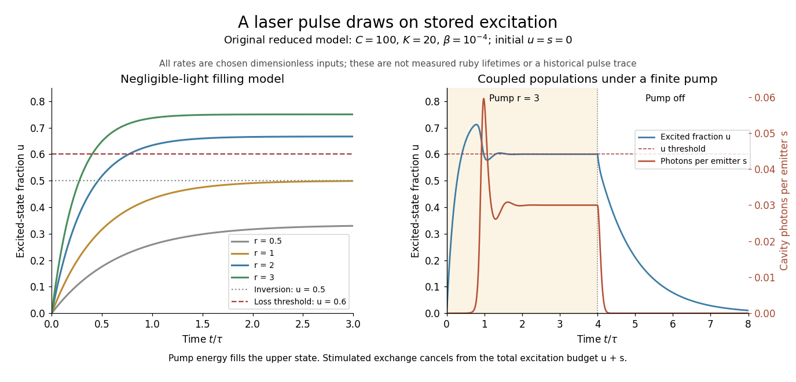

# Stored excitation in a pulsed laser

↑ **Parent:** [Three-level laser rate equation](three-level-laser-rate-equation.md)

A short optical pulse can draw on previously stored excitation. In the original calculation below, $C=100$, $K=20$, $\beta=10^{-4}$, $u(0)=s(0)=0$, and $r=3$ for $0\leq x<4$, followed by $r=0$. The cavity field initially remains small while pumping fills the upper state. Once sufficient gain develops, the photon population grows and depletes the stored inversion. Continuing pump action can refill it, giving [relaxation oscillations](relaxation-oscillation.md) in this simple model. This is not a fit to Maiman's recorded output.

**[Figure 2](#image-ground-state-depletion-delays-startup-and-cavity-light-then-drains-stored-excitation). Ground-state depletion delays startup, and cavity light then drains stored excitation**. Original [three-level laser rate equation](three-level-laser-rate-equation.md) calculations. Left: negligible-light upper-state fractions for several constant pumps, compared with the chosen $u_{\rm th}=0.6$. Right: coupled upper-state and cavity-photon populations for $C=100$, $K=20$, $\beta=10^{-4}$ and a pump of $r=3$ switched off at $t/\tau=4$. The rates and times are dimensionless teaching inputs, not measured ruby lifetimes or a historical pulse trace.

The equations expose the excitation budget underlying [conservation of energy](conservation-of-energy.md). Adding them cancels the stimulated exchange:

$$
\frac{d(u+s)}{dx}=r(1-u)-(1-\beta)u-Ks.
$$

Pumping supplies excitations; nonlasing decay and cavity loss remove them. Integrating gives the bound

$$
\int_0^X Ks\,dx\leq u(0)+s(0)+\int_0^Xr(1-u)\,dx.
$$

Only part of the cavity loss may be useful output; passive absorption is also a loss. The pulse's instantaneous power can draw on stored excitation, while its total extracted energy still obeys the integrated budget. The model also preserves $0\leq u\leq1$ and $s\geq0$: at each boundary its derivatives point inward or along the boundary.

There is a further energy cost in the pump cycle. For one absorbed pump photon producing at most one emitted laser photon, the ideal energy-conversion bound is

$$
\eta\leq\frac{h\nu_{\rm laser}}{h\nu_{\rm pump}}
=\frac{\lambda_{\rm pump}}{\lambda_{\rm laser}}.
$$

Chosen wavelengths $550\,\mathrm{nm}$ and $694.3\,\mathrm{nm}$ give about $0.7922$ before other losses. The missing energy can leave through nonradiative relaxation and heating. Actual efficiency also depends on how much pump light is absorbed, unwanted decays and optical losses; a population model alone cannot predict it.

## ↑ Ancestors (7)

1. [Three-level laser rate equation](three-level-laser-rate-equation.md)
2. [Three-level laser](three-level-laser.md)
3. [Laser](laser-split.md)
4. [Optics](optics-split.md)
5. [Branches of physics](branches-of-physics.md)
6. [Physics](physics-split.md)
7. [Codex Wiki](split.md)
