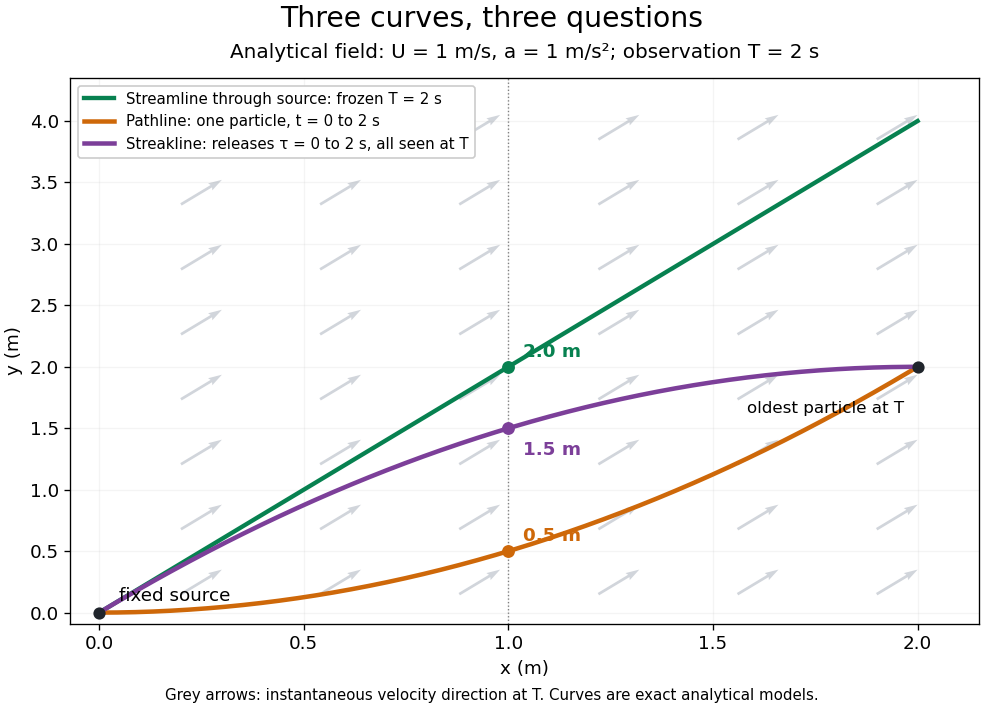

# Streamline

↑ **Parent:** [Fluid mechanics](fluid-mechanics-split.md)  
ⓦ [Wiki](https://en.wikipedia.org/wiki/Streamline)

A [streamline](streamline.md) at a specified instant $T$ is a curve whose [tangent line](tangent-line.md) follows the [velocity field](velocity-field.md) at that same frozen instant everywhere along the curve. One convenient [integral curve](integral-curve-of-a-vector-field.md) parameterization is

$$
\frac{d\boldsymbol\gamma}{ds}=\mathbf u(\boldsymbol\gamma(s),T),\qquad T\text{ fixed}.
$$

Here $s$ is an auxiliary curve parameter, with units of seconds in this convention; advancing $s$ does not advance physical time. Any regular reparameterization preserves the tangent geometry. Where $u_x\ne0$, a planar [streamline](streamline.md) satisfies $dy/dx=u_y/u_x$ evaluated at time $T$. At a [stagnation point](stagnation-point.md) the [velocity field](velocity-field.md) has no direction; under the local [Lipschitz condition](lipschitz-continuity.md) of the [Picard-Lindelöf theorem](picard-lindelof-theorem.md), regular [streamlines](streamline.md) at the same time cannot cross. A [streamline](streamline.md) answers which directions fit together now, making it useful for describing local flow geometry. [MIT fluid mechanics modules, tutorial on streamlines, streaklines and pathlines](https://web.mit.edu/fluids-modules/www/potential_flows/LecturesHTML/lec02/tutorial/)

In the analytical [velocity field](velocity-field.md) $(U,at)$ introduced under [pathline](pathline.md), the [streamline](streamline.md) through the origin at time $T$ is

$$
y=\frac{aT}{U}x.
$$

At $T=2\ \mathrm s$ this is $y=2x$ when both coordinates are expressed in metres. At $x=1\ \mathrm m$ its height is $2\ \mathrm m$, whereas the earlier [pathline](pathline.md) of the origin's first released [fluid element](fluid-element.md) has height $0.5\ \mathrm m$. Its instantaneous [streamline](streamline.md) at the final position $(2,2)\ \mathrm m$ is instead $y-2\ \mathrm m=2(x-2\ \mathrm m)$: the [pathline](pathline.md) is tangent to that [streamline](streamline.md) at its current endpoint, although its recorded history does not lie along it.

**[Figure 18](#image-analytical-comparison-of-a-frozen-time-streamline-one-pathline-and-a-streakline). Analytical comparison of a frozen-time streamline, one pathline and a streakline**.

The green [streamline](streamline.md) uses the [velocity field](velocity-field.md) at $T=2\ \mathrm s$ throughout; the orange [pathline](pathline.md) uses times $0\leq t\leq2\ \mathrm s$; the purple [streakline](streakline.md) uses different release times at the single observation time $T=2\ \mathrm s$. The grey arrows all show the instantaneous [velocity](velocity.md) direction at $T$. These are exact analytical curves with chosen units, not measured dye shapes.

In a [steady flow](steady-flow.md) in a fixed [reference frame](reference-frame.md), a [pathline](pathline.md) and a [streamline](streamline.md) solve the same autonomous [ordinary differential equation](ordinary-differential-equation.md). Uniqueness makes each particle released from a fixed point follow the same [integral curve](integral-curve-of-a-vector-field.md), so its [pathline](pathline.md), the [streakline](streakline.md) from that point and the [streamline](streamline.md) share one geometrical curve. Finite recording or release intervals usually show different segments of that curve; the comparison assumes particles stay in the domain and treats stationary [fluid elements](fluid-element.md) separately. Neither two-dimensionality nor [incompressibility](incompressible-flow.md) is needed for this coincidence. Steadiness is sufficient, but is not necessary: $\mathbf u(\mathbf x,t)=g(t)\mathbf v(\mathbf x)$ with smooth $g(t)>0$ changes [speed](speed.md) while preserving the same [integral curves](integral-curve-of-a-vector-field.md). In a general time-dependent [velocity field](velocity-field.md), however, the three curves differ. Kline explains why continuous dye release in [steady flow](steady-flow.md) can therefore display [streamlines](streamline.md). [S. J. Kline, Flow Visualization film notes, section II](https://web.mit.edu/hml/ncfmf/05FV.pdf)

For two-dimensional [incompressible flow](incompressible-flow.md), the convention $\mathbf u=(\partial_y\psi,-\partial_x\psi)$ gives $\mathbf u\cdot\nabla\psi=0$, so regular [streamlines](streamline.md) are [level sets](level-set.md) of the [stream function](stream-function.md) at each frozen time. In time-dependent [incompressible flow](incompressible-flow.md), that does not force a [pathline](pathline.md) to stay on one numerical value of $\psi$: its [material derivative](material-derivative.md) is $D\psi/Dt=\partial_t\psi$. The distinction is the difference between a geometric snapshot and a parcel's history.

**Table of contents**

- [Stream tube](stream-tube.md)

## ↑ Ancestors (4)

1. [Fluid mechanics](fluid-mechanics-split.md)
2. [Branches of physics](branches-of-physics.md)
3. [Physics](physics-split.md)
4. [Codex Wiki](split.md)

## ← Incoming links (68)

- [Bernoulli invariant](bernoulli-invariant.md)
- [Bernoulli's principle](bernoulli-s-principle.md)
- [Closed-streamline threshold for a circular topographic anticyclone](closed-streamline-threshold-for-a-circular-topographic-anticyclone.md)
- [Crocco form of the unsteady Euler equation](crocco-form-of-the-unsteady-euler-equation.md)
- [Dynamic pressure](dynamic-pressure.md)
- [Electric flux](electric-flux.md)
- [Equipotential curve](equipotential-curve.md)
- [Image vortex at a plane wall](image-vortex-at-a-plane-wall.md)
- [Laminar flow](laminar-flow.md)
- [Linear planar strain and rotation streamlines](linear-planar-strain-and-rotation-streamlines.md)
- [Solution](past-exam-of-the-mathematics-course-of-the-university-of-cambridge/2001/ib/paper-4/16g/solution.md)
- [Solution](past-exam-of-the-mathematics-course-of-the-university-of-cambridge/2001/ib/paper-4/7g/solution.md)
- [Solution](past-exam-of-the-mathematics-course-of-the-university-of-cambridge/2001/iii/paper-36/1/d/solution.md)
- [Solution](past-exam-of-the-mathematics-course-of-the-university-of-cambridge/2001/iii/paper-46/3/i/solution.md)
- [Solution](past-exam-of-the-mathematics-course-of-the-university-of-cambridge/2001/iii/paper-48/1/solution.md)
- [Solution](past-exam-of-the-mathematics-course-of-the-university-of-cambridge/2002/ib/paper-1/6c/solution.md)
- [Solution](past-exam-of-the-mathematics-course-of-the-university-of-cambridge/2002/ib/paper-3/18c/solution.md)
- [Solution](past-exam-of-the-mathematics-course-of-the-university-of-cambridge/2002/iii/paper-43/4/solution.md)
- [Solution](past-exam-of-the-mathematics-course-of-the-university-of-cambridge/2003/ib/paper-1/6c/solution.md)
- [Solution](past-exam-of-the-mathematics-course-of-the-university-of-cambridge/2003/ib/paper-4/16c/solution.md)
- [Solution](past-exam-of-the-mathematics-course-of-the-university-of-cambridge/2003/ib/paper-4/7c/solution.md)
- [Solution](past-exam-of-the-mathematics-course-of-the-university-of-cambridge/2003/iii/paper-72/3/solution.md)
- [Solution](past-exam-of-the-mathematics-course-of-the-university-of-cambridge/2005/ib/paper-1/5e/a/solution.md)
- [Solution](past-exam-of-the-mathematics-course-of-the-university-of-cambridge/2005/ib/paper-1/5e/solution.md)
- [Solution](past-exam-of-the-mathematics-course-of-the-university-of-cambridge/2007/ib/paper-1/17d/solution.md)
- [Solution](past-exam-of-the-mathematics-course-of-the-university-of-cambridge/2007/ib/paper-1/5d/ii/solution.md)
- [Solution](past-exam-of-the-mathematics-course-of-the-university-of-cambridge/2007/ib/paper-1/5d/iii/solution.md)
- [Solution](past-exam-of-the-mathematics-course-of-the-university-of-cambridge/2007/ib/paper-4/18d/solution.md)
- [Solution](past-exam-of-the-mathematics-course-of-the-university-of-cambridge/2008/ib/paper-1/5b/solution.md)
- [Solution](past-exam-of-the-mathematics-course-of-the-university-of-cambridge/2009/iii/paper-79/5/a/solution.md)
- [Solution](past-exam-of-the-mathematics-course-of-the-university-of-cambridge/2013/ib/paper-1/5a/solution.md)
- [Solution](past-exam-of-the-mathematics-course-of-the-university-of-cambridge/2014/ib/paper-1/17b/solution.md)
- [7B](past-exam-of-the-mathematics-course-of-the-university-of-cambridge/2014/ib/paper-2/7b.md)
- [Solution](past-exam-of-the-mathematics-course-of-the-university-of-cambridge/2014/ib/paper-2/7b/i/solution.md)
- [Solution](past-exam-of-the-mathematics-course-of-the-university-of-cambridge/2014/ib/paper-2/7b/ii/solution.md)
- [Solution](past-exam-of-the-mathematics-course-of-the-university-of-cambridge/2014/ib/paper-2/7b/iii/solution.md)
- [Solution](past-exam-of-the-mathematics-course-of-the-university-of-cambridge/2014/iii/paper-78/2/solution.md)
- [Solution](past-exam-of-the-mathematics-course-of-the-university-of-cambridge/2016/ib/paper-1/17c/b/solution.md)
- [Solution](past-exam-of-the-mathematics-course-of-the-university-of-cambridge/2016/ib/paper-1/17c/c/ii/solution.md)
- [Solution](past-exam-of-the-mathematics-course-of-the-university-of-cambridge/2016/iii/paper-321/2/d/ii/solution.md)
- [Solution](past-exam-of-the-mathematics-course-of-the-university-of-cambridge/2017/ib/paper-1/5d/ii/solution.md)
- [Solution](past-exam-of-the-mathematics-course-of-the-university-of-cambridge/2017/ib/paper-2/7d/solution.md)
- [Solution](past-exam-of-the-mathematics-course-of-the-university-of-cambridge/2018/ib/paper-2/7d/solution.md)
- [Solution](past-exam-of-the-mathematics-course-of-the-university-of-cambridge/2018/iii/paper-333/2/solution.md)
- [Solution](past-exam-of-the-mathematics-course-of-the-university-of-cambridge/2019/ib/paper-2/7c/solution.md)
- [Solution](past-exam-of-the-mathematics-course-of-the-university-of-cambridge/2020/ib/paper-1/17c/b/solution.md)
- [Solution](past-exam-of-the-mathematics-course-of-the-university-of-cambridge/2020/ii/paper-1/39b/iv/solution.md)
- [Solution](past-exam-of-the-mathematics-course-of-the-university-of-cambridge/2023/ib/paper-2/5c/b/solution.md)
- [Solution](past-exam-of-the-mathematics-course-of-the-university-of-cambridge/2024/ib/paper-2/5d/solution.md)
- [Solution](past-exam-of-the-mathematics-course-of-the-university-of-cambridge/2024/ib/paper-3/7d/solution.md)
- [Solution](past-exam-of-the-mathematics-course-of-the-university-of-cambridge/2024/iii/paper-314/2/b/solution.md)
- [Solution](past-exam-of-the-mathematics-course-of-the-university-of-cambridge/2025/ib/paper-1/16d/solution.md)
- [Solution](past-exam-of-the-mathematics-course-of-the-university-of-cambridge/2025/ib/paper-3/16d/solution.md)
- [Solution](past-exam-of-the-mathematics-course-of-the-university-of-cambridge/2025/iii/paper-329/3/solution.md)
- [Solution](past-exam-of-the-mathematics-course-of-the-university-of-cambridge/2026/ib/paper-2/5a/ii/solution.md)
- [Solution](past-exam-of-the-mathematics-course-of-the-university-of-cambridge/2026/ib/paper-2/5a/iii/solution.md)
- [Solution](past-exam-of-the-mathematics-course-of-the-university-of-cambridge/2026/ii/paper-2/39c/a/solution.md)
- [Pathline](pathline.md)
- [Rankine half-body](rankine-half-body.md)
- [Sinusoidal cellular flow](sinusoidal-cellular-flow.md)
- [Steady flow](steady-flow.md)
- [Steady planar vorticity as a local function of stream function](steady-planar-vorticity-as-a-local-function-of-stream-function.md)
- [Steady rotating-frame Bernoulli integral](steady-rotating-frame-bernoulli-integral.md)
- [Stokes flow](stokes-flow-split.md)
- [Streakline](streakline.md)
- [Stream tube](stream-tube.md)
- [Streamline](streamline.md)
- [Vorticity](vorticity.md)
