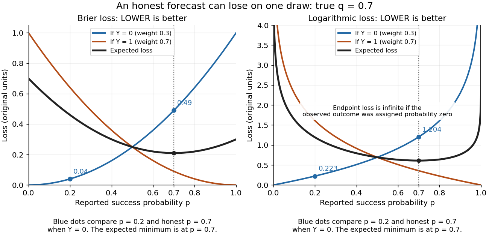

# Strictly proper scoring rule

↑ **Parent:** [Proper scoring rule](proper-scoring-rule.md)

A [strictly proper scoring rule](strictly-proper-scoring-rule.md) is a [proper scoring rule](proper-scoring-rule.md) for which the true [probability distribution](probability-distribution.md) is the unique optimizer of the [expected value](expected-value.md). Equivalently, any different admissible [probability distribution](probability-distribution.md) gives strictly larger expected loss. For [probability density functions](probability-density-function.md), two densities that agree [almost everywhere](almost-everywhere.md) represent the same [probability distribution](probability-distribution.md). Ordinary [propriety](proper-scoring-rule.md) permits ties: the constant reward $S(P,x)=0$ is a [proper scoring rule](proper-scoring-rule.md), because every report ties, but it is not a [strictly proper scoring rule](strictly-proper-scoring-rule.md) and elicits no information.

[Strict propriety](strictly-proper-scoring-rule.md) concerns [expectation](expected-value.md), not guaranteed success on each observation or each realized dataset. With the stipulated [Bernoulli distribution](bernoulli-distribution.md) $q=0.7$, suppose the outcome is $Y=0$. The honest report $p=0.7$ then has [Brier score](brier-score.md) loss $0.49$, while $p=0.2$ has loss $0.04$. The [logarithmic loss](logarithmic-loss.md) similarly gives losses $-\ln(0.3)\approx1.203973$ and $-\ln(0.8)\approx0.223144$. The honest forecast loses this comparison on that draw, which occurs with [probability](probability.md) $0.3$ in the stipulated [statistical model](statistical-model-split.md).

**[Figure 5](#image-individual-outcomes-can-favor-a-different-report-even-though-the-expected-brier-score-and-logarithmic-loss-are-uniquely-minimized-at-p-0-7). Individual outcomes can favor a different report even though the expected Brier score and logarithmic loss are uniquely minimized at $p=0.7$**.

The $Y=0$ loss curves favor $p=0$, and the $Y=1$ loss curves favor $p=1$. Their weighted average, with weights $0.3$ and $0.7$, favors $p=0.7$. Choosing a report after observing $Y$ would use information unavailable at forecast time. Even an average loss on a finite dataset can rank an honest forecast below a competing forecast through outcome variation; [strict propriety](strictly-proper-scoring-rule.md) guarantees the ranking in [expected value](expected-value.md) under the specified information and true [predictive distribution](predictive-distribution.md).

**Table of contents**

- [Brier score](brier-score.md)
- [Logarithmic scoring rule](logarithmic-scoring-rule.md)
  - [Prequential log score identity](prequential-log-score-identity.md)

## ↑ Ancestors (7)

1. [Proper scoring rule](proper-scoring-rule.md)
2. [Scoring rule](scoring-rule.md)
3. [Statistical inference](statistical-inference-split.md)
4. [Probability and statistics](probability-and-statistics-split.md)
5. [Area of mathematics](area-of-mathematics.md)
6. [Mathematics](mathematics-split.md)
7. [Codex Wiki](split.md)

## ← Incoming links (6)

- [Brier score](brier-score.md)
- [Cross-entropy](cross-entropy.md)
- [Logarithmic scoring rule](logarithmic-scoring-rule.md)
- [Solution](past-exam-of-the-mathematics-course-of-the-university-of-cambridge/2013/iii/paper-34/4/a/solution.md)
- [Relative entropy nonnegativity](relative-entropy-nonnegativity.md)
- [Strictly proper scoring rule](strictly-proper-scoring-rule.md)
