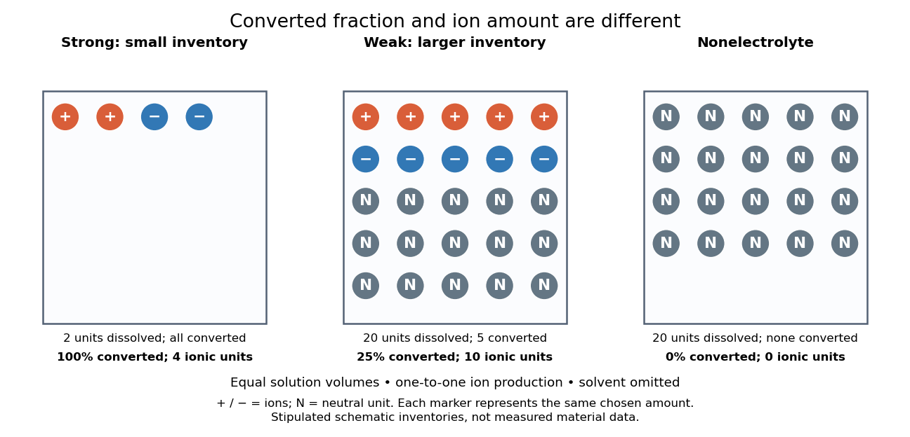

# Strong electrolyte

↑ **Parent:** [Electrolyte](electrolyte.md)  
ⓦ [Wiki](https://en.wikipedia.org/wiki/Strong_electrolyte)

A [strong electrolyte](strong-electrolyte.md) yields essentially all [ions](ion.md) from its dissolved substance in the specified [solvent](solvent.md) and conditions. Strength does not specify [concentration](concentration.md).

For dissolved [sodium chloride](sodium-chloride.md) in dilute [water](water.md), one dissolved formula unit supplies one [sodium](sodium.md) [cation](cation.md) and one [chloride](chloride.md) [anion](anion.md). For [hydrogen chloride](hydrogen-chloride.md) in [water](water.md), [ions](ion.md) instead arise by [proton](proton.md) transfer to the [solvent](solvent.md), giving [hydronium](hydronium.md) and [chloride](chloride.md). Thus separating existing [ions](ion.md) by [dissociation of an ionic compound](dissociation-of-an-ionic-compound.md) and producing [ions](ion.md) from neutral [molecules](molecule-split.md) by [ionization](ionization.md) can both give a [strong electrolyte](strong-electrolyte.md).[Chemistry 2e, §11.2, Ionic Electrolytes and Covalent Electrolytes](chemistry-2e-by-paul-flowers-and-others/11-2-electrolytes.md)

The denominator in “essentially all” is the dissolved inventory. [Solubility](solubility.md) asks how much enters the [chemical solution](solution-chemistry.md); [electrolyte](electrolyte.md) strength asks what happens to the part that enters. A sparingly soluble [ionic compound](salt-chemistry.md) can therefore have an essentially fully dissociated dissolved portion. Undissolved solid does not count as neutral dissolved [chemical species](chemical-species.md), and low [electrical conductivity](electrical-conductivity.md) alone does not establish a [weak electrolyte](weak-electrolyte.md).[Chemistry 2e, §11.2, Ionic Electrolytes, paragraph on sparingly soluble ionic compounds](chemistry-2e-by-paul-flowers-and-others/11-2-electrolytes.md)

**[Figure 6](#image-electrolyte-strength-and-dissolved-amount-of-substance-answer-different-questions). Electrolyte strength and dissolved amount of substance answer different questions**. Original schematic inventories in equal [volume](volume-thermodynamics.md) of a specified [solvent](solvent.md). Each symbol represents the same chosen [amount of substance](amount-of-substance.md), not one literal microscopic sample. A two-unit [strong electrolyte](strong-electrolyte.md) inventory produces two [cations](cation.md) and two [anions](anion.md); a twenty-unit [weak electrolyte](weak-electrolyte.md) inventory with a stipulated one-quarter converted fraction produces five of each [ion](ion.md) and fifteen neutral units. A twenty-unit [nonelectrolyte](nonelectrolyte.md) inventory remains neutral. The [solvent](solvent.md) and its background [ions](ion.md) are omitted. These are chosen inventories, not measured material data.

The diagram's [weak electrolyte](weak-electrolyte.md) has the smaller converted fraction but more [ions](ion.md) in the same [volume](volume-thermodynamics.md): ten charged symbols versus four. Even at equal total [ion](ion.md) [concentrations](concentration.md), different [ion](ion.md) [drift velocities](drift-velocity.md) can give different [electrical conductivities](electrical-conductivity.md). Strength is useful for predicting dissolved [chemical species](chemical-species.md) in [chemical equations](chemical-equation.md); [concentration](concentration.md) and transport properties are additionally needed to predict [electric current](electric-current.md).

An inspected motivating experiment is Harvard Natural Sciences Lecture Demonstrations' [Conductivity of Solutions by Harvard Natural Sciences Lecture Demonstrations](conductivity-of-solutions-by-harvard-natural-sciences-lecture-demonstrations.md), Setting it Up. Separate labeled beakers hold aqueous [sodium chloride](sodium-chloride.md), [sucrose](sucrose.md), [acetic acid](acetic-acid.md) and [hydrochloric acid](hydrochloric-acid.md) samples specified at $0.10\,\mathrm{mol\,L^{-1}}$, with about $150\,\mathrm{mL}$ in $250\,\mathrm{mL}$ beakers; distilled [water](water.md) supplies a blank. Metal [electrodes](electrode.md) enclosed in tubing connect to a lamp. The readout is lamp brightness; the page reports that an ionic [chemical solution](solution-chemistry.md) lights the lamp. A separate deionized-[water](water.md) rinse station limits carryover between samples.[Setting it Up, sample list, enclosed electrodes, lamp and rinse station](conductivity-of-solutions-by-harvard-natural-sciences-lecture-demonstrations.md)

For a controlled interpretation, keep [electrode](electrode.md) spacing and immersed area fixed, compare at the same [temperature](temperature-split.md), and recheck the blank after rinsing. These are additional controls: the page supplies no numerical [electrode](electrode.md) geometry, [temperature](temperature-split.md) or calibration. Brightness supports the presence of mobile [ions](ion.md); it cannot alone measure the converted fraction because [concentration](concentration.md), [ion](ion.md) mobility and circuit response also matter. Its classification of insoluble compounds as weak should not replace the dissolved-inventory distinction above.[How it Works and Setting it Up; qualitative readout and unspecified geometry and temperature](conductivity-of-solutions-by-harvard-natural-sciences-lecture-demonstrations.md)

## ↑ Ancestors (4)

1. [Electrolyte](electrolyte.md)
2. [Electrochemistry](electrochemistry-split.md)
3. [Chemistry](chemistry-split.md)
4. [Codex Wiki](split.md)

## ← Incoming links (4)

- [Electrolyte](electrolyte.md)
- [Net ionic equation](net-ionic-equation.md)
- [Nonelectrolyte](nonelectrolyte.md)
- [Strong electrolyte](strong-electrolyte.md)
