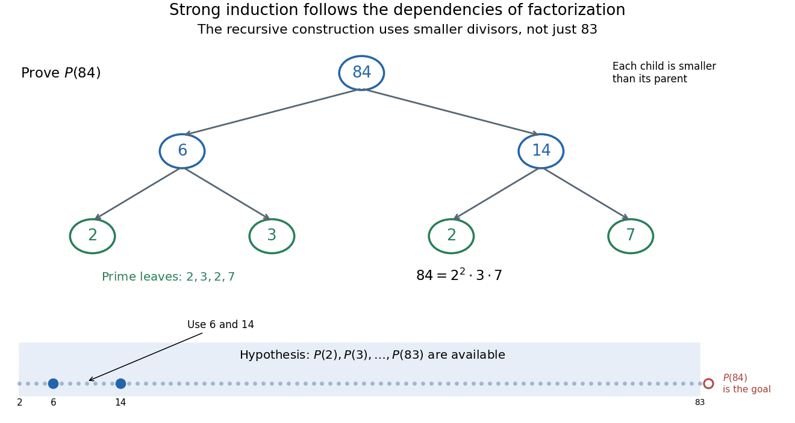

# Strong induction for factorization existence

↑ **Parent:** [Strong induction](strong-induction.md)

Every [integer](integer-split.md) $n\geq2$ has a [prime factorization](fundamental-theorem-of-arithmetic.md). The [induction base case](induction-base-case.md) $2$ is [prime](prime-number-split.md). For a larger [integer](integer-split.md), either it is [prime](prime-number-split.md) or it is $ab$, with $2\leq a,b<n$. The [induction hypothesis](induction-hypothesis.md) supplies [prime factorizations](fundamental-theorem-of-arithmetic.md) of both smaller [integer divisors](divisor.md); multiplying them gives one for $n$. This proves existence, while uniqueness requires the additional argument under the [fundamental theorem of arithmetic](fundamental-theorem-of-arithmetic.md).[§5.2.2, printed pp. 125–126: existence of a product of primes; the statement here does not include uniqueness](mathematics-for-computer-science-by-eric-lehman-and-others.md)

For the chosen number $84$, one possible recursive decomposition is

$$
84=6\cdot14=(2\cdot3)(2\cdot7)=2^2\cdot3\cdot7.
$$

The step at $84$ needs results for $6$ and $14$, rather than a result for $83$. Each [composite number](composite-number.md) in this [factorization tree](factorization-tree.md) splits into strictly smaller positive [integers](integer-split.md), so recursive descent terminates at [prime numbers](prime-number-split.md). The [tree](tree-graph-theory-split.md) describes one construction; another choice of [integer divisors](divisor.md) can give a differently shaped [factorization tree](factorization-tree.md).

**[Figure 5](#image-the-step-for-84-can-use-6-and-14-the-induction-hypothesis-covers-both). The step for 84 can use 6 and 14: the induction hypothesis covers both**. Original factorization tree $84\to6\cdot14$, followed by $6\to2\cdot3$ and $14\to2\cdot7$. Arrows show recursive dependencies toward smaller [integers](integer-split.md), rather than the order of increasing induction. The strip at the bottom marks the earlier cases available at the step for $84$, with the required $6$ and $14$ highlighted. No use of the unproved case $84$ is permitted in the hypothesis.

The same pattern explains the usefulness of [strong induction](strong-induction.md) for [algorithm correctness](algorithm-correctness.md). When a [recursive procedure](recursive-procedure.md) returns answers for smaller [inputs](input-computer-science.md), the [induction hypothesis](induction-hypothesis.md) can justify those answers; the remaining task is to justify how the current call combines them. Strictly decreasing a [nonnegative integer](natural-number.md) size measure establishes termination. Correctness also requires each call's conditions and its combination rule; termination alone does not make an [algorithm](algorithm-split.md) correct.

## ↑ Ancestors (7)

1. [Strong induction](strong-induction.md)
2. [Mathematical induction](mathematical-induction.md)
3. [Mathematical proof](mathematical-proof.md)
4. [Foundations of mathematics](foundations-of-mathematics-split.md)
5. [Area of mathematics](area-of-mathematics.md)
6. [Mathematics](mathematics-split.md)
7. [Codex Wiki](split.md)
