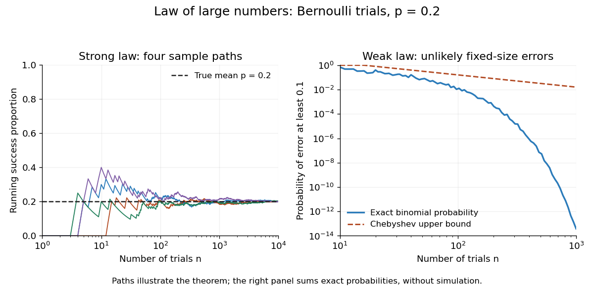

# Strong law of large numbers

↑ **Parent:** [Almost sure convergence](almost-sure-convergence.md)  
ⓦ [Wiki](https://en.wikipedia.org/wiki/Strong_law_of_large_numbers)

Let $X_1,X_2,\ldots$ be real [independent and identically distributed random variables](independent-and-identically-distributed-random-variables.md) with $\mathbb E|X_1|<\infty$, and let $\mu=\mathbb E[X_1]$ be their [expected value](expected-value-split.md). Their [sample mean](sample-mean.md) satisfies

$$
\overline X_n=\frac1n\sum_{j=1}^nX_j\xrightarrow{\mathrm{a.s.}}\mu.
$$

This is [almost sure convergence](almost-sure-convergence.md): with [probability](probability.md) one, an entire infinite sequence of observations has averages that eventually stay within every prescribed positive tolerance of $\mu$. The [variance](variance-split.md) need not be finite. The [strong law of large numbers](strong-law-of-large-numbers.md) implies the [weak law of large numbers](weak-law-of-large-numbers.md), which asserts [convergence in probability](convergence-in-probability.md) at each increasing sample size.

For [independent](independent-random-variables.md) trials with a [Bernoulli distribution](bernoulli-distribution.md) of parameter $p$, $X_j$ is one for success and zero for failure. Then $\overline X_n$ is the observed success proportion, and the [strong law of large numbers](strong-law-of-large-numbers.md) says $\overline X_n\to p$ [almost surely](almost-sure-convergence.md). This turns a theoretical [probability](probability.md) into a quantity one can estimate by repetition. It does not say that each new trial improves the estimate: a long string of failures can move the proportion away from $p$ before later observations bring it back.

**[Figure 1](#image-bernoulli-averages-approach-their-mean-sample-paths-and-exact-error-probabilities). Bernoulli averages approach their mean: sample paths and exact error probabilities**. The left panel shows four reproducibly simulated sequences of [independent](independent-random-variables.md) [Bernoulli trials](bernoulli-trial.md) with success [probability](probability.md) $p=0.2$. The right panel calculates $\mathbb P(|\overline X_n-p|\geq0.1)$ from the exact [binomial distribution](binomial-distribution.md) and compares it with the bound from the [Chebyshev inequality](chebyshev-s-inequality.md). Small irregularities reflect integer-valued counts. The paths illustrate [almost sure convergence](almost-sure-convergence.md); a finite simulation cannot prove it.

The [strong law of large numbers](strong-law-of-large-numbers.md) gives the limiting location of the [sample mean](sample-mean.md), while the [central limit theorem](central-limit-theorem.md) describes its fluctuations when the [variance](variance-split.md) is finite and positive. The two assertions can hold together:

$$
\overline X_n\xrightarrow{\mathrm{a.s.}}\mu,
\qquad
\frac{\sqrt n(\overline X_n-\mu)}{\sigma}\xrightarrow{d}N(0,1).
$$

The first error shrinks to zero; the second has been enlarged enough to retain a nontrivial [probability distribution](probability-distribution-split.md). The second assertion is [convergence in distribution](convergence-in-distribution.md), not a claim that the enlarged error along one sequence approaches a particular [normal random variable](gaussian-random-variable.md).

The assumptions make a practical difference. If every observation repeats the same nonconstant [Bernoulli random variable](bernoulli-distribution.md), $X_j=X_1$, then $\overline X_n=X_1$ for all $n$: identical [probability distributions](probability-distribution-split.md) alone do not make repeated observations informative. For [independent](independent-random-variables.md) observations with a [Standard Cauchy distribution](standard-cauchy-distribution.md), the [Cauchy sample mean has an unchanged distribution](cauchy-sample-mean-has-an-unchanged-distribution.md), so it does not concentrate around a constant. Its [expected value](expected-value-split.md) is undefined, and $\mathbb E|X_1|=\infty$; neither example contradicts the stated [strong law of large numbers](strong-law-of-large-numbers.md).

A brief proof outline in the case of finite [variance](variance-split.md) uses the [Kolmogorov maximal inequality](kolmogorov-maximal-inequality.md) for the centered partial sums. The [probability](probability.md) that their maximum up to $2^m$ exceeds $\varepsilon2^m$ is at most $\sigma^2/(\varepsilon^2 2^m)$. These bounds are summable, so the [Borel-Cantelli lemma](borel-cantelli-lemmas.md) controls all sufficiently large such blocks and hence every intermediate sample size. The general case $\mathbb E|X_1|<\infty$ requires truncation to control large observations; the argument using finite [variance](variance-split.md) alone does not prove that full version.

**Table of contents**

- [Strong law for uniformly L2-bounded uncorrelated random variables](strong-law-for-uniformly-l2-bounded-uncorrelated-random-variables.md)
- [Strong law for adjacent products](strong-law-for-adjacent-products.md)

## ↑ Ancestors (7)

1. [Almost sure convergence](almost-sure-convergence.md)
2. [Convergence of random variables](convergence-of-random-variables-split.md)
3. [Probability theory](probability-theory-split.md)
4. [Probability and statistics](probability-and-statistics-split.md)
5. [Area of mathematics](area-of-mathematics.md)
6. [Mathematics](mathematics-split.md)
7. [Codex Wiki](split.md)

## ← Incoming links (94)

- [Asymptotic equipartition property](asymptotic-equipartition-property.md)
- [Central limit theorem](central-limit-theorem.md)
- [Certain ruin with nonpositive loading and finite claim variance](certain-ruin-with-nonpositive-loading-and-finite-claim-variance.md)
- [Convergence of random variables](convergence-of-random-variables-split.md)
- [Divergence of a driftless Brownian exponential clock](divergence-of-a-driftless-brownian-exponential-clock.md)
- [Expected value](expected-value-split.md)
- [Exponential moment bound for a Gaussian random-walk maximum](exponential-moment-bound-for-a-gaussian-random-walk-maximum.md)
- [Exponential sample-mean upper-tail rate](exponential-sample-mean-upper-tail-rate.md)
- [Geometric maximum of an upward skip-free random walk](geometric-maximum-of-an-upward-skip-free-random-walk.md)
- [Importance sampling](importance-sampling.md)
- [Integrable random variable](integrable-random-variable.md)
- [Law of large numbers](law-of-large-numbers.md)
- [Log-optimal multiplicative betting](log-optimal-multiplicative-betting.md)
- [Maximum aggregate loss in a classical risk model](maximum-aggregate-loss-in-a-classical-risk-model.md)
- [Maximum of a downward-biased random walk](maximum-of-a-downward-biased-random-walk.md)
- [Monte Carlo integration](monte-carlo-integration.md)
- [Nonexplosion under uniformly bounded jump rates](nonexplosion-under-uniformly-bounded-jump-rates.md)
- [Solution](past-exam-of-the-mathematics-course-of-the-university-of-cambridge/2001/iii/paper-21/4/c/solution.md)
- [Solution](past-exam-of-the-mathematics-course-of-the-university-of-cambridge/2001/iii/paper-27/2/solution.md)
- [Solution](past-exam-of-the-mathematics-course-of-the-university-of-cambridge/2001/iii/paper-46/2/solution.md)
- [Solution](past-exam-of-the-mathematics-course-of-the-university-of-cambridge/2002/iii/paper-40/2/a/i/solution.md)
- [Solution](past-exam-of-the-mathematics-course-of-the-university-of-cambridge/2003/iii/paper-31/2/solution.md)
- [Solution](past-exam-of-the-mathematics-course-of-the-university-of-cambridge/2004/iii/paper-35/4/c/solution.md)
- [Solution](past-exam-of-the-mathematics-course-of-the-university-of-cambridge/2004/iii/paper-40/4/i/solution.md)
- [Solution](past-exam-of-the-mathematics-course-of-the-university-of-cambridge/2004/iii/paper-40/4/ii/solution.md)
- [Solution](past-exam-of-the-mathematics-course-of-the-university-of-cambridge/2004/iii/paper-53/1/1/solution.md)
- [Solution](past-exam-of-the-mathematics-course-of-the-university-of-cambridge/2005/iii/paper-36/4/a/solution.md)
- [Solution](past-exam-of-the-mathematics-course-of-the-university-of-cambridge/2005/iii/paper-39/2/solution.md)
- [Solution](past-exam-of-the-mathematics-course-of-the-university-of-cambridge/2006/ib/paper-2/20c/b/solution.md)
- [Solution](past-exam-of-the-mathematics-course-of-the-university-of-cambridge/2006/ii/paper-1/25j/d/solution.md)
- [Solution](past-exam-of-the-mathematics-course-of-the-university-of-cambridge/2006/ii/paper-3/26j/b/solution.md)
- [Solution](past-exam-of-the-mathematics-course-of-the-university-of-cambridge/2006/ii/paper-4/27j/a/solution.md)
- [Solution](past-exam-of-the-mathematics-course-of-the-university-of-cambridge/2006/iii/paper-32/2/c/solution.md)
- [Solution](past-exam-of-the-mathematics-course-of-the-university-of-cambridge/2006/iii/paper-42/1/solution.md)
- [Solution](past-exam-of-the-mathematics-course-of-the-university-of-cambridge/2007/iii/paper-45/3/solution.md)
- [Solution](past-exam-of-the-mathematics-course-of-the-university-of-cambridge/2007/iii/paper-48/4/solution.md)
- [Solution](past-exam-of-the-mathematics-course-of-the-university-of-cambridge/2008/ib/paper-2/19h/solution.md)
- [Solution](past-exam-of-the-mathematics-course-of-the-university-of-cambridge/2009/ii/paper-1/12h/ii/solution.md)
- [Solution](past-exam-of-the-mathematics-course-of-the-university-of-cambridge/2009/ii/paper-1/12h/iii/solution.md)
- [Solution](past-exam-of-the-mathematics-course-of-the-university-of-cambridge/2009/ii/paper-2/26j/solution.md)
- [Solution](past-exam-of-the-mathematics-course-of-the-university-of-cambridge/2009/ii/paper-3/26j/a/solution.md)
- [Solution](past-exam-of-the-mathematics-course-of-the-university-of-cambridge/2009/iii/paper-101/2/a/solution.md)
- [Solution](past-exam-of-the-mathematics-course-of-the-university-of-cambridge/2009/iii/paper-101/5/a/solution.md)
- [Solution](past-exam-of-the-mathematics-course-of-the-university-of-cambridge/2009/iii/paper-29/3/b/solution.md)
- [Solution](past-exam-of-the-mathematics-course-of-the-university-of-cambridge/2009/iii/paper-33/1/solution.md)
- [Solution](past-exam-of-the-mathematics-course-of-the-university-of-cambridge/2010/ii/paper-2/29j/c/solution.md)
- [Solution](past-exam-of-the-mathematics-course-of-the-university-of-cambridge/2010/ii/paper-3/25i/solution.md)
- [Solution](past-exam-of-the-mathematics-course-of-the-university-of-cambridge/2010/iii/paper-28/1/c/i/solution.md)
- [Solution](past-exam-of-the-mathematics-course-of-the-university-of-cambridge/2010/iii/paper-28/2/a/i/solution.md)
- [Solution](past-exam-of-the-mathematics-course-of-the-university-of-cambridge/2012/iii/paper-32/3/solution.md)
- [Solution](past-exam-of-the-mathematics-course-of-the-university-of-cambridge/2012/iii/paper-33/2/b/solution.md)
- [Solution](past-exam-of-the-mathematics-course-of-the-university-of-cambridge/2012/iii/paper-33/4/c/solution.md)
- [Solution](past-exam-of-the-mathematics-course-of-the-university-of-cambridge/2013/iii/paper-24/5/a/solution.md)
- [Solution](past-exam-of-the-mathematics-course-of-the-university-of-cambridge/2013/iii/paper-33/1/solution.md)
- [Solution](past-exam-of-the-mathematics-course-of-the-university-of-cambridge/2013/iii/paper-57/4/c/ii/solution.md)
- [Solution](past-exam-of-the-mathematics-course-of-the-university-of-cambridge/2014/iii/paper-31/3/solution.md)
- [Solution](past-exam-of-the-mathematics-course-of-the-university-of-cambridge/2015/ii/paper-3/24j/solution.md)
- [Solution](past-exam-of-the-mathematics-course-of-the-university-of-cambridge/2015/iii/paper-29/6/ii/solution.md)
- [Solution](past-exam-of-the-mathematics-course-of-the-university-of-cambridge/2016/ib/paper-2/20h/a/solution.md)
- [Solution](past-exam-of-the-mathematics-course-of-the-university-of-cambridge/2016/iii/paper-201/3/a/solution.md)
- [Solution](past-exam-of-the-mathematics-course-of-the-university-of-cambridge/2016/iii/paper-208/2/2/3/solution.md)
- [Solution](past-exam-of-the-mathematics-course-of-the-university-of-cambridge/2016/iii/paper-208/5/d/solution.md)
- [Solution](past-exam-of-the-mathematics-course-of-the-university-of-cambridge/2016/iii/paper-208/6/d/solution.md)
- [Solution](past-exam-of-the-mathematics-course-of-the-university-of-cambridge/2017/ii/paper-2/26k/b/solution.md)
- [Solution](past-exam-of-the-mathematics-course-of-the-university-of-cambridge/2017/ii/paper-3/25k/b/solution.md)
- [Solution](past-exam-of-the-mathematics-course-of-the-university-of-cambridge/2018/ii/paper-3/28k/b/solution.md)
- [Solution](past-exam-of-the-mathematics-course-of-the-university-of-cambridge/2018/iii/paper-201/3/c/solution.md)
- [Solution](past-exam-of-the-mathematics-course-of-the-university-of-cambridge/2018/iii/paper-201/3/d/solution.md)
- [Solution](past-exam-of-the-mathematics-course-of-the-university-of-cambridge/2019/ii/paper-1/28k/a/solution.md)
- [Solution](past-exam-of-the-mathematics-course-of-the-university-of-cambridge/2019/ii/paper-3/28j/c/solution.md)
- [Solution](past-exam-of-the-mathematics-course-of-the-university-of-cambridge/2019/ii/paper-4/28j/b/i/solution.md)
- [Solution](past-exam-of-the-mathematics-course-of-the-university-of-cambridge/2019/iii/paper-201/1/d/solution.md)
- [Solution](past-exam-of-the-mathematics-course-of-the-university-of-cambridge/2019/iii/paper-201/3/c/solution.md)
- [Solution](past-exam-of-the-mathematics-course-of-the-university-of-cambridge/2020/ii/paper-2/27k/ii/solution.md)
- [Solution](past-exam-of-the-mathematics-course-of-the-university-of-cambridge/2020/ii/paper-4/26k/a/solution.md)
- [Solution](past-exam-of-the-mathematics-course-of-the-university-of-cambridge/2021/iii/paper-201/5/b/solution.md)
- [Solution](past-exam-of-the-mathematics-course-of-the-university-of-cambridge/2022/ii/paper-3/26g/solution.md)
- [Solution](past-exam-of-the-mathematics-course-of-the-university-of-cambridge/2022/iii/paper-201/2/a/solution.md)
- [Solution](past-exam-of-the-mathematics-course-of-the-university-of-cambridge/2022/iii/paper-219/4/a/i/solution.md)
- [Solution](past-exam-of-the-mathematics-course-of-the-university-of-cambridge/2023/ii/paper-4/28k/a/solution.md)
- [Solution](past-exam-of-the-mathematics-course-of-the-university-of-cambridge/2023/ii/paper-4/28k/b/solution.md)
- [Solution](past-exam-of-the-mathematics-course-of-the-university-of-cambridge/2025/iii/paper-205/5/c/solution.md)
- [Solution](past-exam-of-the-mathematics-course-of-the-university-of-cambridge/2026/iii/paper-201/2/d/solution.md)
- [Solution](past-exam-of-the-mathematics-course-of-the-university-of-cambridge/2026/iii/paper-205/5/solution.md)
- [Quantile proof of the Glivenko-Cantelli theorem](quantile-proof-of-the-glivenko-cantelli-theorem.md)
- [Short-time Gaussian spin-bath decoherence](short-time-gaussian-spin-bath-decoherence.md)
- [Stationary workload supremum](stationary-workload-supremum.md)
- [Strong law for adjacent products](strong-law-for-adjacent-products.md)
- [Strong law for Poisson arrival times](strong-law-for-poisson-arrival-times.md)
- [Strong law for uniformly L2-bounded uncorrelated random variables](strong-law-for-uniformly-l2-bounded-uncorrelated-random-variables.md)
- [Strong law of large numbers](strong-law-of-large-numbers.md)
- [Tail measurability of limits of sample averages](tail-measurability-of-limits-of-sample-averages.md)
- [Uniform strong law from finite L1 bracketing](uniform-strong-law-from-finite-l1-bracketing.md)
- [Weak law of large numbers](weak-law-of-large-numbers.md)
