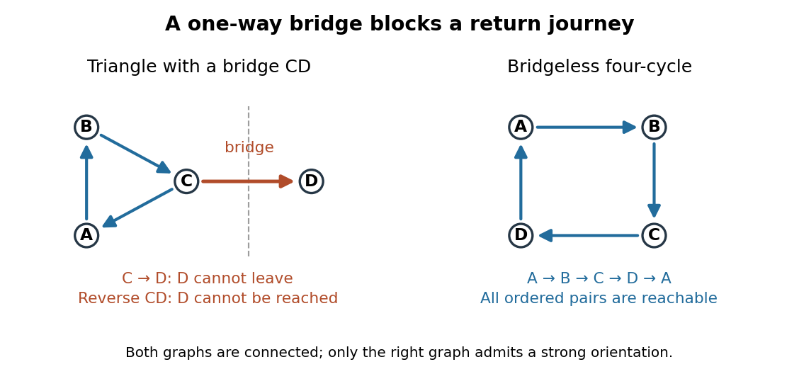

# Strong orientation

↑ **Parent:** [Orientation of a graph](orientation-of-a-graph.md)  
ⓦ [Wiki](https://en.wikipedia.org/wiki/Strong_orientation)

A [strong orientation](strong-orientation.md) is an [orientation of a graph](orientation-of-a-graph.md) with [strong connectivity](strong-connectivity.md): for every ordered pair $(u,v)$ of [vertices](vertex-graph-theory.md), there is a [directed path](directed-path.md) from $u$ to $v$. A length-zero [directed path](directed-path.md) permits $u=v$. Ordinary [connectivity](connectivity-graph-theory.md) of the underlying [undirected graph](undirected-graph.md) is necessary, but does not ensure this two-way [reachability](reachability-in-a-graph.md) after directions are chosen. The acyclic $D_1$ is not a [strong orientation](strong-orientation.md); the cyclic $D_2$ is, since a journey can continue around its [directed cycle](directed-cycle.md).

Attach a new [vertex](vertex-graph-theory.md) $D$ to that [triangle in a graph](triangle-in-a-graph.md) by the single [edge](edge-of-a-graph.md) $CD$. This [edge](edge-of-a-graph.md) is a [bridge in a graph](bridge-graph-theory.md). If oriented $C\to D$, no [directed path](directed-path.md) leaves $D$ for the [triangle in a graph](triangle-in-a-graph.md); if oriented $D\to C$, no [directed path](directed-path.md) from the [triangle in a graph](triangle-in-a-graph.md) reaches $D$. Neither choice gives a [strong orientation](strong-orientation.md), even when the [triangle in a graph](triangle-in-a-graph.md) itself is cyclically oriented. By contrast, the four-[vertex](vertex-graph-theory.md) [cycle graph](cycle-graph.md) has the [strong orientation](strong-orientation.md)

$$
A\to B\to C\to D\to A.
$$

Following this [directed cycle](directed-cycle.md) reaches any requested [vertex](vertex-graph-theory.md) in at most three steps. Removing any one of its undirected [edges](edge-of-a-graph.md) leaves a [graph path](path-in-a-graph.md) through all four [vertices](vertex-graph-theory.md), so it has no [bridge in a graph](bridge-graph-theory.md).

**[Figure 6](#image-a-bridge-in-a-graph-obstructs-a-strong-orientation-while-a-bridgeless-cycle-graph-admits-one). A bridge in a graph obstructs a strong orientation, while a bridgeless cycle graph admits one**.

For more than one [vertex](vertex-graph-theory.md), a [strong orientation](strong-orientation.md) cannot also be an [acyclic orientation](acyclic-orientation.md): [directed paths](directed-path.md) from $u$ to $v$ and back give a nonempty [closed directed walk](closed-directed-walk.md), from which removing repeated portions leaves a [directed cycle](directed-cycle.md). A [directed graph](directed-graph.md) containing one [directed cycle](directed-cycle.md) need not have [strong connectivity](strong-connectivity.md), as the attached $D$ shows.

**Table of contents**

- [Robbins' theorem](robbins-theorem.md)

## ↑ Ancestors (6)

1. [Orientation of a graph](orientation-of-a-graph.md)
2. [Graph theory](graph-theory-split.md)
3. [Foundations of mathematics](foundations-of-mathematics-split.md)
4. [Area of mathematics](area-of-mathematics.md)
5. [Mathematics](mathematics-split.md)
6. [Codex Wiki](split.md)

## ← Incoming links (3)

- [Orientation of a graph](orientation-of-a-graph.md)
- [Robbins' theorem](robbins-theorem.md)
- [Strong orientation](strong-orientation.md)
