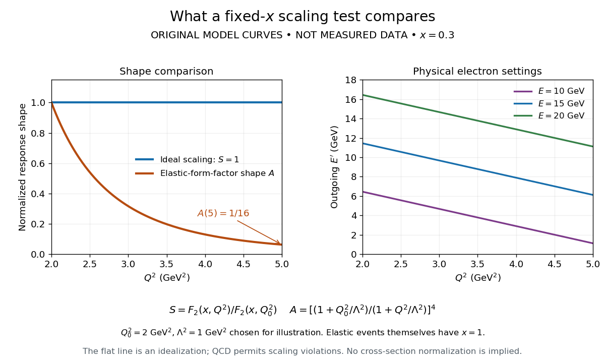

# Structure-function scaling versus elastic suppression

↑ **Parent:** [SLAC-MIT deep inelastic electron scattering experiment](slac-mit-deep-inelastic-electron-scattering-experiment.md)

An ideal [Bjorken scaling](bjorken-scaling.md) model has $F_2(x,Q^2)=f(x)$: varying $Q^2$ at fixed [Bjorken x](bjorken-x.md) leaves this dimensionless [deep-inelastic structure function](deep-inelastic-structure-function.md) unchanged. The comparison requires extracting a [deep-inelastic structure function](deep-inelastic-structure-function.md), rather than plotting raw event counts. [Quantum chromodynamics](quantum-chromodynamics.md) predicts departures from exact [Bjorken scaling](bjorken-scaling.md); finite [hadron](hadron.md) masses also limit the idealization.

For an original shape comparison, choose $f(x)=x(1-x)^3$ and define $S(Q^2)=F_2(0.3,Q^2)/F_2(0.3,Q_0^2)$ with $Q_0^2=2\,\mathrm{GeV}^2$. The ideal model has $S=1$. To display a contrasting size-dependent suppression, define an illustrative elastic-form-factor shape $G(Q^2)=(1+Q^2/\Lambda^2)^{-2}$ with the freely chosen $\Lambda^2=1\,\mathrm{GeV}^2$. Its normalized squared magnitude is

$$
A(Q^2)=\left|\frac{G(Q^2)}{G(Q_0^2)}\right|^2=\left(\frac{1+Q_0^2/\Lambda^2}{1+Q^2/\Lambda^2}\right)^4.
$$

Thus $A(5\,\mathrm{GeV}^2)=1/16$, whereas $S(5\,\mathrm{GeV}^2)=1$. The elastic-form-factor shape is a comparison of suppression mechanisms, not an elastic [differential scattering cross-section](differential-scattering-cross-section.md) assigned to $x=0.3$: actual [elastic scattering](elastic-scattering.md) from a [proton](proton.md) has $W=M$ and $x=1$. Neither curve is measured data or a fit to the SLAC-MIT experiment.

**[Figure 6](#image-fixed-x-scaling-model-and-illustrative-elastic-form-factor-suppression). Fixed-x scaling model and illustrative elastic-form-factor suppression**. Original calculated curves. The left panel compares normalized response shapes; the right checks physical outgoing [electron](electron.md) [energies](energy-split.md) at the same [Bjorken x](bjorken-x.md). The flat curve is an ideal [Bjorken scaling](bjorken-scaling.md) model, not an assertion of exact scaling in [Quantum chromodynamics](quantum-chromodynamics.md).

The experimental interpretation required more than a flat curve. The angular dependence and small longitudinal response supported [spin one-half](spin-one-half.md) [partons](parton.md), expressed at leading order by the [Callan-Gross relation](callan-gross-relation.md) $F_2=2xF_1$. Identification with fractionally charged [quarks](quark.md) also drew on later [electron](electron.md), [muon](muon.md) and [neutrino](neutrino.md) comparisons. A scaling plot alone does not determine the individual [electric charges](electric-charge-split.md) of constituents.[1990 Nobel lecture, identification of the constituents and early neutrino results; 1991 reprint p. 623](deep-inelastic-scattering-comparisons-with-the-quark-model-by-jerome-isaac-friedman.md)

The leading [parton model](parton-model.md) formula already shows the ambiguity: $F_2=x\sum_f Q_f^2(q_f+\bar q_f)$ combines squared [electric charges](electric-charge-split.md) with unknown [parton distribution functions](parton-distribution-function.md). One measured function cannot independently fix all these quantities. [Confinement](confinement.md) also explains why an inclusive final [hadron](hadron.md) state need not contain an isolated outgoing [quark](quark.md).

## ↑ Ancestors (8)

1. [SLAC-MIT deep inelastic electron scattering experiment](slac-mit-deep-inelastic-electron-scattering-experiment.md)
2. [Deep inelastic scattering](deep-inelastic-scattering.md)
3. [Quantum chromodynamics](quantum-chromodynamics.md)
4. [Standard Model](standard-model-split.md)
5. [Quantum field theory](quantum-field-theory-split.md)
6. [Branches of physics](branches-of-physics.md)
7. [Physics](physics-split.md)
8. [Codex Wiki](split.md)
