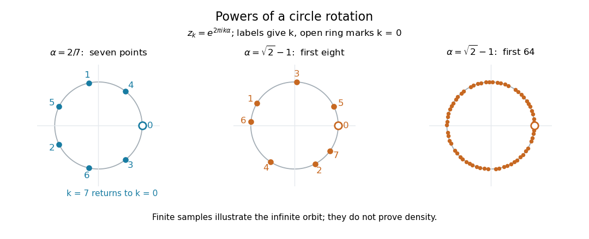

# Subgroups generated by circle rotations

↑ **Parent:** [Compact group](compact-group.md)

Fix a real angle fraction $\alpha$, and repeatedly multiply by $g=e^{2\pi i\alpha}$ in the [circle group](circle-group.md). The generated [cyclic subgroup](cyclic-subgroup.md) is $H_\alpha=\{g^k:k\in\mathbb Z\}$. Equivalently, the angle fractions are the [fractional parts](fractional-part.md) of $k\alpha$, with one full turn identified with zero.

If $\alpha=p/q$ is a [rational number](rational-number.md) in lowest terms, with $q>0$ and $p,q$ [coprime](coprime-integers.md), then $g^q=1$ and no smaller positive power is $1$. Hence $H_\alpha$ is a [finite cyclic group](finite-cyclic-group.md) of order $q$, consisting of equally spaced points. For $\alpha=2/7$, the successive angle fractions, starting at $k=0$, are

$$
0,\quad\frac27,\quad\frac47,\quad\frac67,\quad\frac17,\quad\frac37,\quad\frac57,\quad0.
$$

The [subgroup](subgroup.md) is finite, so it is a [closed subgroup](closed-subgroup.md) of the [circle group](circle-group.md); it is also a [discrete subgroup](discrete-subgroup.md). It is not an [open subgroup](open-subgroup.md), since every ambient [neighbourhood](neighbourhood-mathematics.md) of any of its points contains an arc, rather than only these seven points.

If $\alpha$ is an [irrational number](irrational-number.md), no nonzero [integer](integer.md) $k$ satisfies $k\alpha\in\mathbb Z$, so the powers never repeat. The stronger statement is that $H_\alpha$ is a [dense set](dense-set.md) in the [circle group](circle-group.md): every nonempty open arc contains a power $g^k$. Thus its [closure](closure-topology.md) is all of $\mathbb T$, while $H_\alpha$ itself is a countable proper [subgroup](subgroup.md) and is not a [closed subgroup](closed-subgroup.md) or a [discrete subgroup](discrete-subgroup.md). See [irrational rotation](irrational-rotation.md) and [everywhere interval frequency under an irrational rotation](everywhere-interval-frequency-under-an-irrational-rotation.md) for the corresponding motion and its long-term frequencies.

For $\alpha=\sqrt2-1$, direct computation of the [fractional parts](fractional-part.md) of $k\alpha$ gives, to six decimal places,

$$
\begin{array}{c|rrrrrrrr}
k&0&1&2&3&4&5&6&7\\
\{k\alpha\}&0&0.414214&0.828427&0.242641&0.656854&0.071068&0.485281&0.899495
\end{array}
$$

For example, $\{3\alpha\}=3\sqrt2-4\approx0.242641$ and $\{5\alpha\}=5\sqrt2-7\approx0.071068$. These calculations specify exactly which points the diagram displays.

**[Figure 2](#image-seven-repeating-rational-rotation-points-and-the-first-eight-and-sixty-four-irrational-rotation-points). Seven repeating rational-rotation points and the first eight and sixty-four irrational-rotation points**. Labels give the power index $k$; the points are $e^{2\pi ik\alpha}$. The first panel uses $\alpha=2/7$, and the other two use $\alpha=\sqrt2-1$. Each finite sample is only an illustration: a finite plot cannot establish that the infinite [subgroup](subgroup.md) is a [dense set](dense-set.md). Reproduce the diagram with [rational-versus-irrational-rotations.py](rational-versus-irrational-rotations.py).

This example shows why algebraic generation and [closure](closure-topology.md) must be distinguished: one [irrational rotation](irrational-rotation.md) generates a countable [cyclic subgroup](cyclic-subgroup.md), yet its [closure](closure-topology.md) is the whole uncountable [compact group](compact-group.md).

## ↑ Ancestors (7)

1. [Compact group](compact-group.md)
2. [Topological group](topological-group-split.md)
3. [Algebraic topology](algebraic-topology-split.md)
4. [Geometry and topology](geometry-and-topology-split.md)
5. [Area of mathematics](area-of-mathematics.md)
6. [Mathematics](mathematics-split.md)
7. [Codex Wiki](split.md)
